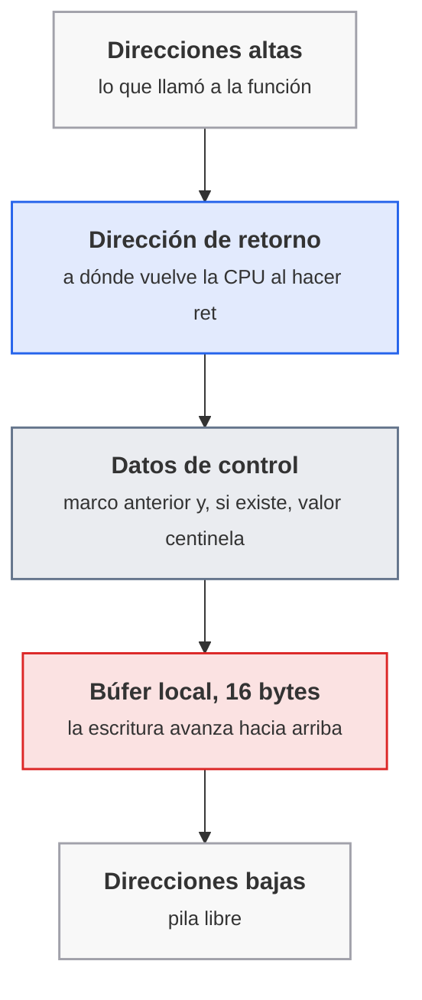
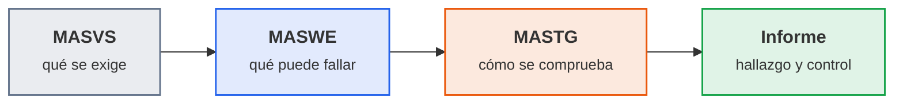

# Para ampliar

Esta página recoge, unidad por unidad, lo que va más allá de lo que se hace en clase: temas que ninguna hoja obligatoria necesita, prácticas optativas que se pueden hacer en máquina propia y enlaces para seguir por cuenta propia. Cada unidad enlaza desde su sitio el apartado de aquí que amplía lo que explica, de modo que las unidades quedan con lo que se da en cada sesión y esto sirve para ir más lejos. Nada de lo que hay aquí puntúa en las entregas evaluables, salvo que la unidad lo diga expresamente.

## UT1 · Prueba de aplicaciones

Material que va más allá de lo que se hace en la [UT1](ut/ut1-prueba-aplicaciones.md): cómo seguir con CryptoZombies y con Learn Git Branching cuando las entregas ya están hechas, y qué es un desbordamiento de búfer y por qué los lenguajes con comprobación de límites lo evitan.

### CryptoZombies y Solidity, más allá de la entrega

La hoja [A1.7](ut/ut1-prueba-aplicaciones.md#a17-solidity-y-git-sesion-7) exige las seis lecciones del curso principal (*Solidity: Beginner to Intermediate Smart Contracts*). Quien las termine con tiempo de sobra tiene tres caminos, de más cercano a más lejano:

1. **El curso avanzado del mismo sitio**, <https://cryptozombies.io/en/solidity_advanced>, con lecciones de nivel más alto sobre el mismo lenguaje. No puntúa.
2. **Reescribir el contrato de la lección 5 para Solidity 0.8.** El curso está escrito para Solidity 0.5, y desde la 0.8 la aritmética comprueba el desbordamiento por defecto, de modo que `SafeMath` deja de hacer falta (es lo que se pide razonar en el último paso de la hoja). Comparar el contrato original con su versión moderna, línea a línea, es un ejercicio corto que fija la diferencia. La lista de cambios de esa versión está en la [documentación de Solidity](https://docs.soliditylang.org/en/latest/080-breaking-changes.html).
3. **Leer cómo se rompen los contratos reales.** La sección de [consideraciones de seguridad](https://docs.soliditylang.org/en/latest/security-considerations.html) de la documentación oficial recoge los fallos típicos (reentrada, desbordamientos, llamadas a contratos externos) con ejemplos de código. Es la continuación natural del apartado [Contratos inteligentes y sus riesgos](ut/ut1-prueba-aplicaciones.md#contratos-inteligentes-y-sus-riesgos) de la sesión 7.

### Learn Git Branching, los bloques que quedan

La entrega pide los bloques `main` y `remote`. La aplicación tiene más niveles de los que exige la hoja, y ninguno puntúa:

| Bloque | Qué practica | Cuándo tiene sentido |
|---|---|---|
| *Advanced Topics* (dentro de la pestaña principal) | Varios `rebase` encadenados, los padres de una fusión y `rebase` selectivo | Tras las [ramas, fusiones y remotos](ut/ut1-prueba-aplicaciones.md#git-ramas-fusiones-y-remotos) de la sesión 7, si el flujo con `rebase` se va a usar en un equipo |
| *To Origin And Beyond, Advanced Git Remotes* (pestaña `remote`) | Subir varias ramas, seguimiento de ramas remotas y los argumentos de `push`, `fetch` y `pull` | Antes de la UT5, donde un repositorio remoto es el disparador del pipeline |

El número exacto de niveles y sus nombres cambian entre versiones de la aplicación (es de código abierto y se actualiza), de modo que la lista que muestra la pantalla de selección de niveles manda sobre cualquier cifra escrita aquí. El código y su lista de niveles están en el [repositorio del proyecto](https://github.com/pcottle/learnGitBranching).

### Seguridad de la memoria: el desbordamiento de búfer

La [tabla de seguridad de los lenguajes](ut/ut1-prueba-aplicaciones.md#seguridad-de-los-lenguajes) dice que en C el acceso directo a memoria produce «desbordes de búfer» y que Go y Python comprueban los límites. Este apartado explica qué ocurre por dentro, a nivel conceptual: no hay ninguna técnica de explotación, solo el mecanismo que permite entender por qué esa fila de la tabla pesa tanto.

**Qué es.** Un búfer es un trozo de memoria de tamaño fijo, por ejemplo un `char nombre[16]` que guarda un texto. Hay desbordamiento cuando el programa escribe más datos de los que caben y el sobrante pisa lo que hay a continuación. En C nada lo impide: `strcpy(nombre, entrada)` copia hasta encontrar el final del texto de origen, sin mirar cuánto cabe en el destino.

**Por qué es grave.** Cada llamada a una función reserva en la pila un bloque (el marco de la función) donde conviven las variables locales y, más arriba, los datos que permiten volver a quien llamó: la dirección de retorno. Un búfer local se escribe hacia direcciones más altas, es decir, en dirección a esos datos de control. Es la misma pila cuya cima señala el registro `rsp`, que se inspecciona con `gdb` en la [A1.3](ut/ut1-prueba-aplicaciones.md#a13-depuracion-en-ensamblador-sesion-3).



<p class="pie" markdown>Marco de una función en la pila, de arriba abajo. Una entrada mayor que el búfer sobrescribe primero los datos de control y después la dirección de retorno: si un atacante decide esos bytes, decide a dónde salta el programa al terminar la función.</p>

Con la dirección de retorno alterada, la función no vuelve a su llamador sino donde indiquen los datos de entrada. De ahí que el fallo suela acabar clasificado como ejecución de código arbitrario, y de ahí su lugar en catálogos como [CWE-121](https://cwe.mitre.org/data/definitions/121.html) (desbordamiento en la pila), [CWE-120](https://cwe.mitre.org/data/definitions/120.html) (copia sin comprobar el tamaño) y [CWE-787](https://cwe.mitre.org/data/definitions/787.html) (escritura fuera de límites, la familia general).

**Qué lo frena, por capas.** Ninguna capa es suficiente sola y todas se complementan:

| Capa | Qué hace | Límite |
|---|---|---|
| Lenguaje con comprobación de límites | Go, Python y otros detienen el programa (`panic`, `IndexError`) antes de escribir fuera del búfer | Se desactiva o se rodea con código `unsafe` o con extensiones en C |
| Compilador | Un valor centinela junto a la dirección de retorno (`-fstack-protector-strong` en GCC) aborta el programa si cambia; `-fhardened` agrupa varias de estas opciones en los GCC recientes | Protege la dirección de retorno, no el resto de datos vecinos |
| Sistema operativo | Pila no ejecutable y aleatorización de direcciones (ASLR) dificultan usar lo que se escribe | Se han encontrado técnicas para eludirlas, por eso no se confía solo en ellas |
| Desarrollo | Funciones con límite de tamaño (`strncpy`, `snprintf`), análisis estático (`cppcheck`) y pruebas con sanitizers (`-fsanitize=address`) | Requieren disciplina y no hacen desaparecer el riesgo |

La conclusión práctica es la que ya dice la unidad: para procesar entradas de terceros se elige un lenguaje que compruebe los límites antes que reforzar C con parches. Ese es también el criterio de las agencias públicas de seguridad, que recomiendan migrar el código nuevo a lenguajes con seguridad de memoria (ver la [hoja de ruta de la CISA](https://www.cisa.gov/resources-tools/resources/case-memory-safe-roadmaps)). Para el catálogo de opciones del compilador, la [documentación de GCC](https://gcc.gnu.org/onlinedocs/gcc/Instrumentation-Options.html) las describe una a una, y la [página de OWASP](https://owasp.org/www-community/vulnerabilities/Buffer_Overflow) resume el fallo con ejemplos.

!!! ojo "Dónde se practica"
    Si se quiere ver un desbordamiento de verdad, se hace solo sobre un programa propio, compilado por uno mismo en `pps01`, o en los retos de una plataforma pensada para ello, como [pwn.college](https://pwn.college), que está pensada para aprender esta técnica de forma legal. Escribir entradas que revienten el programa de otra persona sin permiso es acceso ilícito a un sistema, con consecuencias penales.

### Enlaces

- CryptoZombies: [curso principal](https://cryptozombies.io), [curso avanzado](https://cryptozombies.io/en/solidity_advanced).
- Solidity: [cambios de la 0.8](https://docs.soliditylang.org/en/latest/080-breaking-changes.html) y [consideraciones de seguridad](https://docs.soliditylang.org/en/latest/security-considerations.html).
- Git: [Learn Git Branching](https://learngitbranching.js.org/) y su [código](https://github.com/pcottle/learnGitBranching).
- Memoria: [CWE-121](https://cwe.mitre.org/data/definitions/121.html), [CWE-787](https://cwe.mitre.org/data/definitions/787.html), [hoja de ruta de la CISA](https://www.cisa.gov/resources-tools/resources/case-memory-safe-roadmaps), [pwn.college](https://pwn.college).

## UT2 · Nivel de seguridad requerido

Material que va más allá de lo que se hace en la [UT2](ut/ut2-nivel-seguridad.md): qué cambia entre ASVS 4.0.3 (la versión del curso) y la 5.0, qué cambia entre el OWASP Top 10 de 2021 y el de 2025, cómo se puntúa con CVSS 4.0 frente a la 3.1 que se usa en la [A2.1](ut/ut2-nivel-seguridad.md#a21-riesgos-de-una-aplicacion-sesion-9), y qué precauciones exige la actividad optativa de ransomware.

### ASVS 5.0 frente a la 4.0.3

El curso trabaja con la 4.0.3 porque es la versión de los enunciados ([ASVS en la sesión 10](ut/ut2-nivel-seguridad.md#owasp-asvs-que-es-y-su-estructura-por-capitulos)). La 5.0.0 se publicó en mayo de 2025 y es la versión estable actual del proyecto, de modo que quien trabaje en una empresa se la encontrará. Los cambios que afectan a lo que se hace en la unidad son estos (cifras contadas sobre los ficheros CSV oficiales de cada versión):

| Aspecto | 4.0.3 | 5.0.0 |
|---|---|---|
| Requisitos | 286 | 345 |
| Capítulos | 14, de V1 Arquitectura a V14 Configuración | 17: desaparece Arquitectura y aparecen Seguridad del frontend web, Tokens autocontenidos, OAuth y OIDC, Código y arquitectura seguros y WebRTC; la validación pasa junto a la lógica de negocio |
| Niveles | L1, L2 y L3 marcados con una casilla; L1 tiene 128 requisitos | El nivel es un número; los requisitos cuyo nivel mínimo es 1, 2 y 3 son 70, 183 y 92 |
| Enfoque | Muchos requisitos describen un mecanismo concreto | Se centran en el objetivo de seguridad y citan el mecanismo solo como ejemplo |
| Referencias a CWE y NIST | Cada requisito lleva su CWE y su referencia NIST | Se han retirado del cuerpo del estándar |
| Diseño y decisiones | Modelado de amenazas en un capítulo propio | Las decisiones de seguridad se documentan (requisitos de documentación) y el capítulo de arquitectura desaparece |

Tres consecuencias para quien conoce la versión 4.0.3:

- **Los identificadores cambian todos**, incluso los de requisitos que no se han tocado. De los 286 requisitos de la 4.0.3, el proyecto cuenta 11 sin cambios, 15 con retoques gramaticales y 109 que dejan de existir como requisito separado (borrados, duplicados o fusionados). Por eso el propio proyecto recomienda citar con la versión delante, por ejemplo `v5.0.0-1.2.5`, y publica ficheros de correspondencia entre las dos versiones en la carpeta [`mappings`](https://github.com/OWASP/ASVS/tree/v5.0.0/5.0/mappings) del repositorio.
- **El nivel L1 es más pequeño**: los requisitos de nivel 1 pasan de 128 a 70, porque el nuevo L1 se define por defensa de primera capa y no por lo fácil que sea comprobarlo desde fuera. Eso cambia el criterio de la [elección de nivel](ut/ut2-nivel-seguridad.md#elegir-el-nivel-l1-l2-y-l3): el documento pasa a decir que las organizaciones deben elegir el nivel según su riesgo y su madurez, sin un nivel obligado por tipo de aplicación, y que L2 es el objetivo de la mayoría. L2 exige cumplir L1 y L2 juntos (unos 253 requisitos de 345, casi las tres cuartas partes).
- **Un mismo requisito, otro sitio**: la longitud mínima de contraseña que la hoja [A2.2](ut/ut2-nivel-seguridad.md#a22-asvs-elegir-el-nivel-sesion-10) resuelve como `V2.1.1` (12 caracteres) es en la 5.0 el `V6.2.1` (mínimo de 8, con 15 recomendados) dentro del capítulo de Autenticación. El texto no es el mismo, así que no basta con renombrar la fila: hay que releer el requisito.

Para probar la 5.0 con el mismo escenario de la A2.2, basta con descargar el [CSV de la 5.0.0](https://github.com/OWASP/ASVS/raw/v5.0.0/5.0/docs_en/OWASP_Application_Security_Verification_Standard_5.0.0_en.csv), filtrar el nivel 1 y rehacer la hoja de cálculo con sus capítulos nuevos. Es un ejercicio comparativo, no una entrega.

### OWASP Top 10: de 2021 a 2025

La [sesión 9](ut/ut2-nivel-seguridad.md#fuentes-abiertas-de-vulnerabilidades-owasp-top-10-cwe-y-cve) usa la edición de 2021, que es la del material de referencia. OWASP ha publicado la de 2025, con dos categorías nuevas y una fusión:

| 2021 | 2025 | Qué ha pasado |
|---|---|---|
| A01 Control de acceso deficiente | A01 Control de acceso deficiente | Sigue primera y absorbe SSRF |
| A05 Configuración de seguridad incorrecta | A02 Configuración de seguridad incorrecta | Sube del quinto al segundo puesto |
| A06 Componentes vulnerables y obsoletos | A03 Fallos en la cadena de suministro de software | Se amplía a dependencias, sistemas de compilación e infraestructura de distribución |
| A02 Fallos criptográficos | A04 Fallos criptográficos | Baja dos puestos |
| A03 Inyección | A05 Inyección | Baja dos puestos |
| A04 Diseño inseguro | A06 Diseño inseguro | Baja dos puestos |
| A07 Fallos de identificación y autenticación | A07 Fallos de autenticación | Solo cambia el nombre |
| A08 Fallos de integridad de software y datos | A08 Fallos de integridad de software y datos | Sin cambios |
| A09 Fallos de registro y monitorización | A09 Fallos de registro y alertas | Cambia el nombre para subrayar las alertas |
| A10 SSRF | A10 Gestión incorrecta de condiciones excepcionales | Categoría nueva; SSRF pasa a A01 |

Tiene una lectura directa para la UT2: la cadena de suministro, que en el curso se estudia con el [caso xz](ut/ut2-nivel-seguridad.md#la-cadena-de-suministro-el-caso-xz), tiene ya categoría propia en el Top 10. Las traducciones al español de los nombres son de estos apuntes; la lista oficial en inglés está en [owasp.org/Top10/2025](https://owasp.org/Top10/2025/).

### CVSS 4.0 frente a la 3.1

La A2.1 se apoya en la puntuación 3.1 porque es la que muestra la NVD en las fichas que usa la práctica (las de Log4Shell y xz la traen así). FIRST publicó la **versión 4.0 el 1 de noviembre de 2023**. Cambian la nomenclatura, las métricas y lo que la cifra final quiere decir:

| Aspecto | CVSS 3.1 | CVSS 4.0 |
|---|---|---|
| Grupos de métricas | Base, Temporal y Environmental | Base, Threat, Environmental y Supplemental (esta última no altera la puntuación) |
| Condiciones del ataque | Complejidad (AC) | Complejidad (AC) y Requisitos del ataque (AT: si hacen falta condiciones de despliegue) |
| Participación del usuario | Ninguna o requerida (UI) | Ninguna, Pasiva o Activa (UI) |
| Alcance | Un indicador de si cambia el ámbito (S) | Desaparece: se puntúa el impacto en el sistema vulnerable (VC, VI, VA) y en los sistemas posteriores (SC, SI, SA) por separado |
| Madurez del exploit | En Temporal | Métrica de amenaza `E`, que se puede fijar por quien consume la ficha |
| Vector | `CVSS:3.1/AV:N/AC:L/PR:N/UI:N/S:U/C:H/I:H/A:H` | `CVSS:4.0/AV:N/AC:L/AT:N/PR:N/UI:N/VC:H/VI:H/VA:H/SC:N/SI:N/SA:N` |

Las bandas de severidad son las mismas (0,1 a 3,9 baja, 4,0 a 6,9 media, 7,0 a 8,9 alta, 9,0 a 10,0 crítica). Lo que sí obliga a ser preciso es el nombre de la puntuación: la especificación pide indicar qué grupos se han usado, con `CVSS-B` (solo Base), `CVSS-BT`, `CVSS-BE` o `CVSS-BTE`. Una puntuación de la NVD sin más datos es `CVSS-B`, es decir, la gravedad genérica de la vulnerabilidad, y no dice cuánto importa en una empresa concreta; para eso están las métricas de entorno, que las rellena quien consume la ficha.

Para practicar, la [calculadora oficial de FIRST](https://www.first.org/cvss/calculator/4-0) permite introducir el vector de una vulnerabilidad de la A2.1 y comparar el resultado con el de la 3.1. Es normal que no coincidan: las dos escalas no son equivalentes.

### ACT_UT2_4: el enunciado de ransomware

El enunciado del aula (`ACT_RA2_4.pdf`) pide leer una guía, ejecutar un ransomware de laboratorio y redactar un informe forense. Se desarrolla en la [sesión 14](ut/ut2-nivel-seguridad.md#act_ut2_4-analisis-de-un-ransomware-optativa), con la parte evaluable centrada en el informe. Lo que aquí queda fuera es solo la ejecución, y va con condiciones no negociables: máquina virtual desechable distinta de `pps01`, con instantánea limpia, sin red, sin carpetas ni portapapeles compartidos y sin datos reales, y destrucción de la máquina al terminar. Ejecutar malware fuera de ese entorno puede cifrar datos reales sin marcha atrás, y lanzarlo contra sistemas ajenos es delito. No se incluyen aquí pasos de creación ni de ejecución; quien quiera profundizar en el análisis lo hace sobre familias ya documentadas públicamente.

### Enlaces

- ASVS: [proyecto](https://owasp.org/www-project-application-security-verification-standard/), [versión 5.0.0](https://github.com/OWASP/ASVS/tree/v5.0.0) y [versión 4.0.3](https://github.com/OWASP/ASVS/tree/v4.0.3_release).
- Top 10: [edición de 2025](https://owasp.org/Top10/2025/) y [edición de 2021](https://owasp.org/Top10/2021/).
- CVSS: [especificación 4.0](https://www.first.org/cvss/v4-0/specification-document) y [calculadora 4.0](https://www.first.org/cvss/calculator/4-0).
- Ransomware: [Guía de ransomware de INCIBE](https://www.incibe.es/sites/default/files/contenidos/guias/doc/guia_ransomware.pdf) y [No More Ransom](https://www.nomoreransom.org/es/index.html).

## UT3 · Vulnerabilidades web

Material que va más allá de lo que se hace en la [UT3](ut/ut3-vulnerabilidades-web.md): el endurecimiento de Nginx más allá de la configuración de partida, las categorías de PortSwigger Academy que la unidad no recorre, y una práctica de ingeniería inversa de firmware para hacer en máquina propia.

!!! ojo "Solo sobre lo propio o lo autorizado"
    Todo lo ofensivo de esta página se hace en los laboratorios de PortSwigger Academy, que los autoriza, o sobre ficheros y máquinas propios en una red aislada. Acceder sin autorización a un sistema ajeno es delito, y no cambia porque el objetivo sea una cámara o un servidor que parezca abandonado.

### Nginx más allá de la configuración de partida

La [A3.4](ut/ut3-vulnerabilidades-web.md#a34-hardening-final-sesion-18) trae, en «Si te sobra tiempo», una tabla de equivalencias entre Apache y Nginx y una configuración completa que se ha comprobado. Nginx se usa mucho delante de una aplicación en producción (como proxy inverso y balanceador), y hay cuatro cosas que la configuración de partida no cubre y que dan fallos reales.

**Comprobar antes de recargar.** `nginx -t` valida la sintaxis de la configuración sin tocar el servicio; `nginx -s reload` la aplica, y si la nueva configuración tiene un error el proceso maestro mantiene la anterior. En el contenedor de la práctica se ejecutan como `docker exec <contenedor> nginx -t`.

**Las cabeceras de seguridad no se heredan como se espera.** Las directivas `add_header` se heredan del nivel superior solo si no hay ninguna `add_header` en el nivel actual (así lo dice la [documentación del módulo](https://nginx.org/en/docs/http/ngx_http_headers_module.html)). Si HSTS y CSP se definen en `server` y luego un `location` añade una sola cabecera propia, ese `location` pierde las otras dos sin ningún aviso. La comprobación es siempre la misma: `curl -sI` a cada ruta, no solo a la raíz.

**Límite de peticiones y límite de conexiones son cosas distintas.** `limit_req` (el de la hoja) limita la tasa de peticiones por cliente; [`limit_conn`](https://nginx.org/en/docs/http/ngx_http_limit_conn_module.html) limita las conexiones abiertas a la vez, que es lo que frena a un cliente lento que ocupa conexiones sin terminar peticiones. Los dos devuelven `503` por defecto, y `limit_req_status 429;` lo cambia al código que describe mejor lo ocurrido (demasiadas peticiones). Se combinan:

```nginx
limit_conn_zone $binary_remote_addr zone=conex_ip:10m;

server {
    limit_conn conex_ip 20;
    limit_req_status 429;
}
```

**Proxy inverso y WAF.** Con una aplicación detrás (por ejemplo la de la [A3.11](ut/ut3-vulnerabilidades-web.md#a311-contrasenas-y-proteccion-frente-a-bots-sesion-25) en el puerto 5000), Nginx termina TLS y reenvía la petición con `proxy_pass`. Hay que pasar explícitamente la información del cliente original, porque la aplicación ve la dirección del proxy:

```nginx
location / {
    proxy_pass http://app:5000;
    proxy_set_header Host $host;
    proxy_set_header X-Forwarded-For $proxy_add_x_forwarded_for;
    proxy_set_header X-Forwarded-Proto $scheme;
}
```

Con `X-Forwarded-For` viene una advertencia de fondo: la cabecera la puede falsificar el cliente, así que la aplicación solo la respeta si la pone su propio proxy. Un límite de intentos basado en esa cabecera sin más se salta cambiándola. Para el WAF, la imagen `owasp/modsecurity-crs` (que ya se cita en la A3.4) tiene variantes con Nginx (etiquetas `nginx`, `4.x-nginx-lts` y similares) y se configura por variables de entorno: `BACKEND` fija a dónde se reenvía y `BLOCKING_PARANOIA` el nivel de exigencia de las reglas. Sus opciones están en el [repositorio de la imagen](https://github.com/coreruleset/modsecurity-crs-docker) y las reglas en el [sitio del Core Rule Set](https://coreruleset.org). Es la misma idea de la [A3.3](ut/ut3-vulnerabilidades-web.md#a33-waf-con-modsecurity-y-crs-sesion-17) con el proxy incluido en la imagen.

### Los laboratorios de PortSwigger que la unidad no recorre

La unidad resuelve laboratorios de trece categorías de [PortSwigger Academy](https://portswigger.net/web-security/all-labs): inyección SQL, XSS, CSRF, DOM, CORS, autenticación, recorrido de ruta, inyección de comandos, divulgación de información, control de acceso, subida de ficheros, SSRF y pruebas de API. La página de laboratorios lista hoy 31 categorías, de modo que quedan otras 18, todas gratuitas con la misma cuenta. Ninguna puntúa, y algunos laboratorios exigen Burp Suite Professional, que el curso no usa: esos se saltan, igual que en las hojas de la unidad.

Por dónde seguir, agrupadas por con qué se conectan de lo ya visto:

| Categoría | Se conecta con | Por qué merece la pena |
|---|---|---|
| [JWT](https://portswigger.net/web-security/jwt) | Sesiones y autenticación (A3.6, A3.9) | Los tokens autocontenidos sustituyen a la cookie de sesión en las APIs y su firma se verifica mal con frecuencia |
| [OAuth](https://portswigger.net/web-security/oauth) | Autenticación | Es el «iniciar sesión con...» que casi toda aplicación web ofrece |
| [Clickjacking](https://portswigger.net/web-security/clickjacking) | CSP y `frame-ancestors` (A3.2) | Es el ataque que la cabecera de la A3.2 corta; verlo funcionar fija por qué está |
| [NoSQL injection](https://portswigger.net/web-security/nosql-injection) | Inyección SQL (A3.8) | Misma raíz (un dato interpretado como orden) contra bases que no usan SQL |
| [XXE](https://portswigger.net/web-security/xxe) | SSRF (A3.10) | Un XML mal procesado puede leer ficheros del servidor o provocar SSRF |
| [Inyección de plantillas](https://portswigger.net/web-security/server-side-template-injection) | Inyección de comandos (A3.7) | Cuando la entrada llega a un motor de plantillas, puede acabar ejecutando código en el servidor |
| [Ataques a la cabecera Host](https://portswigger.net/web-security/host-header) | Configuración del servidor (A3.4) | Falla lo que confía en una cabecera que decide el cliente |
| [Deserialización insegura](https://portswigger.net/web-security/deserialization) | Componentes de terceros (UT2) | Es el tipo de fallo detrás de varios incidentes muy conocidos |
| [Lógica de negocio](https://portswigger.net/web-security/logic-flaws) y [condiciones de carrera](https://portswigger.net/web-security/race-conditions) | Requisitos de lógica de ASVS | Fallos que no detecta ningún escáner porque no hay una cadena rara que buscar |
| [Contaminación de prototipos](https://portswigger.net/web-security/prototype-pollution) | XSS del lado cliente (A3.12) | Fallo propio de JavaScript, muy presente en aplicaciones modernas |
| [GraphQL](https://portswigger.net/web-security/graphql), [WebSockets](https://portswigger.net/web-security/websockets) y [ataques a LLM web](https://portswigger.net/web-security/llm-attacks) | Pruebas de API | Superficies que las APIs REST clásicas no tienen |
| [Envenenamiento](https://portswigger.net/web-security/web-cache-poisoning) y [engaño](https://portswigger.net/web-security/web-cache-deception) de caché, y [contrabando de peticiones HTTP](https://portswigger.net/web-security/request-smuggling) | Arquitectura web (sesión 15) | Aparecen cuando hay varios servidores en cadena (CDN, proxy y aplicación); son los más difíciles |
| [Habilidades esenciales](https://portswigger.net/web-security/essential-skills) | Burp Suite (A3.9) | Codificaciones para ofuscar ataques y uso del escáner (este, solo con Professional), útiles para todo lo demás |

Otras dos herramientas de la plataforma valen para el autoestudio:

- Las [rutas de aprendizaje](https://portswigger.net/web-security/learning-paths) ordenan los temas de menos a más difícil, para quien no sabe por dónde empezar.
- Los [laboratorios misteriosos](https://portswigger.net/web-security/mystery-lab-challenge) ocultan el título y la descripción de un laboratorio al azar: hay que reconocer la vulnerabilidad sin que nadie la nombre, que es lo que pasa en un análisis real. La plataforma los usa además para preparar su certificación profesional (ver el enlace de más abajo).

### Práctica en máquina propia: ingeniería inversa de firmware

El aula conserva el enunciado `RA_EX.pdf`, un examen práctico de ingeniería inversa de firmware de una cámara IP, con el firmware de un modelo concreto en el fichero `DCS-932L_REVA_FIRMWARE_1.14.04.ZIP` del aula. Este apartado lo recoge como práctica de ampliación, que se hace únicamente en `pps01`, sin conexión a ninguna cámara real y sin tocar dispositivos ajenos. Sirve de puente entre esta unidad (qué hay dentro de un servidor web embebido) y la UT1 (leer un binario que no se ha escrito).

**Qué pide el enunciado.** Una sola actividad: firmar una captura de pantalla con el juego de llaves del dispositivo. Para ello hay que obtener la llave pública y la privada del dispositivo (en la práctica, se buscan dentro de la imagen del firmware) y capturar el contenido de ambas, y con ellas firmar la captura. La idea que hay detrás es que un firmware que lleva su clave privada dentro no la protege: cualquiera que lo descargue la tiene.

**Con qué se hace.** Tres pasos, con herramientas de código abierto:

1. **Desempaquetar la imagen.** Un firmware es un fichero que contiene un sistema de ficheros (muchas veces `squashfs`) precedido por una cabecera. [`binwalk`](https://github.com/ReFirmLabs/binwalk) busca esas estructuras dentro del fichero y las extrae, y con `strings` se leen las cadenas de texto que contiene. El resultado es un árbol de directorios como el de cualquier Linux, de modo que la [UT1](ut/ut1-prueba-aplicaciones.md) sirve como punto de partida.
2. **Buscar las claves.** En ese árbol se buscan ficheros de certificado y clave (`find` por extensión, `grep` por la cabecera `BEGIN` de las claves PEM). Es la técnica que usa quien audita un firmware real: comprobar qué secretos se han dejado de fábrica. Para ir más lejos, [Ghidra](https://ghidra-sre.org) permite abrir los binarios del servidor web y leer su lógica.
3. **Firmar y comprobar.** Con las claves obtenidas se firma la captura con `openssl dgst -sha256 -sign clave.pem -out firma.bin captura.png` y se comprueba con `openssl dgst -sha256 -verify publica.pem -signature firma.bin captura.png`, que dice `Verified OK` (la [página del manual](https://docs.openssl.org/master/man1/openssl-dgst/) recoge las opciones).

La conclusión que se lleva quien lo hace es la que da sentido a la unidad: los secretos que viajan dentro de un binario o de una imagen son públicos para quien la obtenga. Es el mismo criterio que rige las contraseñas y claves de una aplicación web (nunca en el repositorio, nunca en la imagen) y enlaza con la unidad 5.

### Enlaces

- Nginx: [documentación oficial](https://nginx.org/en/docs/) y [guía de inicio](https://nginx.org/en/docs/beginners_guide.html); módulos [`limit_req`](https://nginx.org/en/docs/http/ngx_http_limit_req_module.html), [`limit_conn`](https://nginx.org/en/docs/http/ngx_http_limit_conn_module.html), [`ssl`](https://nginx.org/en/docs/http/ngx_http_ssl_module.html) y [`proxy`](https://nginx.org/en/docs/http/ngx_http_proxy_module.html).
- PortSwigger Academy: [todos los laboratorios](https://portswigger.net/web-security/all-labs), [rutas de aprendizaje](https://portswigger.net/web-security/learning-paths), [laboratorios misteriosos](https://portswigger.net/web-security/mystery-lab-challenge) y la [certificación Burp Suite Certified Practitioner](https://portswigger.net/web-security/certification), que exige Burp Suite Professional y queda fuera del curso.
- Firmware: [binwalk](https://github.com/ReFirmLabs/binwalk), [Ghidra](https://ghidra-sre.org) y [OpenSSL `dgst`](https://docs.openssl.org/master/man1/openssl-dgst/).

## UT4 · Aplicaciones móviles

Material que va más allá de lo que se hace en clase en la [UT4](ut/ut4-aplicaciones-moviles.md): el estándar y la guía de pruebas de OWASP para móviles (MASVS y MASTG), qué cambia al analizar iOS en lugar de Android y otras aplicaciones de práctica para seguir entrenando el análisis estático, el almacenamiento y el tráfico.

!!! ojo "Solo sobre aplicaciones propias o de práctica"
    Todo lo de esta sección se hace sobre aplicaciones deliberadamente vulnerables instaladas en un emulador o en un dispositivo propio. Analizar o modificar la aplicación de un tercero sin autorización escrita puede ser delito, además de incumplir las condiciones de la tienda y del fabricante.

### MASVS y MASTG: el estándar y la guía de pruebas

Herramientas de la unidad: el Top 10 de OWASP Mobile que se ve en la [sesión 29](ut/ut4-aplicaciones-moviles.md#estructura-de-un-apk-y-owasp-mobile-top-10) es una lista de riesgos; **MASVS** y **MASTG** son el paso siguiente, lo que se usa para verificar una aplicación de forma sistemática. Los publica el proyecto OWASP MAS (Mobile Application Security) y son de acceso libre.

| Pieza | Qué es | Para qué sirve |
|---|---|---|
| MASVS (*Mobile Application Security Verification Standard*) | Estándar con los requisitos de seguridad que debe cumplir una aplicación móvil, agrupados en categorías como almacenamiento, criptografía, autenticación, red, plataforma, código, resistencia a la ingeniería inversa y privacidad | Decidir qué se exige a una aplicación y con qué criterio se da por buena |
| MASWE (*Mobile Application Security Weakness Enumeration*) | Catálogo de debilidades concretas, cada una ligada a un control del MASVS | Poner nombre exacto al fallo encontrado en un informe |
| MASTG (*Mobile Application Security Testing Guide*) | Guía con los procedimientos técnicos para comprobar cada debilidad en Android e iOS: pruebas, técnicas, herramientas y aplicaciones de demostración | Saber cómo se comprueba, paso a paso, algo que el MASVS solo enuncia |



<p class="pie" markdown>Los tres documentos se encadenan: el estándar fija el requisito, la enumeración concreta la debilidad y la guía explica la prueba que la detecta.</p>

La relación con lo que se hace en clase es directa. El almacenamiento de la [sesión 32](ut/ut4-aplicaciones-moviles.md#almacenamiento-seguro-en-el-dispositivo) es la categoría de almacenamiento, el tráfico de la sesión 33 es la de red y la inspección del binario de la sesión 31 cae en la de código. Un informe de las actividades de la unidad gana valor si cada hallazgo cita el control del MASVS que incumple, en lugar de describirlo solo con palabras propias. Los controles se identifican con el prefijo de su categoría (por ejemplo `MASVS-STORAGE-1`) y la página de cada uno lista las debilidades y pruebas asociadas.

El proyecto publica además listas de comprobación descargables con los controles y las pruebas, útiles como plantilla del apartado de resultados de un informe, y una colección de aplicaciones de práctica y de retos de ingeniería inversa (*crackmes*) para entrenar.

### Analizar aplicaciones iOS

En la unidad iOS solo aparece como comparación de arquitectura. El análisis práctico se hace sobre Android por una razón de coste: iOS exige hardware de Apple para desarrollar y firmar, y su sistema está cerrado. Conviene saber qué cambia si algún día se analiza una aplicación de iPhone.

| | Android | iOS |
|---|---|---|
| Paquete de la aplicación | APK, un ZIP con `.dex` | IPA, un ZIP con un ejecutable Mach-O y un `Info.plist` |
| Código que se inspecciona | Bytecode que se descompila con `jadx` | Código máquina ARM ya compilado, más difícil de leer |
| Metadatos y permisos | `AndroidManifest.xml` | `Info.plist` y las autorizaciones (*entitlements*) |
| Entorno de pruebas | Emulador o dispositivo con depuración USB | Simulador (solo para desarrollo) o dispositivo real, normalmente con jailbreak para inspeccionar por dentro |
| Instrumentación en ejecución | `frida` y `objection` | `frida` y `objection`, con las mismas ideas |

Las técnicas conceptuales son las mismas (leer los recursos, buscar secretos en el binario, mirar dónde guarda datos, interceptar el tráfico), pero cambian las herramientas y el esfuerzo. Las dos plataformas comparten el enfoque de que cada aplicación corre aislada en su propio espacio. La documentación de seguridad de la plataforma publicada por Apple es la fuente de referencia del modelo de protección, y la sección de iOS del MASTG cubre las pruebas equivalentes a las de Android.

### Otras aplicaciones de práctica

Además de DIVA y PIVAA, que son las de la unidad, hay otras aplicaciones vulnerables a propósito con las que seguir entrenando cada criterio de evaluación. Todas se instalan solo en el emulador propio.

| Aplicación | Plataforma | Qué permite practicar |
|---|---|---|
| InsecureBankv2 | Android | Una aplicación bancaria falsa con almacenamiento y comunicaciones inseguras; ya viene en el material de la actividad ACT_RA4_1 |
| Aplicaciones de práctica del proyecto MAS (*MASTG apps*) | Android e iOS | Cada una demuestra una debilidad concreta del catálogo, con la prueba del MASTG asociada |
| UnCrackable | Android e iOS | Retos de ingeniería inversa y de resistencia a la manipulación, de nivel creciente |
| DVIA-v2 | iOS | El equivalente de DIVA para iPhone |

Para automatizar una primera pasada se puede usar **MobSF** (*Mobile Security Framework*), que analiza un APK o un IPA y genera un informe con permisos, componentes expuestos y cadenas sospechosas. Sirve de apoyo, no de sustituto: el informe automático tiene falsos positivos y solo la revisión manual decide qué hallazgo es real.

### Enlaces

- OWASP MAS, portal del proyecto: <https://mas.owasp.org/>
- MASVS: <https://mas.owasp.org/MASVS/>
- MASWE: <https://mas.owasp.org/MASWE/>
- MASTG: <https://mas.owasp.org/MASTG/>
- Listas de comprobación: <https://mas.owasp.org/checklists/>
- Retos de ingeniería inversa (*crackmes*): <https://mas.owasp.org/crackmes/>
- Aplicaciones de demostración del MASTG: <https://mas.owasp.org/MASTG/apps/>
- Repositorio del MASTG: <https://github.com/OWASP/mastg>
- OWASP Mobile Top 10: <https://owasp.org/www-project-mobile-top-10/>
- InsecureBankv2: <https://github.com/dineshshetty/Android-InsecureBankv2>
- DVIA-v2: <https://github.com/prateek147/DVIA-v2>
- MASTG Hacking Playground: <https://github.com/OWASP/MASTG-Hacking-Playground>
- MobSF: <https://github.com/MobSF/Mobile-Security-Framework-MobSF>
- Frida: <https://frida.re/docs/home/>
- Objection: <https://github.com/sensepost/objection>
- Apple Platform Security: <https://support.apple.com/guide/security/welcome/web>

## UT5 · Despliegue seguro

Material que va más allá de lo que se hace en clase en la [UT5](ut/ut5-despliegue-seguro.md): OpenTofu como continuación abierta de Terraform, GitLab CI como equivalente de Jenkins, Kubernetes estándar frente a K3s, la firma de artefactos con Sigstore y un trabajo de ampliación con seis retos.

### OpenTofu

Terraform se explica en las [sesiones 44 y 45](ut/ut5-despliegue-seguro.md#terraform-proveedores-recursos-estado-y-ciclo-de-trabajo). **OpenTofu** es una bifurcación de Terraform que nació tras el cambio de licencia de este a la Business Source License y que mantiene la Linux Foundation con licencia de código abierto (MPL 2.0). El lenguaje de los ficheros (HCL), los proveedores y el ciclo de trabajo son los mismos, así que lo aprendido en clase se traslada tal cual.

| Terraform | OpenTofu |
|---|---|
| `terraform init` | `tofu init` |
| `terraform plan` | `tofu plan` |
| `terraform apply` | `tofu apply` |
| `terraform destroy` | `tofu destroy` |
| Registro de proveedores de HashiCorp | Registro propio de OpenTofu, con los proveedores habituales |

El criterio habitual para un equipo nuevo que quiera evitar la restricción de licencia es OpenTofu; para un laboratorio con una versión ya instalada, la migración es directa siguiendo la guía oficial. Los ficheros de la sesión 44 se pueden probar sustituyendo el comando, sin cambiar una línea.

### GitLab CI

En clase el servidor de integración continua es Jenkins (sesiones 40 a 43). **GitLab CI** cubre el mismo papel integrado en el propio repositorio: el pipeline se describe en un fichero `.gitlab-ci.yml` en la raíz, sin instalar un servidor aparte, y lo ejecutan procesos llamados *runners*, que pueden correr los trabajos en contenedores Docker.

| Jenkins | GitLab CI | Diferencia relevante |
|---|---|---|
| `Jenkinsfile` | `.gitlab-ci.yml` | El fichero es YAML y no un lenguaje de programación |
| `pipeline` y `stage` | `stages` y `job` | Los trabajos se agrupan por etapa y los de una misma etapa corren en paralelo |
| `agent` | *Runner* y `image` | El entorno de cada trabajo se elige con la imagen de contenedor |
| `steps` | `script` | Lista de comandos de shell |
| `when` | `rules` | Condiciones para que un trabajo se ejecute |
| Credenciales de Jenkins | Variables de CI/CD | Se pueden enmascarar y limitar a ramas protegidas |
| Plugin de análisis | Trabajos con imagen del analizador | No hay plugins; se usa la imagen de cada herramienta |

```yaml
stages:
  - build
  - test

build-job:
  stage: build
  image: maven:3-eclipse-temurin-17
  script:
    - mvn -B package -DskipTests

test-job:
  stage: test
  image: maven:3-eclipse-temurin-17
  script:
    - mvn -B test
```

Ese fichero equivale a un `Jenkinsfile` de dos etapas con Maven: primero se construye y después se prueba. Para reproducirlo hace falta un proyecto en una instancia de GitLab con un runner disponible; los servicios públicos ofrecen runners compartidos con cuota limitada.

### Kubernetes estándar

En las [sesiones 49 a 51](ut/ut5-despliegue-seguro.md#k3s-frente-a-kubernetes) se usa K3s por un motivo práctico: es una distribución certificada y ligera que cabe en una VM pequeña. Kubernetes estándar ofrece la misma API, con los mismos objetos (pod, despliegue, servicio), pero se instala por piezas y exige más recursos. Lo que cambia es la instalación y el mantenimiento, no lo que se escribe en los manifiestos.

| Opción | Cuándo se usa |
|---|---|
| K3s | Laboratorios y nodos de borde con pocos recursos, el caso del curso |
| `kubeadm` | Clúster de Kubernetes estándar en máquinas propias, con control del plano de control y de la red |
| minikube, kind | Un clúster desechable en el portátil para pruebas y aprendizaje |
| Servicio gestionado del proveedor de nube | Producción, donde el proveedor mantiene el plano de control |

Los manifiestos de las hojas A5.12 a A5.14 funcionan sin cambios en cualquiera de estas opciones. Lo que sí varía es el controlador de entrada HTTP y el balanceador que traen de serie: K3s incluye los suyos y en Kubernetes estándar se instalan aparte.

### Firma de artefactos con Sigstore

En la [sesión 43](ut/ut5-despliegue-seguro.md#secretos-en-el-pipeline-y-firma-de-artefactos) se explica por qué firmar un artefacto y qué garantiza. **Sigstore** es el proyecto abierto que simplifica hacerlo, y **Cosign** es su herramienta de línea de órdenes para firmar y verificar imágenes de contenedor y otros ficheros.

El problema clásico de firmar es custodiar una clave privada de larga vida: si se filtra, cada firma pasada queda en duda. Sigstore ofrece la firma sin clave (*keyless*), que sustituye la clave por una identidad:

1. Quien firma se autentica con un proveedor de identidad (OIDC), por ejemplo la cuenta del repositorio o la identidad del propio pipeline.
2. Un servicio (Fulcio) emite un certificado de vida muy corta que liga una clave efímera a esa identidad.
3. La firma y el certificado se registran en un libro público e inalterable (Rekor), que deja constancia de cuándo se firmó.
4. Al verificar, se comprueba la firma, que el certificado corresponde a la identidad esperada y que consta en el registro.

```bash
cosign sign --yes registry.ejemplo.local/pps-app:1.0
cosign verify registry.ejemplo.local/pps-app:1.0 \
  --certificate-identity=ops@ejemplo.local \
  --certificate-oidc-issuer=https://accounts.ejemplo.local
```

La primera orden firma la imagen abriendo el flujo de identidad; la segunda verifica exigiendo quién firmó y con qué proveedor. Un pipeline puede negarse a desplegar una imagen cuya verificación falle, que es la forma práctica de convertir la firma en una barrera. Conviene recordar el límite que ya se vio en la sesión 43: firmar prueba de dónde viene el artefacto, no que esté libre de vulnerabilidades.

### Trabajo de ampliación con retos

El aula incluye un trabajo de ampliación con seis retos, sin plazo ni peso. Es una propuesta para ir más allá de las entregas de la asignatura; cualquier valoración la fija el profesor. Cada reto se apoya en algo que ya se ha practicado.

| Reto | Se apoya en | Cómo abordarlo |
|---|---|---|
| 1. Informe técnico de un ejercicio de desbordamiento de búfer | UT1, seguridad de la memoria | Reproducir el ejercicio en máquina propia, explicar la causa y la mitigación, con el formato de la *Normativa de entrega* |
| 2. Informe técnico de un ejercicio de Burp Suite | UT3, laboratorios de PortSwigger | Elegir un reto, documentar la petición, el fallo y la corrección |
| 3. Conseguir 2000 puntos en Atenea | Todas las unidades | Retos de la plataforma del CCN-CERT; el entregable es la captura del nivel de logro |
| 4. Instalar un servidor Proxmox y aprovisionar máquinas virtuales y contenedores LXC con Terraform | UT5, sesiones 44 y 45 | Usar un proveedor de Proxmox para Terraform u OpenTofu y describir en código una VM y un contenedor |
| 5. Todos los ejercicios de Burp Suite | UT3 | Completar la colección de laboratorios de PortSwigger indicada en el apartado de esa unidad |
| 6. Examen técnico tipo test de todos los RA | Toda la asignatura | Preparar y resolver un test de repaso con las cinco unidades |

El reto 4 es el más cercano a esta unidad. Proxmox es un hipervisor libre que expone una API; el proveedor de la comunidad para Terraform y OpenTofu traduce los recursos de HCL a llamadas a esa API. El esquema de trabajo es el de la hoja A5.8 (`init`, `plan`, `apply`) con un proveedor distinto, y las credenciales de acceso siguen la regla de siempre: nunca en el repositorio, sino en variables sensibles o en un fichero excluido.

### Enlaces

- OpenTofu: <https://opentofu.org/docs/>
- Migrar de Terraform a OpenTofu: <https://opentofu.org/docs/intro/migration/>
- Preguntas frecuentes de OpenTofu: <https://opentofu.org/faq/>
- Proveedor de Proxmox para Terraform y OpenTofu: <https://github.com/bpg/terraform-provider-proxmox>
- GitLab CI/CD: <https://docs.gitlab.com/ci/>
- Sintaxis de `.gitlab-ci.yml`: <https://docs.gitlab.com/ci/yaml/>
- GitLab Runner con ejecutor Docker: <https://docs.gitlab.com/runner/executors/docker/>
- Kubernetes, tutoriales básicos: <https://kubernetes.io/docs/tutorials/kubernetes-basics/>
- Instalar un clúster con `kubeadm`: <https://kubernetes.io/docs/setup/production-environment/tools/kubeadm/>
- kind: <https://kind.sigs.k8s.io/>
- minikube: <https://minikube.sigs.k8s.io/docs/>
- K3s: <https://docs.k3s.io/>
- Sigstore: <https://docs.sigstore.dev/>
- Firma sin clave, visión general: <https://docs.sigstore.dev/cosign/signing/overview/>
- Firmar imágenes de contenedor con Cosign: <https://docs.sigstore.dev/cosign/signing/signing_with_containers/>
- SLSA, marco de integridad de la cadena de suministro: <https://slsa.dev/>
- Atenea (CCN-CERT): <https://atenea.ccn-cert.cni.es> (responde 403 a peticiones automáticas; se abre desde el navegador con la cuenta del curso)
