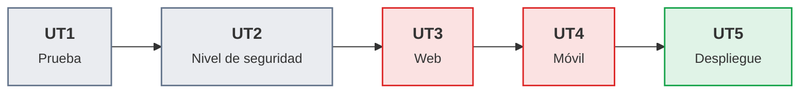

# Puesta en producción segura

Apuntes de la asignatura · Curso de especialización en ciberseguridad · 120 h oficiales · 59 sesiones de 1 h 50 min en el centro · Curso 2026-27

Aquí están los apuntes de toda la asignatura, unidad por unidad, con la hoja de práctica de cada sesión y las prácticas evaluables. Es el mismo material que se trabaja en clase, reorganizado por sesiones y ampliado con lo que no cabe en una clase de dos horas, con enlaces a la documentación oficial y a los sitios donde practicar.

## De qué va la asignatura

Una aplicación no se pone en producción solo porque funcione. Antes hay que saber cómo se ejecuta y cómo se prueba, qué nivel de seguridad exige por lo que guarda y por a quién sirve, dónde suele fallar (en el servidor web, en el cliente, en la aplicación móvil) y cómo se despliega de forma reproducible y vigilada para que un cambio no abra un agujero. Esta asignatura recorre ese camino con aplicaciones deliberadamente vulnerables y con las herramientas que se usan en el sector, y en cada unidad se aprende tanto a provocar el fallo en el laboratorio como a corregirlo.

!!! ojo "Todo lo ofensivo se hace solo sobre lo propio o lo autorizado"
    Las prácticas de ataque se hacen únicamente contra aplicaciones y máquinas deliberadamente vulnerables que corren en la máquina virtual del propio alumno, en una red aislada, o en los laboratorios que las plataformas educativas autorizan. Acceder sin autorización a un sistema ajeno es delito, aunque no se cause daño. Cada unidad con contenido ofensivo lo recuerda al empezar y cada práctica ofensiva termina con la corrección.

Estos son los conceptos que vertebran el curso, en el orden en que aparecen:

- **Prueba y ejecución de aplicaciones.** Qué diferencia a un lenguaje compilado, uno interpretado y uno que corre sobre una máquina virtual, cómo se lee el código de bajo nivel con NASM y `gdb`, qué tipos de prueba existen y cómo se ejecutan con `unittest` y `go test`. Se completa con Bash, un contrato inteligente en Solidity y el flujo de trabajo con Git.
- **Nivel de seguridad requerido.** Cómo se decide cuánta seguridad necesita una aplicación: OWASP Top 10, CWE, CVE y CVSS para hablar de riesgos, y OWASP ASVS para fijar el nivel de verificación y sus requisitos. Se aplica a Docker, a la puerta trasera de xz y al ransomware como casos reales.
- **Vulnerabilidades web.** Endurecer un servidor web (Apache, TLS, cabeceras, ModSecurity) y romper y arreglar una aplicación: inyección SQL, XSS, sesiones, control de acceso, almacenamiento de contraseñas y bots. Se trabaja con DVWA, PortSwigger Academy y Burp Suite.
- **Aplicaciones móviles.** Permisos, almacenamiento de datos, tráfico de red y binarios de aplicaciones Android: se desempaquetan, se inspeccionan y se analizan con `adb`, jadx, apktool, Drozer y MobSF, y se valida en el servidor lo que el cliente no puede garantizar.
- **Despliegue seguro.** El ciclo completo de un cambio: control de versiones con roles, integración continua con Jenkins, análisis de dependencias, infraestructura como código con Terraform y Ansible, Kubernetes ligero con K3s, monitorización con Prometheus y Grafana, y fallos y recuperación probados a propósito.

Primero se aprende a probar y a medir el riesgo, luego a atacar y a corregir la web y el móvil, y al final a entregar el software con un proceso seguro y recuperable.

## Qué hay en esta web

-   :material-book-open-page-variant: **[Unidades](ut/ut1-prueba-aplicaciones.md)**

    ---

    Los apuntes de las cinco unidades, una por resultado de aprendizaje. Cada una empieza con un par de párrafos sobre lo que se busca y sigue con las sesiones en orden: la teoría de ese día y su hoja de práctica. Las prácticas evaluables cierran la unidad con su rúbrica.

-   :material-calendar-month: **[Calendario de sesiones](calendario.md)**

    ---

    Las 59 sesiones del curso con fecha, unidad y lo que se hace en cada una. La vista de calendario muestra el detalle al pasar el ratón y lleva a la hoja con un clic. Incluye las seis sesiones de margen y los dos exámenes.

-   :material-school: **[Presentación y evaluación](modulo.md)**

    ---

    Resultados de aprendizaje y criterios de evaluación con la hoja o entrega de la que sale cada evidencia, cómo se calcula la nota, los plazos de las entregas y los exámenes.

-   :material-flask: **[Laboratorio](laboratorio.md)**

    ---

    El puesto de trabajo, la máquina `pps01` y el resto de máquinas virtuales, puertos y nombres, cuentas, el repositorio de entregas, cómo aislar las máquinas vulnerables y qué hacer si algo se rompe.

-   :material-console: **[Chuleta de comandos](chuleta.md)**

    ---

    Los comandos de cada herramienta del curso, agrupados por unidad, para copiarlos en el laboratorio.

-   :material-book-alphabet: **[Glosario](glosario.md)**

    ---

    Los términos y siglas de la asignatura en una o dos frases, con la unidad donde se explican a fondo.

-   :material-book-plus: **[Para ampliar](ampliacion.md)**

    ---

    Lo que va más allá de lo que se hace en clase y los enlaces para seguir por cuenta propia, ordenado por unidad, incluido el trabajo optativo para subir nota.

-   :material-link-variant: **[Bibliografía y enlaces](recursos.md)**

    ---

    Documentación oficial de cada herramienta, libros, plataformas donde practicar y créditos del material de terceros.

## Unidades

| UT | Título | Horas | Sesiones | RA · CE |
|----|--------|------:|----------|---------|
| [UT1](ut/ut1-prueba-aplicaciones.md) | Prueba de aplicaciones | 16 | 1 a 8 | RA1 a, b, c, d, e |
| [UT2](ut/ut2-nivel-seguridad.md) | Nivel de seguridad requerido | 12 | 9 a 14 | RA2 a, b, c, d |
| [UT3](ut/ut3-vulnerabilidades-web.md) | Vulnerabilidades web | 26 | 15 a 27 | RA3 a, b, c, d, e, f, g |
| [UT4](ut/ut4-aplicaciones-moviles.md) | Aplicaciones móviles | 16 | 29 a 36 | RA4 a, b, c, d, e |
| [UT5](ut/ut5-despliegue-seguro.md) | Despliegue seguro | 44 | 37 a 58 | RA5 a, b, c, d, e, f, g |

Cada unidad de trabajo desarrolla un resultado de aprendizaje del currículo: **la UT1 es el RA1, la UT2 el RA2, y así hasta la UT5, que es el RA5**. Por eso las entregas evaluables se numeran `ACT_UTn_k` (la actividad k de la unidad n) y sus criterios se citan como los del RA correspondiente.

Las clases son los lunes y los jueves, del 1 de octubre de 2026 al 3 de junio de 2027, y no hay formación en empresa: todo es en el centro. Las dos evaluaciones se cierran con un examen: el jueves 28 de enero (sesión 28, unidades 1 a 3) y el jueves 3 de junio (sesión 59, unidades 4 y 5). Cada unidad termina con una **sesión de margen** (las sesiones 8, 14, 27, 36, 47 y 58): absorbe las clases que se pierdan por causas ajenas y, si no se ha perdido ninguna, se dedica a repasar y a una actividad de ampliación. Los detalles están en el [calendario](calendario.md).

Las **prácticas evaluables no tienen sesión propia**. Cada entrega se construye con varias hojas de práctica, se guarda en el repositorio de entregas y se cierra por su plazo (siempre a las 23:59), aunque se pierda una clase. La sección final de cada unidad recoge, para cada entrega, de qué hojas sale, su plazo y su rúbrica.

## Cómo usar estos apuntes

- Conviene leer la sesión antes de clase. Cada unidad está ordenada por sesiones, con la teoría de ese día seguida de su hoja de práctica. En clase la explicación es corta y el laboratorio largo.
- Cada sesión empieza con un recuadro "Recursos de la sesión" que reúne, con lo esencial separado de lo opcional, los enlaces y la documentación que esa sesión necesita. El enunciado de cada entrega está en el aula. La hoja guía la práctica y no se entrega: su último apartado, «Para practicar», dice qué guardar y qué entrega evaluable lo recoge.
- Los comandos están pensados para copiarlos en la máquina `pps01`. Si algo no funciona igual en la versión instalada, el primer sitio donde mirar es "Errores frecuentes" de la unidad y, para lo general, [Si algo se rompe](laboratorio.md#si-algo-se-rompe).
- Conviene documentar sobre la marcha: una captura, la salida de un comando, el fichero corregido. Al terminar cada hoja se guarda en el repositorio de entregas, y eso es lo que recoge cada práctica evaluable.
- Las plataformas de aprendizaje a ritmo propio (CryptoZombies, Learn Git Branching, PortSwigger Academy y Atenea) se empiezan en clase y se completan en casa antes del plazo de la entrega correspondiente.

## Antes de empezar

Se da por hecho un ciclo superior de informática: terminal de Linux, redes básicas y Docker básico. No hace falta traer nada instalado: la primera sesión (1 de octubre) prepara el puesto de trabajo, que es una máquina virtual Ubuntu llamada `pps01` sobre VirtualBox, con Docker, Git y VS Code, y crea las cuentas del curso (GitHub, Docker Hub, PortSwigger Academy y Atenea) y el repositorio de entregas a partir de la plantilla del curso. Hace falta un equipo con la virtualización por hardware activada, 16 GB de RAM y 100 GB de disco libres. La página de [laboratorio](laboratorio.md) detalla las máquinas, los puertos y las cuentas, y la de [presentación y evaluación](modulo.md) explica cómo se califica.

## Sobre estos apuntes

Este material lo ha escrito el profesor de la asignatura con el apoyo de Claude; la nota completa sobre cómo se ha elaborado está en la [página de presentación](modulo.md#sobre-el-material). Los errores se pueden comunicar en clase o abrir como issue en el [repositorio](https://github.com/victor-educ/apuntes-PPS). El texto propio se publica con licencia [CC BY-SA 4.0](https://creativecommons.org/licenses/by-sa/4.0/deed.es); el material de terceros se enlaza a su origen, no se copia. La versión publicada aparece en el pie de cada página.
