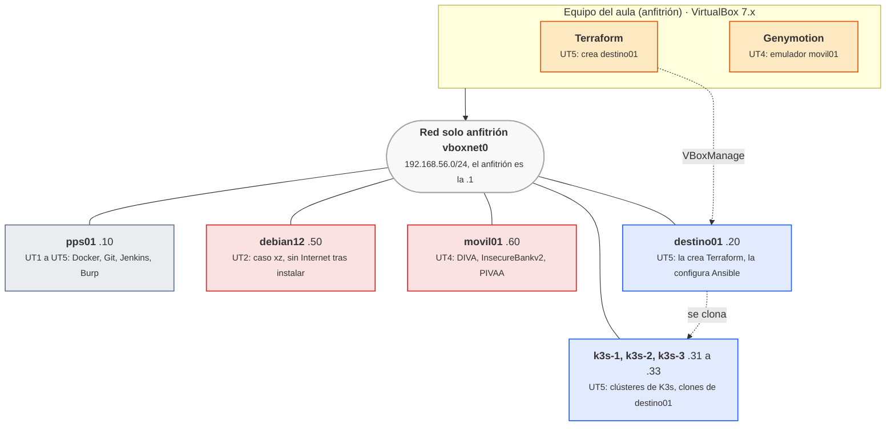

# El laboratorio

<p class="ut-meta">Curso 2026-27 · Un puesto por alumno: VirtualBox en el equipo del aula · Red solo anfitrión 192.168.56.0/24 · Todo lo que se ataca es propio y está aislado</p>

Todas las prácticas del módulo se hacen en un laboratorio que cada alumno monta en su propio equipo con VirtualBox: una máquina principal, `pps01`, que se usa desde la primera sesión, y un puñado de máquinas auxiliares que aparecen solo cuando una unidad las necesita. Esta página es la fuente de verdad de ese laboratorio: qué máquinas hay, cuándo se crean, cuánta memoria consumen, qué puertos y nombres se usan y qué hacer cuando algo se rompe. Si una hoja dice otra cosa, la hoja está mal.

## Cómo queda al final del módulo

El laboratorio no existe entero desde el primer día. Crece con las unidades: `pps01` en la UT1, `debian12` en la UT2, `movil01` en la UT4 y el resto en la UT5. Las máquinas se comunican por una única red solo anfitrión, y el equipo físico (el anfitrión) es el único que ve todo y el único donde se ejecuta Terraform.



<p class="pie" markdown>En rojo, las máquinas que contienen software vulnerable a propósito (`debian12` y `movil01`); `pps01` también aloja contenedores vulnerables (DVWA, Log4Shell), por eso ninguna sale a la red del aula. Los clones de `destino01` (`k3s-N`) son la única parte que se construye a partir de otra máquina.</p>

## Convenciones

Todas las unidades usan estos nombres, direcciones y rutas. Un nombre distinto en una hoja es una errata, no una variante.

### Puesto de trabajo

El objetivo es que todos los alumnos partan del mismo entorno, aislado del equipo y con marcha atrás posible. La herramienta que lo consigue es VirtualBox con máquinas Ubuntu 24.04 y una instantánea antes de cada práctica con riesgo.

| Requisito | Valor | Para qué |
|---|---|---|
| Virtualizador | VirtualBox 7.x, con `VBoxManage` en el `PATH` del anfitrión | Todas las máquinas; Terraform (A5.8) llama a `VBoxManage` en local |
| Virtualización por hardware | VT-x o AMD-V activada en la BIOS | Sin ella no arrancan las máquinas de 64 bits (ver [si algo se rompe](#si-algo-se-rompe)) |
| Memoria del equipo | 16 GB como mínimo | El presupuesto de memoria de abajo está calculado para esa cifra |
| Procesador | 4 núcleos como mínimo | `pps01` usa 4 vCPU; las demás máquinas, 1 |
| Disco | 100 GB libres | Discos dinámicos de las VM, imágenes de Docker y descargas |
| Red | Acceso a Internet; treinta equipos descargando a la vez en el aula | Ubuntu, imágenes de Docker, Terraform y la caja de `destino01` |
| Red solo anfitrión | Interfaz `vboxnet0`, con el anfitrión en `192.168.56.1` | Une todas las VM entre sí y con el anfitrión |
| Software en el anfitrión | Genymotion (UT4, sesión 29) y Terraform (UT5, sesión 44) | Ninguno de los dos se instala en `pps01` |
| Cuentas | GitHub y Docker Hub (`pps<NIA>`), PortSwigger Academy y Atenea | Detalle en [cuentas y repositorios](#cuentas-y-repositorios) |

Todas las unidades trabajan desde `pps01` salvo que la hoja diga otra cosa. Las excepciones son tres: Terraform se ejecuta **en el anfitrión** (el proveedor de VirtualBox necesita `VBoxManage` local, y crear máquinas desde dentro de otra exigiría virtualización anidada), Genymotion también, y las hojas de K3s y de monitorización remota saltan entre varias máquinas y dicen en cada paso en cuál se escribe.

**Descargas grandes.** Conviene lanzarlas antes de la sesión que las necesita, porque en el aula compiten treinta equipos:

| Descarga | Tamaño aproximado | Cuándo |
|---|---|---|
| ISO de Ubuntu 24.04 LTS de escritorio, o la imagen `pps01.ova` si el aula la publica | 6 GB la ISO | Sesión 1 (A1.1) |
| ISO de Debian 12 (instalador de red) | Unos 700 MB, sin escritorio | Antes de la sesión 13 |
| Imagen de Android de Genymotion (API 23, Google Nexus 5X) | Varios cientos de MB | Sesión 29 (A4.1) |
| Imágenes de Docker (Jenkins, MobSF, DVWA, Prometheus, Grafana) | Unos pocos GB en total | Sesiones 19, 34 y 40 a 53 |
| Caja de Vagrant `bento/ubuntu-24.04` con Terraform | Varios cientos de MB | Sesión 44 (A5.8) |
| Base de datos de vulnerabilidades de Dependency-Check (volumen `dc-data`) | Varios GB la primera vez | Sesión 43 (A5.7) |

**Instantáneas.** Antes de cada práctica con riesgo se toma una de la máquina afectada, y al terminar se vuelve a ella. Con la máquina apagada, `VBoxManage snapshot <VM> take <nombre>` la crea y `VBoxManage snapshot <VM> restore <nombre>` vuelve a ella; con la máquina encendida, `restore` se niega y hay que hacer antes `VBoxManage controlvm <VM> poweroff`. El menú Máquina, Tomar instantánea, de la interfaz hace lo mismo. `pps01` conserva la instantánea `a11-base` de la A1.1.

### Máquinas virtuales

El criterio es encender solo lo que la sesión pide y dejar el resto apagado. La tabla recoge cada máquina con la sesión en la que nace, que es lo que decide si una hoja se puede hacer en su fecha. Las direcciones son de laboratorio y no se usan fuera de él.

| VM | Sistema y usuario | Recursos | IP | Red | Se usa en | Cuándo se crea |
|---|---|---|---|---|---|---|
| `pps01` | Ubuntu 24.04 LTS de escritorio, usuario `alumno` con `sudo` | 4 vCPU, 6 GB, 50 GB dinámicos | `192.168.56.10` (fija) | NAT y solo anfitrión | Todas las unidades: Docker, Git, VS Code, Python, Go, nasm y gdb, Java y Maven, Burp Suite Community, Jenkins en contenedor, Ansible, Prometheus y Grafana | Sesión 1, 1 oct (A1.1); instantánea `a11-base` |
| `debian12` | Debian 12, usuario `alumno` con `sudo` | 1 vCPU, 2 GB, 15 GB | `192.168.56.50` | Solo anfitrión. NAT solo durante la instalación y los paquetes iniciales; después sin salida a Internet | UT2, A2.5 (caso xz) | Sesión 13, 19 nov, al principio de la A2.5, con `VBoxManage unattended install`; instantánea `antes-a25` tras instalar los paquetes y antes de aislarla |
| `movil01` | Emulador de Genymotion, Android 6.0 (API 23), Google Nexus 5X | Los que asigna Genymotion; 2 GB en el presupuesto de memoria | `192.168.56.60` por convención; Genymotion la asigna por DHCP y puede ser otra | Solo anfitrión, la misma red de `pps01` | UT4, de la A4.1 a la A4.7 | Sesión 29, 1 feb (A4.1); se crea en el anfitrión, no dentro de `pps01` |
| `destino01` | Ubuntu 24.04 de la caja `bento/ubuntu-24.04`, usuario `vagrant` (contraseña `vagrant`, publicada por la caja) | 1 vCPU, 1,5 GB, disco de la caja | `192.168.56.20` (DHCP de `vboxnet0` limitado a esa dirección) | NAT y solo anfitrión | UT5: A5.8 a A5.11, y base para clonar | Sesión 44, 12 abr (A5.8); la crea Terraform desde el anfitrión |
| `k3s-1` | Clon completo de `destino01`, usuario `vagrant` | 1 vCPU, 1,5 GB (2 GB si el equipo lo permite) | `192.168.56.31` (fija, `/etc/netplan/60-lab.yaml`) | NAT y solo anfitrión | UT5: A5.12 a A5.14, A5.17, A5.20 | Sesión 49, 29 abr (A5.12) |
| `k3s-2` y `k3s-3` | Clones completos de `k3s-1` ya desinstalado, usuario `vagrant` | Igual que `k3s-1` | `192.168.56.32` y `192.168.56.33` | NAT y solo anfitrión | UT5: A5.13, A5.14, A5.17, A5.20 | Sesión 50, 3 may (A5.13) |

Notas sobre la tabla:

- **`pps01` no tiene la IP fija hasta que se le pone.** La A1.1 crea el adaptador 2 solo anfitrión y fija la `192.168.56.10` en un paso propio. Como el DHCP de `vboxnet0` se limita a una dirección en la A5.8, la IP no puede depender del DHCP. Se modifica la conexión existente de la interfaz, con el nombre que muestren `nmcli -f NAME,DEVICE con show` y `ip -br a` (normalmente `enp0s8`):

    ```bash
    sudo nmcli con modify "Wired connection 2" ipv4.method manual ipv4.addresses 192.168.56.10/24 ipv4.never-default yes
    sudo nmcli con up "Wired connection 2"
    ```

- **Usuario de las máquinas de la UT5.** `destino01` y sus clones se crean con la caja de Vagrant y traen el usuario `vagrant`, no `alumno`; es el que usan el inventario de Ansible de la A5.10 y la A5.11. Las hojas A5.12, A5.19 y A5.20 usan `vagrant` en `k3s-N`; `alumno` es solo el usuario de `pps01` y `debian12`. **La A5.16 no crea máquinas:** vigila `destino01` (node_exporter, `192.168.56.20:9100`) desde el Prometheus y el Grafana del stack de la A5.15 en `pps01`.
- **Las máquinas con NAT** reciben además la IP del NAT de VirtualBox, idéntica en todas las VM: por eso K3s se instala con `--node-ip` y `--flannel-iface` apuntando a la red solo anfitrión.
- **Clonar** significa clon completo con MAC nueva, y después cambiar el nombre (`hostnamectl set-hostname`), regenerar `/etc/machine-id` y editar la IP de `/etc/netplan/60-lab.yaml`, como se hace en la A5.12.
- **Genymotion y el DHCP de `vboxnet0`.** El servidor DHCP limitado a la `.20` (A5.8) es posterior a `movil01` y no la afecta mientras dure la UT4; si `movil01` se vuelve a arrancar después, puede quedarse sin dirección.

#### Crear `debian12` desde el anfitrión

`debian12` se crea desde el anfitrión con dos adaptadores (NAT temporal para la instalación y los primeros paquetes, y solo anfitrión con la IP fija `192.168.56.50` para que `pps01` le copie ficheros por `scp`) y una instalación desatendida contra la ISO de `~/iso/` (la que se descarga en la tarea de casa de la A2.4). Antes de lanzarla se cambia la ruta al fichero de ISO exacto descargado y la contraseña del usuario `alumno`:

```bash
VBoxManage createvm --name debian12 --platform-architecture x86 --ostype Debian_64 --register
VBoxManage modifyvm debian12 --memory 2048 --cpus 1 --nic1 nat --nic2 hostonly --hostonlyadapter2 vboxnet0
VBoxManage createmedium disk --filename ~/VirtualBox\ VMs/debian12/debian12.vdi --size 15360
VBoxManage storagectl debian12 --name SATA --add sata --controller IntelAhci
VBoxManage storageattach debian12 --storagectl SATA --port 0 --device 0 --type hdd \
  --medium ~/VirtualBox\ VMs/debian12/debian12.vdi
VBoxManage storagectl debian12 --name IDE --add ide
VBoxManage unattended install debian12 --iso="$HOME/iso/debian-12.X.0-amd64-netinst.iso" \
  --user=alumno --user-password=<contraseña> --full-user-name=alumno --start-vm=gui
```

La instalación tarda entre 10 y 15 minutos. El resto de la preparación (fijar la IP, copiar los ficheros desde `pps01`, instalar paquetes, tomar la instantánea `antes-a25` y quitar el adaptador NAT) la hace la A2.5, que es la única hoja que usa esta máquina.

### Presupuesto de memoria

Un equipo de 16 GB reserva unos 5 GB para el sistema anfitrión, VirtualBox y el navegador, y deja **unos 11 GB para las máquinas encendidas a la vez**. La tabla suma lo que cada sesión necesita encendido:

| Unidad y sesión | Máquinas encendidas | RAM | Cabe en 11 GB |
|---|---|---|---|
| UT1, UT2 (salvo A2.5) y UT3 | `pps01` | 6 GB | Sí |
| UT2, A2.5 (sesión 13) | `pps01` y `debian12` | 8 GB | Sí |
| UT4, A4.1 a A4.7 | `pps01` y `movil01` | 8 GB | Sí |
| UT5, A5.1 a A5.7 y A5.15, A5.18 | `pps01` (en la A5.15, con Jenkins parado: `docker stop jenkins`) | 6 GB | Sí |
| UT5, A5.8 y A5.9 | `destino01` (`pps01` puede estar apagada) | 1,5 GB (7,5 con `pps01`) | Sí |
| UT5, A5.10 y A5.11 | `pps01` y `destino01` | 7,5 GB | Sí |
| UT5, A5.12 | `k3s-1` (y `pps01` si se trabaja desde ella) | 1,5 a 2 GB (8 con `pps01`) | Sí |
| UT5, A5.13 y A5.14 | `k3s-1`, `k3s-2` y `k3s-3` (`pps01` apagada) | 4,5 GB (6 GB con 2 GB por nodo) | Sí |
| UT5, A5.16 | `pps01` (con el stack de la A5.15) y `destino01` | 7,5 GB | Sí |
| UT5, A5.17 | `pps01` (con el stack de la A5.15), `k3s-1`, `k3s-2`, `k3s-3` y `destino01` | 12 GB | **No, por poco** |
| UT5, A5.19 | `pps01` | 6 GB | Sí |
| UT5, A5.20 | `pps01` (Jenkins y el stack de monitorización), `k3s-1`, `k3s-2` y `k3s-3` (`destino01` apagada) | 10,5 GB | Sí, justo |

La A5.17 se resuelve bajando la memoria de `pps01`, que es la única máquina con margen. Con `pps01` apagada, `VBoxManage modifyvm pps01 --memory 4096` la deja en 4 GB (`pps01` solo lanza `curl` y `docker` de dos contenedores pequeños y ejecuta el stack de la A5.15, con Jenkins parado): 10 GB en total. La A5.20 cabe con `pps01` en 6 GB; si el equipo va justo, `--memory 4096` deja 8,5 GB. Al terminar, se vuelve a `--memory 6144`. Un equipo con más de 16 GB no necesita nada de esto, y con `k3s-N` de 2 GB cada una hay que bajar `pps01` un GB más.

Si el equipo no llega ni así, la alternativa es k3d, que ejecuta K3s en contenedores dentro de `pps01`; se explica en la sesión 50 y no necesita las máquinas `k3s-N`.

### Puertos y nombres

Una máquina, un puerto y un nombre para cada cosa, los mismos en todas las unidades. Si una hoja dice otro, la hoja está mal. Casi todo lo que escucha en `pps01` lo hace a la vez que otras cosas en algún momento del curso, así que la tabla dice **en qué sesiones** está cada servicio en marcha: un puerto ocupado es el fallo más frecuente del laboratorio y casi siempre es un contenedor de una hoja anterior que sigue vivo (ver [Si algo se rompe](#si-algo-se-rompe)).

Los puertos de aplicaciones vulnerables se publican en `127.0.0.1` de `pps01` cuando la hoja lo indica (`-p 127.0.0.1:8082:8080`): así no se ven desde la red solo anfitrión, aunque la máquina quede encendida.

#### Puertos en `pps01` (`192.168.56.10`)

| Puerto | Servicio | Unidad | Cuándo está en marcha |
|---:|---|---|---|
| 22 | `sshd` del sistema | Todas | Siempre; el alumno entra desde el anfitrión con `ssh alumno@192.168.56.10` |
| 80 | Apache instalado con `apt` (delante de la aplicación de contraseñas y bots, con `fail2ban`) | UT3, A3.11 | Desde esa hoja; hay que pararlo antes de la UT5 (`sudo systemctl disable --now apache2`), porque el Traefik de la A5.15 usa el mismo puerto |
| 80 | Traefik del stack de monitoración de ejemplo | UT5, A5.15 | Mientras el stack de la A5.15 esté levantado |
| 2222 | `sshd` de prueba del caso xz, en `127.0.0.1` | UT2, A2.5 | Solo esa hoja; se hace en `debian12`, no en `pps01` |
| 3000 | Grafana del stack de ejemplo | UT5, A5.15 | Con el stack levantado |
| 5000 | Aplicación de ejemplo de contraseñas y bots (Flask, en `127.0.0.1`) | UT3, A3.11 | Solo esa hoja |
| 5001 | Servidor propio de validación de compras (Flask, en `127.0.0.1`) | UT4, A4.7 | Solo esa hoja |
| 8000 | MobSF | UT4, A4.6 | Con `docker run --rm`; desaparece al pararlo |
| 8080 | Apache de las prácticas de hardening (contenedor `web`, HTTP) | UT3, A3.1 a A3.4 | Solo mientras se prueba; se para con `docker rm -f web` |
| 8080 | cAdvisor del stack de ejemplo | UT5, A5.15 | Con el stack levantado; no coincide con el Apache porque las dos hojas están separadas por meses, pero el aviso vale |
| 8081 | DVWA, publicado en `127.0.0.1` | UT3, A3.5 a A3.7 | Mientras dure `docker compose up` de `ut3/a35/` |
| 8082 | Log4Shell (`log4shell-vulnerable-app`), en `127.0.0.1`; el contenedor escucha en el 8080 | UT2, A2.4 | Solo esa hoja |
| 8082 | Métricas propias de Traefik | UT5, A5.15 | Con el stack levantado |
| 8083 | `pps-app` lanzada a mano (`java -jar`, A5.3) y comprobación temporal de la imagen publicada (A5.19) | UT5 | Segundos o minutos; siempre se para al terminar |
| 8085 | Proxy de Burp Suite | UT3 (A3.9 a A3.12) y UT4 (A4.5) | Mientras Burp esté abierto |
| 8090 | Jenkins (interfaz); el contenedor escucha en el 8080 | UT5, desde A5.4 | Desde esa hoja hasta el final del curso |
| 8091 | Jenkins restaurado desde la copia (`jenkins-restaurado`) | UT5, A5.18 | Solo esa hoja; convive con el de 8090 |
| 8092 | `pps-app` desplegada por el pipeline con Compose (y la prueba local de la A5.6) | UT5, A5.6 en adelante | Mientras se mantenga el despliegue |
| 8101 y 8102 | Los dos `nginx:alpine` de la comprobación de `--restart` | UT5, A5.17 | Solo esa hoja |
| 8443 | Apache de las prácticas de hardening (HTTPS) | UT3, A3.1 a A3.4 | Igual que el 8080 |
| 9443 | Nginx opcional con HTTPS (imagen `pr5`), en `127.0.0.1` | UT3, A3.4 «Si te sobra tiempo» | Solo si se hace la práctica opcional de Nginx |
| 8888 | Servidor de InsecureBankv2, en un contenedor | UT4, A4.5 | Con `docker run --rm` |
| 9090 | Prometheus del stack de ejemplo | UT5, A5.15 a A5.17 y A5.20 (en la A5.16 recoge también `destino01:9100`) | Con el stack levantado |
| 9100 | node_exporter del stack de ejemplo | UT5, A5.15 | Con el stack levantado |
| 31415 | Agente de Drozer, dentro de `movil01` (no en `pps01`) | UT4, A4.6 | Con la aplicación activada |
| 50000 | Agentes de Jenkins (se publica, aunque en el curso no se usan agentes remotos) | UT5, desde A5.4 | Igual que el 8090 |

Regla de decisión cuando un puerto de esta tabla aparece ocupado: `ss -ltnp | grep :<puerto>` dice quién lo tiene. Si es un contenedor de otra hoja, se para con `docker rm -f <nombre>`; si es Apache instalado con `apt`, con `sudo systemctl disable --now apache2`. Nunca se cambia el puerto de la hoja actual, porque las siguientes dan por hecho el de esta tabla.

#### Puertos en las demás máquinas

| Puerto | Servicio | Máquina | Unidad |
|---:|---|---|---|
| 22 | SSH | `destino01` (usuario `vagrant`), `k3s-N` (usuario `vagrant`) y `debian12` (usuario `alumno`) | UT2 y UT5 |
| 80 | Apache instalado por Ansible | `destino01` | UT5, A5.10 y A5.11 |
| 3000 | Grafana (el del stack de la A5.15) | `pps01` | UT5, A5.15 a A5.17 y A5.20 |
| 5555 | `adb` por red | `movil01` | UT4 |
| 6443 | API de Kubernetes de K3s | `k3s-1`, `k3s-2`, `k3s-3` | UT5, A5.13 |
| 9090 | Prometheus (y la interfaz de alertas) | `pps01` | UT5, A5.15 a A5.17 y A5.20 |
| 9100 | node_exporter | `destino01` (`.20`, desde la A5.16), y los tres `k3s-N` desde la A5.20 | UT5 |
| 30080 | NodePort de `nginx` | los tres `k3s-N` | UT5, A5.12 a A5.14 y A5.17 |
| 30081 | NodePort de `pps-app` | los tres `k3s-N` | UT5, A5.20 |

Los NodePort no coinciden a propósito: el `30080` es del `nginx` de prueba del clúster y el `30081` de la aplicación del curso, para que los dos convivan sin pisarse.

#### Contenedores, volúmenes, imágenes y credenciales

Lo que las hojas crean con nombre fijo. Si una hoja nombra uno de ellos, es el de esta tabla.

| Tipo | Nombre | Qué es | Unidad |
|---|---|---|---|
| Contenedor | `web` | Apache de las prácticas de hardening, siempre con `--rm` | UT3 |
| Contenedor | `vulnerable-app` | Log4Shell, en `127.0.0.1:8082` | UT2, A2.4 |
| Contenedor | `confinado` | Contenedor con el perfil AppArmor `pps-confinado` | UT2, A2.4 |
| Contenedor | `insecurebank-server`, `mobsf` | Servidor de InsecureBankv2 y MobSF | UT4 |
| Contenedor | `jenkins` | Jenkins, con `--restart unless-stopped` | UT5, desde A5.4 |
| Contenedor | `jenkins-restaurado` | Comprobación de la copia de seguridad | UT5, A5.18 |
| Imagen | `pps-base`, `pps-a31` | Apache de partida de la UT3 | UT3 |
| Imagen | `pps<NIA>/pr1`, `pr2`, `pr3` | Las tres imágenes en cascada de ACT_UT3_1, publicadas en Docker Hub | UT3 |
| Imagen | `pps-jenkins:1` | Jenkins con Maven, construida con el `Dockerfile` de `~/jenkins-lab` | UT5, A5.4 |
| Imagen | `pps-jenkins:2` | La anterior más el cliente de Docker; sustituye a la `:1` desde la A5.6 | UT5, A5.6 en adelante |
| Imagen | `pps<NIA>/pps-app:<etiqueta>` | La aplicación del curso, con el número de la construcción como etiqueta | UT5, A5.6 en adelante |
| Volumen | `jenkins_home` | Trabajos, usuarios y credenciales de Jenkins; es lo que se copia en la A5.18 | UT5 |
| Volumen | `dc-data` | Base de vulnerabilidades de Dependency-Check (la primera descarga tarda; no se borra) | UT5, A5.7 |
| Volumen | `dvwa-datos` | Base de datos de DVWA | UT3 |
| Credencial de Jenkins | `github-token` | Usuario `pps<NIA>` y token de GitHub de solo lectura | UT5, A5.4 |
| Credencial de Jenkins | `dockerhub` | Tipo *Username with password*: usuario `pps<NIA>` y un token de acceso de Docker Hub (*Account settings, Personal access tokens*) con permiso de escritura | UT5: la A5.7 da por hecho que existe y la A5.19 la usa para el `docker push`; se crea en la A5.7, con `github-token` |
| Credencial de Jenkins | `nvd-api-key` | Clave de la base NVD, como *Secret text* | UT5, A5.7 |
| Repositorios de GitHub | `pps-entregas`, `pps-app`, `pps-iac` | Ver [Repositorio de entregas](#repositorio-de-entregas) | Ver ahí |

Los ID de las credenciales de Jenkins se escriben exactamente así: los `Jenkinsfile` los nombran y un ID distinto rompe el pipeline sin más aviso que "credencial no encontrada".

Las direcciones de la red solo anfitrión están en [Máquinas virtuales](#maquinas-virtuales). Como las VM no tienen DNS, se usa siempre la IP; el nombre `pps01`, `destino01`, etc. es el de la máquina en VirtualBox y su `hostname`, no algo que se resuelva por red.

### Cuentas y repositorios

Las cuentas se crean en la sesión 1 (A1.1) y valen para todo el curso. El usuario es siempre `pps<NIA>`: las letras `pps` y el NIA del alumno, sin más caracteres, para que quien corrige encuentre cada entrega sin preguntar.

| Cuenta | Para qué se usa | Datos |
|---|---|---|
| GitHub | Los repositorios `pps-entregas`, `pps-app` y `pps-iac`, y la organización de la práctica de roles de la UT5 | Usuario `pps<NIA>`, correo corporativo. La clave SSH se genera en `pps01` y se sube a *Settings, SSH and GPG keys* ([guía de GitHub](https://docs.github.com/es/authentication/connecting-to-github-with-ssh)) |
| Docker Hub | Las imágenes `pps<NIA>/pr1`, `pr2`, `pr3` (UT3) y `pps<NIA>/pps-app` (UT5) | Usuario `pps<NIA>`. En Jenkins se usa un token de acceso, no la contraseña |
| PortSwigger Academy | Los laboratorios de Burp y de vulnerabilidades web (UT3) | Correo corporativo |
| Atenea | Retos de ciberseguridad del CCN-CERT | Correo de la Generalitat, registro en <https://atenea.ccn-cert.cni.es/registro> |
| Genymotion | El emulador `movil01` (UT4) | Cuenta personal gratuita; el correo de activación puede tardar hasta una hora, así que se crea antes de la sesión 29 |
| NVD (base de vulnerabilidades del NIST) | La clave de la API que descarga la base de Dependency-Check (UT5, A5.7) | Se solicita en <https://nvd.nist.gov/developers/request-an-api-key>; llega por correo y se guarda solo como credencial `nvd-api-key` de Jenkins |

CryptoZombies y Learn Git Branching no exigen cuenta.

#### Credenciales que no son secretas

Algunas contraseñas del laboratorio están publicadas por sus proyectos o se fijan en el propio material. Valen solo en una máquina del laboratorio, en una red solo anfitrión y sin acceso desde fuera, y no se reutilizan nunca en otro sitio.

| Dónde | Usuario y contraseña | Quién la fija |
|---|---|---|
| Usuario de las VM que se instalan a mano (`pps01` y `debian12`) | `alumno`, con `sudo`; la contraseña la elige cada alumno | El alumno al instalar |
| `destino01` (la crea Terraform) y, por clonación, `k3s-N` | `vagrant` y `vagrant`, con `sudo` sin contraseña | La caja `bento/ubuntu-24.04` |
| DVWA | `admin` y `password` | El proyecto DVWA |
| Bases de datos de DVWA | `pps-lab-dvwa` y `pps-lab-root` | El `compose.yml` de la A3.5 |
| Grafana del stack de ejemplo de `pps01` | `admin` y `grafana` | El repositorio de ejemplo de la A5.15 |
| Token de unión de K3s | Un texto de laboratorio en la orden de instalación | La hoja A5.13 |
| Jenkins | Usuario administrador propio | El alumno, al desbloquear Jenkins en la A5.4 |

Lo que sí es secreto se trata siempre igual:

- **Nada de contraseñas, tokens ni claves en el repositorio ni en las capturas.** Un fichero de valores va en `.gitignore` desde el primer commit. Si un valor real se subió alguna vez, se da por comprometido: se revoca y se crea otro, aunque se borre en el commit siguiente.
- Los tokens de GitHub son de grano fino (*fine-grained*), con acceso solo al repositorio que hace falta, permiso de lectura y caducidad de 30 días.
- Las contraseñas se guardan en un gestor de contraseñas o en un cuaderno propio, nunca en un fichero del repositorio.
- En Jenkins, todo secreto vive en el almacén de credenciales y se lee por su ID con `withCredentials`. La [tabla anterior](#puertos-y-nombres) recoge los tres ID.

### Repositorio de entregas

**Todo lo que se entrega sale de un único repositorio, `pps-entregas`, privado, en la cuenta de GitHub `pps<NIA>`**, y en él se añade como colaborador a quien corrige, con el usuario que indique el profesor. Se comprueba en *Settings, Collaborators* antes de cada plazo: un repositorio privado al que quien corrige no tiene acceso equivale a una entrega vacía.

El repositorio se crea vacío y se clona en `pps01` con `git clone git@github.com:pps<NIA>/pps-entregas.git ~/pps-entregas`. La plantilla de referencia, <https://github.com/pkaminasfp/template>, existe y responde, pero no está marcada como plantilla en GitHub: no hay botón *Use this template*. Se clona aparte (`git clone https://github.com/pkaminasfp/template.git ~/plantilla`) y se toma de ella el modelo del `README.md`.

```text
pps-entregas/
├── README.md              título, lista de unidades y árbol de carpetas
├── ut1/
│   ├── README.md          tabla de hojas con su estado
│   ├── a12/               una carpeta por hoja: ut + unidad, a + hoja sin punto
│   │   ├── README.md
│   │   └── captura-...png
│   └── a13/
├── ut3/a35/               A3.5: aquí vive también el compose.yml de DVWA
└── ut5/a510/              A5.10
```

Cada hoja tiene su carpeta con este nombre (`ut1/a12/` para la A1.2, `ut5/a510/` para la A5.10, `ut5/a516/` para la A5.16) y dentro su `README.md` y sus evidencias. El `README.md` lleva, en este orden: qué se ha hecho, los comandos usados, la validación (la salida que demuestra que funciona) y las capturas, con nombre descriptivo, en la misma carpeta. Al terminar cada hoja se hace `git add`, `git commit` y `git push`; lo que no está en el repositorio no lo puede recoger la entrega evaluable.

Hay dos casos que no siguen esa regla:

- **Las entregas que son documento** (PDF con el formato de la *Normativa de entrega* del aula y su plantilla `Plantilla_memoria_tarea`) se suben a la tarea de Aules. Las que son repositorio llevan la URL en la tarea. La sección de prácticas evaluables de cada unidad dice cuál es cuál.
- **Otros repositorios de la UT5.** Además de `pps-entregas`, la UT5 usa `pps-app` (privado: la aplicación Java, su `Jenkinsfile`, el `compose.yml` y los manifiestos de `k8s/`; Jenkins lo descarga con la credencial `github-token`) y `pps-iac` (Terraform en `terraform/`, que se lanza desde el anfitrión, y Ansible en `ansible/`, que se lanza desde `pps01`; el mismo repositorio se clona en las dos máquinas). Sus carpetas de entrega en `pps-entregas` enlazan a ellos en el `README.md`. Todos llevan `.gitignore` con `.terraform/`, `*.tfstate` y los ficheros de valores desde el primer commit.

La práctica de roles y permisos de la UT5 (A5.2) usa una organización gratuita de GitHub con un repositorio **público**, `equipo-demo`, sin ningún dato real, porque las reglas de rama no funcionan en repositorios privados con el plan gratuito.

### Red aislada y buenas prácticas

El curso ataca aplicaciones a propósito vulnerables. Eso solo es aceptable si se hace dentro del laboratorio y contra lo propio: acceder sin autorización a un sistema ajeno es delito, y una aplicación vulnerable expuesta en la red del aula lo es para todos los que la ven. Las reglas son cuatro.

1. **Solo NAT o solo anfitrión, nunca puente.** Ninguna VM del laboratorio usa el adaptador en modo puente (*bridged*), que la pondría en la red del aula. `pps01` lleva NAT (salida a Internet) más solo anfitrión (`192.168.56.0/24`, visible solo desde el propio equipo). Se comprueba en *Configuración, Red* de cada VM.
2. **Lo vulnerable escucha en `127.0.0.1`.** DVWA, Log4Shell y los servidores de la UT4 se publican con `-p 127.0.0.1:...` salvo que la hoja diga lo contrario (`insecurebank-server` y Jenkins necesitan verse desde la red solo anfitrión). Se paran al terminar la hoja: `docker rm -f <nombre>` o `docker compose down`.
3. **`debian12` no sale a Internet.** El caso xz corre código malicioso real. La VM se usa con el adaptador solo anfitrión, sin carpetas compartidas ni portapapeles compartido, y vuelve a su instantánea al terminar. Lo que necesita de Internet (paquetes, `xzbot`, librerías) se descarga en `pps01` y se copia con `scp`. Los pocos paquetes que la hoja instala en `debian12` (`openssh-server`, `binutils`) se instalan antes de aislarla, con el adaptador NAT activado; después se desactiva ese adaptador y se toma la instantánea de partida.
4. **Instantánea antes de la práctica con riesgo.** Antes de DVWA, de los contenedores vulnerables y de cualquier hoja que cambie la configuración del sistema, se toma una instantánea de `pps01` y al acabar se vuelve a ella si algo ha quedado mal:

```bash
VBoxManage snapshot pps01 take "antes-a35"
VBoxManage snapshot pps01 list
VBoxManage controlvm pps01 poweroff
VBoxManage snapshot pps01 restore "antes-a35"
VBoxManage startvm pps01 --type headless
```

Con la VM encendida, `restore` se niega: hay que apagarla antes. Al restaurar se pierde todo lo hecho dentro de la VM desde la instantánea, así que lo que hay que conservar (`~/pps-entregas` sin subir, capturas) se copia o se sube antes.

Buenas prácticas de trabajo, para todas las unidades:

- **Una hoja, un commit y un push** al terminar. El repositorio es la copia de seguridad del trabajo, y también lo que se evalúa.
- **Se enciende solo lo que la sesión pide.** El [presupuesto de memoria](#puesto-de-trabajo) dice qué cabe a la vez; el resto de máquinas se apaga con `VBoxManage controlvm <VM> acpipowerbutton`.
- **Las herramientas de ataque se usan solo dentro de este laboratorio y de las plataformas educativas** que lo autorizan (PortSwigger, Atenea y las aplicaciones vulnerables del propio curso). Nunca contra servicios de Internet ni contra equipos del centro.
- **Las cadenas de prueba son las de manual** (`' OR '1'='1`, `<script>alert(1)</script>`) y las que documentan las propias aplicaciones. No se escribe código de explotación propio.

## Si algo se rompe

Se va a romper alguna vez, y es parte del curso. Lo que sigue es lo general; lo propio de cada unidad está en su apartado "Errores frecuentes". El orden de recuperación, de menos a más drástico: **arreglar la causa, reiniciar el servicio, volver a la instantánea, recrear la VM** (`pps01` se reconstruye en una tarde con las notas de la A1.1 y el repositorio al día).

**La VM no arranca, o VirtualBox dice que no hay virtualización** (`VT-x is disabled in the BIOS`, `VERR_VMX_NO_VMX`, o la VM arranca y se congela). La virtualización por hardware está desactivada en la BIOS (Intel VT-x o AMD-V, a veces llamada "SVM"), o Windows tiene Hyper-V activo y lo usa antes que VirtualBox. Se activa en la BIOS; si es Hyper-V, se desactiva con `bcdedit /set hypervisorlaunchtype off` (en una consola de administrador) y se reinicia. Otras causas: menos RAM libre de la que pide la VM (se baja la memoria de la VM o se apagan otras) y un disco virtual bloqueado tras un cierre brusco (`VBoxManage list runningvms` dice si sigue en marcha y `VBoxManage controlvm <VM> poweroff` la apaga).

**El disco de `pps01` está lleno** (`No space left on device`, Docker que no construye). Casi siempre son imágenes y capas de Docker acumuladas. Se mide y se limpia lo que no se usa:

```bash
df -h /
docker system df
docker system prune
docker builder prune
```

`docker system prune` borra contenedores parados, redes sin uso e imágenes sin etiqueta; no toca los volúmenes (`jenkins_home`, `dc-data`, `dvwa-datos`). Añadir `--volumes` sí los borra, y con ellos el estado de Jenkins y la base de Dependency-Check, que tarda en volver a descargarse: no se usa sin haber copiado antes `jenkins_home` (A5.18). Si aun así no queda espacio, se amplía el disco de la VM con `VBoxManage modifymedium disk <fichero>.vdi --resize <MB>` (con la VM apagada) y se extiende la partición.

**`docker` pide `sudo` o dice `permission denied ... /var/run/docker.sock`.** El usuario no está en el grupo `docker`, o lo está pero la sesión es anterior al cambio. Se añade y se abre una sesión nueva (cerrar la sesión gráfica y volver a entrar; en una terminal, `newgrp docker`):

```bash
sudo usermod -aG docker "$USER"
id | grep docker
docker run --rm hello-world
```

No se arregla con `chmod 666 /var/run/docker.sock` ni ejecutando todo con `sudo`: quien puede hablar con el demonio de Docker es, en la práctica, `root` de la máquina.

**Un puerto está ocupado** (`port is already allocated`, `address already in use`). Queda un contenedor de una hoja anterior o un servicio del sistema. Se busca quién lo tiene y se para; el puerto de la hoja no se cambia, porque las siguientes dan por hecho el de la [tabla de puertos](#puertos-y-nombres):

```bash
ss -ltnp | grep :8080
docker ps --format '{{.Names}}\t{{.Ports}}'
docker rm -f web
sudo systemctl disable --now apache2
```

**Un contenedor arranca y se para al instante, o no responde.** `docker ps -a` lo muestra como `Exited`; `docker logs <nombre>` dice por qué. En una imagen propia de Apache casi siempre falta el primer plano (`apache2ctl -D FOREGROUND`).

**Docker Hub o GitHub rechazan las descargas** (`toomanyrequests`, `429`). Treinta alumnos salen por la misma dirección y el registro aplica su límite anónimo. Se espera unos minutos y se repite; si el aula ya tiene el aviso de que hay descargas pesadas (la ISO, las imágenes de la UT5), esas se hacen en casa antes de la sesión. Iniciar sesión con la cuenta propia (`docker login`) sube el límite.

**Algo se ha roto del todo: volver a la instantánea.** Con la VM apagada (`VBoxManage controlvm <VM> poweroff`), `VBoxManage snapshot <VM> list` muestra las que hay y `VBoxManage snapshot <VM> restore <nombre>` vuelve a una. Las instantáneas recomendadas son tres: `pps01` limpia con las herramientas de la UT1 (la más útil, `base-ut1`), una por cada práctica con riesgo (`antes-a35` para DVWA, `antes-a24` para Log4Shell) y `debian12` antes de la A2.5. Lo hecho después de la instantánea se pierde: el trabajo sin subir se copia antes.

**Hay contenedores vulnerables encendidos que no se necesitan.** Al terminar la sesión, y siempre antes de apagar el equipo del aula, se comprueba que no queda ninguno:

```bash
docker ps
docker rm -f vulnerable-app confinado insecurebank-server mobsf web 2>/dev/null
docker compose -f ~/pps-entregas/ut3/a35/compose.yml down
```

Si el equipo se va a llevar a casa, la VM se apaga (`acpipowerbutton`) y no se deja en modo pausa con una aplicación vulnerable escuchando.

## Repaso previo

El curso parte de un ciclo superior de informática y no repasa lo básico. Si alguno de estos puntos no está fresco, conviene dedicarle una tarde antes de la sesión 1; la comprobación de cada uno es poder hacer lo que dice la última columna sin buscarlo.

| Tema | Lo que se da por sabido | Dónde repasar | Comprobación |
|---|---|---|---|
| Terminal de Linux | Rutas, permisos (`chmod`, `chown`), tuberías y redirecciones, `systemctl`, `journalctl`, edición con `nano` o `vim`, instalar paquetes con `apt` | [Tutorial de línea de órdenes de Ubuntu](https://ubuntu.com/tutorials/command-line-for-beginners) | Crear un fichero, darle permiso de ejecución y buscar una línea en la salida de otra orden con `grep` |
| SSH | Entrar por SSH con usuario y contraseña, generar una clave con `ssh-keygen` y copiarla con `ssh-copy-id`, copiar ficheros con `scp` | Página `man ssh` y `man ssh-keygen` en cualquier Linux | Entrar en una VM sin teclear la contraseña |
| Redes básicas | Dirección IP y máscara, rango de una subred, puerta de enlace, qué es NAT, qué es un puerto y cómo se ve con `ss -ltn` | [ipcalc](https://jodies.de/ipcalc), para practicar el cálculo de rangos | Decir cuántas direcciones tiene `192.168.56.0/24` y si `192.168.56.10` y `192.168.56.41` están en la misma red |
| Docker | `docker run` con `-d`, `-p`, `-v` y `--rm`, `docker build` con un `Dockerfile`, `docker compose up`, volúmenes, redes, `docker logs` y `docker exec` | [Tutorial de la documentación oficial](https://docs.docker.com/get-started/) (una hora) | Publicar un Nginx en un puerto, cambiar su página con un volumen y leer su registro |
| Git | Clonar, `add`, `commit`, `push`, `pull`, ramas y fusión, y qué hace `.gitignore` | [Pro Git](https://git-scm.com/book/es/v2), capítulos 2 y 3; o [Learn Git Branching](https://learngitbranching.js.org/), que se usa en la UT1 | Crear un repositorio, una rama, fusionarla y subir el resultado a GitHub |
| VirtualBox | Crear una VM, asignarle memoria, disco y adaptadores de red (NAT y solo anfitrión), tomar una instantánea | [Manual de VirtualBox](https://www.virtualbox.org/manual/ch01.html) | Crear una VM, tomar una instantánea y volver a ella |

Lo que no se da por sabido y se explica en el curso: Jenkins, Terraform, Ansible, Kubernetes, Prometheus y Grafana (UT5); Burp Suite y las herramientas de análisis de aplicaciones móviles (UT3 y UT4); el lenguaje ensamblador, Go y Solidity (UT1).
