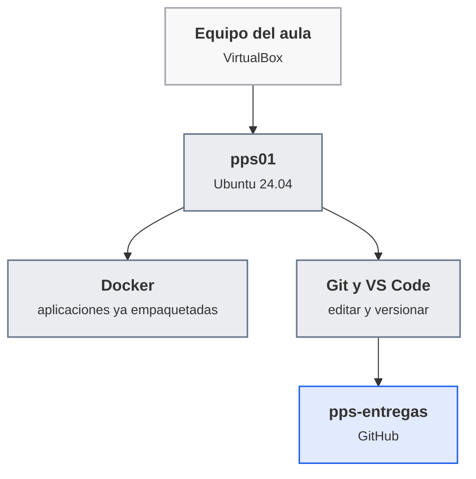
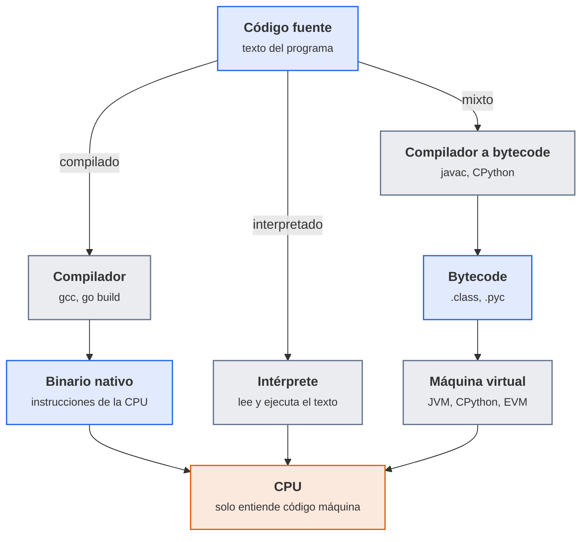
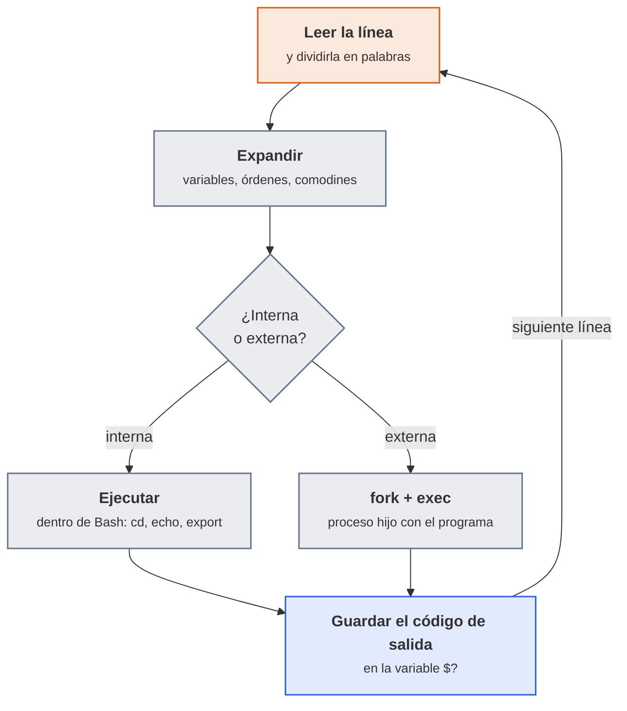
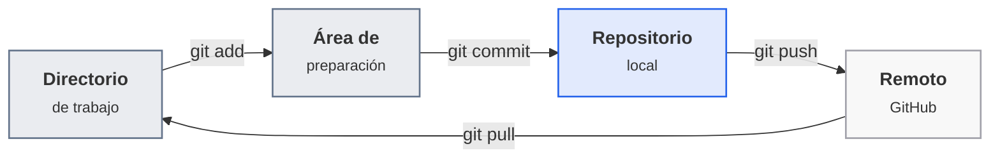
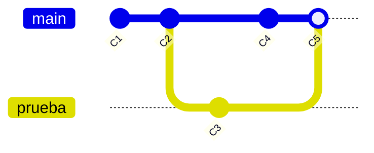

# UT1 · Prueba de aplicaciones

<p class="ut-meta">16 h · Sesiones 1 a 8 · RA1 CE a, b, c, d, e</p>

Antes de buscar fallos de seguridad en una aplicación hay que saber leerla y ponerla en marcha: en qué lenguaje está escrita, qué hace la máquina cuando la ejecuta, cómo se comprueba que cumple lo que promete y qué protecciones da (o no da) el propio lenguaje. Un programa de doce líneas de ensamblador, el mismo ejercicio en Python y en Go, un script de Bash y un contrato inteligente tienen poco en común a primera vista, y sin embargo todos acaban siendo instrucciones que un procesador ejecuta, y todos se prueban y se depuran con las mismas ideas. La unidad recorre esos cinco casos con `nasm` y `gdb` para el ensamblador, `unittest` y `go test` para las pruebas, `bash -x` para el intérprete de órdenes, y CryptoZombies y Learn Git Branching para el contrato inteligente y el control de versiones. Todo se trabaja en la máquina virtual `pps01` del [laboratorio](../laboratorio.md#puesto-de-trabajo) y se guarda en el repositorio `pps-entregas`, que se crea en la primera sesión. Son ocho sesiones (siete de trabajo y una de margen) y cuatro entregas evaluables, ACT_UT1_1 a ACT_UT1_4, con plazo el 22 y el 29 de octubre y el 2 y el 5 de noviembre. Cada entrega tiene en el aula su enunciado en PDF («Actividad 1» a «Actividad 4»), y **el PDF es el que manda**: las hojas siguen su numeración (3.1, 3.2...) y dicen en cada ejercicio a qué punto responde, y lo que una hoja añade por su cuenta va en su ejercicio «Extra (opcional)», que es lo que la rúbrica llama «Extra».

Lo que va más allá de lo que se hace en clase (ampliaciones, otras herramientas y enlaces para seguir) está en [Para ampliar](../ampliacion.md#ut1-prueba-de-aplicaciones).

## Sesión 1 · Presentación y puesto de trabajo

<p class="ut-meta" markdown>1 de octubre · Teoría y práctica · <span class="dur" tabindex="0" aria-label="Presentación y evaluación · 20 min&#10;Puesto de trabajo reproducible · 10 min&#10;A1.1 Puesto de trabajo · 80 min" data-dur="Presentación y evaluación · 20 min&#10;Puesto de trabajo reproducible · 10 min&#10;A1.1 Puesto de trabajo · 80 min">:material-school:<i class="dur-barra" style="--teoria:27%"></i>:material-flask:</span></p>

Al acabar esta sesión hay una máquina virtual `pps01` con Docker, Git y VS Code, las cuentas del curso creadas y un repositorio `pps-entregas` propio, clonado en la máquina y con la primera confirmación subida a GitHub. Antes se explica cómo funciona el módulo (qué se evalúa, cómo se entrega, para qué sirven los márgenes) y por qué el puesto de trabajo se monta como una máquina virtual que se puede reconstruir en minutos.

!!! consulta "Recursos de la sesión"
    **Para la práctica**

    - [Plantilla de repositorio](https://github.com/pkaminasfp/template): el modelo de `README` para `pps-entregas`.

### Presentación y evaluación

Puesta en producción segura (módulo 5023) responde a una pregunta: qué hay que comprobar y qué hay que corregir para que una aplicación pueda salir a producción sin ser una puerta abierta. Son 59 sesiones de 110 minutos, los lunes y los jueves, repartidas en cinco unidades que coinciden con los cinco resultados de aprendizaje (RA) del currículo.

| Unidad | RA | De qué trata | Sesiones |
|---|---|---|---|
| UT1 · Prueba de aplicaciones | RA1 | Lenguajes, modelos de ejecución, pruebas y seguridad de los lenguajes | 1 a 8 (1 oct a 2 nov) |
| UT2 · Nivel de seguridad requerido | RA2 | ASVS, riesgos y qué nivel de verificación exige cada aplicación | 9 a 14 (5 a 23 nov) |
| UT3 · Vulnerabilidades web | RA3 | Validación de entradas, inyección, sesiones, contraseñas y hardening del servidor | 15 a 27 (26 nov a 25 ene) |
| UT4 · Aplicaciones móviles | RA4 | Permisos, almacenamiento seguro, tráfico y binarios | 29 a 36 (1 a 25 feb) |
| UT5 · Despliegue seguro | RA5 | Control de versiones, integración y despliegue continuos, y recuperación | 37 a 58 (8 mar a 31 may) |

**Cómo se evalúa.** Hay tres tipos de evidencia: las entregas evaluables (las actividades de cada unidad, corregidas con rúbrica en Aules), los retos de Atenea (la plataforma de retos del CCN-CERT, con una captura del nivel de logro como entregable) y dos exámenes, el 28 de enero (RA1, RA2 y RA3) y el 3 de junio (RA4 y RA5). La ponderación entre ellos está en [Presentación y evaluación](../modulo.md). Nunca se recorta un criterio de evaluación: cada uno sale de alguna hoja o entrega.

**Cómo se entrega.** Las hojas de cada sesión son para practicar y no se entregan. El trabajo de cada una se guarda en `pps-entregas`, en su carpeta (`ut1/a12/`, `ut1/a13/`...), con `git add`, `git commit` y `git push` y un `README.md` que cuenta qué se ha hecho, los comandos usados, la comprobación y las capturas. Lo que se entrega en Aules son las prácticas evaluables de cada unidad, que recogen esas carpetas y tienen su propio plazo. Cuando la entrega es un documento, se sube a la tarea de Aules en PDF, con la estructura de la *Normativa de entrega*: portada, índice, introducción, desarrollo, bibliografía y conclusión; márgenes de 3 cm a los lados y 2,5 cm arriba y abajo, letra de 12 puntos e interlineado de 1,5, y figuras con su pie. Una entrega que no cumple la normativa se corrige como no evaluada.

**Plazos.** Todos vencen a las 23:59 (hora de Madrid) del día indicado. El plazo no se mueve aunque se pierda una clase: lo que se mueve es el contenido, que se recupera en el margen siguiente. Fuera de plazo y sin causa justificada, la entrega se corrige sobre el 50 %.

**Márgenes.** El calendario reserva seis sesiones sin teoría nueva, una al final de cada bloque. Si no se ha perdido ninguna clase se dedican a repaso y ampliación; si se ha perdido alguna, se recupera en ellas lo pendiente (las reglas exactas están en [Calendario](../calendario.md#los-margenes-del-calendario)).

!!! ojo "Solo sobre lo propio o lo autorizado"
    Las prácticas ofensivas del curso (explotar una vulnerabilidad para entenderla y corregirla) se hacen únicamente contra aplicaciones y máquinas deliberadamente vulnerables del propio laboratorio, en una red aislada, o en los laboratorios de las plataformas que lo autorizan (PortSwigger, Atenea). Acceder sin autorización a un sistema ajeno es delito, aunque sea "solo para probar". El criterio es único: solo sobre lo propio o lo autorizado por escrito. Las reglas del laboratorio están en [Red aislada y buenas prácticas](../laboratorio.md#red-aislada-y-buenas-practicas). Las primeras prácticas ofensivas llegan en noviembre, con la unidad sobre el nivel de seguridad requerido.

### Puesto de trabajo reproducible

Para probar aplicaciones (algunas deliberadamente vulnerables) hace falta un puesto que sea igual para todo el grupo, que no ponga en riesgo el equipo del aula y al que se pueda volver si algo se rompe. La solución es una máquina virtual, `pps01`, con Ubuntu 24.04, y dentro de ella el resto de piezas.



<p class="pie" markdown>Todo lo del curso ocurre dentro de `pps01`; lo único que sale de ella es lo que se sube a `pps-entregas`.</p>

| Pieza | Qué aporta | Cuándo se usa |
|---|---|---|
| Máquina virtual (`pps01`) | Mismo sistema y mismas versiones para todos, aislamiento del equipo y instantáneas para deshacer | Siempre; las aplicaciones vulnerables no salen de ella |
| Docker | Arranca una aplicación ya preparada (una imagen) con una orden, sin instalarla a mano | Desde mediados de noviembre, para las aplicaciones vulnerables y los servidores web de las prácticas |
| Git y GitHub | Historial de cada cambio y el sitio donde se guarda el trabajo de las hojas | Al terminar cada hoja |
| VS Code | Editor con depurador para Python y Go | Desde el 19 de octubre y el resto del curso |
| Cuentas del curso | GitHub (repositorio), Docker Hub (imágenes), PortSwigger Academy (laboratorios web) y Atenea (retos) | Todo el curso |

Las cuentas usan el usuario `pps<NIA>` (las letras `pps` y el número de identificación del alumno, sin más caracteres) y el correo corporativo. Las contraseñas y los tokens no se guardan nunca en el repositorio ni salen en una captura.

La instantánea es lo que hace seguro el resto del curso. Antes de una práctica con riesgo se guarda el estado de la máquina y, si algo se rompe, se vuelve a él en un minuto:

```bash
VBoxManage snapshot pps01 take a11-base
VBoxManage snapshot pps01 restore a11-base
```

La segunda orden se lanza con la máquina apagada. El mismo resultado se consigue desde el menú Máquina, Tomar instantánea de VirtualBox. Las demás máquinas del curso y lo que hacer cuando algo no arranca están en [Máquinas virtuales](../laboratorio.md#maquinas-virtuales) y en [Si algo se rompe](../laboratorio.md#si-algo-se-rompe).

### A1.1 Puesto de trabajo (sesión 1)

<span class="et et-obj">Objetivo</span> Dejar listos `pps01`, las cuentas del curso y el repositorio `pps-entregas`, que cada entrega pide desde la ACT_UT1_1.

<span class="et et-pre">Antes de empezar</span> Un equipo con VirtualBox 7.x y los [requisitos del puesto](../laboratorio.md#puesto-de-trabajo), tu correo corporativo y tu NIA. Teoría: [presentación y evaluación](#presentacion-y-evaluacion) y [puesto de trabajo reproducible](#puesto-de-trabajo-reproducible). Empieza por la máquina, que tiene esperas largas.

<span class="et et-pas">Ejercicios</span>

1. **Máquina.** Crea `pps01` con los valores de [Máquinas virtuales](../laboratorio.md#maquinas-virtuales): adaptador 1 en NAT y adaptador 2 en solo anfitrión.
2. **Cuentas.** Crea tus cuentas de [GitHub](https://github.com/), [Docker Hub](https://hub.docker.com/signup), [PortSwigger Academy](https://portswigger.net/users/register) y [Atenea](https://atenea.ccn-cert.cni.es/registro) con el usuario `pps<NIA>`, y en GitHub el repositorio privado vacío `pps-entregas`, con quien corrige como colaborador.
3. **Herramientas.** Instala en `pps01` `git`, `curl`, `build-essential`, `docker.io` y VS Code, con Docker usable sin `sudo`.
4. **Repositorio.** Configura Git y una clave SSH ed25519, clona `pps-entregas` en `~/pps-entregas` y sube un `README.md` basado en la [plantilla de repositorio](https://github.com/pkaminasfp/template) y un `ut1/README.md` con la tabla de las hojas A1.1 a A1.7.
5. **Red.** Fija `192.168.56.10/24` en el adaptador solo anfitrión, sin puerta de enlace. El resto del curso da por hecha esa dirección.
6. **Instantánea.** Con la máquina apagada, toma la instantánea `a11-base`.

## Sesión 2 · Lenguajes y modelos de ejecución

<p class="ut-meta" markdown>5 de octubre · Teoría y práctica · <span class="dur" tabindex="0" aria-label="Niveles de los lenguajes · 5 min&#10;Compilados, interpretados y con máquina virtual · 10 min&#10;De la CPU al programa en marcha · 10 min&#10;A1.2 Ensamblador: lectura y ejecución · 85 min" data-dur="Niveles de los lenguajes · 5 min&#10;Compilados, interpretados y con máquina virtual · 10 min&#10;De la CPU al programa en marcha · 10 min&#10;A1.2 Ensamblador: lectura y ejecución · 85 min">:material-school:<i class="dur-barra" style="--teoria:23%"></i>:material-flask:</span></p>

Al acabar esta sesión el programa del punto 3.3 del enunciado de la Actividad 1 está ensamblado, enlazado y ejecutado en `pps01`, con su salida explicada y sus dos fallos encontrados y corregidos, y están empezadas las dos lecturas de los puntos 3.1 y 3.2. La teoría da el mapa antes de tocar nada: en qué niveles se escriben los programas, de qué tres maneras llegan a ejecutarse y qué ocurre entre la CPU y el sistema operativo cuando un programa escribe algo en pantalla.

!!! consulta "Recursos de la sesión"
    **Para la práctica**

    - El enunciado de ACT_UT1_1 («Actividad 1. Pruebas de aplicaciones», en el aula), con el programa del punto 3.3.
    - Punto 3.1: [Let's Learn x86-64 Assembly!](https://gpfault.net/posts/asm-tut-0.txt.html) (escrita para Windows, con FASM y WinDbg: sirve para las ideas, no para las órdenes) y la [guía de x86-64 de Stanford (CS107)](https://web.stanford.edu/class/cs107/guide/x86-64.html) (registros y direccionamiento, en sintaxis AT&T).
    - Punto 3.2: [Conceptos de ensamblador y depurador](https://www.w0lff4ng.org/conceptos-basicos-de-assembler-y-debugger/), con NASM.

### Niveles de los lenguajes

Un lenguaje de programación se coloca en un nivel según lo cerca que esté de la máquina. Cuanto más bajo, más control sobre el procesador y la memoria y menos ayuda; cuanto más alto, al revés. Esa escala es la primera forma de comparar lenguajes (CE a) y ya anticipa la de seguridad: lo que el lenguaje no controla, tiene que controlarlo quien programa.

| Nivel | Ejemplos | Qué controla quien programa | Qué le da el lenguaje |
|---|---|---|---|
| Código máquina | Bytes como `48 c7 c0 01 00 00 00` (la instrucción `mov rax, 1`) | Todo, instrucción a instrucción | Nada; es lo único que la CPU entiende |
| Ensamblador | NASM, GAS | Registros, memoria y llamadas al sistema; depende de la CPU | Nombres legibles (`mov`) en lugar de bytes |
| Medio | C | Direcciones de memoria (punteros) y estructuras | Funciones, tipos y bucles, pero ninguna gestión de memoria |
| Alto, propósito general | Python, Go, Java, C# | Lógica del programa | Tipos, funciones, objetos y, casi siempre, gestión automática de la memoria |
| Alto, dominio específico | SQL, HTML, Bash | Consultas, documentos u órdenes | Un vocabulario para un solo tipo de tarea |
| Muy alto | Prolog, Haskell, Scratch | Qué se quiere, no cómo | Casi todo el "cómo" lo resuelve el lenguaje |

El nivel no dice cómo se ejecuta el programa: dos lenguajes del mismo nivel pueden ejecutarse de maneras muy distintas.

### Compilados, interpretados y con máquina virtual

Un mismo programa de una línea, imprimir `Hello World!`, se ejecuta de tres maneras según el lenguaje: `gcc hola.c -o hola && ./hola` (se traduce entero a instrucciones de la CPU y luego se lanza), `python3 hola.py` (un programa, el intérprete, lee el texto y lo va ejecutando) o `javac Hola.java && java Hola` (se traduce a un código intermedio que ejecuta otro programa, la máquina virtual). Esos son los tres modelos de ejecución de la unidad (CE b).



<p class="pie" markdown>En los tres caminos la CPU solo ejecuta código máquina; lo que cambia es quién lo produce y cuándo. El intérprete y la máquina virtual son, a su vez, programas nativos.</p>

| Modelo | Qué se distribuye | Ventajas | Inconvenientes | Ejemplos |
|---|---|---|---|---|
| Compilado (nativo) | Un binario para una arquitectura y un sistema | Rápido, sin nada instalado aparte, errores de sintaxis y de tipos al compilar | Hay que recompilar para cada plataforma | Ensamblador, C, Go |
| Interpretado | El propio código fuente | Portable, se prueba al momento sin compilar | Más lento; los errores aparecen al ejecutar la línea que falla | Bash, PHP, JavaScript |
| Con máquina virtual | Un código intermedio (bytecode) | Portable, y la máquina virtual puede comprobar y aislar | Necesita la máquina virtual instalada; arranque más lento | Java, C#, Python, contratos de Ethereum |

Un matiz que evita confusiones: compilado o interpretado no es una propiedad del lenguaje sino de cómo se implementa. El Python habitual (CPython) compila el texto a bytecode dentro del propio programa y lo ejecuta en su máquina virtual; el módulo importado deja ese bytecode en `__pycache__/*.pyc`. Con `python3 -m dis hola.py` se ve el bytecode, y con `gcc -S hola.c` el ensamblador que genera el compilador de C. Los compiladores *JIT* (Just In Time) mezclan las dos cosas: traducen a código nativo mientras el programa corre.

### De la CPU al programa en marcha

Todo programa, sea del modelo que sea, acaba siendo una secuencia de instrucciones que la CPU repite en un ciclo: leer la instrucción a la que apunta el contador de programa (el registro `rip`), decodificarla, ejecutarla y avanzar. Los datos con los que trabaja viven en los registros (posiciones de 64 bits dentro de la CPU) o en la memoria. Para leer ensamblador x86-64 bastan seis registros:

| Registro | Uso en Linux |
|---|---|
| `rax` | Número de la llamada al sistema al entrar y valor devuelto al salir |
| `rdi`, `rsi`, `rdx` | Primer, segundo y tercer argumento de la llamada al sistema |
| `rip` | Dirección de la siguiente instrucción |
| `rsp` | Cima de la pila |

Un ejecutable de Linux tiene formato ELF (*Executable and Linkable Format*): unas cabeceras y varias secciones. Al lanzarlo, el núcleo lee las cabeceras y coloca cada sección en la memoria del nuevo proceso, con sus permisos:

| Sección o zona | Qué contiene | Permisos |
|---|---|---|
| `.text` | Las instrucciones del programa | Lectura y ejecución |
| `.data` | Datos con valor inicial (un texto, una constante) | Lectura y escritura |
| `.bss` | Datos sin valor inicial, a cero al empezar | Lectura y escritura |
| Pila (*stack*) | Variables locales y direcciones de retorno; al arrancar lleva los argumentos del programa | Lectura y escritura |

Un programa no puede escribir en pantalla ni abrir un fichero por su cuenta: se lo pide al núcleo con una llamada al sistema. En x86-64 Linux siempre tiene la misma forma: se carga el número de la llamada en `rax`, sus argumentos en `rdi`, `rsi` y `rdx`, y se ejecuta la instrucción `syscall`. El resultado vuelve en `rax`. Dos llamadas bastan para casi todos los programas de ejemplo:

| Llamada | Número | Argumentos | Qué hace |
|---|---|---|---|
| `write` | 1 | Descriptor (1 es la salida estándar), dirección del texto, número de bytes | Escribe bytes |
| `exit` | 60 | Código de salida | Termina el proceso |

Los números salen de `grep -E '__NR_(write|exit) ' /usr/include/x86_64-linux-gnu/asm/unistd_64.h`, y `man 2 write` documenta los argumentos. La consecuencia para seguridad es directa: **todo lo que un programa hace hacia fuera pasa por llamadas al sistema**, escrito en el lenguaje que sea, y por eso `strace` lo ve todo y los entornos aislados (contenedores, sandboxes) funcionan filtrando esas llamadas.

Una carga de `write` en NASM, con la sintaxis Intel que usa el enunciado, tiene esta forma (el primer operando es el destino):

```nasm
mov rax, 1          ; número de la llamada: write
mov rdi, 1          ; descriptor: salida estándar
mov rsi, message    ; dirección donde está el texto
mov rdx, 13         ; cuántos bytes escribir
syscall             ; pedir al núcleo que lo haga
```

En la sintaxis AT&T, la de la guía de Stanford y la que muestra `gdb` por defecto, el orden es el contrario y los registros llevan `%` (`mov $1, %rax`). Conviene saber cuál se está leyendo antes de interpretar una línea. Además, el número de bytes se cuenta, no se adivina: cada carácter ocupa un byte, y el salto de línea es otro (el código 10).

### A1.2 Ensamblador: lectura y ejecución (sesión 2)

<span class="et et-obj">Objetivo</span> Ejecutar, explicar y corregir el programa del punto 3.3 de la Actividad 1, y resumir sus dos lecturas. Cubre los puntos 3.1, 3.2, 3.3.1 y 3.3.2 del enunciado (el 3.3.3 es la A1.3). Lo recoge la ACT_UT1_1, con plazo el 22 de octubre.

<span class="et et-pre">Antes de empezar</span> `pps01` con `build-essential` ([A1.1](#a11-puesto-de-trabajo-sesion-1)) y el repositorio `~/pps-entregas`. Teoría: [niveles de los lenguajes](#niveles-de-los-lenguajes), [modelos de ejecución](#compilados-interpretados-y-con-maquina-virtual) y [de la CPU al programa en marcha](#de-la-cpu-al-programa-en-marcha).

<span class="et et-pas">Ejercicios</span> Trabaja en `~/pps-entregas/ut1/a12/` y contesta en su `README.md`.

1. **Ejecución (3.3.1).** Ensambla, enlaza y ejecuta el programa del enunciado tal cual, como `hola_enunciado.asm`. Anota los comandos, la salida y el código de salida.
2. **Salida (3.3.2).** Localiza las dos anomalías del programa, explica su causa y corrígelas en una copia, `hola.asm`, que da el ejecutable `hola`.
3. **Análisis (3.3.2).** Sobre `hola`: en qué sección están el texto y el código, qué dirección tiene `_start` frente al punto de entrada y cuántos bytes ocupa `.text`.
4. **Lecturas (3.1 y 3.2).** Resume en cinco líneas cada una la arquitectura x86-64 y qué son un ensamblador y un depurador, a partir de las lecturas de los recursos de la sesión.
5. **Extra (opcional).** Escribe el mismo programa en C y en Python y compara los tres en una tabla: tamaño, tipo de ejecutable, librerías y llamadas al sistema.

## Sesión 3 · Ensamblador y depurador

<p class="ut-meta" markdown>15 de octubre · Teoría y práctica · <span class="dur" tabindex="0" aria-label="Qué hace un depurador · 15 min&#10;A1.3 Depuración en ensamblador · 95 min" data-dur="Qué hace un depurador · 15 min&#10;A1.3 Depuración en ensamblador · 95 min">:material-school:<i class="dur-barra" style="--teoria:14%"></i>:material-flask:</span></p>

Al acabar esta sesión el programa del enunciado está analizado instrucción a instrucción con un depurador, con una tabla que dice qué registro cambia en cada paso y por qué el programa se cae al final, y recorrido también en el depurador web que pide el enunciado. Con eso quedan contestadas las tres preguntas del punto 3.3 de la Actividad 1 (ejecutar, salida y análisis con el depurador). La teoría explica qué permite ver un depurador y qué órdenes de `gdb` bastan para la hoja.

!!! consulta "Recursos de la sesión"
    **Para la práctica**

    - [Depurador de ensamblador en el navegador](http://asmdebugger.com/): el que nombra el punto 3.3.3 del enunciado; emula 32 bits.
    - [Documentación de gdb](https://sourceware.org/gdb/current/onlinedocs/gdb.html): el depurador con el que se analiza el programa real.

### Qué hace un depurador

Un depurador ejecuta un programa bajo control: lo detiene donde se le pide y enseña el estado exacto de la máquina en ese punto. Sirve para sustituir la suposición («debería valer 13») por la lectura («vale 14»), y es la herramienta con la que se descubre qué hace de verdad un binario cuando no se tiene el fuente, algo habitual en seguridad. En el sistema real el proceso corre de verdad, con lo que eso implica: un programa desconocido se depura solo dentro de la máquina virtual aislada.

| Concepto | Qué es | Orden de `gdb` |
|---|---|---|
| Punto de parada (*breakpoint*; «punto de interrupción» en VS Code) | Un lugar donde el programa se detiene | `break _start` (`b`) |
| Paso a paso | Ejecutar una sola instrucción y volver a parar | `stepi` (`si`); `nexti` (`ni`) no entra en las llamadas |
| Continuar | Seguir hasta el siguiente punto de parada o el final | `continue` (`c`) |
| Registros | Los valores de la CPU en este instante | `info registers rax rdi` (`i r`), `p $rax` |
| Memoria | El contenido de cualquier dirección | `x/14xb $rsi` (14 bytes en hexadecimal), `x/s $rsi` (como texto), `x/8i $rip` (las 8 instrucciones siguientes) |
| Pila | La zona apuntada por `rsp`, que crece hacia direcciones bajas | `x/4gx $rsp` (cuatro palabras de 8 bytes) |
| Señal | El aviso que el núcleo manda al proceso, por ejemplo `SIGSEGV` cuando accede a memoria que no es suya | `gdb` se detiene solo y lo indica |

La orden `x` sigue el formato `x/NFU dirección`: `N` es cuántos elementos, `F` el formato (`x` hexadecimal, `d` decimal, `s` texto, `i` instrucciones, `c` carácter) y `U` el tamaño (`b` byte, `w` 4 bytes, `g` 8 bytes). Por dentro, `gdb` usa `ptrace` para controlar el proceso y coloca un byte especial (`int3`) en el lugar del punto de parada.

Dos detalles evitan confusiones. `gdb` muestra por defecto la sintaxis AT&T: con `set disassembly-flavor intel` cambia a la del enunciado. Y compilar con información de depuración (`nasm -g -F dwarf`) permite que `gdb` relacione cada instrucción con su línea del fuente; sin ella, funciona igual, pero solo con direcciones.

El depurador web y `gdb` son cosas distintas: `gdb` controla un proceso real (llamadas al sistema y memoria del ELF), mientras que el web emula un subconjunto de instrucciones y enseña cada registro y bandera (`zf`, `cf`, `sf`, `of`) cambiando, lo que aclara bucles y comparaciones.

### A1.3 Depuración en ensamblador (sesión 3)

<span class="et et-obj">Objetivo</span> Analizar con `gdb` y con el depurador web el programa del enunciado de la Actividad 1, instrucción a instrucción, y explicar por qué se cae. Cubre el punto 3.3.3. Lo recoge la ACT_UT1_1, con plazo el 22 de octubre, junto con la A1.2.

<span class="et et-pre">Antes de empezar</span> La carpeta `ut1/a12/` de la [A1.2](#a12-ensamblador-lectura-y-ejecucion-sesion-2). Teoría: [qué hace un depurador](#que-hace-un-depurador).

<span class="et et-pas">Ejercicios</span> Trabaja en `~/pps-entregas/ut1/a13/` y contesta en su `README.md`.

1. **Preparación.** Copia los dos `.asm` de la A1.2 y ensámblalos con información de depuración. Deja `gdb` en sintaxis Intel.
2. **Recorrido (3.3.3).** Recorre `hola_enunciado` desde `_start` y anota en una tabla qué registro cambia en cada instrucción y a qué valor, qué hay en memoria antes del `syscall` y qué devuelve `write`.
3. **El fallo (3.3.3).** Sigue hasta el `SIGSEGV` y explica qué instrucción se ejecutó tras el último `xor`, qué valor tenía `rax` y por qué falla.
4. **Programa corregido (3.3.3).** Repite el recorrido con `hola` hasta el final y anota su código de salida.
5. **Depurador web (3.3.3).** Recorre en el [depurador web](http://asmdebugger.com/) las instrucciones del programa que puede emular, pasadas a 32 bits, y anota los registros y qué instrucciones no ha podido ejecutar y por qué.
6. **Respuestas del 3.3.** Reúne en el README los comandos, la salida real y la esperada y el análisis con los dos depuradores, con una captura de `gdb` parado en `SIGSEGV` y otra del depurador web.
7. **Extra (opcional).** En el depurador web, un bucle que sume 5, 4, 3, 2 y 1 en `eax` con `ecx` como contador, observando la bandera `zf`.

## Sesión 4 · Python: código fuente, pruebas y depuración

<p class="ut-meta" markdown>19 de octubre · Teoría y práctica · <span class="dur" tabindex="0" aria-label="Elementos de un programa · 10 min&#10;Tipos de prueba y test unitario · 15 min&#10;A1.4 Python: programa, tests y depuración · 85 min" data-dur="Elementos de un programa · 10 min&#10;Tipos de prueba y test unitario · 15 min&#10;A1.4 Python: programa, tests y depuración · 85 min">:material-school:<i class="dur-barra" style="--teoria:23%"></i>:material-flask:</span></p>

Al acabar esta sesión hay un programa en Python de unas treinta líneas, con su README, tres pruebas unitarias (una fallida a propósito) que se ejecutan con una orden, y una sesión de depuración en VS Code con un punto de interrupción y las variables a la vista. La teoría da el vocabulario para leer cualquier código (los elementos de un programa) y la clasificación de las pruebas, y fija las tres ideas que hacen buena a una prueba unitaria.

!!! consulta "Recursos de la sesión"
    **Para la práctica**

    - [Pruebas unitarias en Python (`unittest`)](https://docs.python.org/es/3/library/unittest.html): la referencia del módulo.
    - El enunciado de ACT_UT1_2 («Actividad 2. Ejecución de aplicaciones») y las dos lecturas de su punto 3.1, *How Python Works* y *How Java Works*, están en el aula.

    **Para ampliar** (opcional)

    - [Documentación de Python](https://docs.python.org/es/3/).

### Elementos de un programa

Leer código desconocido es una habilidad de seguridad tanto como de programación: lo primero que se busca son los mismos cinco elementos, en este orden. El punto de entrada (por dónde empieza), los datos (variables y constantes, y de qué tipo), las decisiones y los bucles (por dónde puede ir la ejecución), las funciones (qué trozos se reutilizan) y todo lo que toca el exterior (argumentos, ficheros, red, y qué pasa cuando algo falla). El programa que se usa desde aquí en Python, en Go y en Bash clasifica un número de puerto según los rangos de la IANA (0 a 1023 del sistema, 1024 a 49151 de usuario, el resto dinámicos), y lleva anotados sus elementos:

```python
"""Clasifica puertos TCP/UDP según los rangos de la IANA."""
import sys

LIMITE_SISTEMA = 1023   # constante: de 0 a 1023, puertos del sistema
LIMITE_USUARIO = 49151  # de 1024 a 49151, puertos de usuario


def clasificar_puerto(numero):
    """Devuelve 'sistema', 'usuario' o 'dinámico' según el número de puerto."""
    if numero < 0 or numero > 65535:
        raise ValueError("puerto fuera de rango (0 a 65535)")
    if numero <= LIMITE_SISTEMA:
        return "sistema"
    elif numero <= LIMITE_USUARIO:
        return "usuario"
    return "dinámico"


def es_privilegiado(numero):
    """Por defecto, en Linux solo un proceso privilegiado escucha por debajo de 1024."""
    return numero <= LIMITE_SISTEMA


def main(argumentos):
    for texto in argumentos:              # bucle sobre cada argumento
        try:
            numero = int(texto)           # conversión de texto a entero
            print(f"{numero}: {clasificar_puerto(numero)}")
        except ValueError as error:       # captura el error de int() y el de clasificar_puerto()
            print(f"{texto}: {error}")


if __name__ == "__main__":
    main(sys.argv[1:])
```

Los mismos elementos cambian de forma en cada lenguaje, y la tabla sirve para reconocerlos en los tres:

| Elemento | Python | Go | Bash |
|---|---|---|---|
| Comentario | `# texto` | `// texto` | `# texto` |
| Constante y variable | `LIMITE = 1023` (por convención) | `const limite = 1023`, `numero := 5` | `limite=1023` (sin espacios alrededor de `=`) |
| Tipo | Dinámico: `int("22")` convierte | Estático: `var n int`, `strconv.Atoi("22")` | Todo es texto; `(( n + 1 ))` lo interpreta como número |
| Decisión | `if`, `elif`, `else` (con sangría) | `if x <= 1023 { }`, `switch` | `if (( x <= 1023 )); then ... fi` |
| Bucle | `for t in argumentos:` | `for _, t := range args {` | `for t in "$@"; do ... done` |
| Función | `def f(n):` | `func f(n int) string {` | `f() { local n=$1; ... }` |
| Error | `try` y `except ValueError` | Se devuelve: `valor, err := f()` | Código de salida: `$?` |
| Entrada | `sys.argv[1:]`, `input()` | `os.Args[1:]` | `"$@"`, `$1`, `read` |

En Python la sangría es sintaxis: una línea mal alineada cambia el significado del programa, no solo su aspecto.

### Tipos de prueba y test unitario

Una prueba comprueba que el software hace lo que dice, y en seguridad también que no hace lo que no debe: una entrada rara no lo tumba ni le da acceso a lo que no toca. Hay varios niveles, según cuánto del sistema se pone a prueba a la vez (CE d):

| Tipo | Qué comprueba | Quién y cuándo | Ejemplo con el programa de puertos |
|---|---|---|---|
| Unitaria | Una función o un método aislado | Quien programa, a cada cambio | `clasificar_puerto(22)` devuelve `"sistema"` |
| De integración | Varias piezas trabajando juntas | Quien programa o el equipo, al juntar módulos | `python3 puertos.py 22 abc` imprime las dos líneas esperadas |
| De sistema | El producto completo, ya instalado: rendimiento, seguridad y resistencia ante situaciones anormales | Un equipo de pruebas, antes de lanzar | El programa en su contenedor, con mil argumentos y entradas absurdas |
| De aceptación | Que cumple lo pactado con quien lo encarga | El cliente o el usuario, al recibirlo | Sistemas confirma que la clasificación coincide con su tabla de puertos |
| De regresión | Que un cambio no ha roto lo que ya funcionaba | Automática, a cada cambio | Repetir todas las pruebas anteriores tras tocar `clasificar_puerto` |

Según lo que se sepa del código, la prueba es de caja blanca (se conoce el código y se busca recorrer todos los caminos, con una medida llamada cobertura) o de caja negra (solo se conocen entradas y salidas). En caja negra, dos técnicas eligen los valores con criterio en lugar de al azar: las particiones equivalentes (se prueba un valor de cada clase que el programa trata igual) y los valores límite (se prueban los bordes, que es donde suelen estar los fallos). Para el programa de puertos:

| Clase | Rango | Valor representativo | Valores límite |
|---|---|---|---|
| Inválida por abajo | menos de 0 | -5 | -1 |
| Sistema | 0 a 1023 | 22 | 0 y 1023 |
| Usuario | 1024 a 49151 | 8080 | 1024 y 49151 |
| Dinámico | 49152 a 65535 | 50000 | 49152 y 65535 |
| Inválida por arriba | más de 65535 | 70000 | 65536 |

Una prueba unitaria sigue cuatro pasos: preparar los datos, ejecutar la función, verificar el resultado y, si hace falta, limpiar. Para que sirva tiene que ser aislada (no depende de ficheros, red ni de otras pruebas), automática (se lanza con una orden y dice sí o no), rápida y determinista (mismos datos, mismo resultado). En Python la herramienta estándar es `unittest`: una clase que hereda de `unittest.TestCase`, un método `test_...` por prueba y métodos de verificación:

| Verificación | Comprueba | Ejemplo |
|---|---|---|
| `assertEqual(a, b)` | Que dos valores son iguales | `assertEqual(clasificar_puerto(22), "sistema")` |
| `assertTrue(x)`, `assertFalse(x)` | Que una condición es cierta o falsa | `assertTrue(es_privilegiado(80))` |
| `assertRaises(Error)` | Que se lanza un error concreto | `with self.assertRaises(ValueError): clasificar_puerto(65536)` |

Se ejecutan con `python3 -m unittest -v` desde la carpeta del proyecto. El resultado marca cada prueba como correcta (`ok`), fallida (`FAIL`, la verificación no se cumple) o con error (`ERROR`, saltó una excepción inesperada). Un fallo bien leído es información: el `Traceback` dice la línea, el valor esperado y el obtenido. El estándar de facto en empresa es `pytest`, con menos ceremonia, pero exige instalar un paquete; aquí se usa `unittest` porque viene con Python y es lo que pide el enunciado.

### A1.4 Python: programa, tests y depuración (sesión 4)

<span class="et et-obj">Objetivo</span> Un programa en Python con su README, tres pruebas unitarias (una que falla a propósito) y una depuración en VS Code. Cubre los puntos 3.1, 3.2, 3.2.1 y 3.2.2 de la Actividad 2. Lo recoge la ACT_UT1_2, con plazo el 29 de octubre, junto con la A1.5.

<span class="et et-pre">Antes de empezar</span> `pps01` con VS Code y `~/pps-entregas`. Teoría: [elementos de un programa](#elementos-de-un-programa), donde está el programa de puertos, y [tipos de prueba y test unitario](#tipos-de-prueba-y-test-unitario).

<span class="et et-pas">Ejercicios</span> Trabaja en `~/pps-entregas/ut1/a14/` y contesta en su `README.md`.

1. **Programa y README (3.2).** `puertos.py` (el de la teoría u otro propio con una función, una decisión, un bucle y un caso de error) y un README con qué hace, qué instalar y cómo se ejecuta, con un ejemplo de salida.
2. **Tests unitarios (3.2.1).** `test_puertos.py` con tres pruebas de `unittest` de tres tipos distintos, una de ellas fallida a propósito. Explica cada una y el `Traceback` de la fallida.
3. **Depuración (3.2.2).** Depura `puertos.py` en VS Code con los argumentos `22 8080 abc` y explica las secciones más relevantes con lo que muestran Variables, Inspección y Pila de llamadas, con una captura.
4. **Lectura (3.1).** Resume en cinco líneas cómo se ejecuta el código en Python y en Java, con las dos lecturas del aula.
5. **Extra (opcional).** El bytecode del programa con `dis`, una prueba depurada desde VS Code y la cobertura de los tests.

## Sesión 5 · Go: pruebas y depuración

<p class="ut-meta" markdown>22 de octubre · Teoría y práctica · <span class="dur" tabindex="0" aria-label="Go: compilar, probar y depurar · 15 min&#10;A1.5 Go: programa, tests y depuración · 95 min" data-dur="Go: compilar, probar y depurar · 15 min&#10;A1.5 Go: programa, tests y depuración · 95 min">:material-school:<i class="dur-barra" style="--teoria:14%"></i>:material-flask:</span></p>

Al acabar esta sesión el mismo programa de la sesión anterior existe en Go, con su README, sus tres pruebas ejecutadas con `go test` (una fallida a propósito) y su depuración en VS Code: son los puntos 3.3 de la Actividad 2. La teoría cuenta cómo se compila y se prueba un programa en Go, con el programa y sus pruebas enteros para copiarlos.

!!! consulta "Recursos de la sesión"
    **Para la práctica**

    - [Añadir un test en Go](https://go.dev/doc/tutorial/add-a-test): el tutorial oficial de pruebas.
    - [Instalación de Go](https://go.dev/doc/install) y [paquete `testing`](https://pkg.go.dev/testing).

### Go: compilar, probar y depurar

Go es un lenguaje compilado y de tipado estático: `go build` traduce todo el programa a un único binario nativo que no necesita nada instalado para ejecutarse, y el compilador rechaza en ese momento lo que en Python solo se descubriría al ejecutar (un tipo equivocado, una variable sin usar). Un proyecto es un módulo, con un fichero `go.mod` que se crea con `go mod init`, y las pruebas vienen incluidas en la biblioteca estándar y en la herramienta: `go test`. Lo que sigue es el mismo programa de puertos:

```go
// Command puertos clasifica puertos TCP/UDP según los rangos de la IANA.
package main

import (
	"errors"
	"fmt"
	"os"
	"strconv"
)

const (
	limiteSistema = 1023  // de 0 a 1023, puertos del sistema
	limiteUsuario = 49151 // de 1024 a 49151, puertos de usuario
)

// ErrFueraDeRango se devuelve cuando el número no es un puerto válido.
var ErrFueraDeRango = errors.New("puerto fuera de rango (0 a 65535)")

// Clasificar devuelve "sistema", "usuario" o "dinámico" según el número de puerto.
func Clasificar(numero int) (string, error) {
	if numero < 0 || numero > 65535 {
		return "", ErrFueraDeRango
	}
	switch {
	case numero <= limiteSistema:
		return "sistema", nil
	case numero <= limiteUsuario:
		return "usuario", nil
	default:
		return "dinámico", nil
	}
}

// EsPrivilegiado indica si el puerto está por debajo de 1024.
func EsPrivilegiado(numero int) bool {
	return numero <= limiteSistema
}

func main() {
	for _, texto := range os.Args[1:] {
		numero, err := strconv.Atoi(texto)
		if err != nil {
			fmt.Printf("%s: %v\n", texto, err)
			continue
		}
		clase, err := Clasificar(numero)
		if err != nil {
			fmt.Printf("%d: %v\n", numero, err)
			continue
		}
		fmt.Printf("%d: %s\n", numero, clase)
	}
}
```

| Aspecto | Python | Go |
|---|---|---|
| Ejecución | `python3 fichero.py`: el intérprete traduce a bytecode y lo ejecuta | `go run .` compila y lanza; `go build` deja un binario |
| Tipos | Dinámicos: se comprueban al ejecutar | Estáticos: se comprueban al compilar |
| Errores | Excepciones (`raise`, `try`/`except`) | Valores devueltos (`err`) que hay que mirar; `panic` para lo irrecuperable |
| Pruebas | `unittest` (o `pytest`): clases y métodos `test_...` | `testing`: funciones `TestXxx(t *testing.T)` en ficheros `_test.go` |
| Formato del código | Convención (PEP 8) | Lo impone `gofmt` |
| Distribución | Código más intérprete y librerías | Un binario estático |

Las pruebas en Go se rigen por convención de nombres: un fichero que acaba en `_test.go`, y funciones que empiezan por `Test`. No hay métodos `assert`: se compara con `if` y se informa con `t.Errorf` (la prueba sigue) o `t.Fatalf` (se detiene). Tres estilos cubren casi todo: la prueba de tabla (una lista de casos y un bucle, el estilo habitual en Go), la prueba de error (con `errors.Is`) y la de una condición booleana:

```go
package main

import (
	"errors"
	"testing"
)

func TestClasificarPorRango(t *testing.T) {
	casos := []struct {
		puerto   int
		esperado string
	}{
		{22, "sistema"},
		{1023, "sistema"},
		{1024, "usuario"},
		{8080, "usuario"},
		{49152, "dinámico"},
	}
	for _, c := range casos {
		obtenido, err := Clasificar(c.puerto)
		if err != nil || obtenido != c.esperado {
			t.Errorf("Clasificar(%d) = %q, %v; se esperaba %q", c.puerto, obtenido, err, c.esperado)
		}
	}
}

func TestClasificarFueraDeRango(t *testing.T) {
	_, err := Clasificar(65536)
	if !errors.Is(err, ErrFueraDeRango) {
		t.Errorf("se esperaba ErrFueraDeRango y llegó %v", err)
	}
}

func TestEsPrivilegiadoFallaAProposito(t *testing.T) {
	if !EsPrivilegiado(8080) {
		t.Error("8080 no es privilegiado: este test falla a propósito")
	}
}
```

Las órdenes de cada día son `go run . 22 8080 abc`, `go test -v` (cada prueba con su resultado), `go test -run Rango` (solo las que casan con el nombre), `go test -cover` (porcentaje de líneas ejecutadas por las pruebas) y `go vet` (avisa de errores sospechosos que compilan). La depuración usa Delve (`dlv`), que la extensión de Go de VS Code instala y maneja: los puntos de interrupción, la ejecución paso a paso y los paneles son los mismos que con Python. Para depurar una prueba, VS Code pone sobre cada función `Test...` los enlaces «run test» y «debug test».

### A1.5 Go: programa, tests y depuración (sesión 5)

<span class="et et-obj">Objetivo</span> El programa de puertos en Go con su README, tres pruebas con `go test` (una que falla a propósito) y una depuración en VS Code. Cubre los puntos 3.3, 3.3.1 y 3.3.2 de la Actividad 2. Lo recoge la ACT_UT1_2, con plazo el 29 de octubre, junto con la A1.4.

<span class="et et-pre">Antes de empezar</span> La [A1.4](#a14-python-programa-tests-y-depuracion-sesion-4) como modelo de README. Teoría: [Go: compilar, probar y depurar](#go-compilar-probar-y-depurar), con el programa y las pruebas.

<span class="et et-pas">Ejercicios</span> Trabaja en el módulo `puertos` de `~/pps-entregas/ut1/a15/` y contesta en su `README.md`.

1. **Programa y README (3.3).** Instala Go, crea el módulo con `main.go` y ejecútalo con los mismos argumentos que en Python. README con qué hace, qué instalar y cómo se ejecuta.
2. **Tests unitarios (3.3.1).** `main_test.go` con las tres pruebas. Explica cada una y la salida de la fallida.
3. **Depuración (3.3.2).** Depura en VS Code con los argumentos `22 8080 abc` y un punto de interrupción en el `switch` de `Clasificar`, y explica las secciones relevantes con los valores de `numero` y `clase`, con una captura.
4. **Extra (opcional).** Tabla comparativa Go frente a Python hecha con lo observado, y la cobertura con `go test -cover`.

## Sesión 6 · Bash y seguridad de los lenguajes

<p class="ut-meta" markdown>26 de octubre · Teoría y práctica · <span class="dur" tabindex="0" aria-label="Bash por dentro · 10 min&#10;Seguridad de los lenguajes · 15 min&#10;A1.6 Bash y seguridad de los lenguajes · 85 min" data-dur="Bash por dentro · 10 min&#10;Seguridad de los lenguajes · 15 min&#10;A1.6 Bash y seguridad de los lenguajes · 85 min">:material-school:<i class="dur-barra" style="--teoria:23%"></i>:material-flask:</span></p>

Al acabar esta sesión hay un script de Bash depurado con `bash -x`, un análisis de `LearnBash.sh` que compara lo que el script dice que hace con lo que hace de verdad, y una comparativa de la seguridad de Go, Python y Bash apoyada en experimentos propios. Es la sesión del CE e: qué protecciones da cada lenguaje y cuáles deja a quien programa. La teoría explica primero qué hace Bash con cada línea, porque de ahí salen los errores de seguridad típicos de los scripts, y después los criterios con los que se compara un lenguaje.

!!! consulta "Recursos de la sesión"
    **Para la práctica**

    - [Tutorial de línea de órdenes (krother)](https://github.com/krother/bash_tutorial): el tutorial de la actividad.
    - [Depuración de scripts de Bash](https://tldp.org/LDP/Bash-Beginners-Guide/html/sect_02_03.html) y [manual de Bash](https://www.gnu.org/software/bash/manual/bash.html).
    - El enunciado de ACT_UT1_3 («Actividad 3. BASH Programming»), las dos lecturas de sus puntos 3.1 y 3.2 (*How Does the Shell Command ls Work Internally* e *Introduction to Bash Scripting*) y el script `LearnBash.sh` están en el aula.

### Bash por dentro

Bash hace lo mismo con cada línea que se le da, ya venga del teclado o de un script, y conocer ese ciclo explica tanto por qué un script funciona como por qué es inseguro. Con `ls -l *.txt` como ejemplo: Bash lee la línea y la divide en palabras (`ls`, `-l`, `*.txt`); expande lo que toca (`*.txt` se sustituye por `a.txt b.txt`: lo hace Bash, `ls` nunca ve el asterisco); busca si `ls` es una orden interna o un programa externo; y, si es externo, crea un proceso hijo (`fork`), lo sustituye por el programa (`exec`), espera a que termine y guarda su código de salida en `$?`.



<p class="pie" markdown>Es el ciclo leer, evaluar, imprimir (REPL) de todo intérprete de órdenes. Lo que expande Bash en el segundo paso es lo que después ejecuta: por eso ahí nacen las inyecciones.</p>

Las expansiones se hacen siempre en el mismo orden, y el orden importa:

| Orden | Expansión | Ejemplo | Consecuencia |
|---|---|---|---|
| 1 | Llaves | `echo {1..3}` da `1 2 3` | Se hace antes que las variables: `{$a..$b}` no se expande |
| 2 | Tilde | `~` da `/home/alumno` | |
| 3 | Variables, aritmética y órdenes | `$x`, `$((a + 1))`, `$(date)` | El resultado sustituye a la expresión |
| 4 | División en palabras | `rm $f` con `f="a b"` borra `a` y `b` | Solo ocurre **sin comillas** |
| 5 | Comodines | `*.txt`, `?` | También sin comillas: un dato con `*` se convierte en ficheros |
| 6 | Quitar comillas | `"a b"` pasa a `a b` | Las comillas dobles protegen 4 y 5 |

De ahí sale la regla de oro de Bash: **una variable con datos externos va siempre entre comillas** (`"$f"`), y nunca dentro de `eval`. El código de salida de cada orden queda en `$?`: 0 es correcto y cualquier otro valor es un fallo (1 y 2 son errores genéricos, 126 «no es ejecutable», 127 «no existe la orden», y 128 más el número de la señal cuando el proceso muere por una: 139 es 128 más 11, `SIGSEGV`). Con `&&` se encadena «si la anterior fue bien» y con `||` «si fue mal».

El script que se usa en la unidad es el mismo programa de puertos ya escrito en Python y en Go, y muestra los elementos de Bash de la tabla de [Elementos de un programa](#elementos-de-un-programa):

```bash
#!/usr/bin/env bash
# Clasifica puertos TCP/UDP según los rangos de la IANA.
limite_sistema=1023
limite_usuario=49151

clasificar() {
    local numero=$1
    if (( numero < 0 || numero > 65535 )); then
        return 1
    elif (( numero <= limite_sistema )); then
        echo "sistema"
    elif (( numero <= limite_usuario )); then
        echo "usuario"
    else
        echo "dinámico"
    fi
}

errores=0
for texto in "$@"; do
    if [[ ! $texto =~ ^[0-9]+$ ]]; then
        echo "$texto: no es un número" >&2
        errores=$((errores + 1))
        continue
    fi
    if clase=$(clasificar "$texto"); then
        echo "$texto: $clase"
    else
        echo "$texto: puerto fuera de rango (0 a 65535)" >&2
        errores=$((errores + 1))
    fi
done
exit $(( errores > 0 ))
```

La primera línea (`#!`, el *shebang*) dice al núcleo qué intérprete usar cuando se lanza `./puertos.sh`, y hace falta el permiso de ejecución (`chmod +x`); con `bash puertos.sh` no hace falta ninguno de los dos. Para depurar hay cuatro herramientas: `bash -n script` comprueba la sintaxis sin ejecutar nada; `bash -x script` imprime cada orden ya expandida, con `+` delante (un `+` más por cada nivel de subshell), justo antes de ejecutarla, y sale por el error estándar; `set -x` y `set +x` dentro del script activan y desactivan la traza en un tramo; y la variable `PS4` cambia el prefijo (`PS4='+ ${LINENO}: '` añade el número de línea). Para scripts de mantenimiento, el modo estricto `set -euo pipefail` detiene el script en el primer error (`-e`), en una variable sin definir (`-u`) y en cualquier fallo dentro de una tubería (`pipefail`); es una red de seguridad útil, no una garantía, porque `-e` tiene excepciones.

### Seguridad de los lenguajes

La infraestructura de seguridad de un lenguaje es lo que él y su entorno de ejecución evitan o detectan sin que quien programa lo pida (CE e), y lo que dejan a su cargo. Se compara con siete criterios; la columna de C sirve de referencia de «nada de esto viene de serie», y el resto son los tres lenguajes de la unidad:

| Criterio | C (referencia) | Go | Python | Bash |
|---|---|---|---|---|
| Tipado | Estático pero permisivo (conversiones implícitas) | Estático: rechaza al compilar | Dinámico y fuerte: `"5" + 3` falla al ejecutar | Sin tipos: todo es texto y `$((a + 3))` convierte en silencio |
| Acceso a memoria | Directo (punteros): desbordes de búfer | Sin aritmética de punteros, comprueba límites (`panic`), memoria automática | Sin punteros, `IndexError`, memoria automática | No hay acceso a memoria; el riesgo está en otro sitio |
| Aritmética entera | Desborda sin aviso | Desborda en silencio (envuelve) | Enteros de tamaño arbitrario, sin desborde | Enteros de 64 bits que envuelven en silencio |
| Errores en ejecución | Códigos de retorno que se pueden ignorar | Valor `err` devuelto: ignorarlo se ve en el código | Excepciones que detienen el programa si nadie las captura | Sigue tras un error, salvo con `set -e` |
| Texto que acaba siendo código | `system()` | `exec.Command` no usa shell: los argumentos viajan separados | `eval`, `exec`, `pickle`, `os.system` y `shell=True` | Variable sin comillas y `eval` |
| Dependencias | Sin gestión estándar | Módulos con sumas de verificación (`go.sum`) y `govulncheck` | `pip` y PyPI, con paquetes falsos de nombre parecido; `pip-audit` | Las órdenes del sistema y el `PATH` |
| Herramientas de análisis | `valgrind`, sanitizers, `cppcheck` | `go vet`, `govulncheck`, `gosec` | `bandit`, `mypy` (tipos opcionales) | `shellcheck` |

Dos ideas ordenan la tabla. La primera: a más alto nivel, menos errores de memoria (que en C son la fuente de gran parte de las vulnerabilidades graves) pero no menos errores de lógica, y aparece un riesgo nuevo, el texto que se interpreta como código. La segunda: ningún lenguaje de la tabla aísla el programa. Lo que hacen es tratar los fallos de otra manera; lo que el programa puede hacer al sistema depende del usuario que lo lanza, no del lenguaje.

El aislamiento se pone fuera, y hay varios niveles, de más a menos completo:

| Capa | Qué aísla | Ejemplo | Límite |
|---|---|---|---|
| Máquina virtual | Un sistema operativo entero | VirtualBox y `pps01` | Pesa, y el hipervisor también se ataca |
| Contenedor | Procesos con su propia vista del sistema, sobre el mismo núcleo | Docker | Comparte núcleo: un fallo del núcleo lo atraviesa |
| Sandbox de aplicación | Una aplicación con permisos mínimos | Flatpak (con `bubblewrap`), snap (con AppArmor) | Depende de cómo se haya configurado |
| Sandbox del lenguaje | El intérprete restringe lo que el código puede hacer | El `SecurityManager` de Java, hoy retirado (deprecado en la 17 y desactivado en la 24); el navegador con JavaScript | Historial de escapes: no se confía en él como única barrera |
| Entorno de pruebas del proveedor | Datos y servicios de mentira | El *sandbox* de una pasarela de pago | No protege nada: evita tocar datos reales |

El criterio habitual: el lenguaje reduce la probabilidad de un fallo y el aislamiento limita su daño, y se combinan. Para procesar entradas de usuarios se prefiere un lenguaje con tipado o comprobación de límites (Go o Python) antes que C o Bash; Bash se reserva para unir órdenes del sistema con datos de confianza. Un binario estático de Go cabe en un contenedor casi vacío, lo que deja poco que encontrar dentro; Python arrastra el intérprete y sus librerías; Bash, las utilidades del sistema.

### A1.6 Bash y seguridad de los lenguajes (sesión 6)

<span class="et et-obj">Objetivo</span> Un script de Bash depurado, el tutorial de `krother`, el análisis de `LearnBash.sh` y una evaluación de la seguridad de Go, Python y Bash con experimentos propios. Cubre los puntos 3.1 a 3.6 de la Actividad 3. Lo recoge la ACT_UT1_3, con plazo el 2 de noviembre; lo que no acabes en clase se termina en casa.

<span class="et et-pre">Antes de empezar</span> `pps01` con Go ([A1.5](#a15-go-programa-tests-y-depuracion-sesion-5)), y `LearnBash.sh` y las dos lecturas de Bash del aula. Teoría: [Bash por dentro](#bash-por-dentro) y [seguridad de los lenguajes](#seguridad-de-los-lenguajes).

<span class="et et-pas">Ejercicios</span> Trabaja en `~/pps-entregas/ut1/a16/` y contesta en su `README.md`.

1. **Script y depuración (3.3).** `puertos.sh` con el script de la teoría, ejecutado con `22 8080 50000 abc 70000 '*'`. Guarda las trazas `traza1.txt` (con `22 abc`) y `traza2.txt` (con `8080` y el número de línea) y explica los `+` y `++`, la sustitución de `$texto` y la línea que rechaza `abc`.
2. **Tutorial de `krother` (3.4).** Los seis capítulos del [tutorial](https://github.com/krother/bash_tutorial), con un comando por capítulo y la palabra de 22 caracteres.
3. **`LearnBash.sh` (3.5).** Analízalo, ejecútalo por tramos en un directorio vacío y rellena una tabla de al menos ocho líneas: comentario `# =>`, salida y si coincide. Explica las que no coinciden. No lo lances entero: tiene `rm`, `sudo` y un `ping` sin fin.
4. **Experimentos (3.6).** En `experimentos/`, en Python, Bash y Go (`tipos.go` y `experimentos.go`): sumar texto y número, leer el elemento 10 de una lista de tres, desbordar `9223372036854775807` e inyectar `hola; echo ORDEN_INYECTADA` pegado a una orden y como argumento aparte.
5. **Evaluación (3.6).** Tabla de los siete criterios de la teoría por lenguaje, con valoración y evidencia propia, y unas quince líneas de conclusión para tres casos: una utilidad que recibe nombres de fichero de usuarios, una copia de seguridad nocturna y un servicio de red abierto.
6. **Lecturas (3.1 y 3.2).** Cinco líneas cada una: qué hace Bash desde que se pulsa Intro y qué aporta un script frente a las órdenes a mano.

## Sesión 7 · Contratos inteligentes y control de versiones

<p class="ut-meta" markdown>29 de octubre · Teoría y práctica · <span class="dur" tabindex="0" aria-label="La máquina virtual de Ethereum · 10 min&#10;Contratos inteligentes y sus riesgos · 5 min&#10;Git: ramas, fusiones y remotos · 10 min&#10;A1.7 Solidity y Git · 85 min" data-dur="La máquina virtual de Ethereum · 10 min&#10;Contratos inteligentes y sus riesgos · 5 min&#10;Git: ramas, fusiones y remotos · 10 min&#10;A1.7 Solidity y Git · 85 min">:material-school:<i class="dur-barra" style="--teoria:23%"></i>:material-flask:</span></p>

Al acabar esta sesión hay una primera lección de CryptoZombies y los cuatro primeros niveles de Learn Git Branching hechos, con sus capturas documentadas, y el plan para terminar en casa lo que queda de la Actividad 4 antes del plazo. La teoría añade una variante del modelo de máquina virtual (la de Ethereum, que ejecutan a la vez miles de nodos), los riesgos propios de un contrato inteligente y lo justo de Git para guardar el trabajo y para entender ramas, fusiones y remotos.

!!! consulta "Recursos de la sesión"
    **Para la práctica**

    - [CryptoZombies](https://cryptozombies.io): el curso de contratos inteligentes en Solidity.
    - [Learn Git Branching](https://learngitbranching.js.org/): visualización de ramas y remotos.
    - El enunciado de ACT_UT1_4 («Actividad 4. Solidity + GIT») y las tres lecturas de su punto 3.1 (*Blockchain Basics Ethereum Explained*, *How Ethereum Works* y *Ethereum Virtual Machine*) están en el aula.
    - Para el «Extra» del enunciado: [CryptoZombies avanzado](https://cryptozombies.io/en/solidity_advanced), que sirve para ver cómo se prueba un contrato, aunque las herramientas que usa ya no se mantienen.

### La máquina virtual de Ethereum

Ethereum es una red de nodos que mantienen a la vez el mismo registro de bloques enlazados por huellas criptográficas (una blockchain), sin una autoridad central. Además de apuntar transferencias, guarda programas, los contratos inteligentes, que se ejecutan cuando alguien los llama con una transacción. Cada nodo ejecuta el mismo contrato con los mismos datos y tiene que obtener exactamente el mismo resultado: por eso el programa no corre sobre el sistema de cada nodo, sino sobre una máquina virtual con reglas propias, la EVM (*Ethereum Virtual Machine*), que lleva al extremo el modelo de ejecución [con máquina virtual](#compilados-interpretados-y-con-maquina-virtual).

| Característica de la EVM | Qué significa |
|---|---|
| Máquina de pila | Las operaciones toman sus operandos de una pila y dejan en ella el resultado, como una calculadora; los valores son palabras de 256 bits |
| Bytecode | El contrato se compila (con `solc`, desde Solidity) a una secuencia de instrucciones de la EVM (`PUSH`, `ADD`, `SLOAD`, `SSTORE`, `CALL`) y ese bytecode es lo que se despliega en la cadena |
| Memoria y almacenamiento | La memoria dura lo que dura la llamada; el almacenamiento (*storage*) es el estado permanente del contrato y es lo más caro de escribir |
| Determinista y aislada | Sin ficheros, sin red, sin azar propio: lo mismo que entra da lo mismo que sale, en todos los nodos |
| Gas | Cada instrucción cuesta una cantidad de gas que paga quien llama; si se agota, la ejecución se deshace, y así ningún contrato puede bloquear la red con un bucle infinito |

Un contrato mínimo, con la forma de todos los del curso, ayuda a ver la traducción. La línea `valor += n` se compila a unas pocas instrucciones (cargar de `storage`, sumar, guardar en `storage`), y esa última es la más cara:

```solidity
// SPDX-License-Identifier: MIT
pragma solidity ^0.8.0;

contract Contador {
    uint256 public valor;          // estado: vive en el almacenamiento del contrato

    function sumar(uint256 n) public {
        valor += n;                // se compila a instrucciones de la EVM; cada una cuesta gas
    }
}
```

Con la EVM, los modelos de ejecución de la unidad quedan así:

| Modelo | Ejemplo de la unidad | Quién lo ejecuta | Qué garantiza | Qué no garantiza |
|---|---|---|---|---|
| Nativo | `hola` en ensamblador o C | La CPU, directamente | Velocidad | Nada: sin comprobaciones |
| Intérprete de órdenes | `puertos.sh` | Bash, línea a línea | Rapidez para unir órdenes | Que los datos no se ejecuten como código |
| Bytecode y máquina virtual | `puertos.py` | CPython | Tipos y límites comprobados al ejecutar | Más permisos de los del usuario que lo lanza |
| Compilado con entorno de ejecución | `puertos` en Go | Su propio binario, con recolector de memoria | Tipos al compilar, límites al ejecutar | Lo mismo: corre con los permisos del usuario |
| Máquina virtual replicada | `Contador` en Solidity | Todos los nodos de la red | Mismo resultado en todos y sin acceso al sistema del nodo | Que el propio código del contrato sea correcto |

### Contratos inteligentes y sus riesgos

Un contrato inteligente es un programa en la cadena que guarda datos, y a menudo dinero, y que cualquiera puede llamar sin intermediario. Eso invierte el modelo de riesgo habitual: la interfaz pública es toda la superficie de ataque, el código es visible para todos, y **un contrato desplegado no se puede parchear**. Los fallos típicos son pocos y conocidos, y CryptoZombies tropieza con varios:

| Riesgo | Qué ocurre | Cómo se evita | Dónde aparece en CryptoZombies |
|---|---|---|---|
| Desbordamiento aritmético | Un `uint8` que vale 255 y suma 1 vuelve a 0 (y uno que vale 0 y resta 1 pasa a 255) | Desde Solidity 0.8 la aritmética revierte por defecto; antes se usaba la biblioteca SafeMath | Lección 5, capítulos 9 a 12 |
| Control de acceso | Una función sensible que no comprueba quién llama | `require(msg.sender == owner)` o un modificador como `onlyOwner` | Lección 3 (`Ownable`) |
| Reentrada | Un contrato llama a otro antes de actualizar su propio estado y el otro vuelve a entrar | Actualizar el estado antes de la llamada externa, o un guardián de reentrada | No aparece |
| Azar predecible | Todo lo que ve el contrato es público: un `keccak256` de datos públicos no es aleatorio y un nodo deshonesto puede sesgarlo | Un oráculo de aleatoriedad verificable | Lección 4: el propio curso avisa de que su método no es seguro |
| Datos «privados» | `private` en Solidity solo impide llamarlo desde otro contrato, no leerlo en la cadena | No guardar secretos en el contrato | Transversal |
| Inmutabilidad | Un error desplegado sigue ahí: solo se puede migrar a otro contrato | Pruebas y auditoría antes de desplegar | Transversal |

El desbordamiento es el caso que se estudia a fondo en la hoja (los capítulos 9 a 12 de la lección 5): con `uint8 numero = 255; numero++;` el resultado es 0, igual que un reloj que pasa de 23:59 a 00:00, y la biblioteca SafeMath comprueba cada suma, resta, multiplicación y división y detiene la operación si el resultado no cabe. Es el mismo desbordamiento silencioso que se ha visto en Go y en Bash en la sesión 6, con el agravante de que aquí se juega con dinero.

### Git: ramas, fusiones y remotos

Git guarda la historia de un proyecto como una serie de confirmaciones (*commits*): cada una es una instantánea de los ficheros, con autor, fecha, mensaje y un identificador. Todas las entregas de esta asignatura se hacen con él, así que esta sesión fija lo que se necesita. El trabajo pasa por tres zonas y un remoto:



<p class="pie" markdown>`git add` elige qué entra en la siguiente confirmación, `commit` la guarda en local y `push` la sube. Lo que no se ha subido solo existe en `pps01`.</p>

Una rama es un puntero móvil a una confirmación; `main` es una rama más. Trabajar en una rama aparte permite probar algo sin tocar `main`, y fusionar (*merge*) al terminar:



<p class="pie" markdown>La rama `prueba` sale de `C2`, `main` avanza por su lado con `C4` y `C5` junta las dos historias.</p>

| Orden | Qué hace |
|---|---|
| `git clone <url>` | Copia un repositorio remoto y deja configurado `origin` |
| `git status` | Dice qué ha cambiado y qué está preparado |
| `git add <ruta>` y `git commit -m "mensaje"` | Preparan y guardan una confirmación |
| `git log --oneline --graph` | Muestra la historia con sus ramas |
| `git switch -c <rama>` y `git switch <rama>` | Crean una rama y se cambian de rama (`git checkout` hace lo mismo y es el que usan los niveles de Learn Git Branching) |
| `git merge <rama>` | Trae a la rama actual los cambios de otra |
| `git remote -v` | Lista los remotos (`origin` es el habitual) |
| `git push -u origin <rama>` | Sube la rama y recuerda el destino |
| `git fetch` y `git pull` | Trae los cambios del remoto (`pull` los fusiona además) |

Si dos ramas tocan las mismas líneas, la fusión se detiene con un conflicto: Git marca en el fichero los dos trozos entre `<<<<<<<`, `=======` y `>>>>>>>`, se deja el que vale, se hace `git add` y `git commit`, y con `git merge --abort` se vuelve al punto anterior. Si el `push` responde que se rechaza porque el remoto tiene confirmaciones que no están en local, primero se hace `git pull`. Y una regla de seguridad que importa desde el primer día: **lo que se sube queda en la historia aunque se borre en la confirmación siguiente**, así que una contraseña o un token subidos se dan por comprometidos y se cambian; no basta con borrarlos. Para lo que no debe subirse está `.gitignore`.

[Learn Git Branching](https://learngitbranching.js.org/) enseña todo esto en el navegador con un simulador visual: los niveles del bloque `main` cubren confirmaciones, ramas, fusiones y `rebase`, y los del bloque `remote` cubren clonar, subir y bajar. Guarda el progreso en el navegador que se usa, no en una cuenta.

### A1.7 Solidity y Git (sesión 7)

<span class="et et-obj">Objetivo</span> CryptoZombies y Learn Git Branching completos, con capturas del nivel de logro documentadas, el análisis de SafeMath y el resumen de las lecturas. Cubre los puntos 3.1 a 3.3 de la Actividad 4. Lo recoge la ACT_UT1_4, con plazo el 5 de noviembre; en clase se empieza y el resto se termina en casa.

<span class="et et-pre">Antes de empezar</span> Cuenta en CryptoZombies con el correo corporativo. Teoría: [la máquina virtual de Ethereum](#la-maquina-virtual-de-ethereum), [contratos inteligentes y sus riesgos](#contratos-inteligentes-y-sus-riesgos) y [Git: ramas, fusiones y remotos](#git-ramas-fusiones-y-remotos). Usa siempre el mismo navegador: el progreso se guarda en él.

<span class="et et-pas">Ejercicios</span> Guarda las capturas en `~/pps-entregas/ut1/a17/` y documéntalas en su `README.md`: cada captura con su pie y unas líneas de lo aprendido.

1. **CryptoZombies, lección 1 (3.2.1).** *Making the Zombie Factory* del curso *Solidity: Beginner to Intermediate Smart Contracts*, con la sesión iniciada.
2. **Learn Git Branching, *Introduction Sequence* (3.3.1).** Los 4 niveles de la pestaña *Main* de [Learn Git Branching](https://learngitbranching.js.org/?locale=es_ES).
3. **Capturas documentadas (3.2.1 y 3.3.1).** La del curso de CryptoZombies y la de *Main*. Para la lección 1, qué hace el contrato y con qué elementos de Solidity; para *Introduction Sequence*, qué orden practica cada nivel.
4. **El resto de las plataformas (3.2.1, 3.3.1 y 3.3.2).** Lecciones 2 a 6 de CryptoZombies, el resto de *Main* (15 niveles en total) y los 8 de *Remote*, con una captura documentada por bloque.
5. **SafeMath (3.2.2).** Capítulos 9 a 12 de la lección 5: qué es un desbordamiento y qué vale `uint8 numero = 255; numero++`, qué hace SafeMath y `using SafeMath for uint256`, por qué hacen falta `SafeMath32` y `SafeMath16`, y qué cambia con Solidity 0.8.
6. **Lecturas (3.1).** Ocho líneas sobre la EVM como modelo de ejecución: qué la distingue de CPython, quién ejecuta el código y qué es el gas.
7. **Extra (opcional).** [CryptoZombies avanzado](https://cryptozombies.io/en/solidity_advanced) y los bloques *Advanced Topics* y *To Origin And Beyond* de Learn Git Branching, con sus capturas.

## Sesión 8 · Margen y repaso de la unidad 1

<p class="ut-meta" markdown>2 de noviembre · Margen · <span class="dur" tabindex="0" aria-label="Repaso y recuperación · 110 min" data-dur="Repaso y recuperación · 110 min">:material-school:<i class="dur-barra" style="--teoria:0%"></i>:material-flask:</span></p>

Esta sesión no trae contenido nuevo: absorbe el retraso de las clases de la unidad que se hayan perdido y, si no se ha perdido ninguna, sirve para repasar y ampliar. Hoy vence el plazo de ACT_UT1_3 y el de ACT_UT1_4 vence el jueves 5 de noviembre; los plazos no se mueven aunque se haya perdido una clase.

!!! consulta "Recursos de la sesión"
    No hay material nuevo: se repasa la unidad y, si queda tiempo, se completan [CryptoZombies avanzado](https://cryptozombies.io/en/solidity_advanced) y los temas avanzados de [Learn Git Branching](https://learngitbranching.js.org/).

**Si no se ha perdido ninguna clase**

- Repasar la unidad con los criterios de las [prácticas evaluables](#practicas-evaluables-de-la-unidad) y comprobar que cada criterio (a a e) tiene su evidencia en `pps-entregas`.
- Terminar en el aula lo que quede de CryptoZombies y de Learn Git Branching para el plazo del jueves 5 de noviembre.
- Ampliar (sube el nivel de logro de ACT_UT1_4): el bloque avanzado de CryptoZombies y los bloques *Advanced Topics* y *Advanced Git Remotes* de Learn Git Branching.
- Aprovechar para pasar un `shellcheck` a `puertos.sh` y una cobertura a las pruebas de Python y Go, que son los ejercicios «Extra» de las hojas A1.4 a A1.6.

**Si se ha perdido alguna clase**

- Recuperar la hoja de la sesión perdida (de la [A1.1](#a11-puesto-de-trabajo-sesion-1) a la [A1.7](#a17-solidity-y-git-sesion-7)) empezando por la más antigua, porque cada una se apoya en la anterior. La A1.1 es imprescindible para todas: sin `pps01` ni `pps-entregas` no se puede entregar nada.
- Leer antes la teoría de esa sesión en esta misma página: está escrita para poder seguirla sin haber asistido.
- Priorizar por plazo: ACT_UT1_1 (A1.2 y A1.3) ya venció el 22 de octubre y ACT_UT1_2 (A1.4 y A1.5) el 29, así que se entregan fuera de plazo (con una corrección sobre el 50 % salvo causa justificada); ACT_UT1_3 (A1.6) vence hoy y ACT_UT1_4 (A1.7), el jueves.
- Pedir ayuda con la hoja concreta que no sale: los [errores frecuentes](#errores-frecuentes-en-el-laboratorio) recogen los fallos habituales de cada una.

## Prácticas evaluables de la unidad

La unidad tiene cuatro entregas, ACT_UT1_1 a ACT_UT1_4, y ninguna tiene sesión propia: cada una se construye con la hoja o las hojas de las que sale y se cierra por su plazo. La A1.1 (puesto de trabajo) no se califica. **Cada entrega tiene en el aula su enunciado en PDF, y lo que dice ese enunciado es lo que se entrega**: este apartado lo resume y dice de qué paso de qué hoja sale cada punto, pero no añade ni quita nada. Lo que las hojas proponen fuera del enunciado está en sus ejercicios «Extra (opcional)» y solo cuenta como «Extra», el nivel más alto de la rúbrica.

| Entrega en Aules | Enunciado (PDF) | Hojas | Plazo | CE |
|---|---|---|---|---|
| ACT_UT1_1 · Pruebas de aplicaciones | Actividad 1. Pruebas de aplicaciones | A1.2 y A1.3 | jueves 22 de octubre, 23:59 | a, b |
| ACT_UT1_2 · Ejecución de aplicaciones | Actividad 2. Ejecución de aplicaciones | A1.4 y A1.5 | jueves 29 de octubre, 23:59 | c, d |
| ACT_UT1_3 · Bash programming | Actividad 3. BASH Programming | A1.6 | lunes 2 de noviembre, 23:59 | a, e |
| ACT_UT1_4 · Solidity + Git | Actividad 4. Solidity + GIT | A1.7 | jueves 5 de noviembre, 23:59 | b, e |

**Cómo se entrega.** Las cuatro igual: un PDF en la tarea de Aules con la estructura de la *Normativa de entrega* (portada, índice, introducción, desarrollo, bibliografía y conclusión), con el desarrollo ordenado por los puntos del enunciado (3.1, 3.2...), y en el texto de la tarea la URL de `pps-entregas`, donde están las carpetas de las hojas con el código y las evidencias. El PDF se puede hacer directamente sobre la plantilla del aula (`Plantilla_memoria_tarea`) o convertir a ella los README de las hojas con `pandoc`: los dos caminos, la portada y el resto de partes están en [Del README al PDF de la entrega](../laboratorio.md#del-readme-al-pdf-de-la-entrega). Lo que lleva cada capítulo del desarrollo está en el apartado de cada entrega, en **Qué lleva el PDF**. Un documento que no cumple la normativa se corrige como no evaluado, sea cual sea su contenido. Los plazos vencen a las 23:59 (hora de Madrid) y una entrega fuera de plazo y sin causa justificada se corrige sobre el 50 %. La ponderación de las entregas entre sí, con los retos de Atenea y el examen, está en [Presentación y evaluación](../modulo.md).

**Cómo se califica.** Los enunciados de las actividades 1 y 2 traen rúbrica, y es la que se aplica. Los de las actividades 3 y 4 no la traen: se califican con los niveles de la rúbrica de la actividad 2, punto por punto, con los pesos que se indican en su apartado. Cada fila se califica en uno de estos niveles:

| Nivel | Actividad 1 | Actividades 2, 3 y 4 |
|---:|---|---|
| No evaluado | No cumple la normativa | No cumple la normativa |
| 40 % | Ejecución del programa | Ejecución del programa |
| 60 % | Análisis | Resultado verificado |
| 80 % | Resultado verificado | README |
| 90 % | Documentación | *Clean code* |
| 100 % | Extra | Extra |

En las filas de lectura no hay niveles intermedios: leer el material y resumirlo con palabras propias es el 100 %. La nota de cada CE es la media ponderada de sus filas, y la de la entrega, la media de sus dos CE.

### ACT_UT1_1 · Pruebas de aplicaciones

Enunciado: «Actividad 1. Pruebas de aplicaciones». Sale de las hojas [A1.2](#a12-ensamblador-lectura-y-ejecucion-sesion-2) y [A1.3](#a13-depuracion-en-ensamblador-sesion-3). Plazo: **jueves 22 de octubre, 23:59**, el mismo día de la sesión 5.

| Punto del enunciado | CE | Peso en su CE (rúbrica) | De dónde sale |
|---|---|---|---|
| 3.1 Investiga sobre la arquitectura x86-64 (lectura) | a | 50 % | A1.2, paso 4 |
| 3.2 Investiga sobre los conceptos assembler y debugger (lectura) | a | 50 % | A1.2, paso 4 |
| 3.3 Analiza y contesta las preguntas sobre el código | b | 25 % | A1.2, pasos 1 a 3, y A1.3 |
| 3.3.1 Ejecuta el programa indicando los comandos necesarios | b | 25 % | A1.2, paso 1 |
| 3.3.2 Indica la salida del programa | b | 25 % | A1.2, pasos 2 y 3 |
| 3.3.3 Analiza el código con el debugger asm | b | 25 % | A1.3 |

**Qué lleva el PDF.** Portada, índice e introducción, y en el desarrollo un capítulo por punto:

1. **3.1 Arquitectura x86-64.** El resumen propio de las dos guías: registros, direccionamiento y las dos sintaxis (Intel y AT&T).
2. **3.2 Ensamblador y depurador.** El resumen propio de la lectura: qué hace un ensamblador, qué hace un depurador y para qué sirve cada uno.
3. **3.3 El programa.** El código del enunciado y qué hace cada bloque (secciones, `_start`, las dos llamadas al sistema), con el análisis del ejecutable: dónde están el texto y el código y la dirección de `_start`.
4. **3.3.1 Ejecución.** Los comandos exactos para ensamblar, enlazar y ejecutar, con su salida y el código de salida.
5. **3.3.2 Salida.** La salida real frente a la esperada, las dos anomalías con su causa y el programa corregido (`hola.asm`) con su salida.
6. **3.3.3 Análisis con el depurador.** La tabla de registros instrucción a instrucción, la explicación del `SIGSEGV` y el recorrido en el depurador web, con la captura de cada depurador.

Después, la bibliografía (las tres lecturas) y la conclusión. Si has hecho algo de los ejercicios «Extra» de la A1.2 y la A1.3, va en un capítulo final, «Extra».

### ACT_UT1_2 · Ejecución de aplicaciones

Enunciado: «Actividad 2. Ejecución de aplicaciones». Sale de las hojas [A1.4](#a14-python-programa-tests-y-depuracion-sesion-4) y [A1.5](#a15-go-programa-tests-y-depuracion-sesion-5). Plazo: **jueves 29 de octubre, 23:59**, el mismo día de la sesión 7.

| Punto del enunciado | CE | Peso en su CE (rúbrica) | De dónde sale |
|---|---|---|---|
| 3.1 Lectura del funcionamiento de la ejecución de código Python y Java | c | 10 % | A1.4, paso 4 |
| 3.2 Programa en Python sencillo, con README | c | 40 % | A1.4, paso 1 |
| 3.3 Programa en Go sencillo, con README | c | 40 % | A1.5, paso 1 |
| 3.2.1 Tres tests unitarios en Python, uno que falla, explicados en el README | d | 30 % | A1.4, paso 2 |
| 3.2.2 Debug en Python con VS Code, con las secciones más relevantes | d | 20 % | A1.4, paso 3 |
| 3.3.1 Tres tests unitarios en Go, uno que falla, explicados en el README | d | 30 % | A1.5, paso 2 |
| 3.3.2 Debug en Go con VS Code, con las secciones más relevantes | d | 20 % | A1.5, paso 3 |

En la rúbrica, los pesos del CE c suman 90 %: la media del CE c se hace sobre ese 90 %.

**Qué lleva el PDF.** Portada, índice e introducción, y en el desarrollo un capítulo por punto:

1. **3.1 Ejecución de código en Python y Java.** El resumen propio de las dos lecturas: cómo pasa cada lenguaje del fuente a la ejecución (bytecode, máquina virtual, `__pycache__`).
2. **3.2 Programa en Python.** El README del programa: qué hace, qué hay que instalar, cómo se ejecuta y un ejemplo de salida, con el código.
3. **3.2.1 Tests en Python.** El código de los tres tests, qué comprueba cada uno, cómo se ejecutan y la salida, con el `Traceback` de la fallida explicado.
4. **3.2.2 Debug en Python.** Las secciones más relevantes del programa vistas en el depurador (punto de interrupción, variables, pila de llamadas), con la captura.
5. **3.3, 3.3.1 y 3.3.2.** Los mismos tres capítulos para Go.

Después, la bibliografía y la conclusión, y el capítulo «Extra» si lo hay.

### ACT_UT1_3 · Bash programming

Enunciado: «Actividad 3. BASH Programming». Sale de la hoja [A1.6](#a16-bash-y-seguridad-de-los-lenguajes-sesion-6). Plazo: **lunes 2 de noviembre, 23:59**, el día de la sesión de margen. El tutorial de `krother` es a ritmo propio: en clase se hace el capítulo 1 y el resto **se completa en casa antes del plazo**.

| Punto del enunciado | CE | Peso en la entrega | De dónde sale |
|---|---|---|---|
| 3.1 Leer *How Does the Shell Command ls Work Internally* | a | 5 % | A1.6, paso 6 |
| 3.2 Leer *Introduction to Bash Scripting* | a | 5 % | A1.6, paso 6 |
| 3.3 Script en Bash simple y su debug | a | 15 % | A1.6, paso 1 |
| 3.4 Tutorial de `krother` | a | 10 % | A1.6, paso 2 |
| 3.5 Analizar, ejecutar y verificar `LearnBash.sh` | a | 15 % | A1.6, paso 3 |
| 3.6 Evaluar la seguridad de Go, Python y Bash | e | 50 % | A1.6, pasos 4 y 5 |

**Qué lleva el PDF.** Portada, índice e introducción, y en el desarrollo un capítulo por punto:

1. **3.1 y 3.2 Lecturas.** Un resumen propio de cada una, en su capítulo.
2. **3.3 Script en Bash y su depuración.** El script, su ejecución, las dos trazas y las respuestas sobre los `+`, los `++`, `$texto` y la línea de `abc`.
3. **3.4 Tutorial de `krother`.** Los capítulos hechos, un comando por capítulo, las letras obtenidas y la palabra final.
4. **3.5 `LearnBash.sh`.** La tabla de al menos ocho líneas (línea, comentario, salida y si coincide) y la explicación de las que no coinciden y del mensaje con `alumno`.
5. **3.6 Seguridad de Go, Python y Bash.** Los cuatro experimentos con su salida en los tres lenguajes, la tabla de siete criterios con valoración y evidencia, y la recomendación para los tres casos.

Después, la bibliografía (las dos lecturas y el tutorial) y la conclusión.

### ACT_UT1_4 · Solidity + Git

Enunciado: «Actividad 4. Solidity + GIT». Sale de la hoja [A1.7](#a17-solidity-y-git-sesion-7). Plazo: **jueves 5 de noviembre, 23:59**. El enunciado se apoya en plataformas externas: se entregan las capturas del nivel de logro, pero con documentación y con el formato de la normativa, en el PDF `ACT_UT1_4_pps<NIA>.pdf`. CryptoZombies y Learn Git Branching son a ritmo propio: en clase se hace lo que fija la hoja y el resto **se completa en casa antes del plazo**.

| Punto del enunciado | CE | Peso en la entrega | De dónde sale |
|---|---|---|---|
| 3.1 Lectura de los tres artículos | b | 15 % | A1.7, paso 6 |
| 3.2.1 CryptoZombies: captura del nivel de logro de las seis lecciones | b | 15 % | A1.7, pasos 1, 3 y 4 |
| 3.2.2 Analizar los capítulos 9 a 12 de *ERC721 & Crypto-Collectibles* | e | 50 % | A1.7, paso 5 |
| 3.3.1 Learn Git Branching: captura del nivel de logro de *Main* (15 niveles) | b | 10 % | A1.7, pasos 2, 3 y 4 |
| 3.3.2 Learn Git Branching: captura del nivel de logro de *Remote* (8 niveles) | b | 10 % | A1.7, paso 4 |

**Qué lleva el PDF.** Portada, índice e introducción, y en el desarrollo un capítulo por punto:

1. **3.1 Lecturas.** El resumen propio de los tres artículos: la EVM como modelo de ejecución, quién ejecuta el código y qué es el gas.
2. **3.2.1 CryptoZombies.** Una captura del nivel de logro por lección, con su pie y unas líneas de documentación de cada una (qué se programa y con qué elementos de Solidity).
3. **3.2.2 Capítulos 9 a 12 de *ERC721 & Crypto-Collectibles*.** Las respuestas sobre el desbordamiento, SafeMath, `SafeMath32` y `SafeMath16`, y Solidity 0.8.
4. **3.3.1 Learn Git Branching, *Main*.** La captura de los cuatro bloques con su documentación: qué orden de Git practica cada uno.
5. **3.3.2 Learn Git Branching, *Remote*.** La captura de *Push & Pull* con su documentación.

Después, la bibliografía (los artículos y las dos plataformas) y la conclusión, y el capítulo «Extra» con las capturas del bloque avanzado si lo hay.

El «Extra» del enunciado ([CryptoZombies avanzado](https://cryptozombies.io/en/solidity_advanced), *Advanced Topics* y *Advanced Git Remotes*) sube al 100 % la fila que corresponda.

## Errores frecuentes en el laboratorio

Los fallos están ordenados por hoja. Los de carácter general del laboratorio (VM que no arranca, disco lleno, puertos ocupados) están en [Si algo se rompe](../laboratorio.md#si-algo-se-rompe).

**A1.1 · VirtualBox no ofrece «Ubuntu (64-bit)» o la máquina no arranca con `VT-x is disabled` o `AMD-V is disabled`.** La virtualización por hardware está desactivada en la BIOS o UEFI del equipo, o la ocupa otro hipervisor (en Windows, Hyper-V, WSL2 o «Aislamiento del núcleo»). Arreglo: activar Intel VT-x o AMD-V (SVM) en la BIOS y, en Windows, desactivar la plataforma de hipervisor. Sin virtualización el sistema de 64 bits no arranca, y no hay opción que lo sustituya.

**A1.1 · `docker: permission denied while trying to connect to the Docker daemon socket`.** El usuario todavía no pertenece al grupo `docker`, o se añadió pero la sesión es anterior. Arreglo: `sudo usermod -aG docker "$USER"` y cerrar la sesión gráfica y volver a entrar; `groups` tiene que mostrar `docker`. No se arregla con `sudo docker` ni dando permisos al socket.

**A1.1 · `Permission denied (publickey)` al hacer `git clone` o `git push`.** La clave pública no está en GitHub, se pegó incompleta, o el repositorio se clonó por HTTPS y se sube por SSH. Arreglo: `ssh -T git@github.com` tiene que saludar por el usuario; `cat ~/.ssh/id_ed25519.pub` se copia entero, en una sola línea; y `git remote -v` debe mostrar una URL que empiece por `git@github.com:`.

**A1.1 y A1.7 · `Author identity unknown` o `Please tell me who you are` al confirmar o fusionar.** Falta `user.name` y `user.email`. Arreglo: configurarlos con `git config --global`, como en el paso 4 de la A1.1. Sin ellos ni el `commit` ni el `merge` con confirmación de fusión salen adelante.

**A1.1 · `ping -c 2 192.168.56.1` no responde con la IP ya fijada.** El adaptador 2 no está como «Adaptador solo anfitrión», o la interfaz todavía no ha levantado la conexión. Arreglo: revisar el adaptador en Configuración, Red, esperar un poco y comprobar con `ip -br a` que la interfaz tiene `192.168.56.10/24`.

**A1.1 · `remote: Repository not found` al subir, o quien corrige no ve la entrega.** El nombre del repositorio o del usuario no coincide (`pps<NIA>` sin más caracteres), o falta añadir a quien corrige como colaborador de un repositorio privado. Arreglo: comprobar la URL con `git remote -v` y revisar Settings, Collaborators antes de cada plazo.

**A1.2 · `ld: i386 architecture of input file 'x.o' is incompatible with i386:x86-64 output`.** Se ensambló con `-f elf` (o `-f elf32`) y produjo un objeto de 32 bits, que el enlazador de 64 bits rechaza. Arreglo: `nasm -f elf64`. `file hola.o` tiene que decir `ELF 64-bit`. Con `-f bin` o `-f win64` tampoco se obtiene un ejecutable de Linux.

**A1.2 · `nasm` da error en la primera línea, o `ld` avisa de `cannot find entry symbol _start`.** En el primer caso se ha copiado del recuadro del enunciado la etiqueta `x86_64`, que no forma parte del programa. En el segundo, falta `global _start` (o la etiqueta se escribió distinta). Arreglo: borrar esa línea y declarar `global _start` al principio. Sin ella `ld` enlaza igual, con un aviso, y el programa se cae al arrancar.

**A1.2 · `Segmentation fault` con `hola_enunciado`.** No es un fallo de las herramientas: el programa del enunciado no termina con `syscall` tras cargar `rax` con 60, y la CPU sigue ejecutando lo que hay después del código. Es una de las dos anomalías que hay que encontrar. Tampoco cuadra `./hola_enunciado | wc -c` (14 en lugar de 13) hasta corregir `rdx`.

**A1.2 · `python: command not found` o `Permission denied` al ejecutar los programas.** En Ubuntu 24.04 la orden es `python3`, y un ensamblado sin el `ld` final no deja ejecutable, o se olvidó `./`. Arreglo: `python3 hola.py`, y `./hola` desde la carpeta que lo contiene.

**A1.3 · `gdb` no enseña el fuente ni conoce las líneas, o `No symbol table is loaded`.** Se ensambló sin `-g -F dwarf`, o se enlazó con `ld -s`, que borra los símbolos. Arreglo: `nasm -f elf64 -g -F dwarf` y `ld` sin `-s`. Sin símbolos `break _start` deja de funcionar: hay que poner el punto con la dirección (`break *0x401000`, tomada de `readelf -h`).

**A1.3 · `gdb` muestra `mov $0x1,%eax` en lugar de `mov eax,0x1`, o `The program is not being run` al hacer `stepi`.** Lo primero es la sintaxis AT&T por defecto: falta el `.gdbinit` del paso 1, o se escribió con un error. Lo segundo, el programa ya terminó, o no se lanzó `run` antes de `stepi`; `x/s $rsi` antes de `run` da `Cannot access memory` por lo mismo. Arreglo: `break _start`, `run` y solo entonces `stepi`.

**A1.3 · El depurador web da error al pegar el programa.** El emulador de asmdebugger solo entiende registros de 32 bits y unas treinta instrucciones: no admite `syscall`, `xor`, secciones ni `rax`. Arreglo: pegar solo las instrucciones que puede emular, pasadas a 32 bits (paso 5 de la A1.3), y dejar el resto del análisis a `gdb`.

**A1.4 · `python3 -m unittest` dice `Ran 0 tests` o la vista de Pruebas de VS Code no descubre nada.** Los tests no se descubren si el fichero no empieza por `test` (con el patrón `test_*.py`), si el nombre lleva guiones (`test-puertos.py` no se puede importar), si el método no empieza por `test`, si el fichero tiene un error de sintaxis o si se ejecuta desde otra carpeta. Arreglo: `test_puertos.py` con métodos `test_...`, desde la carpeta `a14` y con `unittest` configurado en la vista de Pruebas con el patrón `test_*.py`.

**A1.4 · `ModuleNotFoundError: No module named 'puertos'`.** Se ejecuta la prueba desde una carpeta que no es `a14`, o se abrió en VS Code otra carpeta, de modo que el directorio de trabajo no contiene `puertos.py`. Arreglo: `code ~/pps-entregas/ut1/a14` y repetir.

**A1.4 · VS Code no reconoce `"type": "debugpy"`, o no ofrece «Python: Seleccionar intérprete».** La extensión de Python es antigua, no está instalada en la máquina virtual o el intérprete no está elegido. Arreglo: actualizar la extensión (`code --install-extension ms-python.python`), elegir `/usr/bin/python3` y, si no hay más remedio, poner `"type": "python"` en `launch.json`.

**A1.5 · `go: go.mod file not found in current directory` o `no Go files`.** Falta el módulo. Arreglo: `go mod init puertos` dentro de `ut1/a15`, y no en `ut1` ni en el repositorio entero.

**A1.5 · `go test` responde `no test files`, o repite `(cached)` sin reflejar un cambio.** En el primer caso el fichero no acaba en `_test.go` o la función no empieza por `Test` con mayúscula. En el segundo, Go guarda en caché el resultado de un test que no ha cambiado. Arreglo: `main_test.go`, funciones `TestXxx(t *testing.T)`, y `go test -count=1 -v` para forzar la ejecución.

**A1.5 · El depurador de Go no arranca: `dlv` no se encuentra o `Failed to continue`.** La extensión de Go no ha instalado sus herramientas (hacen falta descargas y un intérprete de Go reciente), o se lanza con `mode: auto` desde una carpeta sin `go.mod`. Arreglo: «Go: Install/Update Tools» con `dlv` y `gopls`, o `go install github.com/go-delve/delve/cmd/dlv@latest`, y abrir la carpeta que tiene el `go.mod`.

**A1.5 · `declared and not used` o `imported and not used` al compilar.** Es el compilador de Go haciendo su trabajo: rechaza lo que Python dejaría pasar. Arreglo: usar la variable o quitarla; `gofmt -l .` y `go vet` ayudan a detectar lo demás. En la tabla del ejercicio Extra es una observación, no un error.

**A1.6 · `Permission denied` al ejecutar `./puertos.sh`, o `$'\r': command not found`.** Falta `chmod +x`, o el fichero se creó con finales de línea `CRLF`. Arreglo: `chmod +x puertos.sh` y `sed -i 's/\r$//' puertos.sh`. Si el script se lanza con `sh puertos.sh`, el error es distinto: `sh` es `dash` en Ubuntu y no entiende `[[` ni `((`; se lanza con `bash` o directamente con `./`.

**A1.6 · `bash -x` no enseña nada en el fichero o se pierde la traza.** La traza sale por el error estándar, no por el estándar, y `> traza.txt` no la recoge. Arreglo: `bash -x ./puertos.sh 22 abc 2>&1 | tee traza1.txt`. Los `++` son órdenes ejecutadas dentro de una sustitución `$(...)`.

**A1.6 · `LearnBash.sh` se queda colgado, borra ficheros o pide `sudo`.** Se ejecutó entero: contiene `read` (espera datos), `ping` sin límite, `man` e `info` (abren visores) y `rm`. Arreglo: cortar con Ctrl+C, y ejecutar solo los dos tramos de la hoja (`sed -n '1,115p'` y `sed -n '122,164p'`) en un directorio vacío como `/tmp/lb`.

**A1.6 · `go run tipos.go` no funciona y parece que la hoja falla.** Es la prueba: `invalid operation: a + b (mismatched types string and int)`. Es el resultado esperado del experimento de tipos, que se pega en el README. También son esperados el `panic: runtime error: index out of range [10] with length 3` y el `-9223372036854775808` del desbordamiento.

**A1.7 · CryptoZombies no guarda el avance, o las capturas no muestran el nivel de logro.** Se ha entrado sin cuenta (el progreso queda solo en ese navegador y se pierde al borrar datos, cambiar de navegador o usar una ventana privada), o se capturó la pantalla del editor y no la página del curso con el porcentaje. Arreglo: registrarse con la cuenta del curso (con el correo corporativo) y capturar la página del curso al terminar cada bloque.

**A1.7 · Learn Git Branching pierde los niveles hechos.** Su avance se guarda en el navegador. Arreglo: usar siempre el mismo navegador y perfil, no borrar datos del sitio y capturar la pantalla de niveles al terminar cada bloque, por si acaso.

**A1.7 · `git merge` no crea confirmación de fusión, abre un editor o `git push` responde `rejected ... non-fast-forward`.** Sin ningún commit nuevo en `main` desde que se creó la rama, la fusión es un avance rápido y no deja desvío que ver en `git log --graph`: para ver el desvío hay que hacer antes un commit en `main`. El editor se abre si falta `--no-edit`; se cierra guardando. El rechazo aparece si el remoto tiene commits que faltan en local: `git pull --rebase` y de nuevo `git push`. Si la rama se llama `master` en vez de `main`, `git branch -M main` (paso 4 de la A1.1).

**Todas las entregas · El PDF se corrige como no evaluado, o la captura revela una clave.** El PDF no sigue la normativa (falta portada o índice, márgenes de 3 cm y 2,5 cm, letra de 12 puntos e interlineado de 1,5, figuras con pie) o se subió otro fichero. Además, las capturas del terminal o de GitHub pueden mostrar contraseñas, tokens o la clave privada. Arreglo: repasar la lista de la normativa antes de subir y recortar o repetir la captura sin datos secretos.
