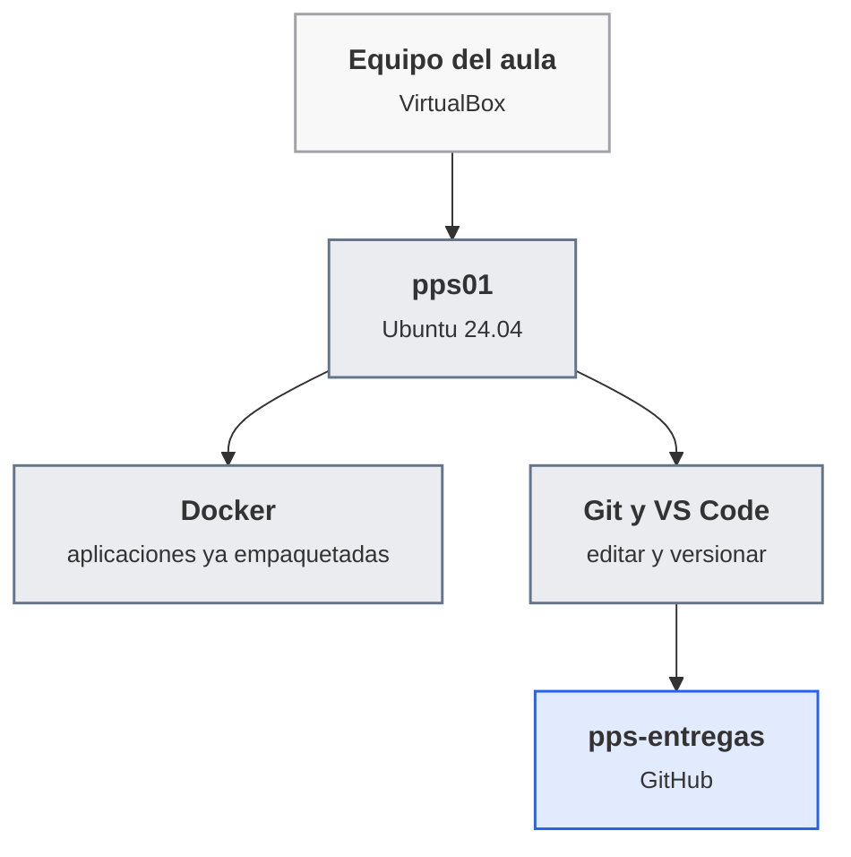
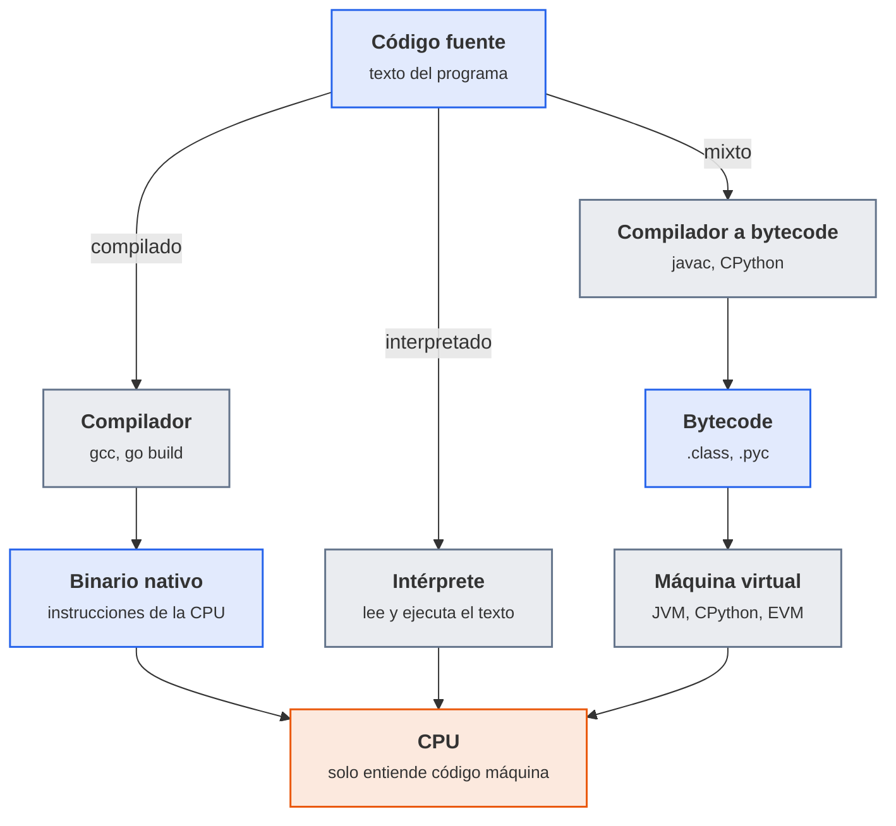
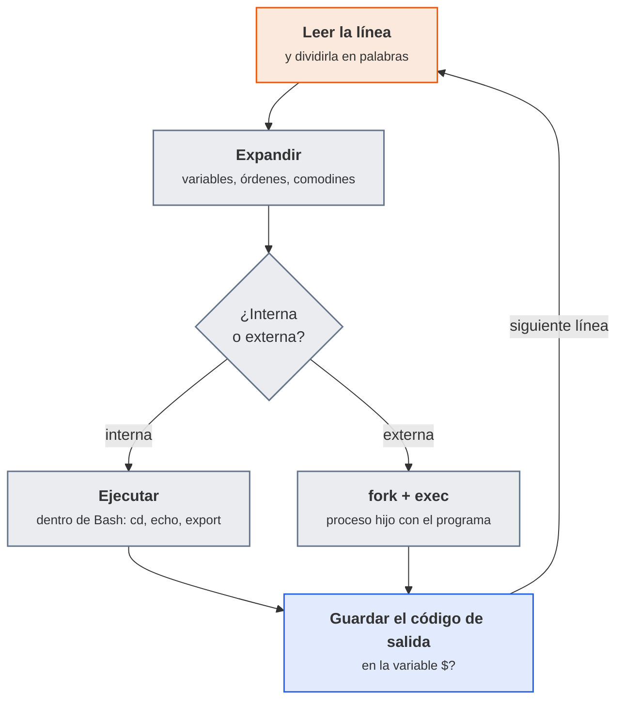
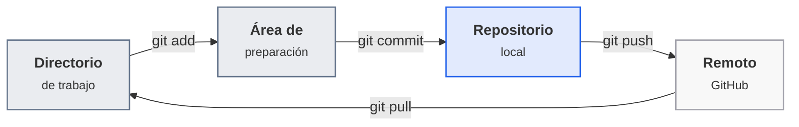
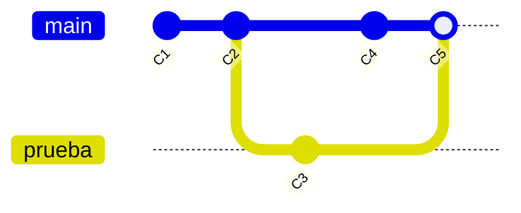

# UT1 · Prueba de aplicaciones

<p class="ut-meta">16 h · Sesiones 1 a 8 · RA1 CE a, b, c, d, e</p>

Antes de buscar fallos de seguridad en una aplicación hay que saber leerla y ponerla en marcha: en qué lenguaje está escrita, qué hace la máquina cuando la ejecuta, cómo se comprueba que cumple lo que promete y qué protecciones da (o no da) el propio lenguaje. Un programa de doce líneas de ensamblador, el mismo ejercicio en Python y en Go, un script de Bash y un contrato inteligente tienen poco en común a primera vista, y sin embargo todos acaban siendo instrucciones que un procesador ejecuta, y todos se prueban y se depuran con las mismas ideas. La unidad recorre esos cinco casos con `nasm` y `gdb` para el ensamblador, `unittest` y `go test` para las pruebas, `bash -x` para el intérprete de órdenes, y CryptoZombies y Learn Git Branching para el contrato inteligente y el control de versiones. Todo se trabaja en la máquina virtual `pps01` del [laboratorio](../laboratorio.md#puesto-de-trabajo) y se guarda en el repositorio `pps-entregas`, que se crea en la primera sesión. Son ocho sesiones (siete de trabajo y una de margen) y cuatro entregas evaluables, ACT_UT1_1 a ACT_UT1_4, con plazo el 22 y el 29 de octubre y el 2 y el 5 de noviembre.

Lo que va más allá de lo que se hace en clase (ampliaciones, otras herramientas y enlaces para seguir) está en [Para ampliar](../ampliacion.md#ut1-prueba-de-aplicaciones).

## Introducción

Esta unidad se lee en el orden en que se da en clase: primero los conceptos y las herramientas que se manejan, y después las ocho sesiones una detrás de otra, cada una con la teoría que se explica ese día y su hoja de práctica. Al final quedan las cuatro entregas con su rúbrica y los errores frecuentes del laboratorio.

### Qué tienes que saber hacer al terminar

- Comparar lenguajes de bajo, medio y alto nivel por su nivel de abstracción, su modelo de ejecución (compilado, interpretado o con máquina virtual) y el control que dan sobre la máquina, y elegir uno para un caso dado (CE a).
- Explicar cómo se ejecuta un programa, desde el código fuente hasta el proceso en marcha, pasando por el binario, el intérprete o la máquina virtual y las llamadas al sistema (CE b).
- Ensamblar, ejecutar y depurar un programa x86-64 sencillo, e identificar en él sus secciones, sus registros y su llamada al sistema (CE b).
- Reconocer los elementos básicos de un programa (variables, tipos, decisiones, bucles, funciones, errores) en Python, Go y Bash, y darles significado (CE c).
- Escribir, ejecutar y depurar pruebas unitarias en Python y en Go, y situar cada prueba en su tipo: unitaria, de integración, de sistema, de aceptación o de regresión (CE d).
- Evaluar qué seguridad da cada lenguaje y su entorno de ejecución (tipado, memoria, aislamiento) y qué riesgos son propios de un contrato inteligente (CE e).
- Entregar el trabajo con Git: clonar, confirmar, subir, crear ramas y fusionarlas (soporte de todas las entregas del curso).

### Los conceptos de la unidad

Un lunes de octubre, un servicio que llevaba meses funcionando empieza a devolver resultados raros después de actualizar una librería. Nadie ha tocado el código propio. Para averiguar qué ha pasado hay que poder leer el código, ejecutarlo paso a paso, ver qué le pide al sistema operativo y comprobar con pruebas automáticas que el comportamiento anterior sigue intacto. Es lo que se entrena aquí, con un objetivo doble: que quien ponga una aplicación en producción sepa qué está poniendo, y que cada comprobación quede escrita y repetible en un repositorio.

| Herramienta o concepto | Qué es, en una frase | Para qué se usa en esta unidad |
|---|---|---|
| VirtualBox y `pps01` | El programa que crea máquinas virtuales y la máquina Ubuntu 24.04 del curso | Tener un puesto igual para todos, aislado del equipo y con instantáneas para volver atrás |
| NASM y `ld` | El ensamblador que traduce mnemónicos a código máquina y el enlazador que produce el ejecutable | Construir el programa x86-64 de la A1.2 |
| `gdb` y el depurador web asmdebugger | Depuradores: ejecutan un programa paso a paso y enseñan registros y memoria | Ver qué hace cada instrucción en la A1.3 |
| `strace` | Muestra las llamadas al sistema que hace un proceso | Comprobar que ensamblador, C y Python acaban pidiendo lo mismo al núcleo |
| Máquina virtual de un lenguaje (CPython, JVM, EVM) | Programa que ejecuta un código intermedio (bytecode) en lugar de instrucciones de la CPU | Entender el tercer modelo de ejecución, junto al binario nativo y al intérprete |
| `unittest` y `go test` | Los marcos de pruebas unitarias de Python y de Go | Escribir tres pruebas, una de ellas fallida a propósito, en la A1.4 y la A1.5 |
| VS Code con las extensiones de Python y de Go | Editor con depurador integrado | Poner puntos de parada y seguir variables en las dos hojas de pruebas |
| Bash y `bash -x` | El intérprete de órdenes de Linux y su modo de traza | Escribir un script, depurarlo y analizar `LearnBash.sh` en la A1.6 |
| Sandbox (entorno aislado) | Espacio donde un programa corre sin poder tocar el resto del sistema | Evaluar qué aislamiento da cada lenguaje y cada entorno de ejecución |
| CryptoZombies y Solidity | Curso guiado en el navegador que enseña a escribir contratos inteligentes en Solidity | Conocer un modelo de ejecución distinto y sus riesgos (A1.7) |
| Git y GitHub | El control de versiones y el servicio donde vive el repositorio `pps-entregas` | Entregar todas las hojas y aprender ramas, fusiones y remotos con Learn Git Branching |
| Tipos de prueba | Unitaria, de integración, de sistema, de aceptación y de regresión | Situar cada comprobación en su nivel y elegir cuál falta |

**Cómo está organizada la unidad.** Cada sesión trae primero la teoría que se explica ese día y después su hoja de práctica. En la sesión 1 se presenta el módulo y se prepara el puesto de trabajo. Las sesiones 2 y 3 son de ensamblador: primero ensamblar, ejecutar y localizar las secciones de un programa, comparándolo con el mismo en C y en Python, y después depurarlo con `gdb`. Las sesiones 4 y 5 repiten un mismo programa en Python y en Go con sus pruebas unitarias y su depuración. La sesión 6 pasa a Bash y compara la seguridad de los tres lenguajes. La sesión 7 añade el contrato inteligente y el control de versiones. La sesión 8 es de margen. Las cuatro entregas no tienen sesión propia: se construyen con las hojas y se cierran por su plazo, como se recoge en las [prácticas evaluables](#practicas-evaluables-de-la-unidad).

### Plan de sesiones

Cada sesión de 110 minutos empieza con una explicación corta y sigue con laboratorio. La columna «Se explica» recoge los apartados de teoría que se desarrollan en clase, con su duración aproximada; la columna «Se practica», el trabajo de laboratorio de esa sesión.

| Sesión | Fecha | Tipo | Se explica | Se practica |
|---:|-------|------|------------|-------------|
| [1](#sesion-1-presentacion-y-puesto-de-trabajo) | 1 oct | Teoría y práctica | Presentación del módulo, evaluación y normas de entrega (20 min); qué necesita un puesto de trabajo reproducible: máquina virtual, Docker, Git y las cuentas del curso (10 min). | Preparar la máquina virtual con Docker, VS Code y Git, crear las cuentas de GitHub, Docker Hub, PortSwigger y Atenea y el repositorio de entregas. |
| [2](#sesion-2-lenguajes-y-modelos-de-ejecucion) | 5 oct | Teoría y práctica | Niveles de los lenguajes; compilados, interpretados y con máquina virtual; cómo se ejecuta un programa (25 min). | Ensamblar y ejecutar un programa x86-64, localizar sus secciones y compararlo con el mismo programa en C y en Python. |
| [3](#sesion-3-ensamblador-y-depurador) | 15 oct | Teoría y práctica | Qué hace un depurador: puntos de parada, registros, pila y memoria (15 min). | Depurar paso a paso el programa anterior con `gdb` y con el depurador web y contestar las preguntas del enunciado. |
| [4](#sesion-4-python-codigo-fuente-pruebas-y-depuracion) | 19 oct | Teoría y práctica | Elementos básicos de un programa; tipos de prueba y estructura de un test unitario (25 min). | Programa en Python con README, tres tests (uno falla a propósito) y depuración en VS Code. |
| [5](#sesion-5-go-pruebas-y-depuracion) | 22 oct | Teoría y práctica | Cómo se compila y se prueba un programa en Go y en qué se diferencia de Python (15 min). | El mismo ejercicio en Go: README, tres tests con `go test` y depuración en VS Code. Plazo de ACT_UT1_1. |
| [6](#sesion-6-bash-y-seguridad-de-los-lenguajes) | 26 oct | Teoría y práctica | Cómo interpreta Bash una orden; qué seguridad ofrece cada lenguaje (25 min). | Script Bash con `bash -x`, análisis de `LearnBash.sh` y comparativa de seguridad de Go, Python y Bash. |
| [7](#sesion-7-contratos-inteligentes-y-control-de-versiones) | 29 oct | Teoría y práctica | La máquina virtual de Ethereum, los contratos y sus riesgos; ramas, fusiones y remotos en Git (25 min). | CryptoZombies y Learn Git Branching (main y remote) con capturas del nivel de logro. Plazo de ACT_UT1_2. |
| [8](#sesion-8-margen-y-repaso-de-la-unidad-1) | 2 nov | Margen | Sin teoría nueva. | Repaso y ampliación, o recuperación de lo perdido. Plazo de ACT_UT1_3. |

Las cuatro entregas (ACT_UT1_1 a ACT_UT1_4) no tienen sesión de práctica evaluable: se construyen con las hojas y se cierran en su fecha. Los criterios de cada una están en [Prácticas evaluables de la unidad](#practicas-evaluables-de-la-unidad).

## Sesión 1 · Presentación y puesto de trabajo

<p class="ut-meta" markdown>1 de octubre · Teoría y práctica · <span class="dur" tabindex="0" aria-label="Presentación y evaluación · 20 min&#10;Puesto de trabajo reproducible · 10 min&#10;A1.1 Puesto de trabajo · 80 min" data-dur="Presentación y evaluación · 20 min&#10;Puesto de trabajo reproducible · 10 min&#10;A1.1 Puesto de trabajo · 80 min">:material-school:<i class="dur-barra" style="--teoria:27%"></i>:material-flask:</span></p>

Al acabar esta sesión hay una máquina virtual `pps01` con Docker, Git y VS Code, las cuentas del curso creadas y un repositorio `pps-entregas` propio, clonado en la máquina y con la primera confirmación subida a GitHub. Antes se explica cómo funciona el módulo (qué se evalúa, cómo se entrega, para qué sirven los márgenes) y por qué el puesto de trabajo se monta como una máquina virtual que se puede reconstruir en minutos.

!!! consulta "Material de partida"
    **Aula** (carpeta `00-General/01 Plantilla lliurable activitats/`): `Normativa_entrega_trabajos.pdf`, con el formato de los documentos que se entregan, y las plantillas de memoria `Plantilla_memoria_tarea.docx` y `Plantilla_memoria_tarea.odt`. **Web**: la plantilla de repositorio del curso anterior, <https://github.com/pkaminasfp/template>. El resto de la sesión (máquina virtual, cuentas, `pps-entregas`) es propio de estos apuntes: el aula de 2024-25 no tiene ficheros sobre él. La presentación completa del módulo está en [Presentación y evaluación](../modulo.md) y el calendario, en [Calendario](../calendario.md).

### Presentación y evaluación

Puesta en producción segura (módulo 5023) responde a una pregunta: qué hay que comprobar y qué hay que corregir para que una aplicación pueda salir a producción sin ser una puerta abierta. Son 59 sesiones de 110 minutos, los lunes y los jueves, repartidas en cinco unidades que coinciden con los cinco resultados de aprendizaje (RA) del currículo.

| Unidad | RA | De qué trata | Sesiones |
|---|---|---|---|
| UT1 · Prueba de aplicaciones | RA1 | Lenguajes, modelos de ejecución, pruebas y seguridad de los lenguajes | 1 a 8 (1 oct a 2 nov) |
| UT2 · Nivel de seguridad requerido | RA2 | ASVS, riesgos y qué nivel de verificación exige cada aplicación | 9 a 14 (5 a 23 nov) |
| UT3 · Vulnerabilidades web | RA3 | Validación de entradas, inyección, sesiones, contraseñas y hardening del servidor | 15 a 27 (26 nov a 25 ene) |
| UT4 · Aplicaciones móviles | RA4 | Permisos, almacenamiento seguro, tráfico y binarios | 29 a 36 (1 a 25 feb) |
| UT5 · Despliegue seguro | RA5 | Control de versiones, integración y despliegue continuos, y recuperación | 37 a 58 (8 mar a 31 may) |

**Cómo se evalúa.** Hay tres tipos de evidencia: las entregas evaluables (las actividades de cada unidad, corregidas con rúbrica en Aules), los retos de Atenea (la plataforma de retos del CCN-CERT, con una captura del nivel de logro como entregable) y dos exámenes, el 28 de enero (RA1, RA2 y RA3) y el 3 de junio (RA4 y RA5). La ponderación entre ellos está en [Presentación y evaluación](../modulo.md). Nunca se recorta un criterio de evaluación: cada uno sale de alguna hoja o entrega.

**Cómo se entrega.** Cada hoja de práctica termina con `git add`, `git commit` y `git push` a `pps-entregas`, en su carpeta (`ut1/a12/`, `ut1/a13/`...), con un `README.md` que cuenta qué se ha hecho, los comandos usados, la comprobación y las capturas. Cuando la entrega es un documento, se sube a la tarea de Aules en PDF, con la estructura de la *Normativa de entrega*: portada, índice, introducción, desarrollo, bibliografía y conclusión; márgenes de 3 cm a los lados y 2,5 cm arriba y abajo, letra de 12 puntos e interlineado de 1,5, y figuras con su pie. Una entrega que no cumple la normativa se corrige como no evaluada.

**Plazos.** Todos vencen a las 23:59 (hora de Madrid) del día indicado. El plazo no se mueve aunque se pierda una clase: lo que se mueve es el contenido, que se recupera en el margen siguiente. Fuera de plazo y sin causa justificada, la entrega se corrige sobre el 50 %.

**Márgenes.** El calendario reserva seis sesiones sin teoría nueva, una al final de cada bloque. Si no se ha perdido ninguna clase se dedican a repaso y ampliación; si se ha perdido alguna, se recupera en ellas lo pendiente (las reglas exactas están en [Calendario](../calendario.md#los-margenes-del-calendario)).

!!! ojo "Solo sobre lo propio o lo autorizado"
    A partir de la UT2 hay prácticas ofensivas (explotar una vulnerabilidad para entenderla y corregirla). Se hacen únicamente contra aplicaciones y máquinas deliberadamente vulnerables del propio laboratorio, en una red aislada, o en los laboratorios de las plataformas que lo autorizan (PortSwigger, DVWA, Atenea). Acceder sin autorización a un sistema ajeno es delito, aunque sea "solo para probar". El criterio es único: solo sobre lo propio o lo autorizado por escrito. Las reglas del laboratorio están en [Red aislada y buenas prácticas](../laboratorio.md#red-aislada-y-buenas-practicas).

### Puesto de trabajo reproducible

Para probar aplicaciones (algunas deliberadamente vulnerables) hace falta un puesto que sea igual para todo el grupo, que no ponga en riesgo el equipo del aula y al que se pueda volver si algo se rompe. La solución es una máquina virtual, `pps01`, con Ubuntu 24.04, y dentro de ella el resto de piezas.



<p class="pie" markdown>Todo lo del curso ocurre dentro de `pps01`; lo único que sale de ella es lo que se sube a `pps-entregas`.</p>

| Pieza | Qué aporta | Cuándo se usa |
|---|---|---|
| Máquina virtual (`pps01`) | Mismo sistema y mismas versiones para todos, aislamiento del equipo y instantáneas para deshacer | Siempre; las aplicaciones vulnerables no salen de ella |
| Docker | Arranca una aplicación ya preparada (una imagen) con una orden, sin instalarla a mano | Desde la UT2 (Log4Shell) y en la UT3 (DVWA, Apache) |
| Git y GitHub | Historial de cada cambio y un sitio donde dejar las entregas | Al terminar cada hoja |
| VS Code | Editor con depurador para Python y Go | A1.4 y A1.5 y el resto del curso |
| Cuentas del curso | GitHub (repositorio), Docker Hub (imágenes), PortSwigger Academy (laboratorios web) y Atenea (retos) | UT1 a UT5 |

Las cuentas usan el usuario `pps<NIA>` (las letras `pps` y el número de identificación del alumno, sin más caracteres) y el correo corporativo. Las contraseñas y los tokens no se guardan nunca en el repositorio ni salen en una captura.

La instantánea es lo que hace seguro el resto del curso. Antes de una práctica con riesgo se guarda el estado de la máquina y, si algo se rompe, se vuelve a él en un minuto:

```bash
VBoxManage snapshot pps01 take a11-base
VBoxManage snapshot pps01 restore a11-base
```

La segunda orden se lanza con la máquina apagada. El mismo resultado se consigue desde el menú Máquina, Tomar instantánea de VirtualBox. Las demás máquinas del curso y lo que hacer cuando algo no arranca están en [Máquinas virtuales](../laboratorio.md#maquinas-virtuales) y en [Si algo se rompe](../laboratorio.md#si-algo-se-rompe).

### A1.1 Puesto de trabajo (sesión 1)

<span class="et et-obj">Objetivo</span> `pps01` arranca y tiene Docker, Git y VS Code; existen tus cuentas de GitHub, Docker Hub, PortSwigger y Atenea; y el repositorio `pps-entregas` está clonado en la máquina con `README.md` y `ut1/README.md` ya subidos.

<span class="et et-pre">Antes de empezar</span> Un equipo con VirtualBox 7.x, la virtualización por hardware activada, 16 GB de RAM y 100 GB libres (los requisitos completos están en [Puesto de trabajo](../laboratorio.md#puesto-de-trabajo)), tu correo corporativo y tu NIA. Se han explicado [cómo funciona el módulo](#presentacion-y-evaluacion) y [qué es un puesto reproducible](#puesto-de-trabajo-reproducible). La instalación de la máquina tiene esperas largas: empieza por ella y haz las cuentas mientras tanto.

<span class="et et-pas">Pasos</span>

1. Crea la máquina, por una de las dos rutas.
    - **Ruta A, importar.** Si el aula publica la imagen `pps01.ova`: en VirtualBox, Archivo, Importar servicio virtualizado, elige el fichero y marca "Reinicializar la dirección MAC de todas las tarjetas de red". Unos 10 minutos. Sigue por el paso 2.
    - **Ruta B, desde la ISO.** Con la ISO de Ubuntu 24.04 LTS de escritorio (unos 6 GB; si no está descargada al empezar la sesión, la instalación se termina en casa y los pasos 2 y 3 no dependen de ella): Nueva, nombre `pps01`, tipo Linux y Ubuntu (64-bit), 4 procesadores, 6144 MB de memoria y disco de 50 GB de reserva dinámica. Si VirtualBox ofrece la instalación desatendida, usa el usuario `alumno` y el nombre de equipo `pps01`; si no, instala con el asistente de Ubuntu con esos mismos valores.
2. En Configuración, Red, deja el adaptador 1 en NAT y activa el adaptador 2 como "Adaptador solo anfitrión". Arranca la máquina; mientras se instala o arranca, sigue con el paso 3.
3. Crea las cuentas con el usuario `pps<NIA>` y el correo corporativo: [GitHub](https://github.com/), [Docker Hub](https://hub.docker.com/signup), [PortSwigger Academy](https://portswigger.net/users/register) y [Atenea](https://atenea.ccn-cert.cni.es/registro) (esta última con tu correo de la Generalitat; puede pedir confirmación por correo). Guarda las contraseñas en un gestor de contraseñas o en un cuaderno tuyo, nunca en un fichero del repositorio.
4. En GitHub, New repository: nombre `pps-entregas`, privado y **sin marcar** ninguna casilla de inicialización. La plantilla del curso anterior no está marcada como plantilla en GitHub, así que no existe el botón "Use this template": se usará como modelo de `README.md`. En Settings, Collaborators, añade a quien corrige, con el usuario que indique el profesor.
5. Dentro de `pps01`, instala las herramientas. En un aula con treinta equipos descargando a la vez tarda entre 5 y 15 minutos:

    ```bash
    sudo apt update && sudo apt install -y git curl build-essential docker.io
    sudo usermod -aG docker "$USER"
    sudo snap install code --classic
    ```

    Cierra la sesión gráfica y vuelve a entrar (el grupo `docker` solo se aplica en una sesión nueva). Comprueba con `docker run --rm hello-world`, que debe terminar con `Hello from Docker!`.
6. Configura Git y crea la clave SSH con la que se sube al repositorio, sin escribir contraseñas cada vez:

    ```bash
    git config --global user.name "pps<NIA>"
    git config --global user.email "<tu correo corporativo>"
    ssh-keygen -t ed25519 -C "pps<NIA>@pps01"
    cat ~/.ssh/id_ed25519.pub
    ```

    Copia la línea que muestra `cat` en GitHub, Settings, SSH and GPG keys, New SSH key. Prueba con `ssh -T git@github.com`: la primera vez pregunta si se confía en el servidor (compara la huella con la [publicada por GitHub](https://docs.github.com/en/authentication/keeping-your-account-and-data-secure/githubs-ssh-key-fingerprints)) y responde con tu usuario.
7. Clona el repositorio y la plantilla, y prepara la primera confirmación:

    ```bash
    git clone git@github.com:pps<NIA>/pps-entregas.git ~/pps-entregas
    git clone https://github.com/pkaminasfp/template.git ~/plantilla
    cd ~/pps-entregas && git branch -M main && mkdir -p ut1 && cp ~/plantilla/README.md README.md
    ```

    Edita `README.md` (título `PPS entregas de pps<NIA>`, una lista con las cinco unidades y el árbol de carpetas que vas a usar, como hace la plantilla) y crea `ut1/README.md` con una tabla de las hojas A1.1 a A1.7 y una columna "Estado". El aviso de "empty repository" al clonar es normal.
8. Fija la IP de `pps01` en la red solo anfitrión. Las demás hojas y unidades dan por hecho que es `192.168.56.10`, y el DHCP de VirtualBox no la garantiza. Ubuntu de escritorio usa NetworkManager: mira qué conexión tiene el segundo adaptador (el que no tiene ya la `10.0.2.x` del NAT) y ponle la dirección a mano, sin puerta de enlace para no romper la salida a Internet por el NAT:

    ```bash
    ip -br a
    nmcli -f NAME,DEVICE con show
    sudo nmcli con modify "Wired connection 2" ipv4.method manual ipv4.addresses 192.168.56.10/24 ipv4.never-default yes
    sudo nmcli con up "Wired connection 2"
    ```

    Sustituye `Wired connection 2` por el nombre que haya mostrado `nmcli` para la interfaz del segundo adaptador (normalmente `enp0s8`). Comprueba con `ip -br a`, que debe mostrar `192.168.56.10/24` en esa interfaz, y con `ping -c 2 192.168.56.1` (el anfitrión). Si el ping no responde, revisa que el adaptador 2 esté en "solo anfitrión" y que la máquina lleve un rato encendida con ese adaptador activo.
9. Sube el resultado y toma la instantánea de la máquina:

    ```bash
    git add . && git commit -m "A1.1 puesto de trabajo" && git push -u origin main
    ```

    Apaga `pps01` y, en VirtualBox, toma una instantánea llamada `a11-base` (o la orden `VBoxManage snapshot pps01 take a11-base` desde el equipo anfitrión).

<span class="et et-com">Comprobación</span> `ip -br a` muestra `192.168.56.10/24` y `ping -c 2 192.168.56.1` responde; `docker run --rm hello-world` responde sin `sudo`; `git --version` y `code --version` dan una versión; `ssh -T git@github.com` te saluda por tu usuario; `git status` en `~/pps-entregas` dice `nothing to commit` y en la página del repositorio en GitHub se ven `README.md` y `ut1/README.md`. Si algo falla, mira [Errores frecuentes](#errores-frecuentes-en-el-laboratorio).

<span class="et et-ent">Entrega</span> La A1.1 no se califica. Desde la primera entrega evaluable (ACT_UT1_1, plazo el 22 de octubre) la URL de `pps-entregas` se indica en la tarea de Aules; comprueba que quien corrige tiene acceso.

<span class="et et-ext">Si te sobra tiempo</span> Activa la verificación en dos pasos en tu cuenta de GitHub y anota en `ut1/README.md` que lo has hecho. Después practica la instantánea: crea un fichero de prueba en `/opt`, apaga la máquina, restaura `a11-base` y comprueba que ha desaparecido.

## Sesión 2 · Lenguajes y modelos de ejecución

<p class="ut-meta" markdown>5 de octubre · Teoría y práctica · <span class="dur" tabindex="0" aria-label="Niveles de los lenguajes · 5 min&#10;Compilados, interpretados y con máquina virtual · 10 min&#10;De la CPU al programa en marcha · 10 min&#10;A1.2 Ensamblador: lectura y ejecución · 85 min" data-dur="Niveles de los lenguajes · 5 min&#10;Compilados, interpretados y con máquina virtual · 10 min&#10;De la CPU al programa en marcha · 10 min&#10;A1.2 Ensamblador: lectura y ejecución · 85 min">:material-school:<i class="dur-barra" style="--teoria:23%"></i>:material-flask:</span></p>

Al acabar esta sesión hay un programa de ensamblador x86-64 ensamblado, enlazado y ejecutado en `pps01`, con sus secciones localizadas y con sus dos fallos encontrados y corregidos, y una tabla que lo compara con el mismo programa escrito en C y en Python. La teoría da el mapa antes de tocar nada: en qué niveles se escriben los programas, de qué tres maneras llegan a ejecutarse y qué ocurre entre la CPU y el sistema operativo cuando un programa escribe algo en pantalla.

!!! consulta "Material de partida"
    **Aula** (carpeta `RA1-Prueba-aplicaciones/`): `01 ACT_RA1_1 - Proves d'aplicacions/UD_1.pdf` (el enunciado: lecturas 3.1 y 3.2 y el programa de 3.3) y `R_UD_1.pdf` (la rúbrica); `02 Fonaments de programació/FUN_PRO.pdf` (un capítulo de un libro de C++, solo como referencia de fondo); `04 Material/How Python Works.pdf` y `How Java Works.pdf` (dos artículos sobre bytecode y máquina virtual). **Web** que ya usaba el material: <https://gpfault.net/posts/asm-tut-0.txt.html> (introducción a x86-64, pero escrita para Windows, con FASM y WinDbg: sirve para las ideas, no para las órdenes), <https://web.stanford.edu/class/cs107/guide/x86-64.html> (guía de registros y direccionamiento, en sintaxis AT&T) y <https://www.w0lff4ng.org/conceptos-basicos-de-assembler-y-debugger/> (ensamblador y depurador con NASM). **Apuntes de terceros**: *Apuntes de Puesta en Producción Segura*, unidad 1, apartados de fundamentos, lenguajes y ejecución (licencia CC BY-NC-SA 4.0), <https://github.com/EloyAlbiach/PPS/tree/main/pruebas>, y *Ciberseguridad-PePS*, tema 0, «Iniciación a la programación», <https://psegarrac.github.io/Ciberseguridad-PePS/tema0/iniciaci%C3%B3n/a/la/programaci%C3%B3n/2021/06/01/Iniciaci%C3%B3n-a-la-programaci%C3%B3n.html>. La atribución completa está en [Material de partida](../material.md).

### Niveles de los lenguajes

Un lenguaje de programación se coloca en un nivel según lo cerca que esté de la máquina. Cuanto más bajo, más control sobre el procesador y la memoria y menos ayuda; cuanto más alto, al revés. Esa escala es la primera forma de comparar lenguajes (CE a) y ya anticipa la de seguridad: lo que el lenguaje no controla, tiene que controlarlo quien programa.

| Nivel | Ejemplos | Qué controla quien programa | Qué le da el lenguaje |
|---|---|---|---|
| Código máquina | Bytes como `48 c7 c0 01 00 00 00` (la instrucción `mov rax, 1`) | Todo, instrucción a instrucción | Nada; es lo único que la CPU entiende |
| Ensamblador | NASM, GAS | Registros, memoria y llamadas al sistema; depende de la CPU | Nombres legibles (`mov`) en lugar de bytes |
| Medio | C | Direcciones de memoria (punteros) y estructuras | Funciones, tipos y bucles, pero ninguna gestión de memoria |
| Alto, propósito general | Python, Go, Java, C# | Lógica del programa | Tipos, funciones, objetos y, casi siempre, gestión automática de la memoria |
| Alto, dominio específico | SQL, HTML, Bash | Consultas, documentos u órdenes | Un vocabulario para un solo tipo de tarea |
| Muy alto | Prolog, Haskell, Scratch | Qué se quiere, no cómo | Casi todo el "cómo" lo resuelve el lenguaje |

El nivel no dice cómo se ejecuta el programa: dos lenguajes del mismo nivel pueden ejecutarse de maneras muy distintas.

### Compilados, interpretados y con máquina virtual

Un mismo programa de una línea, imprimir `Hello World!`, se ejecuta de tres maneras según el lenguaje: `gcc hola.c -o hola && ./hola` (se traduce entero a instrucciones de la CPU y luego se lanza), `python3 hola.py` (un programa, el intérprete, lee el texto y lo va ejecutando) o `javac Hola.java && java Hola` (se traduce a un código intermedio que ejecuta otro programa, la máquina virtual). Esos son los tres modelos de ejecución de la unidad (CE b).



<p class="pie" markdown>En los tres caminos la CPU solo ejecuta código máquina; lo que cambia es quién lo produce y cuándo. El intérprete y la máquina virtual son, a su vez, programas nativos.</p>

| Modelo | Qué se distribuye | Ventajas | Inconvenientes | Ejemplos |
|---|---|---|---|---|
| Compilado (nativo) | Un binario para una arquitectura y un sistema | Rápido, sin nada instalado aparte, errores de sintaxis y de tipos al compilar | Hay que recompilar para cada plataforma | Ensamblador, C, Go |
| Interpretado | El propio código fuente | Portable, se prueba al momento sin compilar | Más lento; los errores aparecen al ejecutar la línea que falla | Bash, PHP, JavaScript |
| Con máquina virtual | Un código intermedio (bytecode) | Portable, y la máquina virtual puede comprobar y aislar | Necesita la máquina virtual instalada; arranque más lento | Java, C#, Python, contratos de Ethereum |

Un matiz que evita confusiones: compilado o interpretado no es una propiedad del lenguaje sino de cómo se implementa. El Python habitual (CPython) compila el texto a bytecode dentro del propio programa y lo ejecuta en su máquina virtual; el módulo importado deja ese bytecode en `__pycache__/*.pyc`. Con `python3 -m dis hola.py` se ve el bytecode, y con `gcc -S hola.c` el ensamblador que genera el compilador de C. Los compiladores *JIT* (Just In Time) mezclan las dos cosas: traducen a código nativo mientras el programa corre.

### De la CPU al programa en marcha

Todo programa, sea del modelo que sea, acaba siendo una secuencia de instrucciones que la CPU repite en un ciclo: leer la instrucción a la que apunta el contador de programa (el registro `rip`), decodificarla, ejecutarla y avanzar. Los datos con los que trabaja viven en los registros (posiciones de 64 bits dentro de la CPU) o en la memoria. Para leer ensamblador x86-64 bastan seis registros:

| Registro | Uso en Linux |
|---|---|
| `rax` | Número de la llamada al sistema al entrar y valor devuelto al salir |
| `rdi`, `rsi`, `rdx` | Primer, segundo y tercer argumento de la llamada al sistema |
| `rip` | Dirección de la siguiente instrucción |
| `rsp` | Cima de la pila |

Un ejecutable de Linux tiene formato ELF (*Executable and Linkable Format*): unas cabeceras y varias secciones. Al lanzarlo, el núcleo lee las cabeceras y coloca cada sección en la memoria del nuevo proceso, con sus permisos:

| Sección o zona | Qué contiene | Permisos |
|---|---|---|
| `.text` | Las instrucciones del programa | Lectura y ejecución |
| `.data` | Datos con valor inicial (un texto, una constante) | Lectura y escritura |
| `.bss` | Datos sin valor inicial, a cero al empezar | Lectura y escritura |
| Pila (*stack*) | Variables locales y direcciones de retorno; al arrancar lleva los argumentos del programa | Lectura y escritura |

Un programa no puede escribir en pantalla ni abrir un fichero por su cuenta: se lo pide al núcleo con una llamada al sistema. En x86-64 Linux siempre tiene la misma forma: se carga el número de la llamada en `rax`, sus argumentos en `rdi`, `rsi` y `rdx`, y se ejecuta la instrucción `syscall`. El resultado vuelve en `rax`. Dos llamadas bastan para casi todos los programas de ejemplo:

| Llamada | Número | Argumentos | Qué hace |
|---|---|---|---|
| `write` | 1 | Descriptor (1 es la salida estándar), dirección del texto, número de bytes | Escribe bytes |
| `exit` | 60 | Código de salida | Termina el proceso |

Los números salen de `grep -E '__NR_(write|exit) ' /usr/include/x86_64-linux-gnu/asm/unistd_64.h`, y `man 2 write` documenta los argumentos. La consecuencia para seguridad es directa: **todo lo que un programa hace hacia fuera pasa por llamadas al sistema**, escrito en el lenguaje que sea, y por eso `strace` lo ve todo y los entornos aislados (contenedores, sandboxes) funcionan filtrando esas llamadas.

Una carga de `write` en NASM, con la sintaxis Intel que usa el enunciado, tiene esta forma (el primer operando es el destino):

```nasm
mov rax, 1          ; número de la llamada: write
mov rdi, 1          ; descriptor: salida estándar
mov rsi, message    ; dirección donde está el texto
mov rdx, 13         ; cuántos bytes escribir
syscall             ; pedir al núcleo que lo haga
```

En la sintaxis AT&T, la de la guía de Stanford y la que muestra `gdb` por defecto, el orden es el contrario y los registros llevan `%` (`mov $1, %rax`). Conviene saber cuál se está leyendo antes de interpretar una línea. Además, el número de bytes se cuenta, no se adivina: cada carácter ocupa un byte, y el salto de línea es otro (el código 10).

### A1.2 Ensamblador: lectura y ejecución (sesión 2)

<span class="et et-obj">Objetivo</span> Ensamblar, enlazar y ejecutar el programa del enunciado, encontrar por qué no se comporta como se explica, corregirlo, localizar sus secciones y compararlo con el mismo programa en C y en Python, con una tabla de mediciones y el resumen de las dos lecturas. Cubre los puntos 3.1, 3.2, 3.3.1 y 3.3.2 del enunciado de ACT_UT1_1.

<span class="et et-pre">Antes de empezar</span> `pps01` con `build-essential` (de la [A1.1](#a11-puesto-de-trabajo-sesion-1)) y el repositorio `~/pps-entregas`. Se han explicado los [niveles de los lenguajes](#niveles-de-los-lenguajes), los [tres modelos de ejecución](#compilados-interpretados-y-con-maquina-virtual) y [cómo llega un programa de la CPU al proceso](#de-la-cpu-al-programa-en-marcha), incluida la forma de una llamada al sistema. El enunciado original (`UD_1.pdf`) sigue siendo la referencia de lo que se entrega.

<span class="et et-pas">Pasos</span>

1. Instala las herramientas y comprueba la versión de NASM:

    ```bash
    sudo apt install -y nasm gdb strace
    nasm -v
    ```

2. Crea `~/pps-entregas/ut1/a12/` y en ella `hola_enunciado.asm` con el programa del punto 3.3, copiado tal cual. La primera línea del recuadro del enunciado (`x86_64`) es la etiqueta del lenguaje y no forma parte del programa: no la copies.

    ```nasm
    global _start

    section .data
    message: db "Hello World!", 10

    section .text
    _start:
        mov rax, 1
        mov rdi, 1
        mov rsi, message
        mov rdx, 14
        syscall

        mov rax, 60
        xor rdi, rdi
    ```

3. Ensambla, enlaza y ejecuta (punto 3.3.1). `nasm` produce el fichero objeto, `ld` lo convierte en ejecutable y `echo $?` muestra el código de salida del programa:

    ```bash
    nasm -f elf64 hola_enunciado.asm -o hola_enunciado.o
    ld hola_enunciado.o -o hola_enunciado
    ./hola_enunciado
    echo $?
    ```

4. Anota la salida (punto 3.3.2) y lo que no cuadra con lo que explica el enunciado. Cuenta con `./hola_enunciado | od -c` cuántos bytes salen y cuáles son. Hay dos anomalías: una está en el número de bytes (cuenta los caracteres de `message`, salto de línea incluido, y compáralo con `rdx`) y la otra en cómo termina el proceso (compara el final del programa con la forma de la llamada a `write`: cuántas instrucciones lleva).
5. Copia el fichero a `hola.asm`, corrige las dos anomalías, y repite el paso 3 con esos nombres. Comprueba que `./hola` imprime una línea, que `echo $?` da `0` y que `./hola | wc -c` da `13`. Deja `hola_enunciado.asm` sin tocar: es la prueba de lo que había.
6. Localiza las secciones del ejecutable. Responde en el README a tres preguntas: en qué sección está el texto y en cuál el código, qué dirección tiene `_start` y si coincide con el punto de entrada, y cuántos bytes ocupa `.text`:

    ```bash
    readelf -h hola | grep 'Entry point'
    readelf -S hola
    nm hola
    objdump -d -M intel hola
    objdump -s -j .data hola
    ```

    Es posible que `objdump` muestre `mov eax,0x1` donde el fuente dice `mov rax, 1`: NASM elige la codificación más corta, y escribir en `eax` deja a cero la mitad alta de `rax`, así que el efecto es el mismo.
7. Escribe el mismo programa en C y en Python y compílalo:

    ```bash
    printf '#include <stdio.h>\n\nint main(void) {\n    printf("Hello World!\\n");\n    return 0;\n}\n' > hola.c
    gcc hola.c -o hola_c
    echo 'print("Hello World!")' > hola.py
    ```

8. Mide los tres programas y rellena la tabla del README con líneas de código, tamaño, tipo de ejecutable, librerías y número de llamadas al sistema. Después comprueba que los tres acaban pidiendo lo mismo al núcleo:

    ```bash
    wc -l hola.asm hola.c hola.py
    ls -l hola hola_c
    file hola hola_c
    ldd hola
    ldd hola_c
    strace ./hola 2>&1 >/dev/null | wc -l
    strace ./hola_c 2>&1 >/dev/null | wc -l
    strace python3 hola.py 2>&1 >/dev/null | wc -l
    strace -e trace=write ./hola_c
    strace -e trace=write python3 hola.py
    ```

9. Lee los materiales de los puntos 3.1 y 3.2 y escribe en el README un resumen propio de cinco líneas de cada uno: la [guía de x86-64 de Stanford](https://web.stanford.edu/class/cs107/guide/x86-64.html) (registros y direccionamiento; ojo, usa sintaxis AT&T) y el artículo de [conceptos básicos de ensamblador y depurador](https://www.w0lff4ng.org/conceptos-basicos-de-assembler-y-debugger/). De la introducción de la [serie de gpfault](https://gpfault.net/posts/asm-tut-0.txt.html) basta la parte que explica qué es un ensamblador y qué es un depurador: el resto es para Windows. Estas lecturas son el 50 % de la nota del CE a: si no caben en clase, se terminan en casa antes del plazo.
10. Escribe `ut1/a12/README.md` (comandos del paso 3, salida y las dos anomalías con su causa, respuestas del paso 6, tabla del paso 8 y resúmenes del paso 9), y haz `git add`, `git commit` y `git push`.

<span class="et et-com">Comprobación</span> `./hola` imprime `Hello World!` y termina con código 0; `./hola | wc -c` da 13; `./hola_enunciado` termina con `Segmentation fault` y código 139. En la tabla, los tres programas muestran `write(1, "Hello World!\n", 13)` como llamada de escritura, y el número de llamadas al sistema crece del ensamblador (unas pocas) al C (decenas) y a Python (centenares). Si `nasm` da un error en la primera línea, has copiado `x86_64`; si `ld` avisa de que no encuentra `_start`, falta `global _start`.

<span class="et et-ent">Entrega</span> La carpeta `ut1/a12/` de `pps-entregas` con `hola_enunciado.asm`, `hola.asm`, `hola.c`, `hola.py` y el `README.md`. Forma parte de la entrega ACT_UT1_1 (plazo el jueves 22 de octubre, 23:59), cuyo PDF se compone con esta hoja y la A1.3: los criterios están en [Prácticas evaluables](#practicas-evaluables-de-la-unidad).

## Sesión 3 · Ensamblador y depurador

<p class="ut-meta" markdown>15 de octubre · Teoría y práctica · <span class="dur" tabindex="0" aria-label="Qué hace un depurador · 15 min&#10;A1.3 Depuración en ensamblador · 95 min" data-dur="Qué hace un depurador · 15 min&#10;A1.3 Depuración en ensamblador · 95 min">:material-school:<i class="dur-barra" style="--teoria:14%"></i>:material-flask:</span></p>

Al acabar esta sesión el programa de la A1.2 está depurado instrucción a instrucción con `gdb`, con una tabla que dice qué registro cambia en cada paso y por qué el programa del enunciado se cae al final, y un segundo ejercicio hecho en el depurador web. Con eso quedan contestadas las tres preguntas del punto 3.3 del enunciado (ejecutar, salida y análisis con el depurador). La teoría explica qué permite ver un depurador y qué órdenes de `gdb` bastan para la hoja.

!!! consulta "Material de partida"
    **Aula**: el mismo enunciado, `01 ACT_RA1_1 - Proves d'aplicacions/UD_1.pdf`, punto 3.3.3 (analizar el código con el depurador ensamblador) y la rúbrica `R_UD_1.pdf`. **Web** que ya usaba el material: <http://asmdebugger.com/> y <https://www.w0lff4ng.org/conceptos-basicos-de-assembler-y-debugger/>. Ese depurador web es un emulador pequeño: solo conoce los registros de 32 bits `eax`, `ebx`, `ecx` y `edx` y una treintena de instrucciones (`mov`, `add`, `sub`, `mul`, `div`, `inc`, `dec`, `cmp`, saltos y `loop`), y no entiende `syscall`, secciones ni registros de 64 bits, así que **no puede ejecutar el programa del enunciado tal como está**. La hoja lo usa con un ejercicio equivalente en registros de 32 bits, y el análisis del programa real se hace con `gdb`, que es el depurador de verdad. Documentación de `gdb`: <https://sourceware.org/gdb/current/onlinedocs/gdb.html>.

### Qué hace un depurador

Un depurador ejecuta un programa bajo control: lo detiene donde se le pide y enseña el estado exacto de la máquina en ese punto. Sirve para sustituir la suposición («debería valer 13») por la lectura («vale 14»), y es la herramienta con la que se descubre qué hace de verdad un binario cuando no se tiene el fuente, algo habitual en seguridad. En el sistema real el proceso corre de verdad, con lo que eso implica: un programa desconocido se depura solo dentro de la máquina virtual aislada.

| Concepto | Qué es | Orden de `gdb` |
|---|---|---|
| Punto de parada (*breakpoint*; «punto de interrupción» en VS Code) | Un lugar donde el programa se detiene | `break _start` (`b`) |
| Paso a paso | Ejecutar una sola instrucción y volver a parar | `stepi` (`si`); `nexti` (`ni`) no entra en las llamadas |
| Continuar | Seguir hasta el siguiente punto de parada o el final | `continue` (`c`) |
| Registros | Los valores de la CPU en este instante | `info registers rax rdi` (`i r`), `p $rax` |
| Memoria | El contenido de cualquier dirección | `x/14xb $rsi` (14 bytes en hexadecimal), `x/s $rsi` (como texto), `x/8i $rip` (las 8 instrucciones siguientes) |
| Pila | La zona apuntada por `rsp`, que crece hacia direcciones bajas | `x/4gx $rsp` (cuatro palabras de 8 bytes) |
| Señal | El aviso que el núcleo manda al proceso, por ejemplo `SIGSEGV` cuando accede a memoria que no es suya | `gdb` se detiene solo y lo indica |

La orden `x` sigue el formato `x/NFU dirección`: `N` es cuántos elementos, `F` el formato (`x` hexadecimal, `d` decimal, `s` texto, `i` instrucciones, `c` carácter) y `U` el tamaño (`b` byte, `w` 4 bytes, `g` 8 bytes). Por dentro, `gdb` usa `ptrace` para controlar el proceso y coloca un byte especial (`int3`) en el lugar del punto de parada.

Dos detalles evitan confusiones. `gdb` muestra por defecto la sintaxis AT&T: con `set disassembly-flavor intel` cambia a la del enunciado. Y compilar con información de depuración (`nasm -g -F dwarf`) permite que `gdb` relacione cada instrucción con su línea del fuente; sin ella, funciona igual, pero solo con direcciones.

El depurador web y `gdb` son cosas distintas: `gdb` controla un proceso real (llamadas al sistema y memoria del ELF), mientras que el web emula un subconjunto de instrucciones y enseña cada registro y bandera (`zf`, `cf`, `sf`, `of`) cambiando, lo que aclara bucles y comparaciones.

### A1.3 Depuración en ensamblador (sesión 3)

<span class="et et-obj">Objetivo</span> Depurar con `gdb` el programa de la A1.2 hasta ver el valor de cada registro antes y después de cada instrucción, explicar con evidencias el fallo del final, y hacer un ejercicio equivalente en el depurador web. Cubre el punto 3.3.3 del enunciado de ACT_UT1_1 y deja el README que responde a las tres preguntas del 3.3.

<span class="et et-pre">Antes de empezar</span> La carpeta `ut1/a12/` de la [A1.2](#a12-ensamblador-lectura-y-ejecucion-sesion-2) con `hola_enunciado.asm` y `hola.asm`. Se ha explicado [qué hace un depurador](#que-hace-un-depurador) y las órdenes de `gdb`.

<span class="et et-pas">Pasos</span>

1. Crea `~/pps-entregas/ut1/a13/`, copia allí los dos `.asm` y deja `gdb` con la sintaxis del enunciado. Ensambla con información de depuración:

    ```bash
    echo 'set disassembly-flavor intel' >> ~/.gdbinit
    nasm -f elf64 -g -F dwarf hola_enunciado.asm -o hola_enunciado.o && ld hola_enunciado.o -o hola_enunciado
    nasm -f elf64 -g -F dwarf hola.asm -o hola.o && ld hola.o -o hola
    ```

2. Depura el programa del enunciado. Abre `gdb -q ./hola_enunciado`, pon un punto de parada al principio y ejecuta:

    ```text
    (gdb) break _start
    (gdb) run
    (gdb) x/8i $rip
    (gdb) info registers rax rdi rsi rdx
    ```

3. Avanza con `stepi` una instrucción cada vez. Tras cada una, mira `info registers rax rdi rsi rdx` y apunta en una tabla del README, por cada instrucción, qué registro cambia y a qué valor. Antes del `syscall`, comprueba lo que va a escribir con `x/s $rsi` y con `x/14xb $rsi`.
4. Ejecuta el `syscall` de `write` con `stepi` y mira `info registers rax`: es el valor que devuelve la llamada, el número de bytes escritos. Apúntalo, y compáralo con lo que debería devolver.
5. Sigue con `stepi` hasta pasar `xor rdi, rdi`. Con `x/3i $rip` mira qué instrucción hay a continuación (una que nadie escribió) y da un `stepi` más: `gdb` avisa de `SIGSEGV`. Con `info registers rax` averigua qué valor tenía `rax` y explica en el README por qué esa instrucción lo usa como dirección y por qué falla.
6. Sal con `quit` y repite los pasos 2 a 4 con el programa corregido (`./hola`); después sigue hasta el final: no se cae y la ejecución termina con `exited normally`. Comprueba con `p $_exitcode` que el código de salida es 0.
7. Abre <http://asmdebugger.com/>, borra el ejemplo y pega este ejercicio, que suma 5, 4, 3, 2 y 1. Pulsa "Next Instruction" y, a cada paso, mira `eax`, `ecx` y la bandera `zf`:

    ```nasm
    start:
        mov eax, 0
        mov ecx, 5
    suma:
        add eax, ecx
        dec ecx
        jnz suma
    exit:
    ```

    Anota los valores de `eax` al final de cada vuelta, cuántas vueltas da el bucle y cuándo se activa `zf` y por qué se sale. Escribe también qué instrucciones del programa de la A1.2 no podría ejecutar este depurador y por qué.
8. Escribe `ut1/a13/README.md` con las tres respuestas del punto 3.3 del enunciado: los comandos para ejecutar el programa (3.3.1, con un enlace a la A1.2), su salida real y la esperada (3.3.2) y el análisis con los depuradores (3.3.3: la tabla del paso 3, el valor de `rax` tras `write`, la explicación de `SIGSEGV` y el ejercicio del paso 7). Añade una captura de `gdb` parado en `SIGSEGV` y otra del depurador web, con su pie. Haz `git add`, `git commit` y `git push`.

<span class="et et-com">Comprobación</span> La tabla del paso 3 tiene una fila por instrucción y dice que, con el programa del enunciado, `rax` vale 14 tras `write`, y que con el corregido vale 13. `gdb` se detuvo con `SIGSEGV` con `rax` a 60 (0x3c). En el depurador web, `eax` acaba en 15 y `zf` pasa a 1 cuando `ecx` llega a 0. Si `gdb` muestra las instrucciones al revés (`mov $0x1,%eax`), falta el `.gdbinit` del paso 1.

<span class="et et-ent">Entrega</span> La carpeta `ut1/a13/` de `pps-entregas` con los dos `.asm` y el `README.md` (con las dos capturas). Forma parte de la entrega ACT_UT1_1 (plazo el jueves 22 de octubre, 23:59): con esta hoja y la A1.2 se compone el PDF que se sube a Aules, con la estructura de la normativa (portada, índice, introducción, desarrollo, bibliografía y conclusión). Los criterios están en [Prácticas evaluables](#practicas-evaluables-de-la-unidad).

<span class="et et-ext">Si te sobra tiempo</span> Pon un punto de captura sobre la llamada al sistema con `catch syscall write` en `gdb` y da `continue`: se detiene antes y después de la llamada y enseña su nombre. Compara con lo que mostraba `strace` en la A1.2. Prueba también `layout regs` para ver los registros y el código en una sola pantalla. Mira la pila al arrancar: en `gdb -q ./hola`, con `break _start` y `run`, ejecuta `x/gx $rsp` (el número de argumentos, 1) y `x/s *(char**)($rsp+8)` (el nombre del programa); repite con `run uno dos` y verás cómo el núcleo deja los argumentos en la pila.

## Sesión 4 · Python: código fuente, pruebas y depuración

<p class="ut-meta" markdown>19 de octubre · Teoría y práctica · <span class="dur" tabindex="0" aria-label="Elementos de un programa · 10 min&#10;Tipos de prueba y test unitario · 15 min&#10;A1.4 Python: programa, tests y depuración · 85 min" data-dur="Elementos de un programa · 10 min&#10;Tipos de prueba y test unitario · 15 min&#10;A1.4 Python: programa, tests y depuración · 85 min">:material-school:<i class="dur-barra" style="--teoria:23%"></i>:material-flask:</span></p>

Al acabar esta sesión hay un programa en Python de unas treinta líneas, con su README, tres pruebas unitarias (una fallida a propósito) que se ejecutan con una orden, y una sesión de depuración en VS Code con un punto de interrupción y las variables a la vista. La teoría da el vocabulario para leer cualquier código (los elementos de un programa) y la clasificación de las pruebas, y fija las tres ideas que hacen buena a una prueba unitaria.

!!! consulta "Material de partida"
    **Aula**: `03 ACT_RA1_2 - Execució d'aplicacions/ACT_2.pdf` (enunciado de ACT_UT1_2: programa en Python y en Go con README, tres tests unitarios de los que uno falla, y depuración en VS Code) y su rúbrica `R_ACT_2.pdf`; `04 Material/How Python Works.pdf` y `How Java Works.pdf` (lectura del punto 3.1); `06 Python/python_1.pdf` (instalación de Anaconda y Jupyter) y `python_2.pdf` (conceptos básicos de Python, como referencia). **Web** que ya usaba el material: <https://docs.python.org/es/3/library/unittest.html>. **Apuntes de terceros**: *Apuntes de Puesta en Producción Segura*, unidad 1, apartados «Elementos de un programa» y «Tipos de pruebas» (licencia CC BY-NC-SA 4.0), <https://github.com/EloyAlbiach/PPS/tree/main/pruebas>, y *Ciberseguridad-PePS*, tema 2, «Aplicación en Python», <https://psegarrac.github.io/Ciberseguridad-PePS/tema2/aplicaci%C3%B3n/en/python/2021/06/01/Aplicaci%C3%B3n-en-python.html>. Atribución completa en [Material de partida](../material.md). El material del aula instala Anaconda; en `pps01` el Python del sistema basta y evita una instalación de varios gigabytes.

### Elementos de un programa

Leer código desconocido es una habilidad de seguridad tanto como de programación: lo primero que se busca son los mismos cinco elementos, en este orden. El punto de entrada (por dónde empieza), los datos (variables y constantes, y de qué tipo), las decisiones y los bucles (por dónde puede ir la ejecución), las funciones (qué trozos se reutilizan) y todo lo que toca el exterior (argumentos, ficheros, red, y qué pasa cuando algo falla). El programa que se usa desde aquí en Python, en Go y en Bash clasifica un número de puerto según los rangos de la IANA (0 a 1023 del sistema, 1024 a 49151 de usuario, el resto dinámicos), y lleva anotados sus elementos:

```python
"""Clasifica puertos TCP/UDP según los rangos de la IANA."""
import sys

LIMITE_SISTEMA = 1023   # constante: de 0 a 1023, puertos del sistema
LIMITE_USUARIO = 49151  # de 1024 a 49151, puertos de usuario


def clasificar_puerto(numero):
    """Devuelve 'sistema', 'usuario' o 'dinámico' según el número de puerto."""
    if numero < 0 or numero > 65535:
        raise ValueError("puerto fuera de rango (0 a 65535)")
    if numero <= LIMITE_SISTEMA:
        return "sistema"
    elif numero <= LIMITE_USUARIO:
        return "usuario"
    return "dinámico"


def es_privilegiado(numero):
    """Por defecto, en Linux solo un proceso privilegiado escucha por debajo de 1024."""
    return numero <= LIMITE_SISTEMA


def main(argumentos):
    for texto in argumentos:              # bucle sobre cada argumento
        try:
            numero = int(texto)           # conversión de texto a entero
            print(f"{numero}: {clasificar_puerto(numero)}")
        except ValueError as error:       # captura el error de int() y el de clasificar_puerto()
            print(f"{texto}: {error}")


if __name__ == "__main__":
    main(sys.argv[1:])
```

Los mismos elementos cambian de forma en cada lenguaje, y la tabla sirve para reconocerlos en los tres:

| Elemento | Python | Go | Bash |
|---|---|---|---|
| Comentario | `# texto` | `// texto` | `# texto` |
| Constante y variable | `LIMITE = 1023` (por convención) | `const limite = 1023`, `numero := 5` | `limite=1023` (sin espacios alrededor de `=`) |
| Tipo | Dinámico: `int("22")` convierte | Estático: `var n int`, `strconv.Atoi("22")` | Todo es texto; `(( n + 1 ))` lo interpreta como número |
| Decisión | `if`, `elif`, `else` (con sangría) | `if x <= 1023 { }`, `switch` | `if (( x <= 1023 )); then ... fi` |
| Bucle | `for t in argumentos:` | `for _, t := range args {` | `for t in "$@"; do ... done` |
| Función | `def f(n):` | `func f(n int) string {` | `f() { local n=$1; ... }` |
| Error | `try` y `except ValueError` | Se devuelve: `valor, err := f()` | Código de salida: `$?` |
| Entrada | `sys.argv[1:]`, `input()` | `os.Args[1:]` | `"$@"`, `$1`, `read` |

En Python la sangría es sintaxis: una línea mal alineada cambia el significado del programa, no solo su aspecto.

### Tipos de prueba y test unitario

Una prueba comprueba que el software hace lo que dice, y en seguridad también que no hace lo que no debe: una entrada rara no lo tumba ni le da acceso a lo que no toca. Hay varios niveles, según cuánto del sistema se pone a prueba a la vez (CE d):

| Tipo | Qué comprueba | Quién y cuándo | Ejemplo con el programa de puertos |
|---|---|---|---|
| Unitaria | Una función o un método aislado | Quien programa, a cada cambio | `clasificar_puerto(22)` devuelve `"sistema"` |
| De integración | Varias piezas trabajando juntas | Quien programa o el equipo, al juntar módulos | `python3 puertos.py 22 abc` imprime las dos líneas esperadas |
| De sistema | El producto completo, ya instalado: rendimiento, seguridad y resistencia ante situaciones anormales | Un equipo de pruebas, antes de lanzar | El programa en su contenedor, con mil argumentos y entradas absurdas |
| De aceptación | Que cumple lo pactado con quien lo encarga | El cliente o el usuario, al recibirlo | Sistemas confirma que la clasificación coincide con su tabla de puertos |
| De regresión | Que un cambio no ha roto lo que ya funcionaba | Automática, a cada cambio | Repetir todas las pruebas anteriores tras tocar `clasificar_puerto` |

Según lo que se sepa del código, la prueba es de caja blanca (se conoce el código y se busca recorrer todos los caminos, con una medida llamada cobertura) o de caja negra (solo se conocen entradas y salidas). En caja negra, dos técnicas eligen los valores con criterio en lugar de al azar: las particiones equivalentes (se prueba un valor de cada clase que el programa trata igual) y los valores límite (se prueban los bordes, que es donde suelen estar los fallos). Para el programa de puertos:

| Clase | Rango | Valor representativo | Valores límite |
|---|---|---|---|
| Inválida por abajo | menos de 0 | -5 | -1 |
| Sistema | 0 a 1023 | 22 | 0 y 1023 |
| Usuario | 1024 a 49151 | 8080 | 1024 y 49151 |
| Dinámico | 49152 a 65535 | 50000 | 49152 y 65535 |
| Inválida por arriba | más de 65535 | 70000 | 65536 |

Una prueba unitaria sigue cuatro pasos: preparar los datos, ejecutar la función, verificar el resultado y, si hace falta, limpiar. Para que sirva tiene que ser aislada (no depende de ficheros, red ni de otras pruebas), automática (se lanza con una orden y dice sí o no), rápida y determinista (mismos datos, mismo resultado). En Python la herramienta estándar es `unittest`: una clase que hereda de `unittest.TestCase`, un método `test_...` por prueba y métodos de verificación:

| Verificación | Comprueba | Ejemplo |
|---|---|---|
| `assertEqual(a, b)` | Que dos valores son iguales | `assertEqual(clasificar_puerto(22), "sistema")` |
| `assertTrue(x)`, `assertFalse(x)` | Que una condición es cierta o falsa | `assertTrue(es_privilegiado(80))` |
| `assertRaises(Error)` | Que se lanza un error concreto | `with self.assertRaises(ValueError): clasificar_puerto(65536)` |

Se ejecutan con `python3 -m unittest -v` desde la carpeta del proyecto. El resultado marca cada prueba como correcta (`ok`), fallida (`FAIL`, la verificación no se cumple) o con error (`ERROR`, saltó una excepción inesperada). Un fallo bien leído es información: el `Traceback` dice la línea, el valor esperado y el obtenido. El estándar de facto en empresa es `pytest`, con menos ceremonia, pero exige instalar un paquete; aquí se usa `unittest` porque viene con Python y es lo que pide el enunciado.

### A1.4 Python: programa, tests y depuración (sesión 4)

<span class="et et-obj">Objetivo</span> Un programa en Python con su README, tres pruebas unitarias de tres tipos (una que falla a propósito), y una depuración en VS Code donde se ve una variable cambiar y la pila de llamadas. Cubre los puntos 3.1, 3.2, 3.2.1 y 3.2.2 del enunciado de ACT_UT1_2.

<span class="et et-pre">Antes de empezar</span> `pps01` con VS Code y `~/pps-entregas` ([A1.1](#a11-puesto-de-trabajo-sesion-1)). Se han explicado los [elementos de un programa](#elementos-de-un-programa) (el programa de puertos está entero ahí) y los [tipos de prueba y el test unitario](#tipos-de-prueba-y-test-unitario). El enunciado pide «un programa sencillo»: el de puertos vale; si prefieres uno propio de la misma dificultad, debe tener una función, una decisión, un bucle y un caso de error.

<span class="et et-pas">Pasos</span>

1. Instala la extensión de Python de VS Code y comprueba el intérprete del sistema:

    ```bash
    code --install-extension ms-python.python
    python3 --version
    ```

2. Crea `~/pps-entregas/ut1/a14/` y `puertos.py` copiando el programa del apartado de teoría. Ejecuta `python3 puertos.py 22 8080 50000 abc 70000` y comprueba que cada línea es lo esperado.
3. Crea `test_puertos.py` con tres pruebas de tres tipos distintos: una con `assertEqual` (un valor de cada clase de la tabla de particiones), otra con `assertRaises` (`65536`) y una con `assertTrue(es_privilegiado(8080))`, que falla a propósito porque 8080 no es privilegiado. Sigue este esqueleto:

    ```python
    import unittest

    from puertos import clasificar_puerto, es_privilegiado


    class PruebasPuertos(unittest.TestCase):

        def test_valor_por_rango(self):
            self.assertEqual(clasificar_puerto(22), "sistema")
            self.assertEqual(clasificar_puerto(8080), "usuario")
            self.assertEqual(clasificar_puerto(50000), "dinámico")

        def test_fuera_de_rango(self):
            with self.assertRaises(ValueError):
                clasificar_puerto(65536)

        def test_que_falla_a_proposito(self):
            # 8080 no es privilegiado: la aserción es falsa y el test falla
            self.assertTrue(es_privilegiado(8080))


    if __name__ == "__main__":
        unittest.main()
    ```

4. Ejecuta `python3 -m unittest -v`. Debe salir `FAILED (failures=1)`. Copia el `Traceback` completo al README y explica en dos líneas qué línea falla, qué se esperaba y qué se obtuvo.
5. Depura con VS Code. Abre la carpeta con `code ~/pps-entregas/ut1/a14`, elige el intérprete (paleta de comandos con Ctrl+Mayús+P, «Python: Seleccionar intérprete», *Select Interpreter* en inglés) y crea `.vscode/launch.json` con los argumentos del programa:

    ```json
    {
        "version": "0.2.0",
        "configurations": [
            {
                "name": "puertos",
                "type": "debugpy",
                "request": "launch",
                "program": "${workspaceFolder}/puertos.py",
                "args": ["22", "8080", "abc"],
                "console": "integratedTerminal"
            }
        ]
    }
    ```

    Si la extensión es antigua y no reconoce `debugpy`, cambia el `type` por `python`.
6. Pon un punto de interrupción (*breakpoint*) en la línea `if numero <= LIMITE_SISTEMA:` (clic a la izquierda del número de línea) y pulsa F5. Recorre el programa con F10 (paso sin entrar en las funciones), F11 (entrando) y F5 (continuar). Anota qué ves en los paneles Variables, Inspección (añade `numero <= LIMITE_SISTEMA`) y Pila de llamadas, y qué valores toma `numero` en cada parada.
7. Para el punto 3.1, ejecuta `python3 -m dis puertos.py | head -60` (el primer `CALL` corresponde a la llamada a `main()` al final del módulo; los `CALL` de `int()`, `print()` y las funciones aparecen más abajo, dentro de sus objetos de código) y localiza en la salida `LOAD_CONST`, `STORE_NAME` y `CALL`. Escribe en el README cinco líneas que expliquen cómo ejecuta CPython tu programa (bytecode y máquina virtual) y qué es `__pycache__`, apoyándote en `How Python Works.pdf` y en el apartado de [compilados, interpretados y con máquina virtual](#compilados-interpretados-y-con-maquina-virtual).
8. Escribe `ut1/a14/README.md` con cuatro apartados: qué hace el programa, cómo se ejecuta (comando y ejemplo de salida), cómo se prueba (comando, qué comprueba cada test y por qué uno falla) y cómo se depura (capturas y las secciones relevantes del programa). Haz `git add`, `git commit` y `git push`.

<span class="et et-com">Comprobación</span> `python3 puertos.py 22 8080 50000 abc 70000` da cinco líneas coherentes; `python3 -m unittest -v` muestra dos `ok` y un `FAIL`; el depurador se detiene en tu punto de interrupción con `numero` visible. Si VS Code dice `ModuleNotFoundError: No module named 'puertos'` al probar, has abierto una carpeta distinta de `a14`.

<span class="et et-ent">Entrega</span> La carpeta `ut1/a14/` con `puertos.py`, `test_puertos.py`, `.vscode/launch.json`, el `README.md` y las capturas. Forma parte de la entrega ACT_UT1_2 (plazo el jueves 29 de octubre, 23:59), junto con la A1.5: los criterios están en [Prácticas evaluables](#practicas-evaluables-de-la-unidad).

<span class="et et-ext">Si te sobra tiempo</span> Depura una prueba: en la vista de Pruebas (icono del matraz) configura `unittest` con el patrón `test_*.py`, pon el punto de interrupción dentro de `clasificar_puerto` y usa «Depurar prueba». Prueba también un punto de interrupción condicional (clic derecho sobre el margen, `numero > 1023`). Añade un test con los ocho valores límite de la tabla usando `self.subTest(puerto=...)`, y mide su cobertura: `sudo apt install -y python3-coverage`, `python3-coverage run -m unittest` y `python3-coverage report -m` (en Ubuntu el ejecutable se llama `python3-coverage`). Anota qué líneas no cubre.

## Sesión 5 · Go: pruebas y depuración

<p class="ut-meta" markdown>22 de octubre · Teoría y práctica · <span class="dur" tabindex="0" aria-label="Go: compilar, probar y depurar · 15 min&#10;A1.5 Go: programa, tests y depuración · 95 min" data-dur="Go: compilar, probar y depurar · 15 min&#10;A1.5 Go: programa, tests y depuración · 95 min">:material-school:<i class="dur-barra" style="--teoria:14%"></i>:material-flask:</span></p>

Al acabar esta sesión el mismo programa de la sesión anterior existe en Go, con su README, sus tres pruebas ejecutadas con `go test` (una fallida a propósito) y su depuración en VS Code, y hay una comparación escrita de qué cambia respecto a Python. La teoría cuenta cómo se compila y se prueba un programa en Go, con el programa y sus pruebas enteros para copiarlos.

!!! consulta "Material de partida"
    **Aula**: `03 ACT_RA1_2 - Execució d'aplicacions/ACT_2.pdf`, punto 3.3 (programa en Go con README, tres tests, depuración con el plugin de Go) y la rúbrica `R_ACT_2.pdf`; `05 Go/Go.pdf` (el libro *How To Code in Go*, de DigitalOcean, con licencia CC BY-NC-SA; referencia del lenguaje). **Web** que ya usaba el material: <https://go.dev/doc/tutorial/add-a-test>, el tutorial oficial de pruebas. También <https://go.dev/doc/install> (instalación) y <https://pkg.go.dev/testing> (el paquete `testing`). El libro del aula explica la instalación en Ubuntu 18.04: en `pps01` (Ubuntu 24.04) basta el paquete del sistema, que se instala con una orden.

### Go: compilar, probar y depurar

Go es un lenguaje compilado y de tipado estático: `go build` traduce todo el programa a un único binario nativo que no necesita nada instalado para ejecutarse, y el compilador rechaza en ese momento lo que en Python solo se descubriría al ejecutar (un tipo equivocado, una variable sin usar). Un proyecto es un módulo, con un fichero `go.mod` que se crea con `go mod init`, y las pruebas vienen incluidas en la biblioteca estándar y en la herramienta: `go test`. Lo que sigue es el mismo programa de puertos:

```go
// Command puertos clasifica puertos TCP/UDP según los rangos de la IANA.
package main

import (
	"errors"
	"fmt"
	"os"
	"strconv"
)

const (
	limiteSistema = 1023  // de 0 a 1023, puertos del sistema
	limiteUsuario = 49151 // de 1024 a 49151, puertos de usuario
)

// ErrFueraDeRango se devuelve cuando el número no es un puerto válido.
var ErrFueraDeRango = errors.New("puerto fuera de rango (0 a 65535)")

// Clasificar devuelve "sistema", "usuario" o "dinámico" según el número de puerto.
func Clasificar(numero int) (string, error) {
	if numero < 0 || numero > 65535 {
		return "", ErrFueraDeRango
	}
	switch {
	case numero <= limiteSistema:
		return "sistema", nil
	case numero <= limiteUsuario:
		return "usuario", nil
	default:
		return "dinámico", nil
	}
}

// EsPrivilegiado indica si el puerto está por debajo de 1024.
func EsPrivilegiado(numero int) bool {
	return numero <= limiteSistema
}

func main() {
	for _, texto := range os.Args[1:] {
		numero, err := strconv.Atoi(texto)
		if err != nil {
			fmt.Printf("%s: %v\n", texto, err)
			continue
		}
		clase, err := Clasificar(numero)
		if err != nil {
			fmt.Printf("%d: %v\n", numero, err)
			continue
		}
		fmt.Printf("%d: %s\n", numero, clase)
	}
}
```

| Aspecto | Python | Go |
|---|---|---|
| Ejecución | `python3 fichero.py`: el intérprete traduce a bytecode y lo ejecuta | `go run .` compila y lanza; `go build` deja un binario |
| Tipos | Dinámicos: se comprueban al ejecutar | Estáticos: se comprueban al compilar |
| Errores | Excepciones (`raise`, `try`/`except`) | Valores devueltos (`err`) que hay que mirar; `panic` para lo irrecuperable |
| Pruebas | `unittest` (o `pytest`): clases y métodos `test_...` | `testing`: funciones `TestXxx(t *testing.T)` en ficheros `_test.go` |
| Formato del código | Convención (PEP 8) | Lo impone `gofmt` |
| Distribución | Código más intérprete y librerías | Un binario estático |

Las pruebas en Go se rigen por convención de nombres: un fichero que acaba en `_test.go`, y funciones que empiezan por `Test`. No hay métodos `assert`: se compara con `if` y se informa con `t.Errorf` (la prueba sigue) o `t.Fatalf` (se detiene). Tres estilos cubren casi todo: la prueba de tabla (una lista de casos y un bucle, el estilo habitual en Go), la prueba de error (con `errors.Is`) y la de una condición booleana:

```go
package main

import (
	"errors"
	"testing"
)

func TestClasificarPorRango(t *testing.T) {
	casos := []struct {
		puerto   int
		esperado string
	}{
		{22, "sistema"},
		{1023, "sistema"},
		{1024, "usuario"},
		{8080, "usuario"},
		{49152, "dinámico"},
	}
	for _, c := range casos {
		obtenido, err := Clasificar(c.puerto)
		if err != nil || obtenido != c.esperado {
			t.Errorf("Clasificar(%d) = %q, %v; se esperaba %q", c.puerto, obtenido, err, c.esperado)
		}
	}
}

func TestClasificarFueraDeRango(t *testing.T) {
	_, err := Clasificar(65536)
	if !errors.Is(err, ErrFueraDeRango) {
		t.Errorf("se esperaba ErrFueraDeRango y llegó %v", err)
	}
}

func TestEsPrivilegiadoFallaAProposito(t *testing.T) {
	if !EsPrivilegiado(8080) {
		t.Error("8080 no es privilegiado: este test falla a propósito")
	}
}
```

Las órdenes de cada día son `go run . 22 8080 abc`, `go test -v` (cada prueba con su resultado), `go test -run Rango` (solo las que casan con el nombre), `go test -cover` (porcentaje de líneas ejecutadas por las pruebas) y `go vet` (avisa de errores sospechosos que compilan). La depuración usa Delve (`dlv`), que la extensión de Go de VS Code instala y maneja: los puntos de interrupción, la ejecución paso a paso y los paneles son los mismos que con Python. Para depurar una prueba, VS Code pone sobre cada función `Test...` los enlaces «run test» y «debug test».

### A1.5 Go: programa, tests y depuración (sesión 5)

<span class="et et-obj">Objetivo</span> El programa de puertos en Go con su README, tres pruebas de tres tipos con `go test` (una que falla a propósito), la depuración de programa y de prueba en VS Code, y una tabla que compara la experiencia con la de Python. Cubre los puntos 3.3, 3.3.1 y 3.3.2 del enunciado de ACT_UT1_2.

<span class="et et-pre">Antes de empezar</span> `pps01` con VS Code y `~/pps-entregas`, y la carpeta `ut1/a14/` de la [A1.4](#a14-python-programa-tests-y-depuracion-sesion-4) para comparar. Se ha explicado [cómo se compila y se prueba un programa en Go](#go-compilar-probar-y-depurar): el programa y las pruebas están enteros en ese apartado.

<span class="et et-pas">Pasos</span>

1. Instala Go y la extensión de VS Code:

    ```bash
    sudo apt install -y golang-go
    go version
    code --install-extension golang.go
    ```

2. Crea `~/pps-entregas/ut1/a15/` y, dentro, el módulo y el programa. `main.go` se copia del apartado de teoría:

    ```bash
    cd ~/pps-entregas/ut1/a15 && go mod init puertos
    go run . 22 8080 50000 abc 70000
    ```

    Comprueba que las cinco líneas dicen lo mismo que en Python; el mensaje del error de `abc` es distinto, y conviene anotar por qué.
3. Crea `main_test.go` con las tres pruebas del apartado de teoría. Ejecuta `go test -v`: debe salir `FAIL` con `TestEsPrivilegiadoFallaAProposito`. Copia al README la salida y explica qué línea falla, qué se esperaba y qué se obtuvo.
4. Ejecuta `gofmt -l .` (no debe listar nada) y `go vet`. Después `go build` y `ls -l puertos`, y anota el tamaño del binario.
5. Abre `code ~/pps-entregas/ut1/a15`. La primera vez, VS Code propone instalar las herramientas de Go: acepta (o «Go: Install/Update Tools» en la paleta, marcando `dlv` y `gopls`). Si `dlv` falla, `sudo apt install -y delve` lo instala desde el sistema.
6. Depura el programa: pon un punto de interrupción en `switch {` de `Clasificar`, y en `.vscode/launch.json` usa esta configuración, con la que F5 lanza el programa con argumentos:

    ```json
    {
        "version": "0.2.0",
        "configurations": [
            {
                "name": "puertos",
                "type": "go",
                "request": "launch",
                "mode": "auto",
                "program": "${workspaceFolder}",
                "args": ["22", "8080", "abc"]
            }
        ]
    }
    ```

    Recorre con F10 y F11, anota los valores de `numero` y `clase` en los paneles, y captura VS Code parado.
7. Escribe en el README una tabla de diferencias con Python con lo que has observado (no con lo que dice la teoría): qué error dio cada lenguaje ante `abc`, cómo se vio cada test fallido, tamaño y forma de lo que se distribuye, y qué cosas rechaza el compilador de Go que Python habría dejado pasar (prueba, por ejemplo, a declarar una variable sin usarla).
8. Escribe `ut1/a15/README.md` con los mismos cuatro apartados que en la A1.4 (qué hace, cómo se ejecuta, cómo se prueba, cómo se depura) y la tabla del paso 7. Haz `git add`, `git commit` y `git push`.

<span class="et et-com">Comprobación</span> `go run . 22 8080 50000 abc 70000` da cinco líneas; `go test -v` termina con `FAIL` y marca solo `TestEsPrivilegiadoFallaAProposito`; `gofmt -l .` no imprime nada; el depurador se detiene en tu punto de interrupción con `numero` visible. Si aparece `go: go.mod file not found`, falta el `go mod init`; si `go test` responde `no test files`, el fichero no acaba en `_test.go`.

<span class="et et-ent">Entrega</span> La carpeta `ut1/a15/` con `main.go`, `main_test.go`, `go.mod`, `.vscode/launch.json`, el `README.md` y las capturas. Forma parte de la entrega ACT_UT1_2 (plazo el jueves 29 de octubre, 23:59), junto con la A1.4. Hoy vence el plazo de ACT_UT1_1, cuyo PDF ya tiene que estar en Aules.

<span class="et et-ext">Si te sobra tiempo</span> Depura una prueba: pon el punto de interrupción dentro de `Clasificar` y pulsa «debug test» sobre `TestClasificarPorRango`; se detiene una vez por caso de la tabla. Mide la cobertura con `go test -cover` y con `go test -coverprofile=c.out && go tool cover -html=c.out`, y añade una prueba para cubrir lo que falte. Convierte `TestClasificarPorRango` en subpruebas con `t.Run` para que cada caso salga con su nombre en `go test -v`.

## Sesión 6 · Bash y seguridad de los lenguajes

<p class="ut-meta" markdown>26 de octubre · Teoría y práctica · <span class="dur" tabindex="0" aria-label="Bash por dentro · 10 min&#10;Seguridad de los lenguajes · 15 min&#10;A1.6 Bash y seguridad de los lenguajes · 85 min" data-dur="Bash por dentro · 10 min&#10;Seguridad de los lenguajes · 15 min&#10;A1.6 Bash y seguridad de los lenguajes · 85 min">:material-school:<i class="dur-barra" style="--teoria:23%"></i>:material-flask:</span></p>

Al acabar esta sesión hay un script de Bash depurado con `bash -x`, un análisis de `LearnBash.sh` que compara lo que el script dice que hace con lo que hace de verdad, y una comparativa de la seguridad de Go, Python y Bash apoyada en experimentos propios. Es la sesión del CE e: qué protecciones da cada lenguaje y cuáles deja a quien programa. La teoría explica primero qué hace Bash con cada línea, porque de ahí salen los errores de seguridad típicos de los scripts, y después los criterios con los que se compara un lenguaje.

!!! consulta "Material de partida"
    **Aula**: `07 ACT_RA1_3 - BASH programming/UD_3 .pdf` (enunciado de ACT_UT1_3: leer los dos materiales, escribir y depurar un script, hacer el tutorial de `krother`, analizar `LearnBash.sh` y evaluar la seguridad de Go, Python y Bash; no tiene rúbrica propia); `08 Material/LearnBash.sh`, `How Does the Shell Command ls Work Internally.pdf` e `Introduction to Bash Scripting.pdf` (dos artículos web, de la lectura de los puntos 3.1 y 3.2). **Web** que ya usaba el material: <https://github.com/krother/bash_tutorial> (tutorial de línea de órdenes con una palabra secreta de 22 caracteres) y <https://tldp.org/LDP/Bash-Beginners-Guide/html/sect_02_03.html> (depuración de scripts). Referencia general: <https://www.gnu.org/software/bash/manual/bash.html>. **Apuntes de terceros**: *Apuntes de Puesta en Producción Segura*, unidad 1, apartado «Seguridad en los lenguajes de programación y sus entornos de ejecución (Sandboxes)» (licencia CC BY-NC-SA 4.0), <https://github.com/EloyAlbiach/PPS/tree/main/pruebas>. Atribución completa en [Material de partida](../material.md).

### Bash por dentro

Bash hace lo mismo con cada línea que se le da, ya venga del teclado o de un script, y conocer ese ciclo explica tanto por qué un script funciona como por qué es inseguro. Con `ls -l *.txt` como ejemplo: Bash lee la línea y la divide en palabras (`ls`, `-l`, `*.txt`); expande lo que toca (`*.txt` se sustituye por `a.txt b.txt`: lo hace Bash, `ls` nunca ve el asterisco); busca si `ls` es una orden interna o un programa externo; y, si es externo, crea un proceso hijo (`fork`), lo sustituye por el programa (`exec`), espera a que termine y guarda su código de salida en `$?`.



<p class="pie" markdown>Es el ciclo leer, evaluar, imprimir (REPL) de todo intérprete de órdenes. Lo que expande Bash en el segundo paso es lo que después ejecuta: por eso ahí nacen las inyecciones.</p>

Las expansiones se hacen siempre en el mismo orden, y el orden importa:

| Orden | Expansión | Ejemplo | Consecuencia |
|---|---|---|---|
| 1 | Llaves | `echo {1..3}` da `1 2 3` | Se hace antes que las variables: `{$a..$b}` no se expande |
| 2 | Tilde | `~` da `/home/alumno` | |
| 3 | Variables, aritmética y órdenes | `$x`, `$((a + 1))`, `$(date)` | El resultado sustituye a la expresión |
| 4 | División en palabras | `rm $f` con `f="a b"` borra `a` y `b` | Solo ocurre **sin comillas** |
| 5 | Comodines | `*.txt`, `?` | También sin comillas: un dato con `*` se convierte en ficheros |
| 6 | Quitar comillas | `"a b"` pasa a `a b` | Las comillas dobles protegen 4 y 5 |

De ahí sale la regla de oro de Bash: **una variable con datos externos va siempre entre comillas** (`"$f"`), y nunca dentro de `eval`. El código de salida de cada orden queda en `$?`: 0 es correcto y cualquier otro valor es un fallo (1 y 2 son errores genéricos, 126 «no es ejecutable», 127 «no existe la orden», y 128 más el número de la señal cuando el proceso muere por una: 139 es 128 más 11, `SIGSEGV`). Con `&&` se encadena «si la anterior fue bien» y con `||` «si fue mal».

El script que se usa en la unidad es el mismo programa de puertos de las sesiones 4 y 5, y muestra los elementos de Bash de la tabla de la sesión 4:

```bash
#!/usr/bin/env bash
# Clasifica puertos TCP/UDP según los rangos de la IANA.
limite_sistema=1023
limite_usuario=49151

clasificar() {
    local numero=$1
    if (( numero < 0 || numero > 65535 )); then
        return 1
    elif (( numero <= limite_sistema )); then
        echo "sistema"
    elif (( numero <= limite_usuario )); then
        echo "usuario"
    else
        echo "dinámico"
    fi
}

errores=0
for texto in "$@"; do
    if [[ ! $texto =~ ^[0-9]+$ ]]; then
        echo "$texto: no es un número" >&2
        errores=$((errores + 1))
        continue
    fi
    if clase=$(clasificar "$texto"); then
        echo "$texto: $clase"
    else
        echo "$texto: puerto fuera de rango (0 a 65535)" >&2
        errores=$((errores + 1))
    fi
done
exit $(( errores > 0 ))
```

La primera línea (`#!`, el *shebang*) dice al núcleo qué intérprete usar cuando se lanza `./puertos.sh`, y hace falta el permiso de ejecución (`chmod +x`); con `bash puertos.sh` no hace falta ninguno de los dos. Para depurar hay cuatro herramientas: `bash -n script` comprueba la sintaxis sin ejecutar nada; `bash -x script` imprime cada orden ya expandida, con `+` delante (un `+` más por cada nivel de subshell), justo antes de ejecutarla, y sale por el error estándar; `set -x` y `set +x` dentro del script activan y desactivan la traza en un tramo; y la variable `PS4` cambia el prefijo (`PS4='+ ${LINENO}: '` añade el número de línea). Para scripts de mantenimiento, el modo estricto `set -euo pipefail` detiene el script en el primer error (`-e`), en una variable sin definir (`-u`) y en cualquier fallo dentro de una tubería (`pipefail`); es una red de seguridad útil, no una garantía, porque `-e` tiene excepciones.

### Seguridad de los lenguajes

La infraestructura de seguridad de un lenguaje es lo que él y su entorno de ejecución evitan o detectan sin que quien programa lo pida (CE e), y lo que dejan a su cargo. Se compara con siete criterios; la columna de C sirve de referencia de «nada de esto viene de serie», y el resto son los tres lenguajes de la unidad:

| Criterio | C (referencia) | Go | Python | Bash |
|---|---|---|---|---|
| Tipado | Estático pero permisivo (conversiones implícitas) | Estático: rechaza al compilar | Dinámico y fuerte: `"5" + 3` falla al ejecutar | Sin tipos: todo es texto y `$((a + 3))` convierte en silencio |
| Acceso a memoria | Directo (punteros): desbordes de búfer | Sin aritmética de punteros, comprueba límites (`panic`), memoria automática | Sin punteros, `IndexError`, memoria automática | No hay acceso a memoria; el riesgo está en otro sitio |
| Aritmética entera | Desborda sin aviso | Desborda en silencio (envuelve) | Enteros de tamaño arbitrario, sin desborde | Enteros de 64 bits que envuelven en silencio |
| Errores en ejecución | Códigos de retorno que se pueden ignorar | Valor `err` devuelto: ignorarlo se ve en el código | Excepciones que detienen el programa si nadie las captura | Sigue tras un error, salvo con `set -e` |
| Texto que acaba siendo código | `system()` | `exec.Command` no usa shell: los argumentos viajan separados | `eval`, `exec`, `pickle`, `os.system` y `shell=True` | Variable sin comillas y `eval` |
| Dependencias | Sin gestión estándar | Módulos con sumas de verificación (`go.sum`) y `govulncheck` | `pip` y PyPI, con paquetes falsos de nombre parecido; `pip-audit` | Las órdenes del sistema y el `PATH` |
| Herramientas de análisis | `valgrind`, sanitizers, `cppcheck` | `go vet`, `govulncheck`, `gosec` | `bandit`, `mypy` (tipos opcionales) | `shellcheck` |

Dos ideas ordenan la tabla. La primera: a más alto nivel, menos errores de memoria (que en C son la fuente de gran parte de las vulnerabilidades graves) pero no menos errores de lógica, y aparece un riesgo nuevo, el texto que se interpreta como código. La segunda: ningún lenguaje de la tabla aísla el programa. Lo que hacen es tratar los fallos de otra manera; lo que el programa puede hacer al sistema depende del usuario que lo lanza, no del lenguaje.

El aislamiento se pone fuera, y hay varios niveles, de más a menos completo:

| Capa | Qué aísla | Ejemplo | Límite |
|---|---|---|---|
| Máquina virtual | Un sistema operativo entero | VirtualBox y `pps01` | Pesa, y el hipervisor también se ataca |
| Contenedor | Procesos con su propia vista del sistema, sobre el mismo núcleo | Docker | Comparte núcleo: un fallo del núcleo lo atraviesa |
| Sandbox de aplicación | Una aplicación con permisos mínimos | Flatpak (con `bubblewrap`), snap (con AppArmor) | Depende de cómo se haya configurado |
| Sandbox del lenguaje | El intérprete restringe lo que el código puede hacer | El `SecurityManager` de Java, hoy retirado (deprecado en la 17 y desactivado en la 24); el navegador con JavaScript | Historial de escapes: no se confía en él como única barrera |
| Entorno de pruebas del proveedor | Datos y servicios de mentira | El *sandbox* de una pasarela de pago | No protege nada: evita tocar datos reales |

El criterio habitual: el lenguaje reduce la probabilidad de un fallo y el aislamiento limita su daño, y se combinan. Para procesar entradas de usuarios se prefiere un lenguaje con tipado o comprobación de límites (Go o Python) antes que C o Bash; Bash se reserva para unir órdenes del sistema con datos de confianza. Un binario estático de Go cabe en un contenedor casi vacío, lo que deja poco que encontrar dentro; Python arrastra el intérprete y sus librerías; Bash, las utilidades del sistema. El filtrado de llamadas al sistema que hace un contenedor (seccomp) se ve en la unidad 2.

### A1.6 Bash y seguridad de los lenguajes (sesión 6)

<span class="et et-obj">Objetivo</span> Un script de Bash depurado con `bash -x`, el análisis de `LearnBash.sh` con una tabla de lo esperado frente a lo obtenido, el arranque del tutorial de `krother`, y una comparativa de la seguridad de Go, Python y Bash con cuatro experimentos propios y una recomendación. Cubre los puntos 3.1 a 3.6 del enunciado de ACT_UT1_3.

<span class="et et-pre">Antes de empezar</span> `pps01` con Go instalado ([A1.5](#a15-go-programa-tests-y-depuracion-sesion-5)) y `~/pps-entregas`. Se han explicado [cómo interpreta Bash una orden](#bash-por-dentro) y [qué seguridad ofrece cada lenguaje](#seguridad-de-los-lenguajes). Del aula hacen falta `LearnBash.sh` y los dos artículos de Bash (puntos 3.1 y 3.2 del enunciado, de lectura).

<span class="et et-pas">Pasos</span>

1. Crea `~/pps-entregas/ut1/a16/` y en ella `puertos.sh` con el script del apartado de teoría. Dale permiso (`chmod +x puertos.sh`) y ejecútalo: `./puertos.sh 22 8080 50000 abc 70000 '*'; echo $?`. Debe clasificar tres, rechazar `abc` y `*` como no numéricos y `70000` como fuera de rango, y terminar con código 1.
2. Depúralo (punto 3.3). Ejecuta `bash -n puertos.sh`, después `bash -x ./puertos.sh 22 abc 2>&1 | tee traza1.txt` y `PS4='+ ${LINENO}: ' bash -x ./puertos.sh 8080 2>&1 | tee traza2.txt`. En el README explica tres cosas de las trazas: por qué unas líneas llevan `+` y otras `++`, en qué momento se ve el valor de `$texto` ya sustituido, y qué línea de la traza corresponde a la comprobación de `abc`.
3. Analiza `LearnBash.sh` (punto 3.5) sin ejecutarlo entero: contiene `read` (espera datos), `sleep`, `sudo`, `rm`, `man` e `info` (abren visores), y un `\ping` sin límite de paquetes que no termina. Cópialo a `~/pps-entregas/ut1/a16/`, comprueba su sintaxis con `bash -n LearnBash.sh` y ejecuta solo dos tramos, en un directorio vacío de pruebas:

    ```bash
    mkdir -p /tmp/lb && cd /tmp/lb
    sed -n '1,115p' ~/pps-entregas/ut1/a16/LearnBash.sh > bloque1.sh
    sed -n '122,164p' ~/pps-entregas/ut1/a16/LearnBash.sh > bloque2.sh
    bash -x bloque1.sh 2>&1 | tee traza-bloque1.txt
    printf 'alumno\n15\n' | bash bloque2.sh 2>&1 | tee salida-bloque2.txt
    ```

    Rellena en el README una tabla con al menos ocho líneas: la línea del script, lo que dice su comentario `# =>`, lo que ha salido y si coincide. Busca las que no coinciden y explica por qué: hay una en el tramo de expansión de llaves (`{$from..$to}`), que se explica con el orden de las expansiones de la teoría. Con la entrada `alumno`, `$USER` coincide con el nombre: mira qué mensaje sale y por qué.
4. Empieza el tutorial de `krother` (punto 3.4): `git clone https://github.com/krother/bash_tutorial.git ~/bash_tutorial`, abre su README y haz el capítulo 1 (unos 5 minutos). Apunta en el README un comando por capítulo y las letras obtenidas. Los capítulos 2 a 6 y la palabra completa de 22 caracteres se terminan **en casa antes del plazo** (el 2 de noviembre); es un tutorial a ritmo propio.
5. Haz los experimentos de la comparativa (punto 3.6) en una carpeta `experimentos/` y guarda cada salida en el README. Los de Python y Bash, en una línea cada uno:

    | Experimento | Python | Bash |
    |---|---|---|
    | Sumar un texto y un número | `python3 -c 'print("5" + 3)'` | `a="5"; echo $((a + 3))` |
    | Índice fuera de rango | `python3 -c 'l=[1,2,3]; print(l[10])'` | `a=(1 2 3); echo "[${a[10]}]"` |
    | Desbordar un entero de 64 bits | `python3 -c 'print(9223372036854775807 + 1)'` | `echo $((9223372036854775807 + 1))` |

    Los de Go, en dos ficheros en casa antes del plazo. `tipos.go` no compila, y esa es la prueba (`go run tipos.go`):

    ```go
    package main

    import "fmt"

    func main() {
    	a, b := "5", 3
    	fmt.Println(a + b)
    }
    ```

    Y `experimentos.go`, que se lanza con `go run experimentos.go indice`, `desborde` o `exec 'hola; echo ORDEN_INYECTADA'`:

    ```go
    package main

    import (
    	"fmt"
    	"math"
    	"os"
    	"os/exec"
    )

    func main() {
    	lista := []int{1, 2, 3}
    	i := 10
    	grande := int64(math.MaxInt64)
    	switch os.Args[1] {
    	case "indice":
    		fmt.Println(lista[i])
    	case "desborde":
    		grande++
    		fmt.Println(grande)
    	case "exec":
    		salida, _ := exec.Command("echo", os.Args[2]).Output()
    		fmt.Print(string(salida))
    	}
    }
    ```

    El cuarto experimento es la inyección, con una cadena de manual que solo imprime un texto. En Bash, `entrada='hola; echo ORDEN_INYECTADA'` y después `bash -c "echo $entrada"` frente a `bash -c 'echo "$1"' _ "$entrada"`; en Python, `os.system("echo " + entrada)` frente a `subprocess.run(["echo", entrada])`. Anota en cada caso cuántas órdenes se ejecutan.
6. Escribe la comparativa (punto 3.6) en `ut1/a16/README.md`. En clase, la tabla de siete criterios del apartado de teoría con tres columnas (Go, Python, Bash), en cada celda una valoración (alta, media o baja) y una evidencia propia (la salida de un experimento o una línea del material). **En casa, antes del plazo**, la conclusión de unas quince líneas con la recomendación de lenguaje y de aislamiento para tres casos: una utilidad que recibe nombres de fichero escritos por usuarios, un script de copia de seguridad nocturno del servidor y un servicio de red que atiende a desconocidos.
7. Haz `git add`, `git commit` y `git push` de lo hecho en clase. **En casa, antes del plazo**, resume en cinco líneas cada una de las dos lecturas del aula (puntos 3.1 y 3.2): qué hace Bash desde que se pulsa Intro y qué aporta un script sobre escribir las órdenes a mano, y vuelve a subir.

<span class="et et-com">Comprobación</span> `./puertos.sh` termina con 1 con esos argumentos y con 0 si solo se pasa `22`; el tramo 1 de `LearnBash.sh` reproduce sus comentarios salvo la línea de `{$from..$to}`, que imprime `{1..10}`; los cuatro experimentos tienen su salida en el README (en Python, `TypeError` y `IndexError` y el entero sin desbordar; en Bash, `8`, `[]` y `-9223372036854775808`; en Go, un error de compilación, un `panic: runtime error: index out of range [10] with length 3` y `-9223372036854775808`), y en la inyección Bash y Python ejecutan dos órdenes con la cadena pegada y una con el argumento separado (Go, con `exec`, imprime la cadena entera como un solo argumento). Si `./puertos.sh` da `Permission denied`, falta el `chmod +x`; si sale `$'\r': command not found`, el fichero se creó en Windows con finales de línea `CRLF` y se arregla con `sed -i 's/\r$//' puertos.sh`.

<span class="et et-ent">Entrega</span> La carpeta `ut1/a16/` con `puertos.sh`, las trazas, `LearnBash.sh`, `experimentos/` y el `README.md`. Forma parte de la entrega ACT_UT1_3 (plazo el lunes 2 de noviembre, 23:59). El tutorial de `krother` es a ritmo propio: la hoja fija el capítulo 1 en clase y el resto se completa **en casa antes del plazo**, igual que la conclusión del paso 6 y los resúmenes del paso 7. Los criterios están en [Prácticas evaluables](#practicas-evaluables-de-la-unidad).

<span class="et et-ext">Si te sobra tiempo</span> Instala `shellcheck` (`sudo apt install -y shellcheck`), pásalo por `puertos.sh` y por `LearnBash.sh` y anota qué avisos da y cuáles corresponden a los riesgos de la tabla de teoría (variables sin comillas, `read` sin `-r`). Añade `set -euo pipefail` al principio de `puertos.sh` y comprueba qué cambia con `abc`.

## Sesión 7 · Contratos inteligentes y control de versiones

<p class="ut-meta" markdown>29 de octubre · Teoría y práctica · <span class="dur" tabindex="0" aria-label="La máquina virtual de Ethereum · 10 min&#10;Contratos inteligentes y sus riesgos · 5 min&#10;Git: ramas, fusiones y remotos · 10 min&#10;A1.7 Solidity y Git · 85 min" data-dur="La máquina virtual de Ethereum · 10 min&#10;Contratos inteligentes y sus riesgos · 5 min&#10;Git: ramas, fusiones y remotos · 10 min&#10;A1.7 Solidity y Git · 85 min">:material-school:<i class="dur-barra" style="--teoria:23%"></i>:material-flask:</span></p>

Al acabar esta sesión hay una primera lección de CryptoZombies y los cuatro primeros niveles de Learn Git Branching hechos, una rama fusionada de verdad en `pps-entregas`, y el plan para terminar en casa lo que queda antes del plazo. La teoría añade una variante del modelo de máquina virtual (la de Ethereum, que ejecutan a la vez miles de nodos), los riesgos propios de un contrato inteligente y lo justo de Git para entregar y para entender ramas, fusiones y remotos.

!!! consulta "Material de partida"
    **Aula**: `09 ACT_RA1_4 - Solidity + GIT/ACT_4.pdf` (enunciado de ACT_UT1_4: leer tres materiales, hacer CryptoZombies con captura del nivel de logro y analizar los capítulos 9 a 12 de la lección 5, y hacer Learn Git Branching, bloques `main` y `remote`, con captura; se entrega documentación con el formato de la normativa); `10 Blockchain/Blockchain.pdf` (presentación de blockchain y Ethereum); `11 Material/`: `Blockchain Basics Ethereum Explained.pdf`, `How Ethereum Works Part.pdf` y `Ethereum Virtual Machine.pdf` (tres artículos web, el punto 3.1). **Web** que ya usaba el material: <https://cryptozombies.io> (curso *Solidity: Beginner to Intermediate Smart Contracts*, seis lecciones), <https://cryptozombies.io/en/solidity_advanced> (extra) y <https://learngitbranching.js.org/> (extra: *Advanced Topics* y *Advanced Git Remotes*). **Apuntes de terceros**: *Ciberseguridad-PePS*, tema 1, «Git», <https://psegarrac.github.io/Ciberseguridad-PePS/tema1/git/2020/11/01/Git.html>. El curso de CryptoZombies está escrito para Solidity 0.5, una versión antigua: sigue sirviendo para aprender la estructura, pero un contrato actual usa 0.8 o posterior, que cambia sobre todo la aritmética (ver los riesgos). Atribución completa en [Material de partida](../material.md).

### La máquina virtual de Ethereum

Ethereum es una red de nodos que mantienen a la vez el mismo registro de bloques enlazados por huellas criptográficas (una blockchain), sin una autoridad central. Además de apuntar transferencias, guarda programas, los contratos inteligentes, que se ejecutan cuando alguien los llama con una transacción. Cada nodo ejecuta el mismo contrato con los mismos datos y tiene que obtener exactamente el mismo resultado: por eso el programa no corre sobre el sistema de cada nodo, sino sobre una máquina virtual con reglas propias, la EVM (*Ethereum Virtual Machine*), que es el tercer modelo de la sesión 2 llevado al extremo.

| Característica de la EVM | Qué significa |
|---|---|
| Máquina de pila | Las operaciones toman sus operandos de una pila y dejan en ella el resultado, como una calculadora; los valores son palabras de 256 bits |
| Bytecode | El contrato se compila (con `solc`, desde Solidity) a una secuencia de instrucciones de la EVM (`PUSH`, `ADD`, `SLOAD`, `SSTORE`, `CALL`) y ese bytecode es lo que se despliega en la cadena |
| Memoria y almacenamiento | La memoria dura lo que dura la llamada; el almacenamiento (*storage*) es el estado permanente del contrato y es lo más caro de escribir |
| Determinista y aislada | Sin ficheros, sin red, sin azar propio: lo mismo que entra da lo mismo que sale, en todos los nodos |
| Gas | Cada instrucción cuesta una cantidad de gas que paga quien llama; si se agota, la ejecución se deshace, y así ningún contrato puede bloquear la red con un bucle infinito |

Un contrato mínimo, con la forma de todos los del curso, ayuda a ver la traducción. La línea `valor += n` se compila a unas pocas instrucciones (cargar de `storage`, sumar, guardar en `storage`), y esa última es la más cara:

```solidity
// SPDX-License-Identifier: MIT
pragma solidity ^0.8.0;

contract Contador {
    uint256 public valor;          // estado: vive en el almacenamiento del contrato

    function sumar(uint256 n) public {
        valor += n;                // se compila a instrucciones de la EVM; cada una cuesta gas
    }
}
```

Con la EVM, los modelos de ejecución de la unidad quedan así:

| Modelo | Ejemplo de la unidad | Quién lo ejecuta | Qué garantiza | Qué no garantiza |
|---|---|---|---|---|
| Nativo | `hola` en ensamblador o C | La CPU, directamente | Velocidad | Nada: sin comprobaciones |
| Intérprete de órdenes | `puertos.sh` | Bash, línea a línea | Rapidez para unir órdenes | Que los datos no se ejecuten como código |
| Bytecode y máquina virtual | `puertos.py` | CPython | Tipos y límites comprobados al ejecutar | Más permisos de los del usuario que lo lanza |
| Compilado con entorno de ejecución | `puertos` en Go | Su propio binario, con recolector de memoria | Tipos al compilar, límites al ejecutar | Lo mismo: corre con los permisos del usuario |
| Máquina virtual replicada | `Contador` en Solidity | Todos los nodos de la red | Mismo resultado en todos y sin acceso al sistema del nodo | Que el propio código del contrato sea correcto |

### Contratos inteligentes y sus riesgos

Un contrato inteligente es un programa en la cadena que guarda datos, y a menudo dinero, y que cualquiera puede llamar sin intermediario. Eso invierte el modelo de riesgo habitual: la interfaz pública es toda la superficie de ataque, el código es visible para todos, y **un contrato desplegado no se puede parchear**. Los fallos típicos son pocos y conocidos, y CryptoZombies tropieza con varios:

| Riesgo | Qué ocurre | Cómo se evita | Dónde aparece en CryptoZombies |
|---|---|---|---|
| Desbordamiento aritmético | Un `uint8` que vale 255 y suma 1 vuelve a 0 (y uno que vale 0 y resta 1 pasa a 255) | Desde Solidity 0.8 la aritmética revierte por defecto; antes se usaba la biblioteca SafeMath | Lección 5, capítulos 9 a 12 |
| Control de acceso | Una función sensible que no comprueba quién llama | `require(msg.sender == owner)` o un modificador como `onlyOwner` | Lección 3 (`Ownable`) |
| Reentrada | Un contrato llama a otro antes de actualizar su propio estado y el otro vuelve a entrar | Actualizar el estado antes de la llamada externa, o un guardián de reentrada | No aparece |
| Azar predecible | Todo lo que ve el contrato es público: un `keccak256` de datos públicos no es aleatorio y un nodo deshonesto puede sesgarlo | Un oráculo de aleatoriedad verificable | Lección 4: el propio curso avisa de que su método no es seguro |
| Datos «privados» | `private` en Solidity solo impide llamarlo desde otro contrato, no leerlo en la cadena | No guardar secretos en el contrato | Transversal |
| Inmutabilidad | Un error desplegado sigue ahí: solo se puede migrar a otro contrato | Pruebas y auditoría antes de desplegar | Transversal |

El desbordamiento es el caso que se estudia a fondo en la hoja (los capítulos 9 a 12 de la lección 5): con `uint8 numero = 255; numero++;` el resultado es 0, igual que un reloj que pasa de 23:59 a 00:00, y la biblioteca SafeMath comprueba cada suma, resta, multiplicación y división y detiene la operación si el resultado no cabe. Es el mismo desbordamiento silencioso que se ha visto en Go y en Bash en la sesión 6, con el agravante de que aquí se juega con dinero.

### Git: ramas, fusiones y remotos

Git guarda la historia de un proyecto como una serie de confirmaciones (*commits*): cada una es una instantánea de los ficheros, con autor, fecha, mensaje y un identificador. Todas las entregas de esta asignatura se hacen con él, así que esta sesión fija lo que se necesita. El trabajo pasa por tres zonas y un remoto:



<p class="pie" markdown>`git add` elige qué entra en la siguiente confirmación, `commit` la guarda en local y `push` la sube. Lo que no se ha subido solo existe en `pps01`.</p>

Una rama es un puntero móvil a una confirmación; `main` es una rama más. Trabajar en una rama aparte permite probar algo sin tocar `main`, y fusionar (*merge*) al terminar:



<p class="pie" markdown>La rama `prueba` sale de `C2`, `main` avanza por su lado con `C4` y `C5` junta las dos historias.</p>

| Orden | Qué hace |
|---|---|
| `git clone <url>` | Copia un repositorio remoto y deja configurado `origin` |
| `git status` | Dice qué ha cambiado y qué está preparado |
| `git add <ruta>` y `git commit -m "mensaje"` | Preparan y guardan una confirmación |
| `git log --oneline --graph` | Muestra la historia con sus ramas |
| `git switch -c <rama>` y `git switch <rama>` | Crean una rama y se cambian de rama (`git checkout` hace lo mismo y es el que usan los niveles de Learn Git Branching) |
| `git merge <rama>` | Trae a la rama actual los cambios de otra |
| `git remote -v` | Lista los remotos (`origin` es el habitual) |
| `git push -u origin <rama>` | Sube la rama y recuerda el destino |
| `git fetch` y `git pull` | Trae los cambios del remoto (`pull` los fusiona además) |

Si dos ramas tocan las mismas líneas, la fusión se detiene con un conflicto: Git marca en el fichero los dos trozos entre `<<<<<<<`, `=======` y `>>>>>>>`, se deja el que vale, se hace `git add` y `git commit`, y con `git merge --abort` se vuelve al punto anterior. Si el `push` responde que se rechaza porque el remoto tiene confirmaciones que no están en local, primero se hace `git pull`. Y una regla de seguridad que importa desde el primer día: **lo que se sube queda en la historia aunque se borre en la confirmación siguiente**, así que una contraseña o un token subidos se dan por comprometidos y se cambian; no basta con borrarlos. Para lo que no debe subirse está `.gitignore`.

[Learn Git Branching](https://learngitbranching.js.org/) enseña todo esto en el navegador con un simulador visual: los niveles del bloque `main` cubren confirmaciones, ramas, fusiones y `rebase`, y los del bloque `remote` cubren clonar, subir y bajar. Guarda el progreso en el navegador que se usa, no en una cuenta.

### A1.7 Solidity y Git (sesión 7)

<span class="et et-obj">Objetivo</span> En clase, la lección 1 de CryptoZombies y el bloque *Introduction Sequence* de Learn Git Branching hecho, y una rama fusionada de verdad en `pps-entregas`. En casa, antes del plazo, el resto de CryptoZombies (incluidos los capítulos 9 a 12 de la lección 5, analizados), el resto de `main` (desde *Ramping Up*) y todo `remote`, con las capturas del nivel de logro y su documentación. Cubre los puntos 3.1, 3.2 y 3.3 del enunciado de ACT_UT1_4.

<span class="et et-pre">Antes de empezar</span> `pps01` con Git y el repositorio `pps-entregas` con la clave SSH ya probada ([A1.1](#a11-puesto-de-trabajo-sesion-1)). Se han explicado [la máquina virtual de Ethereum](#la-maquina-virtual-de-ethereum), [los riesgos de los contratos](#contratos-inteligentes-y-sus-riesgos) y [Git con ramas, fusiones y remotos](#git-ramas-fusiones-y-remotos). El progreso de las dos plataformas se guarda en el navegador o en la cuenta: usa siempre el mismo navegador y captura al terminar cada bloque.

<span class="et et-pas">Pasos</span>

1. Abre <https://cryptozombies.io>, entra en el curso *Solidity: Beginner to Intermediate Smart Contracts* y haz la lección 1 completa (*Making the Zombie Factory*, unos 40 minutos). Si pide iniciar sesión para guardar el avance, hazlo: sin él no hay captura del nivel de logro. Fíjate en la línea `pragma solidity` del editor: es la versión del lenguaje.
2. Abre <https://learngitbranching.js.org/?locale=es_ES>, pestaña *Main*, y haz *Introduction Sequence* (4 niveles, unos 10 minutos). Cada nivel se comprueba con `levels` y `show goal`; el objetivo es que el árbol final coincida con el objetivo.
3. Repite en `pps-entregas` lo que acabas de simular, con Git de verdad:

    ```bash
    cd ~/pps-entregas && mkdir -p ut1/a17 && git switch -c a17-prueba
    echo "prueba de rama" > ut1/a17/rama.txt
    git add . && git commit -m "A1.7 prueba de rama"
    git switch main
    echo "A1.7 en curso" >> ut1/README.md
    git add . && git commit -m "A1.7 estado"
    git merge --no-edit a17-prueba
    git log --oneline --graph
    git push
    ```

    Copia al README la salida de `git log --oneline --graph` y explica en dos líneas qué muestra.
4. Captura la página del curso de CryptoZombies (el porcentaje de cada lección) y la pantalla de selección de niveles de *Main* de Learn Git Branching, con los niveles hechos marcados (al terminar el resto en casa, se repite). Guárdalas en `ut1/a17/` con nombres descriptivos.
5. Escribe `ut1/a17/README.md` con tres apartados: qué has hecho hoy, con las capturas y sus pies; qué hace el contrato de la lección 1 y con qué elemento de Solidity (por ejemplo, qué guarda `Zombie[] public zombies` y dónde), en unas cinco líneas; y la lista de lo que queda para casa. Haz `git add`, `git commit` y `git push`.
6. **En casa, antes del jueves 5 de noviembre**, completa lo que queda (son plataformas a ritmo propio: la hoja fija lo que se hace en clase y el resto se termina fuera): las lecciones 2 a 6 de CryptoZombies, el resto de `main` en Learn Git Branching (*Ramping Up*, *Moving Work Around* y *A Mixed Bag*) y todo el bloque `remote` (*Push & Pull*, 8 niveles). Captura al terminar cada bloque.
7. Lee en casa los tres artículos del punto 3.1 y escribe en el README ocho líneas sobre la EVM como modelo de ejecución: qué la distingue de CPython, quién ejecuta el código y qué es el gas.
8. En casa, antes del plazo, analiza los capítulos 9 a 12 de la lección 5 (punto 3.2.2) y responde por escrito: qué es un desbordamiento y qué valor tiene `uint8 numero = 255; numero++`; qué hace SafeMath y qué añade `using SafeMath for uint256`; por qué el curso necesita además `SafeMath32` y `SafeMath16` (la explicación está en el capítulo 11); y qué cambia con Solidity 0.8 y por qué ya no haría falta SafeMath.

<span class="et et-com">Comprobación</span> `git log --oneline --graph` muestra un desvío y una confirmación de fusión; en GitHub aparecen `ut1/a17/rama.txt` y el README; la lección 1 aparece completada en CryptoZombies y los cuatro niveles de *Introduction Sequence* marcados en Learn Git Branching. Antes del plazo, las seis lecciones a 100 %, los 17 niveles de *Main* y los 8 de *Remote*, cada bloque con su captura.

<span class="et et-ent">Entrega</span> La carpeta `ut1/a17/` de `pps-entregas` (README y capturas) y, con ellas, el PDF `ACT_UT1_4_pps<NIA>.pdf` con la estructura de la normativa (portada, índice, introducción, desarrollo con las capturas y su documentación, bibliografía y conclusión), que se sube a Aules. Forma parte de la entrega ACT_UT1_4 (plazo el jueves 5 de noviembre, 23:59). CryptoZombies y Learn Git Branching son plataformas a ritmo propio: la hoja fija lo que se hace en clase y la entrega exige completar el resto **en casa antes del plazo**. Los criterios están en [Prácticas evaluables](#practicas-evaluables-de-la-unidad).

<span class="et et-ext">Si te sobra tiempo</span> Provoca un conflicto en `pps-entregas`: crea la rama `conflicto`, cambia la misma línea de `ut1/README.md` en `main` y en `conflicto`, fusiona, resuelve los marcadores a mano y anota los pasos. Avanza en la lección 2 de CryptoZombies.

## Sesión 8 · Margen y repaso de la unidad 1

<p class="ut-meta" markdown>2 de noviembre · Margen · <span class="dur" tabindex="0" aria-label="Repaso y recuperación · 110 min" data-dur="Repaso y recuperación · 110 min">:material-school:<i class="dur-barra" style="--teoria:0%"></i>:material-flask:</span></p>

Esta sesión no trae contenido nuevo: absorbe el retraso de las clases que se hayan perdido en las sesiones 1 a 7 y, si no se ha perdido ninguna, sirve para repasar y ampliar. Hoy vence el plazo de ACT_UT1_3 y el de ACT_UT1_4 vence el jueves 5 de noviembre; los plazos no se mueven aunque se haya perdido una clase.

!!! consulta "Material de partida"
    **Aula**: `09 ACT_RA1_4 - Solidity + GIT/ACT_4.pdf`, apartados «Extra» (CryptoZombies avanzado y *Advanced Topics* y *Advanced Git Remotes* de Learn Git Branching). **Web**: <https://cryptozombies.io/en/solidity_advanced> y <https://learngitbranching.js.org/>. El curso avanzado de CryptoZombies se apoya en Truffle y Ganache, cuya retirada anunció su fabricante en 2023 (lo indica el propio [repositorio de Truffle](https://github.com/trufflesuite/truffle)): sigue sirviendo para ver cómo se prueba un contrato, pero la herramienta que se usa hoy es otra (Hardhat o Foundry).

**Si no se ha perdido ninguna clase**

- Repasar la unidad con la lista de criterios de la introducción de la unidad y comprobar que cada criterio (a a e) tiene su evidencia en `pps-entregas`.
- Terminar en el aula lo que quede de CryptoZombies y de Learn Git Branching para el plazo del jueves 5 de noviembre.
- Ampliar (sube el nivel de logro de ACT_UT1_4): el bloque avanzado de CryptoZombies y los bloques *Advanced Topics* y *Advanced Git Remotes* de Learn Git Branching.
- Aprovechar para pasar un `shellcheck` a `puertos.sh` y una cobertura a las pruebas de Python y Go, que son los «Si te sobra tiempo» de las hojas A1.4 a A1.6.

**Si se ha perdido alguna clase**

- Recuperar la hoja de la sesión perdida (de la [A1.1](#a11-puesto-de-trabajo-sesion-1) a la [A1.7](#a17-solidity-y-git-sesion-7)) empezando por la más antigua, porque cada una se apoya en la anterior. La A1.1 es imprescindible para todas: sin `pps01` ni `pps-entregas` no se puede entregar nada.
- Leer antes la teoría de esa sesión en esta misma página: está escrita para poder seguirla sin haber asistido.
- Priorizar por plazo: ACT_UT1_1 (A1.2 y A1.3) ya venció el 22 de octubre y ACT_UT1_2 (A1.4 y A1.5) el 29, así que se entregan fuera de plazo (con una corrección sobre el 50 % salvo causa justificada); ACT_UT1_3 (A1.6) vence hoy y ACT_UT1_4 (A1.7), el jueves.
- Pedir ayuda con la hoja concreta que no sale: los [errores frecuentes](#errores-frecuentes-en-el-laboratorio) recogen los fallos habituales de cada una.

## Prácticas evaluables de la unidad

La unidad tiene cuatro entregas, ACT_UT1_1 a ACT_UT1_4, y ninguna tiene sesión propia: cada una se construye con la hoja o las hojas de las que sale y se cierra por su plazo. La A1.1 (puesto de trabajo) no se califica. Todas se corrigen en Aules con rúbrica, los plazos vencen a las 23:59 (hora de Madrid) y una entrega fuera de plazo y sin causa justificada se corrige sobre el 50 %. Cada entrega tiene dos partes que se corrigen juntas: la carpeta de `pps-entregas` (README y evidencias) y, cuando se indica, un PDF con el formato de la *Normativa de entrega*. Un documento que no cumple la normativa se corrige como no evaluado, sea cual sea su contenido. La ponderación de las entregas entre sí, con los retos de Atenea y el examen, está en [Presentación y evaluación](../modulo.md).

| Entrega | Hojas | Plazo | CE |
|---|---|---|---|
| ACT_UT1_1 · Pruebas de aplicaciones | A1.2 y A1.3 | jueves 22 de octubre, 23:59 | a, b |
| ACT_UT1_2 · Ejecución de aplicaciones | A1.4 y A1.5 | jueves 29 de octubre, 23:59 | c, d |
| ACT_UT1_3 · Bash programming | A1.6 | lunes 2 de noviembre, 23:59 | a, e |
| ACT_UT1_4 · Solidity + Git | A1.7 | jueves 5 de noviembre, 23:59 | b, e |

Cada fila de las tablas de criterios se califica en uno de los niveles de la rúbrica del aula. Las columnas son las de las rúbricas originales del aula (`R_UD_1.pdf` y `R_ACT_2.pdf`); ACT_UT1_3 y ACT_UT1_4 no tienen rúbrica propia y aplican los niveles de la segunda.

| Nivel | ACT_UT1_1 | ACT_UT1_2, ACT_UT1_3 y ACT_UT1_4 |
|---:|---|---|
| No evaluado | No cumple la normativa de entrega | No cumple la normativa de entrega |
| 40 % | Ejecución del programa | Ejecución del programa o de la actividad |
| 60 % | Análisis | Resultado verificado contra lo esperado |
| 80 % | Resultado verificado | README completo: comandos, salida y capturas con pie |
| 90 % | Documentación completa | Código limpio (*clean code*) y cada parte justificada |
| 100 % | Extra propio | Extra propio: una prueba o comparación que el enunciado no pedía |

En las filas de lectura, el nivel máximo es haber leído el material y resumirlo con palabras propias en el README.

### ACT_UT1_1 · Pruebas de aplicaciones

Sale de las hojas [A1.2](#a12-ensamblador-lectura-y-ejecucion-sesion-2) y [A1.3](#a13-depuracion-en-ensamblador-sesion-3). Cubre el CE a (comparar lenguajes de programación, con el mismo programa en ensamblador, C y Python y las dos lecturas) y el CE b (describir modelos de ejecución: ensamblar, ejecutar, analizar con un depurador). Plazo: **jueves 22 de octubre, 23:59**, el mismo día de la sesión 5.

**Qué se entrega.** Un PDF en Aules con la estructura de la normativa (portada, índice, introducción, desarrollo, bibliografía y conclusión) que reúne las tres respuestas del punto 3.3 del enunciado, y las carpetas `ut1/a12/` y `ut1/a13/` de `pps-entregas`, cuya URL se indica en la tarea.

- [ ] Resumen propio de las dos lecturas, x86-64 y ensamblador y depurador (`ut1/a12/README.md`, paso 9 de la A1.2).
- [ ] Comandos, salida real y salida esperada de `hola_enunciado.asm`, con sus dos anomalías y su corrección en `hola.asm` (A1.2, pasos 2 a 5).
- [ ] Secciones del ejecutable y tabla comparativa del programa en ensamblador, C y Python (A1.2, pasos 6 a 8).
- [ ] Análisis con `gdb`: tabla de registros por instrucción, `rax` tras `write`, causa del `SIGSEGV` y pila (A1.3, pasos 2 a 7).
- [ ] Ejercicio del depurador web y las dos capturas con su pie (A1.3, pasos 8 y 9).

| Criterio | CE | Peso | De dónde sale |
|---|---|---|---|
| Lectura 3.1: arquitectura x86-64 (registros, direccionamiento y sintaxis) | a | 25 % | A1.2, paso 9 |
| Lectura 3.2: conceptos de ensamblador y depurador | a | 25 % | A1.2, paso 9 |
| 3.3, el programa: ensamblado, enlazado, ejecutado y comparado con C y Python | b | 12,5 % | A1.2, pasos 2 a 8 |
| 3.3.1, ejecución: comandos exactos y resultado, con las dos anomalías corregidas | b | 12,5 % | A1.2, pasos 3 a 5 |
| 3.3.2, salida: la real frente a la esperada, con las secciones localizadas | b | 12,5 % | A1.2, pasos 4 y 6 |
| 3.3.3, análisis con depuradores: tabla de `gdb`, `SIGSEGV` explicado y ejercicio web | b | 12,5 % | A1.3 |

Los pesos de la rúbrica original reparten el 50 % del CE a en dos lecturas iguales y el 25 % de cada punto del CE b entre sus cuatro apartados; aquí cada CE pesa lo mismo dentro de la entrega y las cuatro filas del CE b quedan en 12,5 % cada una. Las filas de lectura no suben del nivel «lectura». El enunciado original (`UD_1.pdf`) y la rúbrica (`R_UD_1.pdf`) están en el aula, en `RA1-Prueba-aplicaciones/01 ACT_RA1_1`.

### ACT_UT1_2 · Ejecución de aplicaciones

Sale de las hojas [A1.4](#a14-python-programa-tests-y-depuracion-sesion-4) y [A1.5](#a15-go-programa-tests-y-depuracion-sesion-5). Cubre el CE c (reconocer los elementos básicos del código y darles significado: un programa propio en Python y otro en Go, con README) y el CE d (ejecutar tipos de prueba: tres tests unitarios por lenguaje, uno fallido a propósito, y su depuración). Plazo: **jueves 29 de octubre, 23:59**, el mismo día de la sesión 7.

**Qué se entrega.** Las carpetas `ut1/a14/` y `ut1/a15/` de `pps-entregas` con los programas, sus pruebas, `.vscode/launch.json`, un README por lenguaje y las capturas. El enunciado no pide PDF: el README es el documento evaluado, y la carpeta tiene que abrirse sin instalar nada más que lo que el propio README indica.

- [ ] Lectura de cómo se ejecutan Python y Java, resumida en el README de la A1.4 (paso 8).
- [ ] Programa en Python con README: qué hace, cómo se ejecuta y ejemplo de salida (A1.4, pasos 2 y 9).
- [ ] Tres tests unitarios en Python, uno fallido con su `Traceback` explicado (A1.4, pasos 3 y 4).
- [ ] Depuración en Python con puntos de interrupción, paneles y una prueba depurada (A1.4, pasos 5 a 7).
- [ ] Programa en Go con README y tabla de diferencias con Python (A1.5, pasos 2 y 8).
- [ ] Tres tests en Go, uno fallido, con la salida de `go test -v` explicada (A1.5, pasos 3 y 4).
- [ ] Depuración en Go de programa y de prueba, con capturas (A1.5, pasos 5 a 7).

| Criterio | CE | Peso | De dónde sale |
|---|---|---|---|
| 3.1 Lectura: ejecución de código en Python y en Java | c | 5 % | A1.4, paso 8 |
| 3.2 Programa en Python con README: función, decisión, bucle y caso de error identificados | c | 20 % | A1.4, pasos 2 y 9 |
| 3.3 Programa en Go con README: los mismos elementos, con el módulo y el binario | c | 20 % | A1.5, pasos 1, 2 y 4 |
| Tabla de diferencias entre Python y Go, hecha con lo observado | c | 5 % | A1.5, paso 8 |
| 3.2.1 Tests en Python: tres tipos distintos, uno falla, README con cómo ejecutarlos | d | 15 % | A1.4, pasos 3 y 4 |
| 3.2.2 Depuración en Python: secciones relevantes y capturas | d | 10 % | A1.4, pasos 5 a 7 |
| 3.3.1 Tests en Go: tres tipos distintos, uno falla, README con cómo ejecutarlos | d | 15 % | A1.5, pasos 3 y 4 |
| 3.3.2 Depuración en Go: secciones relevantes y capturas | d | 10 % | A1.5, pasos 5 a 7 |

En la rúbrica original el CE d reparte 30, 20, 30 y 20 % entre sus cuatro apartados y el CE c 10, 40 y 40 % entre la lectura y los dos programas; aquí cada CE pesa la mitad de la entrega y las proporciones internas se mantienen (el CE c cede un 5 % a la tabla de diferencias, que la A1.5 pide para comparar). El enunciado original (`ACT_2.pdf`) y la rúbrica (`R_ACT_2.pdf`) están en el aula, en `RA1-Prueba-aplicaciones/03 ACT_RA1_2`.

### ACT_UT1_3 · Bash programming

Sale de la hoja [A1.6](#a16-bash-y-seguridad-de-los-lenguajes-sesion-6). Cubre el CE a (comparar lenguajes: Bash frente a Go y Python en el programa de puertos y en los experimentos) y el CE e (evaluar la seguridad que proporciona cada lenguaje). Plazo: **lunes 2 de noviembre, 23:59**, el día de la sesión de margen.

**Qué se entrega.** La carpeta `ut1/a16/` de `pps-entregas` con `puertos.sh`, las trazas, `LearnBash.sh`, `experimentos/` y un `README.md` que incluye la comparativa. El enunciado de 2024-25 no fija formato de documento; se propone el mismo README de las demás hojas. El tutorial de `krother` es a ritmo propio: en clase se hace el capítulo 1 y el resto **se completa en casa antes del plazo**.

| Criterio | CE | Peso | De dónde sale |
|---|---|---|---|
| 3.1 Lectura: cómo ejecuta Bash una orden (fork, exec y expansiones) | a | 5 % | A1.6, paso 7 |
| 3.2 Lectura: introducción a los scripts de Bash | a | 5 % | A1.6, paso 7 |
| 3.3 Script simple y su depuración: `bash -n`, `bash -x`, `PS4` y las tres preguntas sobre las trazas | a | 15 % | A1.6, pasos 1 y 2 |
| 3.4 Tutorial de `krother`: capítulos completados, un comando por capítulo y la palabra final | a | 10 % | A1.6, paso 4 y trabajo en casa |
| 3.5 Análisis de `LearnBash.sh`: tabla de al menos ocho líneas, con las que no coinciden explicadas | a | 15 % | A1.6, paso 3 |
| 3.6 Experimentos: los cuatro (tipos, índice, desbordamiento e inyección) con su salida en Go, Python y Bash | e | 20 % | A1.6, paso 5 |
| 3.6 Tabla de siete criterios con valoración y evidencia propia en cada celda | e | 15 % | A1.6, paso 6 |
| 3.6 Recomendación de lenguaje y aislamiento para los tres casos, fundamentada | e | 15 % | A1.6, paso 6 |

Estos criterios son una propuesta a partir de los seis puntos del enunciado (`UD_3 .pdf`, en `RA1-Prueba-aplicaciones/07 ACT_RA1_3`): el punto 3.6 se divide en tres filas porque es el único que cubre el CE e y el que pide juicio propio.

### ACT_UT1_4 · Solidity + Git

Sale de la hoja [A1.7](#a17-solidity-y-git-sesion-7). Cubre el CE b (modelos de ejecución: la máquina virtual de Ethereum y los contratos inteligentes) y el CE e (seguridad de la infraestructura blockchain: los riesgos del contrato y el desbordamiento). Plazo: **jueves 5 de noviembre, 23:59**.

**Qué se entrega.** El PDF `ACT_UT1_4_pps<NIA>.pdf` en Aules, con la estructura de la normativa, con las capturas del nivel de logro y su documentación, y la carpeta `ut1/a17/` de `pps-entregas`. El enunciado dice que la actividad se apoya en plataformas externas y que se entregan las capturas, pero con documentación. CryptoZombies y Learn Git Branching son plataformas a ritmo propio: en clase se hace lo que fija la hoja y el resto **se completa en casa antes del plazo**. Las capturas del bloque avanzado (*Extra* del enunciado) suben el nivel de logro a 100 % en la fila que corresponda.

| Criterio | CE | Peso | De dónde sale |
|---|---|---|---|
| 3.1 Lectura: los tres artículos y las ocho líneas sobre la EVM (qué la distingue de CPython, quién ejecuta, qué es el gas) | b | 15 % | A1.7, paso 7 |
| 3.2.1 CryptoZombies: seis lecciones al 100 %, con captura y documentación de cada bloque | b | 15 % | A1.7, pasos 1, 4 y 6 |
| 3.3.1 Learn Git Branching, bloque `main`: 17 niveles, con captura y documentación | b | 10 % | A1.7, pasos 2, 4 y 6 |
| 3.3.2 Learn Git Branching, bloque `remote`: 8 niveles, con captura y documentación | b | 10 % | A1.7, paso 6 |
| Análisis de la lección 1: qué hace el contrato y con qué elemento de Solidity (por ejemplo, qué guarda `Zombie[] public zombies`) | e | 20 % | A1.7, paso 5 |
| 3.2.2 Capítulos 9 a 12 de la lección 5: desbordamiento y SafeMath (`uint8` a 255, `using SafeMath for uint256`) | e | 20 % | A1.7, paso 8 |
| 3.2.2 Capítulos 9 a 12: por qué `SafeMath32` y `SafeMath16` y qué cambia con Solidity 0.8 | e | 10 % | A1.7, paso 8 |

Estos criterios son una propuesta a partir del enunciado (`ACT_4.pdf`, en `RA1-Prueba-aplicaciones/09 ACT_RA1_4`), que no trae rúbrica. La rama fusionada de `pps-entregas` (paso 3 de la A1.7) no puntúa aparte: es la prueba de que Git se usa de verdad, y se tiene en cuenta en la documentación de las filas de Git.

El enunciado original de cada entrega está en el aula, en la carpeta de su actividad, y es la referencia de lo que se entrega si algún detalle de estos apuntes lo contradice.

## Errores frecuentes en el laboratorio

Los fallos están ordenados por hoja. Los de carácter general del laboratorio (VM que no arranca, disco lleno, puertos ocupados) están en [Si algo se rompe](../laboratorio.md#si-algo-se-rompe).

**A1.1 · VirtualBox no ofrece «Ubuntu (64-bit)» o la máquina no arranca con `VT-x is disabled` o `AMD-V is disabled`.** La virtualización por hardware está desactivada en la BIOS o UEFI del equipo, o la ocupa otro hipervisor (en Windows, Hyper-V, WSL2 o «Aislamiento del núcleo»). Arreglo: activar Intel VT-x o AMD-V (SVM) en la BIOS y, en Windows, desactivar la plataforma de hipervisor. Sin virtualización el sistema de 64 bits no arranca, y no hay opción que lo sustituya.

**A1.1 · `docker: permission denied while trying to connect to the Docker daemon socket`.** El usuario todavía no pertenece al grupo `docker`, o se añadió pero la sesión es anterior. Arreglo: `sudo usermod -aG docker "$USER"` y cerrar la sesión gráfica y volver a entrar; `groups` tiene que mostrar `docker`. No se arregla con `sudo docker` ni dando permisos al socket.

**A1.1 · `Permission denied (publickey)` al hacer `git clone` o `git push`.** La clave pública no está en GitHub, se pegó incompleta, o el repositorio se clonó por HTTPS y se sube por SSH. Arreglo: `ssh -T git@github.com` tiene que saludar por el usuario; `cat ~/.ssh/id_ed25519.pub` se copia entero, en una sola línea; y `git remote -v` debe mostrar una URL que empiece por `git@github.com:`.

**A1.1 y A1.7 · `Author identity unknown` o `Please tell me who you are` al confirmar o fusionar.** Falta `user.name` y `user.email`. Arreglo: los dos `git config --global` del paso 6 de la A1.1. Sin ellos ni el `commit` ni el `merge` con confirmación de fusión salen adelante.

**A1.1 · `remote: Repository not found` al subir, o quien corrige no ve la entrega.** El nombre del repositorio o del usuario no coincide (`pps<NIA>` sin más caracteres), o falta añadir a quien corrige como colaborador de un repositorio privado. Arreglo: comprobar la URL con `git remote -v` y revisar Settings, Collaborators antes de cada plazo.

**A1.2 · `ld: i386 architecture of input file 'x.o' is incompatible with i386:x86-64 output`.** Se ensambló con `-f elf` (o `-f elf32`) y produjo un objeto de 32 bits, que el enlazador de 64 bits rechaza. Arreglo: `nasm -f elf64`. `file hola.o` tiene que decir `ELF 64-bit`. Con `-f bin` o `-f win64` tampoco se obtiene un ejecutable de Linux.

**A1.2 · `nasm` da error en la primera línea, o `ld` avisa de `cannot find entry symbol _start`.** En el primer caso se ha copiado del recuadro del enunciado la etiqueta `x86_64`, que no forma parte del programa. En el segundo, falta `global _start` (o la etiqueta se escribió distinta). Arreglo: borrar esa línea y declarar `global _start` al principio. Sin ella `ld` enlaza igual, con un aviso, y el programa se cae al arrancar.

**A1.2 · `Segmentation fault` con `hola_enunciado`.** No es un fallo de las herramientas: el programa del enunciado no termina con `syscall` tras cargar `rax` con 60, y la CPU sigue ejecutando lo que hay después del código. Es una de las dos anomalías que hay que encontrar. Tampoco cuadra `./hola_enunciado | wc -c` (14 en lugar de 13) hasta corregir `rdx`.

**A1.2 · `python: command not found` o `Permission denied` al ejecutar los programas.** En Ubuntu 24.04 la orden es `python3`, y un ensamblado sin el `ld` final no deja ejecutable, o se olvidó `./`. Arreglo: `python3 hola.py`, y `./hola` desde la carpeta que lo contiene.

**A1.3 · `gdb` no enseña el fuente ni conoce las líneas, o `No symbol table is loaded`.** Se ensambló sin `-g -F dwarf`, o se enlazó con `ld -s`, que borra los símbolos. Arreglo: `nasm -f elf64 -g -F dwarf` y `ld` sin `-s`. Sin símbolos `break _start` deja de funcionar: hay que poner el punto con la dirección (`break *0x401000`, tomada de `readelf -h`).

**A1.3 · `gdb` muestra `mov $0x1,%eax` en lugar de `mov eax,0x1`, o `The program is not being run` al hacer `stepi`.** Lo primero es la sintaxis AT&T por defecto: falta el `.gdbinit` del paso 1, o se escribió con un error. Lo segundo, el programa ya terminó, o no se lanzó `run` antes de `stepi`; `x/s $rsi` antes de `run` da `Cannot access memory` por lo mismo. Arreglo: `break _start`, `run` y solo entonces `stepi`.

**A1.3 · El depurador web da error al pegar el programa.** El emulador de asmdebugger solo entiende registros de 32 bits y unas treinta instrucciones: no admite `syscall`, secciones ni `rax`. Arreglo: pegar solo el ejercicio de la hoja (`eax`, `ecx`, `jnz`), y el programa real depurarlo con `gdb`.

**A1.4 · `python3 -m unittest` dice `Ran 0 tests` o la vista de Pruebas de VS Code no descubre nada.** Los tests no se descubren si el fichero no empieza por `test` (con el patrón `test_*.py`), si el nombre lleva guiones (`test-puertos.py` no se puede importar), si el método no empieza por `test`, si el fichero tiene un error de sintaxis o si se ejecuta desde otra carpeta. Arreglo: `test_puertos.py` con métodos `test_...`, desde la carpeta `a14` y con `unittest` configurado en la vista de Pruebas con el patrón `test_*.py`.

**A1.4 · `ModuleNotFoundError: No module named 'puertos'`.** Se ejecuta la prueba desde una carpeta que no es `a14`, o se abrió en VS Code otra carpeta, de modo que el directorio de trabajo no contiene `puertos.py`. Arreglo: `code ~/pps-entregas/ut1/a14` y repetir.

**A1.4 · VS Code no reconoce `"type": "debugpy"`, o no ofrece «Python: Seleccionar intérprete».** La extensión de Python es antigua, no está instalada en la máquina virtual o el intérprete no está elegido. Arreglo: actualizar la extensión (`code --install-extension ms-python.python`), elegir `/usr/bin/python3` y, si no hay más remedio, poner `"type": "python"` en `launch.json`.

**A1.5 · `go: go.mod file not found in current directory` o `no Go files`.** Falta el módulo. Arreglo: `go mod init puertos` dentro de `ut1/a15`, y no en `ut1` ni en el repositorio entero.

**A1.5 · `go test` responde `no test files`, o repite `(cached)` sin reflejar un cambio.** En el primer caso el fichero no acaba en `_test.go` o la función no empieza por `Test` con mayúscula. En el segundo, Go guarda en caché el resultado de un test que no ha cambiado. Arreglo: `main_test.go`, funciones `TestXxx(t *testing.T)`, y `go test -count=1 -v` para forzar la ejecución.

**A1.5 · El depurador de Go no arranca: `dlv` no se encuentra o `Failed to continue`.** La extensión de Go no ha instalado sus herramientas (hacen falta descargas y un intérprete de Go reciente), o se lanza con `mode: auto` desde una carpeta sin `go.mod`. Arreglo: «Go: Install/Update Tools» con `dlv` y `gopls`, o `go install github.com/go-delve/delve/cmd/dlv@latest`, y abrir la carpeta que tiene el `go.mod`.

**A1.5 · `declared and not used` o `imported and not used` al compilar.** Es el compilador de Go haciendo su trabajo: rechaza lo que Python dejaría pasar. Arreglo: usar la variable o quitarla; `gofmt -l .` y `go vet` ayudan a detectar lo demás. En el paso 8 es una observación para la tabla, no un error.

**A1.6 · `Permission denied` al ejecutar `./puertos.sh`, o `$'\r': command not found`.** Falta `chmod +x`, o el fichero se creó con finales de línea `CRLF`. Arreglo: `chmod +x puertos.sh` y `sed -i 's/\r$//' puertos.sh`. Si el script se lanza con `sh puertos.sh`, el error es distinto: `sh` es `dash` en Ubuntu y no entiende `[[` ni `((`; se lanza con `bash` o directamente con `./`.

**A1.6 · `bash -x` no enseña nada en el fichero o se pierde la traza.** La traza sale por el error estándar, no por el estándar, y `> traza.txt` no la recoge. Arreglo: `bash -x ./puertos.sh 22 abc 2>&1 | tee traza1.txt`. Los `++` son órdenes ejecutadas dentro de una sustitución `$(...)`.

**A1.6 · `LearnBash.sh` se queda colgado, borra ficheros o pide `sudo`.** Se ejecutó entero: contiene `read` (espera datos), `ping` sin límite, `man` e `info` (abren visores) y `rm`. Arreglo: cortar con Ctrl+C, y ejecutar solo los dos tramos de la hoja (`sed -n '1,115p'` y `sed -n '122,164p'`) en un directorio vacío como `/tmp/lb`.

**A1.6 · `go run tipos.go` no funciona y parece que la hoja falla.** Es la prueba: `invalid operation: a + b (mismatched types string and int)`. Es el resultado esperado del experimento de tipos, que se pega en el README. También son esperados el `panic: runtime error: index out of range [10] with length 3` y el `-9223372036854775808` del desbordamiento.

**A1.7 · CryptoZombies no guarda el avance, o las capturas no muestran el nivel de logro.** Se ha entrado sin cuenta (el progreso queda solo en ese navegador y se pierde al borrar datos, cambiar de navegador o usar una ventana privada), o se capturó la pantalla del editor y no la página del curso con el porcentaje. Arreglo: registrarse con la cuenta del curso (con el correo corporativo) y capturar la página del curso al terminar cada bloque.

**A1.7 · Learn Git Branching pierde los niveles hechos.** Su avance se guarda en el navegador. Arreglo: usar siempre el mismo navegador y perfil, no borrar datos del sitio y capturar la pantalla de niveles al terminar cada bloque, por si acaso.

**A1.7 · `git merge` no crea confirmación de fusión, abre un editor o `git push` responde `rejected ... non-fast-forward`.** Sin ningún commit nuevo en `main` desde que se creó la rama, la fusión es un avance rápido y no deja desvío que ver en `git log --graph`: por eso el paso 3 hace un commit en `main` antes de fusionar. El editor se abre si falta `--no-edit`; se cierra guardando. El rechazo aparece si el remoto tiene commits que faltan en local: `git pull --rebase` y de nuevo `git push`. Si la rama se llama `master` en vez de `main`, `git branch -M main` (paso 7 de la A1.1).

**Todas las entregas · El PDF se corrige como no evaluado, o la captura revela una clave.** El PDF no sigue la normativa (falta portada o índice, márgenes de 3 cm y 2,5 cm, letra de 12 puntos e interlineado de 1,5, figuras con pie) o se subió otro fichero. Además, las capturas del terminal o de GitHub pueden mostrar contraseñas, tokens o la clave privada. Arreglo: repasar la lista de la normativa antes de subir y recortar o repetir la captura sin datos secretos.
