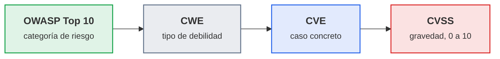
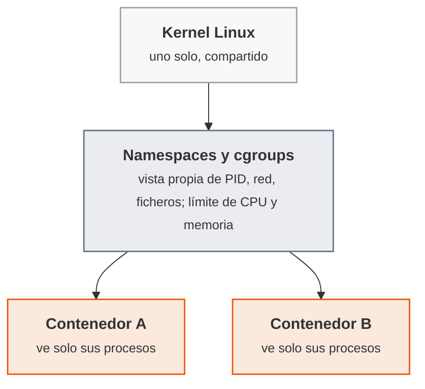
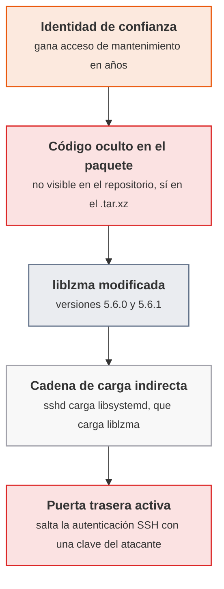

# UT2 · Nivel de seguridad requerido

<p class="ut-meta">12 h · Sesiones 9 a 14 · RA2 CE a, b, c, d</p>

Antes de escribir una línea de código de una aplicación hace falta responder una pregunta previa: ¿cuánta seguridad necesita esta aplicación en concreto? Una tienda con pagos no necesita lo mismo que un blog interno, y tratar a las dos por igual sobra en un caso y falta en el otro. Esta unidad da un criterio para responder esa pregunta con un estándar reconocido, OWASP ASVS, y un vocabulario común para hablar de vulnerabilidades: el catálogo OWASP Top 10, los identificadores CWE y CVE y la puntuación CVSS. También entra en dos casos concretos que muestran por qué el nivel de seguridad no depende solo del código de la aplicación: el aislamiento que ofrece Docker y un ataque real a la cadena de suministro de software. Son seis sesiones (cinco de trabajo y una de margen), tres entregas evaluables, ACT_UT2_1 a ACT_UT2_3, con plazo el 16, el 23 y el 26 de noviembre, y una optativa, ACT_UT2_4. Cada entrega tiene en el aula su enunciado en PDF («Actividad RA2.1. Application Security Verification Standard», «RA2.2. Seguridad en Docker», «RA2.3. Seguridad en Unix» y «RA2.4. Análisis de un Ransomware»), y **el PDF es el que manda**: las hojas siguen su numeración (3.2.1, 4.3.1...) y dicen en cada ejercicio a qué punto responde, y lo que una hoja añade por su cuenta va en su ejercicio «Extra (opcional)», que es lo que la rúbrica llama «Extra».

!!! ojo "Solo sobre lo propio o lo autorizado por escrito"
    Esta unidad reproduce vulnerabilidades reales (Log4Shell, la puerta trasera de xz) contra aplicaciones y máquinas deliberadamente vulnerables, en la máquina virtual propia del alumno y sin salida a la red del aula. Acceder sin autorización a un sistema ajeno es delito en España (Código Penal, artículos 197 bis y 264 y siguientes), aunque la intención sea "solo mirar" y aunque no se cause daño. El criterio profesional es siempre el mismo: solo sobre lo propio o lo que se ha autorizado por escrito. Ninguna hoja de esta unidad escribe código de explotación nuevo: se usan las herramientas y los repositorios que documenta el material del curso, siguiendo su propia documentación.

## Sesión 9 · Fuentes de riesgo: OWASP Top 10, CWE y CVE

<p class="ut-meta" markdown>5 de noviembre · Teoría y práctica · <span class="dur" tabindex="0" aria-label="Fuentes abiertas de vulnerabilidades: OWASP Top 10, CWE y CVE · 15 min&#10;CVSS: puntuar la gravedad · 10 min&#10;A2.1 Riesgos de una aplicación · 85 min" data-dur="Fuentes abiertas de vulnerabilidades: OWASP Top 10, CWE y CVE · 15 min&#10;CVSS: puntuar la gravedad · 10 min&#10;A2.1 Riesgos de una aplicación · 85 min">:material-school:<i class="dur-barra" style="--teoria:23%"></i>:material-flask:</span></p>

Al acabar esta sesión hay diez vulnerabilidades reales clasificadas por categoría de OWASP Top 10, identificador CWE y puntuación CVSS, cada una con una explicación del riesgo concreto que supone para una aplicación. Antes de eso, dos apartados cortos dan el vocabulario: de dónde salen estos catálogos y qué significa cada sigla, y cómo se lee una puntuación CVSS. Es la sesión que abre la unidad y también la que sienta el vocabulario de riesgo que se usa el resto del curso. Ninguna entrega la recoge: el enunciado de ACT_UT2_1 empieza en la sesión 10, con ASVS, y lo que se practica hoy (el tipo de cada fallo y su gravedad) es lo que después etiqueta cada requisito de ASVS y puntúa los casos de Log4Shell y xz.

!!! consulta "Recursos de la sesión"
    **Para la práctica**

    - [OWASP Top 10:2021](https://owasp.org/Top10/2021/): las diez categorías de riesgo web.
    - [Catálogo CWE](https://cwe.mitre.org/) del MITRE: los tipos de debilidad.
    - [NVD](https://nvd.nist.gov/) del NIST: donde vive cada ficha CVE.
    - [Especificación de CVSS 3.1](https://www.first.org/cvss/v3.1/specification-document): cómo se puntúa la gravedad.

### Fuentes abiertas de vulnerabilidades: OWASP Top 10, CWE y CVE

Antes de clasificar una vulnerabilidad hace falta distinguir tres preguntas distintas que a menudo se confunden: qué tipo de fallo es, qué caso concreto de ese fallo es y qué gravedad tiene. Cada pregunta tiene su propio catálogo.



<p class="pie" markdown>De lo general a lo concreto: una categoría amplia del Top 10 (`A03:2021-Injection`) agrupa tipos de debilidad (`CWE-79`, inyección en páginas vistas por otros usuarios), cada tipo se materializa en casos reales (un `CVE` con su ficha en la NVD) y cada caso se puntúa con `CVSS`.</p>

El **CWE** (*Common Weakness Enumeration*, enumeración de debilidades comunes), del MITRE, no describe un fallo que haya ocurrido, describe un tipo de fallo que puede ocurrir: `CWE-89` es "SQL Injection" como concepto, no un caso concreto. Un requisito de ASVS o una vulnerabilidad de la A2.1 se etiquetan con su CWE porque es la forma más precisa de decir "esto es exactamente este tipo de problema", con independencia del lenguaje o del producto donde aparezca.

El **CVE** (*Common Vulnerabilities and Exposures*, vulnerabilidades y exposiciones comunes) identifica un caso concreto, ya descubierto en un producto real y publicado: `CVE-2021-44228` es un fallo concreto de unas versiones concretas de Log4j, no el concepto de inyección. Cada CVE tiene una ficha pública en la **NVD** (*National Vulnerability Database*, base de datos nacional de vulnerabilidades), el catálogo que mantiene el NIST de EE. UU., con su descripción, su CWE asociado y su puntuación CVSS.

El **OWASP Top 10** agrupa los CWE más frecuentes en diez categorías amplias, pensadas para priorizar sin tener que conocer cientos de CWE de memoria. La edición usada en el curso es la de 2021, que es la que sigue el material de referencia de la asignatura; en 2025 OWASP ha publicado una revisión que reordena y renombra varias categorías, y la comparación entre las dos queda en [Para ampliar](../ampliacion.md#ut2-nivel-de-seguridad-requerido).

| Categoría (2021) | De qué trata, en una frase |
|---|---|
| A01: Broken Access Control | Un usuario accede a datos o funciones que no le corresponden |
| A02: Cryptographic Failures | Datos sensibles cifrados de forma débil o transmitidos en claro |
| A03: Injection | Datos del usuario tratados como código o como orden por el servidor |
| A04: Insecure Design | Un fallo de diseño, no de implementación: falta un control en el plano de la aplicación |
| A05: Security Misconfiguration | Configuración por defecto, permisos de más o funciones innecesarias activas |
| A06: Vulnerable and Outdated Components | Una dependencia (librería, framework) con una vulnerabilidad conocida y sin actualizar |
| A07: Identification and Authentication Failures | Autenticación débil: sesión mal gestionada, credenciales predecibles, sin límite de intentos |
| A08: Software and Data Integrity Failures | Código o datos que se aceptan sin comprobar su integridad (una actualización sin firmar, una deserialización insegura) |
| A09: Security Logging and Monitoring Failures | No queda registro de lo que pasó, así que un incidente se detecta tarde o no se detecta |
| A10: Server-Side Request Forgery | El servidor hace una petición a una URL que controla el atacante |

`CVE-2024-3094`, la puerta trasera de las herramientas de compresión `xz`, es a la vez A06 (una dependencia comprometida) y A08 (código que se acepta sin comprobar su integridad); es habitual que un mismo caso encaje en más de una categoría, y la A2.1 pide elegir la que mejor explica el riesgo principal, no la única posible. Ese caso se reproduce en el laboratorio el 19 de noviembre.

### CVSS: puntuar la gravedad

Clasificar por categoría dice de qué tipo es el problema; CVSS dice cuánto importa. La puntuación va de 0,0 a 10,0 y sale de combinar factores objetivos: si se explota desde la red o hace falta acceso local, si necesita que la víctima haga algo, qué privilegios hacen falta y qué se compromete (confidencialidad, integridad, disponibilidad). La cifra final se traduce en una banda de severidad:

| Puntuación CVSS v3.1 | Severidad |
|---:|---|
| 0,0 | Ninguna |
| 0,1 a 3,9 | Baja |
| 4,0 a 6,9 | Media |
| 7,0 a 8,9 | Alta |
| 9,0 a 10,0 | Crítica |

La ficha de la NVD de cada CVE incluye su vector CVSS completo (una cadena como `AV:N/AC:L/PR:N/UI:N/S:U/C:H/I:H/A:H`) y la puntuación ya calculada; para la A2.1 basta con leer la puntuación y la severidad de la ficha, no con calcular el vector a mano. Dos vulnerabilidades de la misma categoría del Top 10 pueden tener puntuaciones muy distintas: lo que cambia el riesgo real no es solo el tipo de fallo, es lo fácil que es explotarlo y lo que se pierde si se explota.

### A2.1 Riesgos de una aplicación (sesión 9)

<span class="et et-obj">Objetivo</span> Clasificar diez vulnerabilidades reales con su CWE, su CVSS, su categoría de OWASP Top 10 2021 y el riesgo que suponen. No la pide ningún enunciado ni la recoge ninguna entrega, pero el CWE de cada fila reaparece en la hoja de ASVS de ACT_UT2_1 y la ficha de `CVE-2021-44228`, en ACT_UT2_2.

<span class="et et-pre">Antes de empezar</span> Acceso a la [NVD](https://nvd.nist.gov/) y a [OWASP Top 10:2021](https://owasp.org/Top10/2021/). Teoría: [fuentes de vulnerabilidades](#fuentes-abiertas-de-vulnerabilidades-owasp-top-10-cwe-y-cve) y [CVSS](#cvss-puntuar-la-gravedad).

<span class="et et-pas">Ejercicios</span> Trabaja en `~/pps-entregas/ut2/a21/` y contesta en su `README.md`, con una tabla de columnas `CVE`, `CWE`, `Categoría OWASP Top 10 2021`, `CVSS (puntuación y severidad)` y `Riesgo para una aplicación concreta`.

1. **CWE y CVSS.** Copia de la ficha de la NVD el CWE y el CVSS v3.1 con su severidad de estas diez: `CVE-2021-44228`, `CVE-2014-0160`, `CVE-2014-6271`, `CVE-2017-0144`, `CVE-2017-5638`, `CVE-2020-11022`, `CVE-2021-26855`, `CVE-2022-22965`, `CVE-2022-40684` y `CVE-2023-34362`.
2. **Categoría del Top 10.** Asigna a cada una la categoría que mejor explica su riesgo principal y, si encaja en dos, la secundaria entre paréntesis.
3. **Riesgo.** Explica en dos o tres líneas qué supondría cada una en una tienda en línea con pagos, un gestor interno de incidencias o una mensajería con adjuntos (la que tenga más sentido, y di cuál).

## Sesión 10 · ASVS: niveles y requisitos

<p class="ut-meta" markdown>9 de noviembre · Teoría y práctica · <span class="dur" tabindex="0" aria-label="OWASP ASVS: qué es y su estructura por capítulos · 10 min&#10;Elegir el nivel: L1, L2 y L3 · 15 min&#10;A2.2 ASVS: elegir el nivel · 85 min" data-dur="OWASP ASVS: qué es y su estructura por capítulos · 10 min&#10;Elegir el nivel: L1, L2 y L3 · 15 min&#10;A2.2 ASVS: elegir el nivel · 85 min">:material-school:<i class="dur-barra" style="--teoria:23%"></i>:material-flask:</span></p>

Hoy empieza la entrega ACT_UT2_1, cuyo enunciado pide verificar todos los requisitos L1 de ASVS sobre un escenario dado. Al acabar esta sesión está empezada la lectura del estándar, existe la hoja de cálculo de la entrega con plantilla corporativa y los 128 requisitos L1 listados por secciones, y los primeros requisitos están analizados sobre el escenario. Antes de eso, dos apartados: qué es ASVS y cómo se organiza en catorce capítulos, y el criterio para decidir entre sus tres niveles, que explica por qué el escenario de la entrega se queda en L1.

!!! consulta "Recursos de la sesión"
    **Para la práctica**

    - [OWASP ASVS 4.0.3](https://github.com/OWASP/ASVS/tree/v4.0.3_release): el estándar de verificación y su estructura por niveles.
    - La [política de contraseñas de Joomla](https://github.com/joomla/joomla-cms/blob/5.2-dev/libraries/src/Form/Rule/PasswordRule.php): el ejemplo de técnica concreta que da el enunciado.
    - El enunciado de la entrega ACT_UT2_1, «Actividad RA2.1. Application Security Verification Standard», está en el aula con su rúbrica.

### OWASP ASVS: qué es y su estructura por capítulos

ASVS (*Application Security Verification Standard*, estándar de verificación de seguridad de aplicaciones) es un catálogo de requisitos técnicos de seguridad, mantenido por OWASP, pensado para dos usos a la vez: como lista de comprobación para quien construye una aplicación y como criterio común para quien la audita. Cada requisito tiene un identificador con el formato `capítulo.sección.número` (por ejemplo, `V2.1.1` es el requisito 1 de la sección 1 del capítulo 2) y, cuando aplica, su CWE asociado.

El estándar se organiza en catorce capítulos, cada uno con un número distinto de requisitos exigibles en el nivel 1 (L1):

| Capítulo | De qué trata | Requisitos en L1 |
|---|---|---:|
| V1 Arquitectura, diseño y modelado de amenazas | Documentar el diseño de seguridad antes de programar | 0 |
| V2 Autenticación | Contraseñas, factores adicionales, recuperación de acceso | 27 |
| V3 Gestión de sesión | Tokens de sesión, cookies, cierre de sesión | 12 |
| V4 Control de acceso | Que cada usuario llegue solo a lo suyo | 8 |
| V5 Validación, sanitización y codificación | Tratar toda entrada como no confiable | 27 |
| V6 Criptografía almacenada | Cómo se guardan claves y secretos | 1 |
| V7 Gestión de errores y registro | Qué se registra y qué no se muestra al usuario | 3 |
| V8 Protección de datos | Qué datos sensibles se exponen y dónde | 7 |
| V9 Comunicaciones | Cifrado del transporte | 3 |
| V10 Código malicioso | Integridad de actualizaciones y del código que se ejecuta | 3 |
| V11 Lógica de negocio | Límites y orden de los pasos de un proceso | 5 |
| V12 Ficheros y recursos | Subida, descarga y ejecución de ficheros | 11 |
| V13 API y servicios web | Métodos, esquemas y CSRF en servicios REST y SOAP | 6 |
| V14 Configuración | Cabeceras HTTP, componentes actualizados, modo depuración | 15 |

El capítulo V1 no exige ningún requisito en L1: el modelado de amenazas formal empieza a pedirse en L2. Los capítulos con más peso en L1 son Autenticación y Validación, con 27 requisitos cada uno; entre los dos suman más de un tercio de los 128 requisitos de nivel 1.

!!! consulta "La versión 5.0 del estándar"
    OWASP publicó ASVS 5.0 en mayo de 2025, que reorganiza los catorce capítulos en diecisiete y cambia varios identificadores de requisito. El curso usa 4.0.3 porque es la versión del enunciado de la entrega y la que sigue el material de referencia; qué cambia entre las dos versiones queda en [Para ampliar](../ampliacion.md#ut2-nivel-de-seguridad-requerido).

### Elegir el nivel: L1, L2 y L3

El nivel no es una preferencia, es una decisión que depende de lo que la aplicación maneja y de a quién afecta si falla.

| Nivel | Cuándo se aplica | Ejemplo |
|---|---|---|
| L1 | Seguridad básica, exigible a cualquier aplicación | Un blog interno, una página informativa sin cuentas de usuario |
| L2 | Aplicaciones con datos sensibles; es el nivel recomendado para la mayoría de aplicaciones empresariales | Una tienda en línea con pagos, un gestor de incidencias con datos de clientes |
| L3 | Aplicaciones críticas, con transacciones de alto valor o datos muy sensibles | Banca, sanidad, infraestructuras críticas |

El criterio para elegir entre los tres no es solo "cuánto se puede gastar en seguridad", es una pregunta de riesgo: qué pasa si esta aplicación falla. Tres preguntas ayudan a decidir: ¿qué datos maneja (ninguno, personales, financieros o de salud)?, ¿qué pasa si se compromete (una molestia, una pérdida económica, un daño a personas)?, ¿a cuánta gente afecta un fallo? Un blog interno sin cuentas de usuario no pasa de L1 aunque se quiera; una aplicación de banca no debería quedarse en L1 aunque el cliente lo pida, porque el riesgo real no ha cambiado por que alguien decida ignorarlo.

El escenario de la entrega es la arquitectura cliente-servidor de una empresa de compra-venta de robellones que va a pasar a producción, y el enunciado fija su nivel en L1. Con las tres preguntas, una tienda con cuentas de clientes se queda en L1 mientras no guarde datos de pago ni datos sensibles; si los guardara, el riesgo apuntaría a L2. Ese razonamiento es el que pide el CE b: saber decir, no solo qué nivel toca, sino por qué, y cuándo el nivel que da el cliente y el nivel que pide el riesgo no coinciden.

Verificar un requisito no es responder "sí" o "no": es documentar dónde se aplica, con qué técnica o fichero se cumple y qué prueba lo demuestra, en una plantilla como esta:

| Capítulo | Requisito | Checklist | Dónde | Técnica o fichero | Prueba de verificación | Riesgo residual |
|---|---|---|---|---|---|---|
| V2.1 Seguridad de contraseñas | V2.1.1: la contraseña tiene al menos 12 caracteres | Cumplido | Formulario de alta y cambio de contraseña, validación en el servidor | Campo `password` validado con una expresión regular de longitud mínima antes de generar el hash | Dar de alta una cuenta con una contraseña de 8 caracteres y comprobar que el servidor la rechaza con un mensaje genérico | Una contraseña de 12 caracteres previsibles (`contraseña123`) sigue siendo débil; lo complementa V2.1.7 (comprobar contra listas de contraseñas filtradas) |

La columna "riesgo residual" es la que distingue una verificación real de una casilla marcada: dice qué sigue sin cubrir aunque el requisito se cumpla, y con qué otro requisito se complementa. Es la que más falla cuando se rellena una hoja de cálculo deprisa, y la que el propio enunciado pone como ejemplo de lo que hay que documentar.

La columna «Checklist» es la que convierte la tabla en una lista de comprobación, que es el nivel del 90 % de la rúbrica para la tabla: cada fila queda marcada como `cumplido` (el control está previsto en el escenario, con su técnica y su prueba), `no cumplido` (falta, y la fila dice qué habría que hacer) o `no aplica`, con el motivo. Es la marca que propone el propio enunciado: si la aplicación cumple el control, se marca como cumplido para su nivel.

El enunciado pide además indicar **en qué servidor** se aplica cada requisito, y no define ninguno. Para que todas las filas hablen de las mismas máquinas, la hoja parte de una arquitectura mínima de tres servidores, que cada alumno puede ampliar si lo justifica:

| Servidor | Función en el escenario de compra-venta |
|---|---|
| Web | Nginx como proxy inverso: termina TLS y añade las cabeceras HTTP |
| Aplicación | La aplicación (API y lógica de negocio): cuentas, sesiones y validación |
| Base de datos | Almacena usuarios (con la contraseña como hash), catálogo y pedidos |

### A2.2 ASVS: elegir el nivel (sesión 10)

<span class="et et-obj">Objetivo</span> Montar la hoja de cálculo de la Actividad RA2.1 con los 128 requisitos L1 de ASVS 4.0.3 y resolver los doce de V2.1 sobre el escenario de compra-venta de robellones. Cubre los puntos 3.1.1, 3.2.1 y el inicio del 3.2.2; la A2.3 sigue sobre el mismo fichero. Lo recoge la ACT_UT2_1, con plazo el 16 de noviembre.

<span class="et et-pre">Antes de empezar</span> LibreOffice Calc o similar y el enunciado de la Actividad RA2.1 (escenario en su apartado 5, rúbrica en el anexo). Teoría: [ASVS y sus capítulos](#owasp-asvs-que-es-y-su-estructura-por-capitulos) y [elegir el nivel](#elegir-el-nivel-l1-l2-y-l3).

<span class="et et-pas">Ejercicios</span> Trabaja en `~/pps-entregas/ut2/a22/`, sobre el fichero `ACT_UT2_1.ods`, y súbelo con un commit al terminar.

1. **Lectura (3.1.1).** Lee de ASVS 4.0.3 la parte de niveles y uso del estándar y el capítulo V2. Lo que no acabes en clase, termínalo en casa.
2. **Tabla L1 (3.2.1).** Crea `ACT_UT2_1.ods` con los 128 requisitos L1, agrupados por capítulo y sección, y las siete columnas de la [plantilla de la teoría](#elegir-el-nivel-l1-l2-y-l3), incluida «Checklist». Sácalos del CSV oficial de la 4.0.3.
3. **Plantilla corporativa (3.2.1).** Añade una portada con nombre, fecha, escenario, nivel L1 y los tres servidores, y da a la tabla formato de empresa: logotipo, colores, cabecera fija, filtros y una fila por capítulo.
4. **V2.1 (3.2.2).** Resuelve V2.1.1 a V2.1.12 como la fila modelo de la teoría: servidor, técnica o fichero, prueba repetible, riesgo residual y marca en «Checklist».
5. **Extra (opcional).** Añade a la portada qué nivel de ASVS corresponde a un blog interno sin cuentas y a una tienda que cobra con tarjeta, y qué tendría que cambiar en la empresa de robellones para que L1 dejara de bastar.

## Sesión 11 · ASVS: verificación de los requisitos L1

<p class="ut-meta" markdown>12 de noviembre · Teoría y práctica · <span class="dur" tabindex="0" aria-label="Verificar un requisito: dónde, con qué técnica y con qué prueba · 15 min&#10;A2.3 ASVS: verificación L1 · 95 min" data-dur="Verificar un requisito: dónde, con qué técnica y con qué prueba · 15 min&#10;A2.3 ASVS: verificación L1 · 95 min">:material-school:<i class="dur-barra" style="--teoria:14%"></i>:material-flask:</span></p>

Al acabar esta sesión el capítulo V2 (Autenticación) está completo en la hoja de cálculo de la entrega y el V3 (Gestión de sesión) está empezado, con el resto marcado como pendiente para terminar en casa antes del plazo. Es el punto 3.2.2 del enunciado de la Actividad RA2.1: analizar, indicar y verificar cada requisito L1 sobre el escenario. La sesión abre con un apartado corto que afina la metodología ya vista (qué hace que un "dónde", una "técnica" y una "prueba" sean lo bastante concretos para que otra persona los repita) y da cuatro requisitos más resueltos como modelo, de capítulos que se resuelven en casa.

!!! consulta "Recursos de la sesión"
    **Para la práctica**

    - [OWASP ASVS](https://owasp.org/www-project-application-security-verification-standard/): la lista completa de requisitos L1 en CSV, que la plantilla de la entrega ya recoge.
    - El enunciado de la entrega ACT_UT2_1, «Actividad RA2.1. Application Security Verification Standard», con el escenario y la rúbrica.

### Verificar un requisito: dónde, con qué técnica y con qué prueba

Tres columnas de la plantilla fallan más que las demás cuando se rellenan sin pensar, y las tres comparten un mismo defecto: la vaguedad.

"Dónde" no es "en el servidor": es en qué componente concreto, con su nombre (el formulario de alta, el middleware de autenticación, la configuración de Apache). Si la aplicación tiene varios servidores (por ejemplo, un frontend y una API), el requisito puede aplicar en uno, en el otro o en los dos, y eso hay que decirlo explícitamente: no todos los requisitos se aplican en todas las máquinas del escenario.

"Técnica o fichero" no es "se valida": es cómo, con qué mecanismo concreto. Puede ser una línea de código, una directiva de configuración, una librería con su nombre, o una política de un proveedor externo (por ejemplo, si la autenticación la delega en un proveedor de identidad, la técnica es "delegado en el proveedor X, ver su documentación de cumplimiento"). Un requisito que no se puede resolver con el código disponible en el escenario se analiza igualmente, con la técnica prevista, aunque no exista código real que revisar: el enunciado pide un análisis técnico, no una implementación completa.

"Prueba de verificación" no es "funciona": es un paso concreto que otra persona podría repetir y que da un resultado observable (un intento que se rechaza, una cabecera que aparece, un registro que se genera). Si la prueba es "se ha comprobado manualmente", falta decir qué se hizo exactamente para comprobarlo.

Un requisito que no aplica al escenario (por ejemplo, uno sobre autenticación multifactor si el escenario no la contempla) se marca `no aplica` en «Checklist» con una frase que explique por qué, no se deja en blanco ni se omite la fila.

Cuatro requisitos más, resueltos como modelo para los capítulos que se hacen en casa, sobre el mismo escenario de compra-venta y sus [tres servidores](#elegir-el-nivel-l1-l2-y-l3):

| Requisito | Servidor y componente | Técnica o fichero | Prueba de verificación | Riesgo residual |
|---|---|---|---|---|
| V3.2.1: nuevo token de sesión al autenticarse (CWE-384) | Aplicación: módulo de login | Regenerar el identificador de sesión justo tras validar las credenciales (`session.regenerate()` o equivalente del framework) | Anotar la cookie de sesión antes y después de iniciar sesión: el valor tiene que cambiar | Un token robado después del login sigue valiendo hasta que caduque (lo cubre V3.3.1, cierre de sesión) |
| V4.1.1: control de acceso en una capa de servicio de confianza (CWE-602) | Aplicación: capa de servicios de la API | Comprobar en el servidor el rol y el propietario del pedido en cada endpoint, no solo ocultar botones en el cliente | Con la sesión de un cliente, pedir por URL el pedido de otro (`/pedidos/1234`): el servidor responde 403 | Un rol con más permisos de los necesarios (revisión de roles en L2) |
| V5.3.4: consultas parametrizadas contra inyección (CWE-89) | Aplicación (acceso a datos) y base de datos | Sentencias preparadas o ORM en todo acceso; usuario de BD sin permisos de esquema | Introducir `' OR '1'='1` en el buscador de catálogo: se trata como texto y no devuelve todo | Consultas dinámicas heredadas que se escapen de la revisión (búsqueda en el código de concatenaciones) |
| V9.1.1: TLS en toda conexión de cliente (CWE-319) | Web: Nginx | Redirección de HTTP a HTTPS y directiva `ssl_protocols TLSv1.2 TLSv1.3;` | `curl -I http://host` devuelve una redirección 301 a `https://`; un cliente forzado a TLS 1.0 es rechazado | Certificado mal gestionado o sin renovar (V9.2, L2) |

### A2.3 ASVS: verificación L1 (sesión 11)

<span class="et et-obj">Objetivo</span> Analizar y verificar en la hoja de cálculo el resto del capítulo V2 y las secciones V3.1 a V3.3, y dejar marcado y planificado lo que queda (punto 3.2.2 y nivel «Checklist» del 3.2.1). La hoja terminada en casa es la ACT_UT2_1, con plazo el 16 de noviembre, y se sube a Aules en `.ods` o `.xls`.

<span class="et et-pre">Antes de empezar</span> `ACT_UT2_1.ods` de la [A2.2](#a22-asvs-elegir-el-nivel-sesion-10), con V2.1 resuelto. Teoría: [verificar un requisito](#verificar-un-requisito-donde-con-que-tecnica-y-con-que-prueba).

<span class="et et-pas">Ejercicios</span> Sigue sobre `ACT_UT2_1.ods` y guarda la versión terminada, con los 128 requisitos resueltos, en `~/pps-entregas/ut2/a23/`.

1. **V2, Autenticación (3.2.2).** Completa las 15 filas que quedan de V2: V2.2, V2.3, V2.5, V2.7 y V2.8.
2. **V3.1 a V3.3, Gestión de sesión (3.2.2).** Resuelve las 6 filas de V3.1, V3.2 y V3.3, siguiendo el modelo V3.2.1 de la teoría.
3. **Checklist y resto en casa (3.2.1 y 3.2.2).** Marca todas las filas que faltan (`no aplica` con su motivo, o `pendiente`), apunta en la portada tu plan para el resto y termínalo en casa antes del plazo. En la hoja entregada no puede quedar ningún `pendiente`.
4. **Extra (opcional).** En una pestaña «Extra», localiza en el código de Joomla 5 el fichero y la regla que cumplen tres requisitos de V2 o V3, con el enlace a la línea.

## Sesión 12 · Seguridad en Docker

<p class="ut-meta" markdown>16 de noviembre · Teoría y práctica · <span class="dur" tabindex="0" aria-label="Namespaces y cgroups: el aislamiento de un contenedor · 10 min&#10;seccomp, AppArmor y SELinux: limitar lo que hace un proceso · 10 min&#10;La superficie de ataque del demonio · 5 min&#10;A2.4 Docker: aislamiento y auditoría · 85 min" data-dur="Namespaces y cgroups: el aislamiento de un contenedor · 10 min&#10;seccomp, AppArmor y SELinux: limitar lo que hace un proceso · 10 min&#10;La superficie de ataque del demonio · 5 min&#10;A2.4 Docker: aislamiento y auditoría · 85 min">:material-school:<i class="dur-barra" style="--teoria:23%"></i>:material-flask:</span></p>

Al acabar esta sesión hay una imagen deliberadamente vulnerable (Log4Shell) construida, escaneada y corriendo de forma contenida en `pps01`, con su vulnerabilidad comprobada y mitigada, y un perfil de AppArmor aplicado y comprobado sobre un contenedor; la auditoría con `docker-bench-security`, los otros dos escaneos y las lecturas del enunciado se hacen en casa. Antes de eso, tres apartados cortos explican qué aísla realmente a un contenedor, qué mecanismos limitan lo que un proceso puede hacer dentro de él, y dónde está el punto más débil de toda la plataforma: el demonio que lo gestiona todo.

!!! consulta "Recursos de la sesión"
    **Para la práctica**

    - El enunciado de la entrega ACT_UT2_2, «RA2.2. Seguridad en Docker», con su rúbrica y la chuleta de seguridad de Docker del anexo.
    - Las lecturas del punto 4.1.1: *Container security fundamentals* de Datadog, [parte 1](https://securitylabs.datadoghq.com/articles/container-security-fundamentals-part-1/) y [parte 2](https://securitylabs.datadoghq.com/articles/container-security-fundamentals-part-2/), y la [guía de seguridad de Docker](https://docs.docker.com/engine/security/).
    - [Seguridad en Docker](https://psegarrac.github.io/Ciberseguridad-PePS/tema3/seguridad/web/2021/03/10/Seguridad-en-Docker.html): la página donde están las prácticas 1, 2 y 3 del punto 4.2.
    - [log4shell-vulnerable-app](https://github.com/christophetd/log4shell-vulnerable-app), con las lecturas de [INCIBE-CERT](https://www.incibe.es/en/incibe-cert/blog/log4shell-analysis-vulnerabilities-log4j) y [Sophos](https://news.sophos.com/en-us/2021/12/17/inside-the-code-how-the-log4shell-exploit-works/) sobre cómo funciona el ataque (punto 4.3.1).
    - [docker-bench-security](https://github.com/docker/docker-bench-security) (punto 4.4.1) y [AppArmor en Docker](https://docs.docker.com/engine/security/apparmor/) (punto 4.5.1).

### Namespaces y cgroups: el aislamiento de un contenedor

Un contenedor no es una máquina virtual: comparte el mismo kernel Linux que el sistema anfitrión. Lo que lo hace parecer una máquina aparte son dos mecanismos del kernel que Docker combina.

Los **namespaces** dan a un proceso una vista propia de un recurso del sistema, de modo que no ve lo que hay fuera de esa vista aunque comparta el mismo kernel:

| Namespace | Qué aísla |
|---|---|
| PID | Los procesos: un contenedor solo ve los suyos, no los del anfitrión ni los de otros contenedores |
| Network | Las interfaces de red: cada contenedor tiene su propia IP y sus propias reglas |
| Mount | El sistema de ficheros: cada contenedor ve solo los volúmenes que se le asignan |
| UTS | El nombre de host |
| IPC | La comunicación entre procesos (memoria compartida, colas de mensajes) |
| User | El mapeo de usuarios: un proceso puede ser root dentro del contenedor sin serlo en el anfitrión |



<p class="pie" markdown>El kernel es uno solo: lo que separa un contenedor de otro no es hardware, es la vista que los namespaces le dan de ese mismo kernel. Un fallo que se escapa del namespace afecta al anfitrión y a todos los demás contenedores.</p>

Los **cgroups** (*control groups*, grupos de control) hacen el trabajo complementario: no ocultan recursos, limitan cuántos puede consumir un proceso. Una CPU o una memoria sin límite en un contenedor puede dejar sin recursos al anfitrión y a los demás contenedores con un único proceso descontrolado, algo que un namespace por sí solo no evita.

### seccomp, AppArmor y SELinux: limitar lo que hace un proceso

Los namespaces y los cgroups aíslan y limitan recursos, pero no dicen qué puede *hacer* un proceso dentro de su propia vista. Esa capa la cubren tres mecanismos distintos, y conviene no confundirlos:

| Mecanismo | Qué restringe | Dónde se usa en el laboratorio |
|---|---|---|
| seccomp | Las llamadas al sistema (*syscalls*) que un proceso puede hacer al kernel | Activo por defecto en Docker: el perfil estándar bloquea alrededor de 44 llamadas de las más de 300 disponibles |
| AppArmor | Qué ficheros, capacidades y recursos puede usar un proceso concreto, mediante un perfil de texto | El mecanismo de esta sesión, porque `pps01` es Ubuntu y AppArmor es su control de acceso obligatorio por defecto |
| SELinux | Lo mismo que AppArmor (control de acceso obligatorio) pero con un modelo de etiquetas por fichero y proceso, más granular y más complejo de administrar | No se usa en el laboratorio: es el mecanismo por defecto en distribuciones basadas en Red Hat, no en Ubuntu |

seccomp actúa por defecto sin que nadie escriba nada: el perfil estándar de Docker ya bloquea llamadas peligrosas como cambiar la hora del reloj o cargar módulos del kernel. AppArmor y SELinux, en cambio, necesitan un perfil explícito para cada aplicación: sin uno, un contenedor corre con el perfil `docker-default`, que es razonable pero genérico. Un perfil propio, como el que aplica la A2.4, restringe además lo que esa aplicación concreta necesita, no lo que cualquier contenedor podría necesitar.

### La superficie de ataque del demonio

El demonio Docker (`dockerd`) corre como root y es quien de verdad crea, destruye y gestiona los contenedores: cualquiera que pueda hablar con su socket tiene, en la práctica, privilegios de root en el anfitrión. Por eso el grupo `docker` equivale a un grupo con privilegios de administración, y añadir un usuario a ese grupo (paso habitual para no escribir `sudo` en cada orden) es una decisión de seguridad, no solo de comodidad.

La configuración del demonio vive en `/etc/docker/daemon.json`; ahí se desactiva el modo `debug` en producción y se pueden fijar límites (`ulimits`) por defecto para los contenedores que arrancan sin sus propios límites. Otro punto habitual de exposición es montar el socket del demonio dentro de un contenedor (`-v /var/run/docker.sock:/var/run/docker.sock`, un patrón común en pipelines de CI/CD para lanzar Docker dentro de Docker): quien controla ese socket controla el anfitrión, así que ese montaje solo se hace cuando es imprescindible y nunca en un contenedor que también procesa entrada de fuera. `docker-bench-security`, que es la herramienta de la hoja de esta sesión, audita justamente este tipo de configuración: la del demonio, la de los contenedores en marcha y la de las imágenes, contra un catálogo de buenas prácticas.


### A2.4 Docker: aislamiento y auditoría (sesión 12)

<span class="et et-obj">Objetivo</span> Escanear, explotar de forma contenida y mitigar la imagen Log4Shell, confinar un contenedor con AppArmor y, en casa, auditar Docker y hacer las otras dos prácticas de escaneo. Cubre los puntos 4.1.1 a 4.5.1 del enunciado de la RA2.2. Lo recoge la ACT_UT2_2, con plazo el 23 de noviembre.

<span class="et et-pre">Antes de empezar</span> `pps01` con una instantánea reciente, Docker sin `sudo` y el [repositorio de entregas](../laboratorio.md#repositorio-de-entregas). Nada se expone a la red del aula ([red aislada](../laboratorio.md#red-aislada-y-buenas-practicas)). Teoría: [namespaces y cgroups](#namespaces-y-cgroups-el-aislamiento-de-un-contenedor), [seccomp, AppArmor y SELinux](#seccomp-apparmor-y-selinux-limitar-lo-que-hace-un-proceso) y [la superficie de ataque del demonio](#la-superficie-de-ataque-del-demonio).

<span class="et et-pas">Ejercicios</span> Trabaja en `~/pps-entregas/ut2/a24/` y contesta en su `README.md`. Los ejercicios 1 a 3 se hacen en clase y los 4 a 6, en casa antes del plazo.

1. **Práctica 1: escaneo (4.2.1).** Clona `log4shell-vulnerable-app` fuera de `pps-entregas`, construye su imagen y escanéala con `trivy` (solo críticas) antes de arrancarla, guardando `trivy-log4shell.txt`. Anota el paquete de Log4j, su versión, su CVE y la versión que lo corrige. Si la construcción falla, usa la imagen publicada:

    ```bash
    export IMG=ghcr.io/christophetd/log4shell-vulnerable-app@sha256:6f88430688108e512f7405ac3c73d47f5c370780b94182854ea2cddc6bd59929
    ```

2. **Exploit contenido (4.3.1).** Arranca el contenedor `vulnerable-app` solo en `127.0.0.1:8082` (el 8080 del contenedor), córtale la salida a Internet en la cadena `DOCKER-USER`, demuestra con una expresión `${...}` inofensiva en la cabecera `X-Api-Version` (entre comillas simples) que es explotable, y mitígalo. Explica, con las lecturas de INCIBE-CERT y Sophos, la segunda fase de un ataque real y la corrección definitiva.
3. **AppArmor (4.5.1).** Crea y carga el perfil `pps-confinado`, que permite todo salvo escribir en `/etc`, `/root` y `/usr`, y compara qué pueden escribir en `/tmp` y en `/etc` dos contenedores `ubuntu:24.04`, uno sin perfil y otro con él.
4. **`docker-bench-security` (4.4.1).** Ejecútalo (clonado fuera de `pps-entregas`, con `vulnerable-app` en marcha), guarda `docker-bench.txt` y explica tres `[WARN]` de secciones distintas: qué comprueba, por qué importa y cómo se resuelve.
5. **Prácticas 2 y 3 (4.2.2 y 4.2.3).** Escanea con `trivy` una etiqueta antigua de WordPress (`trivy-wordpress.txt`) y resume sus críticas. Genera con Syft el SBOM CycloneDX de una de las dos imágenes (`sbom.json`), analízalo con Grype y con Dependency-Track (captura del panel) y explica qué aporta un SBOM.
6. **Lecturas y evidencias (4.1.1).** Resume las tres lecturas del enunciado y ordena el `README.md` por puntos del enunciado, con las salidas, el perfil y las capturas.
7. **Extra (opcional).** Arranca `vulnerable-app` con `--cap-drop=ALL`, `--security-opt no-new-privileges`, `--read-only` con `--tmpfs /tmp`, `--memory 256m` y `--cpus 0.5`, y explica qué protege cada opción y si alguna rompe el servicio.

**Antes del jueves 19 de noviembre, en casa.** La A2.5 crea la VM `debian12` y necesita la ISO netinst de la última Debian 12.x de [cdimage.debian.org](https://cdimage.debian.org/cdimage/archive/latest-oldstable/amd64/iso-cd/) en `~/iso/` del anfitrión (el equipo de VirtualBox, no `pps01`). Son unos 700 MB: descárgala en casa.

## Sesión 13 · Cadena de suministro: el caso xz

<p class="ut-meta" markdown>19 de noviembre · Teoría y práctica · <span class="dur" tabindex="0" aria-label="La cadena de suministro: el caso xz · 15 min&#10;A2.5 El caso xz · 95 min" data-dur="La cadena de suministro: el caso xz · 15 min&#10;A2.5 El caso xz · 95 min">:material-school:<i class="dur-barra" style="--teoria:14%"></i>:material-flask:</span></p>

Al acabar esta sesión hay un análisis propio de las dos versiones de una librería del laboratorio, la original y una infectada, con las diferencias que delatan la puerta trasera, y una investigación con `ldd` de qué depende de qué en la cadena que unió esa librería con el servidor SSH. Antes de eso, un único apartado cuenta el caso: cómo una puerta trasera llegó a una librería de compresión muy extendida y por qué ese ataque concreto es un ejemplo de manual de riesgo en la cadena de suministro de software.

!!! consulta "Recursos de la sesión"
    **Para la práctica**

    - [xzbot](https://github.com/amlweems/xzbot): el laboratorio que reproduce el caso.
    - [Ficha CVE-2024-3094](https://nvd.nist.gov/vuln/detail/CVE-2024-3094) en la NVD.
    - El enunciado de la entrega ACT_UT2_3, «RA2.3. Seguridad en Unix», con los tres escenarios del punto 4.
    - [La historia de la puerta trasera de xz](https://securelist.com/xz-backdoor-story-part-1/112354/) (Securelist): la lectura que pide el enunciado.

    **Para ampliar** (opcional)

    - [La cronología completa del caso](https://pentest-tools.com/blog/xz-utils-backdoor-cve-2024-3094).

### La cadena de suministro: el caso xz

Una cadena de suministro de software es la sucesión de piezas de las que depende una aplicación sin haberlas escrito nadie del propio equipo: librerías, compiladores, imágenes base, paquetes del sistema. Cada eslabón que se acepta sin comprobar es un punto donde alguien más puede introducir código. `CVE-2024-3094` es el caso de manual de ese riesgo: no es un fallo de programación, es un ataque deliberado y sostenido en el tiempo contra un eslabón de esa cadena.

`xz` es un formato de compresión y `liblzma` la librería que lo implementa; la usan, entre muchos otros programas, herramientas del sistema como `systemd` (para comprimir sus registros). Entre 2021 y 2024, una identidad que se había ganado la confianza del mantenedor original del proyecto fue introduciendo, de forma progresiva y con *commits* que parecían legítimos, un código que alteraba el proceso de compilación del paquete. Ese código no estaba en el repositorio de control de versiones a la vista de todos: se escondía en los archivos de prueba del propio paquete distribuido (`.tar.xz`), de modo que quien revisara el código fuente en GitHub no lo veía, pero quien compilaba el paquete descargado sí lo ejecutaba.



<p class="pie" markdown>Ningún paso de esta cadena es, por sí solo, un exploit clásico: es una identidad de confianza, un paquete de distribución con un contenido distinto del repositorio y una dependencia indirecta que nadie había pensado en auditar. La puerta trasera solo se activa si las tres piezas coinciden.</p>

El punto que hace este caso tan citado no es la puerta trasera en sí, es dónde vivía: para que `sshd` (el servidor SSH) acabara ejecutando código de `liblzma`, hacía falta una cadena de dependencias indirecta, `sshd` cargando `libsystemd` por otro motivo (notificar su estado al gestor de servicios) y `libsystemd` cargando a su vez `liblzma` para comprimir registros. Ninguna de las dos dependencias parece, vista por separado, relacionada con la autenticación SSH; unidas, permitían que una librería de compresión interceptara una función de verificación de firma RSA y la sustituyera por la comprobación de una clave del atacante. La puntuación CVSS de `CVE-2024-3094` es 10,0, la máxima: ejecución remota de código con privilegios de root, sin necesitar credenciales válidas.

Se descubrió porque un ingeniero que mantenía software de bases de datos notó que las conexiones SSH a una máquina tardaban unos cientos de milisegundos más de lo esperado y no lo dejó pasar: no fue un escáner automático ni una auditoría formal, fue un caso de curiosidad técnica investigando algo pequeño. El fallo se descubrió antes de llegar a ninguna distribución estable: solo afectó a versiones en desarrollo o de pruebas (Debian *unstable*, Fedora *rawhide* y similares), nunca a Debian 12 estable, que sigue usando una versión anterior y no comprometida de `xz`.

### A2.5 El caso xz (sesión 13)

<span class="et et-obj">Objetivo</span> Reproducir en una Debian 12 aislada, con `xzbot`, los tres escenarios del enunciado de la RA2.3 (librería original, infectada e infectada parcheada), investigar con `ldd` la cadena entre `sshd` y `liblzma` y analizar qué habría detenido el ataque. Cubre los puntos 4, 4.1, 4.2 y 4.3. Lo recoge la ACT_UT2_3, con plazo el 26 de noviembre.

<span class="et et-pre">Antes de empezar</span> La ISO de Debian 12 en `~/iso/` del anfitrión (aviso del final de la [A2.4](#a24-docker-aislamiento-y-auditoria-sesion-12)) y el README de [`amlweems/xzbot`](https://github.com/amlweems/xzbot). Teoría: [el caso xz](#la-cadena-de-suministro-el-caso-xz).

!!! ojo "Solo con la clave de investigación, solo en loopback"
    El tercer escenario ejecuta de verdad el código de explotación que publica `xzbot`, pero con una clave ED448 propia en vez de la del atacante real: es el mecanismo que el propio proyecto documenta para poder estudiar el backdoor sin depender de una clave privada que nadie tiene. Se hace solo contra el `sshd` de prueba de `debian12`, en `127.0.0.1` y sin red externa. Hacerlo contra un servidor ajeno, con la clave real o fuera de esta VM aislada es delito (Código Penal, artículos 197 bis y 264 y siguientes).

<span class="et et-pas">Ejercicios</span> Contesta en `~/pps-entregas/ut2/a25/README.md`, con las salidas de los tres escenarios (sin el binario ni los `.so`).

1. **Máquina y lectura (4).** Crea `debian12` con la receta de [Crear `debian12` desde el anfitrión](../laboratorio.md#crear-debian12-desde-el-anfitrion). Mientras se instala, prepara en `pps01` `xzbot` y sus ficheros `liblzma.so.5.6.0` (infectada) y `liblzma.so.5.6.0.patch` (parcheada), y resume el artículo de Securelist.
2. **Las tres librerías (4.1).** Fija en `debian12` la IP `192.168.56.50`, copia desde `pps01` (`192.168.56.10`) los ficheros, instala `openssh-server` y `binutils`, y compara las tres librerías por tamaño, resumen y símbolos exportados. Después toma la instantánea `antes-a25` y quita el adaptador NAT.
3. **Los tres escenarios (4.1, 4.2 y 4.3).** En un `sshd` de prueba en el puerto 2222, prueba en cada escenario una conexión normal y `xzbot` ("backdoor demo" del README): librería del sistema, infectada con `LD_PRELOAD` y parcheada. Anota el resultado y qué distingue el tercero.
4. **`ldd` (4.1).** Comprueba sin tocar el sistema si `sshd` depende de `libsystemd` y esta de `liblzma`, y explica por qué esa cadena era la que necesitaba el atacante. Si no existe en esta máquina, es un resultado válido.
5. **Análisis (4.1 a 4.3).** Explica qué diferencia el comportamiento observable de los tres escenarios, por qué Debian 12 estable no se vio afectado y qué controles de cadena de suministro habrían detectado el ataque.
6. **Resultados y restauración.** Copia los resultados a `pps01`, súbelos y vuelve `debian12` a `antes-a25` (copia antes de restaurar).

## Sesión 14 · Margen y repaso de la unidad 2

<p class="ut-meta" markdown>23 de noviembre · Margen · <span class="dur" tabindex="0" aria-label="Repaso y recuperación · 110 min" data-dur="Repaso y recuperación · 110 min">:material-school:<i class="dur-barra" style="--teoria:0%"></i>:material-flask:</span></p>

Esta sesión no trae contenido nuevo: absorbe el retraso de las clases de la unidad que se hayan perdido y, si no se ha perdido ninguna, sirve para repasar la unidad y para la actividad optativa ACT_UT2_4. Hoy vence el plazo de ACT_UT2_2 (Docker) y el de ACT_UT2_3 (xz) vence el jueves 26 de noviembre; los plazos no se mueven aunque se haya perdido una clase, solo se mueve el contenido.

!!! consulta "Recursos de la sesión"
    **Para la práctica**

    - [Guía de ransomware de INCIBE](https://www.incibe.es/sites/default/files/contenidos/guias/doc/guia_ransomware.pdf): la lectura de la actividad.
    - [No More Ransom](https://www.nomoreransom.org/es/index.html): herramientas de descifrado de familias conocidas.
    - El enunciado de la entrega optativa ACT_UT2_4, «RA2.4. Análisis de un Ransomware», con las dos entradas del ransomware de laboratorio que analiza.

**Si se ha perdido alguna clase**

- Recuperar primero lo que tiene plazo más cercano. Hoy vence ACT_UT2_2, así que si falta la [A2.4](#a24-docker-aislamiento-y-auditoria-sesion-12), la de Docker, es lo primero: se siguen sus pasos completos y se sube la carpeta `ut2/a24/` antes de las 23:59.
- Después, lo que vence el jueves 26 de noviembre: la [A2.5](#a25-el-caso-xz-sesion-13), la del caso xz. Necesita la VM `debian12` con su instantánea inicial ([máquinas virtuales](../laboratorio.md#maquinas-virtuales)).
- ACT_UT2_1, la hoja de cálculo de ASVS que sale de la A2.2 y la A2.3, venció el lunes 16 de noviembre. Quien no la haya entregado la sube ya: fuera de plazo y sin causa justificada se corrige sobre el 50 %.
- Solo cuando todo lo obligatorio esté entregado, si queda tiempo, mirar la actividad optativa de más abajo.

**Si no se ha perdido ninguna clase**

- Repasar los criterios de las [prácticas evaluables](#practicas-evaluables-de-la-unidad) y comprobar que cada punto de cada enunciado tiene su evidencia en `pps-entregas` (`ut2/a22/` a `ut2/a25/`).
- Terminar lo que haya quedado a medias de lo que se hace en casa: la hoja de cálculo completa de la A2.3, si ACT_UT2_1 aún no está entregada, y los pasos 4 a 6 de la A2.4 (docker-bench-security, las prácticas 2 y 3 y las lecturas), que vencen hoy con ACT_UT2_2.
- Repasar las [prácticas evaluables](#practicas-evaluables-de-la-unidad) y sus tablas de criterios: cada fila indica de qué hoja sale su evidencia y cuánto pesa.
- Hacer la actividad optativa ACT_UT2_4, descrita a continuación, si el tiempo lo permite.

### ACT_UT2_4 · Análisis de un ransomware (optativa)

**Objetivo.** Entender cómo se comporta un ransomware y, sobre todo, cómo se detecta, se contiene y se previene. Es una actividad de **reserva y optativa**: no tiene hoja, no es necesaria para aprobar la unidad y solo se hace si no se ha perdido ninguna clase y todo lo obligatorio está entregado. Su enunciado es «RA2.4. Análisis de un Ransomware» y cubre los criterios c y d. Si se entrega, sube el nivel de logro de RA2 y su plazo, si se hace, es el jueves 26 de noviembre a las 23:59.

**Qué se hace.** El enunciado fija tres puntos: 3.1.1, leer la guía de ransomware de INCIBE; 3.1.2, ejecutar el ransomware de laboratorio de las dos entradas que enlaza y observar su comportamiento; y 3.1.3, redactar el informe forense. La ejecución del 3.1.2 queda acotada por las precauciones de abajo, y el peso de la entrega está en el **informe de análisis y las medidas de prevención**.

!!! ojo "Malware solo en un laboratorio aislado y con instantánea"
    Ejecutar un ransomware fuera de una máquina virtual aislada puede cifrar datos reales, propios o de la red, sin vuelta atrás. Distribuir o lanzar malware contra sistemas ajenos es delito (Código Penal, artículos 264 y siguientes). Estas guías no incluyen pasos de creación ni de ejecución de malware: quien decida hacer esa parte lo hace siguiendo el enunciado del aula y solo con las cuatro condiciones siguientes.

Las precauciones, todas a la vez:

1. Una máquina virtual **desechable** (no `pps01`, que guarda el repositorio de entregas), con instantánea limpia tomada antes de empezar.
2. **Sin red**: adaptador desconectado, sin carpetas compartidas ni portapapeles compartido con el anfitrión.
3. **Sin datos reales**: solo ficheros de prueba creados para la ocasión.
4. Al terminar, se destruye la máquina o se vuelve a la instantánea, y se comprueba que el anfitrión no ha cambiado.

**Qué se entrega.** Un informe en PDF (formato de la *Normativa de entrega*) con un capítulo por punto del enunciado: en el 3.1.1, el resumen propio de la guía de INCIBE; en el 3.1.2, lo observado al ejecutar el ransomware en el laboratorio aislado, con capturas; y en el 3.1.3, el informe forense, con este guion:

| Apartado | Qué contiene |
|---|---|
| Resumen del caso | Qué es el ransomware analizado, de qué tipo es (cifrado, bloqueo, doble extorsión, como servicio) y qué exige |
| Ciclo del ataque | Infección inicial, cifrado, nota de rescate y consecuencias, con lo que se ha observado en el laboratorio |
| Indicadores de compromiso | Ficheros creados o modificados, extensión añadida, nota de rescate y procesos, tal como se ven en un análisis forense |
| Impacto | Qué datos y servicios se pierden y qué pasa si no hay copia de seguridad |
| Medidas de prevención y contención | Al menos cinco, ligadas a la guía de INCIBE: formación frente al phishing, parches, copias desconectadas de la red y probadas, antivirus y cortafuegos, segmentación de red y mínimos privilegios |
| Recuperación | Qué se haría en una empresa: aislar, no pagar el rescate, restaurar desde copia, denunciar y consultar *No More Ransom* |
| Relación con ASVS | Qué requisitos de la hoja de la A2.3 habrían dificultado la entrada (por ejemplo, subida de ficheros, validación de entradas o integridad de actualizaciones) |

Quien no pueda garantizar las cuatro precauciones no ejecuta nada: lo dice en el capítulo 3.1.2, describe el comportamiento a partir de las dos entradas del enunciado y de una familia ya documentada públicamente, y ese punto se califica sobre el análisis. El criterio d pide reconocer riesgos, no lanzar malware.

!!! examen "Qué se evalúa"
    La calidad del informe: si los indicadores de compromiso son coherentes con el tipo de ransomware, si las medidas de prevención responden a cada fase del ciclo y si la recuperación descarta pagar el rescate con argumentos. Una lista de medidas genéricas sin relación con el análisis se queda en «Funcionamiento correcto» (60 %). El enunciado no trae rúbrica: se aplican los niveles de la de la RA2.2, con los pesos de [su apartado](#act_ut2_4-ransomware-optativa).

## Prácticas evaluables de la unidad

La unidad tiene tres entregas obligatorias, ACT_UT2_1 a ACT_UT2_3, y una optativa, ACT_UT2_4. Ninguna tiene sesión propia: cada una se construye con la hoja o las hojas de las que sale y se cierra por su plazo. La A2.1 (riesgos de una aplicación) no la pide ningún enunciado y no se califica. **Cada entrega tiene en el aula su enunciado en PDF, y lo que dice ese enunciado es lo que se entrega**: este apartado lo resume y dice de qué paso de qué hoja sale cada punto, pero no añade ni quita nada. Lo que las hojas proponen fuera del enunciado está en sus ejercicios «Extra (opcional)» y solo cuenta como «Extra», el nivel más alto de la rúbrica.

| Entrega en Aules | Enunciado (PDF) | Hojas | Plazo | CE |
|---|---|---|---|---|
| ACT_UT2_1 · OWASP ASVS | Actividad RA2.1. Application Security Verification Standard | A2.2 y A2.3 | lunes 16 de noviembre, 23:59 | a, b |
| ACT_UT2_2 · Seguridad en Docker | RA2.2. Seguridad en Docker | A2.4 | lunes 23 de noviembre, 23:59 | c, d |
| ACT_UT2_3 · Seguridad en Unix (xz) | RA2.3. Seguridad en Unix | A2.5 | jueves 26 de noviembre, 23:59 | a, b |
| ACT_UT2_4 · Ransomware (optativa) | RA2.4. Análisis de un Ransomware | reserva de la sesión 14 | jueves 26 de noviembre, 23:59, si se hace | c, d |

**Cómo se entrega.** ACT_UT2_1 es distinta de las demás porque su enunciado fija el formato: se entrega **la hoja de cálculo** (`.ods` o `.xls`) con plantilla corporativa, subida a la tarea de Aules, no un PDF. Las otras tres no fijan formato y se entregan como el resto de entregas en documento del módulo: un PDF en la tarea de Aules con la estructura de la *Normativa de entrega* (portada, índice, introducción, desarrollo, bibliografía y conclusión), con el desarrollo ordenado por los puntos del enunciado (4.1.1, 4.2.1...), y en el texto de la tarea la URL de `pps-entregas`, donde están las carpetas de las hojas con las salidas y las evidencias. Cómo se pasa de los README de las hojas al PDF está en [Del README al PDF de la entrega](../laboratorio.md#del-readme-al-pdf-de-la-entrega); lo que lleva cada capítulo, en el apartado de cada entrega. Los plazos vencen a las 23:59 (hora de Madrid) y una entrega fuera de plazo y sin causa justificada se corrige sobre el 50 %. La ponderación de las entregas entre sí y con el examen está en [el módulo](../modulo.md).

**Cómo se califica.** Los enunciados de RA2.1 y RA2.2 traen rúbrica, y es la que se aplica. Los de RA2.3 y RA2.4 no la traen: se califican con los niveles de la rúbrica de RA2.2, punto por punto, con los pesos que se proponen en su apartado. Cada fila se califica en uno de estos niveles:

| Nivel | RA2.1, punto 3.2.1 | RA2.1, punto 3.2.2 | RA2.2, RA2.3 y RA2.4 |
|---:|---|---|---|
| 40 y 60 % | Tabla L1 | Tabla L1 | Funcionamiento correcto |
| 80 % | Plantilla corporativa | Análisis técnico | Análisis técnico |
| 90 % | Checklist | Validación completa | Validación completa |
| 100 % | Extra | Extra | Extra |

Las filas de lectura (3.1.1 en RA2.1 y 4.1.1 en RA2.2) no tienen niveles en la rúbrica. La nota de cada CE es la media ponderada de sus filas.

### ACT_UT2_1 · OWASP ASVS

Enunciado: «Actividad RA2.1. Application Security Verification Standard». Sale de las hojas [A2.2](#a22-asvs-elegir-el-nivel-sesion-10) y [A2.3](#a23-asvs-verificacion-l1-sesion-11), que trabajan sobre el mismo fichero. Plazo: **lunes 16 de noviembre, 23:59**, el mismo día de la sesión 12. Lo que no se termina en clase (unos 95 requisitos) **se completa en casa antes del plazo**.

| Punto del enunciado | CE | Peso (rúbrica) | De dónde sale |
|---|---|---|---|
| 3.1.1 Lectura Application Security Verification Standard 4.0.3 | a | 0 % | A2.2, paso 1 |
| 3.2.1 Realizar tabla por secciones con todos los elementos L1 | b | 100 % | A2.2, pasos 2 y 3, y A2.3, paso 3 |
| 3.2.2 Analizar, indicar y verificar cada uno de los elementos L1 aplicados al escenario | b | 100 % | A2.2, paso 4, y A2.3, pasos 1 a 3 |

La rúbrica pone el CE a al 0 % y las dos filas del CE b al 100 % cada una: cada fila se califica sobre 100 y la nota del CE b es la media de las dos.

**Qué lleva la hoja de cálculo.** No hay PDF: el entregable es el fichero `ACT_UT2_1.ods` (o `.xls`), con:

1. **Portada.** Nombre y usuario `pps<NIA>`, fecha, el escenario del enunciado (la empresa de compra-venta de robellones y su arquitectura cliente-servidor), el nivel L1 que fija y los tres servidores sobre los que se verifica.
2. **3.2.1 Tabla L1 por secciones.** Los 128 requisitos L1 de ASVS 4.0.3, agrupados por capítulo y sección, con formato corporativo (nivel 80 %) y la columna «Checklist» marcada en todas las filas (nivel 90 %).
3. **3.2.2 Análisis y verificación.** En cada fila, en qué servidor se aplica, el fichero o la técnica concreta, la prueba que lo verifica y el riesgo residual; los que no aplican, con su motivo. Una explicación breve sin fundamento técnico no cuenta: es lo que el enunciado descarta.

Si has hecho algo de los ejercicios «Extra» de la A2.2 y la A2.3, va en una pestaña final, «Extra».

### ACT_UT2_2 · Seguridad en Docker

Enunciado: «RA2.2. Seguridad en Docker». Sale de la hoja [A2.4](#a24-docker-aislamiento-y-auditoria-sesion-12). Plazo: **lunes 23 de noviembre, 23:59**, el día de la sesión de margen. Los puntos 4.1.1, 4.2.2, 4.2.3 y 4.4.1 **se hacen en casa antes del plazo**.

| Punto del enunciado | CE | Peso en su CE (rúbrica) | De dónde sale |
|---|---|---|---|
| 4.1.1 Lectura y comprensión | c | sin peso | A2.4, paso 6 |
| 4.2.1 Práctica 1 | c | 35 % | A2.4, paso 1 |
| 4.2.2 Práctica 2 | c | 35 % | A2.4, paso 5 |
| 4.2.3 Práctica 3 | c | 30 % | A2.4, paso 5 |
| 4.3.1 Exploit de la práctica 1 | d | 40 % | A2.4, paso 2 |
| 4.4.1 Aplicar docker-bench-security | d | 30 % | A2.4, paso 4 |
| 4.5.1 Aplicar apparmor | d | 30 % | A2.4, paso 3 |

**Qué lleva el PDF.** Portada, índice e introducción, y en el desarrollo un capítulo por punto:

1. **4.1.1 Lectura y comprensión.** El resumen propio de las tres lecturas: el contenedor como proceso, el aislamiento con namespaces y la guía de seguridad de Docker.
2. **4.2.1 Práctica 1.** Cómo se ha construido la imagen Log4Shell, la orden de `trivy` y su salida, y el paquete de Log4j con su versión, su CVE y la versión que lo corrige.
3. **4.2.2 Práctica 2.** La imagen de WordPress escaneada, con su etiqueta, el resumen de vulnerabilidades críticas y por qué la etiqueta antigua es peor.
4. **4.2.3 Práctica 3.** El SBOM generado con Syft, el análisis con Grype, la captura de Dependency-Track y qué añade un SBOM frente a escanear la imagen.
5. **4.3.1 Exploit de la práctica 1.** El contenedor sin salida a Internet, la prueba con la expresión inofensiva antes y después de la mitigación, qué haría la segunda fase de un ataque real y cuál es la corrección definitiva.
6. **4.4.1 docker-bench-security.** Un fragmento del informe y los tres hallazgos de secciones distintas: qué comprueba cada uno, por qué importa y cómo se resuelve.
7. **4.5.1 AppArmor.** El perfil `pps-confinado`, cómo se carga y la comparación de los dos contenedores en `/tmp` y en `/etc`.

Después, la bibliografía (las lecturas y los repositorios del enunciado) y la conclusión, y el capítulo «Extra» con el endurecimiento de la A2.4 si lo hay.

### ACT_UT2_3 · Seguridad en Unix (xz)

Enunciado: «RA2.3. Seguridad en Unix». Sale de la hoja [A2.5](#a25-el-caso-xz-sesion-13). Plazo: **jueves 26 de noviembre, 23:59**. El enunciado no trae rúbrica: los pesos de esta tabla son una propuesta por punto, con los niveles de la rúbrica de RA2.2, y los CE son los que indica el enunciado (a y b).

| Punto del enunciado | CE | Peso en la entrega | De dónde sale |
|---|---|---|---|
| 4 Lectura del artículo de Securelist | a | 10 % | A2.5, paso 1 |
| 4.1 Reproducir escenario 1: librería original y `ldd` | a | 40 % | A2.5, pasos 2, 3 y 4 |
| 4.2 Reproducir escenario 2: librería infectada | b | 25 % | A2.5, pasos 3 y 5 |
| 4.3 Reproducir escenario 3: librería infectada parcheada | b | 25 % | A2.5, pasos 3 y 5 |

**Qué lleva el PDF.** Portada, índice e introducción, y en el desarrollo un capítulo por punto:

1. **4 Lectura.** El resumen propio del artículo de Securelist: cómo llegó la puerta trasera al paquete y por qué no se veía en el repositorio.
2. **4.1 Escenario 1.** La máquina aislada con su instantánea, la comparación de las tres librerías, la conexión y `xzbot` con la librería original, y la salida de `ldd` con la explicación de la cadena `sshd`, `libsystemd`, `liblzma`.
3. **4.2 Escenario 2.** La librería infectada forzada con `LD_PRELOAD`, el resultado de la conexión y de `xzbot` y por qué es idéntico al del escenario 1.
4. **4.3 Escenario 3.** La librería parcheada, la ejecución de la orden como `root` sin autenticación, por qué Debian 12 estable no se vio afectado y los controles de cadena de suministro que habrían detectado el ataque.

Después, la bibliografía (el repositorio y las lecturas del enunciado) y la conclusión.

### ACT_UT2_4 · Ransomware (optativa)

Enunciado: «RA2.4. Análisis de un Ransomware». Es la actividad de reserva de la [sesión 14](#sesion-14-margen-y-repaso-de-la-unidad-2) y solo suma si el resto de la unidad está entregado. Plazo, si se hace: **jueves 26 de noviembre, 23:59**. El enunciado no trae rúbrica: los pesos son una propuesta por punto, con los niveles de la rúbrica de RA2.2.

| Punto del enunciado | CE | Peso en la entrega | De dónde sale |
|---|---|---|---|
| 3.1.1 Lectura de la guía de INCIBE | c | 20 % | Sesión 14, «Qué se entrega» |
| 3.1.2 Ejecutar el ransomware | d | 30 % | Sesión 14, precauciones |
| 3.1.3 Realizar informe forense del ransomware | c, d | 50 % | Sesión 14, guion del informe |

**Qué lleva el PDF.** Portada, índice e introducción, un capítulo por punto con el contenido que se describe en la [sesión 14](#act_ut2_4-analisis-de-un-ransomware-optativa), la bibliografía y la conclusión.

## Errores frecuentes en el laboratorio

Para lo general (VM que no arranca, disco lleno, Docker sin permisos, puertos ocupados) mira [Si algo se rompe](../laboratorio.md#si-algo-se-rompe). Aquí, lo específico de esta unidad.

**Log4Shell: el registro no muestra nada al enviar la expresión de prueba.** Hay tres causas habituales. La primera, que el argumento de `-H` va entre comillas dobles y la shell intenta expandir `${java:version}` antes de que `curl` lo vea: tiene que ir entre comillas simples, tal como está en el paso 2 de la A2.4. La segunda, que el contenedor acaba de arrancar y todavía no ha registrado la petición: se espera unos segundos y se repite. La tercera, que se está leyendo el contenedor equivocado: `docker ps` dice cuál corre y `docker logs vulnerable-app 2>&1 | grep "API version"` filtra su registro.

**Log4Shell: `docker run` dice que el nombre `vulnerable-app` ya está en uso o que el puerto 8082 está ocupado.** Queda un contenedor de un intento anterior. `docker rm -f vulnerable-app` lo quita y `ss -ltnp | grep 8082` dice si hay otro proceso en ese puerto.

**Log4Shell: el segundo `ping` sigue respondiendo después de la regla de `iptables`.** La regla se puso con una IP y el contenedor tiene otra, casi siempre porque se recreó (paso 2) y Docker le asignó una distinta. Se vuelve a leer la IP con `docker inspect` y se repite la regla. Si `iptables` dice que la cadena `DOCKER-USER` no existe, Docker no está arrancado: `systemctl status docker`.

**`docker pull` o `trivy` fallan con `toomanyrequests`.** Con treinta alumnos descargando a la vez desde la misma red, el registro aplica su límite de peticiones anónimas. Se espera unos minutos y se repite, o se inicia sesión en Docker Hub con la cuenta del curso (`docker login`). La primera ejecución de `trivy` descarga además su base de datos de vulnerabilidades, y esa descarga puede fallar por el mismo motivo: repetir el mismo comando basta.

**`docker-bench-security` deja en la carpeta de la hoja un repositorio anidado.** Si en el paso 4 de la A2.4 el repositorio se clona dentro de `ut2/a24/`, `git add .` avisa de `adding embedded git repository` o sube una referencia vacía. Se evita clonando fuera de `pps-entregas` (por ejemplo en `~/`) y dejando en la carpeta de la hoja solo el `docker-bench.txt`. Si ya se hizo, `git rm --cached docker-bench-security` y se borra la carpeta clonada.

**El `docker-bench.txt` sale con caracteres raros y muchos `[WARN]`.** Los caracteres son los códigos de color del terminal: `sed 's/\x1b\[[0-9;]*m//g' docker-bench.txt` los quita. Los `[WARN]` de la sección 1 (auditoría con `auditd` de los ficheros de Docker) y de la 2 son normales en una máquina de laboratorio recién instalada: el objetivo no es dejar el informe en verde, es entender tres hallazgos. Si sale sin resultados o con `Permission denied`, faltó `sudo`.

**AppArmor: `apparmor_parser: command not found` o `aa-status` no existe.** Faltan los paquetes de AppArmor. `sudo apt install apparmor apparmor-utils` los instala y `cat /sys/module/apparmor/parameters/enabled` tiene que responder `Y`; si responde `N`, AppArmor no está activo en el kernel de esa máquina y el perfil no se aplicará aunque se cargue.

**AppArmor: `apparmor_parser` termina con `syntax error`.** Casi siempre falta una coma al final de una regla (`network,`, `file,`) o una llave. Cada regla de un perfil acaba en coma, incluida la última antes de `}`.

**AppArmor: `docker run` dice que el perfil `pps-confinado` no existe o no está cargado.** Los perfiles cargados con `apparmor_parser -r` viven en el kernel, no en disco: después de reiniciar la VM hay que cargarlos otra vez. `sudo aa-status | grep pps-confinado` lo confirma.

**AppArmor: el contenedor con perfil escribe en `/etc` igualmente.** `docker inspect -f '{{.AppArmorProfile}}' confinado` responde `unconfined` o `docker-default` si la opción `--security-opt apparmor=pps-confinado` se escribió mal o se puso después del nombre de la imagen: las opciones de `docker run` van antes de la imagen, lo que va después es la orden del contenedor.

**xz: `wget` falla en `debian12`.** La máquina no tiene salida a Internet a propósito. Los dos ficheros se descargan en `pps01` y se copian con `scp` por la red solo anfitrión (pasos 1 y 2). Por la misma razón, `binutils` (que trae `nm`) y `openssh-server` se instalan antes de cortar la red, con el adaptador NAT todavía activo (paso 2); sin ellos, `nm: command not found` o `ldd` sobre un `sshd` que no existe.

**xz: `ldd` no muestra `libsystemd` en la salida de `sshd`.** No es un error de la orden: es un resultado, y se anota como tal. La cadena solo existe en los sistemas cuyo `sshd` se compiló con soporte de `systemd`. La hoja pide decir si existe **en esta máquina**, con la orden y su salida como prueba, y explicar qué habría cambiado si existiera.

**xz: `VBoxManage snapshot ... restore` falla o borra los resultados.** Con la VM encendida el comando se niega; hay que apagarla antes (`VBoxManage controlvm debian12 poweroff`). Y al restaurar se pierde todo lo hecho dentro de `debian12` desde la instantánea, así que la carpeta de resultados se copia a `pps01` **antes** (paso 6).

**ASVS: los identificadores de la hoja no coinciden con los del CSV.** Se mezclaron dos versiones del estándar. El curso usa la 4.0.3 (capítulos V1 a V14); la 5.0 tiene otra numeración y otros capítulos. Se descarga el CSV de la versión 4.0.3 y se comprueba que la primera fila indica esa versión.

**ASVS: la hoja lista requisitos de L2 o le faltan de L1.** Al filtrar el CSV por nivel hay que quedarse solo con los marcados para L1: son 128, y V1 no tiene ninguno. El [recuento por capítulo](#owasp-asvs-que-es-y-su-estructura-por-capitulos) sirve para comprobar que no falta ni sobra ninguno.

**ASVS: filas con «Checklist: cumplido» y «dónde: el servidor».** Es la respuesta que el enunciado descarta: no sirve una explicación sin fundamento técnico. Cada fila dice qué servidor (aplicación, base de datos, proxy), qué fichero o técnica y qué prueba concreta; si un requisito no aplica al escenario, se marca `no aplica` y se justifica en una línea.

**Hoja de cálculo: el programa cambia lo que se escribe.** Un identificador escrito sin la `V` inicial (`2.10`) se convierte en número y pierde el cero final; una celda que empieza por `=`, `+` o `-` se interpreta como fórmula y aparece `#NAME?`. Se da formato de texto a la columna antes de pegar y se escribe el identificador completo (`V2.1.10`). Un CSV importado con los acentos rotos se importa de nuevo indicando codificación UTF-8.

**Hoja de cálculo: `git` sube ficheros temporales.** LibreOffice deja un `.~lock.<nombre>#` junto al fichero mientras está abierto. Se cierra el programa antes del commit y se añade `.~lock.*` al `.gitignore` del repositorio.

**A2.1: la puntuación CVSS no coincide con la de la ficha de la NVD.** La ficha muestra varias (v2.0, v3.1, v4.0, y la del CNA junto a la del NIST). La hoja usa la **v3.1** y, si hay dos, la del NIST; se anota cuál se ha copiado.

Los enlaces para ampliar y los apartados que van más allá de lo que se hace en clase están en [Para ampliar](../ampliacion.md#ut2-nivel-de-seguridad-requerido).
