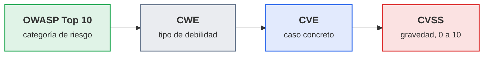
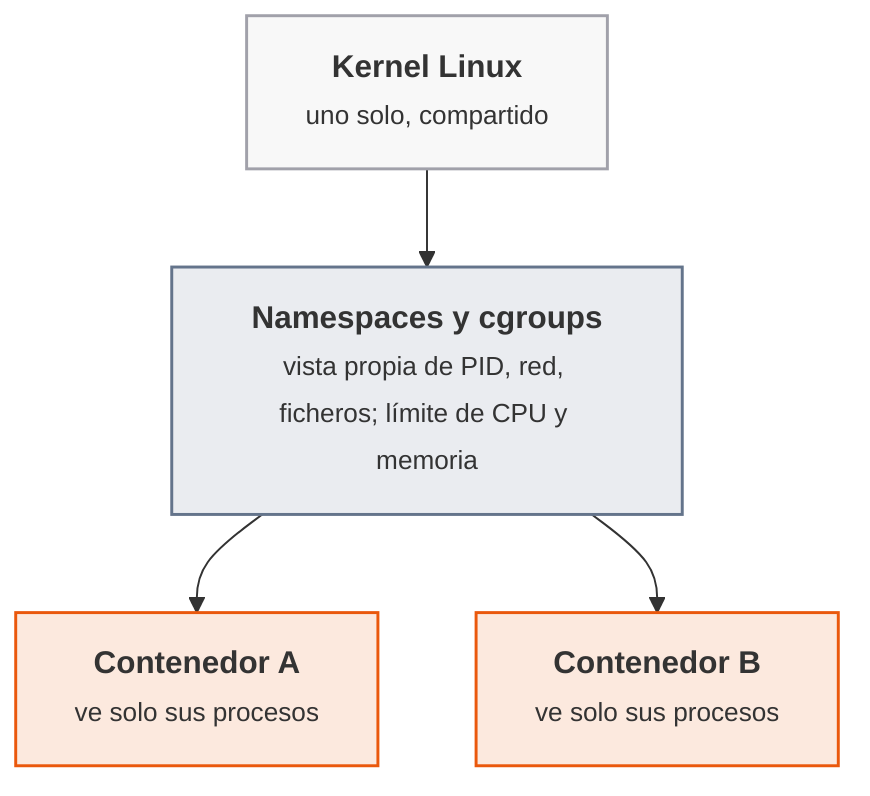
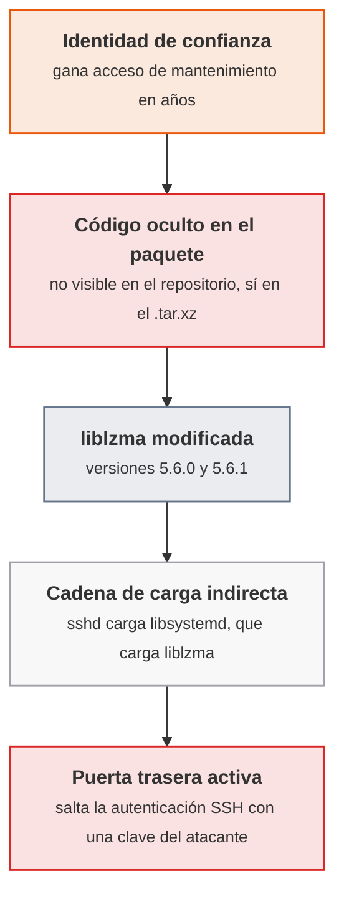

# UT2 · Nivel de seguridad requerido

<p class="ut-meta">12 h · Sesiones 9 a 14 · RA2 CE a, b, c, d</p>

Antes de escribir una línea de código de una aplicación hace falta responder una pregunta previa: ¿cuánta seguridad necesita esta aplicación en concreto? Una tienda con pagos no necesita lo mismo que un blog interno, y tratar a las dos por igual sobra en un caso y falta en el otro. Esta unidad da un criterio para responder esa pregunta con un estándar reconocido, OWASP ASVS, y un vocabulario común para hablar de vulnerabilidades: el catálogo OWASP Top 10, los identificadores CWE y CVE y la puntuación CVSS. También entra en dos casos concretos que muestran por qué el nivel de seguridad no depende solo del código de la aplicación: el aislamiento que ofrece Docker y un ataque real a la cadena de suministro de software.

!!! ojo "Solo sobre lo propio o lo autorizado por escrito"
    Esta unidad reproduce vulnerabilidades reales (Log4Shell, la puerta trasera de xz) contra aplicaciones y máquinas deliberadamente vulnerables, en la máquina virtual propia del alumno y sin salida a la red del aula. Acceder sin autorización a un sistema ajeno es delito en España (Código Penal, artículos 197 bis y 264 y siguientes), aunque la intención sea "solo mirar" y aunque no se cause daño. El criterio profesional es siempre el mismo: solo sobre lo propio o lo que se ha autorizado por escrito. Ninguna hoja de esta unidad escribe código de explotación nuevo: se usan las herramientas y los repositorios que documenta el material del curso, siguiendo su propia documentación.

## Sesión 9 · Fuentes de riesgo: OWASP Top 10, CWE y CVE

<p class="ut-meta" markdown>5 de noviembre · Teoría y práctica · <span class="dur" tabindex="0" aria-label="Fuentes abiertas de vulnerabilidades: OWASP Top 10, CWE y CVE · 15 min&#10;CVSS: puntuar la gravedad · 10 min&#10;A2.1 Riesgos de una aplicación · 85 min" data-dur="Fuentes abiertas de vulnerabilidades: OWASP Top 10, CWE y CVE · 15 min&#10;CVSS: puntuar la gravedad · 10 min&#10;A2.1 Riesgos de una aplicación · 85 min">:material-school:<i class="dur-barra" style="--teoria:23%"></i>:material-flask:</span></p>

Al acabar esta sesión hay diez vulnerabilidades reales clasificadas por categoría de OWASP Top 10, identificador CWE y puntuación CVSS, cada una con una explicación del riesgo concreto que supone para una aplicación. Antes de eso, dos apartados cortos dan el vocabulario: de dónde salen estos catálogos y qué significa cada sigla, y cómo se lee una puntuación CVSS. Es la sesión que abre la unidad y también la que sienta el vocabulario de riesgo que reaparece en la UT3.

!!! consulta "Recursos de la sesión"
    **Para la práctica**

    - [OWASP Top 10:2021](https://owasp.org/Top10/2021/): las diez categorías de riesgo web.
    - [Catálogo CWE](https://cwe.mitre.org/) del MITRE: los tipos de debilidad.
    - [NVD](https://nvd.nist.gov/) del NIST: donde vive cada ficha CVE.
    - [Especificación de CVSS 3.1](https://www.first.org/cvss/v3.1/specification-document): cómo se puntúa la gravedad.
    - El enunciado de la entrega ACT_UT2_1 está en el aula.

### Fuentes abiertas de vulnerabilidades: OWASP Top 10, CWE y CVE

Antes de clasificar una vulnerabilidad hace falta distinguir tres preguntas distintas que a menudo se confunden: qué tipo de fallo es, qué caso concreto de ese fallo es y qué gravedad tiene. Cada pregunta tiene su propio catálogo.



<p class="pie" markdown>De lo general a lo concreto: una categoría amplia del Top 10 (`A03:2021-Injection`) agrupa tipos de debilidad (`CWE-79`, inyección en páginas vistas por otros usuarios), cada tipo se materializa en casos reales (un `CVE` con su ficha en la NVD) y cada caso se puntúa con `CVSS`.</p>

El **CWE** (*Common Weakness Enumeration*, enumeración de debilidades comunes), del MITRE, no describe un fallo que haya ocurrido, describe un tipo de fallo que puede ocurrir: `CWE-89` es "SQL Injection" como concepto, no un caso concreto. Un requisito de ASVS o una vulnerabilidad de la A2.1 se etiquetan con su CWE porque es la forma más precisa de decir "esto es exactamente este tipo de problema", con independencia del lenguaje o del producto donde aparezca.

El **CVE** (*Common Vulnerabilities and Exposures*, vulnerabilidades y exposiciones comunes) identifica un caso concreto, ya descubierto en un producto real y publicado: `CVE-2021-44228` es la puerta trasera concreta de una versión concreta de Log4j, no el concepto de inyección. Cada CVE tiene una ficha pública en la **NVD** (*National Vulnerability Database*, base de datos nacional de vulnerabilidades), el catálogo que mantiene el NIST de EE. UU., con su descripción, su CWE asociado y su puntuación CVSS.

El **OWASP Top 10** agrupa los CWE más frecuentes en diez categorías amplias, pensadas para priorizar sin tener que conocer cientos de CWE de memoria. La edición usada en el curso es la de 2021, que es la que sigue el material de referencia de la asignatura; en 2025 OWASP ha publicado una revisión que reordena y renombra varias categorías, y la comparación entre las dos queda en [Para ampliar](../ampliacion.md#ut2-nivel-de-seguridad-requerido).

| Categoría (2021) | De qué trata, en una frase |
|---|---|
| A01: Broken Access Control | Un usuario accede a datos o funciones que no le corresponden |
| A02: Cryptographic Failures | Datos sensibles cifrados de forma débil o transmitidos en claro |
| A03: Injection | Datos del usuario tratados como código o como orden por el servidor |
| A04: Insecure Design | Un fallo de diseño, no de implementación: falta un control en el plano de la aplicación |
| A05: Security Misconfiguration | Configuración por defecto, permisos de más o funciones innecesarias activas |
| A06: Vulnerable and Outdated Components | Una dependencia (librería, framework) con una vulnerabilidad conocida y sin actualizar |
| A07: Identification and Authentication Failures | Autenticación débil: sesión mal gestionada, credenciales predecibles, sin límite de intentos |
| A08: Software and Data Integrity Failures | Código o datos que se aceptan sin comprobar su integridad (una actualización sin firmar, una deserialización insegura) |
| A09: Security Logging and Monitoring Failures | No queda registro de lo que pasó, así que un incidente se detecta tarde o no se detecta |
| A10: Server-Side Request Forgery | El servidor hace una petición a una URL que controla el atacante |

`CVE-2024-3094`, el caso de la sesión 13, es a la vez A06 (una dependencia comprometida) y A08 (código que se acepta sin comprobar su integridad); es habitual que un mismo caso encaje en más de una categoría, y la A2.1 pide elegir la que mejor explica el riesgo principal, no la única posible.

### CVSS: puntuar la gravedad

Clasificar por categoría dice de qué tipo es el problema; CVSS dice cuánto importa. La puntuación va de 0,0 a 10,0 y sale de combinar factores objetivos: si se explota desde la red o hace falta acceso local, si necesita que la víctima haga algo, qué privilegios hacen falta y qué se compromete (confidencialidad, integridad, disponibilidad). La cifra final se traduce en una banda de severidad:

| Puntuación CVSS v3.1 | Severidad |
|---:|---|
| 0,0 | Ninguna |
| 0,1 a 3,9 | Baja |
| 4,0 a 6,9 | Media |
| 7,0 a 8,9 | Alta |
| 9,0 a 10,0 | Crítica |

La ficha de la NVD de cada CVE incluye su vector CVSS completo (una cadena como `AV:N/AC:L/PR:N/UI:N/S:U/C:H/I:H/A:H`) y la puntuación ya calculada; para la A2.1 basta con leer la puntuación y la severidad de la ficha, no con calcular el vector a mano. Dos vulnerabilidades de la misma categoría del Top 10 pueden tener puntuaciones muy distintas: lo que cambia el riesgo real no es solo el tipo de fallo, es lo fácil que es explotarlo y lo que se pierde si se explota.

### A2.1 Riesgos de una aplicación (sesión 9)

<span class="et et-obj">Objetivo</span> Diez vulnerabilidades reales clasificadas con su categoría de OWASP Top 10 2021, su CWE, su puntuación CVSS con severidad, y una explicación de dos o tres líneas del riesgo que supone cada una para una aplicación concreta.

<span class="et et-pre">Antes de empezar</span> Un navegador con acceso a la [NVD](https://nvd.nist.gov/) y a [OWASP Top 10:2021](https://owasp.org/Top10/2021/). Se han explicado [las fuentes de vulnerabilidades y sus catálogos](#fuentes-abiertas-de-vulnerabilidades-owasp-top-10-cwe-y-cve) y [cómo se lee una puntuación CVSS](#cvss-puntuar-la-gravedad). Esta hoja forma parte de la entrega **ACT_UT2_1 · OWASP ASVS**, junto con la A2.2 y la A2.3.

<span class="et et-pas">Pasos</span>

1. En el repositorio `pps-entregas`, crea la carpeta `ut2/a21/` y, dentro, la tabla de trabajo con las columnas `CVE`, `Nombre común`, `CWE`, `Categoría OWASP Top 10 2021`, `CVSS (puntuación y severidad)` y `Riesgo para una aplicación concreta`.

2. Busca en la NVD la ficha de cada una de estas diez vulnerabilidades y anota su CWE y su puntuación CVSS v3.1 con severidad tal como aparecen en la ficha:

    - `CVE-2021-44228` (Log4Shell)
    - `CVE-2014-0160` (Heartbleed)
    - `CVE-2014-6271` (Shellshock)
    - `CVE-2017-0144` (EternalBlue)
    - `CVE-2017-5638` (la de la brecha de Equifax, en Apache Struts)
    - `CVE-2020-11022` (XSS en jQuery)
    - `CVE-2021-26855` (ProxyLogon, en Microsoft Exchange)
    - `CVE-2022-22965` (Spring4Shell)
    - `CVE-2022-40684` (bypass de autenticación en FortiOS)
    - `CVE-2023-34362` (la de MOVEit Transfer)

    *Pista:* el nombre común entre paréntesis solo ayuda a localizar la ficha, no hace falta citarlo en la tabla. Si la ficha muestra varias versiones de CVSS, usa la v3.1 y, si hay dos, la del NIST.

3. Decide para cada una la categoría de OWASP Top 10 2021 que mejor explica su riesgo principal. Si una encaja en más de una (como `CVE-2024-3094` en la teoría), elige la principal y anota entre paréntesis la secundaria.

4. Escribe en dos o tres líneas, para cada vulnerabilidad, qué riesgo concreto supondría en una de estas tres aplicaciones, la que tenga más sentido para ella y dilo: una tienda en línea con pagos, un servicio interno de gestión de incidencias o una aplicación de mensajería con archivos adjuntos. Completa el `README.md` con la tabla y súbelo.

<span class="et et-com">Comprobación</span> La tabla tiene diez filas completas, cada CVSS coincide con el que muestra la ficha de la NVD de ese CVE, y ninguna explicación de riesgo es una frase genérica que valdría para cualquier vulnerabilidad de la lista.

<span class="et et-ent">Entrega</span> La carpeta `ut2/a21/` de `pps-entregas` con el `README.md` y la tabla. Forma parte de la entrega **ACT_UT2_1 · OWASP ASVS**, plazo el lunes 16 de noviembre a las 23:59.

## Sesión 10 · ASVS: niveles y requisitos

<p class="ut-meta" markdown>9 de noviembre · Teoría y práctica · <span class="dur" tabindex="0" aria-label="OWASP ASVS: qué es y su estructura por capítulos · 10 min&#10;Elegir el nivel: L1, L2 y L3 · 15 min&#10;A2.2 ASVS: elegir el nivel · 85 min" data-dur="OWASP ASVS: qué es y su estructura por capítulos · 10 min&#10;Elegir el nivel: L1, L2 y L3 · 15 min&#10;A2.2 ASVS: elegir el nivel · 85 min">:material-school:<i class="dur-barra" style="--teoria:23%"></i>:material-flask:</span></p>

Al acabar esta sesión hay un nivel de verificación elegido y justificado para el escenario de la entrega, una hoja de cálculo creada con la plantilla de columnas de la unidad y los primeros requisitos L1 resueltos. Antes de eso, dos apartados: qué es ASVS y cómo se organiza en catorce capítulos, y el criterio para decidir entre sus tres niveles.

!!! consulta "Recursos de la sesión"
    **Para la práctica**

    - [OWASP ASVS 4.0.3](https://github.com/OWASP/ASVS/tree/v4.0.3_release): el estándar de verificación y su estructura por niveles.

### OWASP ASVS: qué es y su estructura por capítulos

ASVS (*Application Security Verification Standard*, estándar de verificación de seguridad de aplicaciones) es un catálogo de requisitos técnicos de seguridad, mantenido por OWASP, pensado para dos usos a la vez: como lista de comprobación para quien construye una aplicación y como criterio común para quien la audita. Cada requisito tiene un identificador con el formato `capítulo.sección.número` (por ejemplo, `V2.1.1` es el requisito 1 de la sección 1 del capítulo 2) y, cuando aplica, su CWE asociado.

El estándar se organiza en catorce capítulos, cada uno con un número distinto de requisitos exigibles en el nivel 1 (L1):

| Capítulo | De qué trata | Requisitos en L1 |
|---|---|---:|
| V1 Arquitectura, diseño y modelado de amenazas | Documentar el diseño de seguridad antes de programar | 0 |
| V2 Autenticación | Contraseñas, factores adicionales, recuperación de acceso | 27 |
| V3 Gestión de sesión | Tokens de sesión, cookies, cierre de sesión | 12 |
| V4 Control de acceso | Que cada usuario llegue solo a lo suyo | 8 |
| V5 Validación, sanitización y codificación | Tratar toda entrada como no confiable | 27 |
| V6 Criptografía almacenada | Cómo se guardan claves y secretos | 1 |
| V7 Gestión de errores y registro | Qué se registra y qué no se muestra al usuario | 3 |
| V8 Protección de datos | Qué datos sensibles se exponen y dónde | 7 |
| V9 Comunicaciones | Cifrado del transporte | 3 |
| V10 Código malicioso | Integridad de actualizaciones y del código que se ejecuta | 3 |
| V11 Lógica de negocio | Límites y orden de los pasos de un proceso | 5 |
| V12 Ficheros y recursos | Subida, descarga y ejecución de ficheros | 11 |
| V13 API y servicios web | Métodos, esquemas y CSRF en servicios REST y SOAP | 6 |
| V14 Configuración | Cabeceras HTTP, componentes actualizados, modo depuración | 15 |

El capítulo V1 no exige ningún requisito en L1: el modelado de amenazas formal empieza a pedirse en L2. Los capítulos con más peso en L1 son Autenticación y Validación, con 27 requisitos cada uno; entre los dos suman más de un tercio de los 128 requisitos de nivel 1.

!!! consulta "La versión 5.0 del estándar"
    OWASP publicó ASVS 5.0 en mayo de 2025, que reorganiza los catorce capítulos en diecisiete y cambia varios identificadores de requisito. El curso usa 4.0.3 porque es la versión del enunciado de la entrega y la que sigue el material de referencia; qué cambia entre las dos versiones queda en [Para ampliar](../ampliacion.md#ut2-nivel-de-seguridad-requerido).

### Elegir el nivel: L1, L2 y L3

El nivel no es una preferencia, es una decisión que depende de lo que la aplicación maneja y de a quién afecta si falla.

| Nivel | Cuándo se aplica | Ejemplo |
|---|---|---|
| L1 | Seguridad básica, exigible a cualquier aplicación | Un blog interno, una página informativa sin cuentas de usuario |
| L2 | Aplicaciones con datos sensibles; es el nivel recomendado para la mayoría de aplicaciones empresariales | Una tienda en línea con pagos, un gestor de incidencias con datos de clientes |
| L3 | Aplicaciones críticas, con transacciones de alto valor o datos muy sensibles | Banca, sanidad, infraestructuras críticas |

El criterio para elegir entre los tres no es solo "cuánto se puede gastar en seguridad", es una pregunta de riesgo: qué pasa si esta aplicación falla. Tres preguntas ayudan a decidir: ¿qué datos maneja (ninguno, personales, financieros o de salud)?, ¿qué pasa si se compromete (una molestia, una pérdida económica, un daño a personas)?, ¿a cuánta gente afecta un fallo? Un blog interno sin cuentas de usuario no pasa de L1 aunque se quiera; una aplicación de banca no debería quedarse en L1 aunque el cliente lo pida, porque el riesgo real no ha cambiado por que alguien decida ignorarlo.

El escenario de la entrega es una aplicación cliente-servidor de compra-venta, y el enunciado fija su nivel en L1. Con datos de pago de por medio, el criterio de riesgo apuntaría más bien a L2; el enunciado simplifica a L1 para que la práctica sea abarcable en el tiempo del curso. Ese matiz es precisamente lo que pide la CE b: saber decir, no solo qué nivel toca, sino por qué, y cuándo el nivel que da el cliente y el nivel que pide el riesgo no coinciden.

Verificar un requisito no es responder "sí" o "no": es documentar dónde se aplica, con qué técnica o fichero se cumple y qué prueba lo demuestra, en una plantilla como esta:

| Capítulo | Requisito | Aplica | Dónde | Técnica o fichero | Prueba de verificación | Riesgo residual |
|---|---|---|---|---|---|---|
| V2.1 Seguridad de contraseñas | V2.1.1: la contraseña tiene al menos 12 caracteres | Sí | Formulario de alta y cambio de contraseña, validación en el servidor | Campo `password` validado con una expresión regular de longitud mínima antes de generar el hash | Dar de alta una cuenta con una contraseña de 8 caracteres y comprobar que el servidor la rechaza con un mensaje genérico | Una contraseña de 12 caracteres previsibles (`contraseña123`) sigue siendo débil; lo complementa V2.1.7 (comprobar contra listas de contraseñas filtradas) |

La columna "riesgo residual" es la que distingue una verificación real de una casilla marcada: dice qué sigue sin cubrir aunque el requisito se cumpla, y con qué otro requisito se complementa. Es la que más falla cuando se rellena una hoja de cálculo deprisa, y la que más pregunta la CE c.

El enunciado pide además indicar **en qué servidor** se aplica cada requisito, y no define ninguno. Para que todas las filas hablen de las mismas máquinas, la hoja parte de una arquitectura mínima de tres servidores, que cada alumno puede ampliar si lo justifica:

| Servidor | Función en el escenario de compra-venta |
|---|---|
| Web | Nginx como proxy inverso: termina TLS y añade las cabeceras HTTP |
| Aplicación | La aplicación (API y lógica de negocio): cuentas, sesiones y validación |
| Base de datos | Almacena usuarios (con la contraseña como hash), catálogo y pedidos |

### A2.2 ASVS: elegir el nivel (sesión 10)

<span class="et et-obj">Objetivo</span> El nivel de verificación del escenario de la entrega, justificado por escrito, y una hoja de cálculo con la plantilla de columnas de la unidad y los doce requisitos L1 del capítulo V2.1 (Seguridad de contraseñas) resueltos sobre ese escenario.

<span class="et et-pre">Antes de empezar</span> Un programa de hoja de cálculo (LibreOffice Calc o similar) y el enunciado de la entrega a mano para el formato. Se han explicado [qué es ASVS y su estructura por capítulos](#owasp-asvs-que-es-y-su-estructura-por-capitulos) y [cómo se elige el nivel](#elegir-el-nivel-l1-l2-y-l3). Esta hoja forma parte de la entrega **ACT_UT2_1 · OWASP ASVS**, junto con la A2.1 y la A2.3.

<span class="et et-pas">Pasos</span>

1. Aplica el criterio de la teoría a dos escenarios y anota en dos o tres líneas el nivel que le corresponde a cada uno y por qué: un blog interno de la empresa, sin cuentas de usuario, y una tienda en línea que procesa pagos con tarjeta.

2. Anota el nivel del escenario de la entrega (la aplicación de compra-venta cliente-servidor del enunciado) y, con tus palabras, el matiz entre lo que fija el enunciado (L1) y lo que pediría el riesgo real de una aplicación con pagos.

3. En `~/pps-entregas/ut2/a22/`, genera la hoja de cálculo `ACT_UT2_1.ods` con los 128 requisitos L1 de ASVS 4.0.3 ya listados y las siete columnas de la plantilla de la teoría, y añádele una portada (nombre, fecha, escenario, nivel elegido y la arquitectura de tres servidores) con el formato corporativo que pide el enunciado.

    *Pista:* el CSV oficial está en el repositorio de ASVS 4.0.3 (`.../4.0/docs_en/OWASP ... 4.0.3-en.csv`); los requisitos L1 son las filas que traen marcada la columna `level1`, 128 en total y ninguno en V1. Da formato de texto a la columna del identificador antes de volcarla, o `V2.1.10` pierde el cero final.

4. Resuelve los doce requisitos del capítulo V2.1 (Seguridad de contraseñas) sobre el escenario de compra-venta, siguiendo el modelo de la teoría. El texto completo de cada requisito (V2.1.1 a V2.1.12) está en su propia fila de la plantilla.

5. Guarda la hoja `ACT_UT2_1.ods` y súbela con un commit de progreso.

<span class="et et-com">Comprobación</span> La portada indica el nivel elegido con su justificación, las doce filas de V2.1 tienen las siete columnas completas y ninguna fila deja "riesgo residual" en blanco.

<span class="et et-ent">Entrega</span> La hoja de cálculo, con el nivel y V2.1 resueltos, en `ut2/a22/` de `pps-entregas`. Es un avance de la entrega **ACT_UT2_1 · OWASP ASVS**: la A2.3 completa el resto de los requisitos L1 sobre el mismo fichero, y el plazo conjunto es el lunes 16 de noviembre a las 23:59.

## Sesión 11 · ASVS: verificación de los requisitos L1

<p class="ut-meta" markdown>12 de noviembre · Teoría y práctica · <span class="dur" tabindex="0" aria-label="Verificar un requisito: dónde, con qué técnica y con qué prueba · 15 min&#10;A2.3 ASVS: verificación L1 · 95 min" data-dur="Verificar un requisito: dónde, con qué técnica y con qué prueba · 15 min&#10;A2.3 ASVS: verificación L1 · 95 min">:material-school:<i class="dur-barra" style="--teoria:14%"></i>:material-flask:</span></p>

Al acabar esta sesión el capítulo V2 (Autenticación) está completo en la hoja de cálculo de la entrega y el V3 (Gestión de sesión) está empezado, con el resto marcado como pendiente para terminar en casa antes del plazo. La sesión abre con un apartado corto que afina la metodología ya vista (qué hace que un "dónde", una "técnica" y una "prueba" sean lo bastante concretos para que otra persona los repita) y da cuatro requisitos más resueltos como modelo, de capítulos que se resuelven en casa.

!!! consulta "Recursos de la sesión"
    **Para la práctica**

    - [OWASP ASVS](https://owasp.org/www-project-application-security-verification-standard/): la lista completa de requisitos L1 en CSV, que la plantilla de la entrega ya recoge.

### Verificar un requisito: dónde, con qué técnica y con qué prueba

Tres columnas de la plantilla fallan más que las demás cuando se rellenan sin pensar, y las tres comparten un mismo defecto: la vaguedad.

"Dónde" no es "en el servidor": es en qué componente concreto, con su nombre (el formulario de alta, el middleware de autenticación, la configuración de Apache). Si la aplicación tiene varios servidores (por ejemplo, un frontend y una API), el requisito puede aplicar en uno, en el otro o en los dos, y eso hay que decirlo explícitamente: no todos los requisitos se aplican en todas las máquinas del escenario.

"Técnica o fichero" no es "se valida": es cómo, con qué mecanismo concreto. Puede ser una línea de código, una directiva de configuración, una librería con su nombre, o una política de un proveedor externo (por ejemplo, si la autenticación la delega en un proveedor de identidad, la técnica es "delegado en el proveedor X, ver su documentación de cumplimiento"). Un requisito que no se puede resolver con el código disponible en el escenario se marca igualmente, con "aplica: sí" y la técnica prevista, aunque no exista código real que revisar: el enunciado pide un análisis técnico, no una implementación completa.

"Prueba de verificación" no es "funciona": es un paso concreto que otra persona podría repetir y que da un resultado observable (un intento que se rechaza, una cabecera que aparece, un registro que se genera). Si la prueba es "se ha comprobado manualmente", falta decir qué se hizo exactamente para comprobarlo.

Un requisito que no aplica al escenario (por ejemplo, uno sobre autenticación multifactor si el escenario no la contempla) se marca "aplica: no" con una frase que explique por qué, no se deja en blanco ni se omite la fila.

Cuatro requisitos más, resueltos como modelo para los capítulos que se hacen en casa (el escenario y los tres servidores son los de la sesión 10):

| Requisito | Servidor y componente | Técnica o fichero | Prueba de verificación | Riesgo residual |
|---|---|---|---|---|
| V3.2.1: nuevo token de sesión al autenticarse (CWE-384) | Aplicación: módulo de login | Regenerar el identificador de sesión justo tras validar las credenciales (`session.regenerate()` o equivalente del framework) | Anotar la cookie de sesión antes y después de iniciar sesión: el valor tiene que cambiar | Un token robado después del login sigue valiendo hasta que caduque (lo cubre V3.3.1, cierre de sesión) |
| V4.1.1: control de acceso en una capa de servicio de confianza (CWE-602) | Aplicación: capa de servicios de la API | Comprobar en el servidor el rol y el propietario del pedido en cada endpoint, no solo ocultar botones en el cliente | Con la sesión de un cliente, pedir por URL el pedido de otro (`/pedidos/1234`): el servidor responde 403 | Un rol con más permisos de los necesarios (revisión de roles en L2) |
| V5.3.4: consultas parametrizadas contra inyección (CWE-89) | Aplicación (acceso a datos) y base de datos | Sentencias preparadas o ORM en todo acceso; usuario de BD sin permisos de esquema | Introducir `' OR '1'='1` en el buscador de catálogo: se trata como texto y no devuelve todo | Consultas dinámicas heredadas que se escapen de la revisión (búsqueda en el código de concatenaciones) |
| V9.1.1: TLS en toda conexión de cliente (CWE-319) | Web: Nginx | Redirección de HTTP a HTTPS y directiva `ssl_protocols TLSv1.2 TLSv1.3;` | `curl -I http://host` devuelve una redirección 301 a `https://`; un cliente forzado a TLS 1.0 es rechazado | Certificado mal gestionado o sin renovar (V9.2, L2) |

### A2.3 ASVS: verificación L1 (sesión 11)

<span class="et et-obj">Objetivo</span> El capítulo V2 (Autenticación) completo y las secciones V3.1 a V3.3 de Gestión de sesión resueltos en la hoja de cálculo, siguiendo la metodología de dónde, técnica y prueba, y el resto (V3.4 en adelante, unos 95 requisitos) con su plan para terminarlo en casa antes del plazo.

<span class="et et-pre">Antes de empezar</span> La hoja de cálculo de la A2.2, con el nivel elegido y V2.1 resuelto. Se ha explicado [cómo verificar un requisito de forma concreta](#verificar-un-requisito-donde-con-que-tecnica-y-con-que-prueba).

<span class="et et-pas">Pasos</span>

1. Completa el resto del capítulo V2 (15 filas): V2.2 (seguridad general del autenticador, 3), V2.3 (ciclo de vida del autenticador, 1), V2.5 (recuperación de credenciales, 6), V2.7 (verificador fuera de banda, 4) y V2.8 (verificador de un solo uso, 1). El texto está en la propia fila de la plantilla.

2. Empieza el capítulo V3 (Gestión de sesión): V3.1 (fundamentos, 1), V3.2 (vinculación de la sesión, 3) y V3.3 (terminación de la sesión, 2). Sigue el modelo V3.2.1 de la teoría.

3. Rellena la columna «Aplica» (`sí`, `no` con motivo o `pendiente`) de todas las filas que faltan, para que la hoja muestre qué queda, y ordena los capítulos pendientes por tamaño: V5 (27), V14 (15) y V12 (11) son los más largos. Apunta en la portada tu plan de trabajo en casa (unos 3 minutos por requisito, unas 5 horas en total).

4. Haz un commit de progreso con la hoja.

<span class="et et-com">Comprobación</span> Las 27 filas de V2 y las 6 de V3.1 a V3.3 tienen las siete columnas completas y ninguna fila queda sin marcar en "Aplica".

<span class="et et-ent">Entrega</span> La hoja de cálculo completa, con los 128 requisitos L1 resueltos, en `ut2/a23/` de `pps-entregas` y subida a la tarea de Aules en el formato que pide el enunciado. Lo que no se ha hecho en clase se termina **en casa, antes del plazo**: es un trabajo a ritmo propio y el plazo no se mueve. Cierra la entrega **ACT_UT2_1 · OWASP ASVS** (A2.1, A2.2 y A2.3), lunes 16 de noviembre a las 23:59.

## Sesión 12 · Seguridad en Docker

<p class="ut-meta" markdown>16 de noviembre · Teoría y práctica · <span class="dur" tabindex="0" aria-label="Namespaces y cgroups: el aislamiento de un contenedor · 10 min&#10;seccomp, AppArmor y SELinux: limitar lo que hace un proceso · 10 min&#10;La superficie de ataque del demonio · 5 min&#10;A2.4 Docker: aislamiento y auditoría · 85 min" data-dur="Namespaces y cgroups: el aislamiento de un contenedor · 10 min&#10;seccomp, AppArmor y SELinux: limitar lo que hace un proceso · 10 min&#10;La superficie de ataque del demonio · 5 min&#10;A2.4 Docker: aislamiento y auditoría · 85 min">:material-school:<i class="dur-barra" style="--teoria:23%"></i>:material-flask:</span></p>

Al acabar esta sesión hay una imagen deliberadamente vulnerable (Log4Shell) corriendo de forma contenida en `pps01`, una auditoría del demonio Docker con `docker-bench-security` y un perfil de AppArmor aplicado y comprobado sobre un contenedor. Antes de eso, tres apartados cortos explican qué aísla realmente a un contenedor, qué mecanismos limitan lo que un proceso puede hacer dentro de él, y dónde está el punto más débil de toda la plataforma: el demonio que lo gestiona todo.

!!! consulta "Recursos de la sesión"
    **Para la práctica**

    - [Guía de seguridad de Docker](https://docs.docker.com/engine/security/) y [AppArmor en Docker](https://docs.docker.com/engine/security/apparmor/): el aislamiento del contenedor.
    - [log4shell-vulnerable-app](https://github.com/christophetd/log4shell-vulnerable-app) y [docker-bench-security](https://github.com/docker/docker-bench-security): el laboratorio y la herramienta de comprobación.
    - El enunciado de la entrega ACT_UT2_2 está en el aula.

    **Para ampliar** (opcional)

    - *Container security fundamentals* de Datadog: [parte 1](https://securitylabs.datadoghq.com/articles/container-security-fundamentals-part-1/) y [parte 2](https://securitylabs.datadoghq.com/articles/container-security-fundamentals-part-2/).

### Namespaces y cgroups: el aislamiento de un contenedor

Un contenedor no es una máquina virtual: comparte el mismo kernel Linux que el sistema anfitrión. Lo que lo hace parecer una máquina aparte son dos mecanismos del kernel que Docker combina.

Los **namespaces** dan a un proceso una vista propia de un recurso del sistema, de modo que no ve lo que hay fuera de esa vista aunque comparta el mismo kernel:

| Namespace | Qué aísla |
|---|---|
| PID | Los procesos: un contenedor solo ve los suyos, no los del anfitrión ni los de otros contenedores |
| Network | Las interfaces de red: cada contenedor tiene su propia IP y sus propias reglas |
| Mount | El sistema de ficheros: cada contenedor ve solo los volúmenes que se le asignan |
| UTS | El nombre de host |
| IPC | La comunicación entre procesos (memoria compartida, colas de mensajes) |
| User | El mapeo de usuarios: un proceso puede ser root dentro del contenedor sin serlo en el anfitrión |



<p class="pie" markdown>El kernel es uno solo: lo que separa un contenedor de otro no es hardware, es la vista que los namespaces le dan de ese mismo kernel. Un fallo que se escapa del namespace afecta al anfitrión y a todos los demás contenedores.</p>

Los **cgroups** (*control groups*, grupos de control) hacen el trabajo complementario: no ocultan recursos, limitan cuántos puede consumir un proceso. Una CPU o una memoria sin límite en un contenedor puede dejar sin recursos al anfitrión y a los demás contenedores con un único proceso descontrolado, algo que un namespace por sí solo no evita.

### seccomp, AppArmor y SELinux: limitar lo que hace un proceso

Los namespaces y los cgroups aíslan y limitan recursos, pero no dicen qué puede *hacer* un proceso dentro de su propia vista. Esa capa la cubren tres mecanismos distintos, y conviene no confundirlos:

| Mecanismo | Qué restringe | Dónde se usa en el laboratorio |
|---|---|---|
| seccomp | Las llamadas al sistema (*syscalls*) que un proceso puede hacer al kernel | Activo por defecto en Docker: el perfil estándar bloquea alrededor de 44 llamadas de las más de 300 disponibles |
| AppArmor | Qué ficheros, capacidades y recursos puede usar un proceso concreto, mediante un perfil de texto | El mecanismo de esta sesión, porque `pps01` es Ubuntu y AppArmor es su control de acceso obligatorio por defecto |
| SELinux | Lo mismo que AppArmor (control de acceso obligatorio) pero con un modelo de etiquetas por fichero y proceso, más granular y más complejo de administrar | No se usa en el laboratorio: es el mecanismo por defecto en distribuciones basadas en Red Hat, no en Ubuntu |

seccomp actúa por defecto sin que nadie escriba nada: el perfil estándar de Docker ya bloquea llamadas peligrosas como cambiar la hora del reloj o cargar módulos del kernel. AppArmor y SELinux, en cambio, necesitan un perfil explícito para cada aplicación: sin uno, un contenedor corre con el perfil `docker-default`, que es razonable pero genérico. Un perfil propio, como el que aplica la A2.4, restringe además lo que esa aplicación concreta necesita, no lo que cualquier contenedor podría necesitar.

### La superficie de ataque del demonio

El demonio Docker (`dockerd`) corre como root y es quien de verdad crea, destruye y gestiona los contenedores: cualquiera que pueda hablar con su socket tiene, en la práctica, privilegios de root en el anfitrión. Por eso el grupo `docker` equivale a un grupo con privilegios de administración, y añadir un usuario a ese grupo (paso habitual para no escribir `sudo` en cada orden) es una decisión de seguridad, no solo de comodidad.

La configuración del demonio vive en `/etc/docker/daemon.json`; ahí se desactiva el modo `debug` en producción y se pueden fijar límites (`ulimits`) por defecto para los contenedores que arrancan sin sus propios límites. Otro punto habitual de exposición es montar el socket del demonio dentro de un contenedor (`-v /var/run/docker.sock:/var/run/docker.sock`, un patrón común en pipelines de CI/CD para lanzar Docker dentro de Docker): quien controla ese socket controla el anfitrión, así que ese montaje solo se hace cuando es imprescindible y nunca en un contenedor que también procesa entrada de fuera. `docker-bench-security`, que es la herramienta de la hoja de esta sesión, audita justamente este tipo de configuración: la del demonio, la de los contenedores en marcha y la de las imágenes, contra un catálogo de buenas prácticas.


### A2.4 Docker: aislamiento y auditoría (sesión 12)

<span class="et et-obj">Objetivo</span> La imagen de `christophetd/log4shell-vulnerable-app` escaneada y corriendo contenida en `pps01` (puerto 8082, sin salida a Internet), su vulnerabilidad comprobada y mitigada con una opción de configuración; un informe de `docker-bench-security` con tres hallazgos explicados; y un perfil de AppArmor propio aplicado a un contenedor y comprobado.

<span class="et et-pre">Antes de empezar</span> `pps01` encendida con una instantánea reciente, Docker funcionando sin `sudo` y el repositorio `pps-entregas` clonado ([repositorio de entregas](../laboratorio.md#repositorio-de-entregas)). Se han explicado [namespaces y cgroups](#namespaces-y-cgroups-el-aislamiento-de-un-contenedor), [seccomp, AppArmor y SELinux](#seccomp-apparmor-y-selinux-limitar-lo-que-hace-un-proceso) y [la superficie de ataque del demonio](#la-superficie-de-ataque-del-demonio). Esta hoja forma parte de la entrega **ACT_UT2_2 · Seguridad en Docker**. Todo se hace sobre la imagen deliberadamente vulnerable del laboratorio y sin exponerla a la red del aula ([red aislada](../laboratorio.md#red-aislada-y-buenas-practicas)).

<span class="et et-pas">Pasos</span>

1. Crea la carpeta `ut2/a24/`, define la imagen vulnerable por su digest (el que da el README del repositorio) y escánéala con `trivy` antes de arrancarla (práctica 1 del enunciado), pidiendo solo las vulnerabilidades críticas y guardando la salida en `trivy-log4shell.txt`. Anota qué paquete de Log4j aparece, con su versión y su CVE, y con qué versión lo corrige.

    ```bash
    export IMG=ghcr.io/christophetd/log4shell-vulnerable-app@sha256:6f88430688108e512f7405ac3c73d47f5c370780b94182854ea2cddc6bd59929
    ```

    *Pista:* `trivy` corre en su propio contenedor (`aquasec/trivy`), sin instalar nada.

2. Arranca la imagen publicada solo en el bucle local, en el puerto 8082 del anfitrión (el 8080 del contenedor, según [Puertos y nombres](../laboratorio.md#puertos-y-nombres)), corta su salida a Internet con una regla en la cadena `DOCKER-USER`, comprueba la vulnerabilidad sin atacar (una expresión `${...}` inofensiva en la cabecera `X-Api-Version`, que el registro muestra ya resuelta) y aplica la mitigación de configuración, tras la cual la misma prueba deja el texto sin resolver. Anota en el `README.md` por qué la mitigación es un parche provisional y cuál es la corrección definitiva.

    *Pista:* la expresión va entre comillas simples, o la shell la expande antes que `curl`; la variable que mitiga es `LOG4J_FORMAT_MSG_NO_LOOKUPS=true` y la corrección definitiva, Log4j 2.17.1 o posterior. La regla de `DOCKER-USER` solo bloquea las conexiones nuevas que salen (`--ctstate NEW`), no lo que entra por el puerto publicado. Sin la cabecera la aplicación responde `HTTP 400`, que ya indica que está viva; la explotación completa (servidor LDAP y segunda fase) queda en el README del repositorio.

3. **Este paso se hace en casa antes del plazo**, igual que las prácticas 2 y 3 del enunciado: en clase el tiempo llega para el laboratorio Log4Shell y el perfil de AppArmor, no para todo. Clona y ejecuta `docker-bench-security` siguiendo su propio README, guarda la salida en `docker-bench.txt` y elige tres hallazgos `[WARN]` de secciones distintas (anfitrión, demonio y contenedores en ejecución, entre ellos `vulnerable-app`), explicando de cada uno en el `README.md` qué comprueba, por qué importa y qué cambio lo resolvería.

    *Pista:* clónalo **fuera de `pps-entregas`** (por ejemplo en `~`); si se clona dentro, `git add` lo trata como un repositorio anidado.

4. Crea el perfil de AppArmor `pps-confinado` (parte de un perfil permisivo, donde `file,` permite todo el acceso a ficheros, y añádele denegaciones explícitas de escritura, que siempre prevalecen), cárgalo en el kernel y compruébalo ejecutando dos contenedores de prueba de `ubuntu:24.04`, uno sin perfil y otro con `--security-opt apparmor=pps-confinado`: compara qué puede escribir cada uno en `/tmp` y en `/etc`.

    ```text
    #include <tunables/global>

    profile pps-confinado flags=(attach_disconnected,mediate_deleted) {
      #include <abstractions/base>

      network,
      capability,
      file,
      umount,

      deny /etc/** w,
      deny /root/** w,
      deny /usr/** w,
    }
    ```

    *Pista:* cada regla acaba en coma, incluida la última antes de `}`; se carga con `apparmor_parser -r` y se lista con `aa-status`. Las opciones de `docker run` van antes de la imagen, y `docker inspect -f '{{.AppArmorProfile}}'` confirma el perfil aplicado.

5. Guarda como evidencia la salida del escaneo (paso 1), la del corte de red y la mitigación (paso 2), un fragmento del informe de docker-bench (paso 3) y la comparación de los dos contenedores (paso 4), escribe el resto del `README.md` (qué se ha hecho, comandos y validación) y sube la carpeta.

<span class="et et-com">Comprobación</span> `trivy` ha localizado Log4j en la imagen; el servicio responde en `http://127.0.0.1:8082/` pero el contenedor no alcanza Internet; la expresión de prueba se resuelve antes de la mitigación y no después; el `README.md` explica tres hallazgos reales de `docker-bench-security`; y el contenedor con perfil escribe en `/tmp` pero no en `/etc`, mientras que el contenedor sin perfil escribe en los dos sitios. Si algo falla, revisa [Errores frecuentes](#errores-frecuentes-en-el-laboratorio).

<span class="et et-ent">Entrega</span> La carpeta `ut2/a24/` de `pps-entregas`, con el `README.md`, `trivy-log4shell.txt`, `docker-bench.txt`, el perfil `pps-confinado` y las capturas. Es la entrega **ACT_UT2_2 · Seguridad en Docker**, plazo el lunes 23 de noviembre a las 23:59. El enunciado del aula incluye además dos escaneos más con las mismas herramientas de la práctica 1, que **se hacen en casa antes del plazo** y se añaden a la misma carpeta:

- Práctica 2, un escaneo con `trivy` de una imagen antigua de WordPress (una etiqueta con años de antigüedad, no la última, para que tenga vulnerabilidades que mostrar): `docker run --rm aquasec/trivy image --scanners vuln --severity HIGH,CRITICAL wordpress:5.9 | tee trivy-wordpress.txt`. Resume cuántas vulnerabilidades críticas hay y por qué la etiqueta antigua es peor.
- Práctica 3, un inventario de componentes (SBOM) y su análisis: genera el inventario con [Syft](https://github.com/anchore/syft) en formato CycloneDX (`syft <imagen> -o cyclonedx-json > sbom.json`), analízalo con [Grype](https://github.com/anchore/grype) (`grype sbom:sbom.json`) y súbelo a [Dependency-Track](https://dependencytrack.org/) si lo tienes instalado; si no, basta con Grype y la explicación de qué añade un SBOM a un escaneo directo de la imagen.

**Antes de la sesión 13, en casa.** La A2.5 crea la VM `debian12` desde una instalación desatendida y la necesita ya descargada. Comprueba con `curl` la última versión 12.x en [cdimage.debian.org](https://cdimage.debian.org/cdimage/archive/latest-oldstable/amd64/iso-cd/) (por ejemplo, `curl -sI https://cdimage.debian.org/cdimage/archive/latest-oldstable/amd64/iso-cd/debian-12.15.0-amd64-netinst.iso` tiene que responder `200`, aunque el número de versión concreto cambie), descárgala en el anfitrión (el equipo donde corre VirtualBox, no en `pps01`) y déjala en `~/iso/`. Son unos 700 MB; hacerlo en casa evita que treinta equipos la pidan a la vez en el aula.

<span class="et et-ext">Si te sobra tiempo</span> Endurece el arranque de `vulnerable-app` con las opciones del cheat sheet de Docker del enunciado (`--cap-drop=ALL`, `--security-opt no-new-privileges`, `--read-only` con `--tmpfs /tmp`, `--memory 256m` y `--cpus 0.5`) y comprueba que el servicio sigue respondiendo. Arranca despacio (medio minuto o más en un equipo lento). Anota si alguna de ellas rompe la aplicación y, si es así, por qué; si no rompe ninguna, explica qué protege cada opción.

## Sesión 13 · Cadena de suministro: el caso xz

<p class="ut-meta" markdown>19 de noviembre · Teoría y práctica · <span class="dur" tabindex="0" aria-label="La cadena de suministro: el caso xz · 15 min&#10;A2.5 El caso xz · 95 min" data-dur="La cadena de suministro: el caso xz · 15 min&#10;A2.5 El caso xz · 95 min">:material-school:<i class="dur-barra" style="--teoria:14%"></i>:material-flask:</span></p>

Al acabar esta sesión hay un análisis propio de las dos versiones de una librería del laboratorio, la original y una infectada, con las diferencias que delatan la puerta trasera, y una investigación con `ldd` de qué depende de qué en la cadena que unió esa librería con el servidor SSH. Antes de eso, un único apartado cuenta el caso: cómo una puerta trasera llegó a una librería de compresión muy extendida y por qué ese ataque concreto es un ejemplo de manual de riesgo en la cadena de suministro de software.

!!! consulta "Recursos de la sesión"
    **Para la práctica**

    - [xzbot](https://github.com/amlweems/xzbot): el laboratorio que reproduce el caso.
    - [Ficha CVE-2024-3094](https://nvd.nist.gov/vuln/detail/CVE-2024-3094) en la NVD.
    - El enunciado de la entrega ACT_UT2_3 está en el aula.

    **Para ampliar** (opcional)

    - [La historia de la puerta trasera de xz](https://securelist.com/xz-backdoor-story-part-1/112354/) (Securelist) y [su cronología completa](https://pentest-tools.com/blog/xz-utils-backdoor-cve-2024-3094).

### La cadena de suministro: el caso xz

Una cadena de suministro de software es la sucesión de piezas de las que depende una aplicación sin haberlas escrito nadie del propio equipo: librerías, compiladores, imágenes base, paquetes del sistema. Cada eslabón que se acepta sin comprobar es un punto donde alguien más puede introducir código. `CVE-2024-3094` es el caso de manual de ese riesgo: no es un fallo de programación, es un ataque deliberado y sostenido en el tiempo contra un eslabón de esa cadena.

`xz` es un formato de compresión y `liblzma` la librería que lo implementa; la usan, entre muchos otros programas, herramientas del sistema como `systemd` (para comprimir sus registros). Entre 2021 y 2024, una identidad que se había ganado la confianza del mantenedor original del proyecto fue introduciendo, de forma progresiva y con *commits* que parecían legítimos, un código que alteraba el proceso de compilación del paquete. Ese código no estaba en el repositorio de control de versiones a la vista de todos: se escondía en los archivos de prueba del propio paquete distribuido (`.tar.xz`), de modo que quien revisara el código fuente en GitHub no lo veía, pero quien compilaba el paquete descargado sí lo ejecutaba.



<p class="pie" markdown>Ningún paso de esta cadena es, por sí solo, un exploit clásico: es una identidad de confianza, un paquete de distribución con un contenido distinto del repositorio y una dependencia indirecta que nadie había pensado en auditar. La puerta trasera solo se activa si las tres piezas coinciden.</p>

El punto que hace este caso tan citado no es la puerta trasera en sí, es dónde vivía: para que `sshd` (el servidor SSH) acabara ejecutando código de `liblzma`, hacía falta una cadena de dependencias indirecta, `sshd` cargando `libsystemd` por otro motivo (notificar su estado al gestor de servicios) y `libsystemd` cargando a su vez `liblzma` para comprimir registros. Ninguna de las dos dependencias parece, vista por separado, relacionada con la autenticación SSH; unidas, permitían que una librería de compresión interceptara una función de verificación de firma RSA y la sustituyera por la comprobación de una clave del atacante. La puntuación CVSS de `CVE-2024-3094` es 10,0, la máxima: ejecución remota de código con privilegios de root, sin necesitar credenciales válidas.

Se descubrió porque un ingeniero que mantenía software de bases de datos notó que las conexiones SSH a una máquina tardaban unos cientos de milisegundos más de lo esperado y no lo dejó pasar: no fue un escáner automático ni una auditoría formal, fue un caso de curiosidad técnica investigando algo pequeño. El fallo se descubrió antes de llegar a ninguna distribución estable: solo afectó a versiones en desarrollo o de pruebas (Debian *unstable*, Fedora *rawhide* y similares), nunca a Debian 12 estable, que sigue usando una versión anterior y no comprometida de `xz`.

### A2.5 El caso xz (sesión 13)

<span class="et et-obj">Objetivo</span> Los tres escenarios del laboratorio de `xzbot` reproducidos en la VM aislada (`sshd` con la librería original, con la infectada y con la infectada parcheada), con el resultado esperado de cada uno comprobado e interpretado, una investigación con `ldd` de la cadena de dependencias entre `sshd` y `liblzma`, y un análisis de qué controles habrían detectado el ataque antes de que llegara a producción.

<span class="et et-pre">Antes de empezar</span> La ISO de Debian 12 descargada en `~/iso/` del anfitrión (tarea de la sesión anterior). Esta hoja crea la VM `debian12` al principio y la deja, ya instalada, sin salida a Internet ([máquinas virtuales](../laboratorio.md#maquinas-virtuales)). Se ha explicado [el caso xz](#la-cadena-de-suministro-el-caso-xz). Esta hoja sigue el README de [`amlweems/xzbot`](https://github.com/amlweems/xzbot) paso a paso: cada orden remite a la sección del README que la documenta y ninguna se reproduce aquí. El tercer escenario dispara el backdoor con la clave de investigación que el propio README sustituye por la del atacante (sección "ed448 patch"), nunca con la clave real, y solo en local (`127.0.0.1`), sin exponer nada a la red del aula.

!!! ojo "Solo con la clave de investigación, solo en loopback"
    El tercer escenario ejecuta de verdad el código de explotación que publica `xzbot`, pero con una clave ED448 propia en vez de la del atacante real: es el mecanismo que el propio proyecto documenta para poder estudiar el backdoor sin depender de una clave privada que nadie tiene. Se hace solo contra el `sshd` de prueba de `debian12`, en `127.0.0.1` y sin red externa. Hacerlo contra un servidor ajeno, con la clave real o fuera de esta VM aislada es delito (Código Penal, artículos 197 bis y 264 y siguientes).

<span class="et et-pas">Pasos</span>

1. Crea la VM `debian12` desde el anfitrión con la receta de [Crear `debian12` desde el anfitrión](../laboratorio.md#crear-debian12-desde-el-anfitrion), apuntando a la ISO que descargaste en `~/iso/`. Mientras se instala (10 a 15 min), prepara en `pps01` la herramienta `xzbot` y los dos ficheros de librería de su carpeta `assets/`, y lee el artículo de [Securelist](https://securelist.com/xz-backdoor-story-part-1/112354/) si no lo has hecho.

    *Pista:* `xzbot` se instala con `go install` y los ficheros son `liblzma.so.5.6.0` (infectada) y `liblzma.so.5.6.0.patch` (la infectada con la clave de investigación, sección "ed448 patch" del README).

2. Cuando termine la instalación, fija en `debian12` la IP de la red solo anfitrión, copia desde `pps01` los dos ficheros y el binario `xzbot`, e instala lo que hace falta para arrancar un segundo `sshd` de prueba y comparar bibliotecas. Antes de ejecutar nada, compara las tres librerías (la original del sistema, la infectada y la parcheada) por tamaño, resumen criptográfico y símbolos exportados, y anota la diferencia. Toma la instantánea `antes-a25` y, solo entonces, quita el adaptador NAT: a partir de ahí `debian12` ya no tiene salida a Internet, pero `pps01` (`192.168.56.10`) la sigue viendo en `192.168.56.50` para copiar los resultados de vuelta.

    *Pista:* la IP se fija con `nmcli` sobre la interfaz solo anfitrión (suele ser `enp0s8`); `openssh-server` y `binutils` (trae `nm`) hay que instalarlos con el NAT todavía activo. `nm -D` lista los símbolos exportados: la parcheada solo difiere de la infectada en la clave ED448, mientras que frente a la del sistema (una versión limpia y anterior de `xz`) la diferencia es total. El adaptador NAT se quita con `VBoxManage modifyvm debian12 --nic1 none` y la VM apagada.

3. Reproduce los tres escenarios en un `sshd` de prueba en el puerto 2222 (aislado del `sshd` del sistema), anotando el resultado de cada uno y qué diferencia el tercero de los otros dos:

    - **Escenario 1, librería original.** Con la librería oficial de Debian, sin comprometer: una conexión SSH normal funciona.
    - **Escenario 2, librería infectada, sin activar la puerta trasera.** Fuerza la librería infectada con `LD_PRELOAD` (nada se recompila) y conecta igual, sin `xzbot`: el resultado es idéntico al escenario 1, porque la puerta trasera solo reacciona ante una clave que aquí nadie tiene, y eso es lo que hace el ataque tan difícil de notar.
    - **Escenario 3, librería parcheada, puerta trasera disparada.** Con la librería parcheada y `xzbot` (sección "backdoor demo" de su README), ejecuta una orden inofensiva sin usuario ni contraseña: se ejecuta como `root` aunque la conexión no llegue a autenticarse. Es la ejecución remota de código que puntúa `CVE-2024-3094` con un CVSS de 10,0.

    *Pista:* las dos librerías copiadas desde `pps01` son `liblzma.so.5.6.0` (infectada) y `liblzma.so.5.6.0.patch` (parcheada); el resultado del escenario 3 queda en `/tmp/xzbot-a25.txt`.

4. Investiga con `ldd`, sin modificar nada del sistema, la cadena de dependencias real de esta máquina: si `sshd` depende de `libsystemd` y si `libsystemd` depende a su vez de `liblzma`. Explica con tus palabras por qué esa cadena, si existe, es la que un atacante necesitaba para que una librería de compresión pudiera intervenir en la autenticación SSH.

    *Pista:* `ldd` sobre el binario de `sshd` y sobre el `libsystemd.so` que localice `ldconfig -p`. Si la cadena no aparece en esta máquina, es un resultado válido y se anota como tal.

5. Escribe el análisis final en el `README.md`: qué diferencia el comportamiento observable de los tres escenarios (no el contenido del backdoor en sí), por qué Debian 12 estable no se vio afectado en producción aunque comparta la misma arquitectura de dependencias, y qué controles de cadena de suministro habrían detectado o dificultado este ataque antes de llegar a producción (firma criptográfica de los artefactos publicados, comprobar que el código fuente del repositorio coincide con el del paquete distribuido, reducir el número de dependencias indirectas de un servicio crítico como `sshd`).

6. Copia la carpeta de resultados de `debian12` a `pps01`, súbela desde `pps01` y vuelve `debian12` a la instantánea `antes-a25` (con la VM apagada desde el anfitrión).

    *Pista:* al restaurar se pierde todo lo hecho dentro de `debian12`, así que la copia a `pps01` va antes.

<span class="et et-com">Comprobación</span> Los tres escenarios se han ejecutado en orden y el resultado de cada uno coincide con lo esperado (conexión normal en el 1 y en el 2, ejecución de `id` sin autenticación en el 3); el apartado de `ldd` dice explícitamente si la cadena `sshd` → `libsystemd` → `liblzma` existe en `debian12`, con la orden y su salida como evidencia; y el análisis final nombra al menos dos controles de cadena de suministro concretos, no genéricos.

<span class="et et-ent">Entrega</span> La carpeta `ut2/a25/` de `pps-entregas`, con el `README.md` y las salidas guardadas de los tres escenarios (el binario `xzbot` y los ficheros `.so` descargados no hace falta subirlos: están en el repositorio original). Forma parte de la entrega **ACT_UT2_3 · Seguridad en Unix (xz)**, plazo el jueves 26 de noviembre a las 23:59.

## Sesión 14 · Margen y repaso de la unidad 2

<p class="ut-meta" markdown>23 de noviembre · Margen · <span class="dur" tabindex="0" aria-label="Repaso y recuperación · 110 min" data-dur="Repaso y recuperación · 110 min">:material-school:<i class="dur-barra" style="--teoria:0%"></i>:material-flask:</span></p>

Esta sesión no trae contenido nuevo: absorbe el retraso de las clases que se hayan perdido en las sesiones 9 a 13 y, si no se ha perdido ninguna, sirve para repasar la unidad y para la actividad optativa ACT_UT2_4. Hoy vence el plazo de ACT_UT2_2 (Docker) y el de ACT_UT2_3 (xz) vence el jueves 26 de noviembre; los plazos no se mueven aunque se haya perdido una clase, solo se mueve el contenido.

!!! consulta "Recursos de la sesión"
    **Para la práctica**

    - [Guía de ransomware de INCIBE](https://www.incibe.es/sites/default/files/contenidos/guias/doc/guia_ransomware.pdf): la lectura de la actividad.
    - [No More Ransom](https://www.nomoreransom.org/es/index.html): herramientas de descifrado de familias conocidas.
    - El enunciado de la entrega optativa ACT_UT2_4 está en el aula.

**Si se ha perdido alguna clase**

- Recuperar primero lo que tiene plazo más cercano. Hoy vence ACT_UT2_2, así que si falta la A2.4 (sesión 12) es lo primero: sigue sus pasos completos y sube la carpeta `ut2/a24/` antes de las 23:59.
- Después, lo que vence el jueves 26 de noviembre: la A2.5 (sesión 13). Necesita la VM `debian12` con su instantánea inicial ([máquinas virtuales](../laboratorio.md#maquinas-virtuales)).
- La A2.1, A2.2 y A2.3 (entrega ACT_UT2_1) vencieron el lunes 16 de noviembre. Quien no las haya entregado las sube ya: fuera de plazo y sin causa justificada se corrige sobre el 50 %.
- Solo cuando todo lo obligatorio esté entregado, si queda tiempo, mirar la actividad optativa de más abajo.

**Si no se ha perdido ninguna clase**

- Repasar los criterios de las [prácticas evaluables](#practicas-evaluables-de-la-unidad) y comprobar que cada criterio (a, b, c, d) tiene su evidencia en `pps-entregas` (`ut2/a21/` a `ut2/a25/`).
- Terminar lo que haya quedado a medias de las tres partes que se hacen en casa: la hoja de cálculo completa de la A2.3 si aún no está entregada y los dos escaneos adicionales de la A2.4 (WordPress antiguo y SBOM).
- Repasar las [prácticas evaluables](#practicas-evaluables-de-la-unidad) y sus tablas de criterios: cada fila indica de qué hoja sale su evidencia y cuánto pesa.
- Hacer la actividad optativa ACT_UT2_4, descrita a continuación, si el tiempo lo permite.

### ACT_UT2_4 · Análisis de un ransomware (optativa)

**Objetivo.** Entender cómo se comporta un ransomware y, sobre todo, cómo se detecta, se contiene y se previene. Es una actividad de **reserva y optativa**: no tiene hoja, no es necesaria para aprobar la unidad y solo se hace si no se ha perdido ninguna clase y todo lo obligatorio está entregado. Cubre los criterios c y d. Si se entrega, sube el nivel de logro de RA2 y su plazo, si se hace, es el jueves 26 de noviembre a las 23:59.

**Qué se hace.** El enunciado del aula fija tres tareas: leer la guía de INCIBE, analizar el comportamiento de un ransomware de laboratorio y redactar un informe forense. En estos apuntes la parte que se trabaja y se evalúa es la que tiene valor profesional, el **informe de análisis y las medidas de prevención**, y la ejecución queda acotada por las precauciones de abajo.

!!! ojo "Malware solo en un laboratorio aislado y con instantánea"
    Ejecutar un ransomware fuera de una máquina virtual aislada puede cifrar datos reales, propios o de la red, sin vuelta atrás. Distribuir o lanzar malware contra sistemas ajenos es delito (Código Penal, artículos 264 y siguientes). Estas guías no incluyen pasos de creación ni de ejecución de malware: quien decida hacer esa parte lo hace siguiendo el enunciado del aula y solo con las cuatro condiciones siguientes.

Las precauciones, todas a la vez:

1. Una máquina virtual **desechable** (no `pps01`, que guarda el repositorio de entregas), con instantánea limpia tomada antes de empezar.
2. **Sin red**: adaptador desconectado, sin carpetas compartidas ni portapapeles compartido con el anfitrión.
3. **Sin datos reales**: solo ficheros de prueba creados para la ocasión.
4. Al terminar, se destruye la máquina o se vuelve a la instantánea, y se comprueba que el anfitrión no ha cambiado.

**Qué se entrega.** Un informe en PDF (formato de la *Normativa de entrega*) con este guion:

| Apartado | Qué contiene |
|---|---|
| Resumen del caso | Qué es el ransomware analizado, de qué tipo es (cifrado, bloqueo, doble extorsión, como servicio) y qué exige |
| Ciclo del ataque | Infección inicial, cifrado, nota de rescate y consecuencias, con lo que se ha observado en el laboratorio |
| Indicadores de compromiso | Ficheros creados o modificados, extensión añadida, nota de rescate y procesos, tal como se ven en un análisis forense |
| Impacto | Qué datos y servicios se pierden y qué pasa si no hay copia de seguridad |
| Medidas de prevención y contención | Al menos cinco, ligadas a la guía de INCIBE: formación frente al phishing, parches, copias desconectadas de la red y probadas, antivirus y cortafuegos, segmentación de red y mínimos privilegios |
| Recuperación | Qué se haría en una empresa: aislar, no pagar el rescate, restaurar desde copia, denunciar y consultar *No More Ransom* |
| Relación con ASVS | Qué requisitos de la hoja de la A2.3 habrían dificultado la entrada (por ejemplo, subida de ficheros, validación de entradas o integridad de actualizaciones) |

El informe se puede escribir sin ejecutar nada, a partir del enunciado, la guía de INCIBE y el análisis de una familia ya documentada públicamente. Quien lo haga así no pierde nada de lo evaluable: el criterio d pide reconocer riesgos, no lanzar malware.

!!! examen "Qué se evalúa"
    La calidad del informe: si los indicadores de compromiso son coherentes con el tipo de ransomware, si las medidas de prevención responden a cada fase del ciclo y si la recuperación descarta pagar el rescate con argumentos. Una lista de medidas genéricas sin relación con el análisis se queda en el 60 %.

## Prácticas evaluables de la unidad

La unidad tiene tres entregas obligatorias y una optativa. Ninguna tiene sesión propia: cada una se construye con varias hojas y se cierra en su plazo, que es siempre a las 23:59 (hora de Madrid) del día indicado y no se mueve aunque se haya perdido una clase. Se califican en Aules, una tarea por entrega; fuera de plazo y sin causa justificada se corrige sobre el 50 %. La ponderación de cada entrega frente al resto de la asignatura y al examen la fija [el módulo](../modulo.md). Los pesos de las tablas de abajo reparten el 100 % **dentro** de cada entrega.

Los niveles de logro son: el 40 y el 60 % se alcanzan con un **funcionamiento correcto** (lo pedido está hecho y se ve funcionar), el 80 % con **análisis técnico** (se explica por qué funciona y qué controla), el 90 % con **validación completa** (una prueba que demuestra el resultado, con su evidencia) y el 100 % con un **extra** razonado más allá del enunciado.

| Entrega | Hojas | Plazo | CE |
|---|---|---|---|
| ACT_UT2_1 · OWASP ASVS | A2.1, A2.2, A2.3 | lunes 16 de noviembre | a, b, c, d |
| ACT_UT2_2 · Seguridad en Docker | A2.4 | lunes 23 de noviembre | c, d |
| ACT_UT2_3 · Seguridad en Unix (xz) | A2.5 | jueves 26 de noviembre | d |
| ACT_UT2_4 · Ransomware (optativa) | reserva de la sesión 14 | jueves 26 de noviembre, si se hace | c, d |

### ACT_UT2_1 · OWASP ASVS

**De qué hojas sale.** De la A2.1 (sesión 9, la clasificación de riesgos), la A2.2 (sesión 10, el nivel y el capítulo V2.1) y la A2.3 (sesión 11, el resto de capítulos), que trabajan sobre el mismo fichero. **Plazo:** lunes 16 de noviembre a las 23:59. **CE:** a, b, c, d.

**Qué se entrega.** Dos cosas: la carpeta `ut2/a21/` de `pps-entregas` con la tabla de las diez vulnerabilidades, y la hoja de cálculo de ASVS (`.ods` o `.xls`, el formato que pide el enunciado, con portada y formato corporativo) en `ut2/a22/` y `ut2/a23/`, que además se sube a la tarea de Aules. La hoja cubre **todos** los requisitos L1 (128 en ASVS 4.0.3), con las siete columnas de la plantilla; los que no se hicieron en clase se terminan en casa antes del plazo.

| Criterio | CE | Peso | Evidencia |
|---|---|---:|---|
| Las diez vulnerabilidades clasificadas con categoría del Top 10 2021, CWE, CVSS con severidad y un riesgo concreto para una aplicación | d | 20 % | A2.1: tabla del `README.md` |
| Niveles ASVS caracterizados y nivel del escenario elegido con justificación de riesgo (incluido el matiz entre el L1 del enunciado y el que pediría una aplicación con pagos) | a, b | 20 % | A2.2: pasos 1 y 2 y portada de la hoja |
| Requisitos L1 enumerados sin omisiones: los 128, con «aplica: no» justificado cuando corresponda | c | 20 % | A2.2 y A2.3: capítulos V1 a V14 |
| Verificación técnica de cada requisito: en qué servidor se aplica, con qué fichero o técnica y qué prueba lo demuestra (no basta una explicación sin fundamento técnico) | c | 30 % | A2.2 y A2.3: columnas «dónde», «técnica o fichero» y «prueba» |
| Riesgo residual real en cada fila y formato corporativo de la hoja | c | 10 % | A2.2 y A2.3: columna «riesgo residual» y portada |

### ACT_UT2_2 · Seguridad en Docker

**De qué hoja sale.** De la A2.4 (sesión 12) y de los dos escaneos adicionales que el enunciado pide en casa. **Plazo:** lunes 23 de noviembre a las 23:59. **CE:** c, d.

**Qué se entrega.** La carpeta `ut2/a24/` de `pps-entregas` con el `README.md`, `trivy-log4shell.txt`, `trivy-wordpress.txt`, el inventario de componentes (`sbom.json`) y su análisis, `docker-bench.txt`, el perfil `pps-confinado` y las capturas. El reparto es 35, 35 y 30 % dentro del CE c y 40, 30 y 30 % dentro del CE d, con los dos criterios al 50 % cada uno.

| Criterio | CE | Peso | Evidencia |
|---|---|---:|---|
| Práctica 1: escaneo con `trivy` de la imagen Log4Shell, con el paquete, su versión y la versión que lo corrige | c | 17 % | A2.4, paso 1 |
| Práctica 2: escaneo de una imagen antigua de WordPress y resumen de por qué es peor que la actual | c | 17 % | A2.4, entrega |
| Práctica 3: inventario de componentes (SBOM) y su análisis con vulnerabilidades | c | 16 % | A2.4, entrega |
| Laboratorio Log4Shell contenido (sin salida a Internet), vulnerabilidad comprobada y mitigada, con la corrección definitiva explicada | d | 20 % | A2.4, paso 2 |
| `docker-bench-security` ejecutado y tres hallazgos de secciones distintas explicados (qué comprueba, por qué importa, cómo se resuelve) | d | 15 % | A2.4, paso 3 |
| Perfil de AppArmor propio aplicado a un contenedor y comparado con otro sin perfil | d | 15 % | A2.4, paso 4 |

### ACT_UT2_3 · Seguridad en Unix (xz)

**De qué hoja sale.** De la A2.5 (sesión 13). **Plazo:** jueves 26 de noviembre a las 23:59. **CE:** d.

**Qué se entrega.** La carpeta `ut2/a25/` de `pps-entregas` con el `README.md`, las salidas guardadas y los dos ficheros de librería descargados. La hoja reproduce el exploit en los tres escenarios del laboratorio (librería original, infectada sin activar e infectada parcheada) y dispara la puerta trasera con `xzbot` en el tercero, todo sobre `debian12` aislada y con instantánea previa, porque activa código malicioso real.

| Criterio | CE | Peso | Evidencia |
|---|---|---:|---|
| Instantánea previa, máquina aislada y restauración | d | 5 % | A2.5, pasos 2 y 6 |
| Comportamiento de los tres escenarios: conexión normal en 1 y 2, ejecución de `id` sin autenticación en 3 | d | 30 % | A2.5, paso 3 |
| Cadena `sshd` → `libsystemd` → `liblzma` con `ldd`, orden y salida | d | 25 % | A2.5, paso 4 |
| Análisis de qué cambia entre versiones y por qué Debian 12 estable no se vio afectado | d | 20 % | A2.5, paso 5 |
| Al menos dos controles de cadena de suministro concretos | d | 20 % | A2.5, paso 5 |

### ACT_UT2_4 · Ransomware (optativa)

No tiene hoja ni tabla de pesos propia: es la actividad de reserva de la [sesión 14](#sesion-14-margen-y-repaso-de-la-unidad-2), cubre los criterios c y d y se valora sobre el informe de análisis y de prevención que allí se describe. Solo suma si el resto de la unidad está entregado.

El enunciado de cada actividad está en el aula.

## Errores frecuentes en el laboratorio

Para lo general (VM que no arranca, disco lleno, Docker sin permisos, puertos ocupados) mira [Si algo se rompe](../laboratorio.md#si-algo-se-rompe). Aquí, lo específico de esta unidad.

**Log4Shell: el registro no muestra nada al enviar la expresión de prueba.** Hay tres causas habituales. La primera, que el argumento de `-H` va entre comillas dobles y la shell intenta expandir `${java:version}` antes de que `curl` lo vea: tiene que ir entre comillas simples, tal como está en el paso 2 de la A2.4. La segunda, que el contenedor acaba de arrancar y todavía no ha registrado la petición: se espera unos segundos y se repite. La tercera, que se está leyendo el contenedor equivocado: `docker ps` dice cuál corre y `docker logs vulnerable-app 2>&1 | grep "API version"` filtra su registro.

**Log4Shell: `docker run` dice que el nombre `vulnerable-app` ya está en uso o que el puerto 8082 está ocupado.** Queda un contenedor de un intento anterior. `docker rm -f vulnerable-app` lo quita y `ss -ltnp | grep 8082` dice si hay otro proceso en ese puerto.

**Log4Shell: el segundo `ping` sigue respondiendo después de la regla de `iptables`.** La regla se puso con una IP y el contenedor tiene otra, casi siempre porque se recreó (paso 2) y Docker le asignó una distinta. Se vuelve a leer la IP con `docker inspect` y se repite la regla. Si `iptables` dice que la cadena `DOCKER-USER` no existe, Docker no está arrancado: `systemctl status docker`.

**`docker pull` o `trivy` fallan con `toomanyrequests`.** Con treinta alumnos descargando a la vez desde la misma red, el registro aplica su límite de peticiones anónimas. Se espera unos minutos y se repite, o se inicia sesión en Docker Hub con la cuenta del curso (`docker login`). La primera ejecución de `trivy` descarga además su base de datos de vulnerabilidades, y esa descarga puede fallar por el mismo motivo: repetir el mismo comando basta.

**`docker-bench-security` deja en la carpeta de la hoja un repositorio anidado.** El paso 3 clona el repositorio dentro de `ut2/a24/` y `git add .` avisa de `adding embedded git repository` o sube una referencia vacía. Se evita clonando fuera de `pps-entregas` (por ejemplo en `~/`) y dejando en la carpeta de la hoja solo el `docker-bench.txt`. Si ya se hizo, `git rm --cached docker-bench-security` y se borra la carpeta clonada.

**El `docker-bench.txt` sale con caracteres raros y muchos `[WARN]`.** Los caracteres son los códigos de color del terminal: `sed 's/\x1b\[[0-9;]*m//g' docker-bench.txt` los quita. Los `[WARN]` de la sección 1 (auditoría con `auditd` de los ficheros de Docker) y de la 2 son normales en una máquina de laboratorio recién instalada: el objetivo no es dejar el informe en verde, es entender tres hallazgos. Si sale sin resultados o con `Permission denied`, faltó `sudo`.

**AppArmor: `apparmor_parser: command not found` o `aa-status` no existe.** Faltan los paquetes de AppArmor. `sudo apt install apparmor apparmor-utils` los instala y `cat /sys/module/apparmor/parameters/enabled` tiene que responder `Y`; si responde `N`, AppArmor no está activo en el kernel de esa máquina y el perfil no se aplicará aunque se cargue.

**AppArmor: `apparmor_parser` termina con `syntax error`.** Casi siempre falta una coma al final de una regla (`network,`, `file,`) o una llave. Cada regla de un perfil acaba en coma, incluida la última antes de `}`.

**AppArmor: `docker run` dice que el perfil `pps-confinado` no existe o no está cargado.** Los perfiles cargados con `apparmor_parser -r` viven en el kernel, no en disco: después de reiniciar la VM hay que cargarlos otra vez. `sudo aa-status | grep pps-confinado` lo confirma.

**AppArmor: el contenedor con perfil escribe en `/etc` igualmente.** `docker inspect -f '{{.AppArmorProfile}}' confinado` responde `unconfined` o `docker-default` si la opción `--security-opt apparmor=pps-confinado` se escribió mal o se puso después del nombre de la imagen: las opciones de `docker run` van antes de la imagen, lo que va después es la orden del contenedor.

**xz: `wget` falla en `debian12`.** La máquina no tiene salida a Internet a propósito. Los dos ficheros se descargan en `pps01` y se copian con `scp` por la red solo anfitrión (pasos 1 y 2). Por la misma razón, `binutils` (que trae `nm`) y `openssh-server` se instalan antes de cortar la red, con el adaptador NAT todavía activo (paso 2); sin ellos, `nm: command not found` o `ldd` sobre un `sshd` que no existe.

**xz: `ldd` no muestra `libsystemd` en la salida de `sshd`.** No es un error de la orden: es un resultado, y se anota como tal. La cadena solo existe en los sistemas cuyo `sshd` se compiló con soporte de `systemd`. La hoja pide decir si existe **en esta máquina**, con la orden y su salida como prueba, y explicar qué habría cambiado si existiera.

**xz: `VBoxManage snapshot ... restore` falla o borra los resultados.** Con la VM encendida el comando se niega; hay que apagarla antes (`VBoxManage controlvm debian12 poweroff`). Y al restaurar se pierde todo lo hecho dentro de `debian12` desde la instantánea, así que la carpeta de resultados se copia a `pps01` **antes** (paso 6).

**ASVS: los identificadores de la hoja no coinciden con los del CSV.** Se mezclaron dos versiones del estándar. El curso usa la 4.0.3 (capítulos V1 a V14); la 5.0 tiene otra numeración y otros capítulos. Se descarga el CSV de la versión 4.0.3 y se comprueba que la primera fila indica esa versión.

**ASVS: la hoja lista requisitos de L2 o le faltan de L1.** Al filtrar el CSV por nivel hay que quedarse solo con los marcados para L1: son 128, y V1 no tiene ninguno. El recuento por capítulo de la sesión 10 sirve para comprobar que no falta ni sobra ninguno.

**ASVS: filas con «aplica: sí» y «dónde: el servidor».** Es la respuesta que el enunciado descarta: no sirve una explicación sin fundamento técnico. Cada fila dice qué servidor (aplicación, base de datos, proxy), qué fichero o técnica y qué prueba concreta; si un requisito no aplica al escenario, se marca «no» y se justifica en una línea.

**Hoja de cálculo: el programa cambia lo que se escribe.** Un identificador escrito sin la `V` inicial (`2.10`) se convierte en número y pierde el cero final; una celda que empieza por `=`, `+` o `-` se interpreta como fórmula y aparece `#NAME?`. Se da formato de texto a la columna antes de pegar y se escribe el identificador completo (`V2.1.10`). Un CSV importado con los acentos rotos se importa de nuevo indicando codificación UTF-8.

**Hoja de cálculo: `git` sube ficheros temporales.** LibreOffice deja un `.~lock.<nombre>#` junto al fichero mientras está abierto. Se cierra el programa antes del commit y se añade `.~lock.*` al `.gitignore` del repositorio.

**A2.1: la puntuación CVSS no coincide con la de la ficha de la NVD.** La ficha muestra varias (v2.0, v3.1, v4.0, y la del CNA junto a la del NIST). La hoja usa la **v3.1** y, si hay dos, la del NIST; se anota cuál se ha copiado.

Los enlaces para ampliar y los apartados que van más allá de lo que se hace en clase están en [Para ampliar](../ampliacion.md#ut2-nivel-de-seguridad-requerido).
