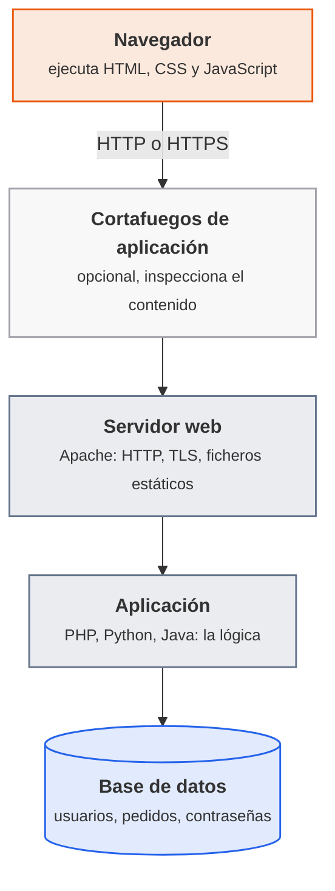
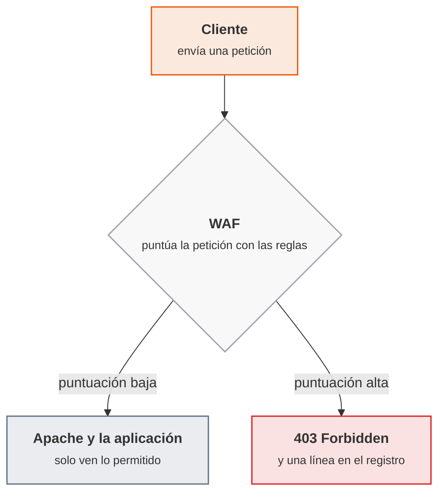
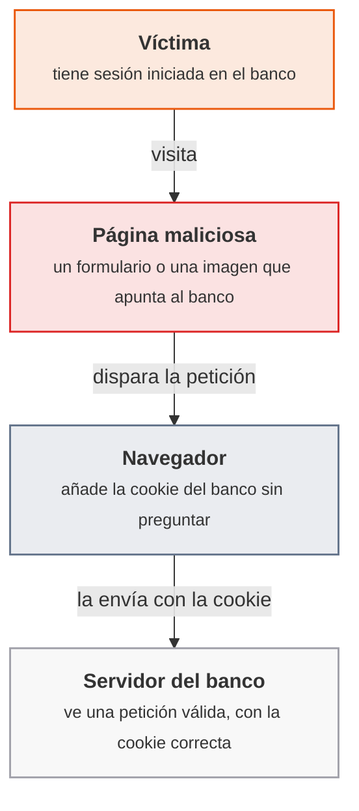
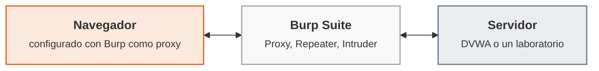
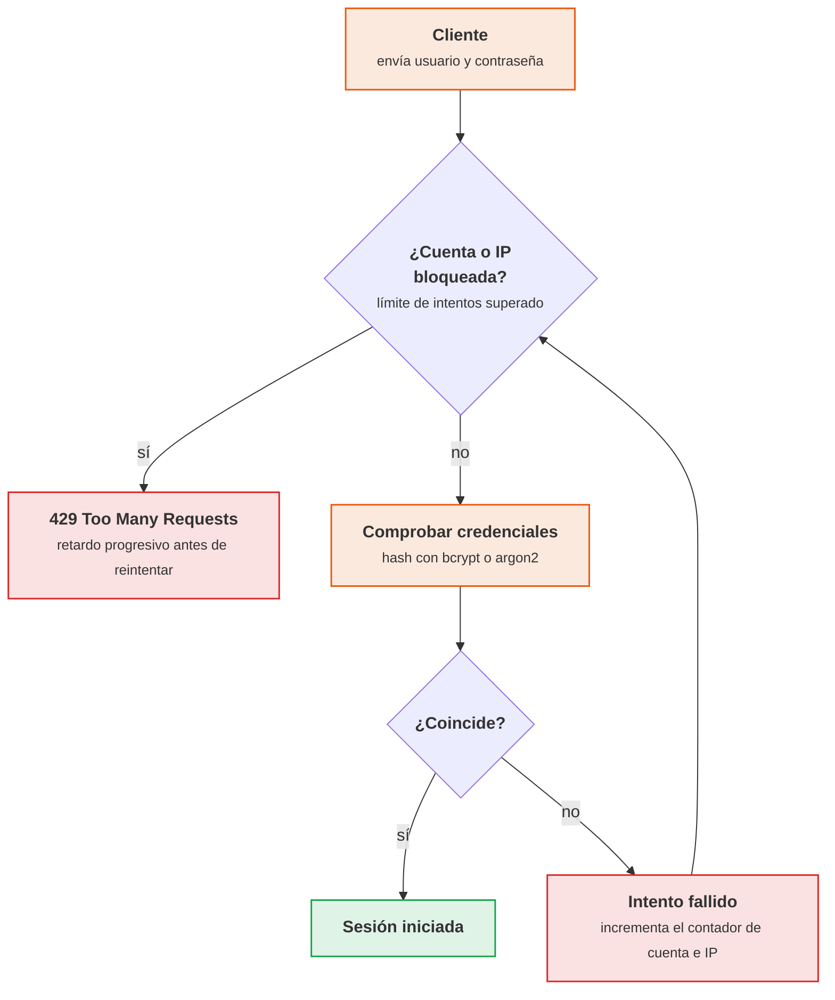

# UT3 · Vulnerabilidades web

<p class="ut-meta">26 h · Sesiones 15 a 27 · RA3 CE a, b, c, d, e, f, g</p>

Una aplicación web recibe texto de desconocidos, lo mezcla con consultas, comandos y páginas, y lo devuelve a otros navegadores. Casi todos los fallos de esta unidad salen de ahí: el servidor trata como orden lo que debía tratar como dato. Lo que se busca es doble: endurecer el servidor que aloja la aplicación (Apache en un contenedor, con TLS, cabeceras, cortafuegos de aplicación y límites) y reconocer, explotar en un laboratorio propio y corregir las vulnerabilidades web más habituales. Las herramientas son Docker y `curl` para el servidor, DVWA y los laboratorios de PortSwigger Academy para las vulnerabilidades, Burp Suite Community para ver y repetir el tráfico, y una pequeña aplicación Flask para las contraseñas y los bots. Son trece sesiones (doce de trabajo y una de margen) y seis entregas evaluables, ACT_UT3_1 a ACT_UT3_6. Las cinco primeras tienen en el aula su enunciado en PDF («RA3.1 Apache Hardening», «RA3.2 Damm Vulnerable Web App», «RA3.3 SQL Injection», «RA3.4.1 Burp Suite - Server Side» y «RA3.4.2 Burp Suite - Client Side»), y **el PDF es el que manda**: las hojas siguen su numeración (3.1.1, 3.2.1...) y dicen en cada paso a qué punto responden, y lo que una hoja añade por su cuenta va en «Si te sobra tiempo». La sexta, ACT_UT3_6, no tiene enunciado en PDF: la define esta unidad.

!!! ojo "Solo sobre lo propio o lo autorizado por escrito"
    Todo lo ofensivo de esta unidad se hace **únicamente** contra aplicaciones deliberadamente vulnerables que corren en la máquina virtual del propio alumno (DVWA, en una red aislada) o en los laboratorios que sus plataformas autorizan (PortSwigger Academy). Acceder sin autorización a un sistema ajeno es delito en España (Código Penal, artículos 197 bis y 264 y siguientes), aunque la intención sea "solo mirar" y aunque no se cause daño. El criterio profesional es siempre el mismo: solo sobre lo propio o lo que se ha autorizado por escrito. Cada vulnerabilidad se explica con su corrección, porque el objetivo de la unidad es saber evitar el fallo, no solo provocarlo; aplicarla en el código es lo que proponen los «Si te sobra tiempo» de las hojas de DVWA, y el examen pregunta por ella.

Lo que va más allá de lo que se hace en clase (ampliaciones, otras herramientas y enlaces para seguir) está en [Para ampliar](../ampliacion.md#ut3-vulnerabilidades-web).

Se trabaja siempre en `pps01`, con Docker, y las máquinas con aplicaciones vulnerables no se exponen a la red del aula ([red aislada](../laboratorio.md#red-aislada-y-buenas-practicas)). Los puertos están en [Puertos y nombres](../laboratorio.md#puertos-y-nombres), y las evidencias van al [repositorio de entregas](../laboratorio.md#repositorio-de-entregas), en `ut3/a31/`, `ut3/a32/`...; las imágenes se suben a Docker Hub con el usuario `pps<NIA>` ([cuentas y repositorios](../laboratorio.md#cuentas-y-repositorios)).

## Sesión 15 · Arquitectura web y HTTP

<p class="ut-meta" markdown>26 de noviembre · Teoría y práctica · <span class="dur" tabindex="0" aria-label="Arquitectura de una aplicación web · 5 min&#10;El protocolo HTTP · 10 min&#10;Apache y su configuración básica · 10 min&#10;A3.1 Apache y HTTP en un contenedor · 85 min" data-dur="Arquitectura de una aplicación web · 5 min&#10;El protocolo HTTP · 10 min&#10;Apache y su configuración básica · 10 min&#10;A3.1 Apache y HTTP en un contenedor · 85 min">:material-school:<i class="dur-barra" style="--teoria:23%"></i>:material-flask:</span></p>

Al acabar esta sesión hay un servidor Apache corriendo en un contenedor de `pps01`, se ha leído cada petición y cada respuesta con `curl` y con el navegador, y se ha modificado su configuración básica reconstruyendo la imagen. La hoja se apoya en tres apartados: dónde está cada pieza de una aplicación web, cómo es un mensaje HTTP y cómo se organiza la configuración de Apache. Esa imagen es la base de las tres sesiones siguientes, que hasta el 7 de diciembre le añaden HTTPS, un cortafuegos de aplicación y límites para la entrega ACT_UT3_1.

!!! consulta "Recursos de la sesión"
    **Para la práctica**

    - [Documentación de Apache 2.4](https://httpd.apache.org/docs/2.4/): la referencia del servidor.
    - El enunciado de la entrega ACT_UT3_1, «RA3.1 Apache Hardening», en el aula. Sus prácticas siguen dos guías que enlaza: [Hardening del servidor](https://psegarrac.github.io/Ciberseguridad-PePS/tema3/seguridad/web/2021/03/01/Hardening-Servidor.html) (prácticas 1 a 5) y [Certificado SSL en Apache](https://psegarrac.github.io/Ciberseguridad-PePS/tema1/practicas/2020/11/08/P1-SSL.html) (punto 3.2).

### Arquitectura de una aplicación web

Una aplicación web es un programa cuyo cliente es un navegador. Para decidir dónde poner una defensa hay que saber dónde está cada pieza, porque cada una tiene sus propios fallos y su propia herramienta para corregirlos.



<p class="pie" markdown>De arriba abajo es el camino de una petición. Cuanto más abajo llega un dato sin filtrar, más daño hace: lo que alcanza la base de datos es lo más grave.</p>

Cada capa tiene su tipo de fallo. El servidor web falla por configuración (versiones visibles, listados de directorios, métodos de más, HTTP sin cifrar). La aplicación falla por cómo trata lo que recibe (XSS, inyección de comandos, inyección SQL, sesiones, control de acceso). La base de datos falla por lo que guarda y cómo lo guarda (contraseñas en claro o con un hash rápido). El navegador no es de fiar: todo lo que hace (validar un formulario, ocultar un botón) se puede saltar, así que **toda validación que importa se repite en el servidor**. La unidad va en ese orden: hasta el 7 de diciembre se endurece el servidor web, y del 10 de diciembre al 21 de enero se explotan y se corrigen los fallos de la aplicación y de la base de datos.

Apache con PHP sirve ficheros y ejecuta la aplicación en un mismo proceso; una aplicación en Python o Java suele ir en su propio servidor con Apache o Nginx delante, como proxy inverso, que es también el sitio natural del cortafuegos de aplicación y de los certificados.

### El protocolo HTTP

HTTP es el protocolo de la capa de aplicación que usa un navegador para pedir recursos a un servidor. Cada intercambio es una petición y una respuesta, y el protocolo no guarda memoria entre una y otra: las sesiones se construyen encima con cookies. Como los mensajes son texto, se leen con `curl` igual que los lee el navegador.

Una petición lleva una línea inicial, cabeceras y, a veces, cuerpo:

```http
GET /buscar?q=zapatos HTTP/1.1
Host: tienda.local
User-Agent: curl/8.5.0
Accept: text/html
Cookie: sesion=a3f9c1
```

La respuesta lleva una línea de estado, cabeceras y el cuerpo:

```http
HTTP/1.1 200 OK
Server: Apache/2.4.58 (Ubuntu)
Content-Type: text/html; charset=utf-8
Set-Cookie: sesion=a3f9c1; Path=/; HttpOnly

<html>...</html>
```

Lo que interesa desde la seguridad:

| Elemento | Qué contiene | Por qué importa |
|---|---|---|
| Método | `GET` pide, `POST` envía datos, `PUT` y `DELETE` modifican o borran, `OPTIONS` pregunta qué se admite, `TRACE` devuelve la petición tal cual | Cada método de más es superficie de ataque: una aplicación que solo lee y envía formularios necesita `GET`, `POST` y `HEAD` |
| Código de estado | 2xx correcto, 3xx redirección, 4xx error del cliente (403 prohibido, 404 no existe), 5xx error del servidor | Un 500 con una traza de pila cuenta mucho al atacante; un 403 frente a un 404 puede revelar que un recurso existe |
| Cabecera `Server` y similares | Nombre y versión del software | Da pistas para buscar vulnerabilidades conocidas |
| `Set-Cookie` y `Cookie` | El servidor entrega un valor y el navegador lo devuelve en cada petición al mismo sitio | Es el identificador de sesión: quien lo tiene es el usuario |
| `Content-Type` | Tipo del cuerpo | Un tipo mal declarado hace que el navegador interprete como código lo que era datos |
| Cabeceras de seguridad (`Strict-Transport-Security`, `Content-Security-Policy`) | Instrucciones del servidor al navegador | Reducen el daño cuando la aplicación falla, porque el navegador las cumple |

HTTP sin cifrar viaja en claro: cualquiera en la ruta (una wifi abierta, un equipo intermedio) lee y puede modificar las peticiones, incluidas las cookies. Por eso hoy en día todo el tráfico se sirve por HTTPS, que es HTTP dentro de TLS.

### Apache y su configuración básica

Apache se configura con directivas en ficheros de texto. En Debian y Ubuntu el reparto es siempre el mismo y conviene conocerlo, porque ahí es donde se endurece el servidor.

| Ruta o mandato | Qué es |
|---|---|
| `/etc/apache2/apache2.conf` | Configuración global |
| `/etc/apache2/mods-available` y `mods-enabled` | Módulos disponibles y activos; los activos son enlaces a los disponibles |
| `/etc/apache2/conf-available` y `conf-enabled` | Fragmentos de configuración global, con el mismo esquema |
| `/etc/apache2/sites-available` y `sites-enabled` | Sitios (hosts virtuales); se activa uno por enlace |
| `a2enmod`, `a2dismod`, `a2enconf`, `a2disconf`, `a2ensite`, `a2dissite` | Crean o quitan esos enlaces |
| `apache2ctl configtest`, `apache2ctl -M`, `apache2ctl -S` | Comprobar la sintaxis, listar módulos cargados y listar los hosts virtuales |
| `/var/www/html` | Raíz de documentos por defecto |
| `/var/log/apache2/access.log` y `error.log` | Registro de accesos y de errores |

Un host virtual (`VirtualHost`) permite servir varios sitios desde un mismo Apache y es donde se declaran el nombre, la raíz de documentos y, cuando hay HTTPS, el certificado. Las directivas se pueden poner en la configuración global, en el host virtual o en un fichero `.htaccess` dentro de la raíz. El criterio habitual: en la configuración del servidor y no en `.htaccess`, que se relee en cada petición, deja a quien sube contenido cambiar el servidor y solo hace falta en un alojamiento compartido. En el laboratorio no se usa.

En un contenedor la configuración no se edita dentro: se guarda junto al `Dockerfile`, se copia al construir la imagen y se activa con `a2enconf`, de modo que la imagen es reproducible y la configuración queda en Git.

### A3.1 Apache y HTTP en un contenedor (sesión 15)

<span class="et et-obj">Objetivo</span> Una imagen `pps-base` con Apache 2.4 sobre Ubuntu, corriendo en `pps01` en el puerto 8080, y la evidencia de que se ha leído una petición y una respuesta HTTP completas con `curl` y con el navegador, y de que se ha cambiado la configuración básica reconstruyendo la imagen.

<span class="et et-pre">Antes de empezar</span> `pps01` encendida, Docker funcionando sin `sudo` y el repositorio `pps-entregas` clonado ([repositorio de entregas](../laboratorio.md#repositorio-de-entregas)). Se han explicado [dónde está cada pieza de una aplicación web](#arquitectura-de-una-aplicacion-web), [cómo es un mensaje HTTP](#el-protocolo-http) y [cómo se organiza Apache](#apache-y-su-configuracion-basica). Esta imagen es la base de todas las de ACT_UT3_1 (A3.2, A3.3 y A3.4): se conserva la carpeta.

<span class="et et-pas">Pasos</span>

1. Crea la carpeta `ut3/a31/` del repositorio de entregas con una página de prueba y escribe el `Dockerfile` de la imagen base `pps-base`: Apache 2.4 sobre `ubuntu:24.04` instalado con los paquetes de Ubuntu, la página copiada a la raíz de documentos y Apache en primer plano. Construye la imagen y arranca el contenedor `web` publicando el 80 en el 8080.

    *Pista:* instala también `curl` y `openssl`, que hacen falta en las sesiones siguientes para ModSecurity y el certificado. El `CMD` tiene que dejar Apache en primer plano (`apache2ctl -D FOREGROUND`), o el contenedor se para al arrancar.

2. Lee una petición y una respuesta HTTP completas con `curl`: pide la página con las cabeceras y después solo las cabeceras, provoca un 404 y prueba los métodos `POST`, `DELETE` y `OPTIONS`. Anota la línea de estado, `Server`, `Content-Type`, el código de cada método y la cabecera `Allow` del `OPTIONS`.
3. Abre la página en el navegador de `pps01`, mira la petición y la respuesta en la pestaña Red (F12) y anota qué cabeceras de petición añade el navegador que `curl` no manda.
4. Cambia la configuración básica reconstruyendo la imagen. Escribe `basico.conf` y actívalo en un `Dockerfile.basico` sobre `pps-base` (guárdalo aparte para no perder el primero); reconstruye como `pps-a31` y relanza el contenedor.

    ```apache
    ServerName localhost
    ErrorDocument 404 "Recurso no encontrado en pps01"
    Header always set Set-Cookie "visita=1; Path=/"
    ```

    *Pista:* el `ServerName` quita el aviso `AH00558` del arranque. La directiva `Header` no funciona sin activar el módulo `headers` (`a2enmod headers` en el Dockerfile).

5. Comprueba el cambio y el viaje de la cookie (el 404 trae el texto propio y `Set-Cookie: visita=1`, y una segunda petición que reenvía la cookie guardada manda la cabecera `Cookie`) e inspecciona el servidor por dentro: host virtual que atiende, módulos cargados y configuración activa.

    *Pista:* `curl -c`/`-b` guardan y reenvían la cookie; `apache2ctl -S` y `-M` y el contenido de `conf-enabled`/`sites-enabled` muestran el estado del servidor.

6. Escribe el `README.md` de la hoja (qué se ha hecho, las salidas relevantes y las capturas del paso 3) y súbelo.

<span class="et et-com">Comprobación</span> `curl -i http://localhost:8080/noexiste` devuelve `404` con el texto `Recurso no encontrado en pps01` y una línea `Set-Cookie: visita=1`; la segunda petición del paso 5 muestra `> Cookie: visita=1`; `apache2ctl -S` no da avisos de nombre de servidor. Si el contenedor no arranca o el puerto está ocupado, mira `docker logs web` y [Errores frecuentes](#errores-frecuentes-en-el-laboratorio).

<span class="et et-ent">Para practicar</span> Guarda en `ut3/a31/` de `pps-entregas` `Dockerfile`, `Dockerfile.basico`, `basico.conf`, `index.html`, `README.md` y las capturas. Esta hoja no es un punto del enunciado de **ACT_UT3_1 · Server hardening** (plazo, el 14 de diciembre), pero `pps-base` es la imagen de la que parten todas las que pide; el README general de la entrega lo escribes el 7 de diciembre, en la [A3.4](#a34-hardening-final-sesion-18).

<span class="et et-ext">Si te sobra tiempo</span> Crea un segundo sitio con su propio `VirtualHost`, su carpeta de documentos y un nombre distinto (por ejemplo `otro.local`, que se resuelve con la cabecera `Host` de `curl -H 'Host: otro.local' http://localhost:8080/`), actívalo con `a2ensite` y comprueba con `apache2ctl -S` que hay dos.

## Sesión 16 · TLS y política de seguridad de contenido

<p class="ut-meta" markdown>30 de noviembre · Teoría y práctica · <span class="dur" tabindex="0" aria-label="Certificados y TLS en Apache · 15 min&#10;HSTS y CSP · 10 min&#10;A3.2 Certificado y CSP · 85 min" data-dur="Certificados y TLS en Apache · 15 min&#10;HSTS y CSP · 10 min&#10;A3.2 Certificado y CSP · 85 min">:material-school:<i class="dur-barra" style="--teoria:23%"></i>:material-flask:</span></p>

Al acabar esta sesión la imagen de Apache sirve la página por HTTPS con un certificado propio, redirige el HTTP al HTTPS, envía las cabeceras HSTS y CSP, tiene desactivado el listado de directorios, y queda publicada en Docker Hub en dos imágenes: `pps<NIA>/certificado` (punto 3.2.1 del enunciado de ACT_UT3_1) y `pps<NIA>/pr1` (su práctica 1). Antes se ve qué garantiza TLS y cómo se instala un certificado en Apache, y después qué hacen las dos cabeceras que obligan al navegador a usarlo y a limitar de dónde carga contenido.

!!! consulta "Recursos de la sesión"
    **Para la práctica**

    - [Certificado SSL en Apache](https://psegarrac.github.io/Ciberseguridad-PePS/tema1/practicas/2020/11/08/P1-SSL.html) y [Hardening del servidor](https://psegarrac.github.io/Ciberseguridad-PePS/tema3/seguridad/web/2021/03/01/Hardening-Servidor.html): las guías del punto 3.2.1 y de la práctica 1 del enunciado de ACT_UT3_1.
    - [CSP](https://developer.mozilla.org/es/docs/Web/HTTP/CSP) y [HSTS](https://developer.mozilla.org/es/docs/Web/HTTP/Headers/Strict-Transport-Security) en la documentación de Mozilla: las cabeceras de seguridad.

### Certificados y TLS en Apache

TLS es el protocolo que cifra HTTP y le da tres garantías: confidencialidad (nadie en la ruta lee el contenido), integridad (nadie lo modifica sin que se note) y autenticidad (el servidor es quien dice ser). Las dos primeras salen del cifrado; la tercera, del certificado.

Un certificado es un fichero que une un nombre (`tienda.local`) con una clave pública, firmado por una autoridad de certificación (CA) en la que el navegador confía. El servidor guarda la clave privada, que nunca sale de él, y presenta el certificado en cada conexión.

El proceso, en cada conexión: el navegador saluda con las versiones y cifrados que admite, Apache envía su certificado, el navegador valida la firma, la caducidad y el nombre del sitio, y ambos acuerdan una clave de sesión sin enviarla por la red. La validación es la que protege de un servidor falso: si el navegador no confía en la firma, avisa. Un certificado autofirmado cifra igual, pero el aviso salta siempre.

Hay dos clases de certificado, y la elección depende del uso:

| Certificado | Lo firma | Cuándo se usa |
|---|---|---|
| Autofirmado | El propio servidor | Laboratorio e intranet: cifra, pero el navegador avisa porque no puede verificar la identidad |
| De una CA pública (por ejemplo Let's Encrypt, gratuita y automatizable) | Una CA que los navegadores ya traen | Cualquier sitio accesible desde Internet |

En el laboratorio se usa el autofirmado, que es lo único que tiene sentido para `localhost`, y se comprueba con `curl -k` (que acepta el certificado sin validarlo) o aceptando la excepción en el navegador. En producción no se acepta nunca una excepción: se instala un certificado de una CA.

En Apache, HTTPS son tres cosas: el módulo `ssl` activado, un `VirtualHost` en el puerto 443 con `SSLEngine on` y las rutas del certificado y de la clave, y, en el puerto 80, una redirección permanente al HTTPS para que quien llegue por HTTP no se quede sin cifrar. El certificado autofirmado se genera con una orden de `openssl`:

```bash
openssl req -x509 -nodes -days 365 -newkey rsa:2048 \
  -subj "/C=ES/O=PPS/CN=localhost" \
  -keyout apache.key -out apache.crt
```

`-x509` crea directamente un certificado autofirmado, `-nodes` deja la clave sin contraseña (si no, Apache no arrancaría solo), `-days` fija la validez y `-subj` evita las preguntas interactivas. El campo `CN` es el nombre para el que vale el certificado y tiene que coincidir con el que se escribe en el navegador. La clave privada nunca se sube a un repositorio; en el laboratorio se genera al construir la imagen, que es de prácticas y no de producción.

SSLv3, TLS 1.0 y 1.1 están rotos y desactivados por defecto en las versiones actuales de OpenSSL y Apache: se usa TLS 1.2 y 1.3 y no se toca la lista de cifrados salvo que una auditoría lo pida.

### HSTS y CSP

HSTS y CSP son cabeceras de respuesta: instrucciones del servidor que el navegador cumple. Ninguna sustituye a corregir la aplicación, pero las dos reducen el daño cuando algo falla.

**HSTS** (`Strict-Transport-Security`) le dice al navegador que, durante un tiempo, solo hable con este sitio por HTTPS, aunque el usuario escriba `http://` o siga un enlace antiguo. Evita el ataque en que alguien intercepta la primera petición sin cifrar y la degrada. Se envía únicamente por HTTPS:

```apache
Header always set Strict-Transport-Security "max-age=31536000" "expr=%{HTTPS} == 'on'"
```

`max-age` son segundos (31536000 es un año). HSTS es difícil de deshacer, porque el navegador lo recuerda todo ese tiempo: se empieza con un valor pequeño en pruebas y se sube cuando se ha comprobado que todo el sitio funciona por HTTPS. `includeSubDomains` extiende la regla a los subdominios y solo se añade si todos ellos tienen HTTPS.

**CSP** (`Content-Security-Policy`) le dice al navegador de qué orígenes puede cargar cada tipo de contenido. Es la segunda línea de defensa contra el XSS: si un atacante consigue inyectar un `<script>` en línea, una política que solo permite scripts del propio origen hace que el navegador lo ignore.

| Directiva | Qué controla | Ejemplo |
|---|---|---|
| `default-src` | Valor por defecto para todo lo que no tiene directiva propia | `default-src 'self'` |
| `script-src` | De dónde se pueden cargar scripts | `script-src 'self'` |
| `img-src` | Imágenes | `img-src 'self' data:` |
| `style-src` | Hojas de estilo | `style-src 'self'` |
| `frame-ancestors` | Quién puede incrustar esta página en un `iframe` | `frame-ancestors 'none'` |

`'self'` es el propio origen (mismo esquema, dominio y puerto). Una política estricta bloquea también los scripts y estilos en línea, que es justo lo que hace un XSS, y por eso una aplicación con `onclick="..."` en su HTML tiene que reescribirse para cumplirla. Para introducir una CSP sin romper nada, existe el modo de prueba `Content-Security-Policy-Report-Only`: el navegador avisa en la consola de lo que bloquearía, pero no bloquea. `frame-ancestors 'none'` responde a la tarea del `iframe` del material: es la razón por la que una página que la envía no se muestra dentro de otra, que es la defensa contra el *clickjacking* (una página ajena que superpone la del sitio, invisible, para que el usuario haga clic sin saberlo).

Se acompañan de otras cabeceras de una línea: `X-Content-Type-Options: nosniff` (el navegador respeta el `Content-Type` declarado) y `Referrer-Policy` (qué dirección de origen se envía al salir). Se dejan como ampliación.

### A3.2 Certificado y CSP (sesión 16)

<span class="et et-obj">Objetivo</span> Dos imágenes en Docker Hub, cada una con su README. `pps<NIA>/certificado`, sobre `pps-base`, sirve el sitio por HTTPS en el 8443 con un certificado autofirmado y redirige el 8080 al 8443: es el punto 3.2.1 del enunciado de ACT_UT3_1. `pps<NIA>/pr1`, construida sobre ella, desactiva el listado de directorios y envía HSTS y CSP: es la práctica 1 (punto 3.1.1). El orden es el de las capas y no el del enunciado, porque la práctica 1 pide HSTS, que solo funciona por HTTPS, y su guía da el certificado por instalado.

<span class="et et-pre">Antes de empezar</span> La imagen `pps-base` de la [A3.1](#a31-apache-y-http-en-un-contenedor-sesion-15) construida en `pps01`, y la cuenta de Docker Hub `pps<NIA>`. Se han explicado [los certificados y TLS en Apache](#certificados-y-tls-en-apache) y [HSTS y CSP](#hsts-y-csp). Las dos guías que enlaza el enunciado están en los recursos de la [sesión 15](#sesion-15-arquitectura-web-y-http).

<span class="et et-pas">Pasos</span>

Se construye de abajo arriba: primero la imagen del certificado, que se comprueba sola, y encima la de la práctica 1, de modo que `pr1` ya contiene el HTTPS. El enunciado pide un README por práctica, así que cada imagen va en su subcarpeta (`ut3/a32/certificado/` y `ut3/a32/pr1/`) con su `Dockerfile`, su configuración y su README.

1. **Certificado (punto 3.2.1).** Escribe `sitio.conf` con dos hosts virtuales: uno en el 80 que redirige a `https://localhost:8443/` y otro en el 443 que sirve por TLS con el certificado que genera el `Dockerfile`. El `Dockerfile`, sobre `pps-base`, activa `ssl`, genera el certificado autofirmado con la orden de [Certificados y TLS en Apache](#certificados-y-tls-en-apache) en `/etc/ssl/pps/`, desactiva el sitio por defecto y activa el tuyo. Construye `pps<NIA>/certificado`, arranca publicando el 8080 y el 8443 (para antes el contenedor de la A3.1 si sigue vivo) y comprueba que el HTTP redirige y que el navegador muestra el certificado con tu `CN`.

    ```apache
    <VirtualHost *:443>
        ServerName localhost
        DocumentRoot /var/www/html
        SSLEngine on
        SSLCertificateFile    /etc/ssl/pps/apache.crt
        SSLCertificateKeyFile /etc/ssl/pps/apache.key
    </VirtualHost>
    ```

    *Pista:* `a2dissite 000-default`; la clave privada se genera al construir y lleva `chmod 600`. La guía del enunciado usa `default-ssl.conf` y un dominio inventado en `/etc/hosts`; en el laboratorio basta `localhost`.

2. **Práctica 1: listado, HSTS y CSP (punto 3.1.1).** Escribe `seguridad.conf` con las cabeceras de [HSTS y CSP](#hsts-y-csp), con la CSP `default-src 'self'; frame-ancestors 'none'`. El `Dockerfile`, sobre `pps<NIA>/certificado`, activa `headers`, desactiva `autoindex` (el listado de un directorio sin `index.html`) y activa tu configuración. Construye `pps<NIA>/pr1` y arráncala en lugar de la anterior.

    *Pista:* HSTS solo tiene efecto por HTTPS, así que su `Header` lleva `"expr=%{HTTPS} == 'on'"`; `autoindex` se desactiva con `a2dismod -f`.

3. **Cabeceras y listado (punto 3.1.1).** Compara las cabeceras por HTTP y por HTTPS (con `-k`, que acepta el certificado autofirmado) y anota qué cabeceras aparecen en cada caso y por qué HSTS solo sale en la segunda. Después comprueba que una carpeta `privado` sin `index.html` responde `404` (nunca un listado) y que un fichero suyo sí se sirve.
4. **Efecto de la CSP (punto 3.1.1).** Sirve desde el contenedor una página `csp.html` con un script en línea que cambia el título y otra que incrusta la tuya en un `iframe`, ábrelas por HTTPS y anota qué bloquea el navegador en la consola (F12). Es la prueba de que la cabecera no solo se envía, sino que el navegador la cumple.

    *Pista:* copia las dos páginas de prueba al contenedor con `docker cp`; con la CSP, el script en línea no se ejecuta y el marco sale vacío.

5. **Docker Hub y README (puntos 3.1.1 y 3.2.1).** Inicia sesión en Docker Hub (la contraseña o el token nunca en un fichero ni en una captura) y sube las dos imágenes. Escribe el `README.md` de cada subcarpeta con lo que pide el enunciado: explicación, validación con las salidas de los pasos 1, 3 y 4, capturas y la orden `docker pull` de su imagen. Súbelo todo a `pps-entregas`.

<span class="et et-com">Comprobación</span> `curl -I http://localhost:8080/` da `301` con `Location: https://localhost:8443/`; `curl -kI https://localhost:8443/` muestra `Strict-Transport-Security` y `Content-Security-Policy` con `pr1`, y no con `certificado`; `csp.html` no cambia el título y la consola registra el bloqueo; la carpeta `privado` devuelve `404` y no un listado; y `docker pull pps<NIA>/pr1` en otra terminal la descarga. Si el navegador insiste en HTTP tras una prueba anterior, es HSTS: mira [Errores frecuentes](#errores-frecuentes-en-el-laboratorio).

<span class="et et-ent">Para practicar</span> Guarda en `ut3/a32/` de `pps-entregas` las subcarpetas `certificado/` y `pr1/` con sus ficheros, su README y sus capturas, y deja en Docker Hub `pps<NIA>/certificado` y `pps<NIA>/pr1`. Lo recoge la entrega **ACT_UT3_1 · Server hardening** (plazo, el 14 de diciembre), en sus puntos 3.2.1 y 3.1.1.

<span class="et et-ext">Si te sobra tiempo</span> Cambia la CSP por `Content-Security-Policy-Report-Only` y comprueba que el script en línea se ejecuta pero la consola avisa de lo que se habría bloqueado. Después mira el certificado con `openssl s_client -connect localhost:8443 -servername localhost < /dev/null | openssl x509 -noout -subject -dates`.

## Sesión 17 · Cortafuegos de aplicación web

<p class="ut-meta" markdown>3 de diciembre · Teoría y práctica · <span class="dur" tabindex="0" aria-label="Qué es un cortafuegos de aplicación web · 5 min&#10;ModSecurity y OWASP CRS · 10 min&#10;A3.3 WAF con ModSecurity y CRS · 95 min" data-dur="Qué es un cortafuegos de aplicación web · 5 min&#10;ModSecurity y OWASP CRS · 10 min&#10;A3.3 WAF con ModSecurity y CRS · 95 min">:material-school:<i class="dur-barra" style="--teoria:14%"></i>:material-flask:</span></p>

Al acabar esta sesión la imagen de la sesión anterior lleva ModSecurity con el conjunto de reglas OWASP CRS, bloquea con un 403 las peticiones con patrones de ataque conocidos y deja el motivo en el registro de errores, en dos imágenes: `pps<NIA>/pr2`, con el motor y una regla propia (práctica 2 del enunciado), y `pps<NIA>/pr3`, con las reglas (práctica 3). Primero se ve qué es un cortafuegos de aplicación y qué lo distingue de uno de red, y después cómo funcionan el motor y las reglas que lo hacen útil.

!!! consulta "Recursos de la sesión"
    **Para la práctica**

    - [Hardening del servidor](https://psegarrac.github.io/Ciberseguridad-PePS/tema3/seguridad/web/2021/03/01/Hardening-Servidor.html): la guía de las prácticas 2 y 3 del enunciado de ACT_UT3_1.
    - [OWASP Core Rule Set](https://coreruleset.org/docs/): las reglas del cortafuegos de aplicación web.

### Qué es un cortafuegos de aplicación web

Un cortafuegos de red decide con la dirección IP y el puerto. Un cortafuegos de aplicación web (WAF, del inglés *web application firewall*) lee el contenido HTTP: la URL, los parámetros, las cabeceras y el cuerpo. Se coloca delante de la aplicación, o dentro del servidor web como módulo, y bloquea las peticiones que se parecen a un ataque antes de que lleguen a la aplicación.



<p class="pie" markdown>El WAF no arregla el código: reduce el riesgo mientras se arregla. Una regla que detecta `<script>` en un parámetro protege un XSS conocido, pero no cambia que la aplicación sea vulnerable.</p>

Lo que aporta y lo que no:

| Aporta | No aporta |
|---|---|
| Una barrera contra XSS, inyección SQL, recorrido de ruta o ejecución de comandos con patrones conocidos | Corrección de la vulnerabilidad: un atacante paciente puede ofuscar la petición hasta que la regla no la reconozca |
| Tiempo cuando aparece una vulnerabilidad en software de terceros y aún no hay parche | Protección contra fallos de lógica (un IDOR o un control de acceso mal hecho son peticiones perfectamente válidas) |
| Registro de intentos, útil para detectar escaneos | Ausencia de falsos positivos: una regla puede bloquear una petición legítima, y hay que ajustarla |

### ModSecurity y OWASP CRS

ModSecurity es el motor de WAF de código abierto más usado y funciona como módulo de Apache. Por sí mismo no protege de nada: ejecuta las reglas que se le dan. Las reglas más habituales son las del **OWASP Core Rule Set** (CRS), un conjunto mantenido por la comunidad que cubre las categorías del Top 10: inyección SQL, XSS, inclusión de ficheros, ejecución de comandos, escáneres conocidos y protocolo HTTP mal formado.

El CRS no bloquea una petición por una sola regla, sino por la suma: cada regla que se cumple aporta puntos a una **puntuación de anomalía** y, si al terminar de leer la petición se supera el umbral (5 por defecto para las entrantes), la petición se rechaza con un 403. Es un sistema tolerante: un patrón dudoso suma poco y pasa; varios juntos bloquean. Cada regla lleva un identificador numérico y un mensaje, que es lo que queda en el registro para saber por qué se ha bloqueado algo.

Tres ajustes del motor que conviene conocer:

| Ajuste | Valores | Qué hace |
|---|---|---|
| `SecRuleEngine` | `On`, `DetectionOnly`, `Off` | En `On` bloquea; en `DetectionOnly` solo anota. Se empieza en `DetectionOnly` en un sitio real, se revisan los falsos positivos y se pasa a `On` |
| Nivel de paranoia | 1 a 4 | Cuántas reglas se aplican: el 1 tiene pocos falsos positivos y es el de partida; los altos exigen ajuste fino |
| Reglas propias | Identificadores del 1000000 en adelante | Se añaden a un fichero aparte para no tocar las reglas del paquete |

El paquete de Ubuntu 24.04 trae el CRS en su serie 3.3; la serie actual del proyecto es la 4. Para el laboratorio vale la del paquete, que se instala con `apt`. En un servicio real conviene una versión mantenida (la imagen `owasp/modsecurity-crs`, que el proyecto publica en Docker Hub, ya trae Apache delante con el motor y las reglas configurados como proxy inverso), y actualizar el conjunto de reglas es una tarea periódica como cualquier otra.

### A3.3 WAF con ModSecurity y CRS (sesión 17)

<span class="et et-obj">Objetivo</span> Dos imágenes más en la cascada de ACT_UT3_1, cada una con su README. `pps<NIA>/pr2`, sobre `pps<NIA>/pr1`, lleva el motor ModSecurity activo y una regla local propia que bloquea con un 403: es la práctica 2 (punto 3.1.2). `pps<NIA>/pr3`, sobre `pr2`, añade las reglas OWASP CRS y bloquea las peticiones de prueba de inyección de comandos, recorrido de ruta, XSS e inyección SQL, con el identificador de cada regla en el registro: es la práctica 3 (punto 3.1.3).

<span class="et et-pre">Antes de empezar</span> La imagen `pps<NIA>/pr1` de la [A3.2](#a32-certificado-y-csp-sesion-16) en `pps01`. Se han explicado [qué es un cortafuegos de aplicación web](#que-es-un-cortafuegos-de-aplicacion-web) y [ModSecurity y OWASP CRS](#modsecurity-y-owasp-crs). Las cadenas de prueba de esta hoja son las de manual y se lanzan solo contra tu propio contenedor.

<span class="et et-pas">Pasos</span>

Primero el motor solo y después las reglas, en dos imágenes, porque así lo separa el enunciado y porque así se ve qué aporta cada pieza: el motor sin reglas no bloquea casi nada, y por eso `pr2` lleva una regla propia para comprobar el 403 (la guía la pone en la práctica 3; aquí se adelanta, y `pr3` la hereda). Cada imagen va en su subcarpeta (`ut3/a33/pr2/` y `ut3/a33/pr3/`) con su README.

1. **Práctica 2: el motor (punto 3.1.2).** Escribe el `Dockerfile` sobre `pps<NIA>/pr1`: instala solo el motor ModSecurity, copia la configuración recomendada como activa y pon el motor en `On` (viene en `DetectionOnly`). Añade en `reglas-locales.conf` una regla propia que bloquee cualquier petición cuyo parámetro `testparam` contenga la palabra `test`. Construye `pps<NIA>/pr2` y arráncala en lugar de la anterior.

    *Pista:* el paquete del motor es `libapache2-mod-security2`, y con `--no-install-recommends` no arrastra las reglas, que son la práctica 3. El `On` se fija con un `sed` sobre `/etc/modsecurity/modsecurity.conf`, copiado de `modsecurity.conf-recommended`; la regla es un `SecRule ARGS:testparam "@contains test"` con un identificador propio (`id:1000001`), `deny` y `status:403`, copiada a `/etc/modsecurity/`.

2. **Prueba del 403 (punto 3.1.2).** Comprueba que una petición normal da `200`, que `testparam=un test` recibe `403` tanto en la URL como enviado desde un formulario (la guía lo prueba con un formulario) y que `testparam=nada` pasa. Localiza en el registro de errores la línea con el `id` de tu regla.

    *Pista:* `curl -d` envía los datos como un formulario `POST`; cada bloqueo deja `[id "..."] [msg "..."]` en `/var/log/apache2/error.log`.

3. **Práctica 3: reglas OWASP (punto 3.1.3).** Escribe el `Dockerfile` sobre `pps<NIA>/pr2` que instala el conjunto de reglas OWASP CRS, construye `pps<NIA>/pr3` y arráncala. Comprueba que la regla local de `pr2` sigue bloqueando: es la herencia que pide el enunciado.

    *Pista:* el paquete es `modsecurity-crs`, y la configuración del módulo en Ubuntu ya lo carga. La guía clona el repositorio del CRS; el paquete de Ubuntu ahorra ese paso (la serie que trae está en [ModSecurity y OWASP CRS](#modsecurity-y-owasp-crs)).

4. **Ataques de prueba y registro (punto 3.1.3).** Lanza las dos peticiones de la guía, `exec=/bin/bash` (inyección de comandos) y `exec=/../../` (recorrido de ruta), y una de XSS y otra de inyección SQL de manual: las cuatro reciben `403` y una normal `200`. Lee en el registro de errores por qué se bloqueó cada una: cuenta las reglas que sumaron puntos y anota el identificador y el mensaje de tres.

    *Pista:* `-G --data-urlencode` codifica el parámetro para que llegue tal cual; si una cadena no va codificada, `curl` la puede partir y el WAF no la ve.

5. **Docker Hub y README (puntos 3.1.2 y 3.1.3).** Sube `pps<NIA>/pr2` y `pps<NIA>/pr3` y escribe el `README.md` de cada subcarpeta: explicación, validación con las salidas de los pasos 2 y 4, capturas y la orden `docker pull` de su imagen.

<span class="et et-com">Comprobación</span> Con `pr2`, `testparam=un test` da `403` por URL y por formulario y `testparam=nada` da `200`. Con `pr3`, las cuatro peticiones del paso 4 dan `403` y la normal `200`; el registro muestra identificadores de las familias `932` (comandos), `930` (ruta), `941` (XSS) o `942` (SQL) y un `949110` de puntuación excedida; y la regla `1000001` sigue bloqueando. Si una petición de ataque da `200`, mira [Errores frecuentes](#errores-frecuentes-en-el-laboratorio).

<span class="et et-ent">Para practicar</span> Guarda en `ut3/a33/` de `pps-entregas` las subcarpetas `pr2/` (con `Dockerfile` y `reglas-locales.conf`) y `pr3/`, cada una con su `README.md` y sus capturas, y deja en Docker Hub `pps<NIA>/pr2` y `pps<NIA>/pr3`: como `pr3` parte de `pr2` y esta de `pr1`, contiene también el HTTPS, HSTS y CSP de la A3.2, que es la cascada que pide el enunciado. Lo recoge la entrega **ACT_UT3_1 · Server hardening** (plazo, el 14 de diciembre), en sus puntos 3.1.2 y 3.1.3.

<span class="et et-ext">Si te sobra tiempo</span> Prueba el modo de solo detección: pon el motor en `DetectionOnly`, repite una de las cadenas de ataque (ahora responde `200`, pero el registro la sigue anotando) y vuelve a `On`. Después cambia el `default-src` de la CSP por uno demasiado estricto y comprueba en la consola qué se rompe, o envía por `curl` un `User-Agent` de escáner conocido (`curl -A "sqlmap/1.0" ...`) y localiza la regla `913100` en el registro.

## Sesión 18 · Denegación de servicio y buenas prácticas del servidor

<p class="ut-meta" markdown>7 de diciembre · Teoría y práctica · <span class="dur" tabindex="0" aria-label="Denegación de servicio y su mitigación en Apache · 10 min&#10;Buenas prácticas de hardening · 10 min&#10;A3.4 Hardening final · 90 min" data-dur="Denegación de servicio y su mitigación en Apache · 10 min&#10;Buenas prácticas de hardening · 10 min&#10;A3.4 Hardening final · 90 min">:material-school:<i class="dur-barra" style="--teoria:18%"></i>:material-flask:</span></p>

Al acabar esta sesión el servidor rechaza a quien hace demasiadas peticiones o las envía demasiado despacio, no revela su versión, solo admite los métodos que usa, no lista directorios ni deja ficheros legibles a cualquiera. Queda en dos imágenes: `pps<NIA>/pr4` (práctica 4 del enunciado, la denegación de servicio) y `pps<NIA>/hardening` (punto 3.3, buenas prácticas), que es la final, recoge todo lo de las hojas anteriores y completa el material de la entrega ACT_UT3_1. Antes se ve cómo se ataca la disponibilidad de un servidor y qué mitigaciones ofrece Apache, y después la lista de buenas prácticas que cierra el endurecimiento.

!!! consulta "Recursos de la sesión"
    **Para la práctica**

    - [Endurecimiento de Apache](https://geekflare.com/cybersecurity/apache-web-server-hardening-security/): la guía del punto 3.3 del enunciado de ACT_UT3_1, con la lista de buenas prácticas del servidor.
    - [Hardening del servidor](https://psegarrac.github.io/Ciberseguridad-PePS/tema3/seguridad/web/2021/03/01/Hardening-Servidor.html): la guía de la práctica 4 (`mod_evasive` y Apache Bench).

    **Para ampliar** (opcional)

    - [Versión para Nginx](https://geekflare.com/es/nginx-webserver-security-hardening-guide/): para la práctica 5, el «EXTRA» del enunciado.

### Denegación de servicio y su mitigación en Apache

Un ataque de denegación de servicio (DoS) busca que el servidor deje de atender a los usuarios legítimos, no que entregue datos. La versión distribuida (DDoS) lo hace desde muchas máquinas a la vez. Ninguna configuración de Apache detiene un DDoS de verdad, que se para con servicios de red delante (un proveedor con capacidad de absorción, un CDN); lo que sí se puede hacer es no regalar el servidor al primero que lo intente desde una máquina.

| Ataque | Cómo agota el servidor | Mitigación en Apache |
|---|---|---|
| Inundación de peticiones | Miles de peticiones válidas por segundo desde una IP | `mod_evasive`: bloquea temporalmente la IP que supera un umbral de peticiones por intervalo |
| Cliente lento (tipo Slowloris) | Abre muchas conexiones y envía las cabeceras a goteo para ocuparlas | `mod_reqtimeout` (viene activo): fija cuánto se espera a las cabeceras y al cuerpo y una velocidad mínima |
| Cuerpos enormes | Envía un `POST` de gigas | `LimitRequestBody`: tamaño máximo del cuerpo |
| Conexiones inactivas | Mantiene sockets abiertos sin pedir nada | `Timeout` y `KeepAliveTimeout` bajos |

`mod_evasive` no es un cortafuegos: cuenta por IP en una tabla en memoria y, al pasar el umbral, responde `403` a esa IP durante un tiempo (`DOSBlockingPeriod`). Los umbrales se ajustan a la aplicación: una página con muchos recursos hace muchas peticiones legítimas seguidas. Tiene un límite conocido: detrás de un proxy inverso todas las peticiones llegan desde la IP del proxy, y bloquearía a todos a la vez; en ese caso el límite se pone en el proxy. `mod_ratelimit`, en cambio, limita el ancho de banda de una respuesta, no el número de peticiones, y no sirve contra este ataque. Las mitigaciones de la tabla se probarán en la hoja con un cliente lento y con Apache Bench (`ab`), la herramienta de la propia Apache para generar carga.

### Buenas prácticas de hardening

Endurecer es quitar lo que no se usa y acotar lo que se deja. Cada ajuste tiene un porqué, y ninguno sirve si el servidor está sin actualizar.

| Práctica | Cómo se hace en Apache | Por qué |
|---|---|---|
| No revelar la versión | `ServerTokens Prod` y `ServerSignature Off` | El atacante no sabe qué vulnerabilidades buscar |
| Desactivar `TRACE` | `TraceEnable Off` | Evita que el servidor devuelva la petición completa, cookies incluidas |
| Restringir métodos | `<LimitExcept GET POST HEAD>` con `Require all denied` | Cada método que la aplicación no usa es superficie de ataque |
| Sin listado de directorios | `Options -Indexes` (y `a2dismod autoindex`) | Un directorio sin `index` no muestra sus ficheros |
| Sin `.htaccess` | `AllowOverride None` | Nadie que suba un fichero cambia la configuración del servidor |
| Sin ejecución de scripts donde no toca | `Options -ExecCGI -Includes` | Un fichero subido no se ejecuta como programa |
| Permisos mínimos | Raíz de documentos del root y grupo `www-data`, sin permisos para otros | Apache lee, pero no escribe, y otros usuarios del sistema no leen |
| Módulos justos | `a2dismod` de lo que no se usa | Cada módulo cargado es código que puede tener fallos |
| Tiempos y tamaños acotados | `Timeout`, `KeepAliveTimeout`, `LimitRequestBody` | Reduce el daño de un cliente lento o abusivo |
| Tráfico solo cifrado | HTTPS, HSTS y redirección | A3.2 |
| Contenido validado | WAF | A3.3 |
| Actualizar | Reconstruir la imagen con la base actualizada | Un servidor sin parches es la primera vulnerabilidad de la lista |

Los permisos son el fallo más frecuente: el `chmod 777` "para que funcione" es la respuesta equivocada. Apache se ejecuta como `www-data`; basta con que ese usuario (por el grupo) pueda **leer** el sitio. Solo las carpetas en las que la aplicación escribe (subidas, caché) necesitan escritura, y en ellas no se ejecuta código.

Otros ajustes que se ven en las guías y no se aplican aquí: autenticación básica de un directorio (`htpasswd`) para zonas de administración, límite de acceso por IP con `Require ip`, y registros en un servidor aparte. Se dejan como ampliación.

### A3.4 Hardening final (sesión 18)

<span class="et et-obj">Objetivo</span> Las dos últimas imágenes de ACT_UT3_1, cada una con su README. `pps<NIA>/pr4`, sobre `pps<NIA>/pr3`, bloquea con `mod_evasive` una ráfaga de peticiones de Apache Bench, con el informe de `ab` guardado: es la práctica 4 (punto 3.1.4). `pps<NIA>/hardening`, sobre `pr4`, aplica las buenas prácticas de la guía del punto 3.3: oculta la versión, solo admite `GET`, `POST` y `HEAD`, no lista directorios, corta a un cliente lento con un 408 y sirve el sitio con permisos mínimos (punto 3.3.1). Al terminar, el README general de la entrega. La práctica 5 (Nginx) es el «EXTRA» del enunciado y va en «Si te sobra tiempo».

<span class="et et-pre">Antes de empezar</span> La imagen `pps<NIA>/pr3` de la [A3.3](#a33-waf-con-modsecurity-y-crs-sesion-17) en `pps01`. Se han explicado [la denegación de servicio y su mitigación](#denegacion-de-servicio-y-su-mitigacion-en-apache) y [las buenas prácticas de hardening](#buenas-practicas-de-hardening). Para generar carga, `sudo apt-get install -y apache2-utils` (trae `ab`) y `netcat-openbsd` si `nc` no está.

<span class="et et-pas">Pasos</span>

Se cierra la cascada en el orden del enunciado: primero la práctica 4 sobre `pr3`, y encima la imagen de buenas prácticas, que es la final y contiene todo lo anterior. Cada imagen va en su subcarpeta (`ut3/a34/pr4/` y `ut3/a34/hardening/`) con su README, y el último paso comprueba que nada de lo de las hojas anteriores se ha perdido por el camino.

1. **Práctica 4: `mod_evasive` (punto 3.1.4).** Escribe `evasive.conf` con umbrales bajos para que la prueba se vea y el `Dockerfile` sobre `pps<NIA>/pr3` que instala y activa `mod_evasive` con esa configuración. Construye `pps<NIA>/pr4` y arráncala en lugar de la anterior.

    ```apache
    <IfModule mod_evasive20.c>
        DOSHashTableSize    3097
        DOSPageCount        5
        DOSSiteCount        50
        DOSPageInterval     1
        DOSSiteInterval     1
        DOSBlockingPeriod   30
        DOSLogDir           /var/log/mod_evasive
    </IfModule>
    ```

    *Pista:* el paquete es `libapache2-mod-evasive`, y la carpeta de `DOSLogDir` tiene que existir y ser del usuario `www-data`.

2. **Prueba con Apache Bench (punto 3.1.4).** Lanza una ráfaga contra la página y comprueba que deja de recibir `200` al pasar el umbral; guarda la salida de `ab` en `ab-informe.txt`, que es el informe que pide la guía. Espera a que expire el bloqueo de la IP y comprueba que se vuelve a entrar.

    *Pista:* `ab -n 200 -c 10` genera la ráfaga; el bloqueo dura lo que marca `DOSBlockingPeriod`.

3. **Buenas prácticas (punto 3.3.1).** Escribe `buenas-practicas.conf` con las prácticas de [Buenas prácticas de hardening](#buenas-practicas-de-hardening) (versión y sistema ocultos, `TRACE` off, solo `GET POST HEAD`, sin listados, `.htaccess` ni ejecución de scripts, tiempos y tamaños acotados) y el corte del cliente lento de `mod_reqtimeout`. El `Dockerfile`, sobre `pps<NIA>/pr4`, activa `reqtimeout`, incorpora la configuración con un nombre que se cargue después de la de Ubuntu y deja la raíz de documentos con propietario `root`, grupo `www-data` y sin permisos para otros. Construye `pps<NIA>/hardening`, arranca y valida con `apache2ctl configtest`.

    *Pista:* el corte del cliente lento no está en la teoría: `RequestReadTimeout header=5-10,minrate=500 body=5,minrate=500`. `security.conf` de Ubuntu fija `ServerTokens OS` y gana la última directiva cargada, por eso la configuración propia va con un nombre posterior (por ejemplo `seguridad-final`). Permisos con `chown -R root:www-data` y un `chmod` que quite el acceso a otros, nunca `777`.

4. **Comprobación de las buenas prácticas (punto 3.3.1).** Comprueba que la cabecera `Server` solo dice `Apache`, que los métodos distintos de `GET`, `POST` y `HEAD` se rechazan, que una carpeta sin `index.html` no lista sus ficheros, que el contenido tiene los permisos mínimos y que un cliente lento que no termina la petición recibe un `408`.

    *Pista:* el cliente lento se simula enviando con `nc` una cabecera incompleta y esperando.

5. **Cascada y README general (puntos 3.1 a 3.3).** Comprueba que las defensas de las hojas anteriores siguen activas en `hardening` (la redirección y HSTS, la CSP y el bloqueo del WAF) y sube `pr4` y `hardening` a Docker Hub, cada una con el README de su subcarpeta. Después escribe en `ut3/` el `README.md` general de ACT_UT3_1: una tabla con las seis imágenes (`certificado`, `pr1` a `pr4` y `hardening`), el punto del enunciado al que responde cada una, qué añade y su orden `docker pull`, y una frase que explique la herencia (cada una contiene a la anterior). Súbelo todo a `pps-entregas`.

<span class="et et-com">Comprobación</span> Con `pr4`, `ab` muestra la mayoría de respuestas no 2xx y `/var/log/mod_evasive` tiene un fichero con tu IP. Con `hardening`, `Server` solo dice `Apache`; `PUT`, `DELETE` y `OPTIONS` dan `403` y `TRACE` no da `200` (`403` o `405`); la carpeta sin `index.html` no lista sus ficheros; el cliente lento recibe `408`; y las comprobaciones del paso 5 pasan. Si `ab` no bloquea nada, mira los umbrales de `evasive.conf` en [Errores frecuentes](#errores-frecuentes-en-el-laboratorio).

<span class="et et-ent">Para practicar</span> Guarda en `ut3/a34/` de `pps-entregas` las subcarpetas `pr4/` (con `ab-informe.txt`) y `hardening/`, cada una con sus ficheros, su README y sus capturas; deja en `ut3/` el `README.md` general de ACT_UT3_1 y en Docker Hub las seis imágenes. Lo recoge, con la A3.2 y la A3.3, la entrega **ACT_UT3_1 · Server hardening** (plazo, el 14 de diciembre), cuyo enunciado es «RA3.1 Apache Hardening»: esta hoja cubre sus puntos 3.1.4 y 3.3.1.

<span class="et et-ext">Si te sobra tiempo</span> Es la práctica 5 del enunciado, marcada como «EXTRA»: repetir en Nginx lo hecho en Apache, en una imagen `pps<NIA>/pr5` sobre `nginx:stable`. La guía pide un `index.php` con `phpinfo();`, un directorio protegido con autenticación, el certificado con el servidor seguro, las cabeceras HSTS y CSP y las reglas OWASP de ModSecurity, y como entrega la imagen y una explicación detallada de la instalación y la configuración. Equivalencias con lo hecho en Apache, y una configuración de partida que se ha comprobado (`default.conf`, que se copia en `/etc/nginx/conf.d/`), a la que faltan el PHP y el directorio con autenticación (`auth_basic` y `auth_basic_user_file`):

| En Apache | En Nginx |
|---|---|
| `ServerTokens Prod` | `server_tokens off;` |
| `Header always set ...` | `add_header ... always;` |
| `<LimitExcept GET POST HEAD>` | `limit_except GET POST HEAD { deny all; }` |
| `mod_evasive` | `limit_req_zone` y `limit_req` |
| `RequestReadTimeout` | `client_header_timeout` y `client_body_timeout` |
| `Options -Indexes` | `autoindex off;` |
| `LimitRequestBody` | `client_max_body_size` |

```nginx
limit_req_zone $binary_remote_addr zone=por_ip:10m rate=5r/s;
server_tokens off;

server {
    listen 80;
    return 301 https://localhost:9443$request_uri;
}

server {
    listen 443 ssl;
    ssl_certificate     /etc/nginx/ssl/nginx.crt;
    ssl_certificate_key /etc/nginx/ssl/nginx.key;
    ssl_protocols       TLSv1.2 TLSv1.3;
    add_header Strict-Transport-Security "max-age=31536000" always;
    add_header Content-Security-Policy "default-src 'self'; frame-ancestors 'none'" always;
    client_body_timeout   5s;
    client_header_timeout 5s;
    client_max_body_size  1m;
    root /usr/share/nginx/html;
    autoindex off;
    location / {
        limit_req zone=por_ip burst=10 nodelay;
        limit_except GET POST HEAD { deny all; }
    }
}
```

El certificado se genera con `openssl` en el `Dockerfile`, igual que en la A3.2. El WAF en Nginx se hace con la imagen `owasp/modsecurity-crs:nginx`, que ya lo trae.


## Sesión 19 · Validación de entradas y XSS

<p class="ut-meta" markdown>10 de diciembre · Teoría y práctica · <span class="dur" tabindex="0" aria-label="No confiar en la entrada del usuario · 10 min&#10;XSS reflejado, almacenado y basado en DOM · 15 min&#10;A3.5 DVWA XSS · 85 min" data-dur="No confiar en la entrada del usuario · 10 min&#10;XSS reflejado, almacenado y basado en DOM · 15 min&#10;A3.5 DVWA XSS · 85 min">:material-school:<i class="dur-barra" style="--teoria:23%"></i>:material-flask:</span></p>

Al acabar esta sesión hay una DVWA corriendo en `pps01` (puerto 8081, solo accesible desde la propia máquina), se ha explotado el XSS reflejado, el almacenado y el basado en DOM en los niveles Low y Medium y se ha comprobado en el código de cada nivel por qué funciona, que es lo que pide el enunciado de ACT_UT3_2 para cada tutorial de DVWA. La hoja se apoya en dos apartados: el principio que evita casi todo lo que viene en la unidad (no fiarse de la entrada) y la familia del XSS con sus tres variantes.

!!! consulta "Recursos de la sesión"
    **Para la práctica**

    - [DVWA](https://github.com/digininja/DVWA): la aplicación vulnerable que se usa en clase.
    - El enunciado de la entrega ACT_UT3_2, «RA3.2 Damm Vulnerable Web App», en el aula. Su bibliografía incluye unas [soluciones de DVWA](https://aftabsama.com/writeups/dvwa/) que sirven para comprobar, no para copiar.

### No confiar en la entrada del usuario

Una aplicación recibe datos de un formulario, de la URL, de una cabecera, de una cookie o de un fichero, y todos ellos los controla quien envía la petición, no el programador. Casi todas las vulnerabilidades de esta unidad tienen la misma causa: un dato de fuera se usa como si fuera una orden del programa, en una página, en una consulta, en un comando o en una ruta de ficheros. La defensa tiene tres piezas que se combinan, cada una con su sitio:

| Pieza | Qué hace | Cuándo se aplica |
|---|---|---|
| **Validar** | Comprobar que el dato tiene la forma esperada (un entero, un correo, una longitud máxima, uno de tres valores permitidos) y rechazar si no | Al recibirlo, siempre en el servidor |
| **Codificar la salida** | Convertir los caracteres con significado en el contexto donde se va a escribir (`<` en HTML, comillas en SQL, espacios en un comando) para que se traten como texto | Justo al usar el dato, según el contexto de destino |
| **Separar datos y código** | Usar mecanismos donde el dato viaja aparte de la orden (consultas parametrizadas, listas de argumentos) | Siempre que exista |

Tres criterios evitan los errores más comunes. Primero, **la validación en el navegador es comodidad, no seguridad**: un atributo `maxlength` o un JavaScript de comprobación se salta con las herramientas del propio navegador o con `curl`; toda validación que importa se repite en el servidor. Segundo, **lista blanca, no lista negra**: definir lo que se admite es viable; enumerar todo lo peligroso no lo es, y cada filtro que quita una cadena concreta (`<script>`, `../`, `;`) tiene una variante que no quita. Tercero, **codificar donde se usa, no donde se guarda**: el mismo dato puede acabar en HTML, en un atributo, en JavaScript o en una URL, y cada contexto codifica distinto.

### XSS reflejado, almacenado y basado en DOM

El XSS (*cross-site scripting*) es la inyección de código JavaScript en una página que ven otros usuarios. El navegador no distingue el script de la aplicación del inyectado, así que lo ejecuta con los permisos de esa página: puede leer lo que la página lee (incluida la cookie de sesión si no es `HttpOnly`), hacer peticiones como el usuario y cambiar lo que este ve. Se clasifica según dónde viaja el dato:

```mermaid
flowchart TB
    subgraph R["XSS reflejado: el dato viaja en la petición y vuelve en la misma respuesta"]
        direction LR
        R1["<b>Enlace preparado</b><br><small>con el script en un parámetro</small>"]:::riesgo --> R2["<b>Servidor</b><br><small>devuelve el parámetro sin codificar</small>"]:::pieza --> R3["<b>Navegador de la víctima</b><br><small>ejecuta el script</small>"]:::act
    end
    subgraph S["XSS almacenado: el dato se guarda y se sirve a cada visitante"]
        direction LR
        S1["<b>Comentario con script</b><br><small>enviado una vez</small>"]:::riesgo --> S2["<b>Base de datos</b><br><small>lo guarda tal cual</small>"]:::dato --> S3["<b>Cada visitante</b><br><small>lo recibe y lo ejecuta</small>"]:::act
    end
    classDef act fill:#ea580c22,stroke:#ea580c,stroke-width:1.5px
    classDef pieza fill:#64748b22,stroke:#64748b,stroke-width:1.5px
    classDef dato fill:#2563eb22,stroke:#2563eb,stroke-width:1.5px
    classDef infra fill:#a1a1aa14,stroke:#a1a1aa,stroke-width:1.5px
    classDef ok fill:#16a34a22,stroke:#16a34a,stroke-width:1.5px
    classDef riesgo fill:#dc262622,stroke:#dc2626,stroke-width:1.5px
```



<p class="pie" markdown>La diferencia práctica: el reflejado necesita que la víctima siga un enlace; el almacenado alcanza a todo el que abra la página, sin que nadie tenga que hacer nada, por eso es más grave.</p>

| Variante | Dónde está el fallo | Cómo se ve | Corrección |
|---|---|---|---|
| Reflejado | El servidor escribe un parámetro de la petición en la respuesta sin codificarlo | La cadena de prueba aparece en el HTML de la respuesta, sin convertir `<` en `&lt;` | Codificar la salida (en PHP, `htmlspecialchars`) |
| Almacenado | El servidor guarda el dato y lo escribe después en las páginas de otros usuarios | Se ejecuta al volver a cargar la página, sin repetir la petición | Codificar la salida al escribirlo (y validar al guardarlo) |
| Basado en DOM | El JavaScript de la página lee un dato de la URL y lo inserta en la página sin tratarlo | La respuesta del servidor no contiene el script: aparece solo en el DOM que construye el navegador | En el cliente, insertar texto (`textContent`) y no HTML (`innerHTML`); si hace falta HTML, sanearlo con una biblioteca como DOMPurify |

En el DOM, lo que importa es la diferencia entre `innerHTML` (interpreta el texto como marcado) y `textContent` (lo trata como texto). Un servidor bien codificado no protege de un JavaScript que hace `innerHTML = location.search`.

La codificación de salida es la corrección que de verdad cierra el XSS; el resto son capas que reducen el daño cuando falla:

- **[CSP](#hsts-y-csp)**: un `script-src 'self'` hace que el navegador ignore los scripts en línea.
- **Cookie `HttpOnly`**: el script inyectado no puede leer la cookie de sesión.
- **Un [WAF](#modsecurity-y-owasp-crs)**: bloquea patrones conocidos, pero un filtro por patrones se rodea y no sustituye a la codificación.

Los [atributos de las cookies](#robo-y-fijacion-de-sesion-atributos-de-las-cookies), `HttpOnly` entre ellos, se explican en la sesión siguiente, el 14 de diciembre.

### A3.5 DVWA XSS (sesión 19)

<span class="et et-obj">Objetivo</span> DVWA montada en `pps01` en el puerto 8081, y el XSS reflejado, el almacenado y el basado en DOM explotados en Low y Medium, cada uno con su captura, la cadena usada y el motivo del fallo localizado en el código. Son los tres primeros tutoriales del punto 3.1 del enunciado de ACT_UT3_2, que pide **todos** los de DVWA en Low y Medium con capturas, comandos y una breve explicación.

<span class="et et-pre">Antes de empezar</span> `pps01` con Docker y acceso a Internet para descargar las imágenes de DVWA y de MariaDB (unos minutos: con treinta equipos a la vez, empieza el montaje en cuanto llegues). Se han explicado [no confiar en la entrada del usuario](#no-confiar-en-la-entrada-del-usuario) y [los tres tipos de XSS](#xss-reflejado-almacenado-y-basado-en-dom). Solo se ataca la DVWA de tu propia máquina, en `127.0.0.1` ([red aislada y buenas prácticas](../laboratorio.md#red-aislada-y-buenas-practicas)).

<span class="et et-pas">Pasos</span>

Primero se monta DVWA, que sirve para esta hoja y para las tres siguientes, y después se recorren los tres tutoriales de XSS del menú, cada uno en Low y luego en Medium: Medium solo se entiende comparando su filtro con el código de Low.

1. **DVWA en local (preparación del punto 3.1).** Toma una instantánea de la VM `pps01` por si algo se rompe, crea `~/pps-entregas/ut3/a35/` y escribe el `compose.yml` de DVWA con MariaDB. Publica DVWA solo en el bucle local (así no se ve desde otras máquinas) y usa contraseñas de laboratorio para la base, que no valen fuera de este contenedor.

    ```yaml
    services:
      dvwa:
        image: ghcr.io/digininja/dvwa:latest
        environment:
          DB_SERVER: db
          DB_DATABASE: dvwa
          DB_USER: dvwa
          DB_PASSWORD: pps-lab-dvwa
          DEFAULT_SECURITY_LEVEL: low
        ports:
          - "127.0.0.1:8081:80"
        depends_on:
          - db
      db:
        image: mariadb:10
        environment:
          MYSQL_ROOT_PASSWORD: pps-lab-root
          MYSQL_DATABASE: dvwa
          MYSQL_USER: dvwa
          MYSQL_PASSWORD: pps-lab-dvwa
        volumes:
          - dvwa-datos:/var/lib/mysql
    volumes:
      dvwa-datos:
    ```

2. **Primer arranque.** Levanta DVWA, inicializa la base en `http://127.0.0.1:8081/setup.php` (**Create / Reset Database**), entra con las credenciales de DVWA (las de su documentación) y comprueba en **DVWA Security** que el nivel es **Low**.

    *Pista:* MariaDB tarda en arrancar; si da error de conexión, espera unos segundos y recarga (ver [Errores frecuentes](#errores-frecuentes-en-el-laboratorio)).

3. **XSS (Reflected) (punto 3.1).** Explótalo en **Low** y después en **Medium**. En cada nivel, comprueba con Ctrl+U que el parámetro vuelve en la respuesta y pulsa **View Source** para localizar en el código por qué funciona. En Medium el filtro es una lista negra: encuentra un vector que no contenga la cadena que elimina y anota por qué un filtro así no basta.

    *Pista:* el reflejado se dispara con un enlace que lleva el script en un parámetro; para Medium, piensa en etiquetas HTML con un evento, que no necesitan la palabra que el filtro quita.

4. **XSS (Stored) y XSS (DOM) (punto 3.1).** Explota el almacenado en **Low** y **Medium** (comprueba que sobrevive a una recarga sin reenviar nada) y el basado en DOM en **Low** y **Medium**. Para cada uno, **View Source** o el inspector, y anota dónde está el fallo.

    *Pista:* en el almacenado de Medium el campo de nombre limita la longitud con un `maxlength` que se cambia en F12 (no es una defensa real). En el DOM, compara el código fuente del servidor (Ctrl+U) con el DOM ya construido (F12, Elementos): el script solo aparece en el segundo.

5. **Documentación (punto 3.1).** Escribe el `README.md` con lo que pide el enunciado para cada tutorial: las capturas de la explotación (Low y Medium de las tres variantes), las cadenas y comandos usados y una breve explicación con el motivo visto en el código. El enunciado insiste en que es imprescindible aportar toda la información necesaria: quien lo lea tiene que poder repetirlo. Súbelo a `pps-entregas`.

<span class="et et-com">Comprobación</span> Tienes seis capturas de un aviso (tres variantes, dos niveles), la comprobación de que el XSS almacenado sobrevive a una recarga y la de que el DOM no aparece en el código fuente del servidor. Si DVWA no carga o pide inicializar la base, mira [Errores frecuentes](#errores-frecuentes-en-el-laboratorio).

<span class="et et-ent">Para practicar</span> Guarda en `ut3/a35/` de `pps-entregas` `compose.yml` y el `README.md` con las capturas. Lo recoge, con la A3.6, la A3.7 y la parte de DVWA de la A3.8, la entrega **ACT_UT3_2 · DVWA** (plazo, el 11 de enero). Completa en casa antes de ese plazo, con el mismo formato, los tutoriales de DVWA que no se hacen en clase (están en [Prácticas evaluables](#practicas-evaluables-de-la-unidad)).

<span class="et et-ext">Si te sobra tiempo</span> Corrige el XSS reflejado de **Low** para que el parámetro se codifique a la salida: copia el fichero del contenedor, cámbialo con `htmlspecialchars` y devuélvelo (`docker compose cp`; la ruta es `.../vulnerabilities/xss_r/source/low.php`). Repite el ataque (ahora la cadena se ve como texto) y compara tu cambio con el nivel **Impossible**. Después cambia a **High** y averigua qué filtro usa el XSS reflejado y por qué sigue siendo una lista negra (**View Source**), y mira en el módulo **CSP Bypass** qué política envía y de dónde carga scripts.

## Sesión 20 · Sesiones, autenticación y CSRF

<p class="ut-meta" markdown>14 de diciembre · Teoría y práctica · <span class="dur" tabindex="0" aria-label="Robo y fijación de sesión, atributos de las cookies · 15 min&#10;CSRF y sus contramedidas · 10 min&#10;A3.6 DVWA: sesión y CSRF · 85 min" data-dur="Robo y fijación de sesión, atributos de las cookies · 15 min&#10;CSRF y sus contramedidas · 10 min&#10;A3.6 DVWA: sesión y CSRF · 85 min">:material-school:<i class="dur-barra" style="--teoria:23%"></i>:material-flask:</span></p>

Al acabar esta sesión se ha comprobado en DVWA cómo un identificador de sesión predecible permite suplantar a otro usuario y se ha explotado, en Low y en Medium, un CSRF que cambia la contraseña sin que la víctima lo pida. La hoja se apoya en dos apartados: qué hace segura o insegura una cookie de sesión, y cómo funciona el CSRF y qué lo frena.

!!! consulta "Recursos de la sesión"
    **Para la práctica**

    - [DVWA](https://github.com/digininja/DVWA): módulos *CSRF* y *Weak Session IDs*.

### Robo y fijación de sesión, atributos de las cookies

HTTP no recuerda nada entre una petición y la siguiente: la sesión se construye por encima con un identificador que el servidor entrega la primera vez y el navegador devuelve en cada petición dentro de una cookie. Quien tiene ese identificador es, para el servidor, el usuario. De ahí salen dos ataques distintos:

| Ataque | Cómo funciona | Cuándo es posible |
|---|---|---|
| Robo de sesión (*session hijacking*) | El atacante consigue el identificador de una sesión ya iniciada (por ejemplo con un XSS que lee `document.cookie`, o interceptando HTTP sin cifrar) y lo usa | La cookie es legible por JavaScript o el tráfico no va cifrado |
| Fijación de sesión (*session fixation*) | El atacante fuerza a la víctima a usar un identificador que él ya conoce (por ejemplo en la URL, `?PHPSESSID=HOLA`) antes de que inicie sesión, y después lo usa él | El servidor acepta un identificador propuesto desde fuera y no lo cambia al autenticarse |

Un identificador de sesión débil hace el robo casi innecesario: si es un contador o la hora del servidor, no hace falta interceptar nada, basta con probar valores cercanos. Un identificador seguro se genera con una fuente criptográfica (en PHP, `random_bytes`), es lo bastante largo para no poder recorrerse por fuerza bruta y **cambia al iniciar sesión**, lo que corrige la fijación.

Los atributos de la cookie son la otra mitad de la defensa, y se fijan en la cabecera `Set-Cookie` de la respuesta:

| Atributo | Qué impide |
|---|---|
| `HttpOnly` | Que JavaScript la lea (`document.cookie`): corta el robo por XSS |
| `Secure` | Que se envíe por HTTP sin cifrar: corta la intercepción en la red |
| `SameSite=Strict` o `Lax` | Que se envíe en una petición que viene de otro sitio: corta el CSRF |
| Expiración corta y regeneración | Que una sesión robada valga indefinidamente |

Ninguno de los tres primeros excluye a los otros: una cookie de sesión de producción lleva los tres.

### CSRF y sus contramedidas

El CSRF (*cross-site request forgery*) no roba nada: aprovecha que el navegador de la víctima **ya tiene** una sesión iniciada y adjunta la cookie automáticamente a cualquier petición a ese dominio, venga de donde venga la página que la origina.



<p class="pie" markdown>El servidor no puede distinguir esta petición de una que la víctima habría hecho a propósito: llega con la cookie correcta. Por eso la defensa no está en la cookie de sesión, sino en un dato adicional que la página maliciosa no puede conocer.</p>

Contramedidas, de la más a la menos habitual:

| Contramedida | Cómo funciona |
|---|---|
| Token anti-CSRF | El servidor incluye en cada formulario un valor impredecible y solo acepta la petición si vuelve con ese valor; una página de otro origen no puede leerlo para incluirlo |
| `SameSite=Strict` o `Lax` en la cookie de sesión | El navegador no envía la cookie en una petición que se origina en otro sitio |
| Comprobar `Origin` o `Referer` | El servidor rechaza si la petición no viene de su propio dominio; es más débil, porque esas cabeceras a veces faltan por configuraciones de privacidad legítimas |
| Repetir la autenticación en acciones críticas | Cambiar la contraseña pide la contraseña actual, que la página maliciosa no conoce |

El token anti-CSRF es la defensa principal porque no depende de que el navegador de la víctima tenga una configuración concreta. `SameSite` es un segundo cinturón que además ayuda contra el robo de sesión.

### A3.6 DVWA: sesión y CSRF (sesión 20)

<span class="et et-obj">Objetivo</span> Con la DVWA de la [A3.5](#a35-dvwa-xss-sesion-19), el identificador de sesión débil de Low y Medium documentado y el CSRF de cambio de contraseña explotado en Low y en Medium, cada uno con su captura, los comandos usados y el motivo visto en el código. Son dos tutoriales más del punto 3.1 del enunciado de ACT_UT3_2.

<span class="et et-pre">Antes de empezar</span> DVWA en marcha (`docker compose up -d` en `~/pps-entregas/ut3/a35/` si se ha parado). Se han explicado [los atributos de las cookies](#robo-y-fijacion-de-sesion-atributos-de-las-cookies) y [el CSRF](#csrf-y-sus-contramedidas).

<span class="et et-pas">Pasos</span>

Primero la sesión y después el CSRF, que se apoya en ella: el CSRF funciona precisamente porque el navegador adjunta la cookie de sesión sin preguntar. En los dos, Low enseña el fallo y Medium la defensa que lo intenta cerrar.

1. **Weak Session IDs (punto 3.1).** En **Low** y en **Medium**, pulsa **Generate** varias veces y anota los valores de la cookie `dvwaSession`. Deduce el patrón de cada nivel y por qué los dos son predecibles.

    *Pista:* los valores se ven en F12 (Aplicación o Almacenamiento, Cookies). Fíjate en si crecen de uno en uno o si siguen otra magnitud conocida del servidor.

2. **Atributos de la cookie (punto 3.1).** Comprueba que la cookie de sesión que emite ese módulo no lleva `HttpOnly`, en la pestaña Red de F12 y también por línea de órdenes, que es como lo vería un script, y anota qué permite eso a un XSS.

    *Pista:* la cabecera `Set-Cookie` está en la respuesta; con `curl -i` se ve igual, pasando las cookies `security` y `PHPSESSID`.

3. **CSRF en Low (punto 3.1).** Cambia tu contraseña con el formulario y después provoca el mismo cambio sin usar el formulario, como lo haría una página ajena, para ver que la petición se acepta igual. Deshaz el cambio.

    *Pista:* una página atacante dispararía la acción con una etiqueta que hace una petición al dominio (un `` o un formulario que se envía solo); para la prueba basta lanzar esa misma petición desde la pestaña con la sesión abierta.

4. **CSRF en Medium (punto 3.1).** Repite y comprueba que ahora falla. En **View Source** localiza la comprobación (mira la cabecera `Referer`) y demuestra que se puede burlar sirviendo una página atacante cuyo origen contenga el nombre del servidor. Anota por qué esta defensa es más débil que un token.

    *Pista:* una página servida en local cuya ruta o nombre incluya el del servidor hace que el `Referer` pase la comprobación; un navegador configurado para no enviar `Referer` (habitual por privacidad) bloquearía también lo legítimo.

5. **Documentación (punto 3.1).** Escribe el `README.md` con las capturas de los pasos 1 a 4, las peticiones y comandos usados y la explicación breve de cada fallo con el fragmento de código que lo produce. Súbelo a `pps-entregas`.

<span class="et et-com">Comprobación</span> Los valores anotados en el paso 1 muestran el patrón (consecutivo, y después la hora); la cookie del paso 2 sale sin `HttpOnly`; el paso 3 cambia la contraseña sin usar el formulario, y en el 4 la petición directa falla y la página con el nombre del servidor en su ruta la vuelve a colar. Si la prueba del paso 3 no cambia nada, comprueba que sigues autenticado y en nivel Low ([Errores frecuentes](#errores-frecuentes-en-el-laboratorio)).

<span class="et et-ent">Para practicar</span> Guarda en `ut3/a36/` de `pps-entregas` el `README.md` con las capturas. Lo recoge la entrega **ACT_UT3_2 · DVWA** (plazo, el 11 de enero).

<span class="et et-ext">Si te sobra tiempo</span> Corrige el identificador de sesión de **Weak Session IDs** para que use una fuente criptográfica y añada `HttpOnly` y `SameSite=Strict`: copia `.../weak_id/source/low.php` del contenedor, cámbialo (en PHP, `bin2hex(random_bytes(20))` da el valor y `setcookie(..., ["httponly" => true, "samesite" => "Strict"])` los atributos) y devuélvelo; comprueba que el valor ya no sigue un patrón y que la cookie lleva esos atributos. En **CSRF**, nivel **High**, mira **View Source**: además de comprobar el `Referer`, exige un token. Compara su generación con `generateSessionToken()` de **Impossible** y anota qué añade el token que no daba el `Referer`. Por último, la fijación de sesión: en **Impossible**, comprueba en el código si se regenera el identificador al autenticarse (`session_regenerate_id`) y por qué eso corrige la fijación.

## Sesión 21 · Inyección de comandos, ficheros y rutas

<p class="ut-meta" markdown>17 de diciembre · Teoría y práctica · <span class="dur" tabindex="0" aria-label="Inyección de comandos, subida e inclusión de ficheros, recorrido de ruta · 20 min&#10;A3.7 DVWA: comandos y ficheros · 90 min" data-dur="Inyección de comandos, subida e inclusión de ficheros, recorrido de ruta · 20 min&#10;A3.7 DVWA: comandos y ficheros · 90 min">:material-school:<i class="dur-barra" style="--teoria:18%"></i>:material-flask:</span></p>

Al acabar esta sesión se ha explotado en DVWA la inyección de comandos del sistema operativo, la subida de un fichero PHP disfrazado de imagen y la inclusión de un fichero fuera de la aplicación, en los niveles Low y Medium, cada una documentada con la línea de código que la permite. Estas tres vulnerabilidades comparten causa: un dato del usuario acaba dentro de una operación del sistema (ejecutar, guardar, incluir) sin comprobar su forma.

!!! consulta "Recursos de la sesión"
    **Para la práctica**

    - [DVWA](https://github.com/digininja/DVWA): módulos de subida de ficheros e inyección de comandos.

### Inyección de comandos, subida e inclusión de ficheros, recorrido de ruta

Las tres vulnerabilidades tienen la misma causa (un dato de fuera entra en una operación que alcanza más de lo debido) y la misma defensa: la lista blanca.

**Inyección de comandos del sistema operativo.** Ocurre cuando una aplicación construye un comando de shell concatenando un dato del usuario. El shell interpreta ciertos caracteres como separadores de órdenes (`;`, `&&`, `|`, `` ` ``): si el dato los contiene, lo que sigue se ejecuta como una orden nueva.

```bash
ping -c 4 127.0.0.1; id
```

Este comando en apariencia hace un `ping`, pero el `;` separa una segunda orden, `id`, que se ejecuta igual. Una lista negra que quite `;` no basta: `&&`, `|`, un salto de línea o `` ` `` consiguen lo mismo. La corrección de verdad tiene dos capas: validar que el dato tiene la forma esperada (una dirección IP, con `filter_var($ip, FILTER_VALIDATE_IP)` en PHP) y, si aun así hay que pasarlo a una shell, escaparlo como un único argumento (`escapeshellarg`). Mejor todavía, evitar la shell: casi todos los lenguajes ofrecen una forma de ejecutar un programa con una lista de argumentos, sin que ningún intérprete de comandos entre en juego.

**Subida de ficheros.** El riesgo no es subir un fichero: es que el servidor lo ejecute después. Si una aplicación PHP admite subir "imágenes" comprobando solo la extensión o el campo `Content-Type` que el propio navegador declara (y que el atacante controla), un fichero `.php` con una extensión de imagen falsa, o directamente un `.php` sin más, puede acabar guardado dentro de la raíz de documentos y ejecutarse al pedirlo por HTTP. La corrección combina varias medidas: comprobar el contenido real del fichero (no el nombre ni el tipo declarado), generar un nombre nuevo en el servidor en vez de usar el que envía el cliente, limitar el tamaño, y sobre todo, guardar lo subido **fuera** de la raíz de documentos o en una carpeta donde el servidor tenga prohibido ejecutar código (sin permiso de ejecución, o con una directiva que desactive los manejadores de PHP para esa ruta).

**Inclusión de ficheros y recorrido de ruta.** Ocurre cuando una aplicación decide qué fichero servir o incluir a partir de un parámetro (`?pagina=...`). Sin control, el atacante sube por el árbol de directorios con `../` (*path traversal*) hasta llegar a un fichero fuera de la aplicación:

```
?pagina=../../../../etc/passwd
```

Si además el lenguaje permite incluir una URL remota como si fuera un fichero local (en PHP, la opción `allow_url_include`, desactivada por defecto desde hace años), el mismo fallo se convierte en **RFI** (*remote file inclusion*): el atacante aloja su propio código en un servidor externo y hace que la aplicación vulnerable lo ejecute. La corrección de ambos es la misma lista blanca: en vez de recibir un nombre de fichero, recibir un identificador corto (`inicio`, `contacto`) y traducirlo en el servidor a una ruta fija con un `switch` o un array que solo contiene las opciones válidas.

| Vulnerabilidad | Dato peligroso | Corrección |
|---|---|---|
| Inyección de comandos | `;`, `&&`, `\|`, `` ` `` en un parámetro que llega a una shell | Validar la forma esperada y, si hace falta la shell, escapar el argumento; mejor, no usar shell |
| Subida de ficheros | Extensión o `Content-Type` falseables | Comprobar el contenido, renombrar, y no ejecutar código desde la carpeta de subidas |
| LFI / recorrido de ruta | `../` en un parámetro que compone una ruta | Lista blanca de nombres válidos, nunca la ruta directa |
| RFI | Una URL en el mismo parámetro, con `allow_url_include` activo | Lo anterior, más mantener esa opción desactivada |

### A3.7 DVWA: comandos y ficheros (sesión 21)

<span class="et et-obj">Objetivo</span> Con la DVWA de las hojas anteriores, la inyección de comandos, la subida de un fichero PHP y la inclusión de ficheros explotadas en Low y Medium, cada una documentada con la petición, la respuesta y el fragmento de código que la explica. Son tres tutoriales más del punto 3.1 del enunciado de ACT_UT3_2.

<span class="et et-pre">Antes de empezar</span> DVWA en marcha. Se ha explicado [la inyección de comandos, la subida y la inclusión de ficheros](#inyeccion-de-comandos-subida-e-inclusion-de-ficheros-recorrido-de-ruta). La subida de ficheros de esta hoja se queda en demostrar que el servidor ejecuta el fichero subido: no se construye una conexión hacia un equipo atacante.

<span class="et et-pas">Pasos</span>

Los tres módulos en el orden del menú de DVWA, cada uno en Low y luego en Medium. Comparten causa (un dato del usuario acaba en una operación del sistema) y por eso la documentación sigue el mismo molde en los tres: petición, respuesta y la línea de código que lo permite.

1. **Command Injection (punto 3.1).** En **Low**, comprueba que el formulario de `ping` ejecuta además un comando que encadenas, y prueba varios separadores de shell. En **Medium**, el filtro es una lista negra de separadores: encuentra uno que no esté en ella.

    *Pista:* los separadores de shell son `;`, `&&`, `|`, `&` y el salto de línea; **View Source** enseña cuáles quita Medium.

2. **File Upload (punto 3.1).** En **Low**, sube un fichero PHP que solo demuestre ejecución de código y pide su ruta para comprobar que el servidor lo ejecuta (no lo muestra como texto). En **Medium**, la comprobación mira el tipo que declara el navegador: repite la subida forzando a mano un tipo de imagen para el mismo fichero y comprueba si sigue ejecutándose.

    *Pista:* el PHP de prueba solo tiene que imprimir algo que pruebe que corre (por ejemplo el nombre del host); con `curl -F` se fija el `type=` del formulario, pasando las cookies `PHPSESSID` y `security`. La ruta de subida la devuelve DVWA (en `.../hackable/uploads/`).

3. **File Inclusion (punto 3.1).** En **Low**, usa el recorrido de ruta para leer un fichero del sistema fuera de la aplicación (uno sin datos sensibles, solo para comprobar el acceso). En **Medium**, el código sustituye `../` una sola vez: usa una cadena que se solape para burlarlo.

    *Pista:* el parámetro es `?page=...`; para Medium, piensa en una secuencia que, al quitarle un `../` del centro, vuelva a dejar `../`.

4. **Documentación (punto 3.1).** Documenta las seis explotaciones (comandos, subida, inclusión; Low y Medium de cada una) con la petición o el comando, la captura, la respuesta relevante y el fragmento de código que explica el fallo. Escribe el `README.md` y súbelo a `pps-entregas`.

<span class="et et-com">Comprobación</span> El paso 1 muestra la salida del comando encadenado tras el `ping`; el 2 demuestra que el `.php` subido se ejecuta, también con el tipo forzado en Medium; el 3 lee un fichero fuera de la aplicación en Low y lo vuelve a leer en Medium con la cadena que burla el filtro. Si `curl` con `-F` no sube el fichero con el tipo forzado, revisa las comillas del comando ([Errores frecuentes](#errores-frecuentes-en-el-laboratorio)).

<span class="et et-ent">Para practicar</span> Guarda en `ut3/a37/` de `pps-entregas` `prueba.php` y el `README.md` con la documentación de las seis explotaciones. Lo recoge, con la A3.5, la A3.6 y la parte de DVWA de la A3.8, la entrega **ACT_UT3_2 · DVWA** (plazo, el 11 de enero). Completa en casa antes de ese plazo el resto de tutoriales de DVWA que el enunciado pide en Low y Medium (los que no se han hecho en clase).

<span class="et et-ext">Si te sobra tiempo</span> Corrige la inyección de comandos con una lista blanca: valida que el dato es una dirección IP antes de construir el comando (`filter_var($ip, FILTER_VALIDATE_IP)`) y, aun así, escapa el argumento con `escapeshellarg()` por si el validador tuviera un caso no previsto; el fichero es `.../exec/source/low.php`. Repite el ataque (ahora se rechaza) y comprueba que una IP correcta sigue funcionando: la corrección no puede romper el uso legítimo. Después, en **File Upload**, nivel **High**, mira **View Source**: comprueba el contenido real de la imagen con `getimagesize()`. Sube un fichero que combine una cabecera de imagen válida con código PHP al final (una imagen polimórfica) y comprueba si `getimagesize()` la detiene o no.

## Sesión 22 · Inyección SQL

<p class="ut-meta" markdown>21 de diciembre · Teoría y práctica · <span class="dur" tabindex="0" aria-label="Cómo se produce una inyección SQL · 15 min&#10;Consultas parametrizadas · 10 min&#10;A3.8 Inyección SQL · 85 min" data-dur="Cómo se produce una inyección SQL · 15 min&#10;Consultas parametrizadas · 10 min&#10;A3.8 Inyección SQL · 85 min">:material-school:<i class="dur-barra" style="--teoria:23%"></i>:material-flask:</span></p>

Al acabar esta sesión se ha explotado la inyección SQL en DVWA (Low y Medium) con la técnica UNION para leer la tabla de usuarios, que es un tutorial más de ACT_UT3_2, y se han resuelto en PortSwigger Academy los cinco primeros laboratorios de la categoría (los dos Apprentice y los tres Practitioner de UNION), que abren ACT_UT3_3. Antes se ve cómo una consulta se altera con datos del usuario, y después la corrección que cierra el problema del todo: la consulta parametrizada.

!!! consulta "Recursos de la sesión"
    **Para la práctica**

    - [Laboratorios de inyección SQL de PortSwigger](https://portswigger.net/web-security/all-labs#sql-injection): niveles Apprentice y Practitioner.
    - [DVWA](https://github.com/digininja/DVWA): para practicar la técnica UNION viendo el código vulnerable y su corrección.
    - El enunciado de la entrega ACT_UT3_3, «RA3.3 SQL Injection», en el aula.

### Cómo se produce una inyección SQL

Una inyección SQL ocurre cuando una aplicación construye una consulta concatenando texto y un dato del usuario, en vez de mantenerlos separados. La base de datos no distingue entre "la parte fija de la consulta" y "el dato": lee el texto completo como una única orden.

```sql
SELECT first_name, last_name FROM users WHERE user_id = '$id';
```

Si `$id` llega tal cual desde el formulario, un valor como `1' OR '1'='1` cambia el significado de la cláusula `WHERE`:

```sql
SELECT first_name, last_name FROM users WHERE user_id = '1' OR '1'='1';
```

La condición `'1'='1'` es siempre cierta, así que la consulta devuelve **todas** las filas, no solo la del usuario 1. Es la inyección clásica. Con la técnica **UNION**, el atacante añade una segunda consulta a una tabla completamente distinta:

```sql
SELECT first_name, last_name FROM users WHERE user_id = '1' UNION SELECT user, password FROM users-- -';
```

Para que un `UNION` funcione, la segunda consulta tiene que devolver el mismo número de columnas que la primera y de un tipo compatible; el `-- -` comenta el resto de la consulta original para que no estorbe. El método habitual para averiguar el número de columnas es `ORDER BY 1`, `ORDER BY 2`... hasta que la base de datos da un error, o `UNION SELECT NULL`, `UNION SELECT NULL,NULL`... por el mismo procedimiento.

Cuando la aplicación no muestra el resultado de la consulta ni un mensaje de error, la inyección sigue siendo posible pero **a ciegas** (*blind*): en vez de leer un dato, se hacen preguntas de sí o no y se observa una diferencia en la respuesta.

| Variante ciega | Cómo se detecta |
|---|---|
| Basada en contenido | Se compara la respuesta de una condición verdadera (`AND 1=1`) con una falsa (`AND 1=2`): si son distintas, hay un canal |
| Basada en tiempo | Se añade un retardo condicional (`AND SLEEP(5)`, en MySQL); si la respuesta tarda esos segundos, la condición era cierta |

Con cualquiera de las dos, preguntando letra a letra (`¿la primera letra de la contraseña del admin es 'a'? ¿es 'b'?...`) se reconstruye un dato entero, aunque el proceso es mucho más lento que una inyección con resultado visible.

### Consultas parametrizadas

La corrección de fondo no es "escapar comillas": es que el dato **nunca** forme parte del texto de la consulta. Una consulta parametrizada (también llamada sentencia preparada) separa las dos cosas: la consulta viaja al motor de base de datos con huecos marcados, y los valores se envían aparte, en un canal que el motor nunca interpreta como SQL.

```php
$stmt = $mysqli->prepare("SELECT first_name, last_name FROM users WHERE user_id = ?");
$stmt->bind_param("s", $id);
$stmt->execute();
```

Con esta forma, un valor como `1' OR '1'='1` no altera la consulta: se busca literalmente un `user_id` que sea la cadena `1' OR '1'='1`, que no existe, y la consulta no devuelve nada. No hay comillas que romper porque el dato no se ha escrito dentro del texto SQL en ningún momento.

| Enfoque | Qué hace | Cierra el problema |
|---|---|---|
| Concatenar y escapar comillas (`mysqli_real_escape_string`) | Añade `\` delante de comillas y caracteres especiales | No: solo cubre el caso en que el dato va entre comillas; si el campo no lleva comillas en la consulta (como el `id` numérico de DVWA en Medium), el escape no protege nada |
| Lista blanca del tipo de dato (`is_numeric`, `filter_var`) | Rechaza lo que no tiene la forma esperada | Reduce el riesgo, pero es una segunda capa, no la solución |
| Consulta parametrizada | El dato viaja separado de la consulta | Sí: es la corrección que se aplica siempre que el lenguaje lo permite, y todos lo permiten |


### A3.8 Inyección SQL (sesión 22)

<span class="et et-obj">Objetivo</span> Los cinco primeros laboratorios de la categoría *SQL injection* de PortSwigger Academy (los dos de nivel Apprentice y los tres Practitioner de la técnica UNION) resueltos, con su captura *Not solved* y *Solved*: es el comienzo del punto 3.1 del enunciado de ACT_UT3_3, «RA3.3 SQL Injection». Antes, para ver el fallo en el código, el módulo SQL Injection de DVWA explotado con UNION en Low y en Medium hasta leer usuario y contraseña de la tabla `users`, que es un tutorial más del punto 3.1 de ACT_UT3_2.

<span class="et et-pre">Antes de empezar</span> DVWA en marcha. Cuenta creada en PortSwigger Academy con el correo `@alu.edu.gva.es` ([cuentas y repositorios](../laboratorio.md#cuentas-y-repositorios)): sin iniciar sesión, la Academy no guarda el progreso y la captura *Solved* no vale. Se ha explicado [cómo se produce una inyección SQL](#como-se-produce-una-inyeccion-sql) y [las consultas parametrizadas](#consultas-parametrizadas).

<span class="et et-pas">Pasos</span>

Primero DVWA, porque deja ver el código vulnerable y la consulta que se altera; después los laboratorios, que no enseñan el código pero aplican la misma técnica sobre aplicaciones distintas. Los laboratorios van en el orden de la lista de la Academy, que es el de la tabla del enunciado.

1. **SQL Injection de DVWA, Low (ACT_UT3_2, punto 3.1).** Averigua el número de columnas de la consulta y después usa la técnica UNION para leer usuario y contraseña de todos los usuarios de la tabla `users`. Anota que las contraseñas salen como hash, no en claro. En **View Source**, localiza la línea que mete el valor en el texto SQL. [Cómo se guardan bien las contraseñas](#sesion-25-contrasenas-seguras-y-proteccion-frente-a-bots) se trabaja el 18 de enero.

    *Pista:* el número de columnas se tantea con `ORDER BY 1`, `ORDER BY 2`... hasta el error, o con `UNION SELECT NULL`, `NULL,NULL`...; el `-- -` comenta el resto de la consulta original.

2. **SQL Injection de DVWA, Medium (ACT_UT3_2, punto 3.1).** El campo es ahora un desplegable y la petición va por `POST`: repite la inyección con `curl`. En **View Source**, localiza `mysqli_real_escape_string` y anota por qué no protege aquí.

    *Pista:* en Medium el `id` se usa sin comillas en la consulta, así que escapar comillas no cambia nada; por eso la inyección no necesita comillas.

3. **Laboratorios Apprentice (ACT_UT3_3, punto 3.1).** Entra en tu cuenta de PortSwigger Academy y resuelve los dos laboratorios de nivel Apprentice de *SQL injection* (<https://portswigger.net/web-security/all-labs#sql-injection>), *SQL injection vulnerability in WHERE clause allowing retrieval of hidden data* y *SQL injection vulnerability allowing login bypass*. Captura cada uno en estado *Not solved* al abrirlo y *Solved* al terminar, y anota el payload usado.
4. **Laboratorios UNION (ACT_UT3_3, punto 3.1).** Resuelve, por este orden, los tres primeros de nivel Practitioner, que aplican la técnica de los pasos 1 y 2 sobre el campo vulnerable de cada uno: *SQL injection UNION attack, determining the number of columns returned by the query*, *SQL injection UNION attack, finding a column containing text* y *SQL injection UNION attack, retrieving data from other tables*. Las mismas capturas y el payload.
5. **Documentación.** Escribe el `README.md` con una sección para DVWA (pasos 1 y 2: comandos, capturas y la línea de código del fallo), que va a ACT_UT3_2, y otra para los laboratorios (pasos 3 y 4: una fila por laboratorio con su payload y las dos capturas), que es el principio del PDF de ACT_UT3_3. Súbelo a `pps-entregas`.

<span class="et et-com">Comprobación</span> El UNION del paso 1 devuelve los cinco usuarios de DVWA con sus hashes; el paso 2 confirma que Medium sigue siendo vulnerable con el mismo UNION sin comillas; los cinco laboratorios de los pasos 3 y 4 aparecen como **Solved** en tu cuenta. Si un laboratorio de PortSwigger no arranca la instancia, espera unos segundos y recarga: la infraestructura de la Academy tarda en aprovisionar cada intento.

<span class="et et-ent">Para practicar</span> Guarda en `ut3/a38/` de `pps-entregas` las capturas y el `README.md`. La parte de DVWA la recoge la entrega **ACT_UT3_2 · DVWA** (plazo, el 11 de enero). La de PortSwigger empieza la entrega **ACT_UT3_3 · SQL Injection** (plazo, el 25 de enero): el enunciado fija 18 laboratorios (2 Apprentice y 16 Practitioner), así que completa en casa antes de ese plazo los trece Practitioner que faltan, salvo los que exigen Burp Suite Professional, y monta el PDF con el formato de la normativa.

<span class="et et-ext">Si te sobra tiempo</span> En DVWA, nivel **High**, mira **View Source**: usa `LIMIT 1` para devolver una sola fila. Averigua cómo se sigue extrayendo la tabla completa a pesar del límite (pista: el UNION se repite cambiando qué fila se pide, o se concatenan varias filas en un solo campo con una función de agregación). Para la corrección, cambia la consulta de **Low** por la consulta parametrizada de [Consultas parametrizadas](#consultas-parametrizadas) y comprueba que el mismo UNION ya no devuelve nada.

## Sesión 23 · Burp Suite: interceptar y repetir

<p class="ut-meta" markdown>11 de enero · Teoría y práctica · <span class="dur" tabindex="0" aria-label="Qué hace Burp Suite · 15 min&#10;A3.9 Burp Suite y autenticación · 95 min" data-dur="Qué hace Burp Suite · 15 min&#10;A3.9 Burp Suite y autenticación · 95 min">:material-school:<i class="dur-barra" style="--teoria:14%"></i>:material-flask:</span></p>

Al acabar esta sesión Burp Suite Community está configurado en `pps01` como proxy del navegador, y con Proxy, Repeater e Intruder se han resuelto los tres laboratorios de nivel Apprentice de autenticación de PortSwigger Academy, que abren ACT_UT3_4. Antes se ve qué hace cada módulo de Burp, y después se aprende a usarlo sobre el primer laboratorio.

!!! consulta "Recursos de la sesión"
    **Para la práctica**

    - [Documentación de Burp Suite](https://portswigger.net/burp/documentation/desktop/getting-started): la herramienta.
    - [Laboratorios de PortSwigger](https://portswigger.net/web-security/all-labs): la categoría de autenticación.
    - El enunciado de la entrega ACT_UT3_4, «RA3.4.1 Burp Suite - Server Side», en el aula.

### Qué hace Burp Suite

Hasta ahora el tráfico se ha leído con `curl`, que construye la petición a mano, o con la pestaña Red del navegador, que solo permite ver lo que ya se envió. Burp Suite se sitúa **entre** el navegador y el servidor como un proxy: recibe cada petición antes de que salga, permite pararla, leerla, modificarla y decidir si sigue, y guarda todo el historial para volver a él. Es la herramienta de referencia del sector para pruebas de aplicaciones web, y la usan tanto quienes atacan como quienes defienden: todo lo que hace podría hacerse con `curl`, pero Burp lo hace visible y repetible.



<p class="pie" markdown>Todo el tráfico pasa por Burp en los dos sentidos; el navegador y el servidor no saben que hay algo en medio, salvo por el certificado del proxy, que hay que instalar en el navegador para ver el tráfico HTTPS.</p>

Los tres módulos que se usan en esta unidad:

| Módulo | Qué hace | Para qué se usa aquí |
|---|---|---|
| **Proxy** | Intercepta cada petición del navegador antes de enviarla, y permite editarla o dejarla pasar | Ver exactamente qué envía un formulario o un enlace |
| **Repeater** | Toma una petición capturada y permite reenviarla, editada, tantas veces como haga falta, viendo la respuesta cada vez | Probar variaciones de una inyección sin volver a escribirla en el navegador |
| **Intruder** | Automatiza el envío de una petición con una lista de valores en un punto marcado | Fuerza bruta y pruebas repetitivas; en Community, con límite de velocidad |

Existen más pestañas (Target, Decoder, Comparer) que se irán usando según haga falta. La versión **Community** es gratuita y basta para todo lo de esta unidad; la versión **Professional** añade un escáner automático de vulnerabilidades y un Intruder sin límite de velocidad, y algunos laboratorios avanzados de PortSwigger la exigen: el enunciado ya avisa de que esos no se hacen en esta asignatura.

Para que Burp vea el tráfico HTTPS sin que el navegador avise de un certificado no confiable, se instala el certificado de la CA de Burp en el almacén de confianza del navegador (una vez por perfil): es la única excepción a "nunca aceptar una excepción de certificado", porque el certificado es del propio proxy que controla el alumno, no de un tercero.

### A3.9 Burp Suite y autenticación (sesión 23)

<span class="et et-obj">Objetivo</span> Burp Suite Community en `pps01`, con el navegador configurado para pasar por su proxy en el puerto 8085 y su certificado instalado, y los tres laboratorios de nivel Apprentice de la categoría *Authentication* de PortSwigger Academy resueltos con Burp, con su captura *Not solved* y *Solved*. Es el comienzo de la categoría 1 del punto 3.1 del enunciado de ACT_UT3_4, «RA3.4.1 Burp Suite - Server Side».

<span class="et et-pre">Antes de empezar</span> Burp Suite Community instalado en `pps01` con el instalador para Linux de <https://portswigger.net/burp/releases> (no existe paquete `snap` con ese nombre; el instalador pesa varios cientos de MB, así que conviene descargarlo antes de la clase y no con treinta equipos a la vez). Cuenta de PortSwigger Academy creada e iniciada. Se ha explicado [qué hace Burp Suite](#que-hace-burp-suite).

<span class="et et-pas">Pasos</span>

Primero la herramienta, y después los laboratorios en el orden de la lista de la Academy. El primero se resuelve usando los tres módulos por orden (Proxy para ver la petición, Repeater para cambiarla a mano e Intruder para automatizar lo que se ha hecho a mano), porque es la forma de trabajar de todos los demás.

1. **Burp como proxy (preparación del punto 3.1).** Abre Burp y configura el navegador para pasar por su proxy en `127.0.0.1:8085`, con el certificado de la CA de Burp importado en el almacén del navegador.

    *Pista:* el listener está en **Proxy → Proxy settings** (créalo con **Add** si no existe). El certificado se descarga de `http://burp/cert` con el navegador ya apuntando al proxy, y se importa en el almacén de autoridades (Firefox usa el suyo, no el del sistema).

2. **Username enumeration via different responses (punto 3.1, Authentication).** Con **Intercept** activado, interrumpe un intento de login del laboratorio, cambia el usuario en Burp y déjalo pasar con **Forward**: la respuesta corresponde al valor de Burp, no al del formulario. Envía la petición a **Repeater** y anota qué texto de la respuesta cambia según el usuario exista o no. Con esa diferencia, usa **Intruder** (ataque *Sniper*) con las listas que da el laboratorio para encontrar primero el usuario y después la contraseña.

    *Pista:* el Intruder de Community es lento; lánzalo pronto. Si la diferencia entre respuestas es pequeña (un carácter, una longitud), ordena los resultados por longitud o compáralas con **Comparer**.

3. **2FA simple bypass y Password reset broken logic (punto 3.1, Authentication).** En el primero, recorre en **HTTP history** el flujo de login con segundo factor y comprueba si el servidor exige de verdad ese paso pidiendo directamente la página posterior. En el segundo, con **Repeater**, observa qué parámetros lleva la petición que fija la contraseña nueva y cuáles comprueba realmente el servidor.
4. **Documentación (punto 3.1).** Guarda de cada laboratorio la captura *Not solved* al empezar, la de *Solved* al terminar y la de la petición de Burp que lo resuelve, y escribe el `README.md` con ellas y una línea por laboratorio sobre qué fallaba. Súbelo a `pps-entregas`.

<span class="et et-com">Comprobación</span> La petición interceptada en el paso 2 llega al laboratorio con el valor cambiado en Burp, no el escrito en el navegador; Repeater muestra el texto que distingue un usuario válido; los tres laboratorios quedan en **Solved**. Si el navegador avisa de que el sitio no es seguro tras el paso 1, el certificado no se ha importado en el almacén correcto ([Errores frecuentes](#errores-frecuentes-en-el-laboratorio)).

<span class="et et-ent">Para practicar</span> Guarda en `ut3/a39/` de `pps-entregas` las capturas y el `README.md`. Lo recoge, con la [A3.10](#a310-burp-control-de-acceso-y-servidor-sesion-24), la entrega **ACT_UT3_4 · Burp Suite, lado servidor** (plazo, el 25 de enero). Los nueve Practitioner de *Authentication* que fija el enunciado se completan en casa antes del plazo.

<span class="et et-ext">Si te sobra tiempo</span> Resuelve *Username enumeration via subtly different responses*, el primer Practitioner de *Authentication*: la diferencia es un solo carácter, y en Intruder se encuentra con **Settings → Grep - Extract** sobre el mensaje de error. Después practica Proxy y Repeater con tu propio tráfico: intercepta el login de DVWA, cambia `username` en Burp y comprueba que DVWA responde con el valor que pusiste en Burp; en Repeater, cambia `password` por uno incorrecto y anota qué texto distingue el fallo del éxito.

## Sesión 24 · Control de acceso y vulnerabilidades del servidor

<p class="ut-meta" markdown>14 de enero · Teoría y práctica · <span class="dur" tabindex="0" aria-label="Control de acceso y roles · 10 min&#10;IDOR y escalada de privilegios · 10 min&#10;SSRF y divulgación de información · 5 min&#10;A3.10 Burp: control de acceso y servidor · 85 min" data-dur="Control de acceso y roles · 10 min&#10;IDOR y escalada de privilegios · 10 min&#10;SSRF y divulgación de información · 5 min&#10;A3.10 Burp: control de acceso y servidor · 85 min">:material-school:<i class="dur-barra" style="--teoria:23%"></i>:material-flask:</span></p>

Al acabar esta sesión se han resuelto en PortSwigger Academy los primeros laboratorios de control de acceso, recorrido de ruta, inyección de comandos, divulgación de información y SSRF, cinco de las ocho categorías de ACT_UT3_4, usando Burp Suite para inspeccionar y modificar las peticiones. Antes se ve qué es el control de acceso por roles y cómo falla (IDOR, escalada), y después dos vulnerabilidades del lado del servidor que no se han visto todavía: la divulgación de información y el SSRF.

!!! consulta "Recursos de la sesión"
    **Para la práctica**

    - [Laboratorios de PortSwigger](https://portswigger.net/web-security/all-labs): control de acceso, recorrido de ruta, inyección de comandos, divulgación de información y SSRF.

### Control de acceso y roles

Validar la entrada dice qué formato tiene un dato; el control de acceso dice **quién puede pedirlo**. Son problemas distintos: una petición perfectamente bien formada (`GET /pedidos/1234`) puede ser exactamente el ataque, si quien la envía no es el dueño del pedido 1234.

El modelo más simple es el control de acceso basado en roles (RBAC, del inglés *role-based access control*): cada usuario tiene un rol (anónimo, usuario registrado, administrador) y cada acción exige un rol mínimo. El fallo casi siempre es el mismo: la interfaz oculta un botón o un enlace según el rol, pero el servidor no repite la comprobación cuando llega la petición directamente. Ocultar en el navegador es como [validar en el cliente](#no-confiar-en-la-entrada-del-usuario): comodidad, no seguridad. El criterio que corrige esto es **denegar por defecto**: cada acción exige una comprobación explícita del rol en el servidor, y lo que no está permitido expresamente está prohibido, en vez de al revés.

| Fallo de control de acceso | Cómo se ve |
|---|---|
| Funcionalidad no protegida | Una URL de administración (`/admin`) no exige ningún rol, solo no está enlazada desde la interfaz de un usuario normal |
| IDOR | Un identificador en la URL o en un parámetro (`?id=1234`) se usa para buscar un recurso sin comprobar que pertenece a quien pide |
| Escalada horizontal | Un usuario accede a los datos de otro usuario del mismo nivel (otro cliente, no un administrador) |
| Escalada vertical | Un usuario normal accede a una función reservada a un rol superior |

### IDOR y escalada de privilegios

El IDOR (*insecure direct object reference*, referencia directa insegura a un objeto) es el caso más común de fallo de control de acceso: la aplicación usa un identificador que el cliente controla (un número de pedido, un nombre de fichero) para localizar un recurso, sin comprobar que ese identificador pertenece a quien lo pide.

```
GET /historiales/usuarios?user=3245
```

Si cambiar `3245` por `3244` devuelve el historial de otro paciente, la aplicación confía en que nadie va a probar otro número. Las dos defensas se combinan: comprobar en el servidor, en cada petición, que el recurso pedido pertenece al usuario autenticado (`if ($_SESSION['usuario_id'] != $id_pedido_solicitado) { denegar(); }`), y hacer los identificadores impredecibles (un identificador único universal en vez de un contador) para que adivinar uno válido no sea trivial. La segunda ayuda, pero no sustituye a la primera: un identificador impredecible que igualmente no se comprueba sigue siendo vulnerable en cuanto se filtra uno.

La escalada de privilegios es la misma idea aplicada al rol en vez de al identificador: un usuario normal llama a una función de administración, y si el servidor no repite la comprobación de rol en esa función concreta, la petición se ejecuta igual.

### Divulgación de información y SSRF

**Divulgación de información.** No es una vulnerabilidad que se explote directamente: es la que facilita explotar las demás. Un mensaje de error con la traza de pila del lenguaje, un fichero `.git` accesible por HTTP, un comentario con una ruta interna o una versión de software exacta en la cabecera `Server` dan al atacante datos que no debería tener. La corrección es siempre la misma: mensajes de error genéricos para el usuario (el detalle va al registro del servidor, no a la respuesta), y ningún fichero de control de versiones ni de configuración dentro de la raíz de documentos.

**SSRF** (*server-side request forgery*, falsificación de petición del lado del servidor). Ocurre cuando una aplicación hace una petición HTTP a una URL que en parte o del todo controla el usuario, por ejemplo para consultar una API interna:

```
POST /stock HTTP/1.0
stockApi=http://192.168.0.10/verificar?producto=1
```

Un atacante no tiene acceso directo a `192.168.0.10`, que es una dirección solo alcanzable desde dentro de la red del servidor, pero si la aplicación es vulnerable, puede sustituir la URL y hacer que el propio servidor visite otra cosa en su nombre:

```
POST /stock HTTP/1.0
stockApi=http://192.168.0.10/admin/borrar-todo
```

El servidor, que sí puede llegar a esa dirección interna, hace la petición por el atacante y se salta cualquier cortafuegos de red que protegiera esos servicios pensando que solo el propio servidor los alcanzaría. La corrección combina limitar a una lista blanca de dominios o direcciones permitidas, deshabilitar las redirecciones automáticas (que se pueden usar para saltar el filtro) y, cuando sea posible, no aceptar una URL completa del usuario, sino un identificador que el servidor traduce él mismo a la URL real.

### A3.10 Burp: control de acceso y servidor (sesión 24)

<span class="et et-obj">Objetivo</span> Seis laboratorios de nivel Apprentice de PortSwigger Academy resueltos con Burp Suite (dos de control de acceso, uno de recorrido de ruta, uno de inyección de comandos, uno de divulgación de información y uno de SSRF), cada uno con su captura *Not solved* y *Solved* y la petición de Burp que lo resuelve. Abren cinco de las ocho categorías del punto 3.1 del enunciado de ACT_UT3_4.

<span class="et et-pre">Antes de empezar</span> Burp Suite configurado como en la [A3.9](#a39-burp-suite-y-autenticacion-sesion-23), con el navegador apuntando a `127.0.0.1:8085`. Se han explicado [el control de acceso por roles](#control-de-acceso-y-roles), [el IDOR y la escalada de privilegios](#idor-y-escalada-de-privilegios) y [la divulgación de información y el SSRF](#divulgacion-de-informacion-y-ssrf).

<span class="et et-pas">Pasos</span>

Un laboratorio de nivel Apprentice por categoría, el primero de su lista, para aprender a reconocer cada fallo con Burp; el resto de cada categoría sigue el mismo método y se completa en casa. Se empieza por control de acceso porque sus dos laboratorios no necesitan más que pedir una URL o cambiar un número.

1. **Access control (punto 3.1, categoría 5).** Resuelve *Unprotected admin functionality* (*Access control*): busca en el código fuente de la página de inicio la pista hacia una ruta de administración no enlazada y pídela directamente.
2. **Access control, IDOR (punto 3.1, categoría 5).** Resuelve *User ID controlled by request parameter*: con **Repeater**, cambia el identificador de usuario de la petición que carga tu perfil por el del usuario objetivo. Es un IDOR de manual.
3. **File Path Traversal (punto 3.1, categoría 2).** Resuelve *File path traversal, simple case*: en la petición que pide una imagen por nombre de fichero, sustituye con Repeater el nombre por una ruta con recorrido hasta un fichero del sistema.
4. **OS Command Injection (punto 3.1, categoría 3).** Resuelve *OS command injection, simple case*: con Repeater, añade un separador de comandos (como en la [A3.7](#a37-dvwa-comandos-y-ficheros-sesion-21)) al campo que ejecuta un comando, para correr el que pide el enunciado.
5. **Information Disclosure y SSRF (punto 3.1, categorías 4 y 7).** Resuelve *Information disclosure in error messages* y *Basic SSRF against the local server*: en el primero, provoca un error que revele un dato interno; en el segundo, con Repeater, cambia la URL del formulario de comprobación de stock por la del recurso interno que pide el enunciado.
6. **Documentación (punto 3.1).** Guarda de cada laboratorio la captura *Not solved* al empezar, la de *Solved* al terminar y la de la petición de Burp con el parámetro cambiado, y escribe el `README.md` con ellas agrupadas por categoría. Súbelo a `pps-entregas`.

<span class="et et-com">Comprobación</span> Los seis laboratorios quedan en **Solved** y cada captura muestra en Burp la petición concreta (con el parámetro cambiado) que produjo el resultado. Si un laboratorio no carga la instancia, espera y recarga: la Academy la aprovisiona bajo demanda.

<span class="et et-ent">Para practicar</span> Guarda en `ut3/a310/` de `pps-entregas` las capturas y el `README.md`. Lo recoge, con la [A3.9](#a39-burp-suite-y-autenticacion-sesion-23), la entrega **ACT_UT3_4 · Burp Suite, lado servidor** (plazo, el 25 de enero). Completa en casa antes del plazo, con el mismo formato de captura, el resto de laboratorios que fija la tabla del enunciado en las ocho categorías, incluidas *File upload* y *API testing*, que no se tocan en clase (fuera de los que exigen Burp Suite Professional).

<span class="et et-ext">Si te sobra tiempo</span> Añade al `README.md` la matriz de roles de la tienda de los pasos 1 y 2 (filas: anónimo, usuario, administrador; columnas: `/admin`, `/my-account?id=...` propio y ajeno) con lo que la aplicación permite y lo que debería permitir, indica qué paso es escalada vertical (1) y cuál horizontal (2), y da la corrección de cada laboratorio en una línea (comprobar rol y propietario en el servidor y denegar por defecto; lista blanca en la ruta, el comando y la URL; error genérico). Después resuelve *Basic SSRF against another back-end system* (hay que recorrer un rango de direcciones internas con Intruder), *User ID controlled by request parameter with password disclosure* (misma categoría que el paso 2, un paso más allá) y *Information disclosure in version control history* (un repositorio `.git` accesible por HTTP): con Burp, pide `/.git/` y compara con lo que pasaría si el despliegue no hubiera dejado esa carpeta dentro de la raíz de documentos.

## Sesión 25 · Contraseñas seguras y protección frente a bots

<p class="ut-meta" markdown>18 de enero · Teoría y práctica · <span class="dur" tabindex="0" aria-label="Almacenamiento de contraseñas: hash, sal y algoritmos modernos · 15 min&#10;Fuerza bruta y bots: límite de intentos, CAPTCHA y fail2ban · 10 min&#10;A3.11 Contraseñas y protección frente a bots · 85 min" data-dur="Almacenamiento de contraseñas: hash, sal y algoritmos modernos · 15 min&#10;Fuerza bruta y bots: límite de intentos, CAPTCHA y fail2ban · 10 min&#10;A3.11 Contraseñas y protección frente a bots · 85 min">:material-school:<i class="dur-barra" style="--teoria:23%"></i>:material-flask:</span></p>

Al acabar esta sesión hay una aplicación propia de registro e inicio de sesión que guarda las contraseñas con un algoritmo moderno, un hash débil generado por el propio alumno queda roto con una lista de palabras pequeña, y la aplicación frena tanto la fuerza bruta contra una cuenta como el alta masiva de usuarios por un bot. Antes se ve por qué un hash sin más no basta para guardar una contraseña, y después qué hace lento a un atacante que prueba contraseñas o registra cuentas de forma automática.

!!! consulta "Recursos de la sesión"
    **Para la práctica**

    - [OWASP Password Storage Cheat Sheet](https://cheatsheetseries.owasp.org/cheatsheets/Password_Storage_Cheat_Sheet.html): cómo se guardan las contraseñas (bcrypt, sal y, como capa extra, pimienta).

### Almacenamiento de contraseñas: hash, sal y algoritmos modernos

Guardar la contraseña tal cual en la base de datos significa que quien lea la tabla (por una fuga, una copia de seguridad mal protegida o una [inyección SQL](#como-se-produce-una-inyeccion-sql)) tiene ya todas las contraseñas. La alternativa es guardar un **hash**: el resultado de una función de un solo sentido, que a partir de la contraseña da una cadena fija y de la que no se puede volver a la contraseña original. Al iniciar sesión se calcula el hash de lo que teclea el usuario y se compara con el guardado; nunca se descifra nada.

Un hash sin más no basta. MD5 y SHA-1 se diseñaron para ser rápidos, no para proteger contraseñas: una tarjeta gráfica calcula miles de millones por segundo, y con un diccionario de contraseñas habituales o una tabla arcoíris (hashes precalculados) se recupera la mayoría en minutos. Dos usuarios con la misma contraseña obtienen además el mismo hash, así que un solo hash roto delata a todos los que compartían esa contraseña. La corrección clásica es la **sal**: una cadena aleatoria distinta por usuario que se concatena con la contraseña antes de aplicar el hash, y que se guarda junto al hash (no es secreta). Con sal, dos contraseñas iguales dan hashes distintos y una tabla precalculada deja de servir, porque habría que precalcularla para cada sal.

| Algoritmo | Pensado para | Por qué sirve o no para contraseñas |
|---|---|---|
| MD5, SHA-1, SHA-256 sin sal | Comprobar la integridad de un fichero | Son rápidos a propósito: un atacante prueba miles de millones de combinaciones por segundo |
| MD5 o SHA-256 con sal manual | Paliar lo anterior sin cambiar de algoritmo | Sigue siendo rápido; solo evita las tablas precalculadas, no la fuerza bruta con hardware dedicado |
| bcrypt, argon2 | Contraseñas | Son deliberadamente lentos y llevan la sal incorporada; un factor de coste ajustable permite hacerlos más lentos con hardware mejor |

El criterio habitual, y el de la OWASP Password Storage Cheat Sheet: bcrypt o argon2, con un factor de coste que haga tardar el login unos cientos de milisegundos en el servidor real. Una **pimienta** (clave común a toda la aplicación, guardada fuera de la base de datos) añade una capa, pero no sustituye a la sal ni al algoritmo lento: la hoja se queda en bcrypt con sal automática y deja la pimienta como ampliación.

### Fuerza bruta y bots: límite de intentos, CAPTCHA y fail2ban

Un algoritmo lento en el servidor no impide que alguien prueba contraseñas contra el formulario de login una tras otra (fuerza bruta) o que un script rellena el formulario de registro miles de veces para crear cuentas falsas. Frente a esto no se protege el hash: se protege el propio formulario, con medidas que se combinan porque cada una cierra un hueco distinto.



<p class="pie" markdown>El límite se cuenta **por cuenta** (frena a quien ataca un usuario concreto) y **por IP** (frena a quien reparte el ataque entre muchas cuentas): un solo contador no basta.</p>

- **Límite de intentos por cuenta y por IP.** Un contador de fallos por nombre de usuario evita que se agote una cuenta a fuerza de probar contraseñas; un contador por dirección IP evita que la misma máquina pruebe contra muchas cuentas a la vez. Los dos hacen falta: el de cuenta no frena a quien prueba una contraseña común contra muchas cuentas, y el de IP no frena a quien reparte los intentos entre muchas IP. Bloquear del todo una cuenta permite además dejar fuera a su dueño a propósito, por eso conviene el retardo en vez del bloqueo definitivo.
- **Retardo progresivo.** En vez de bloquear de golpe, cada fallo adicional aumenta la espera antes del siguiente intento permitido (por ejemplo 1, 2, 4, 8 segundos). Con pocos fallos casi no se nota; con muchos, hace inviable probar miles de contraseñas en un tiempo razonable, sin necesidad de decidir cuándo bloquear del todo.
- **CAPTCHA.** Una prueba que una persona resuelve con facilidad y un script no, casi siempre en el paso de registro o tras varios fallos de login (no en cada intento, porque perjudica también al usuario legítimo). En el laboratorio se sustituye por una suma que genera el servidor y **guarda en la sesión** (nunca en un campo oculto del formulario, que un script lee y resuelve); en producción se usa un servicio como reCAPTCHA, hCaptcha o Turnstile, que se integra igual: el servidor comprueba la respuesta antes de crear la cuenta.
- **`fail2ban` sobre el log de Apache.** Mientras la aplicación limita a nivel de cuenta, `fail2ban` vigila el log del servidor web y bloquea a nivel de red: lee las líneas que marcan un intento fallido y, al superar un umbral en una ventana de tiempo, añade una regla de cortafuegos que corta esa IP durante un periodo. Actúa aunque el atacante cambie de cuenta en cada intento, porque mira la IP contra el servidor entero.

!!! examen "Qué se evalúa"
    RA3 CE e (algoritmos criptográficos seguros para contraseñas) y CE g (medidas contra fuerza bruta, envío masivo y registros automáticos). La entrega **ACT_UT3_6**, que recoge esta hoja, es la única de la unidad que guarda contraseñas y frena bots: los enunciados de las demás citan el CE e entre sus criterios, pero ninguna hoja lo trabaja de lleno, y el g no lo cita ninguna.

### A3.11 Contraseñas y protección frente a bots (sesión 25)

<span class="et et-obj">Objetivo</span> Una aplicación Flask con SQLite (registro y login) que guarda las contraseñas con bcrypt, un hash MD5 generado por ti roto con John the Ripper, y la misma aplicación con retardo progresivo por cuenta e IP, una suma anti bot en el registro y `fail2ban` bloqueando por IP sobre el log de Apache.

<span class="et et-pre">Antes de empezar</span> `pps01` con Internet. Se han explicado [el almacenamiento de contraseñas](#almacenamiento-de-contrasenas-hash-sal-y-algoritmos-modernos) y [la fuerza bruta y los bots](#fuerza-bruta-y-bots-limite-de-intentos-captcha-y-fail2ban). El `app.py` se copia íntegro: los pasos siguientes lo prueban, no lo escriben desde cero. Los paquetes se instalan con `apt` porque `pip` fuera de un entorno virtual está bloqueado en Ubuntu 24.04.

<span class="et et-pas">Pasos</span>

1. Instala con `apt` lo que usa la hoja (Flask, bcrypt, sqlite3, John the Ripper, Apache y fail2ban), crea la carpeta `ut3/a311/` de `pps-entregas` con un `.gitignore` que excluya `usuarios.db` y copia en `app.py` esta aplicación mínima de registro y login. Guarda las contraseñas con bcrypt, lleva la suma anti bot en el registro y aplica el retardo progresivo por cuenta y por IP (tras 3 fallos, 2, 4, 8 s de espera hasta un máximo de 60 s); los pasos siguientes la prueban, no la reescriben:

    ```python
    import os, random, sqlite3, time, bcrypt
    from flask import Flask, request, session, redirect

    app = Flask(__name__)
    app.secret_key = os.urandom(24)  # nunca una clave fija en el repositorio
    DB = "usuarios.db"
    fallos = {}  # usuario o IP -> [n_fallos, ultimo_intento]

    def bloqueado(clave):
        n, ultimo = fallos.get(clave, [0, 0])
        return n >= 3 and time.time() - ultimo < min(2 ** (n - 2), 60)

    def registra_fallo(clave):
        n, _ = fallos.get(clave, [0, 0])
        fallos[clave] = [n + 1, time.time()]

    @app.route("/registro", methods=["GET", "POST"])
    def registro():
        if request.method == "POST":
            esperada = session.pop("captcha", None)  # solo vale una vez
            if esperada is None or request.form.get("captcha") != str(esperada):
                return "CAPTCHA incorrecto", 400
            h = bcrypt.hashpw(request.form["clave"].encode(), bcrypt.gensalt()).decode()
            con = sqlite3.connect(DB)
            try:
                con.execute("INSERT INTO usuarios VALUES (?, ?)", (request.form["usuario"], h))
                con.commit()
            except sqlite3.IntegrityError:
                return "El usuario ya existe", 409
            finally:
                con.close()
            return "Usuario creado"
        a, b = random.randint(1, 9), random.randint(1, 9)
        session["captcha"] = a + b
        return f'''<form method="post">
            Usuario: <input name="usuario"><br>
            Clave: <input name="clave" type="password"><br>
            ¿Cuánto es {a} + {b}? <input name="captcha"><br>
            <input type="submit"></form>'''

    @app.route("/login", methods=["GET", "POST"])
    def login():
        if request.method == "POST":
            usuario, clave = request.form["usuario"], request.form["clave"]
            ip = request.remote_addr
            if bloqueado(usuario) or bloqueado(ip):
                return "Demasiados intentos, espera antes de volver a probar", 429
            con = sqlite3.connect(DB)
            fila = con.execute("SELECT hash FROM usuarios WHERE usuario=?", (usuario,)).fetchone()
            con.close()
            if fila and bcrypt.checkpw(clave.encode(), fila[0].encode()):
                session["usuario"] = usuario
                fallos.pop(usuario, None)
                return redirect("/panel")
            registra_fallo(usuario); registra_fallo(ip)
            return "Usuario o clave incorrectos", 401
        return '''<form method="post">
            Usuario: <input name="usuario"><br>
            Clave: <input name="clave" type="password"><br>
            <input type="submit"></form>'''

    @app.route("/panel")
    def panel():
        return f"Sesión iniciada como {session.get('usuario', '(nadie)')}"

    if __name__ == "__main__":
        con = sqlite3.connect(DB)
        con.execute("CREATE TABLE IF NOT EXISTS usuarios (usuario TEXT PRIMARY KEY, hash TEXT NOT NULL)")
        con.commit(); con.close()
        app.run(host="127.0.0.1", port=5000)
    ```

2. Arranca la aplicación, crea un usuario y comprueba en `usuarios.db` que el hash no se parece a la contraseña y empieza por `$2b$`. Después simula un bot que no carga el formulario (y por tanto no tiene la suma en su sesión): el alta tiene que dar `400`.

    *Pista:* el hash se mira con `sqlite3 usuarios.db "SELECT * FROM usuarios;"`; el bot se imita con un `curl` que manda el registro sin haber pedido antes el formulario.

3. Rompe un hash débil que generas tú: crea `lista.txt` con una lista pequeña de palabras inventadas (ninguna es una contraseña real), calcula en `debil.txt` el MD5 con sal al estilo `crypt` de una de ellas y rómpelo con John. Compara con `john --test` la velocidad de ese hash y la de bcrypt, y anota cuántas veces más lento es bcrypt.

    *Pista:* el hash débil se genera con `openssl passwd -1`; el `john` de los repositorios de Ubuntu no trae `raw-md5`, usa el formato `md5crypt`.

4. Prueba el retardo progresivo con seis intentos de login fallidos seguidos: los primeros dan `401` y a partir del cuarto la respuesta es `429` hasta que pasa la espera.
5. Pon Apache como proxy delante de la aplicación (que sigue en marcha) y bloquea por IP con `fail2ban` sobre el log de Apache. Los dos ficheros de `fail2ban` se copian tal cual:

    ```ini
    # /etc/fail2ban/filter.d/pps-login.conf
    [Definition]
    failregex = ^<HOST> .* "POST /login HTTP/[\d.]+" (401|429)
    ```

    ```ini
    # /etc/fail2ban/jail.local
    [pps-login]
    enabled  = true
    backend  = auto
    port     = http,https
    filter   = pps-login
    logpath  = /var/log/apache2/access.log
    maxretry = 5
    findtime = 60
    bantime  = 300
    ```

    Lanza los seis fallos del paso 4 contra la IP de `pps01` (no `127.0.0.1`, que `fail2ban` ignora por defecto), comprueba que la IP queda bloqueada y que ya no responde, y desbloquéala.

    *Pista:* el proxy es `a2enmod proxy proxy_http` más un `ProxyPass / http://127.0.0.1:5000/`. La IP de `pps01` es `192.168.56.10`. Comprueba el filtro con `fail2ban-regex` antes de la prueba y desbloquea con `fail2ban-client set pps-login unbanip 192.168.56.10`.
6. Documenta y guarda: capturas del hash MD5 roto y de la comparación `john --test`, de la secuencia `401` y `429`, del `400` del alta sin CAPTCHA y de `fail2ban-client status pps-login` con la IP bloqueada. Copia `pps-login.conf` y `jail.local` a la carpeta, escribe el `README.md` y haz `git add`, `git commit` y `git push`. No subas `usuarios.db` ni ninguna clave.

<span class="et et-com">Comprobación</span> El hash de `usuarios.db` empieza por `$2b$`. John muestra en claro la palabra que elegiste. El `curl` sin sesión al registro devuelve `400`. El cuarto login fallido seguido devuelve `429`. `fail2ban-client status pps-login` lista la IP tras seis fallos y `unbanip` la libera.

<span class="et et-ent">Para practicar</span> Guarda en `ut3/a311/` de `pps-entregas` `app.py`, `lista.txt`, `debil.txt`, `pps-login.conf`, `jail.local`, las capturas y el `README.md` con los comandos usados. Lo recoge la entrega **ACT_UT3_6 · Contraseñas y protección frente a bots** (plazo, el 25 de enero), que no tiene otra hoja. Como capa adicional puedes añadir una pimienta (una variable de entorno `PPS_PEPPER` que se concatena a la contraseña antes de `bcrypt.hashpw`), que solo protege frente a una fuga de la base de datos si se guarda en el entorno y no en el código.

## Sesión 26 · Burp Suite: lado cliente

<p class="ut-meta" markdown>21 de enero · Teoría y práctica · <span class="dur" tabindex="0" aria-label="CSRF desde el atacante y desde el desarrollador · 5 min&#10;CORS y la política del mismo origen · 5 min&#10;XSS basado en DOM en los laboratorios · 5 min&#10;A3.12 Burp: lado cliente · 95 min" data-dur="CSRF desde el atacante y desde el desarrollador · 5 min&#10;CORS y la política del mismo origen · 5 min&#10;XSS basado en DOM en los laboratorios · 5 min&#10;A3.12 Burp: lado cliente · 95 min">:material-school:<i class="dur-barra" style="--teoria:14%"></i>:material-flask:</span></p>

Al acabar esta sesión se han resuelto en PortSwigger Academy seis laboratorios del lado cliente (CSRF, CORS y XSS, con dos de ellos basados en DOM), y se tiene en Burp la petición que resuelve cada uno; son los primeros de las cuatro categorías de ACT_UT3_5. La teoría no repite cómo funcionan el [XSS](#xss-reflejado-almacenado-y-basado-en-dom) y el [CSRF](#csrf-y-sus-contramedidas), ya vistos con DVWA: fija qué mira el atacante en cada fallo, que es lo que guía cada laboratorio, y qué cambia el desarrollador, que es lo que pregunta el examen.

!!! consulta "Recursos de la sesión"
    **Para la práctica**

    - [Laboratorios de PortSwigger](https://portswigger.net/web-security/all-labs): categorías [CSRF](https://portswigger.net/web-security/csrf), [CORS](https://portswigger.net/web-security/cors) y [vulnerabilidades del DOM](https://portswigger.net/web-security/dom-based).
    - El enunciado de la entrega ACT_UT3_5, «RA3.4.2 Burp Suite - Client Side», en el aula.

### CSRF desde el atacante y desde el desarrollador

Objetivo: reconocer si una acción de la aplicación se puede provocar desde otra página, y saber qué defensa la corta. La herramienta es Burp, con **Repeater** para ver la petición que dispara la acción y el **servidor de exploits** que da cada laboratorio para alojar la página del atacante.

El mecanismo es el de [CSRF y sus contramedidas](#csrf-y-sus-contramedidas): el navegador adjunta la cookie de sesión a cualquier petición a ese dominio. Para que una acción sea explotable por CSRF hacen falta tres cosas a la vez, y las tres se miran en la petición capturada:

| Condición | Qué mira el atacante en la petición | Qué la rompe (desarrollador) |
|---|---|---|
| Una acción con efecto (cambiar el correo, transferir) | Un `POST` o un `GET` que modifica datos | Exigir la contraseña actual en las acciones críticas |
| La sesión va solo en una cookie | Que no haya otra credencial que el navegador no adjunte solo | Un token anti-CSRF por sesión, comprobado en el servidor |
| Todos los parámetros son predecibles | Que ninguno lo sea únicamente para quien ha cargado el formulario | Un token impredecible en el cuerpo o en una cabecera |

Los laboratorios avanzan por las **validaciones mal hechas** del token, que es el fallo real en producción: la aplicación tiene token, pero solo lo comprueba en `POST` (y aceptaría el mismo cambio por `GET`), o solo si el parámetro llega (y bastaría con quitarlo), o no lo une a la sesión del usuario. El criterio de la corrección no cambia: el token se genera por sesión, se envía en cada acción que modifica datos, se rechaza si falta o no coincide **en cualquier método**, y `SameSite=Lax` o `Strict` en la cookie de sesión actúa de segunda barrera.

### CORS y la política del mismo origen

Objetivo: entender por qué un navegador deja o no leer la respuesta de otro origen, y qué configuración del servidor abre esa puerta sin querer. La herramienta es Burp: se añade a una petición la cabecera `Origin` con **Repeater** y se observa qué cabeceras `Access-Control-*` devuelve el servidor.

Por defecto, el navegador aplica la **política del mismo origen**: un script cargado desde `https://a.example` puede enviar peticiones a `https://b.example` (por eso existe el CSRF), pero **no puede leer la respuesta**. CORS (*cross-origin resource sharing*) es el mecanismo con el que el servidor B declara qué orígenes pueden leerla, mediante dos cabeceras de respuesta:

```http
Access-Control-Allow-Origin: https://a.example
Access-Control-Allow-Credentials: true
```

La segunda es la peligrosa: con ella, el navegador incluye la cookie de sesión de la víctima en la petición y deja al script del origen permitido leer datos privados (una clave de API, un perfil). El fallo es siempre de configuración, y los laboratorios recorren los habituales:

| Configuración del servidor | Cómo se ve en Burp | Corrección |
|---|---|---|
| Refleja el `Origin` recibido en `Access-Control-Allow-Origin` | Se envía `Origin: https://cualquiera.example` y vuelve tal cual, con `Allow-Credentials: true` | Una lista blanca de orígenes exactos, comparados de forma literal |
| Acepta el origen `null` | `Origin: null` vuelve aceptado (lo envían documentos en `iframe` con `sandbox`, y por eso un atacante puede fabricarlo) | No incluir `null` en la lista blanca |
| Confía en subdominios o en protocolos inseguros | Se acepta un origen `http://` o un subdominio cualquiera | Solo `https` y solo los subdominios que se controlan de verdad |

El atacante, con esa configuración, aloja en su servidor de exploits un script que hace la petición con credenciales y envía la respuesta a su propio registro. La defensa completa: lista blanca literal, no combinar `Allow-Credentials` con orígenes amplios, y no confiar en CORS para proteger datos sensibles, porque solo dice qué navegadores pueden leerlos, no quién puede pedirlos: la comprobación de sesión y de rol sigue en el servidor.

### XSS basado en DOM en los laboratorios

Objetivo: localizar en el JavaScript de la página la **fuente** (de dónde lee un dato) y el **sumidero** (dónde lo escribe), que es la forma de razonar de todos los laboratorios de esta categoría. La herramienta es el inspector del navegador para leer el código, y Burp para comprobar que el servidor no interviene.

La explicación de qué es el XSS basado en DOM y su corrección con `textContent` está en [XSS reflejado, almacenado y basado en DOM](#xss-reflejado-almacenado-y-basado-en-dom). En los laboratorios se lee así:

| Fuente (de dónde viene el dato) | Sumidero (dónde acaba) | Qué ocurre |
|---|---|---|
| `location.search`, `location.hash` | `document.write()` | El dato se escribe como HTML dentro del documento y se ejecuta |
| `location.search` | `innerHTML` | El dato se interpreta como marcado, aunque un `<script>` insertado así no se ejecute y haya que usar un elemento con un evento (``) |
| Un mensaje entre ventanas (`postMessage`) | `innerHTML`, `eval` | Lo que envía otra página llega al sumidero sin comprobar el origen |

Una señal útil en Burp: la respuesta del servidor **no contiene** la cadena de prueba (se busca en **HTTP history**), pero la página la muestra. Si es así, el fallo está en el JavaScript, no en el servidor, y ninguna codificación de salida del servidor ni ningún WAF lo cierra. La corrección del desarrollador es insertar texto (`textContent`), sanear con una biblioteca como DOMPurify cuando hace falta HTML, y, en `postMessage`, comprobar `event.origin` contra el origen esperado antes de usar el dato.

### A3.12 Burp: lado cliente (sesión 26)

<span class="et et-obj">Objetivo</span> Seis laboratorios de PortSwigger Academy resueltos con Burp Suite (dos de CSRF, uno de CORS, uno de XSS reflejado y dos de XSS basado en DOM), con la petición de Burp y la captura *Not solved* a *Solved* de cada uno. Abren las cuatro categorías del punto 3.1 del enunciado de ACT_UT3_5; los dos de DOM de esta hoja están en la lista de la Academy dentro de *Cross-site scripting*, no de *DOM-based vulnerabilities*.

<span class="et et-pre">Antes de empezar</span> Burp Suite configurado como en la [A3.9](#a39-burp-suite-y-autenticacion-sesion-23), con el navegador apuntando a `127.0.0.1:8085`, y la cuenta de PortSwigger Academy iniciada. Se han explicado [CSRF desde el atacante y desde el desarrollador](#csrf-desde-el-atacante-y-desde-el-desarrollador), [CORS y la política del mismo origen](#cors-y-la-politica-del-mismo-origen) y [XSS basado en DOM en los laboratorios](#xss-basado-en-dom-en-los-laboratorios), y antes [el XSS](#xss-reflejado-almacenado-y-basado-en-dom) y [el CSRF](#csrf-y-sus-contramedidas) con DVWA. Cada laboratorio da su **servidor de exploits** (botón *Go to exploit server*): es donde se aloja la página del atacante y no hace falta instalar nada.

<span class="et et-pas">Pasos</span>

Las categorías en el orden del enunciado (CSRF, CORS y después XSS), y dentro de cada una del laboratorio más simple al primero que tiene una defensa mal hecha, porque así se ve qué mira el atacante cuando la aplicación sí intenta protegerse.

1. **CSRF sin defensas (punto 3.1, CSRF).** Resuelve *CSRF vulnerability with no defenses* (Apprentice). Localiza en **Proxy → HTTP history** el `POST` que cambia el correo y móntalo en el servidor de exploits como un formulario que se envía solo al cargarse. Anota qué parámetro habría hecho falta que el atacante no conociera.

    *Pista:* **Generate CSRF PoC** no está en Community; el molde está en la pestaña *Solution* del laboratorio, y se adapta la URL y el correo.

2. **CSRF con token mal validado (punto 3.1, CSRF).** Resuelve *CSRF where token validation depends on request method* (Practitioner). Con **Repeater**, comprueba que el token es obligatorio en `POST` pero no si cambias el método, y monta el exploit aprovechándolo. Anota qué comprobación faltaba en el servidor.

    *Pista:* el método se cambia con el botón derecho, **Change request method**.

3. **CORS (punto 3.1, CORS).** Resuelve *CORS vulnerability with basic origin reflection* (Apprentice). Con Repeater, añade una cabecera `Origin` a la petición que devuelve los datos de la cuenta y comprueba que la respuesta la refleja; después monta en el servidor de exploits el script que lee esos datos con credenciales. Es el más largo: reserva unos 20 minutos.

    *Pista:* el molde del script está en la pestaña *Solution*; no lo copies sin entender qué hace cada línea.

4. **XSS reflejado (punto 3.1, Cross-site scripting).** Resuelve *Reflected XSS into HTML context with nothing encoded* (Apprentice). Comprueba en Burp que la cadena de prueba vuelve **sin codificar**, que es lo que diferencia este caso de los de DOM.
5. **XSS basado en DOM (punto 3.1, Cross-site scripting).** Resuelve *DOM XSS in document.write sink using source location.search* y *DOM XSS in innerHTML sink using source location.search* (Apprentice). En cada uno, localiza en el JavaScript la fuente y el sumidero antes de escribir el vector, y comprueba en Burp que la respuesta del servidor no trae la cadena.

    *Pista:* con `innerHTML` un `<script>` no se ejecuta; hay que usar un elemento con un evento.

6. **Documentación (punto 3.1).** Guarda de cada laboratorio la captura *Not solved* al empezar, la de *Solved* al terminar y la de la petición de Burp o la cadena que lo resuelve, y escribe el `README.md` de la hoja con ellas agrupadas por categoría. Súbelo a `pps-entregas`.

<span class="et et-com">Comprobación</span> Los seis laboratorios aparecen como **Solved** en el perfil de la Academy y cada captura muestra la petición o la cadena que lo resolvió. Si el laboratorio no carga o el servidor de exploits no responde, espera un minuto y recarga: la Academy aprovisiona la instancia bajo demanda y caduca a los pocos minutos de inactividad. Si Burp intercepta y bloquea la carga de la página, desactiva **Intercept** ([Errores frecuentes](#errores-frecuentes-en-el-laboratorio)).

<span class="et et-ent">Para practicar</span> Guarda en `ut3/a312/` de `pps-entregas` el `README.md` y las capturas. Lo recoge la entrega **ACT_UT3_5 · Burp Suite, lado cliente** (plazo, el 25 de enero), que no tiene otra hoja: su enunciado, «RA3.4.2 Burp Suite - Client Side», pide un documento con el formato de la normativa y las capturas *Not solved* a *Solved* de **todos** los laboratorios que fija su tabla. En clase haces los seis de esta hoja; completa **en casa antes del plazo** el resto de laboratorios Apprentice y Practitioner de las categorías CSRF, CORS, DOM-based y Cross-site scripting (salvo los que exigen Burp Suite Professional), porque la nota es la regla de tres sobre el total.

<span class="et et-ext">Si te sobra tiempo</span> Añade al `README.md` una tabla con la corrección del desarrollador para cada uno de los seis laboratorios, en una línea (token comprobado en cualquier método, lista blanca de orígenes, codificación de salida, `textContent`), que es lo que pregunta el examen. Después resuelve *CSRF where token is not tied to user session* (Practitioner): con dos cuentas, comprueba que el token de una vale para la otra, y anota por qué un token que no se une a la sesión no protege.

## Sesión 27 · Margen y repaso de la unidad 3

<p class="ut-meta" markdown>25 de enero · Margen · <span class="dur" tabindex="0" aria-label="Repaso y recuperación · 110 min" data-dur="Repaso y recuperación · 110 min">:material-school:<i class="dur-barra" style="--teoria:0%"></i>:material-flask:</span></p>

Sesión sin contenido nuevo y sin hoja. Sirve para recuperar lo que se haya perdido de la unidad 3 y, quien va al día, para adelantar laboratorios y preparar el examen de la primera evaluación (jueves 28 de enero, RA1, RA2 y RA3). Hoy vencen a las 23:59 las entregas ACT_UT3_3, ACT_UT3_4, ACT_UT3_5 y ACT_UT3_6, y los retos de Atenea de RA1 y RA2.

!!! consulta "Recursos de la sesión"
    No hay material nuevo: se repasan las hojas de la unidad y se completan en casa los laboratorios pendientes de [PortSwigger](https://portswigger.net/web-security/all-labs).

### Si se ha perdido alguna clase

1. Localizar en el [calendario](../calendario.md) la sesión que falta y hacer su hoja completa, con los pasos y la comprobación. El orden de prioridad es el de las entregas que vencen hoy: primero ACT_UT3_6 ([A3.11](#a311-contrasenas-y-proteccion-frente-a-bots-sesion-25)), después las de PortSwigger ([A3.8](#a38-inyeccion-sql-sesion-22), [A3.9](#a39-burp-suite-y-autenticacion-sesion-23), [A3.10](#a310-burp-control-de-acceso-y-servidor-sesion-24) y [A3.12](#a312-burp-lado-cliente-sesion-26)).
2. Las hojas de PortSwigger se pueden hacer en casa a ritmo propio, pero el plazo de hoy no se mueve: si falta mucho, se entrega lo resuelto y la regla de tres da la nota.
3. Repasar el apartado de teoría de la sesión perdida antes de la hoja: el examen pregunta el porqué de cada corrección, no solo la explotación.
4. Cualquier duda sobre la entrega concreta se resuelve al principio de la sesión: es la última oportunidad antes de que se cierre la tarea.

### Si no se ha perdido ninguna clase

1. **Laboratorios pendientes**: completar los laboratorios de nivel Practitioner de PortSwigger que falten en las categorías de las entregas ACT_UT3_3 (inyección SQL), ACT_UT3_4 (autenticación, recorrido de ruta, inyección de comandos, divulgación de información, control de acceso, subida de ficheros, SSRF y pruebas de API) y ACT_UT3_5 (CSRF, CORS, DOM y XSS), salvo los que exigen Burp Suite Professional. Cada laboratorio resuelto sube la nota por la regla de tres.
2. **Repaso para el examen**: para cada vulnerabilidad de la unidad, escribir en una línea la causa, la cadena de prueba de manual y la corrección: XSS, CSRF, sesión, inyección de comandos, ficheros, SQL, control de acceso, SSRF, contraseñas y bots. Después, para el servidor: HTTPS y HSTS, CSP, WAF, límites y buenas prácticas de Apache. Esa lista es el mejor resumen para el examen.
3. **Revisar la entrega antes de subirla**: cada carpeta de `pps-entregas` con su `README.md`, sus comandos y sus capturas, y los documentos en PDF con el formato de la *Normativa de entrega*.
4. Si todo está entregado, avanzar en los retos de Atenea de RA3, que siguen abiertos hasta el 31 de mayo.

## Prácticas evaluables de la unidad

La unidad tiene seis entregas, ACT_UT3_1 a ACT_UT3_6, y ninguna tiene sesión propia: cada una se construye con las hojas de las que sale y se cierra por su plazo. La A3.1 (Apache y HTTP) no se califica: es la base de las imágenes de ACT_UT3_1. **Las cinco primeras entregas tienen en el aula su enunciado en PDF, y lo que dice ese enunciado es lo que se entrega**: este apartado lo resume y dice de qué paso de qué hoja sale cada punto, pero no añade ni quita nada. Lo que las hojas proponen fuera del enunciado está en sus «Si te sobra tiempo». ACT_UT3_6 no tiene enunciado en PDF: la define este apartado.

| Entrega en Aules | Enunciado (PDF) | Hojas | Plazo | CE |
|---|---|---|---|---|
| ACT_UT3_1 · Server hardening | RA3.1 Apache Hardening | A3.2 a A3.4 | lunes 14 de diciembre, 23:59 | a, b, c |
| ACT_UT3_2 · DVWA | RA3.2 Damm Vulnerable Web App | A3.5 a A3.7 y la parte de DVWA de la A3.8 | lunes 11 de enero, 23:59 | a, b, c, d, e, f |
| ACT_UT3_3 · SQL Injection | RA3.3 SQL Injection | A3.8 | lunes 25 de enero, 23:59 | a, b, c, d, e, f |
| ACT_UT3_4 · Burp Suite, lado servidor | RA3.4.1 Burp Suite - Server Side | A3.9 y A3.10 | lunes 25 de enero, 23:59 | a, b, c, d, e, f |
| ACT_UT3_5 · Burp Suite, lado cliente | RA3.4.2 Burp Suite - Client Side | A3.12 | lunes 25 de enero, 23:59 | a, b, c, d, e, f |
| ACT_UT3_6 · Contraseñas y protección frente a bots | No tiene | A3.11 | lunes 25 de enero, 23:59 | e, g |

Los CE son los que cita cada enunciado. Los de ACT_UT3_2 a ACT_UT3_5 citan los seis primeros de la unidad con el mismo peso. El de ACT_UT3_1 cita tres, que rotula «CA.A», «CA.B» y «CA.E» bajo el título RA4, pero cuyos textos son los de los CE a, b y c de este RA3 (validar las entradas, riesgos de inyección y gestión de la sesión). El g solo lo trabaja ACT_UT3_6. Los retos de Atenea y el examen los gestiona la [página del módulo](../modulo.md).

**Cómo se entrega.** Depende de lo que pide cada enunciado:

- **ACT_UT3_1 y ACT_UT3_2, por Git.** Sus enunciados piden la entrega en el repositorio: en el texto de la tarea de Aules va la URL de `pps-entregas` (y en ACT_UT3_1, además, las órdenes `docker pull` de sus imágenes). El de ACT_UT3_1 pide expresamente las cuentas de GitHub y Docker Hub con el usuario `pps<NIA>` y el correo `@alu.edu.gva.es`, y el repositorio a partir de la [plantilla](https://github.com/pkaminasfp/template), que es como se creó `pps-entregas` en la sesión 1 ([cuentas y repositorios](../laboratorio.md#cuentas-y-repositorios)). Lo que lleva el repositorio está en el apartado de cada entrega, en **Qué lleva el repositorio**.
- **ACT_UT3_3, ACT_UT3_4 y ACT_UT3_5, en PDF.** Sus enunciados piden «un documento con el formato correcto» con las capturas de los laboratorios: es un PDF con la estructura de la *Normativa de entrega* (portada, índice, introducción, desarrollo, bibliografía y conclusión), subido a la tarea de Aules. Cómo se monta, sobre la plantilla del aula o desde los README, está en [Del README al PDF de la entrega](../laboratorio.md#del-readme-al-pdf-de-la-entrega), y lo que lleva cada capítulo, en **Qué lleva el PDF** de cada entrega. Un documento que no cumple la normativa se corrige como no evaluado, sea cual sea su contenido.
- **ACT_UT3_6, por Git**, con la URL de `pps-entregas` en la tarea.

Los plazos vencen a las 23:59 (hora de Madrid) y una entrega fuera de plazo y sin causa justificada se corrige sobre el 50 %. El plazo no se mueve aunque se pierda una clase: en ese caso se recupera el contenido en la sesión 27 de margen o en casa.

**Cómo se califica.** Ningún enunciado de la unidad trae rúbrica.

- **ACT_UT3_3, ACT_UT3_4 y ACT_UT3_5, por regla de tres.** Los enunciados de ACT_UT3_4 y ACT_UT3_5 lo dicen expresamente: la nota es la proporción entre los laboratorios resueltos y todos los que fija la tabla del enunciado. El de ACT_UT3_3 trae la misma tabla y se califica igual. Los detalles, en el aviso de abajo.
- **ACT_UT3_1 y ACT_UT3_2, punto por punto**, con los pesos que propone su apartado, y cada fila con los niveles que se usan en la unidad 1 para las actividades sin rúbrica: 40 % si funciona, 60 % si el resultado está verificado, 80 % si además el README lo explica con sus capturas y 90 % si está completo y limpio. En ACT_UT3_1, la práctica 5, que el enunciado marca como «EXTRA», es lo que da el 100 %.
- **ACT_UT3_6**, con la tabla de su apartado.

!!! ojo "Las tres entregas de PortSwigger se califican por regla de tres"
    En ACT_UT3_3, ACT_UT3_4 y ACT_UT3_5 la nota es la proporción entre los laboratorios **resueltos** y el total de los que fija la tabla del enunciado, que son los de nivel Apprentice y Practitioner de sus categorías (los números están en el apartado de cada entrega). Si la Academy ha añadido laboratorios después, la referencia sigue siendo la tabla. **No se hacen ni cuentan en el total** los que exigen Burp Suite Professional (los que usan el escáner o Burp Collaborator, cosa que el enunciado del laboratorio indica): el enunciado dice que esos no se realizan. Un laboratorio cuenta como resuelto solo si el documento muestra su captura con el estado **Not solved** al empezar y **Solved** al terminar, con la cuenta de la Academy iniciada; sin la captura de cierre, no cuenta. Los de nivel Expert no se piden.

### ACT_UT3_1 · Server hardening

Enunciado: «RA3.1 Apache Hardening». Sale de las hojas [A3.2](#a32-certificado-y-csp-sesion-16), [A3.3](#a33-waf-con-modsecurity-y-crs-sesion-17) y [A3.4](#a34-hardening-final-sesion-18), sobre la imagen `pps-base` de la [A3.1](#a31-apache-y-http-en-un-contenedor-sesion-15). Plazo: **lunes 14 de diciembre de 2026, 23:59**. CE: a, b y c, que el enunciado cita para el conjunto y no reparte por punto.

El enunciado pide para todas las prácticas del punto 3.1 tres cosas: las imágenes en Docker Hub con la nomenclatura `pps/prX` (en el curso, `pps<NIA>/prX`, con el usuario de Docker Hub delante), la mejor estrategia de capas, con la información en cascada (la imagen de la práctica 3 contiene las de la 2 y la 1), y un README por práctica con explicación, validación, capturas y la URL para hacer el `pull`. Los puntos 3.2.1 y 3.3.1 piden también su imagen, sin darle número: en el curso son `pps<NIA>/certificado`, que va debajo de `pr1` porque la práctica 1 necesita el HTTPS, y `pps<NIA>/hardening`, encima de `pr4`. La cadena completa queda `pps-base`, `certificado`, `pr1`, `pr2`, `pr3`, `pr4` y `hardening`.

| Punto del enunciado | Peso propuesto | De dónde sale |
|---|---|---|
| 3.1 Requisitos comunes: imágenes `pps<NIA>/prX` en Docker Hub, en cascada, y un README por práctica | 10 % | A3.2, A3.3 y A3.4, último paso de cada una |
| 3.1.1 Práctica 1: CSP (`pr1`: sin `autoindex`, HSTS y CSP) | 15 % | A3.2, pasos 2 a 5 |
| 3.1.2 Práctica 2: Web Application Firewall (`pr2`: ModSecurity con una regla propia) | 15 % | A3.3, pasos 1, 2 y 5 |
| 3.1.3 Práctica 3: OWASP (`pr3`: reglas OWASP CRS) | 15 % | A3.3, pasos 3 a 5 |
| 3.1.4 Práctica 4: Evitar ataques DDOS (`pr4`: `mod_evasive` y Apache Bench) | 15 % | A3.4, pasos 1, 2 y 5 |
| 3.1.5 Práctica 5 EXTRA: Nginx (`pr5`) | Extra, fuera del 100 % | A3.4, «Si te sobra tiempo» |
| 3.2.1 Certificado digital en Apache y su imagen (`certificado`) | 15 % | A3.2, pasos 1 y 5 |
| 3.3.1 Securizar Apache con las buenas prácticas y su imagen (`hardening`) | 15 % | A3.4, pasos 3 a 5 |

Los pesos son una propuesta: el enunciado no trae rúbrica.

**Qué lleva el repositorio.** Una subcarpeta por imagen, cada una con su `Dockerfile`, su configuración y su README (explicación, validación con las salidas, capturas y la orden `docker pull`), y un README general:

1. **3.1.1 Práctica 1, `ut3/a32/pr1/`.** `seguridad.conf`; en el README, las cabeceras por HTTP y por HTTPS, la carpeta sin listado y el bloqueo de la CSP en la consola.
2. **3.1.2 Práctica 2, `ut3/a33/pr2/`.** `reglas-locales.conf`; en el README, el `403` por URL y por formulario y la línea del registro con el `id` de la regla.
3. **3.1.3 Práctica 3, `ut3/a33/pr3/`.** En el README, las cuatro peticiones bloqueadas, los identificadores y mensajes de tres reglas y la regla propia heredada.
4. **3.1.4 Práctica 4, `ut3/a34/pr4/`.** `evasive.conf` y `ab-informe.txt`; en el README, la ráfaga bloqueada y el desbloqueo.
5. **3.1.5 Práctica 5, si se hace, `ut3/a34/pr5/`.** La imagen de Nginx y la explicación detallada de la instalación y la configuración que pide la guía.
6. **3.2.1 Certificado, `ut3/a32/certificado/`.** `sitio.conf` (nunca la clave privada); en el README, la redirección y el certificado visto en el navegador.
7. **3.3.1 Buenas prácticas, `ut3/a34/hardening/`.** `buenas-practicas.conf`; en el README, cada práctica comprobada (versión, métodos, listado, permisos y el `408` del cliente lento) y las defensas anteriores aún activas.
8. **`ut3/README.md`.** La tabla de las seis imágenes con su punto del enunciado, qué añade cada una y su `docker pull`, y la frase de la herencia.

En el texto de la tarea de Aules, la URL del repositorio y las órdenes `docker pull`.

### ACT_UT3_2 · DVWA

Enunciado: «RA3.2 Damm Vulnerable Web App». Sale de las hojas [A3.5](#a35-dvwa-xss-sesion-19), [A3.6](#a36-dvwa-sesion-y-csrf-sesion-20) y [A3.7](#a37-dvwa-comandos-y-ficheros-sesion-21) y de los pasos 1 y 2 de la [A3.8](#a38-inyeccion-sql-sesion-22). Plazo: **lunes 11 de enero de 2027, 23:59**. CE: a, b, c, d, e y f, con el mismo peso.

El enunciado tiene un solo punto, el 3.1: **realizar todos los tutoriales de DVWA en los niveles Low y Medium** y entregarlos por Git con capturas de la explotación, los comandos utilizados y una breve explicación, y avisa de que es imprescindible aportar toda la información necesaria. «Todos» son los módulos del menú de la versión instalada. En clase se hacen XSS (los tres), Weak Session IDs, CSRF, Command Injection, File Upload, File Inclusion y SQL Injection; el resto se completa **en casa antes del plazo**, con el mismo formato que las hojas.

| Punto del enunciado | CE | Peso propuesto | De dónde sale |
|---|---|---|---|
| 3.1 XSS (Reflected), XSS (Stored) y XSS (DOM) | a, b | 20 % | A3.5, pasos 3 a 5 |
| 3.1 Weak Session IDs y CSRF | c | 15 % | A3.6 |
| 3.1 Command Injection, File Upload y File Inclusion | a, b | 20 % | A3.7 |
| 3.1 SQL Injection | a, b | 10 % | A3.8, pasos 1, 2 y 5 |
| 3.1 Resto de módulos del menú (Brute Force, Insecure CAPTCHA, SQL Injection (Blind), CSP Bypass, JavaScript y los que traiga la versión, como Authorisation Bypass) | a a f | 25 % | En casa |
| 3.1 Toda la información necesaria: capturas, comandos y explicación de cada tutorial | a a f | 10 % | El README de cada carpeta |

Los pesos son una propuesta: el enunciado no trae rúbrica.

**Qué lleva el repositorio.** Una carpeta por hoja y una para lo hecho en casa, cada una con su `README.md` y, en él, una sección por módulo con la captura de Low y la de Medium, la cadena o el comando usado y la explicación breve del fallo con el fragmento de código que lo produce:

1. **`ut3/a35/`.** `compose.yml` y los tres XSS.
2. **`ut3/a36/`.** Weak Session IDs y CSRF.
3. **`ut3/a37/`.** `prueba.php`, Command Injection, File Upload y File Inclusion.
4. **`ut3/a38/`.** La sección de SQL Injection de DVWA.
5. **`ut3/dvwa-resto/`.** Una sección por cada módulo hecho en casa.

En el texto de la tarea de Aules, la URL del repositorio. Las correcciones de los «Si te sobra tiempo» no las pide el enunciado; si se hacen, van en una sección final de cada README.

### ACT_UT3_3 · SQL Injection

Enunciado: «RA3.3 SQL Injection». Sale de los pasos 3 a 5 de la hoja [A3.8](#a38-inyeccion-sql-sesion-22). Plazo: **lunes 25 de enero de 2027, 23:59**. CE: a, b, c, d, e y f, con el mismo peso.

| Punto del enunciado | Laboratorios | Peso | De dónde sale |
|---|---|---|---|
| 3.1 Todos los laboratorios de *SQL injection* (<https://portswigger.net/web-security/all-labs#sql-injection>) | 2 Apprentice y 16 Practitioner: 18 | 100 %, por regla de tres | A3.8, pasos 3 y 4 (los dos Apprentice y los tres primeros Practitioner); el resto, en casa |

**Qué lleva el PDF.** Portada, índice e introducción, y en el desarrollo un solo capítulo, el **3.1 Laboratorios de SQL injection**, con una sección por laboratorio en el orden de la lista de la Academy: nombre y nivel, la captura *Not solved*, la captura *Solved* y, en una o dos líneas, la técnica o el payload que lo resolvió, que es lo que la normativa pide de cada apartado (qué se ha hecho y el resultado). Al final del capítulo, la lista de los que no se han hecho por exigir Burp Suite Professional, con el motivo. Después, la bibliografía (las fuentes del enunciado) y la conclusión. La parte de DVWA de la A3.8 no va aquí: es de ACT_UT3_2.

### ACT_UT3_4 · Burp Suite, lado servidor

Enunciado: «RA3.4.1 Burp Suite - Server Side». Sale de las hojas [A3.9](#a39-burp-suite-y-autenticacion-sesion-23) y [A3.10](#a310-burp-control-de-acceso-y-servidor-sesion-24). Plazo: **lunes 25 de enero de 2027, 23:59**. CE: a, b, c, d, e y f, con el mismo peso.

El punto 3.1 pide todos los laboratorios de ocho categorías, numeradas en el enunciado, y su tabla fija cuántos de cada nivel; la nota es la regla de tres sobre el total, 55. En clase se hacen los de las hojas y el resto **en casa antes del plazo**.

| Punto del enunciado (3.1) | Apprentice | Practitioner | De dónde sale |
|---|---:|---:|---|
| 1 Authentication | 3 | 9 | A3.9, pasos 2 y 3 (los tres Apprentice) |
| 2 File Path Traversal | 1 | 5 | A3.10, paso 3 |
| 3 OS Command Injection | 1 | 3 | A3.10, paso 4 |
| 4 Information Disclosure | 4 | 1 | A3.10, paso 5 |
| 5 Access Control | 9 | 4 | A3.10, pasos 1 y 2 |
| 6 File upload | 2 | 4 | En casa |
| 7 SSRF | 2 | 3 | A3.10, paso 5 |
| 8 Api Testing | 1 | 3 | En casa |
| **Total** | **23** | **32** | **55 laboratorios, 100 % por regla de tres** |

**Qué lleva el PDF.** Portada, índice e introducción, y en el desarrollo el capítulo **3.1** con una sección por categoría, en el orden del enunciado (1 Authentication a 8 Api Testing). En cada una, un apartado por laboratorio con su nombre y nivel, la captura *Not solved*, la captura *Solved* y una o dos líneas de qué se hizo con Burp para resolverlo (la petición cambiada, el módulo usado). Al final, los que no se han hecho por exigir Burp Suite Professional, con el motivo. Después, la bibliografía y la conclusión.

### ACT_UT3_5 · Burp Suite, lado cliente

Enunciado: «RA3.4.2 Burp Suite - Client Side». Sale de la hoja [A3.12](#a312-burp-lado-cliente-sesion-26). Plazo: **lunes 25 de enero de 2027, 23:59**. CE: a, b, c, d, e y f, con el mismo peso.

El punto 3.1 pide todos los laboratorios de cuatro categorías, con la cantidad de cada nivel que fija su tabla; la nota es la regla de tres sobre el total, 44. Muchos usan el servidor de exploits que la propia Academy da a cada alumno: es el único servidor desde el que se lanza el ataque, y solo contra la instancia del laboratorio.

| Punto del enunciado (3.1) | Apprentice | Practitioner | De dónde sale |
|---|---:|---:|---|
| Cross-site request forgery (CSRF) | 1 | 11 | A3.12, pasos 1 y 2 |
| Cross-origin resource sharing (CORS) | 2 | 1 | A3.12, paso 3 |
| DOM-based vulnerabilities | 0 | 5 | En casa |
| Cross-site scripting | 9 | 15 | A3.12, pasos 4 y 5 |
| **Total** | **12** | **32** | **44 laboratorios, 100 % por regla de tres** |

**Qué lleva el PDF.** Portada, índice e introducción, y en el desarrollo el capítulo **3.1** con una sección por categoría, en el orden del enunciado (CSRF, CORS, DOM y XSS). En cada una, un apartado por laboratorio con su nombre y nivel, la captura *Not solved*, la captura *Solved* y una o dos líneas de qué se hizo para resolverlo (la petición de Burp o el exploit alojado). Al final, los que no se han hecho por exigir Burp Suite Professional, con el motivo. Después, la bibliografía y la conclusión.

### ACT_UT3_6 · Contraseñas y protección frente a bots

**Hoja:** [A3.11](#a311-contrasenas-y-proteccion-frente-a-bots-sesion-25). **Plazo:** lunes 25 de enero de 2027, 23:59. **CE:** e (algoritmos criptográficos seguros para almacenar contraseñas) y g (medidas contra ataques a contraseñas, envío masivo de mensajes y registros automáticos).

**Qué se entrega.** Es una actividad nueva, sin enunciado en PDF en el aula: lo que se entrega y cómo se califica es lo que dice este apartado. La carpeta `ut3/a311/` del repositorio, con el código de la aplicación de ejemplo (puerto 5000), los dos ficheros de configuración de `fail2ban` y un `README.md` con las capturas y la explicación. La URL del repositorio se sube a Aules. Los hashes que se rompen son los que genera el propio alumno con contraseñas de laboratorio; no se entrega ninguna lista de contraseñas ajena ni ninguna contraseña real.

| Criterio | Qué se mira | Peso |
|---|---|---|
| Almacenamiento seguro | Contraseñas guardadas con bcrypt o argon2, con sal propia del algoritmo, y comprobación en el login sin guardar nunca el texto claro | 25 % |
| Hash débil roto | Hash MD5 al estilo crypt (rápido frente a bcrypt) creado por el alumno y roto con una lista de palabras pequeña, y comparación medida (`john --test`) con el hash lento | 20 % |
| Límite de intentos | Retardo progresivo por cuenta y por IP, con la secuencia de respuestas `401` y `429` que lo prueba | 20 % |
| `fail2ban` | Filtro sobre el registro de Apache, prueba del bloqueo y de su desbloqueo con `unbanip`, y por qué `ignoreip` protege a la propia máquina | 15 % |
| Registros automáticos | CAPTCHA con la respuesta guardada en el servidor, prueba de que un alta sin él da `400` y explicación de cómo se integraría un servicio real | 10 % |
| Documentación | README con comandos y capturas, y sin `usuarios.db` ni claves en el repositorio | 10 % |
| **Total** | | **100 %** |

## Errores frecuentes en el laboratorio

Los fallos generales de las máquinas (VM que no arranca, disco lleno, `docker` sin permisos, puertos ocupados) están en [Si algo se rompe](../laboratorio.md#si-algo-se-rompe). Aquí van los específicos de esta unidad.

### Apache y las imágenes

**`docker run` falla con `port is already allocated` o `address already in use`.** Queda vivo el contenedor `web` de la hoja anterior, u otro servicio usa el 8080 o el 8443. `docker ps` lo muestra y `docker rm -f web` lo quita; si no es un contenedor, `ss -ltnp | grep -E '8080|8443'` dice qué proceso lo ocupa.

**El contenedor arranca y se para al instante.** Apache tiene que quedarse en primer plano: el `CMD` es `apache2ctl -D FOREGROUND` (sin `-D FOREGROUND` el proceso se lanza en segundo plano y el contenedor termina). Si el `CMD` es correcto, la causa es un error de configuración: `docker run` sin `-d` o `docker logs web` muestran la línea del fallo, y `docker run --rm pps<NIA>/pr1 apache2ctl configtest` lo comprueba sin arrancar el servidor. Un fallo típico es una directiva de un módulo que no está activado (`Header` sin `a2enmod headers`).

**`docker build` no encuentra un fichero (`COPY failed: file not found`).** El comando se lanzó desde otra carpeta. El contexto es el directorio donde se ejecuta: hay que estar en `~/pps-entregas/ut3/aXX/`, con los ficheros de la hoja al lado del `Dockerfile`.

**`FROM pps-base` o `FROM pps<NIA>/pr1` falla con `pull access denied`.** La imagen de partida no existe en esta máquina con ese nombre. `docker images` lo dice. Si se cambió de VM o se limpió Docker, se reconstruye la hoja anterior o se baja con `docker pull pps<NIA>/pr1` (solo si ya se había subido).

**`apt-get update` falla dentro del `docker build`.** Sin salida a Internet desde la VM (NAT desactivado) o con treinta equipos descargando a la vez. `curl -I https://archive.ubuntu.com` desde la VM lo comprueba; si es lentitud, se repite la construcción sin cambiar nada, porque las capas anteriores quedan en caché.

**`docker push` responde `denied: requested access to the resource is denied`.** Falta `docker login -u pps<NIA>` o el nombre de la imagen no lleva el usuario delante (`pr1` a secas se intenta subir a un espacio de nombres ajeno). Se etiqueta con `docker tag pr1 pps<NIA>/pr1` y se sube de nuevo.

**Un cambio hecho con `docker exec` desaparece.** Lo que se toca dentro de un contenedor en marcha vive solo en ese contenedor. Para que forme parte de la imagen, el cambio va en un fichero de la carpeta, se copia en el `Dockerfile` y se reconstruye, como la regla propia de la [A3.3](#a33-waf-con-modsecurity-y-crs-sesion-17).

### ModSecurity y las reglas

**Una petición normal recibe `403`.** Es un falso positivo: alguna regla del conjunto CRS ha sumado puntos a algo legítimo. El identificador está en el registro de errores (`docker exec web grep -o '\[id "[0-9]*"\]' /var/log/apache2/error.log | sort | uniq -c`). El criterio correcto es excluir esa regla solo donde molesta, con `SecRuleRemoveById <id>` o `SecRuleRemoveTargetById <id> ARGS:<parámetro>` en un fichero propio, y no apagar el motor con `SecRuleEngine Off`. Para calibrar sin cortar el tráfico, se pasa un rato a `DetectionOnly`, se lee el registro y se vuelve a `On`.

**Un ataque de prueba recibe `200`.** El motor sigue en `DetectionOnly` (el fichero del paquete lo trae así y el `sed` del `Dockerfile` no lo cambió), el módulo no está cargado o las reglas no se incluyen. `docker exec web apache2ctl -M | grep security2` confirma el módulo y `grep SecRuleEngine /etc/modsecurity/modsecurity.conf` el modo. Una cadena sin codificar en `curl` también engaña: con `-G --data-urlencode` el parámetro llega tal cual.

**Un cambio de regla no surte efecto.** Apache no relee la configuración solo: `apache2ctl graceful` la recarga sin parar el contenedor, y `apache2ctl configtest` avisa antes de un error de sintaxis (una comilla sin cerrar en `SecRule` es lo más habitual).

### Certificados y HSTS

**El navegador avisa de que el sitio no es seguro.** Es lo esperado con un certificado autofirmado: nadie de confianza lo ha firmado. En el laboratorio se acepta la excepción, y con `curl` se usa `-k`. Solo es un problema real si el aviso habla de otro nombre (`NET::ERR_CERT_COMMON_NAME_INVALID`): el certificado se generó con un `CN` distinto del nombre que se visita, y se regenera con `CN=localhost`.

**Apache no arranca tras instalar el certificado (`SSLCertificateFile ... does not exist` o `permission denied`).** La ruta del `Dockerfile` no coincide con la de `sitio.conf`, o la clave no la puede leer el usuario que arranca Apache. `docker logs web` da el fichero exacto. La clave lleva `chmod 600` y la lee `root`, que es quien arranca el proceso principal.

**El navegador no abre `http://localhost:8080` después de probar HSTS.** El navegador recuerda HSTS por nombre de servidor y durante todo el `max-age`, y sube a HTTPS cualquier petición a `localhost`. En Chrome se borra en `chrome://net-internals/#hsts` (campo *Delete domain security policies*); en Firefox, con *Olvidar este sitio* en el historial. Para evitar el problema al probar, se sirve HSTS con un `max-age` corto en el laboratorio o se prueba con `curl`, que no guarda nada.

### DVWA

**DVWA muestra `Database Error` o pide crear la base de datos.** La primera vez la base no existe: se entra en `http://127.0.0.1:8081/setup.php` y se pulsa **Create / Reset Database**. Si da error de conexión, MariaDB aún está arrancando (`depends_on` no espera a que esté lista): `docker compose logs db` lo muestra y basta esperar unos segundos y recargar. Si se cambió una contraseña en el `compose.yml` con el volumen ya creado, la base sigue con la antigua: `docker compose down -v` la borra junto con los datos y se vuelve a crear.

**El usuario y la contraseña no entran.** Son `admin` y `password`. Después de **Reset Database** se pierde la sesión y hay que volver a entrar.

**El nivel de seguridad vuelve solo a otro valor.** El nivel se guarda en la cookie `security` del navegador. En otro navegador, en una ventana privada o con `curl` no existe y DVWA usa el nivel por defecto. Se comprueba en **DVWA Security** y, con `curl`, se envía la cookie a mano (`--cookie "security=low; PHPSESSID=..."`).

### Cookies y sesiones

**Un `curl` a un módulo de DVWA devuelve la página de login.** Faltan las dos cookies: `PHPSESSID` (la sesión) y `security` (el nivel). Se copian de F12, pestaña Aplicación, y se pasan juntas. Si la sesión se perdió tras un reinicio de la base, se vuelve a iniciar y se copia la nueva.

**El CSRF de la A3.6 no cambia la contraseña.** La sesión ha caducado, el nivel no es Low, o el ataque se lanza desde una página de otro origen: los navegadores actuales no envían una cookie sin atributo `SameSite` en peticiones entre sitios, así que la prueba de manual se hace pegando la URL en la barra de direcciones del mismo navegador, como indica la hoja.

**La cookie corregida (en el «Si te sobra tiempo» de la A3.6) no lleva `HttpOnly` en el navegador.** La cabecera se ve en la respuesta, no en el valor de la cookie: F12, pestaña Red, respuesta, `Set-Cookie`. Y en Application la columna *HttpOnly* aparece marcada. Si `curl -i` muestra la cabecera y el navegador no, se está mirando una respuesta anterior a la corrección (se recarga con la caché vaciada).

### Burp Suite

**El navegador dice que el proxy rechaza las conexiones.** Burp no está abierto o su *listener* no está en `127.0.0.1:8085`. Se comprueba en **Proxy, Proxy settings** y se ajusta la configuración del navegador al puerto que Burp use.

**Todas las páginas se quedan cargando.** La intercepción está activa y cada petición espera un **Forward**. Se pulsa **Intercept is off** cuando ya no se quiere parar el tráfico.

**Burp no ve el tráfico de DVWA.** Firefox no manda `localhost` ni `127.0.0.1` por el proxy por defecto: hay que vaciar el campo *Sin proxy para* de los ajustes de red (o quitar ahí esas dos direcciones). Con el navegador integrado de Burp esto no pasa.

**Las páginas HTTPS avisan de certificado no válido.** El certificado de la CA de Burp no está en el almacén del navegador que se usa. Se descarga de `http://burp/cert` con el navegador ya apuntando al proxy y se importa en el almacén de autoridades de ese navegador (Firefox usa el suyo, no el del sistema). Sin la CA, la Academy no carga con el proxy activo.

**El navegador integrado de Burp no se abre.** En algunos equipos con Ubuntu 24.04 el sandbox de Chromium lo impide. La salida más simple es Firefox con proxy manual, como en la [A3.9](#a39-burp-suite-y-autenticacion-sesion-23).

### Laboratorios de PortSwigger

**El laboratorio no carga o da un error de instancia.** La Academy crea una instancia por laboratorio y tarda unos segundos: se espera, se recarga y, si sigue sin cargar, se pulsa de nuevo **Access the lab**. Las instancias caducan tras un tiempo sin uso, y en ese caso se abre una nueva.

**El laboratorio está resuelto pero sigue en Not solved.** La marca solo se guarda con la sesión de la Academy iniciada en el mismo navegador donde se resuelve, y el aviso de la esquina se actualiza al recargar la página. Si se hizo con otro navegador o sin sesión, se repite el paso final con la sesión iniciada. La captura de cierre es la que cuenta.

**El laboratorio pide Burp Suite Professional o Burp Collaborator.** No se hace y no cuenta en el total de la regla de tres. Se anota en el documento con el nombre del laboratorio y el motivo.

**Un laboratorio de SSRF pide una dirección interna.** Las direcciones que dan los enunciados (por ejemplo `192.168.0.x` o `localhost`) son las de la red interna de la instancia del laboratorio, no las de la red del aula. No se prueba nada contra ninguna otra dirección.

### Contraseñas, hashes y límite de intentos

**`john` o `hashcat` no encuentran una contraseña que sí está en la lista.** Lo más frecuente es que el hash se generó con `echo` en lugar de `echo -n` y lleva el salto de línea dentro: el hash resultante es de otra cadena. Otras causas: el formato indicado no es el del hash (`--format=raw-md5`, `raw-sha1`), o el hash lleva un prefijo o espacios de más. Con `bcrypt` no encontrarla con una lista pequeña es lo esperado: la lentitud es la defensa.

**La comprobación de bcrypt siempre da falso.** Se compara el hash guardado con la contraseña en `bytes` frente a texto, o se generó un hash nuevo en cada intento en vez de usar la función de comprobación de la biblioteca, que lee la sal del propio hash.

**El límite por IP bloquea a todos a la vez.** Detrás de Apache todas las peticiones llegan a Flask desde `127.0.0.1`, y un límite por IP trata a todo el mundo como uno solo. En el laboratorio se acepta y se documenta que en producción se lee la IP real de la cabecera `X-Forwarded-For` de un proxy de confianza. Los contadores en memoria se pierden al reiniciar la aplicación.

**`fail2ban` no bloquea nada.** El filtro no coincide con el formato del registro (`fail2ban-regex <registro> <filtro>` lo comprueba sin activar nada), la ruta del registro es otra, falta `backend = auto` en la jaula (Ubuntu lee por defecto el diario del sistema y no el fichero) o el servicio no está activo (`systemctl status fail2ban`). Para desbloquear una IP: `fail2ban-client set <jaula> unbanip <IP>`. Por defecto `fail2ban` ignora `127.0.0.1`: por eso la prueba se lanza contra la IP `192.168.56.10` de `pps01`.
