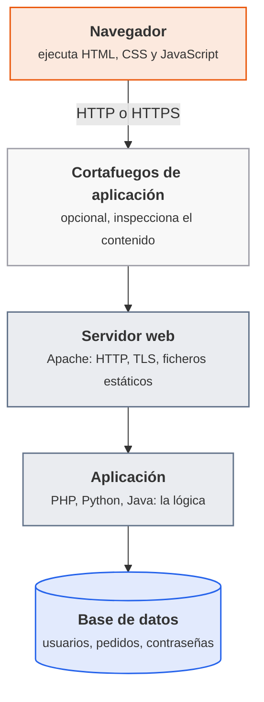
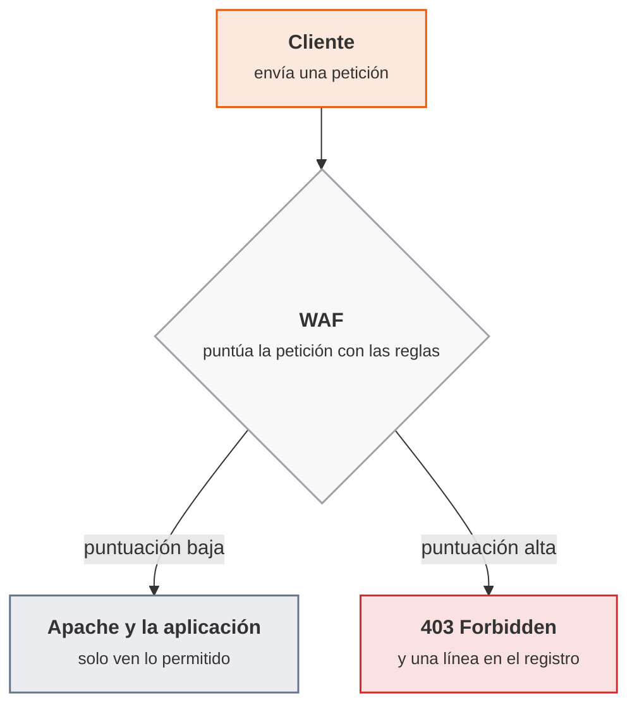
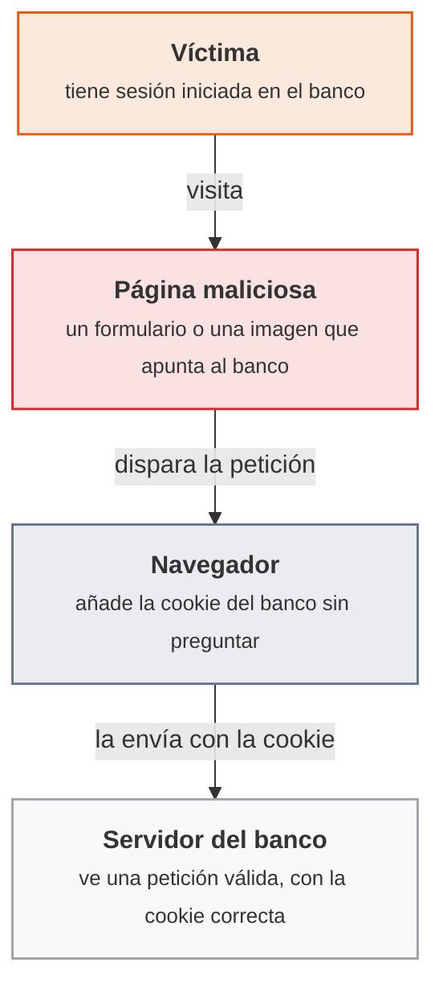
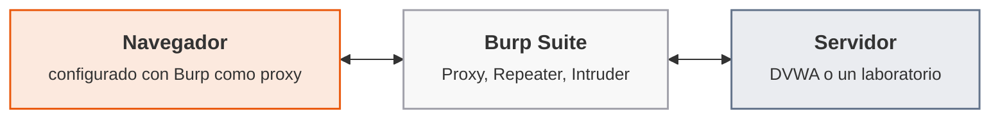
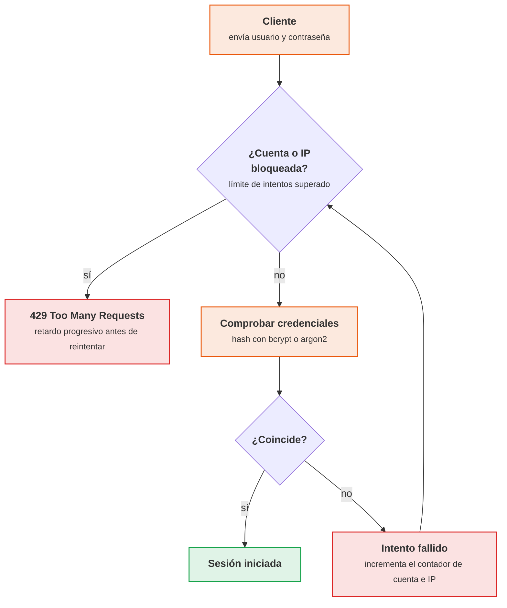

# UT3 · Vulnerabilidades web

<p class="ut-meta">26 h · Sesiones 15 a 27 · RA3 CE a, b, c, d, e, f, g</p>

Una aplicación web recibe texto de desconocidos, lo mezcla con consultas, comandos y páginas, y lo devuelve a otros navegadores. Casi todos los fallos de esta unidad salen de ahí: el servidor trata como orden lo que debía tratar como dato. Lo que se busca es doble: endurecer el servidor que aloja la aplicación (Apache en un contenedor, con TLS, cabeceras, cortafuegos de aplicación y límites) y reconocer, explotar en un laboratorio propio y corregir las vulnerabilidades web más habituales. Las herramientas son Docker y `curl` para el servidor, DVWA y los laboratorios de PortSwigger Academy para las vulnerabilidades, Burp Suite Community para ver y repetir el tráfico, y una pequeña aplicación Flask para las contraseñas y los bots.

!!! ojo "Solo sobre lo propio o lo autorizado por escrito"
    Todo lo ofensivo de esta unidad se hace **únicamente** contra aplicaciones deliberadamente vulnerables que corren en la máquina virtual del propio alumno (DVWA, en una red aislada) o en los laboratorios que sus plataformas autorizan (PortSwigger Academy). Acceder sin autorización a un sistema ajeno es delito en España (Código Penal, artículos 197 bis y 264 y siguientes), aunque la intención sea "solo mirar" y aunque no se cause daño. El criterio profesional es siempre el mismo: solo sobre lo propio o lo que se ha autorizado por escrito. Cada práctica termina con la corrección, porque el objetivo de la unidad es saber evitar el fallo, no solo provocarlo.

Lo que va más allá de lo que se hace en clase (ampliaciones, otras herramientas y enlaces para seguir) está en [Para ampliar](../ampliacion.md#ut3-vulnerabilidades-web).

## Introducción

### Qué tienes que saber hacer al terminar

- Levantar Apache en un contenedor, leer una petición y una respuesta HTTP con `curl` y con el navegador, y endurecerlo: HTTPS con HSTS, política de seguridad de contenido, cortafuegos de aplicación con ModSecurity, límites frente a la denegación de servicio y configuración mínima (CE f).
- Validar las entradas de una aplicación y corregir el XSS reflejado, almacenado y basado en DOM con codificación de salida y CSP (CE a, b).
- Reconocer y corregir la inyección de comandos, la subida y la inclusión de ficheros, el recorrido de ruta y la inyección SQL con consultas parametrizadas (CE a, b).
- Gestionar la sesión de forma segura (cookies con `HttpOnly`, `Secure` y `SameSite`, regeneración del identificador) y frenar el CSRF con tokens (CE c).
- Aplicar control de acceso por roles en el servidor, detectar un IDOR y una escalada de privilegios y corregirlos (CE d).
- Guardar contraseñas con bcrypt o argon2, explicar por qué MD5 y SHA-1 sin sal no sirven, y limitar los intentos de acceso y las altas automáticas (CE e, g).
- Usar Burp Suite Community para interceptar, repetir y analizar tráfico, y resolver laboratorios de PortSwigger Academy (CE a, b, c, d).

### Los conceptos de la unidad

Una tienda en línea guarda las contraseñas en MD5, deja el listado de directorios activo y muestra la versión exacta de Apache en cada respuesta. Un martes, alguien encuentra un campo de búsqueda que devuelve lo que se escribe sin codificarlo, roba la cookie de un administrador, entra con ella y descarga la tabla de usuarios; con el hash sin sal, el 80 % de las contraseñas cae en una tarde. Ninguna de las tres piezas era grave por separado. La unidad va pieza a pieza, del servidor hacia la aplicación, y de cada fallo enseña cómo se ve, cómo se explota en el laboratorio y cómo se corrige.

| Herramienta o concepto | Qué es, en una frase | Para qué se usa en esta unidad |
|---|---|---|
| Apache (`httpd`) en Docker | El servidor web más extendido, ejecutado en un contenedor | La base de las cuatro imágenes de hardening (A3.1 a A3.4) |
| `curl` | Cliente HTTP de línea de comandos | Ver peticiones y respuestas, cabeceras y códigos sin navegador |
| TLS, HSTS y CSP | Cifrado del transporte, y dos cabeceras que obligan al navegador a usarlo y a limitar de dónde carga contenido | Servir la web por HTTPS y reducir el alcance de un XSS |
| WAF, ModSecurity y OWASP CRS | Un cortafuegos que inspecciona el contenido HTTP, su motor para Apache y el conjunto de reglas de la fundación OWASP | Bloquear peticiones con patrones de ataque antes de que lleguen a la aplicación |
| DVWA | Aplicación web deliberadamente vulnerable, con niveles Low, Medium, High e Impossible | Practicar XSS, CSRF, sesión, inyección de comandos, ficheros y SQL en local (A3.5 a A3.8) |
| PortSwigger Academy | Laboratorios web gratuitos, con cuenta, que se marcan como resueltos | Practicar inyección SQL, autenticación, control de acceso, SSRF y vulnerabilidades del cliente (A3.8 a A3.10 y A3.12) |
| Burp Suite Community | Proxy que se sitúa entre el navegador y el servidor: intercepta, edita y repite peticiones | Ver lo que el navegador oculta y reenviar peticiones modificadas |
| Consulta parametrizada | Consulta SQL donde los datos viajan aparte de la orden | La corrección de la inyección SQL |
| bcrypt y argon2 | Funciones de hash pensadas para contraseñas: lentas y con sal incorporada | Guardar contraseñas de forma que un volcado de la base no sirva (A3.11) |
| `fail2ban` y CAPTCHA | Un programa que lee los logs y bloquea IP que fallan mucho, y una prueba que distingue personas de programas | Frenar la fuerza bruta y los registros automáticos (A3.11) |

**Cómo está organizada la unidad.** Cada sesión trae la teoría del día y su hoja. Las sesiones 15 a 18 endurecen Apache con imágenes encadenadas (la última contiene todo lo anterior) y se entregan como ACT_UT3_1. Las 19 a 21 usan DVWA (ACT_UT3_2) y la 22 añade la inyección SQL (ACT_UT3_3). Las 23, 24 y 26 pasan a PortSwigger con Burp Suite (ACT_UT3_4 y ACT_UT3_5) y la 25, en medio, trata las contraseñas y los bots (ACT_UT3_6). La 27 es de margen.

!!! consulta "Antes de empezar la unidad"
    Se trabaja siempre en la máquina `pps01`, con Docker. Los puertos y nombres (8080 y 8443 para Apache, 8081 para DVWA, 8085 para Burp, 5000 para la aplicación de contraseñas) están en [Puertos y nombres](../laboratorio.md#puertos-y-nombres). Las máquinas con aplicaciones vulnerables no se exponen a la red del aula ([red aislada y buenas prácticas](../laboratorio.md#red-aislada-y-buenas-practicas)). Las evidencias van al repositorio `pps-entregas` ([repositorio de entregas](../laboratorio.md#repositorio-de-entregas)), en carpetas `ut3/a31/`, `ut3/a32/`... y las imágenes se suben a Docker Hub con el usuario `pps<NIA>` ([cuentas y repositorios](../laboratorio.md#cuentas-y-repositorios)).

### Plan de sesiones

Cada sesión de 110 minutos empieza con una explicación corta y sigue con laboratorio. La columna «Se explica» recoge los apartados de teoría que se desarrollan en clase, con su duración aproximada; la columna «Se practica», el trabajo de laboratorio de esa sesión.

| Sesión | Fecha | Tipo | Se explica | Se practica |
|---:|---|---|---|---|
| [15](#sesion-15-arquitectura-web-y-http) | 26 nov | Teoría y práctica | Arquitectura de una aplicación web; el protocolo HTTP: métodos, cabeceras, códigos y cookies; el servidor Apache y su configuración básica (25 min). | Levantar Apache en un contenedor, observar peticiones y respuestas con curl y con el navegador y modificar la configuración básica. |
| [16](#sesion-16-tls-y-politica-de-seguridad-de-contenido) | 30 nov | Teoría y práctica | Certificados y TLS en Apache; cabeceras de seguridad: HSTS y CSP (25 min). | Instalar un certificado en Apache, activar HTTPS y HSTS, definir una CSP y subir la imagen a Docker Hub. |
| [17](#sesion-17-cortafuegos-de-aplicacion-web) | 3 dic | Teoría y práctica | Qué es un cortafuegos de aplicación web (WAF); ModSecurity y el conjunto de reglas OWASP CRS (15 min). | Añadir ModSecurity con las reglas CRS a la imagen anterior y comprobar que bloquea un ataque de prueba. |
| [18](#sesion-18-denegacion-de-servicio-y-buenas-practicas-del-servidor) | 7 dic | Teoría y práctica | Ataques de denegación de servicio y sus mitigaciones en Apache; lista de buenas prácticas de hardening (20 min). | Limitar peticiones y tiempos, ocultar la versión, restringir métodos y permisos y cerrar la imagen final; como extra, repetirlo en Nginx. |
| [19](#sesion-19-validacion-de-entradas-y-xss) | 10 dic | Teoría y práctica | No confiar nunca en la entrada del usuario; XSS reflejado, almacenado y basado en DOM y cómo se mitigan (25 min). | Montar DVWA en Docker y explotar y corregir XSS en los niveles Low y Medium. |
| [20](#sesion-20-sesiones-autenticacion-y-csrf) | 14 dic | Teoría y práctica | Robo y fijación de sesión; atributos de las cookies; CSRF y sus contramedidas (25 min). | En DVWA, explotar CSRF y la gestión débil de sesión en Low y Medium y proponer la corrección de cada una. |
| [21](#sesion-21-inyeccion-de-comandos-ficheros-y-rutas) | 17 dic | Teoría y práctica | Inyección de comandos del sistema operativo, subida de ficheros, inclusión de ficheros y recorrido de ruta (20 min). | En DVWA, explotar la inyección de comandos, la subida de ficheros y la inclusión de ficheros en Low y Medium y documentar cada explotación. |
| [22](#sesion-22-inyeccion-sql) | 21 dic | Teoría y práctica | Cómo se produce una inyección SQL: clásica, UNION y ciega; consultas parametrizadas (25 min). | Resolver los laboratorios de nivel Apprentice de inyección SQL de PortSwigger y el módulo SQL Injection de DVWA. |
| [23](#sesion-23-burp-suite-interceptar-y-repetir) | 11 ene | Teoría y práctica | Qué hace Burp Suite: proxy, repeater e intruder; configurarlo con el navegador (15 min). | Configurar Burp, interceptar el tráfico de DVWA y resolver los laboratorios de autenticación de PortSwigger. |
| [24](#sesion-24-control-de-acceso-y-vulnerabilidades-del-servidor) | 14 ene | Teoría y práctica | Control de acceso y roles; IDOR y escalada de privilegios; SSRF y divulgación de información (25 min). | Resolver laboratorios de control de acceso, recorrido de ruta, inyección de comandos, divulgación de información y SSRF de PortSwigger. |
| [25](#sesion-25-contrasenas-seguras-y-proteccion-frente-a-bots) | 18 ene | Teoría y práctica | Almacenamiento de contraseñas: hash, sal y algoritmos modernos. Protección frente a fuerza bruta y bots: límite de intentos, CAPTCHA y fail2ban (25 min). | Guardar contraseñas con bcrypt o argon2 en una aplicación de ejemplo, romper un hash débil con una lista de palabras y añadir un límite de intentos. |
| [26](#sesion-26-burp-suite-lado-cliente) | 21 ene | Teoría y práctica | CSRF, CORS y XSS basado en DOM vistos desde el atacante y desde el desarrollador (15 min). | Resolver laboratorios de CSRF, CORS, XSS y DOM de PortSwigger. |
| [27](#sesion-27-margen-y-repaso-de-la-unidad-3) | 25 ene | Margen | (sin teoría) | Laboratorios Practitioner pendientes de PortSwigger y repaso para el examen; o recuperar lo perdido. |

Las [prácticas evaluables](#practicas-evaluables-de-la-unidad) no tienen sesión propia: cada entrega se construye con varias hojas y se cierra en su plazo.

## Sesión 15 · Arquitectura web y HTTP

<p class="ut-meta" markdown>26 de noviembre · Teoría y práctica · <span class="dur" tabindex="0" aria-label="Arquitectura de una aplicación web · 5 min&#10;El protocolo HTTP · 10 min&#10;Apache y su configuración básica · 10 min&#10;A3.1 Apache y HTTP en un contenedor · 85 min" data-dur="Arquitectura de una aplicación web · 5 min&#10;El protocolo HTTP · 10 min&#10;Apache y su configuración básica · 10 min&#10;A3.1 Apache y HTTP en un contenedor · 85 min">:material-school:<i class="dur-barra" style="--teoria:23%"></i>:material-flask:</span></p>

Al acabar esta sesión hay un servidor Apache corriendo en un contenedor de `pps01`, se ha leído cada petición y cada respuesta con `curl` y con el navegador, y se ha modificado su configuración básica reconstruyendo la imagen. Esa imagen es la base de las tres siguientes: en las sesiones 16 a 18 se le añaden HTTPS, cortafuegos de aplicación y límites hasta cerrar la entrega ACT_UT3_1. La hoja se apoya en tres apartados: dónde está cada pieza de una aplicación web, cómo es un mensaje HTTP y cómo se organiza la configuración de Apache.

!!! consulta "Material de partida"
    En el aula (carpeta `RA3-Vulnerabilidades-web/02 Material`) están `RA3_ArquitecturaWeb.pdf`, `RA3_HTTP.pdf` y `RA3_Apache.pdf`: la teoría de esta sesión, con tareas de instalación de hosts virtuales, alias, redirecciones y páginas de error, y una tarea con `iframe` que se retoma en la [A3.2](#a32-certificado-y-csp-sesion-16). El enunciado de la entrega, `RA3_1.pdf`, está en `01 RA3.1 - Server Hardening`. En la web, los apuntes de terceros del curso anterior tienen tres entradas equivalentes: *Arquitectura web. Conceptos generales* (<https://psegarrac.github.io/Ciberseguridad-PePS/tema1/http/2020/11/04/Arquitectura-web-Conceptos-generales.html>), *Protocolo HTTP* (<https://psegarrac.github.io/Ciberseguridad-PePS/tema1/http/2020/11/05/Protocolo-HTTP.html>) y *Configuración básica de Apache* (<https://psegarrac.github.io/Ciberseguridad-PePS/tema1/apache/2020/11/07/Configuracion-Basic-Apache.html>). La documentación oficial de Apache está en <https://httpd.apache.org/docs/2.4/>. Aquí solo se enlazan: la teoría se explica con palabras propias y al mismo alcance. La autoría de todo el material está en [Material y autoría](../material.md).

### Arquitectura de una aplicación web

Una aplicación web es un programa cuyo cliente es un navegador. Para decidir dónde poner una defensa hay que saber dónde está cada pieza, porque cada una tiene sus propios fallos y su propia herramienta para corregirlos.



<p class="pie" markdown>De arriba abajo es el camino de una petición. Cuanto más abajo llega un dato sin filtrar, más daño hace: lo que alcanza la base de datos es lo más grave.</p>

Cada capa tiene su tipo de fallo. El servidor web falla por configuración (versiones visibles, listados de directorios, métodos de más, HTTP sin cifrar): es lo que se endurece en las sesiones 15 a 18. La aplicación falla por cómo trata lo que recibe (XSS, inyección de comandos, inyección SQL, sesiones, control de acceso): sesiones 19 a 26. La base de datos falla por lo que guarda y cómo lo guarda (contraseñas en claro o con un hash rápido): sesión 25. El navegador no es de fiar: todo lo que hace (validar un formulario, ocultar un botón) se puede saltar, así que **toda validación que importa se repite en el servidor**.

Apache con PHP sirve ficheros y ejecuta la aplicación en un mismo proceso; una aplicación en Python o Java suele ir en su propio servidor con Apache o Nginx delante, como proxy inverso, que es también el sitio natural del cortafuegos de aplicación y de los certificados.

### El protocolo HTTP

HTTP es el protocolo de la capa de aplicación que usa un navegador para pedir recursos a un servidor. Cada intercambio es una petición y una respuesta, y el protocolo no guarda memoria entre una y otra: las sesiones se construyen encima con cookies. Como los mensajes son texto, se leen con `curl` igual que los lee el navegador.

Una petición lleva una línea inicial, cabeceras y, a veces, cuerpo:

```http
GET /buscar?q=zapatos HTTP/1.1
Host: tienda.local
User-Agent: curl/8.5.0
Accept: text/html
Cookie: sesion=a3f9c1
```

La respuesta lleva una línea de estado, cabeceras y el cuerpo:

```http
HTTP/1.1 200 OK
Server: Apache/2.4.58 (Ubuntu)
Content-Type: text/html; charset=utf-8
Set-Cookie: sesion=a3f9c1; Path=/; HttpOnly

<html>...</html>
```

Lo que interesa desde la seguridad:

| Elemento | Qué contiene | Por qué importa |
|---|---|---|
| Método | `GET` pide, `POST` envía datos, `PUT` y `DELETE` modifican o borran, `OPTIONS` pregunta qué se admite, `TRACE` devuelve la petición tal cual | Cada método de más es superficie de ataque: una aplicación que solo lee y envía formularios necesita `GET`, `POST` y `HEAD` |
| Código de estado | 2xx correcto, 3xx redirección, 4xx error del cliente (403 prohibido, 404 no existe), 5xx error del servidor | Un 500 con una traza de pila cuenta mucho al atacante; un 403 frente a un 404 puede revelar que un recurso existe |
| Cabecera `Server` y similares | Nombre y versión del software | Da pistas para buscar vulnerabilidades conocidas |
| `Set-Cookie` y `Cookie` | El servidor entrega un valor y el navegador lo devuelve en cada petición al mismo sitio | Es el identificador de sesión: quien lo tiene es el usuario (sesión 20) |
| `Content-Type` | Tipo del cuerpo | Un tipo mal declarado hace que el navegador interprete como código lo que era datos |
| Cabeceras de seguridad (`Strict-Transport-Security`, `Content-Security-Policy`) | Instrucciones del servidor al navegador | Se añaden en la sesión 16 |

HTTP sin cifrar viaja en claro: cualquiera en la ruta (una wifi abierta, un equipo intermedio) lee y puede modificar las peticiones, incluidas las cookies. Por eso todo el tráfico se sirve hoy por HTTPS, que es HTTP dentro de TLS (sesión 16).

### Apache y su configuración básica

Apache se configura con directivas en ficheros de texto. En Debian y Ubuntu el reparto es siempre el mismo y conviene conocerlo, porque ahí es donde se endurece el servidor.

| Ruta o mandato | Qué es |
|---|---|
| `/etc/apache2/apache2.conf` | Configuración global |
| `/etc/apache2/mods-available` y `mods-enabled` | Módulos disponibles y activos; los activos son enlaces a los disponibles |
| `/etc/apache2/conf-available` y `conf-enabled` | Fragmentos de configuración global, con el mismo esquema |
| `/etc/apache2/sites-available` y `sites-enabled` | Sitios (hosts virtuales); se activa uno por enlace |
| `a2enmod`, `a2dismod`, `a2enconf`, `a2disconf`, `a2ensite`, `a2dissite` | Crean o quitan esos enlaces |
| `apache2ctl configtest`, `apache2ctl -M`, `apache2ctl -S` | Comprobar la sintaxis, listar módulos cargados y listar los hosts virtuales |
| `/var/www/html` | Raíz de documentos por defecto |
| `/var/log/apache2/access.log` y `error.log` | Registro de accesos y de errores |

Un host virtual (`VirtualHost`) permite servir varios sitios desde un mismo Apache y es donde se declaran el nombre, la raíz de documentos y, más adelante, el certificado. Las directivas se pueden poner en la configuración global, en el host virtual o en un fichero `.htaccess` dentro de la raíz. El criterio habitual: en la configuración del servidor y no en `.htaccess`, que se relee en cada petición, deja a quien sube contenido cambiar el servidor y solo hace falta en un alojamiento compartido. En el laboratorio no se usa.

En un contenedor la configuración no se edita dentro: se guarda junto al `Dockerfile`, se copia al construir la imagen y se activa con `a2enconf`, de modo que la imagen es reproducible y la configuración queda en Git.

### A3.1 Apache y HTTP en un contenedor (sesión 15)

<span class="et et-obj">Objetivo</span> Una imagen `pps-base` con Apache 2.4 sobre Ubuntu, corriendo en `pps01` en el puerto 8080, y la evidencia de que se ha leído una petición y una respuesta HTTP completas con `curl` y con el navegador, y de que se ha cambiado la configuración básica reconstruyendo la imagen.

<span class="et et-pre">Antes de empezar</span> `pps01` encendida, Docker funcionando sin `sudo` y el repositorio `pps-entregas` clonado ([repositorio de entregas](../laboratorio.md#repositorio-de-entregas)). Se han explicado [dónde está cada pieza de una aplicación web](#arquitectura-de-una-aplicacion-web), [cómo es un mensaje HTTP](#el-protocolo-http) y [cómo se organiza Apache](#apache-y-su-configuracion-basica). Esta imagen es la base de A3.2, A3.3 y A3.4: se conserva la carpeta.

<span class="et et-pas">Pasos</span>

1. Crea la carpeta de trabajo dentro del repositorio de entregas y la página de prueba:

    ```bash
    mkdir -p ~/pps-entregas/ut3/a31 && cd ~/pps-entregas/ut3/a31
    cat > index.html <<'HTML'
    <!doctype html>
    <html lang="es"><head><meta charset="utf-8"><title>PPS</title></head>
    <body><h1>Hola desde Apache</h1></body></html>
    HTML
    ```

2. Escribe el `Dockerfile` de la imagen base. Instala Apache desde los paquetes de Ubuntu, que es lo que permitirá añadir ModSecurity y otros módulos con `apt` en las sesiones siguientes:

    ```dockerfile
    FROM ubuntu:24.04
    RUN apt-get update \
     && DEBIAN_FRONTEND=noninteractive apt-get install -y --no-install-recommends \
          apache2 curl ca-certificates openssl \
     && rm -rf /var/lib/apt/lists/*
    COPY index.html /var/www/html/index.html
    EXPOSE 80
    CMD ["apache2ctl", "-D", "FOREGROUND"]
    ```

3. Construye la imagen y arranca el contenedor, publicando el 80 del contenedor en el 8080 de la máquina:

    ```bash
    docker build -t pps-base .
    docker run -d --rm --name web -p 8080:80 pps-base
    ```

4. Lee la petición y la respuesta. Pide la página entera con las cabeceras y después solo las cabeceras, y anota la línea de estado, el valor de `Server` y el `Content-Type`:

    ```bash
    curl -i http://localhost:8080/
    curl -I http://localhost:8080/
    ```

5. Provoca un 404 y prueba tres métodos. Anota el código de cada uno y, para `OPTIONS`, la cabecera `Allow`:

    ```bash
    curl -i http://localhost:8080/noexiste
    curl -s -o /dev/null -w '%{http_code}\n' -X POST http://localhost:8080/
    curl -s -o /dev/null -w '%{http_code}\n' -X DELETE http://localhost:8080/
    curl -i -X OPTIONS http://localhost:8080/
    ```

6. Abre `http://localhost:8080/` en el navegador de `pps01`, pulsa F12, pestaña Red, recarga y compara las cabeceras de la petición y de la respuesta con las de `curl`. Anota qué cabeceras de petición añade el navegador y `curl` no.
7. Cambia la configuración básica. Crea `basico.conf` con un nombre de servidor (que elimina el aviso `AH00558` del arranque), un mensaje propio para el 404 y una cookie de prueba:

    ```apache
    ServerName localhost
    ErrorDocument 404 "Recurso no encontrado en pps01"
    Header always set Set-Cookie "visita=1; Path=/"
    ```

    Y reescribe el `Dockerfile` para copiarlo y activarlo. La directiva `Header` necesita el módulo `headers`:

    ```dockerfile
    FROM pps-base
    RUN a2enmod headers
    COPY basico.conf /etc/apache2/conf-available/basico.conf
    RUN a2enconf basico
    ```

    Guarda este segundo fichero como `Dockerfile.basico` para no perder el primero, y reconstruye y relanza:

    ```bash
    docker rm -f web
    docker build -t pps-a31 -f Dockerfile.basico .
    docker run -d --rm --name web -p 8080:80 pps-a31
    ```

8. Comprueba el cambio y el viaje de la cookie. Con `-c` `curl` guarda la cookie recibida y con `-b` la devuelve; en `-v` se ve la cabecera `Cookie` que envía en la segunda petición:

    ```bash
    curl -i http://localhost:8080/noexiste
    curl -s -c jar.txt -o /dev/null http://localhost:8080/
    curl -sv -b jar.txt -o /dev/null http://localhost:8080/ 2>&1 | grep -i '^> cookie'
    ```

9. Inspecciona el servidor por dentro: qué host virtual atiende, qué módulos están cargados y qué configuración global está activa.

    ```bash
    docker exec web apache2ctl -S
    docker exec web apache2ctl -M | head -20
    docker exec web ls /etc/apache2/conf-enabled /etc/apache2/sites-enabled
    ```

10. Escribe el `README.md` de la hoja (qué se ha hecho, los comandos usados, las salidas relevantes y las capturas del paso 6, con nombres descriptivos) y súbelo: `git add . && git commit -m "A3.1 Apache y HTTP" && git push`.

<span class="et et-com">Comprobación</span> `curl -i http://localhost:8080/noexiste` devuelve `404` con el texto `Recurso no encontrado en pps01` y una línea `Set-Cookie: visita=1`; la segunda petición del paso 8 muestra `> Cookie: visita=1`; `apache2ctl -S` no da avisos de nombre de servidor. Si el contenedor no arranca o el puerto está ocupado, mira `docker logs web` y [Errores frecuentes](#errores-frecuentes-en-el-laboratorio).

<span class="et et-ent">Entrega</span> La carpeta `ut3/a31/` de `pps-entregas` con `Dockerfile`, `Dockerfile.basico`, `basico.conf`, `index.html`, `README.md` y las capturas. Forma parte de la entrega **ACT_UT3_1 · Server hardening** (con A3.2, A3.3 y A3.4), plazo el lunes 14 de diciembre a las 23:59; el README final de ACT_UT3_1 se completa en la [A3.4](#a34-hardening-final-sesion-18).

<span class="et et-ext">Si te sobra tiempo</span> Crea un segundo sitio con su propio `VirtualHost`, su carpeta de documentos y un nombre distinto (por ejemplo `otro.local`, que se resuelve con la cabecera `Host` de `curl -H 'Host: otro.local' http://localhost:8080/`), actívalo con `a2ensite` y comprueba con `apache2ctl -S` que hay dos.

## Sesión 16 · TLS y política de seguridad de contenido

<p class="ut-meta" markdown>30 de noviembre · Teoría y práctica · <span class="dur" tabindex="0" aria-label="Certificados y TLS en Apache · 15 min&#10;HSTS y CSP · 10 min&#10;A3.2 Certificado y CSP · 85 min" data-dur="Certificados y TLS en Apache · 15 min&#10;HSTS y CSP · 10 min&#10;A3.2 Certificado y CSP · 85 min">:material-school:<i class="dur-barra" style="--teoria:23%"></i>:material-flask:</span></p>

Al acabar esta sesión la imagen de Apache sirve la página por HTTPS con un certificado propio, redirige el HTTP al HTTPS, envía las cabeceras HSTS y CSP, tiene desactivado el listado de directorios y está publicada en Docker Hub como `pps<NIA>/pr1`. Antes se ve qué garantiza TLS y cómo se instala un certificado en Apache, y después qué hacen las dos cabeceras que obligan al navegador a usarlo y a limitar de dónde carga contenido.

!!! consulta "Material de partida"
    En el aula, `RA3_1.pdf` (carpeta `01 RA3.1 - Server Hardening`) fija la práctica 1 (CSP) y el punto 3.2 (instalar un certificado en Apache con imagen Docker). Los apuntes de terceros que enlazaba son *Hardening del servidor* (<https://psegarrac.github.io/Ciberseguridad-PePS/tema3/seguridad/web/2021/03/01/Hardening-Servidor.html>) y *Certificado digital* (<https://psegarrac.github.io/Ciberseguridad-PePS/tema1/practicas/2020/11/08/P1-SSL.html>). Para las cabeceras, la referencia técnica es la documentación de Mozilla sobre [CSP](https://developer.mozilla.org/es/docs/Web/HTTP/CSP) y sobre [HSTS](https://developer.mozilla.org/es/docs/Web/HTTP/Headers/Strict-Transport-Security). La tarea del `iframe` de `RA3_HTTP.pdf` (por qué una página ajena no se deja incrustar) se resuelve aquí con `frame-ancestors`.

### Certificados y TLS en Apache

TLS es el protocolo que cifra HTTP y le da tres garantías: confidencialidad (nadie en la ruta lee el contenido), integridad (nadie lo modifica sin que se note) y autenticidad (el servidor es quien dice ser). Las dos primeras salen del cifrado; la tercera, del certificado.

Un certificado es un fichero que une un nombre (`tienda.local`) con una clave pública, firmado por una autoridad de certificación (CA) en la que el navegador confía. El servidor guarda la clave privada, que nunca sale de él, y presenta el certificado en cada conexión.

El proceso, en cada conexión: el navegador saluda con las versiones y cifrados que admite, Apache envía su certificado, el navegador valida la firma, la caducidad y el nombre del sitio, y ambos acuerdan una clave de sesión sin enviarla por la red. La validación es la que protege de un servidor falso: si el navegador no confía en la firma, avisa. Un certificado autofirmado cifra igual, pero el aviso salta siempre.

Hay dos clases de certificado, y la elección depende del uso:

| Certificado | Lo firma | Cuándo se usa |
|---|---|---|
| Autofirmado | El propio servidor | Laboratorio e intranet: cifra, pero el navegador avisa porque no puede verificar la identidad |
| De una CA pública (por ejemplo Let's Encrypt, gratuita y automatizable) | Una CA que los navegadores ya traen | Cualquier sitio accesible desde Internet |

En el laboratorio se usa el autofirmado, que es lo único que tiene sentido para `localhost`, y se comprueba con `curl -k` (que acepta el certificado sin validarlo) o aceptando la excepción en el navegador. En producción no se acepta nunca una excepción: se instala un certificado de una CA.

En Apache, HTTPS son tres cosas: el módulo `ssl` activado, un `VirtualHost` en el puerto 443 con `SSLEngine on` y las rutas del certificado y de la clave, y, en el puerto 80, una redirección permanente al HTTPS para que quien llegue por HTTP no se quede sin cifrar. El certificado autofirmado se genera con una orden de `openssl`:

```bash
openssl req -x509 -nodes -days 365 -newkey rsa:2048 \
  -subj "/C=ES/O=PPS/CN=localhost" \
  -keyout apache.key -out apache.crt
```

`-x509` crea directamente un certificado autofirmado, `-nodes` deja la clave sin contraseña (si no, Apache no arrancaría solo), `-days` fija la validez y `-subj` evita las preguntas interactivas. El campo `CN` es el nombre para el que vale el certificado y tiene que coincidir con el que se escribe en el navegador. La clave privada nunca se sube a un repositorio; en el laboratorio se genera al construir la imagen, que es de prácticas y no de producción.

SSLv3, TLS 1.0 y 1.1 están rotos y desactivados por defecto en las versiones actuales de OpenSSL y Apache: se usa TLS 1.2 y 1.3 y no se toca la lista de cifrados salvo que una auditoría lo pida.

### HSTS y CSP

HSTS y CSP son cabeceras de respuesta: instrucciones del servidor que el navegador cumple. Ninguna sustituye a corregir la aplicación, pero las dos reducen el daño cuando algo falla.

**HSTS** (`Strict-Transport-Security`) le dice al navegador que, durante un tiempo, solo hable con este sitio por HTTPS, aunque el usuario escriba `http://` o siga un enlace antiguo. Evita el ataque en que alguien intercepta la primera petición sin cifrar y la degrada. Se envía únicamente por HTTPS:

```apache
Header always set Strict-Transport-Security "max-age=31536000" "expr=%{HTTPS} == 'on'"
```

`max-age` son segundos (31536000 es un año). HSTS es difícil de deshacer, porque el navegador lo recuerda todo ese tiempo: se empieza con un valor pequeño en pruebas y se sube cuando se ha comprobado que todo el sitio funciona por HTTPS. `includeSubDomains` extiende la regla a los subdominios y solo se añade si todos ellos tienen HTTPS.

**CSP** (`Content-Security-Policy`) le dice al navegador de qué orígenes puede cargar cada tipo de contenido. Es la segunda línea de defensa contra el XSS: si un atacante consigue inyectar un `<script>` en línea, una política que solo permite scripts del propio origen hace que el navegador lo ignore.

| Directiva | Qué controla | Ejemplo |
|---|---|---|
| `default-src` | Valor por defecto para todo lo que no tiene directiva propia | `default-src 'self'` |
| `script-src` | De dónde se pueden cargar scripts | `script-src 'self'` |
| `img-src` | Imágenes | `img-src 'self' data:` |
| `style-src` | Hojas de estilo | `style-src 'self'` |
| `frame-ancestors` | Quién puede incrustar esta página en un `iframe` | `frame-ancestors 'none'` |

`'self'` es el propio origen (mismo esquema, dominio y puerto). Una política estricta bloquea también los scripts y estilos en línea, que es justo lo que hace un XSS, y por eso una aplicación con `onclick="..."` en su HTML tiene que reescribirse para cumplirla. Para introducir una CSP sin romper nada, existe el modo de prueba `Content-Security-Policy-Report-Only`: el navegador avisa en la consola de lo que bloquearía, pero no bloquea. `frame-ancestors 'none'` responde a la tarea del `iframe` del material: es la razón por la que una página que la envía no se muestra dentro de otra, que es la defensa contra el *clickjacking* (una página ajena que superpone la del sitio, invisible, para que el usuario haga clic sin saberlo).

Se acompañan de otras cabeceras de una línea: `X-Content-Type-Options: nosniff` (el navegador respeta el `Content-Type` declarado) y `Referrer-Policy` (qué dirección de origen se envía al salir). Se dejan como ampliación.

### A3.2 Certificado y CSP (sesión 16)

<span class="et et-obj">Objetivo</span> La imagen `pps<NIA>/pr1`, construida sobre `pps-base`, sirve el sitio por HTTPS en el 8443 con un certificado autofirmado, redirige el 8080 al 8443, envía HSTS y CSP, no lista directorios y está subida a Docker Hub con su README. Es la práctica 1 y el punto 3.2 del enunciado de ACT_UT3_1.

<span class="et et-pre">Antes de empezar</span> La imagen `pps-base` de la [A3.1](#a31-apache-y-http-en-un-contenedor-sesion-15) construida en `pps01`, y la cuenta de Docker Hub `pps<NIA>`. Se han explicado [los certificados y TLS en Apache](#certificados-y-tls-en-apache) y [HSTS y CSP](#hsts-y-csp).

<span class="et et-pas">Pasos</span>

1. Crea la carpeta `~/pps-entregas/ut3/a32/` y en ella copia `index.html` de la A3.1. Crea `seguridad.conf`, con las dos cabeceras:

    ```apache
    ServerName localhost

    # HSTS solo tiene efecto por HTTPS: se envia solo en respuestas cifradas
    Header always set Strict-Transport-Security "max-age=31536000" "expr=%{HTTPS} == 'on'"

    # CSP: todo el contenido solo del propio origen y sin marcos ajenos
    Header always set Content-Security-Policy "default-src 'self'; frame-ancestors 'none'"
    ```

2. Crea `sitio.conf` con los dos hosts virtuales. El primero redirige; el segundo sirve por TLS con el certificado que se genera en el `Dockerfile`:

    ```apache
    <VirtualHost *:80>
        ServerName localhost
        Redirect permanent / https://localhost:8443/
    </VirtualHost>

    <VirtualHost *:443>
        ServerName localhost
        DocumentRoot /var/www/html
        SSLEngine on
        SSLCertificateFile    /etc/ssl/pps/apache.crt
        SSLCertificateKeyFile /etc/ssl/pps/apache.key
    </VirtualHost>
    ```

3. Escribe el `Dockerfile`. Activa `ssl` y `headers`, desactiva `autoindex` (el módulo que genera el listado de un directorio sin `index.html`), sustituye el sitio por defecto por el tuyo y genera el certificado:

    ```dockerfile
    FROM pps-base
    RUN a2enmod ssl headers \
     && a2dismod -f autoindex \
     && a2dissite 000-default \
     && mkdir /etc/ssl/pps \
     && openssl req -x509 -nodes -days 365 -newkey rsa:2048 \
          -subj "/C=ES/O=PPS/CN=localhost" \
          -keyout /etc/ssl/pps/apache.key -out /etc/ssl/pps/apache.crt \
     && chmod 600 /etc/ssl/pps/apache.key
    COPY seguridad.conf /etc/apache2/conf-available/seguridad.conf
    COPY sitio.conf /etc/apache2/sites-available/sitio.conf
    RUN a2enconf seguridad && a2ensite sitio
    EXPOSE 80 443
    ```

4. Construye con el nombre definitivo, arranca publicando los dos puertos y para el contenedor de la A3.1 si sigue vivo:

    ```bash
    docker rm -f web 2>/dev/null
    docker build -t pps<NIA>/pr1 .
    docker run -d --rm --name web -p 8080:80 -p 8443:443 pps<NIA>/pr1
    ```

5. Comprueba la redirección y las cabeceras. Con `-k` `curl` acepta el certificado autofirmado. Anota qué cabeceras aparecen por HTTP y cuáles por HTTPS y por qué HSTS solo sale en la segunda:

    ```bash
    curl -I http://localhost:8080/
    curl -kI https://localhost:8443/
    ```

6. Comprueba que la CSP tiene efecto. Crea `csp.html` con un script en línea, cópialo dentro del contenedor y ábrelo por HTTPS en el navegador, aceptando la excepción del certificado. Con la CSP el título no cambia y la consola (F12) muestra que el navegador ha bloqueado el script:

    ```bash
    printf '<!doctype html><title>original</title><script>document.title="script en linea ejecutado"</script>\n' > csp.html
    docker cp csp.html web:/var/www/html/csp.html
    ```

    Visita `https://localhost:8443/csp.html`. Anota el mensaje de la consola.

7. Comprueba `frame-ancestors`. Crea una página que incrusta la tuya, sírvela desde el mismo contenedor y ábrela: el marco sale vacío y la consola dice que la política lo impide. Esto es lo que evita que otra web muestre la tuya dentro de un `iframe`:

    ```bash
    printf '<!doctype html><iframe src="https://localhost:8443/" width="400" height="200"></iframe>\n' > marco.html
    docker cp marco.html web:/var/www/html/marco.html
    ```

8. Comprueba que no hay listado de directorios. Crea una carpeta con un fichero y pídela; con `autoindex` desactivado la respuesta es un `404` y no un listado, y el fichero de dentro sí se sirve (`/privado/secreto.txt` da `200`):

    ```bash
    docker exec web sh -c 'mkdir /var/www/html/privado && touch /var/www/html/privado/secreto.txt'
    curl -sk -o /dev/null -w '%{http_code}\n' https://localhost:8443/privado/
    ```

9. Inicia sesión en Docker Hub, escribiendo la contraseña o el token cuando lo pida (nunca en el fichero ni en una captura), y sube la imagen:

    ```bash
    docker login -u pps<NIA>
    docker push pps<NIA>/pr1
    ```

10. Escribe el `README.md` de la práctica (explicación, validación con las salidas de los pasos 5 a 8, capturas y la orden `docker pull pps<NIA>/pr1` para bajarla) y haz `git add`, `git commit` y `git push`.

<span class="et et-com">Comprobación</span> `curl -I http://localhost:8080/` da `301` con `Location: https://localhost:8443/`; `curl -kI https://localhost:8443/` muestra `Strict-Transport-Security` y `Content-Security-Policy`; `csp.html` no cambia el título y la consola registra el bloqueo; la carpeta `privado` devuelve `404` y no un listado; y `docker pull pps<NIA>/pr1` en otra terminal la descarga. Si el navegador insiste en HTTP tras una prueba anterior, es HSTS: mira [Errores frecuentes](#errores-frecuentes-en-el-laboratorio).

<span class="et et-ent">Entrega</span> La carpeta `ut3/a32/` de `pps-entregas` con los ficheros, el README y las capturas, y la imagen `pps<NIA>/pr1` en Docker Hub. Forma parte de la entrega **ACT_UT3_1 · Server hardening**, plazo el lunes 14 de diciembre a las 23:59.

<span class="et et-ext">Si te sobra tiempo</span> Cambia la CSP por `Content-Security-Policy-Report-Only` y comprueba que el script en línea se ejecuta pero la consola avisa de lo que se habría bloqueado. Después mira el certificado con `openssl s_client -connect localhost:8443 -servername localhost < /dev/null | openssl x509 -noout -subject -dates`.

## Sesión 17 · Cortafuegos de aplicación web

<p class="ut-meta" markdown>3 de diciembre · Teoría y práctica · <span class="dur" tabindex="0" aria-label="Qué es un cortafuegos de aplicación web · 5 min&#10;ModSecurity y OWASP CRS · 10 min&#10;A3.3 WAF con ModSecurity y CRS · 95 min" data-dur="Qué es un cortafuegos de aplicación web · 5 min&#10;ModSecurity y OWASP CRS · 10 min&#10;A3.3 WAF con ModSecurity y CRS · 95 min">:material-school:<i class="dur-barra" style="--teoria:14%"></i>:material-flask:</span></p>

Al acabar esta sesión la imagen de la sesión anterior lleva ModSecurity con el conjunto de reglas OWASP CRS, bloquea con un 403 las peticiones con patrones de ataque conocidos, deja el motivo en el registro de errores y está publicada como `pps<NIA>/pr2`. Primero se ve qué es un cortafuegos de aplicación y qué lo distingue de uno de red, y después cómo funcionan el motor y las reglas que lo hacen útil.

!!! consulta "Material de partida"
    En el aula, `RA3_1.pdf` (carpeta `01 RA3.1 - Server Hardening`) fija las prácticas 2 (Web Application Firewall) y 3 (reglas OWASP) y pide una imagen por práctica que contenga las anteriores. Los apuntes de terceros que las acompañaban están en *Hardening del servidor* (<https://psegarrac.github.io/Ciberseguridad-PePS/tema3/seguridad/web/2021/03/01/Hardening-Servidor.html>): instalan el módulo, copian la configuración recomendada y clonan el repositorio de reglas a mano. Aquí se hace con los paquetes de Ubuntu, que dejan lo mismo instalado en una orden y son más fáciles de reproducir en una imagen. La documentación del proyecto de reglas está en <https://coreruleset.org/docs/>.

### Qué es un cortafuegos de aplicación web

Un cortafuegos de red decide con la dirección IP y el puerto. Un cortafuegos de aplicación web (WAF, del inglés *web application firewall*) lee el contenido HTTP: la URL, los parámetros, las cabeceras y el cuerpo. Se coloca delante de la aplicación, o dentro del servidor web como módulo, y bloquea las peticiones que se parecen a un ataque antes de que lleguen a la aplicación.



<p class="pie" markdown>El WAF no arregla el código: reduce el riesgo mientras se arregla. Una regla que detecta `<script>` en un parámetro protege un XSS conocido, pero no cambia que la aplicación sea vulnerable.</p>

Lo que aporta y lo que no:

| Aporta | No aporta |
|---|---|
| Una barrera contra XSS, inyección SQL, recorrido de ruta o ejecución de comandos con patrones conocidos | Corrección de la vulnerabilidad: un atacante paciente puede ofuscar la petición hasta que la regla no la reconozca |
| Tiempo cuando aparece una vulnerabilidad en software de terceros y aún no hay parche | Protección contra fallos de lógica (un IDOR o un control de acceso mal hecho son peticiones perfectamente válidas) |
| Registro de intentos, útil para detectar escaneos | Ausencia de falsos positivos: una regla puede bloquear una petición legítima, y hay que ajustarla |

### ModSecurity y OWASP CRS

ModSecurity es el motor de WAF de código abierto más usado y funciona como módulo de Apache. Por sí mismo no protege de nada: ejecuta las reglas que se le dan. Las reglas más habituales son las del **OWASP Core Rule Set** (CRS), un conjunto mantenido por la comunidad que cubre las categorías del Top 10: inyección SQL, XSS, inclusión de ficheros, ejecución de comandos, escáneres conocidos y protocolo HTTP mal formado.

El CRS no bloquea una petición por una sola regla, sino por la suma: cada regla que se cumple aporta puntos a una **puntuación de anomalía** y, si al terminar de leer la petición se supera el umbral (5 por defecto para las entrantes), la petición se rechaza con un 403. Es un sistema tolerante: un patrón dudoso suma poco y pasa; varios juntos bloquean. Cada regla lleva un identificador numérico y un mensaje, que es lo que queda en el registro para saber por qué se ha bloqueado algo.

Tres ajustes del motor que conviene conocer:

| Ajuste | Valores | Qué hace |
|---|---|---|
| `SecRuleEngine` | `On`, `DetectionOnly`, `Off` | En `On` bloquea; en `DetectionOnly` solo anota. Se empieza en `DetectionOnly` en un sitio real, se revisan los falsos positivos y se pasa a `On` |
| Nivel de paranoia | 1 a 4 | Cuántas reglas se aplican: el 1 tiene pocos falsos positivos y es el de partida; los altos exigen ajuste fino |
| Reglas propias | Identificadores del 1000000 en adelante | Se añaden a un fichero aparte para no tocar las reglas del paquete |

El paquete de Ubuntu 24.04 trae el CRS en su serie 3.3; la serie actual del proyecto es la 4. Para el laboratorio vale la del paquete, que se instala con `apt`. En un servicio real conviene una versión mantenida (la imagen `owasp/modsecurity-crs`, que el proyecto publica en Docker Hub, ya trae Apache delante con el motor y las reglas configurados como proxy inverso), y actualizar el conjunto de reglas es una tarea periódica como cualquier otra.

### A3.3 WAF con ModSecurity y CRS (sesión 17)

<span class="et et-obj">Objetivo</span> La imagen `pps<NIA>/pr2`, construida sobre `pps<NIA>/pr1`, bloquea con un 403 una petición de prueba con XSS, otra con inyección SQL, otra con recorrido de ruta y otra con ejecución de comandos, deja en el registro el identificador de cada regla que saltó y bloquea también con una regla local propia. Es el conjunto de las prácticas 2 y 3 del enunciado de ACT_UT3_1.

<span class="et et-pre">Antes de empezar</span> La imagen `pps<NIA>/pr1` de la [A3.2](#a32-certificado-y-csp-sesion-16) en `pps01`. Se han explicado [qué es un cortafuegos de aplicación web](#que-es-un-cortafuegos-de-aplicacion-web) y [ModSecurity y OWASP CRS](#modsecurity-y-owasp-crs). Las cadenas de prueba de esta hoja son las de manual y se lanzan solo contra tu propio contenedor.

<span class="et et-pas">Pasos</span>

1. Crea `~/pps-entregas/ut3/a33/` y escribe el `Dockerfile`. El paquete `libapache2-mod-security2` es el motor y `modsecurity-crs` el conjunto de reglas; la configuración recomendada se copia como configuración activa y el motor se pone en `On`, porque viene en `DetectionOnly`:

    ```dockerfile
    FROM pps<NIA>/pr1
    RUN apt-get update \
     && DEBIAN_FRONTEND=noninteractive apt-get install -y --no-install-recommends \
          libapache2-mod-security2 modsecurity-crs \
     && rm -rf /var/lib/apt/lists/* \
     && cp /etc/modsecurity/modsecurity.conf-recommended /etc/modsecurity/modsecurity.conf \
     && sed -i 's/^SecRuleEngine DetectionOnly/SecRuleEngine On/' /etc/modsecurity/modsecurity.conf
    ```

2. Construye y arranca. Para el contenedor anterior si sigue vivo. El módulo se activa solo al instalar el paquete:

    ```bash
    docker rm -f web 2>/dev/null
    docker build -t pps<NIA>/pr2 .
    docker run -d --rm --name web -p 8080:80 -p 8443:443 pps<NIA>/pr2
    ```

3. Comprueba que una petición normal pasa. Debe dar `200`:

    ```bash
    curl -sk -o /dev/null -w '%{http_code}\n' https://localhost:8443/
    ```

4. Lanza las cuatro peticiones de prueba, cada una con la cadena de manual de su categoría. `-G --data-urlencode` codifica el parámetro por ti. Las cuatro deben dar `403`:

    ```bash
    curl -skG https://localhost:8443/ --data-urlencode "q=<script>alert(1)</script>" -o /dev/null -w 'xss %{http_code}\n'
    curl -skG https://localhost:8443/ --data-urlencode "q=' OR '1'='1" -o /dev/null -w 'sqli %{http_code}\n'
    curl -skG https://localhost:8443/ --data-urlencode "f=../../etc/passwd" -o /dev/null -w 'ruta %{http_code}\n'
    curl -skG https://localhost:8443/ --data-urlencode "exec=/bin/bash" -o /dev/null -w 'cmd %{http_code}\n'
    ```

5. Lee por qué se ha bloqueado cada una. En el registro de errores, cada bloqueo deja el identificador y el mensaje de las reglas que sumaron puntos. Cuenta cuáles han saltado y anota el identificador y el mensaje de tres:

    ```bash
    docker exec web sh -c "grep -o '\[id \"[0-9]*\"\] \[msg \"[^\"]*\"\]' /var/log/apache2/error.log | sort | uniq -c | sort -rn | head -20"
    ```

6. Añade una regla propia, la clásica de prueba: bloquear cualquier petición cuyo parámetro `testparam` contenga la palabra `test`. Se escribe en un fichero aparte dentro del contenedor y se recarga Apache sin parar el contenedor:

    ```bash
    docker exec web sh -c "cat > /etc/modsecurity/reglas-locales.conf <<'R'
    SecRule ARGS:testparam \"@contains test\" \"id:1000001,phase:2,deny,status:403,log,msg:'Regla local de prueba'\"
    R
    apache2ctl graceful"
    curl -skG https://localhost:8443/ --data-urlencode "testparam=un test" -o /dev/null -w 'bloquea %{http_code}\n'
    curl -skG https://localhost:8443/ --data-urlencode "testparam=nada" -o /dev/null -w 'pasa %{http_code}\n'
    ```

7. Prueba el modo de solo detección: cambia `SecRuleEngine On` por `DetectionOnly`, recarga y repite el XSS del paso 4. Ahora responde `200`, pero el registro sigue anotando la regla. Vuelve a `On` y comprueba que el `403` regresa:

    ```bash
    docker exec web sh -c "sed -i 's/^SecRuleEngine On/SecRuleEngine DetectionOnly/' /etc/modsecurity/modsecurity.conf && apache2ctl graceful"
    curl -skG https://localhost:8443/ --data-urlencode "q=<script>alert(1)</script>" -o /dev/null -w 'deteccion %{http_code}\n'
    docker exec web sh -c "sed -i 's/^SecRuleEngine DetectionOnly/SecRuleEngine On/' /etc/modsecurity/modsecurity.conf && apache2ctl graceful"
    ```

8. La regla local del paso 6 vive solo en el contenedor en marcha. Para que forme parte de la imagen, guárdala en un fichero `reglas-locales.conf` de la carpeta, cópiala en el `Dockerfile` (`COPY reglas-locales.conf /etc/modsecurity/reglas-locales.conf`), reconstruye y repite el paso 6. Sube la imagen con `docker push pps<NIA>/pr2`.
9. Escribe el `README.md` (explicación, las salidas de los pasos 3 a 7, capturas y la orden `docker pull pps<NIA>/pr2`) y haz `git add`, `git commit` y `git push`.

<span class="et et-com">Comprobación</span> Las cuatro peticiones del paso 4 dan `403` y la normal `200`; el registro muestra identificadores de las familias `941` (XSS), `942` (SQL), `930` (ruta) o `932` (comandos) y un `949110` de puntuación excedida; la regla `1000001` bloquea `testparam=un test` y deja pasar `testparam=nada`; en `DetectionOnly` el XSS da `200`. Si una petición de ataque da `200`, mira [Errores frecuentes](#errores-frecuentes-en-el-laboratorio).

<span class="et et-ent">Entrega</span> La carpeta `ut3/a33/` de `pps-entregas` con `Dockerfile`, `reglas-locales.conf`, `README.md` y capturas, y la imagen `pps<NIA>/pr2` en Docker Hub. Forma parte de la entrega **ACT_UT3_1 · Server hardening**, plazo el lunes 14 de diciembre a las 23:59. Como `pr2` parte de `pr1`, contiene también el HTTPS, HSTS y CSP de la A3.2.

<span class="et et-ext">Si te sobra tiempo</span> Cambia el `default-src` de la CSP por uno demasiado estricto y comprueba en la consola qué se rompe, o envía por `curl` un `User-Agent` de escáner conocido (`curl -A "sqlmap/1.0" ...`) y localiza la regla `913100` en el registro.

## Sesión 18 · Denegación de servicio y buenas prácticas del servidor

<p class="ut-meta" markdown>7 de diciembre · Teoría y práctica · <span class="dur" tabindex="0" aria-label="Denegación de servicio y su mitigación en Apache · 10 min&#10;Buenas prácticas de hardening · 10 min&#10;A3.4 Hardening final · 90 min" data-dur="Denegación de servicio y su mitigación en Apache · 10 min&#10;Buenas prácticas de hardening · 10 min&#10;A3.4 Hardening final · 90 min">:material-school:<i class="dur-barra" style="--teoria:18%"></i>:material-flask:</span></p>

Al acabar esta sesión el servidor rechaza a quien hace demasiadas peticiones o las envía demasiado despacio, no revela su versión, solo admite los métodos que usa, no lista directorios ni deja ficheros legibles a cualquiera, y la imagen final `pps<NIA>/pr3` recoge todo lo de las cuatro hojas y cierra la entrega ACT_UT3_1. Antes se ve cómo se ataca la disponibilidad de un servidor y qué mitigaciones ofrece Apache, y después la lista de buenas prácticas que cierra el endurecimiento.

!!! consulta "Material de partida"
    En el aula, `RA3_1.pdf` (carpeta `01 RA3.1 - Server Hardening`) fija la práctica 4 (evitar ataques DDoS con `mod_evasive` y comprobarlo con Apache Bench), la práctica 5 opcional (repetirlo en Nginx) y el punto 3.3 (securizar Apache con las buenas prácticas de un artículo). Las referencias públicas del enunciado son <https://geekflare.com/cybersecurity/apache-web-server-hardening-security/> y su versión para Nginx <https://geekflare.com/es/nginx-webserver-security-hardening-guide/>; los apuntes de terceros están en *Hardening del servidor* (<https://psegarrac.github.io/Ciberseguridad-PePS/tema3/seguridad/web/2021/03/01/Hardening-Servidor.html>). La lista de esta sesión sigue el alcance del artículo, con los ajustes verificados en la imagen del laboratorio.

### Denegación de servicio y su mitigación en Apache

Un ataque de denegación de servicio (DoS) busca que el servidor deje de atender a los usuarios legítimos, no que entregue datos. La versión distribuida (DDoS) lo hace desde muchas máquinas a la vez. Ninguna configuración de Apache detiene un DDoS de verdad, que se para con servicios de red delante (un proveedor con capacidad de absorción, un CDN); lo que sí se puede hacer es no regalar el servidor al primero que lo intente desde una máquina.

| Ataque | Cómo agota el servidor | Mitigación en Apache |
|---|---|---|
| Inundación de peticiones | Miles de peticiones válidas por segundo desde una IP | `mod_evasive`: bloquea temporalmente la IP que supera un umbral de peticiones por intervalo |
| Cliente lento (tipo Slowloris) | Abre muchas conexiones y envía las cabeceras a goteo para ocuparlas | `mod_reqtimeout` (viene activo): fija cuánto se espera a las cabeceras y al cuerpo y una velocidad mínima |
| Cuerpos enormes | Envía un `POST` de gigas | `LimitRequestBody`: tamaño máximo del cuerpo |
| Conexiones inactivas | Mantiene sockets abiertos sin pedir nada | `Timeout` y `KeepAliveTimeout` bajos |

`mod_evasive` no es un cortafuegos: cuenta por IP en una tabla en memoria y, al pasar el umbral, responde `403` a esa IP durante un tiempo (`DOSBlockingPeriod`). Los umbrales se ajustan a la aplicación: una página con muchos recursos hace muchas peticiones legítimas seguidas. Tiene un límite conocido: detrás de un proxy inverso todas las peticiones llegan desde la IP del proxy, y bloquearía a todos a la vez; en ese caso el límite se pone en el proxy. `mod_ratelimit`, en cambio, limita el ancho de banda de una respuesta, no el número de peticiones, y no sirve contra este ataque. Las mitigaciones de la tabla se probarán en la hoja con un cliente lento y con Apache Bench (`ab`), la herramienta de la propia Apache para generar carga.

### Buenas prácticas de hardening

Endurecer es quitar lo que no se usa y acotar lo que se deja. Cada ajuste tiene un porqué, y ninguno sirve si el servidor está sin actualizar.

| Práctica | Cómo se hace en Apache | Por qué |
|---|---|---|
| No revelar la versión | `ServerTokens Prod` y `ServerSignature Off` | El atacante no sabe qué vulnerabilidades buscar |
| Desactivar `TRACE` | `TraceEnable Off` | Evita que el servidor devuelva la petición completa, cookies incluidas |
| Restringir métodos | `<LimitExcept GET POST HEAD>` con `Require all denied` | Cada método que la aplicación no usa es superficie de ataque |
| Sin listado de directorios | `Options -Indexes` (y `a2dismod autoindex`) | Un directorio sin `index` no muestra sus ficheros |
| Sin `.htaccess` | `AllowOverride None` | Nadie que suba un fichero cambia la configuración del servidor |
| Sin ejecución de scripts donde no toca | `Options -ExecCGI -Includes` | Un fichero subido no se ejecuta como programa |
| Permisos mínimos | Raíz de documentos del root y grupo `www-data`, sin permisos para otros | Apache lee, pero no escribe, y otros usuarios del sistema no leen |
| Módulos justos | `a2dismod` de lo que no se usa | Cada módulo cargado es código que puede tener fallos |
| Tiempos y tamaños acotados | `Timeout`, `KeepAliveTimeout`, `LimitRequestBody` | Reduce el daño de un cliente lento o abusivo |
| Tráfico solo cifrado | HTTPS, HSTS y redirección | A3.2 |
| Contenido validado | WAF | A3.3 |
| Actualizar | Reconstruir la imagen con la base actualizada | Un servidor sin parches es la primera vulnerabilidad de la lista |

Los permisos son el fallo más frecuente: el `chmod 777` "para que funcione" es la respuesta equivocada. Apache se ejecuta como `www-data`; basta con que ese usuario (por el grupo) pueda **leer** el sitio. Solo las carpetas en las que la aplicación escribe (subidas, caché) necesitan escritura, y en ellas no se ejecuta código.

Otros ajustes que se ven en las guías y no se aplican aquí: autenticación básica de un directorio (`htpasswd`) para zonas de administración, límite de acceso por IP con `Require ip`, y registros en un servidor aparte. Se dejan como ampliación.

### A3.4 Hardening final (sesión 18)

<span class="et et-obj">Objetivo</span> La imagen `pps<NIA>/pr3`, construida sobre `pps<NIA>/pr2`, bloquea con `mod_evasive` una ráfaga de peticiones, corta a un cliente lento con un 408, oculta la versión, solo admite `GET`, `POST` y `HEAD`, no lista directorios y sirve el sitio con permisos mínimos. Cierra las prácticas 4 del enunciado de ACT_UT3_1 y el punto 3.3 (buenas prácticas). La práctica 5 (Nginx) es opcional y va en "Si te sobra tiempo".

<span class="et et-pre">Antes de empezar</span> La imagen `pps<NIA>/pr2` de la [A3.3](#a33-waf-con-modsecurity-y-crs-sesion-17) en `pps01`. Se han explicado [la denegación de servicio y su mitigación](#denegacion-de-servicio-y-su-mitigacion-en-apache) y [las buenas prácticas de hardening](#buenas-practicas-de-hardening). Para generar carga, `sudo apt-get install -y apache2-utils` (trae `ab`) y `netcat-openbsd` si `nc` no está.

<span class="et et-pas">Pasos</span>

1. Crea `~/pps-entregas/ut3/a34/` y escribe `evasive.conf`. Los umbrales son bajos para que la prueba se vea:

    ```apache
    <IfModule mod_evasive20.c>
        DOSHashTableSize    3097
        DOSPageCount        5
        DOSSiteCount        50
        DOSPageInterval     1
        DOSSiteInterval     1
        DOSBlockingPeriod   30
        DOSLogDir           /var/log/mod_evasive
    </IfModule>
    ```

2. Escribe `buenas-practicas.conf` con las prácticas de la lista. Incluye el tiempo de espera de las cabeceras que se va a comprobar:

    ```apache
    # No revelar version ni sistema operativo
    ServerTokens Prod
    ServerSignature Off
    TraceEnable Off
    FileETag None

    # Tiempos y tamaños acotados
    Timeout 10
    KeepAliveTimeout 5
    LimitRequestBody 1048576

    # Sin listados, sin ejecucion de scripts ni SSI, sin .htaccess
    <Directory /var/www/>
        Options -Indexes -Includes -ExecCGI -FollowSymLinks
        AllowOverride None
        Require all granted
    </Directory>

    # Solo los metodos que la aplicacion usa
    <Location "/">
        <LimitExcept GET POST HEAD>
            Require all denied
        </LimitExcept>
    </Location>

    # Cliente lento: cabeceras en 5 s (hasta 10 si envia datos) y cuerpo en 5 s
    RequestReadTimeout header=5-10,minrate=500 body=5,minrate=500
    ```

3. Escribe el `Dockerfile`. Instala `mod_evasive`, activa `evasive` y `reqtimeout`, incorpora la configuración con un nombre que se cargue después de la de Ubuntu (`security.conf` fija `ServerTokens OS`, y la última directiva gana), y deja el sitio con propietario `root`, grupo `www-data` y sin permisos para otros:

    ```dockerfile
    FROM pps<NIA>/pr2
    RUN apt-get update \
     && DEBIAN_FRONTEND=noninteractive apt-get install -y --no-install-recommends libapache2-mod-evasive \
     && rm -rf /var/lib/apt/lists/* \
     && mkdir -p /var/log/mod_evasive && chown www-data /var/log/mod_evasive
    COPY evasive.conf /etc/apache2/mods-available/evasive.conf
    RUN a2enmod evasive reqtimeout
    COPY buenas-practicas.conf /etc/apache2/conf-available/seguridad-final.conf
    RUN a2enconf seguridad-final \
     && chown -R root:www-data /var/www/html \
     && chmod -R o-rwx /var/www/html \
     && chmod 750 /var/www/html
    ```

4. Construye y arranca:

    ```bash
    docker rm -f web 2>/dev/null
    docker build -t pps<NIA>/pr3 .
    docker run -d --rm --name web -p 8080:80 -p 8443:443 pps<NIA>/pr3
    docker exec web apache2ctl configtest
    ```

5. Comprueba el bloque de configuración: la versión oculta, los métodos y el listado. Anota la cabecera `Server` (ahora solo `Apache`), el código de cada método y qué responde una carpeta sin `index.html` (un `403` o un `404`, pero nunca un listado):

    ```bash
    curl -skI https://localhost:8443/ | grep -i '^server'
    for m in GET POST PUT DELETE TRACE OPTIONS; do curl -sk -o /dev/null -w "$m %{http_code}\n" -X $m https://localhost:8443/; done
    docker exec web sh -c 'mkdir -p /var/www/html/privado && touch /var/www/html/privado/secreto.txt'
    curl -sk -o /dev/null -w 'privado %{http_code}\n' https://localhost:8443/privado/
    docker exec web ls -ld /var/www/html /var/www/html/index.html
    ```

6. Comprueba `mod_evasive` con una ráfaga. Con Apache Bench, 200 peticiones de 10 en 10; casi todas dejan de ser `200` cuando se pasa el umbral, y en el registro aparece la IP bloqueada. Espera 30 segundos y comprueba que se vuelve a poder entrar:

    ```bash
    ab -n 200 -c 10 https://localhost:8443/ 2>&1 | grep -i 'Complete requests\|Failed requests\|Non-2xx'
    docker exec web ls /var/log/mod_evasive
    ```

7. Comprueba `mod_reqtimeout` con un cliente lento: envía una cabecera incompleta y no termina la petición. El servidor debe cortarla con un `408` en unos segundos, en lugar de mantener la conexión abierta:

    ```bash
    (printf 'GET / HTTP/1.1\r\nHost: localhost\r\n'; sleep 12) | nc localhost 8080 | head -3
    ```

8. Comprueba que las defensas de las hojas anteriores siguen activas en la imagen final: el redireccionamiento y HSTS de la A3.2 (`curl -kI https://localhost:8443/`) y el bloqueo del WAF de la A3.3 (`curl -skG https://localhost:8443/ --data-urlencode "q=<script>alert(1)</script>" -o /dev/null -w '%{http_code}\n'`, que da `403`).
9. Sube la imagen con `docker push pps<NIA>/pr3`.
10. Cierra la entrega. En la carpeta `ut3/` escribe el `README.md` general de ACT_UT3_1: una tabla con las tres imágenes (`pr1`, `pr2`, `pr3`), qué añade cada una y la orden `docker pull` de cada una, la validación de los pasos 5 a 8 con capturas y una frase que explique la herencia (`pr3` contiene a `pr2` y esta a `pr1`). Haz `git add`, `git commit` y `git push`.

<span class="et et-com">Comprobación</span> `Server` solo dice `Apache`; `PUT`, `DELETE` y `OPTIONS` dan `403` y `TRACE` no da `200` (`403` o `405`); la carpeta sin `index.html` no lista sus ficheros; `ab` muestra la mayoría de respuestas no 2xx y `/var/log/mod_evasive` tiene un fichero con tu IP; el cliente lento recibe `408`; y las comprobaciones del paso 8 pasan. Si `ab` no bloquea nada, mira los umbrales de `evasive.conf` en [Errores frecuentes](#errores-frecuentes-en-el-laboratorio).

<span class="et et-ent">Entrega</span> La carpeta `ut3/a34/` con los ficheros, el README de la hoja y las capturas, el `README.md` general de ACT_UT3_1 en `ut3/` y las tres imágenes (`pps<NIA>/pr1`, `pr2` y `pr3`) en Docker Hub. Es el cierre de la entrega **ACT_UT3_1 · Server hardening** (A3.1 a A3.4), plazo el lunes 14 de diciembre a las 23:59. El enunciado original está en el aula.

<span class="et et-ext">Si te sobra tiempo</span> Repite lo esencial en Nginx (práctica 5 opcional): una imagen `pps<NIA>/pr5` sobre `nginx:stable` con HTTPS, HSTS, CSP, versión oculta, métodos limitados y límite de peticiones. Equivalencias con lo hecho en Apache, y una configuración de partida que se ha comprobado (`default.conf`, que se copia en `/etc/nginx/conf.d/`):

| En Apache | En Nginx |
|---|---|
| `ServerTokens Prod` | `server_tokens off;` |
| `Header always set ...` | `add_header ... always;` |
| `<LimitExcept GET POST HEAD>` | `limit_except GET POST HEAD { deny all; }` |
| `mod_evasive` | `limit_req_zone` y `limit_req` |
| `RequestReadTimeout` | `client_header_timeout` y `client_body_timeout` |
| `Options -Indexes` | `autoindex off;` |
| `LimitRequestBody` | `client_max_body_size` |

```nginx
limit_req_zone $binary_remote_addr zone=por_ip:10m rate=5r/s;
server_tokens off;

server {
    listen 80;
    return 301 https://localhost:9443$request_uri;
}

server {
    listen 443 ssl;
    ssl_certificate     /etc/nginx/ssl/nginx.crt;
    ssl_certificate_key /etc/nginx/ssl/nginx.key;
    ssl_protocols       TLSv1.2 TLSv1.3;
    add_header Strict-Transport-Security "max-age=31536000" always;
    add_header Content-Security-Policy "default-src 'self'; frame-ancestors 'none'" always;
    client_body_timeout   5s;
    client_header_timeout 5s;
    client_max_body_size  1m;
    root /usr/share/nginx/html;
    autoindex off;
    location / {
        limit_req zone=por_ip burst=10 nodelay;
        limit_except GET POST HEAD { deny all; }
    }
}
```

El certificado se genera con `openssl` en el `Dockerfile`, igual que en la A3.2. El WAF en Nginx se hace con la imagen `owasp/modsecurity-crs:nginx`, que ya lo trae.


## Sesión 19 · Validación de entradas y XSS

<p class="ut-meta" markdown>10 de diciembre · Teoría y práctica · <span class="dur" tabindex="0" aria-label="No confiar en la entrada del usuario · 10 min&#10;XSS reflejado, almacenado y basado en DOM · 15 min&#10;A3.5 DVWA XSS · 85 min" data-dur="No confiar en la entrada del usuario · 10 min&#10;XSS reflejado, almacenado y basado en DOM · 15 min&#10;A3.5 DVWA XSS · 85 min">:material-school:<i class="dur-barra" style="--teoria:23%"></i>:material-flask:</span></p>

Al acabar esta sesión hay una DVWA corriendo en `pps01` (puerto 8081, solo accesible desde la propia máquina), se ha explotado el XSS reflejado, el almacenado y el basado en DOM en los niveles Low y Medium, se ha comprobado en el código de cada nivel por qué funciona y se ha corregido uno de ellos. La hoja se apoya en dos apartados: el principio que evita casi todo lo que viene en la unidad (no fiarse de la entrada) y la familia del XSS con sus tres variantes.

!!! consulta "Material de partida"
    En el aula, `SEG_WEB_1.pdf` (carpeta `04 Seguretat web - Validació d'entrades`) recoge la teoría de esta y de la sesión siguiente (XSS, robo de sesión, control de acceso, CSRF) con prácticas de formularios en PHP; `RA3.2.pdf` (carpeta `03 RA3.2 - DVWA`) es el enunciado de la entrega: los tutoriales de DVWA en los niveles Low y Medium, con capturas, comandos y explicación. En la web, el apunte de terceros equivalente es *Validación de entradas* (<https://psegarrac.github.io/Ciberseguridad-PePS/tema3/seguridad/web/2021/01/31/Validaci%C3%B3n-de-entradas.html>) y hay otra explicación del XSS y de sus tres tipos en la unidad 3 de los *Apuntes de Puesta en Producción Segura* (<https://github.com/EloyAlbiach/PPS/blob/main/vulns_web/xss/Readme.md>, licencia CC BY-NC-SA 4.0; la autoría está en [Material y autoría](../material.md)). DVWA está en <https://github.com/digininja/DVWA>. Aquí se explican con palabras propias y se practican con la versión en contenedor de DVWA.

### No confiar en la entrada del usuario

Una aplicación recibe datos de un formulario, de la URL, de una cabecera, de una cookie o de un fichero, y todos ellos los controla quien envía la petición, no el programador. Casi todas las vulnerabilidades de esta unidad tienen la misma causa: un dato de fuera se usa como si fuera una orden del programa, en una página, en una consulta, en un comando o en una ruta de ficheros. La defensa tiene tres piezas que se combinan, cada una con su sitio:

| Pieza | Qué hace | Cuándo se aplica |
|---|---|---|
| **Validar** | Comprobar que el dato tiene la forma esperada (un entero, un correo, una longitud máxima, uno de tres valores permitidos) y rechazar si no | Al recibirlo, siempre en el servidor |
| **Codificar la salida** | Convertir los caracteres con significado en el contexto donde se va a escribir (`<` en HTML, comillas en SQL, espacios en un comando) para que se traten como texto | Justo al usar el dato, según el contexto de destino |
| **Separar datos y código** | Usar mecanismos donde el dato viaja aparte de la orden (consultas parametrizadas, listas de argumentos) | Siempre que exista |

Tres criterios evitan los errores más comunes. Primero, **la validación en el navegador es comodidad, no seguridad**: un atributo `maxlength` o un JavaScript de comprobación se salta con las herramientas del propio navegador o con `curl`; toda validación que importa se repite en el servidor. Segundo, **lista blanca, no lista negra**: definir lo que se admite es viable; enumerar todo lo peligroso no lo es, y cada filtro que quita una cadena concreta (`<script>`, `../`, `;`) tiene una variante que no quita. Tercero, **codificar donde se usa, no donde se guarda**: el mismo dato puede acabar en HTML, en un atributo, en JavaScript o en una URL, y cada contexto codifica distinto.

### XSS reflejado, almacenado y basado en DOM

El XSS (*cross-site scripting*) es la inyección de código JavaScript en una página que ven otros usuarios. El navegador no distingue el script de la aplicación del inyectado, así que lo ejecuta con los permisos de esa página: puede leer lo que la página lee (incluida la cookie de sesión si no es `HttpOnly`), hacer peticiones como el usuario y cambiar lo que este ve. Se clasifica según dónde viaja el dato:

```mermaid
flowchart TB
    subgraph R["XSS reflejado: el dato viaja en la petición y vuelve en la misma respuesta"]
        direction LR
        R1["<b>Enlace preparado</b><br><small>con el script en un parámetro</small>"]:::riesgo --> R2["<b>Servidor</b><br><small>devuelve el parámetro sin codificar</small>"]:::pieza --> R3["<b>Navegador de la víctima</b><br><small>ejecuta el script</small>"]:::act
    end
    subgraph S["XSS almacenado: el dato se guarda y se sirve a cada visitante"]
        direction LR
        S1["<b>Comentario con script</b><br><small>enviado una vez</small>"]:::riesgo --> S2["<b>Base de datos</b><br><small>lo guarda tal cual</small>"]:::dato --> S3["<b>Cada visitante</b><br><small>lo recibe y lo ejecuta</small>"]:::act
    end
    classDef act fill:#ea580c22,stroke:#ea580c,stroke-width:1.5px
    classDef pieza fill:#64748b22,stroke:#64748b,stroke-width:1.5px
    classDef dato fill:#2563eb22,stroke:#2563eb,stroke-width:1.5px
    classDef infra fill:#a1a1aa14,stroke:#a1a1aa,stroke-width:1.5px
    classDef ok fill:#16a34a22,stroke:#16a34a,stroke-width:1.5px
    classDef riesgo fill:#dc262622,stroke:#dc2626,stroke-width:1.5px
```



<p class="pie" markdown>La diferencia práctica: el reflejado necesita que la víctima siga un enlace; el almacenado alcanza a todo el que abra la página, sin que nadie tenga que hacer nada, por eso es más grave.</p>

| Variante | Dónde está el fallo | Cómo se ve | Corrección |
|---|---|---|---|
| Reflejado | El servidor escribe un parámetro de la petición en la respuesta sin codificarlo | La cadena de prueba aparece en el HTML de la respuesta, sin convertir `<` en `&lt;` | Codificar la salida (en PHP, `htmlspecialchars`) |
| Almacenado | El servidor guarda el dato y lo escribe después en las páginas de otros usuarios | Se ejecuta al volver a cargar la página, sin repetir la petición | Codificar la salida al escribirlo (y validar al guardarlo) |
| Basado en DOM | El JavaScript de la página lee un dato de la URL y lo inserta en la página sin tratarlo | La respuesta del servidor no contiene el script: aparece solo en el DOM que construye el navegador | En el cliente, insertar texto (`textContent`) y no HTML (`innerHTML`); si hace falta HTML, sanearlo con una biblioteca como DOMPurify |

En el DOM, lo que importa es la diferencia entre `innerHTML` (interpreta el texto como marcado) y `textContent` (lo trata como texto). Un servidor bien codificado no protege de un JavaScript que hace `innerHTML = location.search`.

La codificación de salida es la corrección que de verdad cierra el XSS; el resto son capas que reducen el daño cuando falla:

- **CSP** ([sesión 16](#hsts-y-csp)): un `script-src 'self'` hace que el navegador ignore los scripts en línea.
- **Cookie `HttpOnly`** ([sesión 20](#robo-y-fijacion-de-sesion-atributos-de-las-cookies)): el script inyectado no puede leer la cookie de sesión.
- **Un WAF** ([sesión 17](#modsecurity-y-owasp-crs)): bloquea patrones conocidos, pero un filtro por patrones se rodea y no sustituye a la codificación.

### A3.5 DVWA XSS (sesión 19)

<span class="et et-obj">Objetivo</span> DVWA montada en `pps01` en el puerto 8081; el XSS reflejado, el almacenado y el basado en DOM explotados en Low y Medium con su captura; el motivo de cada fallo localizado en el código; y una corrección aplicada y comprobada. Es la primera hoja de la entrega ACT_UT3_2 (DVWA).

<span class="et et-pre">Antes de empezar</span> `pps01` con Docker y acceso a Internet para descargar las imágenes de DVWA y de MariaDB (unos minutos: con treinta equipos a la vez, empieza el montaje en cuanto llegues). Se han explicado [no confiar en la entrada del usuario](#no-confiar-en-la-entrada-del-usuario) y [los tres tipos de XSS](#xss-reflejado-almacenado-y-basado-en-dom). Solo se ataca la DVWA de tu propia máquina, en `127.0.0.1` ([red aislada y buenas prácticas](../laboratorio.md#red-aislada-y-buenas-practicas)).

<span class="et et-pas">Pasos</span>

1. Antes de arrancar, toma una instantánea de la VM `pps01` (`VBoxManage snapshot` o el menú de VirtualBox) por si algo se rompe. Crea `~/pps-entregas/ut3/a35/` y en ella `compose.yml`. Enlaza el puerto solo al bucle local (así DVWA no se ve desde otras máquinas) y define contraseñas de laboratorio para la base, que no valen para nada fuera de este contenedor:

    ```yaml
    services:
      dvwa:
        image: ghcr.io/digininja/dvwa:latest
        environment:
          DB_SERVER: db
          DB_DATABASE: dvwa
          DB_USER: dvwa
          DB_PASSWORD: pps-lab-dvwa
          DEFAULT_SECURITY_LEVEL: low
        ports:
          - "127.0.0.1:8081:80"
        depends_on:
          - db
      db:
        image: mariadb:10
        environment:
          MYSQL_ROOT_PASSWORD: pps-lab-root
          MYSQL_DATABASE: dvwa
          MYSQL_USER: dvwa
          MYSQL_PASSWORD: pps-lab-dvwa
        volumes:
          - dvwa-datos:/var/lib/mysql
    volumes:
      dvwa-datos:
    ```

2. Levanta DVWA y, mientras arranca, inicializa la base de datos: abre `http://127.0.0.1:8081/setup.php`, pulsa **Create / Reset Database** y entra con el usuario `admin` y la contraseña `password` (las de DVWA, publicadas en su documentación). En **DVWA Security** comprueba que el nivel es **Low**:

    ```bash
    cd ~/pps-entregas/ut3/a35 && docker compose up -d
    ```

3. **XSS reflejado, Low.** En el menú **XSS (Reflected)** escribe en el campo el texto `<script>alert(1)</script>` y envía. Debe aparecer un aviso. Mira cómo es la respuesta con Ctrl+U (código fuente de la página) y localiza la línea `Hello ...`: el script llega sin transformar. Pulsa **View Source** en la página de DVWA y localiza la línea del código PHP que escribe el parámetro: es el fallo.
4. **XSS reflejado, Medium.** En **DVWA Security** pasa a **Medium** y repite la cadena anterior: ya no funciona. Pulsa **View Source**: el código elimina la cadena `<script>` (una lista negra). Prueba una cadena que no la contiene, ``, y comprueba que se ejecuta. Anota por qué un filtro que quita una cadena concreta no basta.
5. **XSS almacenado, Low.** Con el nivel en **Low**, en **XSS (Stored)** escribe un nombre cualquiera y en el mensaje `<script>alert(1)</script>`. Recarga la página con F5 sin reenviar nada: el aviso reaparece, porque el mensaje está guardado en la base y se sirve en cada visita. Pulsa **View Source** y anota qué sanea el código y qué no (escapa lo que va a la consulta SQL, pero no lo que va a la página).
6. **XSS almacenado, Medium.** Pasa a **Medium**. El mensaje ya se codifica; el nombre solo pierde la cadena `<script>`. El campo de nombre limita la longitud en el navegador: en F12, pestaña Elementos, cambia el atributo `maxlength` del campo (es una restricción del navegador, que ya se ha visto que no protege). Usa en el nombre `` y envía. Comprueba que se ejecuta al recargar. Restablece el libro de visitas con **Create / Reset Database** al terminar.
7. **XSS basado en DOM, Low y Medium.** En **XSS (DOM)** cambia el idioma en el desplegable y observa cómo cambia la URL (`?default=...`). En **Low**, sustituye el valor de `default` en la barra de direcciones por `<script>alert(1)</script>` y pulsa Intro. En **Medium**, DVWA redirige si ve `<script`: rompe la lista desplegable con `?default=English</option></select>`. Comprueba con Ctrl+U que el servidor no devuelve el script en el HTML, y con F12 en Elementos que sí está en el DOM.
8. **Corrección.** Vuelve a **Low** y corrige el XSS reflejado. Copia el fichero del contenedor, cambia la línea que escribe el parámetro para que lo codifique con `htmlspecialchars` y devuélvelo:

    ```bash
    docker compose cp dvwa:/var/www/html/vulnerabilities/xss_r/source/low.php ./low.php
    # edita low.php: en la línea del <pre>Hello, envuelve $_GET[ 'name' ] en htmlspecialchars( ... )
    docker compose cp ./low.php dvwa:/var/www/html/vulnerabilities/xss_r/source/low.php
    ```

    Repite la cadena del paso 3. Ahora el navegador muestra el texto literal `<script>alert(1)</script>` y en el código fuente aparece como `&lt;script&gt;...`. Compara después tu cambio con el nivel **Impossible** (`View Source` con ese nivel): además de codificar, usa un token contra CSRF.
9. Rellena la tabla de corrección de la hoja (una fila por variante: causa concreta vista en el código, corrección propuesta) y escribe el `README.md` con las capturas de cada explotación (Low y Medium de las tres variantes), las cadenas usadas y la explicación breve. `git add`, `git commit`, `git push`.

<span class="et et-com">Comprobación</span> Tienes seis capturas de un aviso (tres variantes, dos niveles), la comprobación de que el XSS almacenado sobrevive a una recarga, la de que el DOM no aparece en el código fuente del servidor, y el antes y después del paso 8 con la cadena visible como texto. Si DVWA no carga o pide inicializar la base, mira [Errores frecuentes](#errores-frecuentes-en-el-laboratorio).

<span class="et et-ent">Entrega</span> La carpeta `ut3/a35/` de `pps-entregas` con `compose.yml`, `low.php` corregido, la tabla y el `README.md` con las capturas. Forma parte de la entrega **ACT_UT3_2 · DVWA** (A3.5, A3.6 y A3.7), plazo el lunes 11 de enero a las 23:59. Los tutoriales de DVWA que no se hacen en clase (ver [la entrega](#practicas-evaluables-de-la-unidad)) se completan en casa antes de ese plazo, con el mismo formato.

<span class="et et-ext">Si te sobra tiempo</span> Cambia **Medium** a **High** y averigua qué filtro usa el XSS reflejado y por qué sigue siendo una lista negra (`View Source`). Después, el módulo **CSP Bypass**: qué política envía y de dónde carga scripts.


## Sesión 20 · Sesiones, autenticación y CSRF

<p class="ut-meta" markdown>14 de diciembre · Teoría y práctica · <span class="dur" tabindex="0" aria-label="Robo y fijación de sesión, atributos de las cookies · 15 min&#10;CSRF y sus contramedidas · 10 min&#10;A3.6 DVWA: sesión y CSRF · 85 min" data-dur="Robo y fijación de sesión, atributos de las cookies · 15 min&#10;CSRF y sus contramedidas · 10 min&#10;A3.6 DVWA: sesión y CSRF · 85 min">:material-school:<i class="dur-barra" style="--teoria:23%"></i>:material-flask:</span></p>

Al acabar esta sesión se ha comprobado en DVWA cómo un identificador de sesión predecible permite suplantar a otro usuario, se ha explotado un CSRF que cambia la contraseña sin que la víctima lo pida, y se ha corregido la gestión de sesión con los atributos de cookie correctos. La hoja se apoya en dos apartados: qué hace segura o insegura una cookie de sesión, y cómo funciona el CSRF y qué lo frena.

!!! consulta "Material de partida"
    En el aula, `SEG_WEB_1.pdf` desarrolla el robo de sesión, la fijación de sesión y el CSRF con un ejemplo completo en PHP (una página `evil.local` que roba la cookie `PHPSESSID` y la reutiliza, y una página que dispara una transferencia con una etiqueta ``). El enunciado de la entrega sigue siendo `RA3.2.pdf`. En la web, el apunte equivalente es *Validación de entradas* (<https://psegarrac.github.io/Ciberseguridad-PePS/tema3/seguridad/web/2021/01/31/Validaci%C3%B3n-de-entradas.html>, mismo documento que la sesión anterior) y la explicación del CSRF de los *Apuntes de Puesta en Producción Segura* (<https://github.com/EloyAlbiach/PPS/blob/main/vulns_web/csrf/Readme.md>, CC BY-NC-SA 4.0). En DVWA, esta hoja usa los módulos **CSRF** y **Weak Session IDs**.

### Robo y fijación de sesión, atributos de las cookies

HTTP no recuerda nada entre una petición y la siguiente: la sesión se construye por encima con un identificador que el servidor entrega la primera vez y el navegador devuelve en cada petición dentro de una cookie. Quien tiene ese identificador es, para el servidor, el usuario. De ahí salen dos ataques distintos:

| Ataque | Cómo funciona | Cuándo es posible |
|---|---|---|
| Robo de sesión (*session hijacking*) | El atacante consigue el identificador de una sesión ya iniciada (por ejemplo con un XSS que lee `document.cookie`, o interceptando HTTP sin cifrar) y lo usa | La cookie es legible por JavaScript o el tráfico no va cifrado |
| Fijación de sesión (*session fixation*) | El atacante fuerza a la víctima a usar un identificador que él ya conoce (por ejemplo en la URL, `?PHPSESSID=HOLA`) antes de que inicie sesión, y después lo usa él | El servidor acepta un identificador propuesto desde fuera y no lo cambia al autenticarse |

Un identificador de sesión débil hace el robo casi innecesario: si es un contador o la hora del servidor, no hace falta interceptar nada, basta con probar valores cercanos. Un identificador seguro se genera con una fuente criptográfica (en PHP, `random_bytes`), es lo bastante largo para no poder recorrerse por fuerza bruta y **cambia al iniciar sesión**, lo que corrige la fijación.

Los atributos de la cookie son la otra mitad de la defensa, y se fijan en la cabecera `Set-Cookie` de la respuesta:

| Atributo | Qué impide |
|---|---|
| `HttpOnly` | Que JavaScript la lea (`document.cookie`): corta el robo por XSS |
| `Secure` | Que se envíe por HTTP sin cifrar: corta la intercepción en la red |
| `SameSite=Strict` o `Lax` | Que se envíe en una petición que viene de otro sitio: corta el CSRF |
| Expiración corta y regeneración | Que una sesión robada valga indefinidamente |

Ninguno de los tres primeros excluye a los otros: una cookie de sesión de producción lleva los tres.

### CSRF y sus contramedidas

El CSRF (*cross-site request forgery*) no roba nada: aprovecha que el navegador de la víctima **ya tiene** una sesión iniciada y adjunta la cookie automáticamente a cualquier petición a ese dominio, venga de donde venga la página que la origina.



<p class="pie" markdown>El servidor no puede distinguir esta petición de una que la víctima habría hecho a propósito: llega con la cookie correcta. Por eso la defensa no está en la cookie de sesión, sino en un dato adicional que la página maliciosa no puede conocer.</p>

Contramedidas, de la más a la menos habitual:

| Contramedida | Cómo funciona |
|---|---|
| Token anti-CSRF | El servidor incluye en cada formulario un valor impredecible y solo acepta la petición si vuelve con ese valor; una página de otro origen no puede leerlo para incluirlo |
| `SameSite=Strict` o `Lax` en la cookie de sesión | El navegador no envía la cookie en una petición que se origina en otro sitio |
| Comprobar `Origin` o `Referer` | El servidor rechaza si la petición no viene de su propio dominio; es más débil, porque esas cabeceras a veces faltan por configuraciones de privacidad legítimas |
| Repetir la autenticación en acciones críticas | Cambiar la contraseña pide la contraseña actual, que la página maliciosa no conoce |

El token anti-CSRF es la defensa principal porque no depende de que el navegador de la víctima tenga una configuración concreta. `SameSite` es un segundo cinturón que además ayuda contra el robo de sesión.

### A3.6 DVWA: sesión y CSRF (sesión 20)

<span class="et et-obj">Objetivo</span> Con la DVWA de la [A3.5](#a35-dvwa-xss-sesion-19), el identificador de sesión débil de Low y Medium documentado, el CSRF de cambio de contraseña explotado en Low y bloqueado en Medium, y la cookie de sesión corregida con `HttpOnly` y `SameSite`.

<span class="et et-pre">Antes de empezar</span> DVWA en marcha (`docker compose up -d` en `~/pps-entregas/ut3/a35/` si se ha parado). Se han explicado [los atributos de las cookies](#robo-y-fijacion-de-sesion-atributos-de-las-cookies) y [el CSRF](#csrf-y-sus-contramedidas).

<span class="et et-pas">Pasos</span>

1. Con el nivel en **Low**, entra en **Weak Session IDs** y pulsa **Generate** varias veces seguidas. Anota los valores de la cookie `dvwaSession` que te da el navegador (F12, pestaña Aplicación o Almacenamiento, Cookies). En Low son consecutivos: si ves `41`, el siguiente casi seguro es `42`.
2. Pasa a **Medium** y repite. Ahora el valor es la hora del servidor en segundos (`time()`): sigue siendo predecible, porque cualquiera puede saber la hora aproximada. Anota la diferencia con Low.
3. Abre la pestaña Red de F12, pulsa **Generate** una vez más y mira la cabecera `Set-Cookie` de la respuesta: no lleva `HttpOnly`. Compruébalo también por línea de órdenes, que es cómo lo vería un script:

    ```bash
    curl -si -X POST http://127.0.0.1:8081/vulnerabilities/weak_id/ --cookie "security=medium; PHPSESSID=<tu PHPSESSID>" | grep -i set-cookie
    ```

4. Vuelve a **Low**. En **CSRF**, cambia tu contraseña a `nueva123` usando el formulario: funciona y el mensaje dice `Password Changed`. Ahora, sin salir de la sesión, simula el ataque construyendo la URL a mano tal como lo haría una página ajena (una imagen o un `` con esta URL bastaría) y pégala en la barra de direcciones de la misma pestaña donde tienes sesión:

    ```
    http://127.0.0.1:8081/vulnerabilities/csrf/?password_new=hackeada&password_conf=hackeada&Change=Change
    ```

    Comprueba que también cambia la contraseña, aunque la petición no salió del formulario de DVWA. Deshaz el cambio volviendo a poner una contraseña conocida.
5. Pasa a **Medium** y repite la URL del paso 4 pegándola directamente en la barra de direcciones: ahora falla, con el mensaje `That request didn't look correct`. Pulsa **View Source** y localiza la comprobación: mira si la petición viene del propio `SERVER_NAME` a través de la cabecera `Referer`. Para ver que se puede burlar, crea una "página ajena" `csrf.html` con ``, sírvela con `python3 -m http.server 8000 --bind 127.0.0.1` y ábrela en la pestaña con sesión (`http://127.0.0.1:8000/csrf.html`): el navegador envía un `Referer` que contiene el nombre del servidor y la contraseña cambia. Vuelve a poner una conocida. Anota por qué esta defensa es más débil que un token: un navegador configurado para no enviar `Referer` (algo habitual por privacidad) bloquearía también las peticiones legítimas, y basta con que el nombre del servidor aparezca en la URL de la página atacante para que la comprobación se dé por buena.
6. Corrige el identificador de sesión de **Weak Session IDs**. Copia `low.php`, cámbialo para que genere un valor aleatorio de fuente criptográfica y añada `HttpOnly` y `SameSite=Strict`, y devuélvelo:

    ```bash
    docker compose cp dvwa:/var/www/html/vulnerabilities/weak_id/source/low.php ./weak_low.php
    ```

    ```php
    <?php

    $html = "";

    if ($_SERVER['REQUEST_METHOD'] == "POST") {
        // Valor impredecible (160 bits de una fuente criptografica) y atributos de proteccion
        $cookie_value = bin2hex(random_bytes(20));
        setcookie("dvwaSession", $cookie_value, [
            "httponly" => true,
            "samesite" => "Strict",
        ]);
    }
    ?>
    ```

    ```bash
    docker compose cp ./weak_low.php dvwa:/var/www/html/vulnerabilities/weak_id/source/low.php
    ```

    Recarga **Weak Session IDs** en Low, pulsa **Generate** dos veces y comprueba en F12 que el valor ya no es consecutivo y que la cookie lleva `HttpOnly; SameSite=Strict`.
7. Rellena la tabla de corrección (causa vista en el código y corrección: aplicada para el identificador de sesión, propuesta para el CSRF) y escribe el `README.md` con las capturas de los pasos 1, 2, 4, 5 y 6. `git add`, `git commit`, `git push`.

<span class="et et-com">Comprobación</span> Los valores anotados en los pasos 1 y 2 muestran el patrón (consecutivo, y después la hora); el paso 4 cambia la contraseña sin usar el formulario y el 5 lo bloquea; tras el paso 6, `Set-Cookie: dvwaSession=...` lleva `HttpOnly` y `SameSite=Strict` y el valor no sigue ningún patrón visible. Si la URL del paso 4 no cambia nada, comprueba que sigues autenticado y en nivel Low ([Errores frecuentes](#errores-frecuentes-en-el-laboratorio)).

<span class="et et-ent">Entrega</span> La carpeta `ut3/a36/` de `pps-entregas` con `weak_low.php`, la tabla y el `README.md` con las capturas. Forma parte de la entrega **ACT_UT3_2 · DVWA**, plazo el lunes 11 de enero a las 23:59.

<span class="et et-ext">Si te sobra tiempo</span> En **CSRF**, nivel **High**, mira `View Source`: además de comprobar el `Referer`, exige un token. Compara su generación con `generateSessionToken()` de **Impossible** y anota qué añade el token que no daba el `Referer`. Después, la fijación de sesión: en **Impossible**, comprueba en el código si se regenera el identificador al autenticarse (`session_regenerate_id`) y por qué eso corrige la fijación.

## Sesión 21 · Inyección de comandos, ficheros y rutas

<p class="ut-meta" markdown>17 de diciembre · Teoría y práctica · <span class="dur" tabindex="0" aria-label="Inyección de comandos, subida e inclusión de ficheros, recorrido de ruta · 20 min&#10;A3.7 DVWA: comandos y ficheros · 90 min" data-dur="Inyección de comandos, subida e inclusión de ficheros, recorrido de ruta · 20 min&#10;A3.7 DVWA: comandos y ficheros · 90 min">:material-school:<i class="dur-barra" style="--teoria:18%"></i>:material-flask:</span></p>

Al acabar esta sesión se ha explotado en DVWA la inyección de comandos del sistema operativo, la subida de un fichero PHP disfrazado de imagen y la inclusión de un fichero fuera de la aplicación, en los niveles Low y Medium, y se ha corregido la inyección de comandos con una lista blanca. Estas tres vulnerabilidades comparten causa: un dato del usuario acaba dentro de una operación del sistema (ejecutar, guardar, incluir) sin comprobar su forma.

!!! consulta "Material de partida"
    El enunciado sigue siendo `RA3.2.pdf`, con los tutoriales de DVWA de Low y Medium. La teoría de esta sesión no tiene un documento propio en el aula: se apoya en `SEG_WEB_1.pdf` (el principio de no confiar en la entrada, ya visto) y en la propia documentación de DVWA (<https://github.com/digininja/DVWA>). En la web, los apuntes de Ponz cubren la subida de ficheros con una práctica de *reverse shell* (*Práctica FileUpload*, entrada del `2021-05-01` de <https://psegarrac.github.io/Ciberseguridad-PePS/>) y la inyección de comandos (entrada del `2021-05-02`); el material del aula no exige un *reverse shell* completo, así que aquí se documenta el efecto (ejecutar código en el servidor) sin la conexión hacia un equipo atacante. Los *Apuntes de Puesta en Producción Segura* tienen las páginas equivalentes de LFI (<https://github.com/EloyAlbiach/PPS/blob/main/vulns_web/lfi/Readme.md>) y RFI (<https://github.com/EloyAlbiach/PPS/blob/main/vulns_web/rfi/Readme.md>), CC BY-NC-SA 4.0.

### Inyección de comandos, subida e inclusión de ficheros, recorrido de ruta

Las tres vulnerabilidades tienen la misma causa (un dato de fuera entra en una operación que alcanza más de lo debido) y la misma defensa: la lista blanca.

**Inyección de comandos del sistema operativo.** Ocurre cuando una aplicación construye un comando de shell concatenando un dato del usuario. El shell interpreta ciertos caracteres como separadores de órdenes (`;`, `&&`, `|`, `` ` ``): si el dato los contiene, lo que sigue se ejecuta como una orden nueva.

```bash
ping -c 4 127.0.0.1; id
```

Este comando en apariencia hace un `ping`, pero el `;` separa una segunda orden, `id`, que se ejecuta igual. Una lista negra que quite `;` no basta: `&&`, `|`, un salto de línea o `` ` `` consiguen lo mismo. La corrección de verdad tiene dos capas: validar que el dato tiene la forma esperada (una dirección IP, con `filter_var($ip, FILTER_VALIDATE_IP)` en PHP) y, si aun así hay que pasarlo a una shell, escaparlo como un único argumento (`escapeshellarg`). Mejor todavía, evitar la shell: casi todos los lenguajes ofrecen una forma de ejecutar un programa con una lista de argumentos, sin que ningún intérprete de comandos entre en juego.

**Subida de ficheros.** El riesgo no es subir un fichero: es que el servidor lo ejecute después. Si una aplicación PHP admite subir "imágenes" comprobando solo la extensión o el campo `Content-Type` que el propio navegador declara (y que el atacante controla), un fichero `.php` con una extensión de imagen falsa, o directamente un `.php` sin más, puede acabar guardado dentro de la raíz de documentos y ejecutarse al pedirlo por HTTP. La corrección combina varias medidas: comprobar el contenido real del fichero (no el nombre ni el tipo declarado), generar un nombre nuevo en el servidor en vez de usar el que envía el cliente, limitar el tamaño, y sobre todo, guardar lo subido **fuera** de la raíz de documentos o en una carpeta donde el servidor tenga prohibido ejecutar código (sin permiso de ejecución, o con una directiva que desactive los manejadores de PHP para esa ruta).

**Inclusión de ficheros y recorrido de ruta.** Ocurre cuando una aplicación decide qué fichero servir o incluir a partir de un parámetro (`?pagina=...`). Sin control, el atacante sube por el árbol de directorios con `../` (*path traversal*) hasta llegar a un fichero fuera de la aplicación:

```
?pagina=../../../../etc/passwd
```

Si además el lenguaje permite incluir una URL remota como si fuera un fichero local (en PHP, la opción `allow_url_include`, desactivada por defecto desde hace años), el mismo fallo se convierte en **RFI** (*remote file inclusion*): el atacante aloja su propio código en un servidor externo y hace que la aplicación vulnerable lo ejecute. La corrección de ambos es la misma lista blanca: en vez de recibir un nombre de fichero, recibir un identificador corto (`inicio`, `contacto`) y traducirlo en el servidor a una ruta fija con un `switch` o un array que solo contiene las opciones válidas.

| Vulnerabilidad | Dato peligroso | Corrección |
|---|---|---|
| Inyección de comandos | `;`, `&&`, `\|`, `` ` `` en un parámetro que llega a una shell | Validar la forma esperada y, si hace falta la shell, escapar el argumento; mejor, no usar shell |
| Subida de ficheros | Extensión o `Content-Type` falseables | Comprobar el contenido, renombrar, y no ejecutar código desde la carpeta de subidas |
| LFI / recorrido de ruta | `../` en un parámetro que compone una ruta | Lista blanca de nombres válidos, nunca la ruta directa |
| RFI | Una URL en el mismo parámetro, con `allow_url_include` activo | Lo anterior, más mantener esa opción desactivada |

### A3.7 DVWA: comandos y ficheros (sesión 21)

<span class="et et-obj">Objetivo</span> Con la DVWA de las hojas anteriores, la inyección de comandos, la subida de un fichero PHP y la inclusión de ficheros explotadas en Low y Medium, cada una documentada con la petición, la respuesta y el fragmento de código que la explica, y la inyección de comandos corregida con una lista blanca comprobada.

<span class="et et-pre">Antes de empezar</span> DVWA en marcha. Se ha explicado [la inyección de comandos, la subida y la inclusión de ficheros](#inyeccion-de-comandos-subida-e-inclusion-de-ficheros-recorrido-de-ruta). La subida de ficheros de esta hoja se queda en demostrar que el servidor ejecuta el fichero subido: no se construye una conexión hacia un equipo atacante.

<span class="et et-pas">Pasos</span>

1. Con el nivel en **Low**, entra en **Command Injection**. El formulario pide una IP y hace `ping`. Prueba con una IP válida y comprueba que responde. Después encadena una orden con `;`:

    ```
    127.0.0.1; id
    ```

    Debe aparecer, tras la salida del `ping`, la del comando `id` (`uid=33(www-data)...`). Repite con `&&` y con `|` y anota cuál funciona en Low.
2. Pasa a **Medium** y repite `127.0.0.1; id`: ya no funciona. Pulsa **View Source**: el código quita las cadenas `&&` y `;` de la entrada (una lista negra de dos elementos). Prueba con el separador que no está en esa lista, el propio `&` simple, o con un salto de línea:

    ```
    127.0.0.1 & id
    ```

    Anota el resultado y prueba también `127.0.0.1 | id`.
3. Vuelve a **Low**. En **File Upload**, sube primero una imagen `.png` normal y comprueba que funciona. Después crea un fichero PHP que solo demuestre ejecución de código, y súbelo:

    ```bash
    printf '<?php echo "PHP ejecutado en: " . php_uname("n"); ?>\n' > prueba.php
    ```

    Sube `prueba.php` con el formulario. DVWA responde con la ruta donde ha quedado guardado (`../../hackable/uploads/prueba.php`). Pide esa ruta con el navegador o con `curl` y comprueba que el servidor lo ejecuta, no lo muestra como texto:

    ```bash
    curl -s http://127.0.0.1:8081/hackable/uploads/prueba.php
    ```

    Debe devolver la frase con el nombre del contenedor, no el código PHP.
4. Pasa a **Medium** y repite la subida de `prueba.php`: el mensaje dice que solo se aceptan imágenes JPEG o PNG. Pulsa **View Source** y localiza la comprobación: usa `$_FILES['uploaded']['type']`, el tipo que **declara el navegador al subir el fichero**, no el contenido real. Repite la subida indicando a mano un tipo de imagen para el mismo fichero PHP (con `curl`, que permite fijar el tipo del formulario; sustituye `VALOR` por el de tu cookie `PHPSESSID`, que se ve en las herramientas de desarrollo del navegador):

    ```bash
    curl -s -b "PHPSESSID=VALOR; security=medium" -F "MAX_FILE_SIZE=100000" -F "uploaded=@prueba.php;type=image/jpeg" -F "Upload=Upload" http://127.0.0.1:8081/vulnerabilities/upload/
    ```

    Anota si el fichero se sube. Pide la ruta devuelta y comprueba que, si se ha subido, sigue ejecutándose igual que en Low: la comprobación de Medium no cambia dónde se guarda ni cómo se sirve.
5. Con el nivel en **Low**, entra en **File Inclusion**. La URL cambia con `?page=include.php`. Prueba el recorrido de ruta para leer un fichero del sistema fuera de la aplicación (`/etc/hostname`, un fichero sin datos sensibles, solo para comprobar el acceso):

    ```
    http://127.0.0.1:8081/vulnerabilities/fi/?page=../../../../../../etc/hostname
    ```

    Debe aparecer el contenido del fichero dentro de la página. Anota cuántos `../` hacen falta y por qué (tantos como para llegar a la raíz del sistema de ficheros del contenedor, y de ahí de sobra).
6. Pasa a **Medium** y repite la misma URL: ya no funciona igual, porque el código sustituye las cadenas `../` y `..\` por nada antes de usarlas. Pero la sustitución se hace una sola vez, así que una cadena que se solape la burla:

    ```
    http://127.0.0.1:8081/vulnerabilities/fi/?page=....//....//....//....//....//etc/hostname
    ```

    Al quitar `../` del centro de `....//`, queda `../` de nuevo. Comprueba que vuelve a leer el fichero y anota por qué un filtro que actúa una sola vez no es una lista blanca.
7. Corrige la inyección de comandos con una lista blanca real: valida que el dato es una dirección IP antes de construir el comando, y aun así escapa el argumento por si el validador tuviera un caso no previsto:

    ```bash
    docker compose cp dvwa:/var/www/html/vulnerabilities/exec/source/low.php ./exec_low.php
    ```

    ```php
    <?php

    if( isset( $_POST[ 'Submit' ]  ) ) {
        // Lista blanca: solo una direccion IP valida llega al comando
        $target = $_REQUEST[ 'ip' ];

        if( !filter_var( $target, FILTER_VALIDATE_IP ) ) {
            $html .= "<pre>Direccion IP no valida</pre>";
        }
        else {
            // Ademas, el argumento se escapa para que la shell lo trate como un solo dato
            $cmd = shell_exec( 'ping -c 4 ' . escapeshellarg( $target ) );
            $html .= "<pre>{$cmd}</pre>";
        }
    }

    ?>
    ```

    ```bash
    docker compose cp ./exec_low.php dvwa:/var/www/html/vulnerabilities/exec/source/low.php
    ```

    Vuelve a **Low** y repite `127.0.0.1; id`: ahora responde `Direccion IP no valida` y no ejecuta nada. Comprueba que una IP correcta (`127.0.0.1`) sigue funcionando: la corrección no puede romper el uso legítimo.
8. Documenta las seis explotaciones (comandos, subida, inclusión; Low y Medium de cada una) con la petición, la respuesta relevante y el fragmento de código, y la corrección del paso 7 con el antes y el después. Escribe el `README.md` y `git add`, `git commit`, `git push`.

<span class="et et-com">Comprobación</span> El paso 1 muestra la salida de `id` tras el `ping`; el 3 demuestra que el `.php` subido se ejecuta; el 5 lee `/etc/hostname` fuera de la aplicación; el 6 repite la lectura con la cadena que burla el filtro de Medium; el 7 bloquea la inyección y mantiene el `ping` legítimo. Si `curl` con `-F` no sube el fichero con el tipo forzado, revisa las comillas del comando ([Errores frecuentes](#errores-frecuentes-en-el-laboratorio)).

<span class="et et-ent">Entrega</span> La carpeta `ut3/a37/` de `pps-entregas` con `exec_low.php`, `prueba.php`, la documentación de las seis explotaciones y el `README.md`. Forma parte de la entrega **ACT_UT3_2 · DVWA**, plazo el lunes 11 de enero a las 23:59. Con esta hoja se completa ACT_UT3_2 (A3.5, A3.6 y A3.7); el resto de tutoriales de DVWA que el enunciado original pide en Low y Medium (los que no se han hecho en clase) se completan en casa antes del plazo.

<span class="et et-ext">Si te sobra tiempo</span> En **File Upload**, nivel **High**, mira `View Source`: comprueba el contenido real de la imagen con `getimagesize()`. Sube un fichero que combine una cabecera de imagen válida con código PHP al final (una imagen polimórfica) y comprueba si `getimagesize()` la detiene o no.


## Sesión 22 · Inyección SQL

<p class="ut-meta" markdown>21 de diciembre · Teoría y práctica · <span class="dur" tabindex="0" aria-label="Cómo se produce una inyección SQL · 15 min&#10;Consultas parametrizadas · 10 min&#10;A3.8 Inyección SQL · 85 min" data-dur="Cómo se produce una inyección SQL · 15 min&#10;Consultas parametrizadas · 10 min&#10;A3.8 Inyección SQL · 85 min">:material-school:<i class="dur-barra" style="--teoria:23%"></i>:material-flask:</span></p>

Al acabar esta sesión se ha explotado la inyección SQL en DVWA (Low y Medium) con la técnica UNION para leer la tabla de usuarios, y se han resuelto en PortSwigger Academy los primeros laboratorios de nivel Apprentice de esta categoría. Antes se ve cómo una consulta se altera con datos del usuario, y después la corrección que cierra el problema del todo: la consulta parametrizada.

!!! consulta "Material de partida"
    El enunciado de esta entrega es `RA3.3.pdf` (carpeta `06 RA3.3 - SQL Injection`): resolver los laboratorios de PortSwigger de la categoría *SQL injection* (<https://portswigger.net/web-security/all-labs#sql-injection>), niveles Apprentice y Practitioner, con capturas de "Not solved" a "Solved". La técnica UNION que se explica aquí se practica primero en DVWA, que no exige cuenta y permite ver el código fuente de la vulnerabilidad y de la corrección, algo que PortSwigger no muestra. En la web, la explicación de terceros equivalente está en *Inyección SQL* (<https://psegarrac.github.io/Ciberseguridad-PePS/tema4/sql/injection/2021/04/01/Inyecci%C3%B3n-SQL.html>) y en la página de SQLi de los *Apuntes de Puesta en Producción Segura* (<https://github.com/EloyAlbiach/PPS/blob/main/vulns_web/sqli/Readme.md>, CC BY-NC-SA 4.0).

### Cómo se produce una inyección SQL

Una inyección SQL ocurre cuando una aplicación construye una consulta concatenando texto y un dato del usuario, en vez de mantenerlos separados. La base de datos no distingue entre "la parte fija de la consulta" y "el dato": lee el texto completo como una única orden.

```sql
SELECT first_name, last_name FROM users WHERE user_id = '$id';
```

Si `$id` llega tal cual desde el formulario, un valor como `1' OR '1'='1` cambia el significado de la cláusula `WHERE`:

```sql
SELECT first_name, last_name FROM users WHERE user_id = '1' OR '1'='1';
```

La condición `'1'='1'` es siempre cierta, así que la consulta devuelve **todas** las filas, no solo la del usuario 1. Es la inyección clásica. Con la técnica **UNION**, el atacante añade una segunda consulta a una tabla completamente distinta:

```sql
SELECT first_name, last_name FROM users WHERE user_id = '1' UNION SELECT user, password FROM users-- -';
```

Para que un `UNION` funcione, la segunda consulta tiene que devolver el mismo número de columnas que la primera y de un tipo compatible; el `-- -` comenta el resto de la consulta original para que no estorbe. El método habitual para averiguar el número de columnas es `ORDER BY 1`, `ORDER BY 2`... hasta que la base de datos da un error, o `UNION SELECT NULL`, `UNION SELECT NULL,NULL`... por el mismo procedimiento.

Cuando la aplicación no muestra el resultado de la consulta ni un mensaje de error, la inyección sigue siendo posible pero **a ciegas** (*blind*): en vez de leer un dato, se hacen preguntas de sí o no y se observa una diferencia en la respuesta.

| Variante ciega | Cómo se detecta |
|---|---|
| Basada en contenido | Se compara la respuesta de una condición verdadera (`AND 1=1`) con una falsa (`AND 1=2`): si son distintas, hay un canal |
| Basada en tiempo | Se añade un retardo condicional (`AND SLEEP(5)`, en MySQL); si la respuesta tarda esos segundos, la condición era cierta |

Con cualquiera de las dos, preguntando letra a letra (`¿la primera letra de la contraseña del admin es 'a'? ¿es 'b'?...`) se reconstruye un dato entero, aunque el proceso es mucho más lento que una inyección con resultado visible.

### Consultas parametrizadas

La corrección de fondo no es "escapar comillas": es que el dato **nunca** forme parte del texto de la consulta. Una consulta parametrizada (también llamada sentencia preparada) separa las dos cosas: la consulta viaja al motor de base de datos con huecos marcados, y los valores se envían aparte, en un canal que el motor nunca interpreta como SQL.

```php
$stmt = $mysqli->prepare("SELECT first_name, last_name FROM users WHERE user_id = ?");
$stmt->bind_param("s", $id);
$stmt->execute();
```

Con esta forma, un valor como `1' OR '1'='1` no altera la consulta: se busca literalmente un `user_id` que sea la cadena `1' OR '1'='1`, que no existe, y la consulta no devuelve nada. No hay comillas que romper porque el dato no se ha escrito dentro del texto SQL en ningún momento.

| Enfoque | Qué hace | Cierra el problema |
|---|---|---|
| Concatenar y escapar comillas (`mysqli_real_escape_string`) | Añade `\` delante de comillas y caracteres especiales | No: solo cubre el caso en que el dato va entre comillas; si el campo no lleva comillas en la consulta (como el `id` numérico de DVWA en Medium), el escape no protege nada |
| Lista blanca del tipo de dato (`is_numeric`, `filter_var`) | Rechaza lo que no tiene la forma esperada | Reduce el riesgo, pero es una segunda capa, no la solución |
| Consulta parametrizada | El dato viaja separado de la consulta | Sí: es la corrección que se aplica siempre que el lenguaje lo permite, y todos lo permiten |


### A3.8 Inyección SQL (sesión 22)

<span class="et et-obj">Objetivo</span> La inyección SQL de DVWA explotada con la técnica UNION en Low y en Medium, hasta leer usuario y contraseña de la tabla `users`, y los cinco laboratorios Apprentice de la categoría *SQL injection* de PortSwigger Academy resueltos y con su captura "Solved".

<span class="et et-pre">Antes de empezar</span> DVWA en marcha. Cuenta creada en PortSwigger Academy con el correo `@alu.edu.gva.es` ([cuentas y repositorios](../laboratorio.md#cuentas-y-repositorios)). Se ha explicado [cómo se produce una inyección SQL](#como-se-produce-una-inyeccion-sql) y [las consultas parametrizadas](#consultas-parametrizadas).

<span class="et et-pas">Pasos</span>

1. Con el nivel en **Low**, entra en **SQL Injection**. Prueba primero un valor normal (`1`) y comprueba la respuesta. Averigua el número de columnas con `ORDER BY`, probando valores crecientes hasta que la base de datos dé un error:

    ```
    1' ORDER BY 1-- -
    1' ORDER BY 2-- -
    1' ORDER BY 3-- -
    ```

    Anota en cuál aparece el error: el número de columnas es el anterior.
2. Con el número de columnas del paso 1 (deben ser dos), lanza el UNION para leer usuario y contraseña de todos los usuarios:

    ```
    1' UNION SELECT user, password FROM users-- -
    ```

    Debe aparecer una lista de usuarios (`admin`, `gordonb`, `1337`, `pablo`, `smithy`...) con un hash en el campo del apellido. Anota que las contraseñas ya están en forma de hash, no en texto claro: esto se trabaja en la [sesión 25](#sesion-25-contrasenas-seguras-y-proteccion-frente-a-bots).
3. Pulsa **View Source** y localiza la línea que construye la consulta. Anota por qué el valor entra directamente en el texto SQL entre comillas simples.
4. Pasa a **Medium**. El formulario ya no es un campo de texto libre: es un desplegable con identificadores numéricos, y las peticiones van por `POST`. Repite la inyección con `curl`, sin comillas (el campo `id` se usa sin comillas en la consulta de Medium):

    ```bash
    curl -s -b "PHPSESSID=VALOR; security=medium" -d "id=1 UNION SELECT user, password FROM users-- -" -d Submit=Submit http://127.0.0.1:8081/vulnerabilities/sqli/ | grep -o 'First name: [^<]*'
    ```

    Comprueba que sigue funcionando. Pulsa **View Source** y localiza `mysqli_real_escape_string`: anota por qué no protege aquí (no hay comillas en la consulta que escapar).
5. Entra en tu cuenta de PortSwigger Academy y resuelve, por este orden, los siguientes laboratorios de nivel Apprentice de la categoría *SQL injection* (<https://portswigger.net/web-security/all-labs#sql-injection>), aplicando la misma técnica de los pasos 1 y 2 sobre el campo vulnerable de cada uno:
    - *SQL injection vulnerability in WHERE clause allowing retrieval of hidden data*
    - *SQL injection vulnerability allowing login bypass*
    - *SQL injection UNION attack, determining the number of columns returned by the query*
    - *SQL injection UNION attack, finding a column containing text*
    - *SQL injection UNION attack, retrieving data from other tables*
6. Para cada laboratorio del paso 5, captura la pantalla con el estado **Solved** en la esquina superior y anota el payload usado.
7. Rellena la tabla de la hoja (laboratorio o explotación, técnica, resultado) y escribe el `README.md` con las capturas de DVWA (pasos 1, 2 y 4) y de PortSwigger (paso 6). `git add`, `git commit`, `git push`.

<span class="et et-com">Comprobación</span> El UNION del paso 2 devuelve los cinco usuarios de DVWA con sus hashes; el paso 4 confirma que Medium sigue siendo vulnerable con el mismo UNION sin comillas; los cinco laboratorios del paso 5 aparecen como **Solved** en tu cuenta. Si un laboratorio de PortSwigger no arranca la instancia, espera unos segundos y recarga: la infraestructura de la Academy tarda en aprovisionar cada intento.

<span class="et et-ent">Entrega</span> La carpeta `ut3/a38/` de `pps-entregas` con la tabla, las capturas y el `README.md`. Esta hoja abre la entrega **ACT_UT3_3 · SQL Injection**, plazo el lunes 25 de enero a las 23:59: el resto de laboratorios Apprentice y Practitioner de la categoría (los que no exigen Burp Suite Professional) se completan en casa antes de ese plazo, con el documento final en el formato de la entrega.

<span class="et et-ext">Si te sobra tiempo</span> En DVWA, nivel **High**, mira `View Source`: usa `LIMIT 1` para devolver una sola fila. Averigua cómo se sigue extrayendo la tabla completa a pesar del límite (pista: el UNION se repite cambiando qué fila se pide, o se concatenan varias filas en un solo campo con una función de agregación).


## Sesión 23 · Burp Suite: interceptar y repetir

<p class="ut-meta" markdown>11 de enero · Teoría y práctica · <span class="dur" tabindex="0" aria-label="Qué hace Burp Suite · 15 min&#10;A3.9 Burp Suite y autenticación · 95 min" data-dur="Qué hace Burp Suite · 15 min&#10;A3.9 Burp Suite y autenticación · 95 min">:material-school:<i class="dur-barra" style="--teoria:14%"></i>:material-flask:</span></p>

Al acabar esta sesión Burp Suite Community está configurado en `pps01` como proxy del navegador, se ha interceptado y modificado una petición a DVWA con Proxy, se ha reenviado con Repeater cambiando un parámetro, y se han resuelto en PortSwigger Academy los primeros laboratorios de autenticación. Antes se ve qué hace cada módulo de Burp, y después se practica con el tráfico propio antes de usarlo contra los laboratorios.

!!! consulta "Material de partida"
    El enunciado de esta entrega es `RA3.4.1.pdf` (carpeta `07 RA3.4.1 - Burp Suite - Server Side`), que fija ocho categorías de laboratorios de PortSwigger (autenticación, recorrido de ruta, inyección de comandos, divulgación de información, control de acceso, subida de ficheros, SSRF y pruebas de API), con Apprentice y Practitioner y la advertencia de que los que exigen Burp Suite Professional no se hacen. Esta sesión cubre la herramienta y la primera categoría, autenticación; el resto se reparte en la [sesión 24](#sesion-24-control-de-acceso-y-vulnerabilidades-del-servidor). La documentación oficial de Burp está en <https://portswigger.net/burp/documentation/desktop/getting-started>.

### Qué hace Burp Suite

Hasta ahora el tráfico se ha leído con `curl`, que construye la petición a mano, o con la pestaña Red del navegador, que solo permite ver lo que ya se envió. Burp Suite se sitúa **entre** el navegador y el servidor como un proxy: recibe cada petición antes de que salga, permite pararla, leerla, modificarla y decidir si sigue, y guarda todo el historial para volver a él. Es la herramienta de referencia del sector para pruebas de aplicaciones web, y la usan tanto quienes atacan como quienes defienden: todo lo que hace podría hacerse con `curl`, pero Burp lo hace visible y repetible.



<p class="pie" markdown>Todo el tráfico pasa por Burp en los dos sentidos; el navegador y el servidor no saben que hay algo en medio, salvo por el certificado del proxy, que hay que instalar en el navegador para ver el tráfico HTTPS.</p>

Los tres módulos que se usan en esta unidad:

| Módulo | Qué hace | Para qué se usa aquí |
|---|---|---|
| **Proxy** | Intercepta cada petición del navegador antes de enviarla, y permite editarla o dejarla pasar | Ver exactamente qué envía un formulario o un enlace |
| **Repeater** | Toma una petición capturada y permite reenviarla, editada, tantas veces como haga falta, viendo la respuesta cada vez | Probar variaciones de una inyección sin volver a escribirla en el navegador |
| **Intruder** | Automatiza el envío de una petición con una lista de valores en un punto marcado | Fuerza bruta y pruebas repetitivas; en Community, con límite de velocidad |

Existen más pestañas (Target, Decoder, Comparer) que se irán usando según haga falta. La versión **Community** es gratuita y basta para todo lo de esta unidad; la versión **Professional** añade un escáner automático de vulnerabilidades y un Intruder sin límite de velocidad, y algunos laboratorios avanzados de PortSwigger la exigen: el enunciado ya avisa de que esos no se hacen en esta asignatura.

Para que Burp vea el tráfico HTTPS sin que el navegador avise de un certificado no confiable, se instala el certificado de la CA de Burp en el almacén de confianza del navegador (una vez por perfil): es la única excepción a "nunca aceptar una excepción de certificado", porque el certificado es del propio proxy que controla el alumno, no de un tercero.

### A3.9 Burp Suite y autenticación (sesión 23)

<span class="et et-obj">Objetivo</span> Burp Suite Community en `pps01`, con el navegador configurado para pasar por su proxy en el puerto 8085 y su certificado instalado; una petición a DVWA interceptada, modificada y reenviada con Repeater; y los dos primeros laboratorios de nivel Apprentice de la categoría *Authentication* de PortSwigger Academy resueltos con Burp.

<span class="et et-pre">Antes de empezar</span> Burp Suite Community instalado en `pps01` con el instalador para Linux de <https://portswigger.net/burp/releases> (no existe paquete `snap` con ese nombre; el instalador pesa varios cientos de MB, así que conviene descargarlo antes de la clase y no con treinta equipos a la vez). Cuenta de PortSwigger Academy creada. DVWA en marcha. Se ha explicado [qué hace Burp Suite](#que-hace-burp-suite).

<span class="et et-pas">Pasos</span>

1. Abre Burp Suite y crea un proyecto temporal. En la pestaña **Proxy → Proxy settings**, comprueba que escucha en `127.0.0.1:8085` (si no existe ese listener, créalo con **Add**).
2. Configura el navegador para usar `127.0.0.1:8085` como proxy HTTP y HTTPS (en Firefox, Ajustes → Red → Configuración manual del proxy). Visita `http://burp/cert` con el navegador ya apuntando al proxy, descarga el certificado e impórtalo en el almacén de autoridades del navegador (en Firefox, Ajustes → Privacidad y seguridad → Certificados → Ver certificados → Importar).
3. En Burp, pestaña **Proxy → Intercept**, comprueba que **Intercept is on**. En el navegador, visita `http://127.0.0.1:8081/login.php` (DVWA): la petición se queda parada en Burp antes de llegar al servidor. Míralo: método, cabeceras, y si es un `POST`, el cuerpo con `username` y `password`.
4. Con la petición interceptada, cambia el valor de `username` por otro texto y pulsa **Forward**. Comprueba en el navegador que DVWA responde como si hubieras enviado ese usuario (login incorrecto, pero con el valor que tú pusiste en Burp, no el que escribiste en el formulario): es la prueba de que Burp modifica de verdad lo que llega al servidor.
5. Desactiva **Intercept** (para no tener que pulsar Forward en cada petición) y repite un login válido (`admin` / `password`) para volver a tener sesión. En la pestaña **Proxy → HTTP history**, localiza esa petición, botón derecho, **Send to Repeater**.
6. En **Repeater**, cambia el valor de `password` por uno incorrecto y pulsa **Send**. Compara la respuesta con la de un intento correcto: anota qué texto distingue un fallo de autenticación de un éxito, porque es la base del laboratorio siguiente.
7. Entra en tu cuenta de PortSwigger Academy (con el navegador ya configurado con el proxy: Burp también intercepta ese tráfico) y resuelve, usando **Intruder** (ataque *Sniper*) con las listas de usuarios y contraseñas que da cada laboratorio. Intruder de Community es lento y conviene lanzarlo pronto; mientras corre, sigue con el otro:
    - *Username enumeration via different responses*: compara el mensaje de error entre un usuario que existe y uno que no.
    - *Username enumeration via subtly different responses*: la diferencia es más sutil (un carácter, un tiempo); usa **Comparer** (botón derecho sobre dos respuestas, **Send to Comparer**) si a simple vista no se ve.
8. Captura cada laboratorio en estado **Solved** y escribe el `README.md` con las capturas del paso 4 (la petición modificada) y del paso 7. `git add`, `git commit`, `git push`.

<span class="et et-com">Comprobación</span> La petición del paso 4 llega a DVWA con el valor cambiado en Burp, no el escrito en el navegador; el paso 6 identifica el texto que distingue éxito de fallo; los dos laboratorios del paso 7 quedan en **Solved**. Si el navegador avisa de que el sitio no es seguro tras el paso 2, el certificado no se ha importado en el almacén correcto ([Errores frecuentes](#errores-frecuentes-en-el-laboratorio)).

<span class="et et-ent">Entrega</span> La carpeta `ut3/a39/` de `pps-entregas` con las capturas y el `README.md`. Es la primera hoja de la entrega **ACT_UT3_4 · Burp Suite, lado servidor** (con la [A3.10](#a310-burp-control-de-acceso-y-servidor-sesion-24)), plazo el lunes 25 de enero a las 23:59.

<span class="et et-ext">Si te sobra tiempo</span> En PortSwigger, resuelve *2FA simple bypass* (categoría *Authentication*, subcategoría *Multi-factor*): tras superar la contraseña, navega directamente a la página posterior al segundo factor sin completarlo, y observa con Burp si el servidor comprueba de verdad que ese paso se ha cumplido.


## Sesión 24 · Control de acceso y vulnerabilidades del servidor

<p class="ut-meta" markdown>14 de enero · Teoría y práctica · <span class="dur" tabindex="0" aria-label="Control de acceso y roles · 10 min&#10;IDOR y escalada de privilegios · 10 min&#10;SSRF y divulgación de información · 5 min&#10;A3.10 Burp: control de acceso y servidor · 85 min" data-dur="Control de acceso y roles · 10 min&#10;IDOR y escalada de privilegios · 10 min&#10;SSRF y divulgación de información · 5 min&#10;A3.10 Burp: control de acceso y servidor · 85 min">:material-school:<i class="dur-barra" style="--teoria:23%"></i>:material-flask:</span></p>

Al acabar esta sesión se han resuelto en PortSwigger Academy laboratorios de control de acceso, recorrido de ruta, inyección de comandos, divulgación de información y SSRF, usando Burp Suite para inspeccionar y modificar las peticiones. Antes se ve qué es el control de acceso por roles y cómo falla (IDOR, escalada), y después dos vulnerabilidades del lado del servidor que no se han visto todavía: la divulgación de información y el SSRF.

!!! consulta "Material de partida"
    El enunciado sigue siendo `RA3.4.1.pdf`, con las categorías *Access control*, *File path traversal*, `OS command injection` (ya vista en DVWA en la [A3.7](#a37-dvwa-comandos-y-ficheros-sesion-21), aquí se resuelve en la Academy), *Information disclosure*, *File upload*, *SSRF* y *API testing*. Esta hoja cubre control de acceso, recorrido de ruta, comandos, divulgación de información y SSRF; subida de ficheros y pruebas de API se dejan para completar en casa, con el mismo procedimiento que las demás. En la web, la explicación de IDOR de los *Apuntes de Puesta en Producción Segura* está en <https://github.com/EloyAlbiach/PPS/blob/main/vulns_web/idor/Readme.md> y la de SSRF en <https://github.com/EloyAlbiach/PPS/blob/main/vulns_web/SSRF/Readme.md> (CC BY-NC-SA 4.0).

### Control de acceso y roles

Validar la entrada dice qué formato tiene un dato; el control de acceso dice **quién puede pedirlo**. Son problemas distintos: una petición perfectamente bien formada (`GET /pedidos/1234`) puede ser exactamente el ataque, si quien la envía no es el dueño del pedido 1234.

El modelo más simple es el control de acceso basado en roles (RBAC, del inglés *role-based access control*): cada usuario tiene un rol (anónimo, usuario registrado, administrador) y cada acción exige un rol mínimo. El fallo casi siempre es el mismo: la interfaz oculta un botón o un enlace según el rol, pero el servidor no repite la comprobación cuando llega la petición directamente. Ocultar en el navegador es como la validación en el cliente de la [sesión 19](#no-confiar-en-la-entrada-del-usuario): comodidad, no seguridad. El criterio que corrige esto es **denegar por defecto**: cada acción exige una comprobación explícita del rol en el servidor, y lo que no está permitido expresamente está prohibido, en vez de al revés.

| Fallo de control de acceso | Cómo se ve |
|---|---|
| Funcionalidad no protegida | Una URL de administración (`/admin`) no exige ningún rol, solo no está enlazada desde la interfaz de un usuario normal |
| IDOR | Un identificador en la URL o en un parámetro (`?id=1234`) se usa para buscar un recurso sin comprobar que pertenece a quien pide |
| Escalada horizontal | Un usuario accede a los datos de otro usuario del mismo nivel (otro cliente, no un administrador) |
| Escalada vertical | Un usuario normal accede a una función reservada a un rol superior |

### IDOR y escalada de privilegios

El IDOR (*insecure direct object reference*, referencia directa insegura a un objeto) es el caso más común de fallo de control de acceso: la aplicación usa un identificador que el cliente controla (un número de pedido, un nombre de fichero) para localizar un recurso, sin comprobar que ese identificador pertenece a quien lo pide.

```
GET /historiales/usuarios?user=3245
```

Si cambiar `3245` por `3244` devuelve el historial de otro paciente, la aplicación confía en que nadie va a probar otro número. Las dos defensas se combinan: comprobar en el servidor, en cada petición, que el recurso pedido pertenece al usuario autenticado (`if ($_SESSION['usuario_id'] != $id_pedido_solicitado) { denegar(); }`), y hacer los identificadores impredecibles (un identificador único universal en vez de un contador) para que adivinar uno válido no sea trivial. La segunda ayuda, pero no sustituye a la primera: un identificador impredecible que igualmente no se comprueba sigue siendo vulnerable en cuanto se filtra uno.

La escalada de privilegios es la misma idea aplicada al rol en vez de al identificador: un usuario normal llama a una función de administración, y si el servidor no repite la comprobación de rol en esa función concreta, la petición se ejecuta igual.

### Divulgación de información y SSRF

**Divulgación de información.** No es una vulnerabilidad que se explote directamente: es la que facilita explotar las demás. Un mensaje de error con la traza de pila del lenguaje, un fichero `.git` accesible por HTTP, un comentario con una ruta interna o una versión de software exacta en la cabecera `Server` dan al atacante datos que no debería tener. La corrección es siempre la misma: mensajes de error genéricos para el usuario (el detalle va al registro del servidor, no a la respuesta), y ningún fichero de control de versiones ni de configuración dentro de la raíz de documentos.

**SSRF** (*server-side request forgery*, falsificación de petición del lado del servidor). Ocurre cuando una aplicación hace una petición HTTP a una URL que en parte o del todo controla el usuario, por ejemplo para consultar una API interna:

```
POST /stock HTTP/1.0
stockApi=http://192.168.0.10/verificar?producto=1
```

Un atacante no tiene acceso directo a `192.168.0.10`, que es una dirección solo alcanzable desde dentro de la red del servidor, pero si la aplicación es vulnerable, puede sustituir la URL y hacer que el propio servidor visite otra cosa en su nombre:

```
POST /stock HTTP/1.0
stockApi=http://192.168.0.10/admin/borrar-todo
```

El servidor, que sí puede llegar a esa dirección interna, hace la petición por el atacante y se salta cualquier cortafuegos de red que protegiera esos servicios pensando que solo el propio servidor los alcanzaría. La corrección combina limitar a una lista blanca de dominios o direcciones permitidas, deshabilitar las redirecciones automáticas (que se pueden usar para saltar el filtro) y, cuando sea posible, no aceptar una URL completa del usuario, sino un identificador que el servidor traduce él mismo a la URL real.

### A3.10 Burp: control de acceso y servidor (sesión 24)

<span class="et et-obj">Objetivo</span> Seis laboratorios de PortSwigger Academy resueltos con Burp Suite (dos de control de acceso, uno de recorrido de ruta, uno de inyección de comandos, uno de divulgación de información y uno de SSRF), con la petición interceptada o repetida como evidencia de cada uno, y la matriz de roles y las correcciones documentadas.

<span class="et et-pre">Antes de empezar</span> Burp Suite configurado como en la [A3.9](#a39-burp-suite-y-autenticacion-sesion-23), con el navegador apuntando a `127.0.0.1:8085`. Se han explicado [el control de acceso por roles](#control-de-acceso-y-roles), [el IDOR y la escalada de privilegios](#idor-y-escalada-de-privilegios) y [la divulgación de información y el SSRF](#divulgacion-de-informacion-y-ssrf).

<span class="et et-pas">Pasos</span>

1. Resuelve *Unprotected admin functionality* (categoría *Access control*): con Burp en **Proxy → HTTP history**, busca en el código fuente de la página de inicio un enlace o una pista hacia una ruta de administración no enlazada desde el menú, y pídela directamente.
2. Resuelve *User ID controlled by request parameter* (misma categoría): inicia sesión con la cuenta que te da el laboratorio, envía a **Repeater** la petición que carga tu perfil y cambia el parámetro del identificador de usuario por el del usuario objetivo que pide el enunciado. Es un IDOR de manual.
3. Resuelve *File path traversal, simple case* (categoría *File path traversal*): localiza la petición que pide una imagen por nombre de fichero, envíala a Repeater y sustituye el nombre por una ruta con `../` hasta `/etc/passwd`.
4. Resuelve *OS command injection, simple case* (categoría *OS command injection*): el laboratorio tiene un campo que ejecuta un comando de sistema con el dato de entrada; con Repeater, añade un separador de comandos (como en la [A3.7](#a37-dvwa-comandos-y-ficheros-sesion-21)) para ejecutar uno adicional que el enunciado pide comprobar.
5. Resuelve *Information disclosure in error messages* (categoría *Information disclosure*): provoca un error en la aplicación (un dato con un formato que no espera) y localiza en la respuesta el dato interno que revela el mensaje de error.
6. Resuelve *Basic SSRF against the local server* (categoría *SSRF*): con Repeater, cambia la URL que envía el formulario de comprobación de stock por la del recurso interno que pide el enunciado.
7. Para el CE d, en el `README.md` añade una matriz de roles de la tienda de los pasos 1 y 2 (filas: anónimo, usuario, administrador; columnas: `/admin`, `/my-account?id=...` propio, `/my-account?id=...` ajeno) con lo que la aplicación permite y lo que debería permitir. Indica qué pasos son escalada vertical (1) y horizontal (2) y, para cada laboratorio, la corrección en una línea (comprobar rol y propietario en el servidor, denegar por defecto; lista blanca en la ruta, el comando y la URL; error genérico).
8. Captura cada laboratorio en **Solved** junto con la petición de Burp que lo resuelve. `git add`, `git commit`, `git push`.

<span class="et et-com">Comprobación</span> Los seis laboratorios quedan en **Solved**, la matriz de roles está en el `README.md`, y cada captura muestra en Burp la petición concreta (con el parámetro cambiado) que produjo el resultado. Si un laboratorio no carga la instancia, espera y recarga: la Academy la aprovisiona bajo demanda.

<span class="et et-ent">Entrega</span> La carpeta `ut3/a310/` de `pps-entregas` con las capturas y el `README.md`. Cierra la primera parte de la entrega **ACT_UT3_4 · Burp Suite, lado servidor** (con la [A3.9](#a39-burp-suite-y-autenticacion-sesion-23)), plazo el lunes 25 de enero a las 23:59. Los laboratorios Apprentice y Practitioner de *File upload* y *API testing* que faltan (fuera de los que exigen Burp Suite Professional) se completan en casa antes del plazo, con el mismo formato de captura.

<span class="et et-ext">Si te sobra tiempo</span> Resuelve *Basic SSRF against another back-end system* (hay que recorrer un rango de direcciones internas con Intruder), *User ID controlled by request parameter with password disclosure* (misma categoría que el paso 2, un paso más allá) y *Information disclosure in version control history* (un repositorio `.git` accesible por HTTP): con Burp, pide `/.git/` y compara con lo que pasaría si el despliegue no hubiera dejado esa carpeta dentro de la raíz de documentos.

## Sesión 25 · Contraseñas seguras y protección frente a bots

<p class="ut-meta" markdown>18 de enero · Teoría y práctica · <span class="dur" tabindex="0" aria-label="Almacenamiento de contraseñas: hash, sal y algoritmos modernos · 15 min&#10;Fuerza bruta y bots: límite de intentos, CAPTCHA y fail2ban · 10 min&#10;A3.11 Contraseñas y protección frente a bots · 85 min" data-dur="Almacenamiento de contraseñas: hash, sal y algoritmos modernos · 15 min&#10;Fuerza bruta y bots: límite de intentos, CAPTCHA y fail2ban · 10 min&#10;A3.11 Contraseñas y protección frente a bots · 85 min">:material-school:<i class="dur-barra" style="--teoria:23%"></i>:material-flask:</span></p>

Al acabar esta sesión hay una aplicación propia de registro e inicio de sesión que guarda las contraseñas con un algoritmo moderno, un hash débil generado por el propio alumno queda roto con una lista de palabras pequeña, y la aplicación frena tanto la fuerza bruta contra una cuenta como el alta masiva de usuarios por un bot. Antes se ve por qué un hash sin más no basta para guardar una contraseña, y después qué hace lento a un atacante que prueba contraseñas o registra cuentas de forma automática.

!!! consulta "Material de partida"
    El aula no trae una práctica de contraseñas propia: la teoría de hashing, sal y algoritmos modernos está en `SEG_WEB_2.pdf` (carpeta `05 Seguretat web - Autenticació`), que sigue la [OWASP Password Storage Cheat Sheet](https://cheatsheetseries.owasp.org/cheatsheets/Password_Storage_Cheat_Sheet.html) casi punto por punto (recomienda bcrypt, sal automática y, como capa adicional, una pimienta). Los apuntes de Ponz, *Autenticación* (<https://psegarrac.github.io/Ciberseguridad-PePS/tema3/seguridad/web/2021/02/10/Autenticaci%C3%B3n.html>), desarrollan cómo se rompen los hashes obsoletos (búsqueda directa, diccionario, fuerza bruta y tablas arcoíris) con el caso real de LinkedIn en 2012. Esta sesión es la actividad **A3.11**, nueva: no existe en el aula porque cubre los CE e y g, que el material anterior no llegaba a practicar con una aplicación propia.

### Almacenamiento de contraseñas: hash, sal y algoritmos modernos

Guardar la contraseña tal cual en la base de datos significa que quien lea la tabla (por una fuga, una copia de seguridad mal protegida o una inyección SQL como la de la [sesión 22](#sesion-22-inyeccion-sql)) tiene ya todas las contraseñas. La alternativa es guardar un **hash**: el resultado de una función de un solo sentido, que a partir de la contraseña da una cadena fija y de la que no se puede volver a la contraseña original. Al iniciar sesión se calcula el hash de lo que teclea el usuario y se compara con el guardado; nunca se descifra nada.

Un hash sin más no basta. MD5 y SHA-1 se diseñaron para ser rápidos, no para proteger contraseñas: una tarjeta gráfica calcula miles de millones por segundo, y con un diccionario de contraseñas habituales o una tabla arcoíris (hashes precalculados) se recupera la mayoría en minutos. Dos usuarios con la misma contraseña obtienen además el mismo hash, así que un solo hash roto delata a todos los que compartían esa contraseña. La corrección clásica es la **sal**: una cadena aleatoria distinta por usuario que se concatena con la contraseña antes de aplicar el hash, y que se guarda junto al hash (no es secreta). Con sal, dos contraseñas iguales dan hashes distintos y una tabla precalculada deja de servir, porque habría que precalcularla para cada sal.

| Algoritmo | Pensado para | Por qué sirve o no para contraseñas |
|---|---|---|
| MD5, SHA-1, SHA-256 sin sal | Comprobar la integridad de un fichero | Son rápidos a propósito: un atacante prueba miles de millones de combinaciones por segundo |
| MD5 o SHA-256 con sal manual | Paliar lo anterior sin cambiar de algoritmo | Sigue siendo rápido; solo evita las tablas precalculadas, no la fuerza bruta con hardware dedicado |
| bcrypt, argon2 | Contraseñas | Son deliberadamente lentos y llevan la sal incorporada; un factor de coste ajustable permite hacerlos más lentos con hardware mejor |

El criterio habitual, y el de la OWASP Password Storage Cheat Sheet: bcrypt o argon2, con un factor de coste que haga tardar el login unos cientos de milisegundos en el servidor real. Una **pimienta** (clave común a toda la aplicación, guardada fuera de la base de datos) añade una capa, pero no sustituye a la sal ni al algoritmo lento: la hoja se queda en bcrypt con sal automática y deja la pimienta como ampliación.

### Fuerza bruta y bots: límite de intentos, CAPTCHA y fail2ban

Un algoritmo lento en el servidor no impide que alguien prueba contraseñas contra el formulario de login una tras otra (fuerza bruta) o que un script rellena el formulario de registro miles de veces para crear cuentas falsas. Frente a esto no se protege el hash: se protege el propio formulario, con medidas que se combinan porque cada una cierra un hueco distinto.



<p class="pie" markdown>El límite se cuenta **por cuenta** (frena a quien ataca un usuario concreto) y **por IP** (frena a quien reparte el ataque entre muchas cuentas): un solo contador no basta.</p>

- **Límite de intentos por cuenta y por IP.** Un contador de fallos por nombre de usuario evita que se agote una cuenta a fuerza de probar contraseñas; un contador por dirección IP evita que la misma máquina pruebe contra muchas cuentas a la vez. Los dos hacen falta: el de cuenta no frena a quien prueba una contraseña común contra muchas cuentas, y el de IP no frena a quien reparte los intentos entre muchas IP. Bloquear del todo una cuenta permite además dejar fuera a su dueño a propósito, por eso conviene el retardo en vez del bloqueo definitivo.
- **Retardo progresivo.** En vez de bloquear de golpe, cada fallo adicional aumenta la espera antes del siguiente intento permitido (por ejemplo 1, 2, 4, 8 segundos). Con pocos fallos casi no se nota; con muchos, hace inviable probar miles de contraseñas en un tiempo razonable, sin necesidad de decidir cuándo bloquear del todo.
- **CAPTCHA.** Una prueba que una persona resuelve con facilidad y un script no, casi siempre en el paso de registro o tras varios fallos de login (no en cada intento, porque perjudica también al usuario legítimo). En el laboratorio se sustituye por una suma que genera el servidor y **guarda en la sesión** (nunca en un campo oculto del formulario, que un script lee y resuelve); en producción se usa un servicio como reCAPTCHA, hCaptcha o Turnstile, que se integra igual: el servidor comprueba la respuesta antes de crear la cuenta.
- **`fail2ban` sobre el log de Apache.** Mientras la aplicación limita a nivel de cuenta, `fail2ban` vigila el log del servidor web y bloquea a nivel de red: lee las líneas que marcan un intento fallido y, al superar un umbral en una ventana de tiempo, añade una regla de cortafuegos que corta esa IP durante un periodo. Actúa aunque el atacante cambie de cuenta en cada intento, porque mira la IP contra el servidor entero.

!!! examen "Qué se evalúa"
    RA3 CE e (algoritmos criptográficos seguros para contraseñas) y CE g (medidas contra fuerza bruta, envío masivo y registros automáticos). La entrega **ACT_UT3_6** de esta hoja pesa por sí sola los dos criterios: no hay otra hoja de la unidad que los cubra.

### A3.11 Contraseñas y protección frente a bots (sesión 25)

<span class="et et-obj">Objetivo</span> Una aplicación Flask con SQLite (registro y login) que guarda las contraseñas con bcrypt, un hash MD5 generado por ti roto con John the Ripper, y la misma aplicación con retardo progresivo por cuenta e IP, una suma anti bot en el registro y `fail2ban` bloqueando por IP sobre el log de Apache.

<span class="et et-pre">Antes de empezar</span> `pps01` con Internet. Se han explicado [el almacenamiento de contraseñas](#almacenamiento-de-contrasenas-hash-sal-y-algoritmos-modernos) y [la fuerza bruta y los bots](#fuerza-bruta-y-bots-limite-de-intentos-captcha-y-fail2ban). El `app.py` se copia íntegro: los pasos siguientes lo prueban, no lo escriben desde cero. Los paquetes se instalan con `apt` porque `pip` fuera de un entorno virtual está bloqueado en Ubuntu 24.04.

<span class="et et-pas">Pasos</span>

1. Instala lo que usa la hoja y crea la carpeta `ut3/a311/` de `pps-entregas` con un `.gitignore` que excluya `usuarios.db`:

    ```bash
    sudo apt install -y python3-flask python3-bcrypt sqlite3 john apache2 fail2ban
    ```

2. Copia esta aplicación mínima en `app.py`. Guarda las contraseñas con bcrypt, lleva la suma anti bot en el registro y aplica el retardo progresivo por cuenta y por IP (tras 3 fallos, 2, 4, 8 s de espera hasta un máximo de 60 s):

    ```python
    import os, random, sqlite3, time, bcrypt
    from flask import Flask, request, session, redirect

    app = Flask(__name__)
    app.secret_key = os.urandom(24)  # nunca una clave fija en el repositorio
    DB = "usuarios.db"
    fallos = {}  # usuario o IP -> [n_fallos, ultimo_intento]

    def bloqueado(clave):
        n, ultimo = fallos.get(clave, [0, 0])
        return n >= 3 and time.time() - ultimo < min(2 ** (n - 2), 60)

    def registra_fallo(clave):
        n, _ = fallos.get(clave, [0, 0])
        fallos[clave] = [n + 1, time.time()]

    @app.route("/registro", methods=["GET", "POST"])
    def registro():
        if request.method == "POST":
            esperada = session.pop("captcha", None)  # solo vale una vez
            if esperada is None or request.form.get("captcha") != str(esperada):
                return "CAPTCHA incorrecto", 400
            h = bcrypt.hashpw(request.form["clave"].encode(), bcrypt.gensalt()).decode()
            con = sqlite3.connect(DB)
            try:
                con.execute("INSERT INTO usuarios VALUES (?, ?)", (request.form["usuario"], h))
                con.commit()
            except sqlite3.IntegrityError:
                return "El usuario ya existe", 409
            finally:
                con.close()
            return "Usuario creado"
        a, b = random.randint(1, 9), random.randint(1, 9)
        session["captcha"] = a + b
        return f'''<form method="post">
            Usuario: <input name="usuario"><br>
            Clave: <input name="clave" type="password"><br>
            ¿Cuánto es {a} + {b}? <input name="captcha"><br>
            <input type="submit"></form>'''

    @app.route("/login", methods=["GET", "POST"])
    def login():
        if request.method == "POST":
            usuario, clave = request.form["usuario"], request.form["clave"]
            ip = request.remote_addr
            if bloqueado(usuario) or bloqueado(ip):
                return "Demasiados intentos, espera antes de volver a probar", 429
            con = sqlite3.connect(DB)
            fila = con.execute("SELECT hash FROM usuarios WHERE usuario=?", (usuario,)).fetchone()
            con.close()
            if fila and bcrypt.checkpw(clave.encode(), fila[0].encode()):
                session["usuario"] = usuario
                fallos.pop(usuario, None)
                return redirect("/panel")
            registra_fallo(usuario); registra_fallo(ip)
            return "Usuario o clave incorrectos", 401
        return '''<form method="post">
            Usuario: <input name="usuario"><br>
            Clave: <input name="clave" type="password"><br>
            <input type="submit"></form>'''

    @app.route("/panel")
    def panel():
        return f"Sesión iniciada como {session.get('usuario', '(nadie)')}"

    if __name__ == "__main__":
        con = sqlite3.connect(DB)
        con.execute("CREATE TABLE IF NOT EXISTS usuarios (usuario TEXT PRIMARY KEY, hash TEXT NOT NULL)")
        con.commit(); con.close()
        app.run(host="127.0.0.1", port=5000)
    ```

3. Lanza `python3 app.py`, abre <http://127.0.0.1:5000/registro> y crea un usuario `demo`. Comprueba en otra terminal con `sqlite3 usuarios.db "SELECT * FROM usuarios;"` que el hash no se parece a la contraseña y empieza por `$2b$`. Después simula un bot que no carga el formulario y por tanto no tiene suma en su sesión: `curl -s -o /dev/null -w "%{http_code}\n" -d "usuario=bot&clave=x&captcha=1" http://127.0.0.1:5000/registro` tiene que dar `400`.
4. Rompe un hash débil que generas tú. Crea `lista.txt` con diez o doce palabras inventadas (una es `estrella7`, ninguna es una contraseña real) y calcula el MD5 con sal al estilo `crypt` (el `john` de los repositorios de Ubuntu no trae el formato `raw-md5`, solo los formatos basados en `crypt`):

    ```bash
    openssl passwd -1 -salt abcdefgh estrella7 > debil.txt
    john --format=md5crypt --wordlist=lista.txt debil.txt
    john --show --format=md5crypt debil.txt
    ```

    Compara la velocidad de los dos algoritmos con `john --test --format=md5crypt` y `john --test --format=bcrypt`: anota las pruebas por segundo de cada uno y cuántas veces más lento es bcrypt.
5. Prueba el retardo progresivo con seis fallos seguidos. Los tres primeros dan `401` y a partir del cuarto la respuesta es `429` hasta que pasa la espera:

    ```bash
    for i in $(seq 1 6); do
      curl -s -o /dev/null -w "%{http_code}\n" -d "usuario=demo&clave=mala$i" http://127.0.0.1:5000/login
    done
    ```

6. Pon Apache delante de la aplicación (que sigue en marcha) y bloquea por IP con `fail2ban`. Los ficheros se copian tal cual:

    ```bash
    sudo a2enmod proxy proxy_http
    echo 'ProxyPass / http://127.0.0.1:5000/' | sudo tee /etc/apache2/conf-available/pps.conf
    sudo a2enconf pps && sudo systemctl restart apache2
    ```

    ```ini
    # /etc/fail2ban/filter.d/pps-login.conf
    [Definition]
    failregex = ^<HOST> .* "POST /login HTTP/[\d.]+" (401|429)
    ```

    ```ini
    # /etc/fail2ban/jail.local
    [pps-login]
    enabled  = true
    backend  = auto
    port     = http,https
    filter   = pps-login
    logpath  = /var/log/apache2/access.log
    maxretry = 5
    findtime = 60
    bantime  = 300
    ```

    Reinicia con `sudo systemctl restart fail2ban` y comprueba el filtro con `sudo fail2ban-regex /var/log/apache2/access.log /etc/fail2ban/filter.d/pps-login.conf`. Lanza los seis fallos del paso anterior contra `http://192.168.56.10/login` (la IP de `pps01`, para que Apache registre una IP que no sea `127.0.0.1`, que `fail2ban` ignora por defecto). Comprueba con `sudo fail2ban-client status pps-login` que la IP queda bloqueada y que `curl --max-time 5 http://192.168.56.10/` ya no responde. Desbloquéala con `sudo fail2ban-client set pps-login unbanip 192.168.56.10`.
7. Documenta y entrega: capturas del hash MD5 roto y de la comparación `john --test`, de la secuencia `401` y `429`, del `400` del alta sin CAPTCHA y de `fail2ban-client status pps-login` con la IP bloqueada. Copia `pps-login.conf` y `jail.local` a la carpeta, escribe el `README.md` y haz `git add`, `git commit` y `git push`. No subas `usuarios.db` ni ninguna clave.

<span class="et et-com">Comprobación</span> El hash de `usuarios.db` empieza por `$2b$`. John muestra `estrella7` en claro. El `curl` sin sesión al registro devuelve `400`. El cuarto login fallido seguido devuelve `429`. `fail2ban-client status pps-login` lista la IP tras seis fallos y `unbanip` la libera.

<span class="et et-ent">Entrega</span> La carpeta `ut3/a311/` de `pps-entregas` con `app.py`, `lista.txt`, `debil.txt`, `pps-login.conf`, `jail.local`, las capturas y el `README.md` con los comandos usados. Es la entrega completa **ACT_UT3_6 · Contraseñas y protección frente a bots**, plazo el lunes 25 de enero a las 23:59. Como capa adicional se puede añadir una pimienta (una variable de entorno `PPS_PEPPER` que se concatena a la contraseña antes de `bcrypt.hashpw`), que solo protege frente a una fuga de la base de datos si se guarda en el entorno y no en el código.

## Sesión 26 · Burp Suite: lado cliente

<p class="ut-meta" markdown>21 de enero · Teoría y práctica · <span class="dur" tabindex="0" aria-label="CSRF desde el atacante y desde el desarrollador · 5 min&#10;CORS y la política del mismo origen · 5 min&#10;XSS basado en DOM en los laboratorios · 5 min&#10;A3.12 Burp: lado cliente · 95 min" data-dur="CSRF desde el atacante y desde el desarrollador · 5 min&#10;CORS y la política del mismo origen · 5 min&#10;XSS basado en DOM en los laboratorios · 5 min&#10;A3.12 Burp: lado cliente · 95 min">:material-school:<i class="dur-barra" style="--teoria:14%"></i>:material-flask:</span></p>

Al acabar esta sesión se han resuelto en PortSwigger Academy seis laboratorios del lado cliente (CSRF, CORS y XSS, con dos de ellos basados en DOM), se tiene en Burp la petición que resuelve cada uno y se sabe qué corrección aplica el desarrollador en cada caso. La teoría no repite lo visto en las sesiones 19 y 20: fija qué mira el atacante en cada fallo y qué cambia el desarrollador, que es lo que la hoja pide documentar.

!!! consulta "Material de partida"
    El enunciado de esta entrega es `RA3.4.2.pdf` (carpeta `08 RA3.4.2 - Burp Suite - Client Side`): pide realizar todos los laboratorios de las categorías *Cross-site request forgery (CSRF)*, *Cross-origin resource sharing (CORS)*, *DOM-based vulnerabilities* y *Cross-site scripting* de <https://portswigger.net/web-security/all-labs>, en los niveles Apprentice y Practitioner, y entregar un documento con las capturas de cada laboratorio de *Not solved* a *Solved*. La nota es una regla de tres entre los laboratorios resueltos y el total, y los que exigen Burp Suite Professional no se hacen. La explicación de CSRF de los *Apuntes de Puesta en Producción Segura* está en <https://github.com/EloyAlbiach/PPS/blob/main/vulns_web/csrf/Readme.md> (CC BY-NC-SA 4.0). La documentación de cada categoría está en <https://portswigger.net/web-security/csrf>, <https://portswigger.net/web-security/cors> y <https://portswigger.net/web-security/dom-based>.

### CSRF desde el atacante y desde el desarrollador

Objetivo: reconocer si una acción de la aplicación se puede provocar desde otra página, y saber qué defensa la corta. La herramienta es Burp, con **Repeater** para ver la petición que dispara la acción y el **servidor de exploits** que da cada laboratorio para alojar la página del atacante.

El mecanismo es el de la [sesión 20](#csrf-y-sus-contramedidas): el navegador adjunta la cookie de sesión a cualquier petición a ese dominio. Para que una acción sea explotable por CSRF hacen falta tres cosas a la vez, y las tres se miran en la petición capturada:

| Condición | Qué mira el atacante en la petición | Qué la rompe (desarrollador) |
|---|---|---|
| Una acción con efecto (cambiar el correo, transferir) | Un `POST` o un `GET` que modifica datos | Exigir la contraseña actual en las acciones críticas |
| La sesión va solo en una cookie | Que no haya otra credencial que el navegador no adjunte solo | Un token anti-CSRF por sesión, comprobado en el servidor |
| Todos los parámetros son predecibles | Que ninguno lo sea únicamente para quien ha cargado el formulario | Un token impredecible en el cuerpo o en una cabecera |

Los laboratorios avanzan por las **validaciones mal hechas** del token, que es el fallo real en producción: la aplicación tiene token, pero solo lo comprueba en `POST` (y aceptaría el mismo cambio por `GET`), o solo si el parámetro llega (y bastaría con quitarlo), o no lo une a la sesión del usuario. El criterio de la corrección no cambia: el token se genera por sesión, se envía en cada acción que modifica datos, se rechaza si falta o no coincide **en cualquier método**, y `SameSite=Lax` o `Strict` en la cookie de sesión actúa de segunda barrera.

### CORS y la política del mismo origen

Objetivo: entender por qué un navegador deja o no leer la respuesta de otro origen, y qué configuración del servidor abre esa puerta sin querer. La herramienta es Burp: se añade a una petición la cabecera `Origin` con **Repeater** y se observa qué cabeceras `Access-Control-*` devuelve el servidor.

Por defecto, el navegador aplica la **política del mismo origen**: un script cargado desde `https://a.example` puede enviar peticiones a `https://b.example` (por eso existe el CSRF), pero **no puede leer la respuesta**. CORS (*cross-origin resource sharing*) es el mecanismo con el que el servidor B declara qué orígenes pueden leerla, mediante dos cabeceras de respuesta:

```http
Access-Control-Allow-Origin: https://a.example
Access-Control-Allow-Credentials: true
```

La segunda es la peligrosa: con ella, el navegador incluye la cookie de sesión de la víctima en la petición y deja al script del origen permitido leer datos privados (una clave de API, un perfil). El fallo es siempre de configuración, y los laboratorios recorren los habituales:

| Configuración del servidor | Cómo se ve en Burp | Corrección |
|---|---|---|
| Refleja el `Origin` recibido en `Access-Control-Allow-Origin` | Se envía `Origin: https://cualquiera.example` y vuelve tal cual, con `Allow-Credentials: true` | Una lista blanca de orígenes exactos, comparados de forma literal |
| Acepta el origen `null` | `Origin: null` vuelve aceptado (lo envían documentos en `iframe` con `sandbox`, y por eso un atacante puede fabricarlo) | No incluir `null` en la lista blanca |
| Confía en subdominios o en protocolos inseguros | Se acepta un origen `http://` o un subdominio cualquiera | Solo `https` y solo los subdominios que se controlan de verdad |

El atacante, con esa configuración, aloja en su servidor de exploits un script que hace la petición con credenciales y envía la respuesta a su propio registro. La defensa completa: lista blanca literal, no combinar `Allow-Credentials` con orígenes amplios, y no confiar en CORS para proteger datos sensibles, porque solo dice qué navegadores pueden leerlos, no quién puede pedirlos: la comprobación de sesión y de rol sigue en el servidor.

### XSS basado en DOM en los laboratorios

Objetivo: localizar en el JavaScript de la página la **fuente** (de dónde lee un dato) y el **sumidero** (dónde lo escribe), que es la forma de razonar de todos los laboratorios de esta categoría. La herramienta es el inspector del navegador para leer el código, y Burp para comprobar que el servidor no interviene.

La explicación de qué es el XSS basado en DOM y su corrección con `textContent` está en la [sesión 19](#xss-reflejado-almacenado-y-basado-en-dom). En los laboratorios se lee así:

| Fuente (de dónde viene el dato) | Sumidero (dónde acaba) | Qué ocurre |
|---|---|---|
| `location.search`, `location.hash` | `document.write()` | El dato se escribe como HTML dentro del documento y se ejecuta |
| `location.search` | `innerHTML` | El dato se interpreta como marcado, aunque un `<script>` insertado así no se ejecute y haya que usar un elemento con un evento (``) |
| Un mensaje entre ventanas (`postMessage`) | `innerHTML`, `eval` | Lo que envía otra página llega al sumidero sin comprobar el origen |

Una señal útil en Burp: la respuesta del servidor **no contiene** la cadena de prueba (se busca en **HTTP history**), pero la página la muestra. Si es así, el fallo está en el JavaScript, no en el servidor, y ninguna codificación de salida del servidor ni ningún WAF lo cierra. La corrección del desarrollador es insertar texto (`textContent`), sanear con una biblioteca como DOMPurify cuando hace falta HTML, y, en `postMessage`, comprobar `event.origin` contra el origen esperado antes de usar el dato.

### A3.12 Burp: lado cliente (sesión 26)

<span class="et et-obj">Objetivo</span> Seis laboratorios de PortSwigger Academy resueltos con Burp Suite (dos de CSRF, uno de CORS, uno de XSS reflejado y dos de XSS basado en DOM), con la petición de Burp y la captura *Not solved* a *Solved* de cada uno, y para cada uno la corrección que aplicaría el desarrollador.

<span class="et et-pre">Antes de empezar</span> Burp Suite configurado como en la [A3.9](#a39-burp-suite-y-autenticacion-sesion-23), con el navegador apuntando a `127.0.0.1:8085`, y la cuenta de PortSwigger Academy iniciada. Se han explicado [CSRF desde el atacante y desde el desarrollador](#csrf-desde-el-atacante-y-desde-el-desarrollador), [CORS y la política del mismo origen](#cors-y-la-politica-del-mismo-origen) y [XSS basado en DOM en los laboratorios](#xss-basado-en-dom-en-los-laboratorios), y antes [el XSS](#xss-reflejado-almacenado-y-basado-en-dom) y [el CSRF](#csrf-y-sus-contramedidas) con DVWA. Cada laboratorio da su **servidor de exploits** (botón *Go to exploit server*): es donde se aloja la página del atacante y no hace falta instalar nada.

<span class="et et-pas">Pasos</span>

1. Resuelve *CSRF vulnerability with no defenses* (Apprentice). Inicia sesión con la cuenta del laboratorio, cambia el correo, y en **Proxy → HTTP history** localiza el `POST` que lo hace. Con el botón derecho, **Engagement tools → Generate CSRF PoC** no está en Community: monta en el servidor de exploits un formulario HTML con los mismos parámetros que se envía solo al cargarse (la pestaña *Solution* del laboratorio da el molde; se adapta la URL y el correo), pulsa **Deliver exploit to victim** y comprueba el estado. Anota qué parámetro habría hecho falta que el atacante no conociera.
2. Resuelve *CSRF where token validation depends on request method* (Practitioner). Con **Repeater**, repite el cambio de correo con un token inválido: se rechaza. Cambia el método a `GET` (botón derecho, **Change request method**) y comprueba que se acepta sin token. Monta el exploit con un `GET` y anota qué comprobación faltaba en el servidor.
3. Resuelve *CORS vulnerability with basic origin reflection* (Apprentice). Con Repeater, en la petición que devuelve los datos de la cuenta (la del laboratorio tiene `Access-Control-Allow-Credentials` en la respuesta), añade una cabecera `Origin: https://cualquiera.example` y comprueba que la respuesta la refleja. Monta en el servidor de exploits el script que lee esa respuesta con credenciales y la envía al registro del servidor (molde en la pestaña *Solution*, que no se copia sin entender qué hace cada línea) y anota la clave que muestra el laboratorio. Es el laboratorio más largo: reserva unos 20 minutos.
4. Resuelve *Reflected XSS into HTML context with nothing encoded* (Apprentice). Con la cadena de manual `<script>alert(1)</script>` en el buscador, localiza en Burp la respuesta y comprueba que la cadena vuelve **sin codificar**, que es lo que diferencia este caso del siguiente.
5. Resuelve *DOM XSS in document.write sink using source location.search* (Apprentice). Busca la cadena de prueba en la respuesta del servidor en Burp: no aparece tal cual como código. Abre el inspector del navegador, localiza el script que llama a `document.write` y razona cuál es la fuente y cuál el sumidero antes de escribir la cadena que lo explota.
6. Resuelve *DOM XSS in innerHTML sink using source location.search* (Apprentice). Como un `<script>` insertado con `innerHTML` no se ejecuta, usa un elemento con un evento (``) y anota por qué funciona.
7. Escribe el `README.md` de la hoja con una tabla de seis filas: laboratorio, petición de Burp que lo resuelve, y la corrección del desarrollador en una línea (token comprobado en cualquier método, lista blanca de orígenes, codificación de salida, `textContent`). Guarda las capturas *Not solved* y *Solved* y haz `git add`, `git commit` y `git push`.

<span class="et et-com">Comprobación</span> Los seis laboratorios aparecen como **Solved** en el perfil de la Academy y cada captura muestra la petición o la cadena que lo resolvió. Si el laboratorio no carga o el servidor de exploits no responde, espera un minuto y recarga: la Academy aprovisiona la instancia bajo demanda y caduca a los pocos minutos de inactividad. Si Burp intercepta y bloquea la carga de la página, desactiva **Intercept** ([Errores frecuentes](#errores-frecuentes-en-el-laboratorio)).

<span class="et et-ent">Entrega</span> La carpeta `ut3/a312/` de `pps-entregas` con el `README.md` y las capturas, y el documento en PDF con el formato de la *Normativa de entrega* y las capturas *Not solved* a *Solved* de **todos** los laboratorios, que se sube a la tarea de Aules. Es la única hoja de la entrega **ACT_UT3_5 · Burp Suite, lado cliente**, plazo el lunes 25 de enero a las 23:59. En clase se hacen los seis laboratorios de esta hoja; el resto de laboratorios Apprentice y Practitioner de las categorías CSRF, CORS, DOM-based y Cross-site scripting (salvo los que exigen Burp Suite Professional) se completan **en casa antes del plazo**, porque la nota es la regla de tres sobre el total de laboratorios.

<span class="et et-ext">Si te sobra tiempo</span> Resuelve *CSRF where token is not tied to user session* (Practitioner): con dos cuentas, comprueba que el token de una vale para la otra, y anota por qué un token que no se une a la sesión no protege.

## Sesión 27 · Margen y repaso de la unidad 3

<p class="ut-meta" markdown>25 de enero · Margen · <span class="dur" tabindex="0" aria-label="Repaso y recuperación · 110 min" data-dur="Repaso y recuperación · 110 min">:material-school:<i class="dur-barra" style="--teoria:0%"></i>:material-flask:</span></p>

Sesión sin contenido nuevo y sin hoja. Sirve para recuperar lo que se haya perdido de la unidad 3 y, quien va al día, para adelantar laboratorios y preparar el examen de la primera evaluación (jueves 28 de enero, RA1, RA2 y RA3). Hoy vencen a las 23:59 las entregas ACT_UT3_3, ACT_UT3_4, ACT_UT3_5 y ACT_UT3_6, y los retos de Atenea de RA1 y RA2.

!!! consulta "Material de partida"
    No hay material nuevo. Se usan las hojas de la unidad, los enunciados del aula de las entregas que vencen hoy (`RA3.3.pdf`, `RA3.4.1.pdf` y `RA3.4.2.pdf`) y la lista completa de laboratorios de <https://portswigger.net/web-security/all-labs>.

### Si se ha perdido alguna clase

1. Localiza en el [plan de sesiones](#plan-de-sesiones) la sesión que falta y haz su hoja completa con los pasos y la comprobación. El orden de prioridad es el de las entregas que vencen hoy: primero ACT_UT3_6 ([A3.11](#a311-contrasenas-y-proteccion-frente-a-bots-sesion-25)), después las de PortSwigger ([A3.8](#a38-inyeccion-sql-sesion-22), [A3.9](#a39-burp-suite-y-autenticacion-sesion-23), [A3.10](#a310-burp-control-de-acceso-y-servidor-sesion-24) y [A3.12](#a312-burp-lado-cliente-sesion-26)).
2. Las hojas de PortSwigger se pueden hacer en casa a ritmo propio, pero el plazo de hoy no se mueve: si falta mucho, se entrega lo resuelto y la regla de tres da la nota.
3. Repasa el apartado de teoría de la sesión perdida antes de la hoja: el examen pregunta el porqué de cada corrección, no solo la explotación.
4. Cualquier duda sobre la entrega concreta se resuelve al principio de la sesión: es la última oportunidad antes de que se cierre la tarea.

### Si no se ha perdido ninguna clase

1. **Laboratorios pendientes**: completa los laboratorios de nivel Practitioner de PortSwigger que falten en las categorías de las entregas ACT_UT3_3 (inyección SQL), ACT_UT3_4 (autenticación, recorrido de ruta, inyección de comandos, divulgación de información, control de acceso, subida de ficheros, SSRF y pruebas de API) y ACT_UT3_5 (CSRF, CORS, DOM y XSS), salvo los que exigen Burp Suite Professional. Cada laboratorio resuelto sube la nota por la regla de tres.
2. **Repaso para el examen**: para cada vulnerabilidad de la unidad, escribe en una línea la causa, la cadena de prueba de manual y la corrección: XSS, CSRF, sesión, inyección de comandos, ficheros, SQL, control de acceso, SSRF, contraseñas y bots. Después, para el servidor: HTTPS y HSTS, CSP, WAF, límites y buenas prácticas de Apache. Esa lista es el mejor resumen para el examen.
3. **Revisa la entrega antes de subirla**: cada carpeta de `pps-entregas` con su `README.md`, sus comandos y sus capturas, y los documentos en PDF con el formato de la *Normativa de entrega*.
4. Si todo está entregado, avanza en los retos de Atenea de RA3, que siguen abiertos hasta el 31 de mayo.

## Prácticas evaluables de la unidad

Las prácticas evaluables de la unidad no tienen sesión propia ni piden trabajo nuevo: cada entrega se construye con las hojas que se indican y se cierra en su plazo. La evidencia de cada hoja ya está en su carpeta de `pps-entregas`; lo que se sube a Aules es la carpeta o el documento que la resume. Todos los plazos terminan a las **23:59 (hora de Madrid)** del día indicado. Fuera de plazo y sin causa justificada, la entrega se corrige sobre el 50 %. El plazo no se mueve aunque se pierda una clase: en ese caso se recupera el contenido en la sesión 27 de margen o en casa.

| Entrega | Hojas | Plazo | CE | Qué se sube |
|---|---|---|---|---|
| ACT_UT3_1 · Server hardening | A3.1 a A3.4 | lunes 14 de diciembre, 23:59 | f | Carpeta `ut3/` del repositorio y tres imágenes en Docker Hub |
| ACT_UT3_2 · DVWA | A3.5 a A3.7 | lunes 11 de enero, 23:59 | a, b, c | Carpeta `ut3/` del repositorio con las evidencias de cada tutorial |
| ACT_UT3_3 · SQL Injection | A3.8 | lunes 25 de enero, 23:59 | a, b | Documento PDF con las capturas de los laboratorios |
| ACT_UT3_4 · Burp Suite, lado servidor | A3.9 y A3.10 | lunes 25 de enero, 23:59 | a, b, d | Documento PDF con las capturas de los laboratorios |
| ACT_UT3_5 · Burp Suite, lado cliente | A3.12 | lunes 25 de enero, 23:59 | b, c | Documento PDF con las capturas de los laboratorios |
| ACT_UT3_6 · Contraseñas y protección frente a bots | A3.11 | lunes 25 de enero, 23:59 | e, g | Carpeta `ut3/a311/` del repositorio |

Con estas seis entregas quedan cubiertos los siete criterios de la unidad: **a** en ACT_UT3_2, ACT_UT3_3 y ACT_UT3_4; **b** en ACT_UT3_2, ACT_UT3_3, ACT_UT3_4 y ACT_UT3_5; **c** en ACT_UT3_2 y ACT_UT3_5; **d** en ACT_UT3_4; **e** y **g** en ACT_UT3_6; **f** en ACT_UT3_1. Los retos de Atenea y el examen los gestiona la [página del módulo](../modulo.md).

!!! ojo "Las tres entregas de PortSwigger se califican por regla de tres"
    En ACT_UT3_3, ACT_UT3_4 y ACT_UT3_5 la nota de la parte de laboratorios es la proporción entre los laboratorios **resueltos** y el total de los que se podían resolver. Cuentan los de nivel Apprentice y Practitioner de las categorías de la entrega. **No se hacen ni cuentan en el total** los que exigen Burp Suite Professional (los que usan el escáner o Burp Collaborator, cosa que el enunciado del laboratorio indica). Un laboratorio cuenta como resuelto solo si el documento muestra su captura con el estado **Not solved** al empezar y **Solved** al terminar, con la cuenta de la Academy iniciada; sin la captura de cierre, no cuenta. Los laboratorios de nivel Expert no se piden. La lista viva de cada categoría está en <https://portswigger.net/web-security/all-labs>.

### ACT_UT3_1 · Server hardening

**Hojas:** [A3.1](#a31-apache-y-http-en-un-contenedor-sesion-15), [A3.2](#a32-certificado-y-csp-sesion-16), [A3.3](#a33-waf-con-modsecurity-y-crs-sesion-17) y [A3.4](#a34-hardening-final-sesion-18). **Plazo:** lunes 14 de diciembre de 2026, 23:59. **CE:** f (se han configurado servidores web para reducir el riesgo de sufrir ataques conocidos).

**Qué se entrega.** El repositorio `pps-entregas`, con las carpetas `ut3/a31/` a `ut3/a34/` y el `README.md` general de ACT_UT3_1 en `ut3/`, y las tres imágenes en Docker Hub: `pps<NIA>/pr1` (HTTPS, HSTS, CSP y sin listados), `pps<NIA>/pr2` (más ModSecurity con las reglas OWASP CRS y una regla local) y `pps<NIA>/pr3` (más límites frente a la denegación de servicio y buenas prácticas). Cada imagen hereda de la anterior, de modo que `pr3` contiene todo lo hecho. Cada práctica lleva su README con la explicación, la validación, las capturas y la orden `docker pull` de su imagen. En Aules se sube la URL del repositorio y las tres órdenes `docker pull`. La práctica 5 del enunciado (Nginx) es opcional y se recoge en la sección "Si te sobra tiempo" de la A3.4.

| Criterio | Qué se mira | Peso |
|---|---|---|
| Servidor base y lectura de HTTP | Imagen `pps-base` funcionando, petición y respuesta leídas con `curl` y con el navegador, cookie de prueba (A3.1) | 10 % |
| HTTPS, HSTS y CSP | Redirección 301, certificado, `Strict-Transport-Security`, `Content-Security-Policy` con efecto comprobado y sin listado de directorios (A3.2) | 20 % |
| Cortafuegos de aplicación | Cuatro ataques de manual bloqueados con `403`, identificadores de regla explicados y regla local propia funcionando (A3.3) | 25 % |
| Denegación de servicio y buenas prácticas | `mod_evasive` y `mod_reqtimeout` con su prueba, versión oculta, métodos restringidos y permisos mínimos (A3.4) | 25 % |
| Imágenes en cascada | `pr1`, `pr2` y `pr3` en Docker Hub, descargables con `docker pull`, y cada una construida sobre la anterior | 10 % |
| Documentación | README de cada práctica con explicación, validación, capturas y orden `pull`, y README general con la tabla de imágenes | 10 % |
| **Total** | | **100 %** |

### ACT_UT3_2 · DVWA

**Hojas:** [A3.5](#a35-dvwa-xss-sesion-19), [A3.6](#a36-dvwa-sesion-y-csrf-sesion-20) y [A3.7](#a37-dvwa-comandos-y-ficheros-sesion-21). **Plazo:** lunes 11 de enero de 2027, 23:59. **CE:** a (validar las entradas), b (riesgos de inyección en servidor y cliente) y c (gestión de la sesión).

**Qué se entrega.** El enunciado original pide realizar **todos los tutoriales de DVWA en los niveles Low y Medium** y entregarlos por Git con capturas de la explotación, los comandos usados y una breve explicación. En clase se hacen XSS (reflejado, almacenado y DOM), Weak Session IDs, CSRF, Command Injection, File Upload y File Inclusion. El resto de módulos del menú de la versión instalada (por ejemplo Brute Force, Insecure CAPTCHA, SQL Injection (Blind), CSP Bypass y JavaScript, según la versión de DVWA) se completan **en casa antes del plazo**, con el mismo formato que las hojas: petición o comando, captura, fragmento de código que explica el fallo y corrección. El módulo SQL Injection ya sale de la [A3.8](#a38-inyeccion-sql-sesion-22) y no se repite. Se entrega la URL del repositorio, con una carpeta por hoja (`ut3/a35/`, `ut3/a36/`, `ut3/a37/`) y una carpeta `ut3/dvwa-resto/` con un `README.md` que tiene una sección por cada módulo hecho en casa.

| Criterio | Qué se mira | Peso |
|---|---|---|
| XSS | Los tres tipos explotados en Low y Medium, con captura y motivo localizado en el código (A3.5) | 20 % |
| Sesión y CSRF | Identificador débil documentado, CSRF explotado en Low y bloqueado en Medium (A3.6) | 20 % |
| Comandos y ficheros | Inyección de comandos, subida e inclusión de ficheros en Low y Medium, cada una con petición, respuesta y código (A3.7) | 20 % |
| Resto de tutoriales | Módulos del menú no vistos en clase, en Low y Medium, con captura y comandos | 15 % |
| Corrección | Para cada vulnerabilidad, qué código o configuración la evita (codificación de salida, tokens, cookies, validación) y una corrección aplicada y comprobada | 15 % |
| Documentación | Comandos, capturas con nombre descriptivo y explicación suficiente para repetirlo: es imprescindible aportar toda la información necesaria | 10 % |
| **Total** | | **100 %** |

### ACT_UT3_3 · SQL Injection

**Hoja:** [A3.8](#a38-inyeccion-sql-sesion-22). **Plazo:** lunes 25 de enero de 2027, 23:59. **CE:** a (validar las entradas) y b (riesgos de inyección en el servidor).

**Qué se entrega.** Un documento en PDF, con el formato de la *Normativa de entrega* del aula y su plantilla `Plantilla_memoria_tarea`, que recoge las capturas **Not solved a Solved** de los laboratorios de la categoría *SQL injection* de PortSwigger Academy (<https://portswigger.net/web-security/all-labs#sql-injection>), niveles Apprentice y Practitioner. En clase se resuelven los seis primeros de Apprentice; el resto se completa **en casa antes del plazo**. Cada laboratorio lleva su captura y el payload usado. Se añade la parte de DVWA de la A3.8 (UNION en Low y Medium) y una explicación breve de por qué falla y cómo se corrige con una consulta parametrizada. El PDF se sube a la tarea de Aules y la carpeta `ut3/a38/` queda en el repositorio como respaldo.

| Criterio | Qué se mira | Peso |
|---|---|---|
| Laboratorios resueltos | Regla de tres: laboratorios Apprentice y Practitioner resueltos sobre el total de los que no exigen Burp Suite Professional | 70 % |
| Evidencia de cada laboratorio | Captura de inicio y de cierre (Not solved a Solved) y payload anotado | 10 % |
| SQL Injection de DVWA | UNION en Low y Medium hasta leer usuarios y hashes, con el fragmento de código que explica el fallo (A3.8) | 10 % |
| Corrección | Consulta parametrizada explicada con un ejemplo, y por qué el escapado de Medium no protege | 5 % |
| Formato del documento | Normativa de entrega: portada, índice, capturas legibles y numeradas | 5 % |
| **Total** | | **100 %** |

### ACT_UT3_4 · Burp Suite, lado servidor

**Hojas:** [A3.9](#a39-burp-suite-y-autenticacion-sesion-23) y [A3.10](#a310-burp-control-de-acceso-y-servidor-sesion-24). **Plazo:** lunes 25 de enero de 2027, 23:59. **CE:** a (validar las entradas), b (riesgos de inyección en el servidor) y d (roles y control de acceso).

**Qué se entrega.** Un documento en PDF con las capturas **Not solved a Solved** de los laboratorios Apprentice y Practitioner de las ocho categorías del enunciado: *Authentication*, *File path traversal*, `OS command injection`, *Information disclosure*, *Access control*, *File upload*, *SSRF* y *API testing* (<https://portswigger.net/web-security/all-labs>). En clase se hacen los dos primeros de autenticación (A3.9) y uno de cada una de cinco categorías (A3.10); todo lo demás, incluidos *File upload* y *API testing*, se completa **en casa antes del plazo**. Para los laboratorios de la A3.9 y la A3.10 se añade la captura de la petición de Burp que los resuelve. El PDF se sube a Aules; las carpetas `ut3/a39/` y `ut3/a310/` quedan como respaldo.

| Criterio | Qué se mira | Peso |
|---|---|---|
| Laboratorios resueltos | Regla de tres sobre el total de las ocho categorías, sin los que exigen Burp Suite Professional | 70 % |
| Burp Suite en uso | Proxy en el 8085 con el certificado importado, petición interceptada y modificada, y Repeater usado en los laboratorios de clase (A3.9 y A3.10) | 10 % |
| Corrección por categoría | Una frase o un fragmento por cada categoría con la medida que evita el fallo; en control de acceso, la comprobación en el servidor y denegar por defecto (CE d) | 10 % |
| Formato del documento | Normativa de entrega: portada, índice, capturas legibles y agrupadas por categoría | 10 % |
| **Total** | | **100 %** |

### ACT_UT3_5 · Burp Suite, lado cliente

**Hoja:** [A3.12](#a312-burp-lado-cliente-sesion-26). **Plazo:** lunes 25 de enero de 2027, 23:59. **CE:** b (riesgos de inyección en el cliente) y c (gestión de la sesión).

**Qué se entrega.** Un documento en PDF con las capturas **Not solved a Solved** de los laboratorios Apprentice y Practitioner de las categorías *Cross-site request forgery (CSRF)*, *Cross-origin resource sharing (CORS)*, *DOM-based vulnerabilities* y *Cross-site scripting* (<https://portswigger.net/web-security/all-labs>). La hoja fija los laboratorios de clase; el resto se completa **en casa antes del plazo**. Muchos de estos laboratorios usan el servidor de exploits que la propia Academy da a cada alumno: es el único servidor desde el que se lanza el ataque, y solo contra la instancia del laboratorio.

| Criterio | Qué se mira | Peso |
|---|---|---|
| Laboratorios resueltos | Regla de tres sobre las cuatro categorías, sin los que exigen Burp Suite Professional | 70 % |
| Atacante y desarrollador | Para cada categoría, cómo se explota y qué medida la evita (token CSRF, `SameSite`, política de CORS restrictiva, codificación de salida, CSP) | 20 % |
| Formato del documento | Normativa de entrega: portada, índice, capturas legibles y agrupadas por categoría | 10 % |
| **Total** | | **100 %** |

### ACT_UT3_6 · Contraseñas y protección frente a bots

**Hoja:** [A3.11](#a311-contrasenas-y-proteccion-frente-a-bots-sesion-25). **Plazo:** lunes 25 de enero de 2027, 23:59. **CE:** e (algoritmos criptográficos seguros para almacenar contraseñas) y g (medidas contra ataques a contraseñas, envío masivo de mensajes y registros automáticos).

**Qué se entrega.** Es una actividad nueva, sin enunciado en el aula. La carpeta `ut3/a311/` del repositorio, con el código de la aplicación de ejemplo (puerto 5000), los dos ficheros de configuración de `fail2ban` y un `README.md` con las capturas y la explicación. La URL del repositorio se sube a Aules. Los hashes que se rompen son los que genera el propio alumno con contraseñas de laboratorio; no se entrega ninguna lista de contraseñas ajena ni ninguna contraseña real.

| Criterio | Qué se mira | Peso |
|---|---|---|
| Almacenamiento seguro | Contraseñas guardadas con bcrypt o argon2, con sal propia del algoritmo, y comprobación en el login sin guardar nunca el texto claro | 25 % |
| Hash débil roto | Hash MD5 al estilo crypt (rápido frente a bcrypt) creado por el alumno y roto con una lista de palabras pequeña, y comparación medida (`john --test`) con el hash lento | 20 % |
| Límite de intentos | Retardo progresivo por cuenta y por IP, con la secuencia de respuestas `401` y `429` que lo prueba | 20 % |
| `fail2ban` | Filtro sobre el registro de Apache, prueba del bloqueo y de su desbloqueo con `unbanip`, y por qué `ignoreip` protege a la propia máquina | 15 % |
| Registros automáticos | CAPTCHA con la respuesta guardada en el servidor, prueba de que un alta sin él da `400` y explicación de cómo se integraría un servicio real | 10 % |
| Documentación | README con comandos y capturas, y sin `usuarios.db` ni claves en el repositorio | 10 % |
| **Total** | | **100 %** |

El enunciado original de cada entrega, salvo ACT_UT3_6 que no existe en el aula, está en la carpeta `RA3-Vulnerabilidades-web` del aula del curso anterior: `RA3_1.pdf`, `RA3.2.pdf`, `RA3.3.pdf`, `RA3.4.1.pdf` y `RA3.4.2.pdf`. Es la referencia de lo que se entrega; la hoja guía la práctica de clase y esta sección fija cómo se puntúa.

## Errores frecuentes en el laboratorio

Los fallos generales de las máquinas (VM que no arranca, disco lleno, `docker` sin permisos, puertos ocupados) están en [Si algo se rompe](../laboratorio.md#si-algo-se-rompe). Aquí van los específicos de esta unidad.

### Apache y las imágenes

**`docker run` falla con `port is already allocated` o `address already in use`.** Queda vivo el contenedor `web` de la hoja anterior, u otro servicio usa el 8080 o el 8443. `docker ps` lo muestra y `docker rm -f web` lo quita; si no es un contenedor, `ss -ltnp | grep -E '8080|8443'` dice qué proceso lo ocupa.

**El contenedor arranca y se para al instante.** Apache tiene que quedarse en primer plano: el `CMD` es `apache2ctl -D FOREGROUND` (sin `-D FOREGROUND` el proceso se lanza en segundo plano y el contenedor termina). Si el `CMD` es correcto, la causa es un error de configuración: `docker run` sin `-d` o `docker logs web` muestran la línea del fallo, y `docker run --rm pps<NIA>/pr1 apache2ctl configtest` lo comprueba sin arrancar el servidor. Un fallo típico es una directiva de un módulo que no está activado (`Header` sin `a2enmod headers`).

**`docker build` no encuentra un fichero (`COPY failed: file not found`).** El comando se lanzó desde otra carpeta. El contexto es el directorio donde se ejecuta: hay que estar en `~/pps-entregas/ut3/aXX/`, con los ficheros de la hoja al lado del `Dockerfile`.

**`FROM pps-base` o `FROM pps<NIA>/pr1` falla con `pull access denied`.** La imagen de partida no existe en esta máquina con ese nombre. `docker images` lo dice. Si se cambió de VM o se limpió Docker, se reconstruye la hoja anterior o se baja con `docker pull pps<NIA>/pr1` (solo si ya se había subido).

**`apt-get update` falla dentro del `docker build`.** Sin salida a Internet desde la VM (NAT desactivado) o con treinta equipos descargando a la vez. `curl -I https://archive.ubuntu.com` desde la VM lo comprueba; si es lentitud, se repite la construcción sin cambiar nada, porque las capas anteriores quedan en caché.

**`docker push` responde `denied: requested access to the resource is denied`.** Falta `docker login -u pps<NIA>` o el nombre de la imagen no lleva el usuario delante (`pr1` a secas se intenta subir a un espacio de nombres ajeno). Se etiqueta con `docker tag pr1 pps<NIA>/pr1` y se sube de nuevo.

**Un cambio hecho con `docker exec` desaparece.** Lo que se toca dentro de un contenedor en marcha vive solo en ese contenedor. Para que forme parte de la imagen, el cambio va en un fichero de la carpeta, se copia en el `Dockerfile` y se reconstruye (paso 8 de la [A3.3](#a33-waf-con-modsecurity-y-crs-sesion-17)).

### ModSecurity y las reglas

**Una petición normal recibe `403`.** Es un falso positivo: alguna regla del conjunto CRS ha sumado puntos a algo legítimo. El identificador está en el registro de errores (`docker exec web grep -o '\[id "[0-9]*"\]' /var/log/apache2/error.log | sort | uniq -c`). El criterio correcto es excluir esa regla solo donde molesta, con `SecRuleRemoveById <id>` o `SecRuleRemoveTargetById <id> ARGS:<parámetro>` en un fichero propio, y no apagar el motor con `SecRuleEngine Off`. Para calibrar sin cortar el tráfico, se pasa un rato a `DetectionOnly`, se lee el registro y se vuelve a `On`.

**Un ataque de prueba recibe `200`.** El motor sigue en `DetectionOnly` (el fichero del paquete lo trae así y el `sed` del `Dockerfile` no lo cambió), el módulo no está cargado o las reglas no se incluyen. `docker exec web apache2ctl -M | grep security2` confirma el módulo y `grep SecRuleEngine /etc/modsecurity/modsecurity.conf` el modo. Una cadena sin codificar en `curl` también engaña: con `-G --data-urlencode` el parámetro llega tal cual.

**Un cambio de regla no surte efecto.** Apache no relee la configuración solo: `apache2ctl graceful` la recarga sin parar el contenedor, y `apache2ctl configtest` avisa antes de un error de sintaxis (una comilla sin cerrar en `SecRule` es lo más habitual).

### Certificados y HSTS

**El navegador avisa de que el sitio no es seguro.** Es lo esperado con un certificado autofirmado: nadie de confianza lo ha firmado. En el laboratorio se acepta la excepción, y con `curl` se usa `-k`. Solo es un problema real si el aviso habla de otro nombre (`NET::ERR_CERT_COMMON_NAME_INVALID`): el certificado se generó con un `CN` distinto del nombre que se visita, y se regenera con `CN=localhost`.

**Apache no arranca tras instalar el certificado (`SSLCertificateFile ... does not exist` o `permission denied`).** La ruta del `Dockerfile` no coincide con la de `sitio.conf`, o la clave no la puede leer el usuario que arranca Apache. `docker logs web` da el fichero exacto. La clave lleva `chmod 600` y la lee `root`, que es quien arranca el proceso principal.

**El navegador no abre `http://localhost:8080` después de probar HSTS.** El navegador recuerda HSTS por nombre de servidor y durante todo el `max-age`, y sube a HTTPS cualquier petición a `localhost`. En Chrome se borra en `chrome://net-internals/#hsts` (campo *Delete domain security policies*); en Firefox, con *Olvidar este sitio* en el historial. Para evitar el problema al probar, se sirve HSTS con un `max-age` corto en el laboratorio o se prueba con `curl`, que no guarda nada.

### DVWA

**DVWA muestra `Database Error` o pide crear la base de datos.** La primera vez la base no existe: se entra en `http://127.0.0.1:8081/setup.php` y se pulsa **Create / Reset Database**. Si da error de conexión, MariaDB aún está arrancando (`depends_on` no espera a que esté lista): `docker compose logs db` lo muestra y basta esperar unos segundos y recargar. Si se cambió una contraseña en el `compose.yml` con el volumen ya creado, la base sigue con la antigua: `docker compose down -v` la borra junto con los datos y se vuelve a crear.

**El usuario y la contraseña no entran.** Son `admin` y `password`. Después de **Reset Database** se pierde la sesión y hay que volver a entrar.

**El nivel de seguridad vuelve solo a otro valor.** El nivel se guarda en la cookie `security` del navegador. En otro navegador, en una ventana privada o con `curl` no existe y DVWA usa el nivel por defecto. Se comprueba en **DVWA Security** y, con `curl`, se envía la cookie a mano (`--cookie "security=low; PHPSESSID=..."`).

### Cookies y sesiones

**Un `curl` a un módulo de DVWA devuelve la página de login.** Faltan las dos cookies: `PHPSESSID` (la sesión) y `security` (el nivel). Se copian de F12, pestaña Aplicación, y se pasan juntas. Si la sesión se perdió tras un reinicio de la base, se vuelve a iniciar y se copia la nueva.

**El CSRF de la A3.6 no cambia la contraseña.** La sesión ha caducado, el nivel no es Low, o el ataque se lanza desde una página de otro origen: los navegadores actuales no envían una cookie sin atributo `SameSite` en peticiones entre sitios, así que la prueba de manual se hace pegando la URL en la barra de direcciones del mismo navegador, como indica la hoja.

**La cookie corregida no lleva `HttpOnly` en el navegador.** La cabecera se ve en la respuesta, no en el valor de la cookie: F12, pestaña Red, respuesta, `Set-Cookie`. Y en Application la columna *HttpOnly* aparece marcada. Si `curl -i` muestra la cabecera y el navegador no, se está mirando una respuesta anterior a la corrección (se recarga con la caché vaciada).

### Burp Suite

**El navegador dice que el proxy rechaza las conexiones.** Burp no está abierto o su *listener* no está en `127.0.0.1:8085`. Se comprueba en **Proxy, Proxy settings** y se ajusta la configuración del navegador al puerto que Burp use.

**Todas las páginas se quedan cargando.** La intercepción está activa y cada petición espera un **Forward**. Se pulsa **Intercept is off** cuando ya no se quiere parar el tráfico.

**Burp no ve el tráfico de DVWA.** Firefox no manda `localhost` ni `127.0.0.1` por el proxy por defecto: hay que vaciar el campo *Sin proxy para* de los ajustes de red (o quitar ahí esas dos direcciones). Con el navegador integrado de Burp esto no pasa.

**Las páginas HTTPS avisan de certificado no válido.** El certificado de la CA de Burp no está en el almacén del navegador que se usa. Se descarga de `http://burp/cert` con el navegador ya apuntando al proxy y se importa en el almacén de autoridades de ese navegador (Firefox usa el suyo, no el del sistema). Sin la CA, la Academy no carga con el proxy activo.

**El navegador integrado de Burp no se abre.** En algunos equipos con Ubuntu 24.04 el sandbox de Chromium lo impide. La salida más simple es Firefox con proxy manual, como en la [A3.9](#a39-burp-suite-y-autenticacion-sesion-23).

### Laboratorios de PortSwigger

**El laboratorio no carga o da un error de instancia.** La Academy crea una instancia por laboratorio y tarda unos segundos: se espera, se recarga y, si sigue sin cargar, se pulsa de nuevo **Access the lab**. Las instancias caducan tras un tiempo sin uso, y en ese caso se abre una nueva.

**El laboratorio está resuelto pero sigue en Not solved.** La marca solo se guarda con la sesión de la Academy iniciada en el mismo navegador donde se resuelve, y el aviso de la esquina se actualiza al recargar la página. Si se hizo con otro navegador o sin sesión, se repite el paso final con la sesión iniciada. La captura de cierre es la que cuenta.

**El laboratorio pide Burp Suite Professional o Burp Collaborator.** No se hace y no cuenta en el total de la regla de tres. Se anota en el documento con el nombre del laboratorio y el motivo.

**Un laboratorio de SSRF pide una dirección interna.** Las direcciones que dan los enunciados (por ejemplo `192.168.0.x` o `localhost`) son las de la red interna de la instancia del laboratorio, no las de la red del aula. No se prueba nada contra ninguna otra dirección.

### Contraseñas, hashes y límite de intentos

**`john` o `hashcat` no encuentran una contraseña que sí está en la lista.** Lo más frecuente es que el hash se generó con `echo` en lugar de `echo -n` y lleva el salto de línea dentro: el hash resultante es de otra cadena. Otras causas: el formato indicado no es el del hash (`--format=raw-md5`, `raw-sha1`), o el hash lleva un prefijo o espacios de más. Con `bcrypt` no encontrarla con una lista pequeña es lo esperado: la lentitud es la defensa.

**La comprobación de bcrypt siempre da falso.** Se compara el hash guardado con la contraseña en `bytes` frente a texto, o se generó un hash nuevo en cada intento en vez de usar la función de comprobación de la biblioteca, que lee la sal del propio hash.

**El límite por IP bloquea a todos a la vez.** Detrás de Apache todas las peticiones llegan a Flask desde `127.0.0.1`, y un límite por IP trata a todo el mundo como uno solo. En el laboratorio se acepta y se documenta que en producción se lee la IP real de la cabecera `X-Forwarded-For` de un proxy de confianza. Los contadores en memoria se pierden al reiniciar la aplicación.

**`fail2ban` no bloquea nada.** El filtro no coincide con el formato del registro (`fail2ban-regex <registro> <filtro>` lo comprueba sin activar nada), la ruta del registro es otra, falta `backend = auto` en la jaula (Ubuntu lee por defecto el diario del sistema y no el fichero) o el servicio no está activo (`systemctl status fail2ban`). Para desbloquear una IP: `fail2ban-client set <jaula> unbanip <IP>`. Por defecto `fail2ban` ignora `127.0.0.1`: por eso la prueba se lanza contra la IP `192.168.56.10` de `pps01`.
