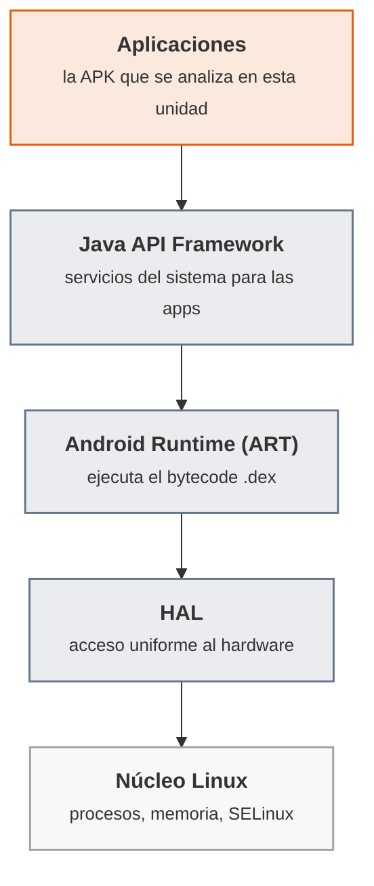
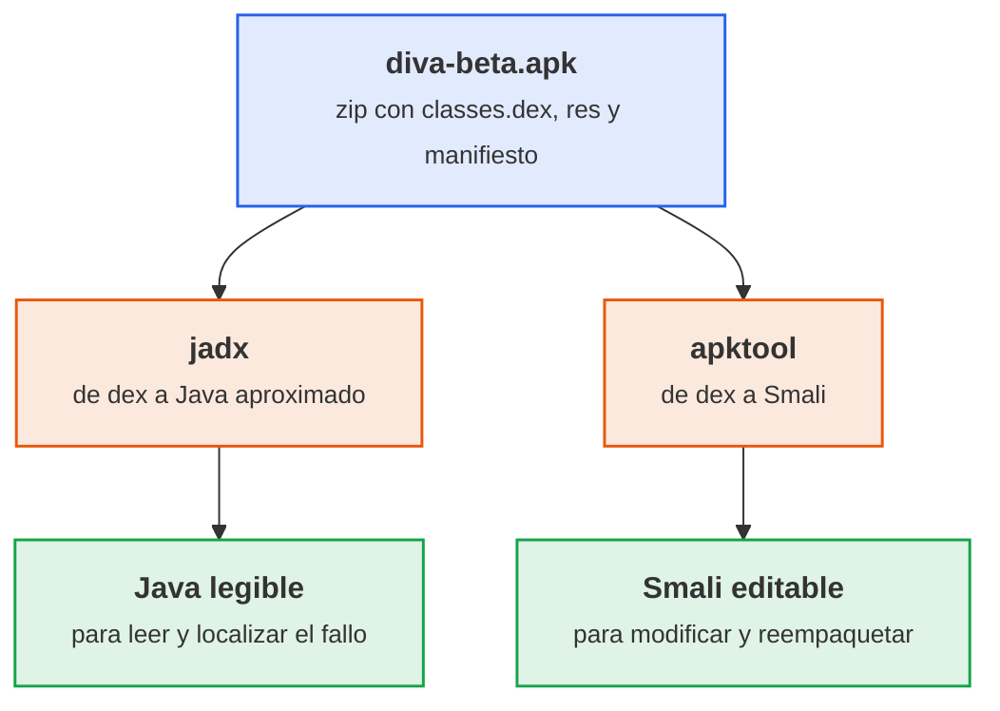
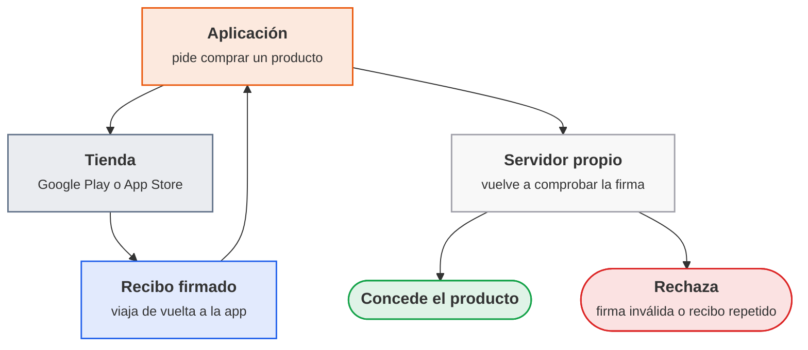

# UT4 · Aplicaciones móviles

<p class="ut-meta">16 h · Sesiones 29 a 36 · RA4 CE a, b, c, d, e</p>

Una aplicación de móvil no vive en un servidor controlado: vive en el dispositivo de quien la instala, con el código dentro del alcance de quien quiera abrirlo. Lo que en una aplicación web es un servidor que nadie más toca es aquí un archivo `.apk` que cualquiera puede descomprimir, descompilar y leer. Esta unidad trabaja con esa idea de fondo: qué modelo de permisos y de firma tienen Android e iOS, qué acaba guardado sin cifrar en el dispositivo, qué protocolo usa la aplicación para hablar con su servidor y qué queda expuesto dentro del binario. Las herramientas son las del análisis de aplicaciones móviles: un emulador Android, `adb` para hablar con él, `jadx` y `apktool` para leer y modificar el código, Burp Suite como proxy de interceptación y Drozer para probar los componentes que una aplicación expone a las demás.

!!! ojo "Solo sobre las aplicaciones del laboratorio"
    Todo lo que se hace en esta unidad (descompilar, extraer credenciales, interceptar tráfico, explotar un componente exportado) se hace únicamente sobre las aplicaciones deliberadamente vulnerables del laboratorio (DIVA, PIVAA, InsecureBankv2), instaladas en el emulador propio y en una red aislada del resto del aula. Hacer lo mismo sobre una aplicación real sin autorización escrita de quien la publica es acceso sin autorización a un sistema ajeno, delito tipificado en el artículo 197 bis del Código Penal. El criterio es siempre el mismo: solo sobre lo propio o sobre lo que autoriza por escrito quien lo posee.

Lo que va más allá de lo que se hace en clase (ampliaciones, otras herramientas y enlaces para seguir) está en [Para ampliar](../ampliacion.md#ut4-aplicaciones-moviles).

## Sesión 29 · Arquitectura de Android y OWASP Mobile

<p class="ut-meta" markdown>1 de febrero · Teoría y práctica · <span class="dur" tabindex="0" aria-label="Arquitectura de Android e iOS · 10 min&#10;Estructura de un APK y OWASP Mobile Top 10 · 15 min&#10;A4.1 Laboratorio móvil · 85 min" data-dur="Arquitectura de Android e iOS · 10 min&#10;Estructura de un APK y OWASP Mobile Top 10 · 15 min&#10;A4.1 Laboratorio móvil · 85 min">:material-school:<i class="dur-barra" style="--teoria:23%"></i>:material-flask:</span></p>

Al acabar esta sesión existe `movil01`, el dispositivo Android del laboratorio, con las dos aplicaciones de trabajo de la unidad instaladas, y el puesto de administración tiene `adb`, `jadx` y `apktool` listos para desempaquetarlas. Antes de tocar el emulador se ve cómo está construido un sistema Android o iOS por capas y qué contiene el archivo `.apk` que se va a desempaquetar, y se cierra con las diez categorías del OWASP Mobile Top 10, que da el vocabulario que se usa el resto de la unidad para nombrar lo que se encuentra.

!!! consulta "Recursos de la sesión"
    **Para la práctica**

    - [OWASP Mobile Top 10](https://owasp.org/www-project-mobile-top-10/) y [OWASP MAS](https://mas.owasp.org/): los riesgos y el estándar de verificación móvil.
    - [Genymotion](https://www.genymotion.com/download/): el emulador de Android del laboratorio.

### Arquitectura de Android e iOS

Android se apoya en un núcleo Linux. Sobre él, una capa de abstracción de hardware (HAL) da acceso uniforme a la cámara, el sensor o el módem sin que cada fabricante tenga que reescribir el sistema entero; encima corre el Android Runtime (ART, el sucesor de la antigua máquina virtual Dalvik), que ejecuta el bytecode de las aplicaciones; y sobre el runtime, el Java API Framework expone a cada aplicación los servicios del sistema (gestión de actividades, notificaciones, ubicación, listas de contactos) a través de una API común.



<p class="pie" markdown>Las capas de Android de arriba abajo: cada aplicación solo ve el framework, y este se apoya en el runtime, la abstracción de hardware y el núcleo.</p>

iOS se apoya en un núcleo derivado de BSD (la misma familia que macOS) y solo se instala en hardware de Apple. Las aplicaciones acceden a un conjunto fijo de frameworks (UIKit, CFNetwork, Core Data) y sus datos van cifrados por defecto, sin la variedad de fabricantes de Android.

| | Android | iOS |
|---|---|---|
| Núcleo | Linux | Derivado de BSD (macOS) |
| Licencia y hardware | Abierta (Apache 2.0), x86 y ARM | Privada, solo ARM y solo Apple |
| Cifrado de datos | Nativo, activable | Activado por defecto (APFS) |

Las dos plataformas separan una zona de solo lectura con el sistema y las aplicaciones de fábrica y una zona de datos de usuario. Es la de datos la que interesa aquí: ahí una aplicación mal escrita deja credenciales, bases de datos o preferencias sin cifrar.

### Estructura de un APK y OWASP Mobile Top 10

Un APK (paquete de aplicación Android, del inglés *Android Application Package*) es un archivo `.zip` con esta estructura, que se ve tal cual al descomprimirlo:

- `AndroidManifest.xml`: qué necesita la aplicación para instalarse y ejecutarse (versión mínima de Android, permisos que va a pedir, componentes que declara).
- `classes.dex`: el código compilado, en formato ejecutable Dalvik.
- `res/` y `resources.arsc`: los recursos (layouts, cadenas de texto, imágenes) sin compilar y compilados.
- `assets/`: recursos adicionales que la aplicación lee directamente, sin pasar por el sistema de recursos de Android.
- `lib/`: librerías nativas (código en C o C++ compilado para cada arquitectura), cuando la aplicación las usa.
- `META-INF/`: el certificado y la firma de la aplicación.

El proceso de creación es el inverso al del análisis de esta unidad: el código fuente en Java o Kotlin se compila a `.class`, se transforma a bytecode `.dex`, y ese `.dex` junto con los recursos y el manifiesto se empaqueta y se firma. Deshacer ese camino, de `.dex` a código legible, es la ingeniería inversa: se practica en la sesión 31, el 8 de febrero, sobre una aplicación vulnerable.

El [OWASP Mobile Top 10](https://owasp.org/www-project-mobile-top-10/) agrupa los fallos más comunes en diez categorías. La unidad usa la numeración de la edición de 2016, que es la que sigue reflejando el reparto de los criterios de evaluación. La web de OWASP publica hoy la edición de 2024, que reordena y renombra las categorías; la última columna da la correspondencia para poder leerla. No se explican todas con el mismo detalle: esta unidad trabaja a fondo M2, M3 y M9, toca M1 y M8 de pasada y deja enunciadas las demás para reconocerlas si aparecen.

| Categoría (2016) | En una frase | Dónde aparece en esta unidad | Edición 2024 |
|---|---|---|---|
| M1. Uso indebido de la plataforma | No usar, o usar mal, las características de seguridad que ya da el sistema (permisos, componentes exportados) | En la lectura de permisos y componentes de la A4.2 | M8, configuración de seguridad incorrecta |
| M2. Almacenamiento inseguro de datos | Guardar datos sensibles sin cifrar, en preferencias, bases de datos o ficheros | El fallo central de la A4.4 | M9 |
| M3. Comunicación insegura | Enviar datos sin cifrar o con un cifrado débil entre la aplicación y su servidor | El fallo central de la A4.5 | M5 |
| M4. Autenticación insegura | Sesiones que no caducan, contraseñas cortas, autenticación que se puede evitar | Se reconoce en la actividad `PostLogin` de InsecureBankv2 (sesión 36) | M3 |
| M5. Cifrado insuficiente | Usar algoritmos débiles o implementarlos mal | Se contrasta con el uso correcto de HMAC en la A4.7 | M10 |
| M6. Autorización insegura | Fallos en el control de qué puede hacer cada usuario ya identificado | Fuera del alcance práctico de esta unidad | M3 |
| M7. Calidad del código del cliente | Errores de programación explotables (desbordamientos, fugas de memoria) | Fuera del alcance práctico de esta unidad | M4 |
| M8. Manipulación de código | Modificar una aplicación y redistribuirla con código añadido | Se practica en la A4.3 al reempaquetar y volver a firmar DIVA | M7 |
| M9. Ingeniería inversa | Analizar el binario para entender o modificar su funcionamiento | El método de trabajo de las sesiones 31 y 34 | M7 |
| M10. Funcionalidad inesperada | Código de pruebas o en desarrollo que queda expuesto en la versión final | Se reconoce en los componentes exportados de PIVAA (A4.6) | M8 |

### A4.1 Laboratorio móvil (sesión 29)

<span class="et et-obj">Objetivo</span> El emulador `movil01` (Genymotion, Android 6.0, Google Nexus 5X) arrancado y visible desde `pps01`, con DIVA e InsecureBankv2 instaladas: al terminar existe una carpeta por aplicación con su código Smali editable (apktool) y, para DIVA, su código Java aproximado (jadx).

<span class="et et-pre">Antes de empezar</span> `pps01` encendida y con Internet. Cuenta personal gratuita de Genymotion, creada y verificada antes de esta sesión (el correo de activación puede tardar hasta una hora): créala en casa el día anterior. Los dos paquetes de APK descargados de Aules en `pps01` y descomprimidos en `~/laboratorio-movil/apk/`: `APK_1.zip` (`diva-beta.apk` e `InsecureBankv2.apk`) y `APK_2.zip` (`pivaa.apk` y `drozer-agent-2.3.4.apk`, que no se usan hasta la sesión 34). Se ha explicado [la arquitectura de Android e iOS](#arquitectura-de-android-e-ios) y [la estructura de un APK](#estructura-de-un-apk-y-owasp-mobile-top-10).

<span class="et et-pas">Pasos</span>

1. Instala Genymotion en el equipo del aula, no dentro de `pps01`: usa la misma instalación de VirtualBox que aloja `pps01`, como una máquina más. Descarga el instalador de la [página de Genymotion](https://www.genymotion.com/download/), inicia sesión con la cuenta y elige la licencia de uso personal.
2. Crea el dispositivo virtual con API 23 (Android 6.0) y modelo Google Nexus 5X, que es con el que está probado el material. Nómbralo `movil01` y deja su red por defecto: el adaptador solo anfitrión de VirtualBox que ya usa `pps01`, para que las dos máquinas se vean. La descarga de la imagen es lo más lento de la hoja; arranca `movil01` cuando termine.
3. En `pps01`, instala las herramientas de análisis (todas están en los repositorios de Ubuntu 24.04):

    ```bash
    sudo apt update && sudo apt install -y adb apktool apksigner sqlite3 unzip
    ```

4. Descarga `jadx` (no está en los repositorios de Ubuntu) tomando la versión estable actual de su página de publicaciones, y comprueba que arranca:

    ```bash
    V=$(curl -s https://api.github.com/repos/skylot/jadx/releases/latest | grep -Po '"tag_name": "v\K[^"]+')
    curl -fsSLo ~/jadx.zip "https://github.com/skylot/jadx/releases/download/v$V/jadx-$V.zip"
    unzip -q ~/jadx.zip -d ~/jadx && ~/jadx/bin/jadx --version
    ```

5. Anota la IP de `movil01` (en el emulador: Ajustes, Wi-Fi, icono de los tres puntos, Avanzado; Genymotion la asigna por DHCP en `192.168.56.0/24`, así que puede no coincidir con la `.60` de las [convenciones](../laboratorio.md#maquinas-virtuales)) y conecta desde `pps01`:

    ```bash
    adb connect <IP de movil01>:5555
    adb devices
    ```

6. Instala las dos aplicaciones y abre cada una una vez en el emulador para comprobar que arrancan:

    ```bash
    cd ~/laboratorio-movil/apk/APK_1/APKs
    adb install diva-beta.apk
    adb install InsecureBankv2.apk
    ```

7. Desempaqueta las dos APK con `apktool` (Smali y recursos, editable) y DIVA además con `jadx` (Java aproximado, solo lectura). Cada resultado va a su propia carpeta:

    ```bash
    mkdir -p ~/laboratorio-movil/{diva,insecurebank}
    apktool d diva-beta.apk -o ~/laboratorio-movil/diva/smali
    apktool d InsecureBankv2.apk -o ~/laboratorio-movil/insecurebank/smali
    ~/jadx/bin/jadx -d ~/laboratorio-movil/diva/java diva-beta.apk
    ```

<span class="et et-com">Comprobación</span> `adb devices` muestra la IP de `movil01` como `device` (no como `unauthorized`), las dos aplicaciones abren en el emulador sin cerrarse, y `~/laboratorio-movil/diva/` contiene el árbol `smali` y el árbol `java` con ficheros dentro.

<span class="et et-ent">Para practicar</span> Guarda en `ut4/a41/` de `pps-entregas` un `README.md` con la captura de `adb devices`, la de las dos aplicaciones abiertas en `movil01` y el listado de `~/laboratorio-movil/` (`ls -R | head -40`). Lo recoge la entrega ACT_UT4_1 (plazo, el 15 de febrero). El laboratorio que montas aquí es el que usan el resto de hojas de la unidad.

<span class="et et-ext">Si te sobra tiempo</span> Abre `diva-beta.apk` con `~/jadx/bin/jadx-gui` y localiza `AndroidManifest.xml`, el paquete `jakhar.aseem.diva` y los recursos: es la estructura del apartado de teoría sobre una aplicación real. Descompila también `InsecureBankv2.apk` con `jadx` (`-d ~/laboratorio-movil/insecurebank/java`) y compara el tamaño y la legibilidad de su código con el de DIVA: la cantidad de clases indica cuánto habrá que leer en las sesiones siguientes.

## Sesión 30 · Permisos, firma y verificación

<p class="ut-meta" markdown>4 de febrero · Teoría y práctica · <span class="dur" tabindex="0" aria-label="Modelo de permisos · 15 min&#10;Firma y verificación de aplicaciones · 10 min&#10;A4.2 Permisos y firma · 85 min" data-dur="Modelo de permisos · 15 min&#10;Firma y verificación de aplicaciones · 10 min&#10;A4.2 Permisos y firma · 85 min">:material-school:<i class="dur-barra" style="--teoria:23%"></i>:material-flask:</span></p>

Al acabar esta sesión hay una tabla propia con los permisos de DIVA y de InsecureBankv2 clasificados por riesgo, sus componentes exportados localizados en el manifiesto, y la firma de cada APK verificada con su emisor anotado. Antes del laboratorio se ve cómo Android e iOS deciden si una aplicación puede usar la cámara o el almacenamiento externo, y qué significa que una aplicación esté firmada.

!!! consulta "Recursos de la sesión"
    **Para la práctica**

    - [Permisos en Android](https://developer.android.com/guide/topics/permissions/overview) y [`apksigner`](https://developer.android.com/studio/command-line/apksigner): permisos y verificación de firma.

### Modelo de permisos

En Android cada permiso protegido pertenece a uno de dos niveles: **normal** (bajo riesgo, se concede solo con declararlo en el manifiesto: acceso a Internet, vibración) o **peligroso** (acceso a datos o funciones sensibles: cámara, ubicación, contactos, SMS, almacenamiento). Desde Android 6.0 los permisos peligrosos se piden en tiempo de ejecución, la primera vez que la aplicación los necesita, y el usuario puede revocarlos después sin desinstalar nada. Además de los permisos, Android aísla cada aplicación en su propia máquina virtual con un identificador de usuario Unix propio (el sandbox se apoya en SELinux), de modo que una aplicación no puede leer los ficheros de otra aunque no pida ningún permiso especial para intentarlo.

iOS no clasifica los permisos en normal o peligroso: casi todo acceso a un recurso sensible (cámara, ubicación, contactos, fotos) exige autorización explícita del usuario la primera vez que la aplicación lo pide, con un diálogo del sistema que la aplicación no puede evitar ni personalizar del todo. El aislamiento es por directorio: cada aplicación recibe una carpeta propia y solo puede leer y escribir en ella salvo que pida acceso a algo externo, y corre con un usuario del sistema de bajos privilegios.

| | Android | iOS |
|---|---|---|
| Concesión | En la instalación (normales) o en tiempo de ejecución (peligrosos) | Siempre en tiempo de ejecución, con diálogo del sistema |
| Revocación | El usuario la revoca en cualquier momento desde Ajustes | Igual, desde Ajustes |
| Aislamiento | Máquina virtual por aplicación, con user ID propio, sobre SELinux | Directorio propio por aplicación, usuario del sistema de bajos privilegios |
| Comunicación entre aplicaciones | Intents, content providers | Esquemas de URL, extensiones de aplicación, AirDrop |

Los componentes de una aplicación Android (actividades, servicios, receptores de emisiones y proveedores de contenido) pueden declararse `exported`, lo que los hace visibles para otras aplicaciones del dispositivo. Un componente exportado sin permiso propio es una puerta abierta: cualquier aplicación instalada puede llamarlo. Localizarlos en el manifiesto es el primer paso del taller de PIVAA, el 18 de febrero.

### Firma y verificación de aplicaciones

Tanto Android como iOS exigen que una aplicación esté firmada antes de poder instalarse. En Android el certificado puede ser autofirmado: no certifica la identidad real del desarrollador, pero sí que todas las versiones de una misma aplicación vienen de la misma clave privada, lo que permite actualizarla sin perder sus datos y comprobar que una APK no se ha manipulado después de firmarla. En iOS la firma tiene que emitirla la propia autoridad de certificación de Apple, un control más estricto que en la práctica exige pasar por su proceso de publicación.

Verificar la firma de una APK dice dos cosas: que el fichero no se ha modificado desde que se firmó, y quién dice haberla firmado (aunque sea un certificado autofirmado, sin garantía de identidad real). Es lo que hace la A4.2 con `apksigner verify`, que entiende los esquemas de firma de Android y se instala solo, sin el SDK completo, con el paquete `apksigner` de Ubuntu. Las aplicaciones de este laboratorio usan solo el esquema clásico (v1, basado en JAR), con huellas SHA-1 de los ficheros y un certificado autofirmado (DIVA lleva el de depuración, `CN=Android Debug`): que estén firmadas no las hace de fiar, y ese detalle es un hallazgo que se anota. `jarsigner -verify` no sirve aquí: con los JDK actuales trata como no firmadas las APK con SHA-1 anterior a 2019, aunque la firma sea válida en Android.

### A4.2 Permisos y firma (sesión 30)

<span class="et et-obj">Objetivo</span> Una tabla propia con los permisos de DIVA y de InsecureBankv2 clasificados en normales y peligrosos, sus componentes exportados localizados con su riesgo, la comparación Android frente a iOS del apartado de teoría rellenada con ejemplos reales de las dos aplicaciones, y la firma de cada APK verificada con su emisor.

<span class="et et-pre">Antes de empezar</span> `movil01` arrancado y `~/laboratorio-movil/` de la A4.1 con las dos aplicaciones desempaquetadas. Se ha explicado [el modelo de permisos](#modelo-de-permisos) y [la firma y verificación de aplicaciones](#firma-y-verificacion-de-aplicaciones).

<span class="et et-pas">Pasos</span>

1. Extrae los permisos declarados de cada manifiesto (el que ha dejado `apktool` en la A4.1, ya en XML legible):

    ```bash
    grep 'uses-permission' ~/laboratorio-movil/diva/smali/AndroidManifest.xml
    grep 'uses-permission' ~/laboratorio-movil/insecurebank/smali/AndroidManifest.xml
    ```

2. Para cada permiso, busca su nivel de protección (`normal` o `dangerous`) en la [documentación de Android](https://developer.android.com/guide/topics/permissions/overview) y monta una tabla: Aplicación, permiso, nivel, para qué lo usa (a partir del código de `~/laboratorio-movil/diva/java` y de `insecurebank/smali`).
3. Localiza los componentes exportados de las dos aplicaciones:

    ```bash
    grep -B2 'exported="true"' ~/laboratorio-movil/diva/smali/AndroidManifest.xml
    grep -B2 'exported="true"' ~/laboratorio-movil/insecurebank/smali/AndroidManifest.xml
    ```

    Anota cuáles no declaran ningún `android:permission`: son los que cualquier aplicación instalada podría invocar sin pedir nada. Un componente con `<intent-filter>` y sin atributo `exported` también queda exportado en aplicaciones de esta época, así que conviene mirar además los filtros:

    ```bash
    grep -B4 'intent-filter' ~/laboratorio-movil/diva/smali/AndroidManifest.xml
    ```

4. Completa la tabla comparativa Android frente a iOS del apartado de teoría con dos ejemplos concretos sacados de las dos aplicaciones (un permiso peligroso y un componente exportado), y una frase propia de qué pasaría en iOS con ese mismo caso.
5. Verifica la firma de las dos APK y anota el emisor del certificado (aparecerá como autofirmado, `CN=...`, sin cadena de confianza) y los esquemas de firma verificados:

    ```bash
    cd ~/laboratorio-movil/apk/APK_1/APKs
    apksigner verify --verbose --print-certs diva-beta.apk
    apksigner verify --verbose --print-certs InsecureBankv2.apk
    ```

    Anota también si el resultado avisa de algoritmos débiles (SHA-1) o de un certificado de depuración: es un hallazgo que va a la tabla, porque la firma es tan fiable como la clave y el algoritmo que la respaldan.

<span class="et et-com">Comprobación</span> `apksigner verify` responde `Verifies` y `Verified using v1 scheme (JAR signing): true` en las dos APK, y la tabla de permisos tiene al menos un permiso peligroso y un componente exportado por aplicación.

<span class="et et-ent">Para practicar</span> Guarda en `ut4/a42/` de `pps-entregas` la tabla de permisos y componentes exportados, la comparación Android/iOS rellenada y la salida de `apksigner` de las dos APK. Lo recoge la entrega ACT_UT4_1 (plazo, el 15 de febrero).

## Sesión 31 · Análisis estático de una aplicación vulnerable

<p class="ut-meta" markdown>8 de febrero · Teoría y práctica · <span class="dur" tabindex="0" aria-label="Ingeniería inversa: de APK a código legible · 20 min&#10;A4.3 DIVA: análisis estático · 90 min" data-dur="Ingeniería inversa: de APK a código legible · 20 min&#10;A4.3 DIVA: análisis estático · 90 min">:material-school:<i class="dur-barra" style="--teoria:18%"></i>:material-flask:</span></p>

Al acabar esta sesión hay, para tres retos de DIVA, el fragmento de código donde está el fallo y su corrección, y una copia de DIVA con el texto de bienvenida modificado, firmada con una clave propia e instalada en `movil01`. Antes de entrar en DIVA se ve el método: cómo se pasa del bytecode `.dex` que trae la APK a algo que se puede leer, y las dos herramientas que hacen ese camino de forma distinta.

!!! consulta "Recursos de la sesión"
    **Para la práctica**

    - [DIVA](https://github.com/payatu/diva-android): la aplicación vulnerable; su `README` lista los trece retos.
    - El enunciado de la entrega ACT_UT4_1 está en el aula.

### Ingeniería inversa: de APK a código legible



<p class="pie" markdown>El mismo `classes.dex` da dos resultados distintos según lo que se necesite: leer o modificar.</p>

`jadx` reconstruye código Java a partir del bytecode Dalvik: el resultado es aproximado (los nombres de variable pueden perderse, y el código no siempre recompila), pero es el más cómodo para leer y entender qué hace una aplicación, que es lo que hace falta en esta sesión. `apktool` va un paso más allá: desensambla a Smali, un lenguaje intermedio legible pero mucho más verboso que Java, pensado para poder modificarse y volver a empaquetarse en una APK nueva (con `apktool build`) que después hay que volver a firmar para poder instalarla. Cuando el objetivo es solo leer, `jadx` basta y sobra; cuando hace falta cambiar algo de la aplicación, como en la A4.3, `apktool` es la herramienta.

Dos límites: el código puede venir ofuscado (nombres sustituidos por letras sueltas, lo que dificulta la lectura sin impedirla), y las librerías nativas en C o C++ no pasan por `jadx` ni por `apktool` y exigen herramientas de análisis de binarios.

### A4.3 DIVA: análisis estático (sesión 31)

<span class="et et-obj">Objetivo</span> Tres fallos de DIVA localizados leyendo su código (contraseña incrustada, dato sensible en el registro y credenciales de API en una actividad accesible desde fuera), cada uno con el fragmento de código, una captura y su corrección, y una APK de DIVA con el texto de bienvenida cambiado, firmada con una clave propia e instalada en `movil01`.

<span class="et et-pre">Antes de empezar</span> `~/laboratorio-movil/diva/` de la A4.1, con el árbol `java` (jadx) y el árbol `smali` (apktool), y `movil01` con DIVA instalada. Se ha explicado [el camino de APK a código legible](#ingenieria-inversa-de-apk-a-codigo-legible).

<span class="et et-pas">Pasos</span>

1. Abre `~/laboratorio-movil/diva/java` en VS Code o `diva-beta.apk` en `jadx-gui`. En el paquete `jakhar.aseem.diva` cada reto de la aplicación es una actividad con un nombre que anticipa el fallo (`LogActivity`, `HardcodeActivity`, `InsecureDataStorage1Activity`...). DIVA tiene trece retos; esta hoja usa tres.
2. **Contraseña incrustada.** Abre `HardcodeActivity` y localiza la comparación con una cadena fija. Captura la línea, y en `movil01` entra en el reto «Hardcoding Issues - Part 1» con esa clave para comprobar que la acepta.
3. **Dato sensible en el registro.** Abre `LogActivity` y localiza la llamada a `Log` que escribe un dato que no debería. Captura la línea. La comprobación en vivo con `adb logcat` se hace en la [A4.4](#a44-diva-almacenamiento-sesion-32), con el resto de fugas del dispositivo.
4. **Credenciales de API accesibles desde fuera.** Abre `APICredsActivity`, localiza las credenciales incrustadas y busca su actividad en `AndroidManifest.xml`: declara un `<intent-filter>` con una acción propia, por lo que otra aplicación (o `adb`) puede abrirla sin pasar por el reto. Lánzala tú desde `pps01` y captura lo que muestra:

    ```bash
    adb shell am start -a jakhar.aseem.diva.action.VIEW_CREDS
    ```

5. Para cada uno de los tres fallos, escribe la corrección con la precisión suficiente para que otra persona la aplique: qué se cambia en el código o en el manifiesto y con qué. «Cifrar mejor» no vale; sí vale, por ejemplo, «no llevar la clave en el cliente y validarla en un servidor» o «`android:exported="false"` y comprobar el permiso».
6. **Modificar la aplicación.** Con el árbol `smali` de la A4.1, cambia el texto de la clave `dintro` en `res/values/strings.xml` por otro propio, reempaqueta y comprueba que el resultado es una APK:

    ```bash
    cd ~/laboratorio-movil
    nano diva/smali/res/values/strings.xml
    apktool b diva/smali -o diva-sin-firmar.apk
    ```

7. Una APK sin firma no se instala. Crea una clave propia (`keytool` te pide una contraseña y unos datos: usa datos de laboratorio y no la subas al repositorio) y firma con ella:

    ```bash
    keytool -genkeypair -keystore clave-lab.jks -alias lab -keyalg RSA -keysize 2048 -validity 365
    apksigner sign --ks clave-lab.jks --out diva-mod.apk diva-sin-firmar.apk
    apksigner verify --print-certs diva-mod.apk
    ```

8. Android no deja actualizar una aplicación con otra firmada con una clave distinta, así que hay que desinstalar la original antes de instalar la modificada. Abre la aplicación y captura la pantalla de bienvenida con el texto nuevo:

    ```bash
    adb uninstall jakhar.aseem.diva
    adb install diva-mod.apk
    ```

9. Anota en una frase qué categoría del OWASP Mobile Top 10 ilustra el paso 8 (M8, manipulación de código) y por qué una aplicación real puede defenderse comprobando su propia firma en un servidor.

<span class="et et-com">Comprobación</span> Los tres fallos tienen su captura de código, su prueba en el emulador (el reto aceptando la clave y la actividad de credenciales abierta desde `adb`) y su corrección concreta. `apksigner verify --print-certs diva-mod.apk` muestra un firmante distinto del de `diva-beta.apk`, y la pantalla de bienvenida de `movil01` muestra el texto nuevo.

<span class="et et-ent">Para practicar</span> Guarda en `ut4/a43/` de `pps-entregas` el informe con los tres fallos (código, captura, corrección) y la captura de la aplicación modificada junto con la salida de `apksigner verify`, sin el fichero `.jks`. Lo recoge la entrega ACT_UT4_1 (plazo, el 15 de febrero).

<span class="et et-ext">Si te sobra tiempo</span> Reto «Hardcoding Issues - Part 2»: en `jadx` la comprobación no está en Java, sino en una librería nativa (`DivaJni`). Extrae la librería de la APK y busca en sus cadenas de texto:

```bash
unzip -o ~/laboratorio-movil/apk/APK_1/APKs/diva-beta.apk 'lib/x86/*' -d /tmp/diva-lib
strings /tmp/diva-lib/lib/x86/libdivajni.so
```

Es el límite de `jadx` y `apktool` que recoge la teoría: el código nativo no pasa por ellos, pero sus cadenas incrustadas siguen siendo legibles.

## Sesión 32 · Almacenamiento de datos y fugas de información

<p class="ut-meta" markdown>11 de febrero · Teoría y práctica · <span class="dur" tabindex="0" aria-label="Almacenamiento seguro en el dispositivo · 15 min&#10;Fugas por registros y copias de seguridad · 10 min&#10;A4.4 DIVA: almacenamiento · 85 min" data-dur="Almacenamiento seguro en el dispositivo · 15 min&#10;Fugas por registros y copias de seguridad · 10 min&#10;A4.4 DIVA: almacenamiento · 85 min">:material-school:<i class="dur-barra" style="--teoria:23%"></i>:material-flask:</span></p>

Al acabar esta sesión hay, para cada uno de los cuatro mecanismos de almacenamiento inseguro de DIVA (preferencias, base de datos, fichero temporal y almacenamiento externo), el dato encontrado en claro y la alternativa segura que correspondería, y comprobadas la fuga por registro y la copia de seguridad automática. Antes de entrar en la aplicación se ve dónde puede guardar datos una aplicación Android y cuál de esos sitios está pensado para un secreto y cuál no.

!!! consulta "Recursos de la sesión"
    **Para la práctica**

    - [Almacenamiento de datos en Android](https://developer.android.com/training/data-storage) y [DIVA](https://github.com/payatu/diva-android): los retos de almacenamiento inseguro.

### Almacenamiento seguro en el dispositivo

Este apartado recorre los sitios donde una aplicación Android puede guardar datos y cuál corresponde a cada tipo de dato, que es lo que pide describir el CE b.

- **SharedPreferences.** Pares clave-valor en un XML dentro del directorio privado de la aplicación. Cómodo para ajustes (idioma, tema), inseguro para credenciales: cualquiera con acceso al dispositivo (root, una copia de seguridad, una aplicación con el mismo user ID en dispositivos antiguos) lo lee en texto plano.
- **Bases de datos SQLite.** Igual de accesibles que las SharedPreferences si no se cifran: SQLite no cifra por defecto, así que una contraseña guardada en una tabla está tan expuesta como en un XML.
- **Almacenamiento interno (ficheros privados de la aplicación).** Un directorio propio al que solo llega la aplicación en condiciones normales, pero no cifrado por sí mismo: sigue en claro para quien tenga acceso físico o root.
- **Almacenamiento externo (tarjeta SD o partición compartida).** El peor sitio para un dato sensible: es legible por cualquier aplicación con permiso de lectura de almacenamiento, y en muchos dispositivos ni siquiera exige ese permiso para las rutas propias de la aplicación.
- **Keystore de Android.** El único de la lista pensado para secretos: guarda claves criptográficas en un área protegida por hardware cuando el dispositivo lo soporta, fuera del alcance de la propia aplicación y de la mayoría de ataques con root. No guarda el dato en sí, sino la clave con la que cifrarlo; el dato cifrado sí puede vivir en SharedPreferences o en SQLite.

| Tipo de dato | Sitio correcto | Por qué no vale un XML sin cifrar |
|---|---|---|
| Contraseña o token de sesión | Cifrado con una clave del Keystore, o no se guarda y se pide de nuevo | Una copia del dispositivo o el acceso con root lo expone entero |
| Ajustes sin valor para un atacante (idioma, tema) | SharedPreferences en claro | No hace falta protegerlo: no es un dato sensible |
| Caché de datos personales (mensajes, contactos) | Base de datos cifrada (SQLCipher u otra) | Expone datos de terceros, no solo del propio usuario |
| Clave de cifrado | Keystore | Es lo único diseñado para eso: guardar la clave, no el dato |

### Fugas por registros y copias de seguridad

Este apartado cierra el bloque de almacenamiento con dos salidas por donde un dato puede escapar sin que nadie lo haya guardado a propósito en un sitio inseguro: el log del sistema y las copias de seguridad automáticas.

El log del sistema Android (accesible con `adb logcat` sin necesitar permisos especiales sobre un dispositivo de desarrollo) recoge todo lo que cualquier aplicación escribe con las funciones de depuración. Un `Log.d("login", "usuario=" + user + " clave=" + pass)` dejado en una versión de producción por error es una fuga tan real como una base de datos sin cifrar, y es uno de los fallos más repetidos en aplicaciones reales: se escribe para depurar y se olvida quitar.

Las copias de seguridad automáticas de Android (activadas por defecto salvo que la aplicación las excluya con `android:allowBackup="false"` en el manifiesto) incluyen, salvo que se configure lo contrario, los ficheros del directorio privado de la aplicación. Una aplicación que guarda un token en claro en sus preferencias lo está exportando también a cualquier copia de seguridad en la nube o en un ordenador, ampliando el número de sitios donde ese dato queda expuesto.

### A4.4 DIVA: almacenamiento (sesión 32)

<span class="et et-obj">Objetivo</span> Para cada uno de los cuatro mecanismos de almacenamiento inseguro de DIVA (SharedPreferences, SQLite, fichero temporal y almacenamiento externo), el dato encontrado en claro dentro de `movil01`, y la comprobación de la fuga por registro y de si la aplicación permite copias de seguridad, cada una con la alternativa segura de la tabla de teoría.

<span class="et et-pre">Antes de empezar</span> `movil01` con DIVA instalada (la original o la modificada de la A4.3, que tiene el mismo código) y `adb devices` mostrándolo. En Genymotion el `adb shell` entra como `root`, a diferencia de un dispositivo físico, y por eso llega al directorio privado de la aplicación sin más pasos. Se ha explicado [el almacenamiento seguro en el dispositivo](#almacenamiento-seguro-en-el-dispositivo) y [las fugas por registros y copias de seguridad](#fugas-por-registros-y-copias-de-seguridad).

<span class="et et-pas">Pasos</span>

1. **Preferencias.** En `movil01`, abre el reto «Insecure Data Storage - Part 1», guarda un usuario y una contraseña de prueba (inventados) y localiza el dato desde `pps01`:

    ```bash
    adb shell ls /data/data/jakhar.aseem.diva/shared_prefs/
    adb shell cat /data/data/jakhar.aseem.diva/shared_prefs/jakhar.aseem.diva_preferences.xml
    ```

2. **Base de datos.** Repite con el reto «Part 2» (SQLite), trae la base de datos a `pps01` y consúltala:

    ```bash
    adb shell ls /data/data/jakhar.aseem.diva/databases/
    adb pull /data/data/jakhar.aseem.diva/databases/ids2 /tmp/ids2
    sqlite3 /tmp/ids2 "select * from myuser;"
    ```

3. **Fichero temporal.** Repite con el reto «Part 3»: la aplicación crea un fichero con nombre aleatorio en su directorio privado.

    ```bash
    adb shell ls /data/data/jakhar.aseem.diva/
    adb shell cat /data/data/jakhar.aseem.diva/uinfo*tmp
    ```

4. **Almacenamiento externo.** Repite con el reto «Part 4»: el fichero queda en la tarjeta SD simulada, con nombre oculto (empieza por punto), y lo puede leer cualquier aplicación con permiso de lectura de almacenamiento:

    ```bash
    adb shell ls -a /sdcard/
    adb shell cat /sdcard/.uinfo.txt
    ```

    Si la aplicación responde «File error occurred», concede el permiso de almacenamiento a DIVA en Ajustes, Aplicaciones, DIVA, Permisos (en Android 6 se concede en ejecución) y repite el reto.
5. **Registro.** Abre el reto «Insecure Logging», introduce un número de tarjeta inventado y busca en el registro el fallo que localizaste en el código en la A4.3:

    ```bash
    adb logcat -d | grep -i diva
    ```

6. **Copias de seguridad.** Mira en el manifiesto de la A4.1 si DIVA las permite:

    ```bash
    grep -o 'allowBackup="[a-z]*"' ~/laboratorio-movil/diva/smali/AndroidManifest.xml
    ```

7. Monta una tabla con una fila por mecanismo (los cuatro de almacenamiento, el registro y la copia de seguridad): qué dato se ha encontrado, dónde y en qué formato, y qué alternativa de la tabla de teoría le correspondería (clave en el Keystore y dato cifrado, base de datos cifrada, no guardarlo, o `android:allowBackup="false"`).

<span class="et et-com">Comprobación</span> La tabla tiene las seis filas con datos reales de tu ejecución (no valores inventados), y hay una captura de la salida de cada uno de los pasos 1 a 6.

<span class="et et-ent">Para practicar</span> Guarda en `ut4/a44/` de `pps-entregas` la tabla de almacenamiento inseguro, las capturas de los pasos 1 a 6 y la corrección propuesta para cada fila. Lo recoge la entrega ACT_UT4_1 (plazo, el 15 de febrero).

## Sesión 33 · Análisis del tráfico de una aplicación

<p class="ut-meta" markdown>15 de febrero · Teoría y práctica · <span class="dur" tabindex="0" aria-label="Proxy de interceptación en el emulador · 10 min&#10;Protocolos inseguros y cómo se detectan · 10 min&#10;A4.5 Tráfico de una aplicación · 90 min" data-dur="Proxy de interceptación en el emulador · 10 min&#10;Protocolos inseguros y cómo se detectan · 10 min&#10;A4.5 Tráfico de una aplicación · 90 min">:material-school:<i class="dur-barra" style="--teoria:18%"></i>:material-flask:</span></p>

Al acabar esta sesión Burp Suite está configurado como proxy de `movil01`, con su certificado de CA instalado en el emulador, y hay una captura del tráfico HTTP en claro que genera InsecureBankv2 contra su propio servidor con la contraseña visible en la petición. Antes de tocar el emulador se ve qué es un proxy de interceptación y por qué HTTP sigue apareciendo en aplicaciones móviles a pesar de que HTTPS es el estándar desde hace años.

!!! consulta "Recursos de la sesión"
    **Para la práctica**

    - [Proxy de Burp Suite](https://portswigger.net/burp/documentation/desktop/tools/proxy/using) e [InsecureBankv2](https://github.com/dineshshetty/Android-InsecureBankv2): interceptar el tráfico de la aplicación.

### Proxy de interceptación en el emulador

Este apartado explica el mecanismo que hace visible el tráfico de una aplicación móvil: ponerse en medio, con el consentimiento del propio dispositivo.

Un proxy de interceptación como Burp Suite se sitúa entre el cliente (la aplicación en `movil01`) y el servidor, y muestra o modifica cada petición y cada respuesta que pasa por él. Para que funcione con HTTP basta con configurar la IP y el puerto del proxy en la conexión Wi-Fi del emulador; para que funcione con HTTPS, además, el dispositivo tiene que confiar en el certificado con el que Burp firma sus conexiones sobre la marcha, porque si no, la aplicación (o el propio sistema) rechaza la conexión por no reconocer esa autoridad de certificación.

El certificado de Burp se instala como una CA de usuario en el almacén de confianza del sistema. Desde Android 7 (API 24), una aplicación cuyo `targetSdkVersion` sea 24 o superior deja de confiar por defecto en las CA de usuario: solo confía en las del sistema, salvo que declare explícitamente lo contrario en su `network_security_config`. Es el fallo típico al montar este laboratorio con un dispositivo o aplicación más recientes que los de este curso: el certificado se instala sin error, pero la aplicación sigue rechazando la conexión porque no lo consulta. Las aplicaciones de esta unidad, escritas entre 2016 y 2021 con un `targetSdkVersion` anterior a ese cambio, sí confían en la CA de usuario sin configuración adicional, que es lo que permite verlas hoy sin más pasos.

### Protocolos inseguros y cómo se detectan

Este apartado cierra la teoría del día con qué se busca exactamente al mirar el tráfico capturado.

Detectar un protocolo inseguro en una captura de proxy es, en la mayoría de los casos, tan directo como mirar el esquema de la URL: una petición `http://` en lugar de `https://` viaja sin cifrar, y cualquiera en la misma red (otro dispositivo, un punto de acceso comprometido) puede leerla o modificarla. Dentro de una petición HTTP en claro, lo que interesa localizar son los datos sensibles del cuerpo o de las cabeceras: credenciales en un formulario de login, un token de sesión en una cabecera `Authorization`, datos personales en un JSON de respuesta. La categoría M3 del OWASP Mobile Top 10 (comunicación insegura) agrupa este fallo junto con el uso de cifrados débiles o de versiones obsoletas de TLS, que no se cubren en el laboratorio de esta unidad pero sí se reconocen: el criterio para todos es el mismo, cifrado moderno y certificado válido de un extremo a otro.

### A4.5 Tráfico de una aplicación (sesión 33)

<span class="et et-obj">Objetivo</span> Burp Suite como proxy de `movil01`, con su CA instalada en el emulador, y una captura del tráfico de InsecureBankv2 contra su servidor propio que muestra la petición de login en HTTP con el usuario y la contraseña legibles.

<span class="et et-pre">Antes de empezar</span> `movil01` con InsecureBankv2 instalada (de la A4.1) y Burp Suite Community disponible en `pps01` (ya en la lista de herramientas del [puesto de trabajo](../laboratorio.md#puesto-de-trabajo)). Se ha explicado [el proxy de interceptación en el emulador](#proxy-de-interceptacion-en-el-emulador) y [los protocolos inseguros y cómo se detectan](#protocolos-inseguros-y-como-se-detectan).

<span class="et et-pas">Pasos</span>

1. Lanza en segundo plano la descarga de las imágenes que necesita la sesión siguiente (con toda la clase a la vez tardan) y despliega el servidor de InsecureBankv2 en `pps01` con Docker. El `Dockerfile` usa el código de `AndroLabServer/`, que trae el propio repositorio:

    ```bash
    (docker pull opensecurity/mobile-security-framework-mobsf; docker pull drozerdocker/drozer:2.4.4) > /dev/null 2>&1 &
    git clone https://github.com/dineshshetty/Android-InsecureBankv2
    cd Android-InsecureBankv2
    cat > Dockerfile <<'DOCKERFILE'
    FROM python:2
    WORKDIR /app
    COPY ./AndroLabServer/requirements.txt .
    RUN pip install --no-cache-dir -r requirements.txt
    COPY ./AndroLabServer .
    EXPOSE 8888
    CMD ["python", "./app.py"]
    DOCKERFILE
    docker build -t insecurebank-server .
    docker run --rm -d -p 8888:8888 --name insecurebank-server insecurebank-server
    ```

2. En `movil01`, abre InsecureBankv2, entra en Preferences y configura como servidor la IP `192.168.56.10` (`pps01`, red solo anfitrión) y el puerto `8888`. Haz un login de prueba y comprueba en la terminal de `docker logs insecurebank-server` que la petición llega.
3. Arranca Burp Suite en `pps01` y activa el proxy en todas las interfaces, no solo en `localhost`, para que `movil01` llegue a él:

    ```text
    Proxy > Proxy settings > Add > Bind to port 8085, Bind to address: All interfaces
    ```

4. En `movil01`, configura el proxy Wi-Fi manual (Ajustes, Wi-Fi, mantener pulsada la red, Modificar red, Proxy manual) con `192.168.56.10` y el puerto `8085`.
5. Con `Proxy > HTTP history` de Burp abierto, repite el login en InsecureBankv2 y localiza la petición: anota el método, la URL completa (con el esquema `http://`), y el usuario y la contraseña tal como viajan en el cuerpo. Este login va por HTTP y se ve sin instalar ninguna CA.
6. Para ver también HTTPS hace falta la CA de Burp. Descárgala desde el navegador del emulador (`http://burp` con el proxy activo, formato DER) e instálala como certificado de usuario (Ajustes, Seguridad, Instalar desde almacenamiento; Android 6 exige antes un PIN o patrón de pantalla). Abre después una página `https://` cualquiera en el navegador del emulador y comprueba que aparece en `HTTP history` con el candado, es decir, descifrada por Burp.
7. Documenta en una frase por qué la captura del paso 5 demuestra la categoría M3 del OWASP Mobile Top 10, y qué cambiaría en la aplicación (no en el servidor de pruebas) para evitarlo.

<span class="et et-com">Comprobación</span> `HTTP history` de Burp muestra la petición de login de InsecureBankv2 con el esquema `http://` y la contraseña de prueba en texto plano dentro del cuerpo de la petición. Si has hecho el paso 6, una página `https://` aparece descifrada.

<span class="et et-ent">Para practicar</span> Guarda en `ut4/a45/` de `pps-entregas` la captura de la petición interceptada, con el usuario y la contraseña visibles, y la frase de corrección del paso 7. Lo recoge la entrega ACT_UT4_2 (plazo, el 25 de febrero).

## Sesión 34 · Taller PIVAA

<p class="ut-meta" markdown>18 de febrero · Teoría y práctica · <span class="dur" tabindex="0" aria-label="Cómo se organiza un taller de vulnerabilidades móviles · 10 min&#10;A4.6 PIVAA · 100 min" data-dur="Cómo se organiza un taller de vulnerabilidades móviles · 10 min&#10;A4.6 PIVAA · 100 min">:material-school:<i class="dur-barra" style="--teoria:9%"></i>:material-flask:</span></p>

Esta sesión es un taller guiado de principio a fin: al terminar hay respuesta a las preguntas del taller sobre los tres componentes vulnerables de PIVAA (proveedor de contenido, servicio y receptor de emisiones), con el comando de Drozer que explota cada uno y su captura. La teoría es solo cómo está organizado el taller, porque el resto de la sesión es trabajo guiado sobre una única aplicación.

!!! consulta "Recursos de la sesión"
    **Para la práctica**

    - [PIVAA](https://github.com/HTBridge/pivaa), [MobSF](https://hub.docker.com/r/opensecurity/mobile-security-framework-mobsf) y [Drozer](https://hub.docker.com/r/drozerdocker/drozer): la aplicación y las herramientas del taller.
    - El enunciado de la entrega ACT_UT4_2 está en el aula.

### Cómo se organiza un taller de vulnerabilidades móviles

Este apartado da el mapa de la sesión antes de entrar en ella: qué hace cada herramienta y en qué orden se usan.

El taller sigue siempre el mismo patrón: primero un análisis automatizado con MobSF que da una lista de componentes y posibles fallos sin escribir ni un comando de explotación, y después Drozer, que ataca de verdad los componentes que MobSF ha señalado como exportados. MobSF corre en un contenedor en `pps01` y se usa desde el navegador; Drozer necesita dos piezas, un agente instalado en `movil01` (la APK `drozer-agent-2.3.4.apk` de los recursos de la unidad) y una consola en `pps01`, también en contenedor, que se conecta al agente por la red solo anfitrión. El resto de la sesión repite tres veces el mismo ciclo (identificar el componente exportado con MobSF, atacarlo con el módulo de Drozer que corresponde, responder la pregunta del taller), sobre el proveedor de contenido, el servicio y el receptor de emisiones de PIVAA.

### A4.6 PIVAA (sesión 34)

<span class="et et-obj">Objetivo</span> Las preguntas del taller sobre PIVAA respondidas para sus tres componentes vulnerables (proveedor de contenido, servicio y receptor de emisiones), cada una con el comando de Drozer usado y una captura de su resultado.

<span class="et et-pre">Antes de empezar</span> `movil01` arrancado, con Docker en `pps01` funcionando (de las unidades anteriores). Se ha explicado [cómo se organiza el taller](#como-se-organiza-un-taller-de-vulnerabilidades-moviles). El enunciado completo con las preguntas exactas está en el aula.

<span class="et et-pas">Pasos</span>

1. Comprueba con `docker images` que las dos imágenes de la A4.5 ya están descargadas (si no, el `docker pull` va delante y en segundo plano) e instala PIVAA y el agente de Drozer en `movil01` (desde `~/laboratorio-movil/apk/APK_2/APKs`):

    ```bash
    adb install pivaa.apk
    adb install drozer-agent-2.3.4.apk
    ```

    Levanta MobSF:

    ```bash
    docker run --rm -p 8000:8000 -d --name mobsf opensecurity/mobile-security-framework-mobsf
    ```

2. Abre `http://localhost:8000` en `pps01`, arrastra `pivaa.apk` al análisis de MobSF y espera a que termine. En la pestaña de componentes, localiza el proveedor de contenido, el servicio y el receptor de emisiones marcados como exportados, y en `DECOMPILED CODE` el código fuente de cada uno.
3. En `movil01`, abre la aplicación Drozer Agent y actívala (pasa el interruptor a on): queda escuchando en el puerto `31415`.
4. Levanta la consola de Drozer en `pps01` y conéctate al agente con la IP de `movil01`:

    ```bash
    docker run -it --rm drozerdocker/drozer:2.4.4 console connect --server <IP de movil01>
    ```

    La imagen ya arranca `drozer`, así que la orden empieza en `console`. Conecta con el agente (la IP de `movil01`, que viste con `adb` en la A4.1; puede no ser la `.60`) y, en el prompt `dz>`, comprueba que ve PIVAA:

    ```text
    dz> run app.package.list -f pivaa
    ```

    Las imágenes antiguas `fsecurelabs/drozer` y `withsecurelabs/drozer` ya no se pueden descargar; la oficial actual es `drozerdocker/drozer`. Se fija la etiqueta `2.4.4` porque es la de la línea 2 de Drozer, la que corresponde al agente 2.3.4 del paquete de recursos: consola y agente tienen que ser de la misma versión mayor.

    Si la consola no encuentra el agente, comprueba primero que `movil01` responde por red (`ping` desde `pps01`) y que el interruptor de Drozer Agent sigue activado.
5. **Login (pantalla inicial).** En `MainActivity` sigue la tarea de login hasta la clase `Authentication` (carpeta `handlers`). Localiza en `saveCache` la línea que escribe usuario y contraseña en el registro y en `saveLoginInfoExternalStorage` la que guarda credenciales sin cifrar en la SD. Captura las dos líneas, haz un login de prueba en PIVAA (datos inventados) y muestra con `adb logcat -d | grep -i pivaa` el usuario y la contraseña en el registro, y con `adb shell cat /sdcard/Android/data/com.htbridge.pivaa/files/credentials.dat` el fichero de credenciales.
6. **Proveedor de contenido.** Encuentra sus URI con `app.provider.finduri` sobre el paquete de PIVAA, y extrae datos con `app.provider.query`. Ejemplo del taller: `run app.provider.query content://com.htbridge.pivaa/"select * from data"`. Localiza en `DatabaseHelper.java` el `rawQuery` sin saneamiento que lo hace posible y responde con ello a la pregunta del taller.
7. **Servicio.** Identifícalo en el manifiesto (¿qué atributos tiene?) y arráncalo desde fuera de la aplicación con `app.service.start` sobre el componente localizado en MobSF, y comprueba en el propio dispositivo que se ha ejecutado sin haber abierto la aplicación.
8. **Receptor de emisiones.** Relaciona el código del receptor con el que lo invoca y envíale un intent con `app.broadcast.send`: acción `service.vulnerable.vulnerableservice.LOG`, extras `data` (contenido) y `location` (ruta del fichero), y comprueba con `adb shell cat` el fichero que se crea. El módulo es `app.broadcast.send` con `--action` y un `--extra string` por cada campo:

    ```text
    dz> run app.broadcast.send --action service.vulnerable.vulnerableservice.LOG --extra string data "texto de prueba" --extra string location "/sdcard/Android/data/com.htbridge.pivaa/files/broadcastfile"
    ```
9. Para los tres componentes, responde en el informe a las preguntas exactas del taller (no solo «se ha explotado»): qué atributo del manifiesto falta, qué comando de Drozer lo aprovecha y qué cambio en el código lo evitaría.

<span class="et et-com">Comprobación</span> Los dos fallos del login (paso 5) se ven en el registro y en `credentials.dat`, y los tres módulos de Drozer del paso 6 al 8 devuelven un resultado (datos del proveedor, confirmación de arranque del servicio, fichero creado por el receptor), y cada uno tiene su pregunta del taller respondida con el comando exacto usado.

<span class="et et-ent">Para practicar</span> Guarda en `ut4/a46/` de `pps-entregas` el informe con los dos fallos del login y las tres explotaciones (comando, captura, respuesta a las preguntas del taller y corrección). Lo recoge la entrega ACT_UT4_2 (plazo, el 25 de febrero).

## Sesión 35 · Compras integradas y CASB

<p class="ut-meta" markdown>22 de febrero · Teoría y práctica · <span class="dur" tabindex="0" aria-label="Validación de compras integradas · 10 min&#10;CASB · 10 min&#10;A4.7 Validación de compras en el servidor · 90 min" data-dur="Validación de compras integradas · 10 min&#10;CASB · 10 min&#10;A4.7 Validación de compras en el servidor · 90 min">:material-school:<i class="dur-barra" style="--teoria:18%"></i>:material-flask:</span></p>

Al acabar esta sesión hay un servidor propio que valida un recibo de compra simulado y concede el producto solo si la firma es correcta y el recibo no se ha usado antes. Antes de programarlo se ve por qué esa decisión no puede tomarla la propia aplicación, y se cierra con una pieza de control que aparece en el mismo terreno, la seguridad de las aplicaciones móviles corporativas: qué es un CASB.

!!! consulta "Recursos de la sesión"
    **Para la práctica**

    - [Verificación de compras en el servidor (Google)](https://developer.android.com/google/play/billing/security) y [App Store Server API (Apple)](https://developer.apple.com/documentation/appstoreserverapi): validar las compras en el servidor.

### Validación de compras integradas

Este apartado explica por qué una compra dentro de una aplicación no puede darse por buena porque la aplicación diga que lo es.



<p class="pie" markdown>El recibo pasa por la aplicación, pero quien decide si vale es siempre el servidor propio, no el cliente.</p>

Una compra integrada (una moneda de un juego, una suscripción, quitar anuncios) se resuelve técnicamente entre la aplicación y la tienda (Google Play o App Store), que devuelve un recibo firmado como prueba de que el pago se ha completado. El error, frecuente en aplicaciones mal construidas, es que sea la propia aplicación la que decida desbloquear el producto en cuanto recibe ese recibo: como toda la lógica corre en un dispositivo que el usuario controla, basta con modificar el código con la ingeniería inversa del análisis estático, o interceptar y reproducir la respuesta con el proxy de interceptación, para desbloquear el producto sin pagar. La única forma de que esa decisión sea de fiar es que la tome un sistema que el usuario no controla: el recibo viaja de la aplicación a un servidor propio, y es ese servidor, hablando directamente con la API de la tienda (o comprobando la firma del recibo con la clave pública que publica), el que decide si el producto se concede. En producción esa comprobación llama a la API de verificación de recibos de Google Play o de App Store; en el laboratorio de esta unidad se simula con un recibo propio firmado con una clave compartida, porque las dos plataformas exigen una cuenta de desarrollador de pago para emitir recibos reales.

### CASB

Este apartado cierra la teoría de la unidad con una pieza de control que pertenece al mismo terreno que la validación de compras: quién decide si una aplicación puede hablar con un servicio en la nube, y con qué condiciones.

Un CASB (intermediario de seguridad de acceso a la nube, del inglés *Cloud Access Security Broker*) es un servicio que se coloca entre los dispositivos de una organización y las aplicaciones en la nube que usan (correo, almacenamiento, mensajería), para aplicar de forma centralizada las políticas de seguridad de la organización sin depender de que cada aplicación las implemente por su cuenta. Sus funciones típicas son cuatro: visibilidad (qué aplicaciones en la nube usa realmente la plantilla, más allá de las autorizadas), control de acceso (bloquear una aplicación no aprobada o exigir autenticación reforzada para entrar en una que sí lo está), protección de datos (evitar que un fichero con datos sensibles salga hacia una aplicación no controlada) y detección de amenazas (patrones de acceso anómalos, como una descarga masiva fuera de horario). En el terreno de las aplicaciones móviles, un CASB es lo que permite a una organización, por ejemplo, exigir que solo las aplicaciones aprobadas por ella accedan a su servicio de correo corporativo desde el móvil de una persona empleada, y bloquear el resto aunque el dispositivo no sea propiedad de la empresa.

### A4.7 Validación de compras en el servidor (sesión 35)

<span class="et et-obj">Objetivo</span> Un servidor propio en Flask (puerto 5001) que valida un recibo de compra simulado firmado con HMAC, concede el producto solo si la firma es correcta y el recibo no se ha usado antes, y rechaza un recibo manipulado o repetido, probado con `curl` en los tres casos.

<span class="et et-pre">Antes de empezar</span> `pps01` con Python instalado (de unidades anteriores). Se ha explicado [la validación de compras integradas](#validacion-de-compras-integradas) y [qué es un CASB](#casb).

<span class="et et-pas">Pasos</span>

1. Instala Flask desde los repositorios (en Ubuntu 24.04 `pip install` fuera de un entorno virtual está bloqueado) y crea el directorio del servidor:

    ```bash
    sudo apt install -y python3-flask
    mkdir -p ~/validacion-compras && cd ~/validacion-compras
    ```

2. Copia tal cual el servidor. Firma cada recibo con HMAC-SHA256 sobre el identificador de producto y un identificador de recibo único, y recuerda qué identificadores ya se han canjeado para no aceptarlos dos veces:

    ```python
    # servidor.py · Validación de compras integradas (A4.7)
    import hmac, hashlib, time
    from flask import Flask, request, jsonify

    app = Flask(__name__)
    CLAVE_TIENDA = b"clave-compartida-de-laboratorio-no-usar-en-produccion"
    RECIBOS_USADOS = set()
    CATALOGO = {"quitar_anuncios": 0.99, "moneda_100": 1.99}

    def firmar(recibo_id: str, producto: str) -> str:
        mensaje = f"{recibo_id}:{producto}".encode()
        return hmac.new(CLAVE_TIENDA, mensaje, hashlib.sha256).hexdigest()

    @app.post("/tienda/emitir")
    def emitir_recibo():
        """Simula lo que hace la tienda: emite un recibo firmado tras el pago."""
        producto = (request.get_json(silent=True) or {}).get("producto")
        if producto not in CATALOGO:
            return jsonify(error="producto desconocido"), 404
        recibo_id = f"{producto}-{int(time.time() * 1000)}"
        firma = firmar(recibo_id, producto)
        return jsonify(recibo_id=recibo_id, producto=producto, firma=firma)

    @app.post("/servidor/validar")
    def validar_compra():
        """Lo que hace el servidor propio: nunca confía en lo que dice el cliente."""
        datos = request.get_json(silent=True) or {}
        recibo_id = datos.get("recibo_id")
        producto = datos.get("producto")
        firma = datos.get("firma")
        if not all(isinstance(x, str) and x for x in (recibo_id, producto, firma)):
            return jsonify(concedido=False, motivo="faltan campos"), 400
        if recibo_id in RECIBOS_USADOS:
            return jsonify(concedido=False, motivo="recibo ya canjeado"), 409
        if not hmac.compare_digest(firma, firmar(recibo_id, producto)):
            return jsonify(concedido=False, motivo="firma inválida"), 403
        RECIBOS_USADOS.add(recibo_id)
        return jsonify(concedido=True, producto=producto)

    if __name__ == "__main__":
        app.run(host="127.0.0.1", port=5001)
    ```

3. Arranca el servidor en segundo plano (al terminar la hoja, `kill %1` lo para):

    ```bash
    python3 servidor.py &
    ```

4. **Recibo válido.** Simula la tienda emitiendo un recibo y después el servidor validándolo:

    ```bash
    curl -s -X POST http://localhost:5001/tienda/emitir -H 'Content-Type: application/json' \
      -d '{"producto":"quitar_anuncios"}' | tee /tmp/recibo.json
    curl -s -X POST http://localhost:5001/servidor/validar -H 'Content-Type: application/json' \
      -d @/tmp/recibo.json
    ```

5. **Recibo manipulado.** Pide un recibo nuevo a la tienda y cambia el producto conservando la firma:

    ```bash
    curl -s -X POST http://localhost:5001/tienda/emitir -H 'Content-Type: application/json' \
      -d '{"producto":"quitar_anuncios"}' | sed 's/"producto": *"quitar_anuncios"/"producto":"moneda_100"/' > /tmp/manipulado.json
    curl -s -X POST http://localhost:5001/servidor/validar -H 'Content-Type: application/json' -d @/tmp/manipulado.json
    ```

     Comprueba que el servidor lo rechaza por firma inválida, no por casualidad.
6. **Recibo repetido.** Envía otra vez la petición exacta del paso 4 (el mismo `/tmp/recibo.json`, sin manipular) y comprueba que el servidor lo rechaza la segunda vez por recibo ya canjeado, aunque la firma sea perfectamente válida.
7. En el informe, explica con una frase por qué el paso 5 falla por la firma y el paso 6 falla por la reutilización, y por qué ninguna de las dos comprobaciones podría hacerlas la propia aplicación.

<span class="et et-com">Comprobación</span> El paso 4 responde `concedido: true`, el paso 5 responde `403` con `firma inválida`, y el paso 6 responde `409` con `recibo ya canjeado`.

<span class="et et-ent">Para practicar</span> Guarda en `ut4/a47/` de `pps-entregas` `servidor.py`, la salida de los tres `curl` del paso 4 al 6 y la explicación del paso 7. Lo recoge la entrega ACT_UT4_2 (plazo, el 25 de febrero).

<span class="et et-ext">Si te sobra tiempo</span> Añade al servidor un límite de tiempo: que un recibo emitido hace más de cinco minutos también se rechace, aunque la firma sea correcta y no se haya usado.

## Sesión 36 · Margen y repaso de la unidad 4

<p class="ut-meta" markdown>25 de febrero · Margen · <span class="dur" tabindex="0" aria-label="Repaso y recuperación · 110 min" data-dur="Repaso y recuperación · 110 min">:material-school:<i class="dur-barra" style="--teoria:0%"></i>:material-flask:</span></p>

Esta sesión no trae teoría nueva: cierra la unidad. Es también el plazo de entrega de ACT_UT4_2, así que el tiempo de clase es el último margen real antes de esa fecha.

- **Si no se ha perdido ninguna sesión**, la clase es repaso y una práctica de ampliación: explotar la actividad `PostLogin` de InsecureBankv2, que queda exportada en el manifiesto y accesible sin haber iniciado sesión, con el Activity Manager del propio dispositivo:

    ```bash
    adb shell am start -n com.android.insecurebankv2/com.android.insecurebankv2.PostLogin
    ```

    Es el mismo tipo de fallo que el de los componentes exportados de PIVAA (sesión 34), aplicado ahora a una actividad completa en lugar de a un proveedor, un servicio o un receptor: comprobarlo cierra el recorrido de la unidad por las cuatro formas de exponer un componente sin querer.

- **Si se ha perdido alguna sesión**, esta es la sesión para recuperar su hoja: repite los pasos de la hoja correspondiente sobre `movil01`, que sigue disponible con las aplicaciones de la unidad instaladas, y entrégala en el mismo directorio de `pps-entregas` que le habría correspondido.

## Prácticas evaluables de la unidad

En esta asignatura no hay sesiones de práctica evaluable: cada entrega se construye con varias hojas y se cierra por su plazo.

### ACT_UT4_1 · Android App Vulnerable

Sale de las hojas A4.1 a A4.4. Plazo: **lunes 15 de febrero, 23:59**. CE: a, b, e.

Se entrega un único informe en PDF (formato de la *Normativa de entrega* del aula) que reúne, de las cuatro hojas:

1. La tabla de permisos y componentes exportados de DIVA e InsecureBankv2, con la comparación Android frente a iOS y la verificación de firma de las dos APK (A4.2).
2. Los tres fallos de DIVA localizados en el código y la aplicación modificada y firmada, con captura y corrección de cada uno (A4.3).
3. Los cuatro mecanismos de almacenamiento inseguro de DIVA, más el registro y la copia de seguridad, con su dato real, su captura y su alternativa segura (A4.4).

| Criterio | RA4 | Sale de | Peso |
|---|---|---|---|
| Comparación de modelos de permisos, con ejemplos reales | a | A4.2 | 25 % |
| Almacenamiento inseguro localizado y corregido correctamente | b | A4.4 | 35 % |
| Binarios inspeccionados: retos de análisis estático resueltos con evidencia | e | A4.1 y A4.3 | 40 % |

### ACT_UT4_2 · PIVAA

Sale de las hojas A4.5 a A4.7. Plazo: **jueves 25 de febrero, 23:59**. CE: c, d, e.

Se entrega un informe en PDF que reúne, de las tres hojas:

1. La captura del tráfico de InsecureBankv2 con la petición de login en HTTP y su corrección (A4.5).
2. Las tres explotaciones de PIVAA con Drozer y las respuestas a las preguntas del taller (A4.6).
3. `servidor.py` y la prueba de los tres casos de validación de compras: recibo válido, manipulado y repetido (A4.7).

| Criterio | RA4 | Sale de | Peso |
|---|---|---|---|
| Validación de compras integradas con validación en el servidor | c | A4.7 | 35 % |
| Tráfico de red capturado y protocolo inseguro identificado y corregido | d | A4.5 | 30 % |
| Binarios de PIVAA inspeccionados: componentes exportados explotados y corregidos | e | A4.6 | 35 % |

El enunciado de ACT_UT4_1 y de ACT_UT4_2, con su formato de entrega exacto, está en el aula.

## Errores frecuentes en el laboratorio

- **`adb devices` no muestra `movil01`, o lo muestra como `unauthorized`.** El emulador no ha terminado de arrancar, o la conexión TCP/IP no se ha aceptado desde el propio dispositivo la primera vez. `adb connect <IP>:5555` otra vez tras esperar a que el emulador esté completamente iniciado suele bastar; si sigue en `unauthorized`, reinicia `adb` con `adb kill-server && adb start-server`.
- **`apktool d` falla con un error de recursos (`brut.androlib.AndrolibException`).** La versión de `apktool` es más antigua que el formato de recursos de la APK. `apktool --version` lo dice; se soluciona actualizando a la versión estable actual, que publica su [página de descargas](https://ibotpeaches.github.io/Apktool/install/).
- **`jarsigner -verify` responde que el `jar` no está firmado, o da un error de algoritmo no soportado.** Algunas versiones recientes de Java deshabilitan por defecto algoritmos de firma antiguos (MD5, SHA1 en ciertos modos) que estas aplicaciones de 2016 a 2021 todavía usan. `jarsigner -verify -verbose -certs -J-Djava.security.debug=jar` da el detalle; si el algoritmo está deshabilitado, se comprueba igualmente con `apksigner verify --print-certs`, `apksigner` ya está instalado desde la A4.1, así que es la comprobación que se documenta.
- **`movil01` no responde por red desde `pps01`.** El adaptador solo anfitrión de VirtualBox no es el mismo en las dos máquinas, o `movil01` ha arrancado con NAT en lugar de con red compartida. Se comprueba en la configuración de red de Genymotion y con `ip a` en `pps01`: las dos tienen que estar en la misma subred.
- **Burp Suite intercepta el tráfico del navegador del emulador pero no el de una aplicación instalada.** La aplicación tiene su propio proxy configurado, o ignora el proxy del sistema (poco frecuente en las aplicaciones de esta unidad, pero posible si se prueba con otra). El proxy de Wi-Fi de Android cubre las conexiones HTTP estándar de la mayoría de aplicaciones; si una no lo respeta, hace falta redirigir su tráfico a nivel de red (con `iptables` en el propio emulador, fuera del alcance de esta unidad).
- **La aplicación rechaza la conexión aunque el certificado de Burp esté instalado.** Comprobar primero el `targetSdkVersion` de la APK en su manifiesto: si es 24 o superior, el fallo es el explicado en [la teoría de la sesión 33](#proxy-de-interceptacion-en-el-emulador), y no tiene arreglo sin volver a compilar la aplicación con su propio `network_security_config`. Con las aplicaciones de esta unidad no debería darse.
- **La consola de Drozer no conecta con el agente (`Connect to server failed`).** El interruptor de Drozer Agent en `movil01` está en off, o el contenedor de la consola en `pps01` no llega a la IP del emulador. Reactivar la aplicación en el dispositivo y repetir `ping <IP de movil01>` desde `pps01` antes de reintentar la conexión.
- **`docker run -p 8888:8888 insecurebank-server` falla con el puerto ya en uso.** Un contenedor anterior de la misma imagen sigue vivo: `docker ps` lo lista, y `docker stop insecurebank-server` lo libera antes de arrancar uno nuevo.
- **El servidor de la A4.7 responde `firma inválida` incluso con un recibo recién emitido sin tocar.** El JSON de `/tmp/recibo.json` incluye un campo extra o un salto de línea que `curl -d @fichero` envía tal cual: `cat /tmp/recibo.json` antes de reutilizarlo para comprobar que el contenido es exactamente el que devolvió `/tienda/emitir`.
