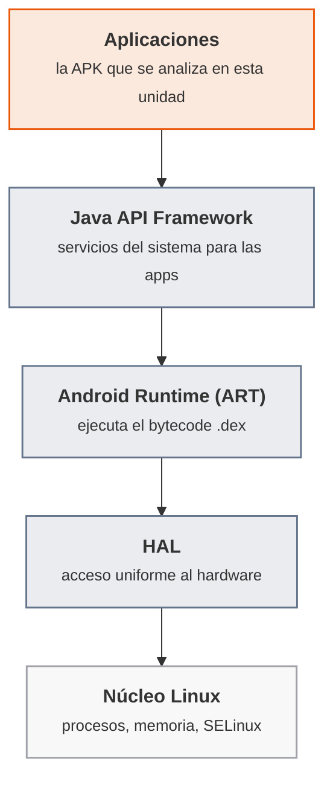
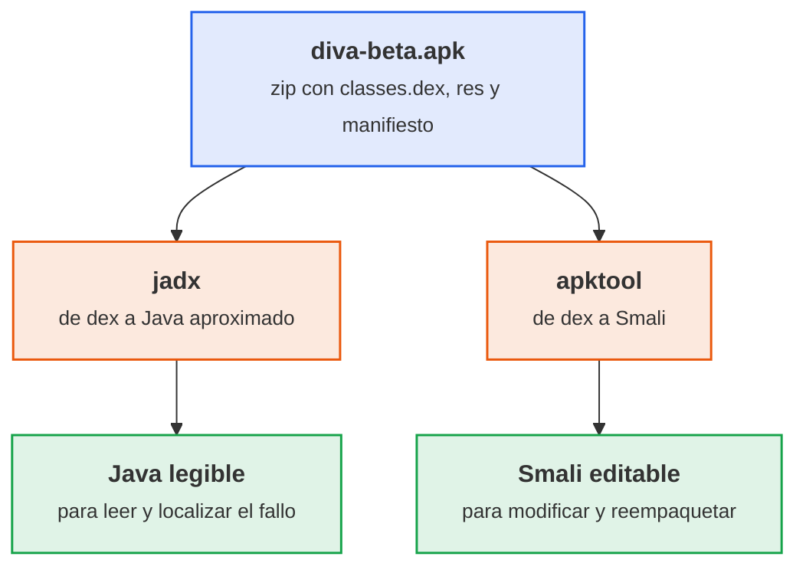
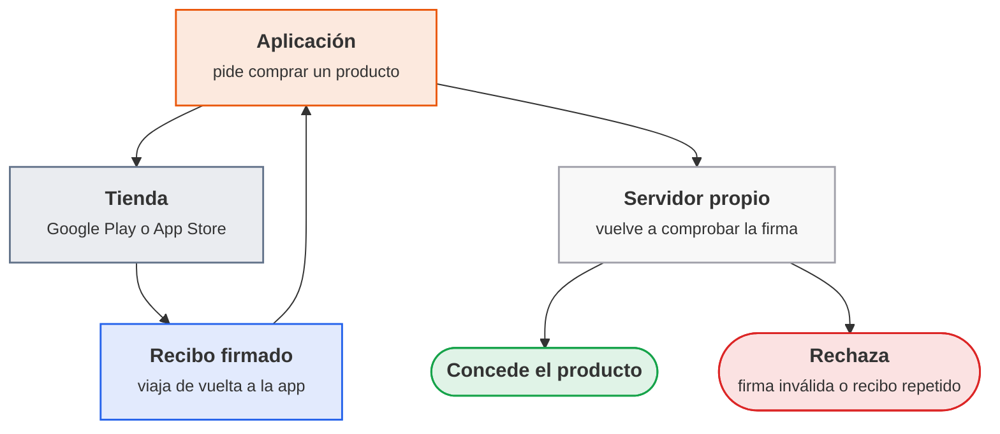

# UT4 · Aplicaciones móviles

<p class="ut-meta">16 h · Sesiones 29 a 36 · RA4 CE a, b, c, d, e</p>

Una aplicación de móvil no vive en un servidor controlado: vive en el dispositivo de quien la instala, con el código dentro del alcance de quien quiera abrirlo. Lo que en una aplicación web es un servidor que nadie más toca es aquí un archivo `.apk` que cualquiera puede descomprimir, descompilar y leer. Esta unidad trabaja con esa idea de fondo: qué modelo de permisos y de firma tienen Android e iOS, qué acaba guardado sin cifrar en el dispositivo, qué protocolo usa la aplicación para hablar con su servidor y qué queda expuesto dentro del binario. Las herramientas son las del análisis de aplicaciones móviles: un emulador Android, `adb` para hablar con él, `jadx` y `apktool` para leer y modificar el código, Burp Suite como proxy de interceptación y Drozer para probar los componentes que una aplicación expone a las demás. Son ocho sesiones (siete de trabajo y una de margen) y dos entregas evaluables, ACT_UT4_1 y ACT_UT4_2, con plazo el 15 y el 25 de febrero. Cada entrega tiene en el aula su enunciado en PDF: «ACT_RA4_1. Android App Vulnerable», cuyo único punto (3.1, ingeniería inversa) remite a una guía en línea sobre DIVA, y «ACT_RA4_2. Purposefully Insecure and Vulnerable Android Application», que remite al «Taller de ejercicios de vulnerabilidades en aplicaciones móviles» (`Lab_Movil.pdf`, adjunto en la misma tarea). **El PDF es el que manda**: las hojas que alimentan una entrega siguen su numeración y dicen en cada paso a qué punto responden, y lo que una hoja añade por su cuenta va en su ejercicio «Extra (opcional)», que en el PDF solo cuenta como «Extra». Las hojas A4.2, A4.4, A4.5 y A4.7 no las pide ningún enunciado: son la práctica de los CE a, b, d y c, que entran en el examen del 3 de junio.

!!! ojo "Solo sobre las aplicaciones del laboratorio"
    Todo lo que se hace en esta unidad (descompilar, extraer credenciales, interceptar tráfico, explotar un componente exportado) se hace únicamente sobre las aplicaciones deliberadamente vulnerables del laboratorio (DIVA, PIVAA, InsecureBankv2), instaladas en el emulador propio y en una red aislada del resto del aula. Hacer lo mismo sobre una aplicación real sin autorización escrita de quien la publica es acceso sin autorización a un sistema ajeno, delito tipificado en el artículo 197 bis del Código Penal. El criterio es siempre el mismo: solo sobre lo propio o sobre lo que autoriza por escrito quien lo posee.

Lo que va más allá de lo que se hace en clase (ampliaciones, otras herramientas y enlaces para seguir) está en [Para ampliar](../ampliacion.md#ut4-aplicaciones-moviles).

## Sesión 29 · Arquitectura de Android y OWASP Mobile

<p class="ut-meta" markdown>1 de febrero · Teoría y práctica · <span class="dur" tabindex="0" aria-label="Arquitectura de Android e iOS · 10 min&#10;Estructura de un APK y OWASP Mobile Top 10 · 15 min&#10;A4.1 Laboratorio móvil · 85 min" data-dur="Arquitectura de Android e iOS · 10 min&#10;Estructura de un APK y OWASP Mobile Top 10 · 15 min&#10;A4.1 Laboratorio móvil · 85 min">:material-school:<i class="dur-barra" style="--teoria:23%"></i>:material-flask:</span></p>

Al acabar esta sesión existe `movil01`, el dispositivo Android del laboratorio, con las dos aplicaciones de trabajo de la unidad instaladas, y el puesto de administración tiene `adb`, `jadx` y `apktool` listos para desempaquetarlas. Antes de tocar el emulador se ve cómo está construido un sistema Android o iOS por capas y qué contiene el archivo `.apk` que se va a desempaquetar, y se cierra con las diez categorías del OWASP Mobile Top 10, que da el vocabulario que se usa el resto de la unidad para nombrar lo que se encuentra.

!!! consulta "Recursos de la sesión"
    **Para la práctica**

    - [OWASP Mobile Top 10](https://owasp.org/www-project-mobile-top-10/) y [OWASP MAS](https://mas.owasp.org/): los riesgos y el estándar de verificación móvil.
    - [Genymotion](https://www.genymotion.com/download/): el emulador de Android del laboratorio.
    - El capítulo 1, «Instalación del entorno», del taller `Lab_Movil.pdf` (adjunto a la tarea ACT_UT4_2): es el montaje que hace esta hoja.

### Arquitectura de Android e iOS

Android se apoya en un núcleo Linux. Sobre él, una capa de abstracción de hardware (HAL) da acceso uniforme a la cámara, el sensor o el módem sin que cada fabricante tenga que reescribir el sistema entero; encima corre el Android Runtime (ART, el sucesor de la antigua máquina virtual Dalvik), que ejecuta el bytecode de las aplicaciones; y sobre el runtime, el Java API Framework expone a cada aplicación los servicios del sistema (gestión de actividades, notificaciones, ubicación, listas de contactos) a través de una API común.



<p class="pie" markdown>Las capas de Android de arriba abajo: cada aplicación solo ve el framework, y este se apoya en el runtime, la abstracción de hardware y el núcleo.</p>

iOS se apoya en un núcleo derivado de BSD (la misma familia que macOS) y solo se instala en hardware de Apple. Las aplicaciones acceden a un conjunto fijo de frameworks (UIKit, CFNetwork, Core Data) y sus datos van cifrados por defecto, sin la variedad de fabricantes de Android.

| | Android | iOS |
|---|---|---|
| Núcleo | Linux | Derivado de BSD (macOS) |
| Licencia y hardware | Abierta (Apache 2.0), x86 y ARM | Privada, solo ARM y solo Apple |
| Cifrado de datos | Nativo, activable | Activado por defecto (APFS) |

Las dos plataformas separan una zona de solo lectura con el sistema y las aplicaciones de fábrica y una zona de datos de usuario. Es la de datos la que interesa aquí: ahí una aplicación mal escrita deja credenciales, bases de datos o preferencias sin cifrar.

### Estructura de un APK y OWASP Mobile Top 10

Un APK (paquete de aplicación Android, del inglés *Android Application Package*) es un archivo `.zip` con esta estructura, que se ve tal cual al descomprimirlo:

- `AndroidManifest.xml`: qué necesita la aplicación para instalarse y ejecutarse (versión mínima de Android, permisos que va a pedir, componentes que declara).
- `classes.dex`: el código compilado, en formato ejecutable Dalvik.
- `res/` y `resources.arsc`: los recursos (layouts, cadenas de texto, imágenes) sin compilar y compilados.
- `assets/`: recursos adicionales que la aplicación lee directamente, sin pasar por el sistema de recursos de Android.
- `lib/`: librerías nativas (código en C o C++ compilado para cada arquitectura), cuando la aplicación las usa.
- `META-INF/`: el certificado y la firma de la aplicación.

El proceso de creación es el inverso al del análisis de esta unidad: el código fuente en Java o Kotlin se compila a `.class`, se transforma a bytecode `.dex`, y ese `.dex` junto con los recursos y el manifiesto se empaqueta y se firma. Deshacer ese camino, de `.dex` a código legible, es la ingeniería inversa: se practica en la sesión 31, el 8 de febrero, sobre una aplicación vulnerable.

El [OWASP Mobile Top 10](https://owasp.org/www-project-mobile-top-10/) agrupa los fallos más comunes en diez categorías. La unidad usa la numeración de la edición de 2016, que es la que sigue reflejando el reparto de los criterios de evaluación. La web de OWASP publica hoy la edición de 2024, que reordena y renombra las categorías; la última columna da la correspondencia para poder leerla. No se explican todas con el mismo detalle: esta unidad trabaja a fondo M2, M3 y M9, toca M1 y M8 de pasada y deja enunciadas las demás para reconocerlas si aparecen.

| Categoría (2016) | En una frase | Dónde aparece en esta unidad | Edición 2024 |
|---|---|---|---|
| M1. Uso indebido de la plataforma | No usar, o usar mal, las características de seguridad que ya da el sistema (permisos, componentes exportados) | En la lectura de permisos y componentes de la A4.2 | M8, configuración de seguridad incorrecta |
| M2. Almacenamiento inseguro de datos | Guardar datos sensibles sin cifrar, en preferencias, bases de datos o ficheros | El fallo central de la A4.4 | M9 |
| M3. Comunicación insegura | Enviar datos sin cifrar o con un cifrado débil entre la aplicación y su servidor | El fallo central de la A4.5 | M5 |
| M4. Autenticación insegura | Sesiones que no caducan, contraseñas cortas, autenticación que se puede evitar | Se reconoce en la actividad `PostLogin` de InsecureBankv2 (sesión 36) | M3 |
| M5. Cifrado insuficiente | Usar algoritmos débiles o implementarlos mal | Se contrasta con el uso correcto de HMAC en la A4.7 | M10 |
| M6. Autorización insegura | Fallos en el control de qué puede hacer cada usuario ya identificado | Fuera del alcance práctico de esta unidad | M3 |
| M7. Calidad del código del cliente | Errores de programación explotables (desbordamientos, fugas de memoria) | Fuera del alcance práctico de esta unidad | M4 |
| M8. Manipulación de código | Modificar una aplicación y redistribuirla con código añadido | Se practica en la A4.3 al reempaquetar y volver a firmar DIVA | M7 |
| M9. Ingeniería inversa | Analizar el binario para entender o modificar su funcionamiento | El método de trabajo de las sesiones 31 y 34 | M7 |
| M10. Funcionalidad inesperada | Código de pruebas o en desarrollo que queda expuesto en la versión final | Se reconoce en los componentes exportados de PIVAA (A4.6) | M8 |

### A4.1 Laboratorio móvil (sesión 29)

<span class="et et-obj">Objetivo</span> Montar el emulador `movil01` visible desde `pps01`, con DIVA e InsecureBankv2 instaladas y desempaquetadas. Cubre el capítulo 1 de `Lab_Movil.pdf` (punto 1 de ACT_UT4_2, plazo el 25 de febrero) y la instalación y el descompilado del 3.1 de ACT_UT4_1 (plazo el 15 de febrero). Las demás hojas de la unidad trabajan sobre este laboratorio.

<span class="et et-pre">Antes de empezar</span> `pps01` con Docker e Internet, una cuenta personal de Genymotion ya verificada (créala el día anterior: la activación tarda) y `APK_1.zip` y `APK_2.zip` de Aules descomprimidos en `~/laboratorio-movil/apk/`. Teoría: [arquitectura de Android e iOS](#arquitectura-de-android-e-ios) y [estructura de un APK](#estructura-de-un-apk-y-owasp-mobile-top-10).

<span class="et et-pas">Ejercicios</span> Trabaja en `~/pps-entregas/ut4/a41/` y documenta en su `README.md`, con una captura por ejercicio.

1. **Genymotion (Lab_Movil, 1.2).** Instálalo en el equipo del aula, sobre el mismo VirtualBox que aloja `pps01`, con la licencia de uso personal.
2. **Dispositivo virtual (Lab_Movil, 1.3).** Crea `movil01` (API 23, Google Nexus 5X) en el adaptador solo anfitrión que usa `pps01` y arráncalo.
3. **Herramientas (Lab_Movil, 1.1).** Instala en `pps01` `apktool`, `apksigner` y `sqlite3`, y `jadx` en `~/jadx`. Donde el taller dice Kali, aquí es `pps01`.
4. **Conexión con ADB (Lab_Movil, nota de 2.2.1).** Conecta desde `pps01` por TCP/IP hasta que `adb devices` muestre `movil01` como `device`. Genymotion le da la IP por DHCP, así que puede no ser la `.60` de las [convenciones](../laboratorio.md#maquinas-virtuales).
5. **Aplicaciones (Lab_Movil, 1.3, y ACT_RA4_1, 3.1).** Instala DIVA e InsecureBankv2 en `movil01` y abre cada una para comprobar que arranca.
6. **Desempaquetado (ACT_RA4_1, 3.1).** Desempaqueta con `apktool` las dos APK en `~/laboratorio-movil/diva/smali` y `~/laboratorio-movil/insecurebank/smali`, y DIVA además con `jadx` en `~/laboratorio-movil/diva/java`. Deja en el README el listado de `~/laboratorio-movil/`.

## Sesión 30 · Permisos, firma y verificación

<p class="ut-meta" markdown>4 de febrero · Teoría y práctica · <span class="dur" tabindex="0" aria-label="Modelo de permisos · 15 min&#10;Firma y verificación de aplicaciones · 10 min&#10;A4.2 Permisos y firma · 85 min" data-dur="Modelo de permisos · 15 min&#10;Firma y verificación de aplicaciones · 10 min&#10;A4.2 Permisos y firma · 85 min">:material-school:<i class="dur-barra" style="--teoria:23%"></i>:material-flask:</span></p>

Al acabar esta sesión hay una tabla propia con los permisos de DIVA y de InsecureBankv2 clasificados por riesgo, sus componentes exportados localizados en el manifiesto, y la firma de cada APK verificada con su emisor anotado. Antes del laboratorio se ve cómo Android e iOS deciden si una aplicación puede usar la cámara o el almacenamiento externo, y qué significa que una aplicación esté firmada.

!!! consulta "Recursos de la sesión"
    **Para la práctica**

    - [Permisos en Android](https://developer.android.com/guide/topics/permissions/overview) y [`apksigner`](https://developer.android.com/studio/command-line/apksigner): permisos y verificación de firma.

### Modelo de permisos

En Android cada permiso protegido pertenece a uno de dos niveles: **normal** (bajo riesgo, se concede solo con declararlo en el manifiesto: acceso a Internet, vibración) o **peligroso** (acceso a datos o funciones sensibles: cámara, ubicación, contactos, SMS, almacenamiento). Desde Android 6.0 los permisos peligrosos se piden en tiempo de ejecución, la primera vez que la aplicación los necesita, y el usuario puede revocarlos después sin desinstalar nada. Además de los permisos, Android aísla cada aplicación en su propia máquina virtual con un identificador de usuario Unix propio (el sandbox se apoya en SELinux), de modo que una aplicación no puede leer los ficheros de otra aunque no pida ningún permiso especial para intentarlo.

iOS no clasifica los permisos en normal o peligroso: casi todo acceso a un recurso sensible (cámara, ubicación, contactos, fotos) exige autorización explícita del usuario la primera vez que la aplicación lo pide, con un diálogo del sistema que la aplicación no puede evitar ni personalizar del todo. El aislamiento es por directorio: cada aplicación recibe una carpeta propia y solo puede leer y escribir en ella salvo que pida acceso a algo externo, y corre con un usuario del sistema de bajos privilegios.

| | Android | iOS |
|---|---|---|
| Concesión | En la instalación (normales) o en tiempo de ejecución (peligrosos) | Siempre en tiempo de ejecución, con diálogo del sistema |
| Revocación | El usuario la revoca en cualquier momento desde Ajustes | Igual, desde Ajustes |
| Aislamiento | Máquina virtual por aplicación, con user ID propio, sobre SELinux | Directorio propio por aplicación, usuario del sistema de bajos privilegios |
| Comunicación entre aplicaciones | Intents, content providers | Esquemas de URL, extensiones de aplicación, AirDrop |

Los componentes de una aplicación Android (actividades, servicios, receptores de emisiones y proveedores de contenido) pueden declararse `exported`, lo que los hace visibles para otras aplicaciones del dispositivo. Un componente exportado sin permiso propio es una puerta abierta: cualquier aplicación instalada puede llamarlo. Localizarlos en el manifiesto es el primer paso del taller de PIVAA, el 18 de febrero.

### Firma y verificación de aplicaciones

Tanto Android como iOS exigen que una aplicación esté firmada antes de poder instalarse. En Android el certificado puede ser autofirmado: no certifica la identidad real del desarrollador, pero sí que todas las versiones de una misma aplicación vienen de la misma clave privada, lo que permite actualizarla sin perder sus datos y comprobar que una APK no se ha manipulado después de firmarla. En iOS la firma tiene que emitirla la propia autoridad de certificación de Apple, un control más estricto que en la práctica exige pasar por su proceso de publicación.

Verificar la firma de una APK dice dos cosas: que el fichero no se ha modificado desde que se firmó, y quién dice haberla firmado (aunque sea un certificado autofirmado, sin garantía de identidad real). Es lo que hace la A4.2 con `apksigner verify`, que entiende los esquemas de firma de Android y se instala solo, sin el SDK completo, con el paquete `apksigner` de Ubuntu. Las aplicaciones de este laboratorio usan solo el esquema clásico (v1, basado en JAR), con huellas SHA-1 de los ficheros y un certificado autofirmado (DIVA lleva el de depuración, `CN=Android Debug`): que estén firmadas no las hace de fiar, y ese detalle es un hallazgo que se anota. `jarsigner -verify` no sirve aquí: con los JDK actuales trata como no firmadas las APK con SHA-1 anterior a 2019, aunque la firma sea válida en Android.

### A4.2 Permisos y firma (sesión 30)

<span class="et et-obj">Objetivo</span> Clasificar los permisos de DIVA y de InsecureBankv2, localizar sus componentes exportados y verificar la firma de las dos APK. Es la práctica del CE a: no la pide ningún enunciado y entra en el examen del 3 de junio; si la documentas, puede ir en el capítulo «Extra» de ACT_UT4_1.

<span class="et et-pre">Antes de empezar</span> `movil01` y `~/laboratorio-movil/` con las dos aplicaciones desempaquetadas ([A4.1](#a41-laboratorio-movil-sesion-29)). Teoría: [modelo de permisos](#modelo-de-permisos) y [firma y verificación de aplicaciones](#firma-y-verificacion-de-aplicaciones).

<span class="et et-pas">Ejercicios</span> Trabaja sobre los dos `AndroidManifest.xml` que dejó `apktool` y contesta en `~/pps-entregas/ut4/a42/README.md`.

1. **Permisos.** Monta una tabla con los `uses-permission` de cada aplicación: permiso, nivel (`normal` o `dangerous`) y para qué lo usa según su código.
2. **Componentes exportados.** Lista los componentes exportados de las dos aplicaciones y marca los que no declaran `android:permission`. En aplicaciones de esta época, un componente con `<intent-filter>` y sin atributo `exported` también queda exportado.
3. **Android frente a iOS.** Completa la tabla comparativa de la teoría con un permiso peligroso y un componente exportado de estas aplicaciones, y una frase de qué pasaría en iOS con cada uno.
4. **Firma.** Verifica la firma de las dos APK con `apksigner` y anota el emisor, los esquemas verificados y cualquier aviso de algoritmo débil o de certificado de depuración.

## Sesión 31 · Análisis estático de una aplicación vulnerable

<p class="ut-meta" markdown>8 de febrero · Teoría y práctica · <span class="dur" tabindex="0" aria-label="Ingeniería inversa: de APK a código legible · 20 min&#10;A4.3 DIVA: análisis estático · 90 min" data-dur="Ingeniería inversa: de APK a código legible · 20 min&#10;A4.3 DIVA: análisis estático · 90 min">:material-school:<i class="dur-barra" style="--teoria:18%"></i>:material-flask:</span></p>

Al acabar esta sesión está hecho el punto 3.1 de ACT_UT4_1, la ingeniería inversa de DIVA: su código leído en Java y una copia de la aplicación con el texto de bienvenida modificado en el Smali, reempaquetada, firmada con una clave propia e instalada en `movil01` en lugar de la original. Antes de entrar en DIVA se ve el método: cómo se pasa del bytecode `.dex` que trae la APK a algo que se puede leer, y las dos herramientas que hacen ese camino de forma distinta.

!!! consulta "Recursos de la sesión"
    **Para la práctica**

    - [DIVA](https://github.com/payatu/diva-android): la aplicación vulnerable; su `README` lista los trece retos.
    - El enunciado «ACT_RA4_1. Android App Vulnerable», en la tarea ACT_UT4_1 del aula. Su punto 3.1 remite a la guía [Ingeniería inversa en Android](https://psegarrac.github.io/Ciberseguridad-PePS/tema6/seguridad/m%C3%B3vil/2022/03/01/Ingenieria-inversa.html), que es la que sigue la hoja.

### Ingeniería inversa: de APK a código legible



<p class="pie" markdown>El mismo `classes.dex` da dos resultados distintos según lo que se necesite: leer o modificar.</p>

`jadx` reconstruye código Java a partir del bytecode Dalvik: el resultado es aproximado (los nombres de variable pueden perderse, y el código no siempre recompila), pero es el más cómodo para leer y entender qué hace una aplicación, que es lo que hace falta en esta sesión. `apktool` va un paso más allá: desensambla a Smali, un lenguaje intermedio legible pero mucho más verboso que Java, pensado para poder modificarse y volver a empaquetarse en una APK nueva (con `apktool build`) que después hay que volver a firmar para poder instalarla. Cuando el objetivo es solo leer, `jadx` basta y sobra; cuando hace falta cambiar algo de la aplicación, como en la A4.3, `apktool` es la herramienta.

La guía de ingeniería inversa del enunciado de ACT_UT4_1 hace la lectura en dos pasos, con herramientas más antiguas que dan el mismo resultado: `dex2jar` convierte el `.dex` en un `.jar` de clases Java y `jd-gui` lo muestra como código. `jadx` hace las dos cosas a la vez, y por eso es el que se usa en el laboratorio. Para firmar la APK modificada la guía usa `uber-apk-signer`, que alinea y firma con una clave de depuración en una sola orden; el laboratorio usa `keytool` y `apksigner`, del paquete de Ubuntu, con una clave propia. Cualquiera de las dos parejas vale para la entrega, siempre que el PDF diga cuál se ha usado.

Dos límites: el código puede venir ofuscado (nombres sustituidos por letras sueltas, lo que dificulta la lectura sin impedirla), y las librerías nativas en C o C++ no pasan por `jadx` ni por `apktool` y exigen herramientas de análisis de binarios.

### A4.3 DIVA: análisis estático (sesión 31)

<span class="et et-obj">Objetivo</span> Leer el código de DIVA, cambiar su texto de bienvenida y reinstalarla reempaquetada y firmada. Con la A4.1 completa el punto 3.1 de ACT_UT4_1, con plazo el 15 de febrero.

<span class="et et-pre">Antes de empezar</span> `~/laboratorio-movil/diva/` con los árboles `java` y `smali`, y `movil01` con DIVA ([A4.1](#a41-laboratorio-movil-sesion-29)). Ten abierta la guía del punto 3.1. Teoría: [de APK a código legible](#ingenieria-inversa-de-apk-a-codigo-legible).

<span class="et et-pas">Ejercicios</span> Trabaja en `~/pps-entregas/ut4/a43/` y documenta cada ejercicio en su `README.md` con su captura. No subas el `.jks` al repositorio.

1. **Lectura del código (3.1).** Localiza en el código Java el paquete `jakhar.aseem.diva`, la actividad principal y una actividad de reto, y anota qué se entiende y qué se ha perdido respecto al código fuente.
2. **Recursos (3.1).** Cambia en el árbol `smali` el texto de la clave `dintro` de `res/values/strings.xml` y guarda una copia del fichero modificado en la carpeta.
3. **Reempaquetado (3.1).** Reconstruye la APK con `apktool` como `DivaModificada.apk`.
4. **Firma (3.1).** Firma la APK con una clave propia (`keytool` y `apksigner`, o `uber-apk-signer` como la guía) y guarda la salida de `apksigner verify --print-certs`.
5. **Instalación (3.1).** Instala la APK firmada en lugar de la original y captura la pantalla de bienvenida con el texto nuevo.
6. **Extra (opcional).** Localiza en el código tres fallos de DIVA (por ejemplo, en `HardcodeActivity`, `LogActivity` y `APICredsActivity`), cada uno con su línea, su prueba en `movil01` y una corrección concreta.

## Sesión 32 · Almacenamiento de datos y fugas de información

<p class="ut-meta" markdown>11 de febrero · Teoría y práctica · <span class="dur" tabindex="0" aria-label="Almacenamiento seguro en el dispositivo · 15 min&#10;Fugas por registros y copias de seguridad · 10 min&#10;A4.4 DIVA: almacenamiento · 85 min" data-dur="Almacenamiento seguro en el dispositivo · 15 min&#10;Fugas por registros y copias de seguridad · 10 min&#10;A4.4 DIVA: almacenamiento · 85 min">:material-school:<i class="dur-barra" style="--teoria:23%"></i>:material-flask:</span></p>

Al acabar esta sesión hay, para cada uno de los cuatro mecanismos de almacenamiento inseguro de DIVA (preferencias, base de datos, fichero temporal y almacenamiento externo), el dato encontrado en claro y la alternativa segura que correspondería, y comprobadas la fuga por registro y la copia de seguridad automática. Antes de entrar en la aplicación se ve dónde puede guardar datos una aplicación Android y cuál de esos sitios está pensado para un secreto y cuál no.

!!! consulta "Recursos de la sesión"
    **Para la práctica**

    - [Almacenamiento de datos en Android](https://developer.android.com/training/data-storage) y [DIVA](https://github.com/payatu/diva-android): los retos de almacenamiento inseguro.

### Almacenamiento seguro en el dispositivo

Este apartado recorre los sitios donde una aplicación Android puede guardar datos y cuál corresponde a cada tipo de dato, que es lo que pide describir el CE b.

- **SharedPreferences.** Pares clave-valor en un XML dentro del directorio privado de la aplicación. Cómodo para ajustes (idioma, tema), inseguro para credenciales: cualquiera con acceso al dispositivo (root, una copia de seguridad, una aplicación con el mismo user ID en dispositivos antiguos) lo lee en texto plano.
- **Bases de datos SQLite.** Igual de accesibles que las SharedPreferences si no se cifran: SQLite no cifra por defecto, así que una contraseña guardada en una tabla está tan expuesta como en un XML.
- **Almacenamiento interno (ficheros privados de la aplicación).** Un directorio propio al que solo llega la aplicación en condiciones normales, pero no cifrado por sí mismo: sigue en claro para quien tenga acceso físico o root.
- **Almacenamiento externo (tarjeta SD o partición compartida).** El peor sitio para un dato sensible: es legible por cualquier aplicación con permiso de lectura de almacenamiento, y en muchos dispositivos ni siquiera exige ese permiso para las rutas propias de la aplicación.
- **Keystore de Android.** El único de la lista pensado para secretos: guarda claves criptográficas en un área protegida por hardware cuando el dispositivo lo soporta, fuera del alcance de la propia aplicación y de la mayoría de ataques con root. No guarda el dato en sí, sino la clave con la que cifrarlo; el dato cifrado sí puede vivir en SharedPreferences o en SQLite.

| Tipo de dato | Sitio correcto | Por qué no vale un XML sin cifrar |
|---|---|---|
| Contraseña o token de sesión | Cifrado con una clave del Keystore, o no se guarda y se pide de nuevo | Una copia del dispositivo o el acceso con root lo expone entero |
| Ajustes sin valor para un atacante (idioma, tema) | SharedPreferences en claro | No hace falta protegerlo: no es un dato sensible |
| Caché de datos personales (mensajes, contactos) | Base de datos cifrada (SQLCipher u otra) | Expone datos de terceros, no solo del propio usuario |
| Clave de cifrado | Keystore | Es lo único diseñado para eso: guardar la clave, no el dato |

### Fugas por registros y copias de seguridad

Este apartado cierra el bloque de almacenamiento con dos salidas por donde un dato puede escapar sin que nadie lo haya guardado a propósito en un sitio inseguro: el log del sistema y las copias de seguridad automáticas.

El log del sistema Android (accesible con `adb logcat` sin necesitar permisos especiales sobre un dispositivo de desarrollo) recoge todo lo que cualquier aplicación escribe con las funciones de depuración. Un `Log.d("login", "usuario=" + user + " clave=" + pass)` dejado en una versión de producción por error es una fuga tan real como una base de datos sin cifrar, y es uno de los fallos más repetidos en aplicaciones reales: se escribe para depurar y se olvida quitar.

Las copias de seguridad automáticas de Android (activadas por defecto salvo que la aplicación las excluya con `android:allowBackup="false"` en el manifiesto) incluyen, salvo que se configure lo contrario, los ficheros del directorio privado de la aplicación. Una aplicación que guarda un token en claro en sus preferencias lo está exportando también a cualquier copia de seguridad en la nube o en un ordenador, ampliando el número de sitios donde ese dato queda expuesto.

### A4.4 DIVA: almacenamiento (sesión 32)

<span class="et et-obj">Objetivo</span> Encontrar en `movil01` los datos que DIVA deja sin proteger en sus cuatro retos de «Insecure Data Storage», en el registro y en la copia de seguridad, y proponer la alternativa segura de cada caso. Es la práctica del CE b: no la pide ningún enunciado y entra en el examen del 3 de junio; si la documentas, puede ir en el capítulo «Extra» de ACT_UT4_1.

<span class="et et-pre">Antes de empezar</span> `movil01` con DIVA ([A4.1](#a41-laboratorio-movil-sesion-29), o la modificada de la [A4.3](#a43-diva-analisis-estatico-sesion-31)) conectado por ADB. Teoría: [almacenamiento seguro en el dispositivo](#almacenamiento-seguro-en-el-dispositivo) y [fugas por registros y copias de seguridad](#fugas-por-registros-y-copias-de-seguridad).

<span class="et et-pas">Ejercicios</span> Trabaja en `~/pps-entregas/ut4/a44/`. En cada reto guarda en DIVA un usuario y una contraseña inventados y búscalos desde `pps01`.

1. **Preferencias (Part 1).** Encuentra el dato en el directorio privado de `jakhar.aseem.diva`.
2. **Base de datos (Part 2).** Trae la base de datos a `pps01` y consúltala con `sqlite3`.
3. **Fichero temporal (Part 3).** Encuentra y lee el fichero que crea el reto.
4. **Almacenamiento externo (Part 4).** Encuentra el fichero en la tarjeta SD. Si el reto responde «File error occurred», concede a DIVA el permiso de almacenamiento: en Android 6 se concede en ejecución.
5. **Registro y copias de seguridad.** Busca en el registro el número de tarjeta del reto «Insecure Logging» y la línea de `LogActivity` que lo escribe, y anota el valor de `allowBackup` del manifiesto.
6. **Tabla.** Una fila por mecanismo, seis en total: dato encontrado, dónde, en qué formato y qué alternativa segura de la teoría le corresponde.

## Sesión 33 · Análisis del tráfico de una aplicación

<p class="ut-meta" markdown>15 de febrero · Teoría y práctica · <span class="dur" tabindex="0" aria-label="Proxy de interceptación en el emulador · 10 min&#10;Protocolos inseguros y cómo se detectan · 10 min&#10;A4.5 Tráfico de una aplicación · 90 min" data-dur="Proxy de interceptación en el emulador · 10 min&#10;Protocolos inseguros y cómo se detectan · 10 min&#10;A4.5 Tráfico de una aplicación · 90 min">:material-school:<i class="dur-barra" style="--teoria:18%"></i>:material-flask:</span></p>

Al acabar esta sesión Burp Suite está configurado como proxy de `movil01`, con su certificado de CA instalado en el emulador, y hay una captura del tráfico HTTP en claro que genera InsecureBankv2 contra su propio servidor con la contraseña visible en la petición. Antes de tocar el emulador se ve qué es un proxy de interceptación y por qué HTTP sigue apareciendo en aplicaciones móviles a pesar de que HTTPS es el estándar desde hace años.

!!! consulta "Recursos de la sesión"
    **Para la práctica**

    - [Proxy de Burp Suite](https://portswigger.net/burp/documentation/desktop/tools/proxy/using) e [InsecureBankv2](https://github.com/dineshshetty/Android-InsecureBankv2): interceptar el tráfico de la aplicación.

### Proxy de interceptación en el emulador

Este apartado explica el mecanismo que hace visible el tráfico de una aplicación móvil: ponerse en medio, con el consentimiento del propio dispositivo.

Un proxy de interceptación como Burp Suite se sitúa entre el cliente (la aplicación en `movil01`) y el servidor, y muestra o modifica cada petición y cada respuesta que pasa por él. Para que funcione con HTTP basta con configurar la IP y el puerto del proxy en la conexión Wi-Fi del emulador; para que funcione con HTTPS, además, el dispositivo tiene que confiar en el certificado con el que Burp firma sus conexiones sobre la marcha, porque si no, la aplicación (o el propio sistema) rechaza la conexión por no reconocer esa autoridad de certificación.

El certificado de Burp se instala como una CA de usuario en el almacén de confianza del sistema. Desde Android 7 (API 24), una aplicación cuyo `targetSdkVersion` sea 24 o superior deja de confiar por defecto en las CA de usuario: solo confía en las del sistema, salvo que declare explícitamente lo contrario en su `network_security_config`. Es el fallo típico al montar este laboratorio con un dispositivo o aplicación más recientes que los de este curso: el certificado se instala sin error, pero la aplicación sigue rechazando la conexión porque no lo consulta. Las aplicaciones de esta unidad, escritas entre 2016 y 2021 con un `targetSdkVersion` anterior a ese cambio, sí confían en la CA de usuario sin configuración adicional, que es lo que permite verlas hoy sin más pasos.

### Protocolos inseguros y cómo se detectan

Este apartado cierra la teoría del día con qué se busca exactamente al mirar el tráfico capturado.

Detectar un protocolo inseguro en una captura de proxy es, en la mayoría de los casos, tan directo como mirar el esquema de la URL: una petición `http://` en lugar de `https://` viaja sin cifrar, y cualquiera en la misma red (otro dispositivo, un punto de acceso comprometido) puede leerla o modificarla. Dentro de una petición HTTP en claro, lo que interesa localizar son los datos sensibles del cuerpo o de las cabeceras: credenciales en un formulario de login, un token de sesión en una cabecera `Authorization`, datos personales en un JSON de respuesta. La categoría M3 del OWASP Mobile Top 10 (comunicación insegura) agrupa este fallo junto con el uso de cifrados débiles o de versiones obsoletas de TLS, que no se cubren en el laboratorio de esta unidad pero sí se reconocen: el criterio para todos es el mismo, cifrado moderno y certificado válido de un extremo a otro.

### A4.5 Tráfico de una aplicación (sesión 33)

<span class="et et-obj">Objetivo</span> Capturar con Burp Suite el login de InsecureBankv2 contra su servidor y ver la contraseña en claro. Es la práctica del CE d: no la pide ningún enunciado y entra en el examen del 3 de junio; si la documentas, puede ir en el capítulo «Extra» de ACT_UT4_2.

<span class="et et-pre">Antes de empezar</span> `movil01` con InsecureBankv2 ([A4.1](#a41-laboratorio-movil-sesion-29)) y Burp Suite Community en `pps01` ([puesto de trabajo](../laboratorio.md#puesto-de-trabajo)). Teoría: [proxy de interceptación en el emulador](#proxy-de-interceptacion-en-el-emulador) y [protocolos inseguros](#protocolos-inseguros-y-como-se-detectan).

<span class="et et-pas">Ejercicios</span> Trabaja en `~/pps-entregas/ut4/a45/` y contesta en su `README.md`.

1. **Servidor.** Deja descargando en segundo plano las imágenes de la sesión siguiente, `opensecurity/mobile-security-framework-mobsf` y `drozerdocker/drozer:2.4.4`. Clona `dineshshetty/Android-InsecureBankv2`, escribe un `Dockerfile` sobre `python:2` que instale `AndroLabServer/requirements.txt` y lance `app.py` en el `8888`, y arráncalo como `insecurebank-server`.
2. **Aplicación contra su servidor.** Configura en InsecureBankv2 el servidor `192.168.56.10`, puerto `8888`, y comprueba en los registros del contenedor que llega un login de prueba.
3. **Proxy.** Pon Burp a escuchar en el `8085` en todas las interfaces y configura ese proxy en la Wi-Fi de `movil01`.
4. **Captura del login.** Repite el login y localiza la petición en `HTTP history`: método, URL con su esquema y credenciales tal como viajan.
5. **HTTPS.** Instala la CA de Burp en `movil01` como certificado de usuario y comprueba que una página `https://` aparece descifrada.
6. **Corrección.** En una frase, por qué la captura demuestra la categoría M3 del OWASP Mobile Top 10 y qué cambiaría en la aplicación para evitarlo.

## Sesión 34 · Taller PIVAA

<p class="ut-meta" markdown>18 de febrero · Teoría y práctica · <span class="dur" tabindex="0" aria-label="Cómo se organiza un taller de vulnerabilidades móviles · 10 min&#10;A4.6 PIVAA · 100 min" data-dur="Cómo se organiza un taller de vulnerabilidades móviles · 10 min&#10;A4.6 PIVAA · 100 min">:material-school:<i class="dur-barra" style="--teoria:9%"></i>:material-flask:</span></p>

Esta sesión es un taller guiado de principio a fin, el capítulo 2 de `Lab_Movil.pdf`, que es casi todo el PDF de ACT_UT4_2: al terminar hay respuesta a cada pregunta del taller sobre PIVAA, desde los dos fallos de su pantalla de login hasta sus tres componentes vulnerables (proveedor de contenido, servicio y receptor de emisiones), con el comando que explota cada uno y su captura. La teoría es solo cómo está organizado el taller, porque el resto de la sesión es trabajo guiado sobre una única aplicación.

!!! consulta "Recursos de la sesión"
    **Para la práctica**

    - [PIVAA](https://github.com/HTBridge/pivaa), [MobSF](https://hub.docker.com/r/opensecurity/mobile-security-framework-mobsf) y [Drozer](https://hub.docker.com/r/drozerdocker/drozer): la aplicación y las herramientas del taller.
    - El enunciado «ACT_RA4_2. Purposefully Insecure and Vulnerable Android Application», en la tarea ACT_UT4_2 del aula, y su adjunto, el «Taller de ejercicios de vulnerabilidades en aplicaciones móviles» (`Lab_Movil.pdf`): las preguntas exactas de cada punto están ahí.

### Cómo se organiza un taller de vulnerabilidades móviles

Este apartado da el mapa de la sesión antes de entrar en ella: qué hace cada herramienta y en qué orden se usan.

El taller sigue siempre el mismo patrón: primero un análisis automatizado con MobSF que da una lista de componentes y posibles fallos sin escribir ni un comando de explotación, y después Drozer, que ataca de verdad los componentes que MobSF ha señalado como exportados. MobSF corre en un contenedor en `pps01` y se usa desde el navegador; Drozer necesita dos piezas, un agente instalado en `movil01` (la APK `drozer-agent-2.3.4.apk` de los recursos de la unidad) y una consola en `pps01`, también en contenedor, que se conecta al agente por la red solo anfitrión. Entre las dos herramientas, el taller lee en el código que muestra MobSF la pantalla de login de PIVAA y explota sus dos fallos con ADB y Logcat, la herramienta de Android que vuelca el registro del sistema. Después repite tres veces el mismo ciclo (identificar el componente exportado con MobSF, atacarlo con el módulo de Drozer que corresponde, responder la pregunta del taller), sobre el proveedor de contenido, el servicio y el receptor de emisiones. El taller está escrito para una máquina Kali Linux; aquí ese papel lo hace `pps01`, y las imágenes de Docker que cita para Drozer ya no se pueden descargar, así que la hoja usa la oficial actual.

### A4.6 PIVAA (sesión 34)

<span class="et et-obj">Objetivo</span> Resolver el capítulo 2 de `Lab_Movil.pdf` sobre PIVAA con MobSF, ADB y Drozer, con cada pregunta del taller respondida y su captura. Son los puntos 2.1 a 2.5 de ACT_UT4_2, con plazo el 25 de febrero.

<span class="et et-pre">Antes de empezar</span> `movil01` conectado por ADB ([A4.1](#a41-laboratorio-movil-sesion-29)) y las imágenes de MobSF y de Drozer descargadas en la [A4.5](#a45-trafico-de-una-aplicacion-sesion-33). Ten abierto `Lab_Movil.pdf`. Teoría: [cómo se organiza el taller](#como-se-organiza-un-taller-de-vulnerabilidades-moviles).

<span class="et et-pas">Ejercicios</span> Trabaja en `~/pps-entregas/ut4/a46/` y responde en su `README.md`, con un apartado por punto del taller.

1. **Análisis previo (2.1).** Instala PIVAA y el agente de Drozer desde `~/laboratorio-movil/apk/APK_2/APKs`, analiza `pivaa.apk` con MobSF y localiza los tres componentes exportados, el manifiesto y el código.
2. **Login: el código (2.2).** Sigue el login hasta la clase `Authentication` y captura la línea vulnerable de `saveCache` y la función que escribe las credenciales en la tarjeta SD.
3. **Login: la explotación (2.2.1).** Con un login inventado, enseña el usuario y la contraseña en el registro y el contenido de `credentials.dat`.
4. **Proveedor de contenido (2.3).** Conecta la consola de Drozer al agente (puerto `31415`), consulta el proveedor de PIVAA y localiza el `rawQuery` de `DatabaseHelper.java`. La imagen del taller ya no existe: usa `drozerdocker/drozer:2.4.4`, que ya arranca `drozer`, así que la orden empieza en `console`.
5. **Servicio (2.4).** Identifica el servicio y sus atributos en el manifiesto y arráncalo con Drozer.
6. **Receptor de emisiones (2.5).** Relaciona el código del receptor con el que lo llama, envíale el intent del taller y explica con qué herramienta se ve el fichero que crea, con su contenido.
7. **Extra (opcional).** Para cada fallo del taller (los dos del login y los tres componentes), escribe qué cambio en el código o en el manifiesto lo evitaría.

## Sesión 35 · Compras integradas y CASB

<p class="ut-meta" markdown>22 de febrero · Teoría y práctica · <span class="dur" tabindex="0" aria-label="Validación de compras integradas · 10 min&#10;CASB · 10 min&#10;A4.7 Validación de compras en el servidor · 90 min" data-dur="Validación de compras integradas · 10 min&#10;CASB · 10 min&#10;A4.7 Validación de compras en el servidor · 90 min">:material-school:<i class="dur-barra" style="--teoria:18%"></i>:material-flask:</span></p>

Al acabar esta sesión hay un servidor propio que valida un recibo de compra simulado y concede el producto solo si la firma es correcta y el recibo no se ha usado antes. Antes de programarlo se ve por qué esa decisión no puede tomarla la propia aplicación, y se cierra con una pieza de control que aparece en el mismo terreno, la seguridad de las aplicaciones móviles corporativas: qué es un CASB.

!!! consulta "Recursos de la sesión"
    **Para la práctica**

    - [Verificación de compras en el servidor (Google)](https://developer.android.com/google/play/billing/security) y [App Store Server API (Apple)](https://developer.apple.com/documentation/appstoreserverapi): validar las compras en el servidor.

### Validación de compras integradas

Este apartado explica por qué una compra dentro de una aplicación no puede darse por buena porque la aplicación diga que lo es.



<p class="pie" markdown>El recibo pasa por la aplicación, pero quien decide si vale es siempre el servidor propio, no el cliente.</p>

Una compra integrada (una moneda de un juego, una suscripción, quitar anuncios) se resuelve técnicamente entre la aplicación y la tienda (Google Play o App Store), que devuelve un recibo firmado como prueba de que el pago se ha completado. El error, frecuente en aplicaciones mal construidas, es que sea la propia aplicación la que decida desbloquear el producto en cuanto recibe ese recibo: como toda la lógica corre en un dispositivo que el usuario controla, basta con modificar el código con la ingeniería inversa del análisis estático, o interceptar y reproducir la respuesta con el proxy de interceptación, para desbloquear el producto sin pagar. La única forma de que esa decisión sea de fiar es que la tome un sistema que el usuario no controla: el recibo viaja de la aplicación a un servidor propio, y es ese servidor, hablando directamente con la API de la tienda (o comprobando la firma del recibo con la clave pública que publica), el que decide si el producto se concede. En producción esa comprobación llama a la API de verificación de recibos de Google Play o de App Store; en el laboratorio de esta unidad se simula con un recibo propio firmado con una clave compartida, porque las dos plataformas exigen una cuenta de desarrollador de pago para emitir recibos reales.

### CASB

Este apartado cierra la teoría de la unidad con una pieza de control que pertenece al mismo terreno que la validación de compras: quién decide si una aplicación puede hablar con un servicio en la nube, y con qué condiciones.

Un CASB (intermediario de seguridad de acceso a la nube, del inglés *Cloud Access Security Broker*) es un servicio que se coloca entre los dispositivos de una organización y las aplicaciones en la nube que usan (correo, almacenamiento, mensajería), para aplicar de forma centralizada las políticas de seguridad de la organización sin depender de que cada aplicación las implemente por su cuenta. Sus funciones típicas son cuatro: visibilidad (qué aplicaciones en la nube usa realmente la plantilla, más allá de las autorizadas), control de acceso (bloquear una aplicación no aprobada o exigir autenticación reforzada para entrar en una que sí lo está), protección de datos (evitar que un fichero con datos sensibles salga hacia una aplicación no controlada) y detección de amenazas (patrones de acceso anómalos, como una descarga masiva fuera de horario). En el terreno de las aplicaciones móviles, un CASB es lo que permite a una organización, por ejemplo, exigir que solo las aplicaciones aprobadas por ella accedan a su servicio de correo corporativo desde el móvil de una persona empleada, y bloquear el resto aunque el dispositivo no sea propiedad de la empresa.

### A4.7 Validación de compras en el servidor (sesión 35)

<span class="et et-obj">Objetivo</span> Probar un servidor Flask (puerto 5001) que valida recibos de compra firmados con HMAC, con un recibo válido, uno manipulado y uno repetido. Es la práctica del CE c: no la pide ningún enunciado y entra en el examen del 3 de junio; si la documentas, puede ir en el capítulo «Extra» de ACT_UT4_2.

<span class="et et-pre">Antes de empezar</span> `pps01` con Python. Teoría: [validación de compras integradas](#validacion-de-compras-integradas) y [CASB](#casb).

<span class="et et-pas">Ejercicios</span> Trabaja en `~/validacion-compras/` y guarda `servidor.py`, la salida de cada prueba y las respuestas en `~/pps-entregas/ut4/a47/`.

1. **Servidor.** Instala `python3-flask` de los repositorios (en Ubuntu 24.04, `pip` fuera de un entorno virtual está bloqueado), copia tal cual este `servidor.py` y arráncalo en segundo plano:

    ```python
    # servidor.py · Validación de compras integradas (A4.7)
    import hmac, hashlib, time
    from flask import Flask, request, jsonify

    app = Flask(__name__)
    CLAVE_TIENDA = b"clave-compartida-de-laboratorio-no-usar-en-produccion"
    RECIBOS_USADOS = set()
    CATALOGO = {"quitar_anuncios": 0.99, "moneda_100": 1.99}

    def firmar(recibo_id: str, producto: str) -> str:
        mensaje = f"{recibo_id}:{producto}".encode()
        return hmac.new(CLAVE_TIENDA, mensaje, hashlib.sha256).hexdigest()

    @app.post("/tienda/emitir")
    def emitir_recibo():
        """Simula lo que hace la tienda: emite un recibo firmado tras el pago."""
        producto = (request.get_json(silent=True) or {}).get("producto")
        if producto not in CATALOGO:
            return jsonify(error="producto desconocido"), 404
        recibo_id = f"{producto}-{int(time.time() * 1000)}"
        firma = firmar(recibo_id, producto)
        return jsonify(recibo_id=recibo_id, producto=producto, firma=firma)

    @app.post("/servidor/validar")
    def validar_compra():
        """Lo que hace el servidor propio: nunca confía en lo que dice el cliente."""
        datos = request.get_json(silent=True) or {}
        recibo_id = datos.get("recibo_id")
        producto = datos.get("producto")
        firma = datos.get("firma")
        if not all(isinstance(x, str) and x for x in (recibo_id, producto, firma)):
            return jsonify(concedido=False, motivo="faltan campos"), 400
        if recibo_id in RECIBOS_USADOS:
            return jsonify(concedido=False, motivo="recibo ya canjeado"), 409
        if not hmac.compare_digest(firma, firmar(recibo_id, producto)):
            return jsonify(concedido=False, motivo="firma inválida"), 403
        RECIBOS_USADOS.add(recibo_id)
        return jsonify(concedido=True, producto=producto)

    if __name__ == "__main__":
        app.run(host="127.0.0.1", port=5001)
    ```

2. **Recibo válido.** Pide con `curl` un recibo de `quitar_anuncios` a `/tienda/emitir`, guárdalo en `/tmp/recibo.json` y envíalo a `/servidor/validar`.
3. **Recibo manipulado.** Pide otro recibo, cambia el producto a `moneda_100` conservando la firma, envíalo y anota por qué lo rechaza.
4. **Recibo repetido.** Envía otra vez el mismo `/tmp/recibo.json` sin tocar y anota por qué lo rechaza.
5. **Explicación.** En una frase, por qué el ejercicio 3 falla por la firma y el 4 por la reutilización, y por qué ninguna de las dos comprobaciones puede hacerla la propia aplicación.

## Sesión 36 · Margen y repaso de la unidad 4

<p class="ut-meta" markdown>25 de febrero · Margen · <span class="dur" tabindex="0" aria-label="Repaso y recuperación · 110 min" data-dur="Repaso y recuperación · 110 min">:material-school:<i class="dur-barra" style="--teoria:0%"></i>:material-flask:</span></p>

Esta sesión no trae teoría nueva: cierra la unidad. Es también el plazo de entrega de ACT_UT4_2, así que el tiempo de clase es el último margen real antes de esa fecha.

- **Si no se ha perdido ninguna sesión**, la clase es repaso y una práctica de ampliación: explotar la actividad `PostLogin` de InsecureBankv2, que queda exportada en el manifiesto y accesible sin haber iniciado sesión, con el Activity Manager del propio dispositivo:

    ```bash
    adb shell am start -n com.android.insecurebankv2/com.android.insecurebankv2.PostLogin
    ```

    Es el mismo tipo de fallo que el de los componentes exportados de PIVAA (sesión 34), aplicado ahora a una actividad completa en lugar de a un proveedor, un servicio o un receptor: comprobarlo cierra el recorrido de la unidad por las cuatro formas de exponer un componente sin querer.

- **Si se ha perdido alguna sesión**, esta es la sesión para recuperar su hoja: repite los pasos de la hoja correspondiente sobre `movil01`, que sigue disponible con las aplicaciones de la unidad instaladas, y guárdala en el mismo directorio de `pps-entregas` que le habría correspondido. Lo primero es lo que pide ACT_UT4_2, que vence hoy: el entorno de la A4.1 y el taller de PIVAA de la A4.6.

## Prácticas evaluables de la unidad

La unidad tiene dos entregas, ACT_UT4_1 y ACT_UT4_2, y ninguna tiene sesión propia: cada una se construye con las hojas de las que sale y se cierra por su plazo. **Cada entrega tiene en el aula su enunciado en PDF, y lo que dice ese enunciado es lo que se entrega**: este apartado lo resume y dice de qué paso de qué hoja sale cada punto, pero no añade ni quita nada. Lo que las hojas proponen fuera del enunciado está en sus ejercicios «Extra (opcional)» y solo cuenta como «Extra», el nivel más alto de la escala.

| Entrega en Aules | Enunciado (PDF) | Hojas | Plazo | CE |
|---|---|---|---|---|
| ACT_UT4_1 · Android App Vulnerable | ACT_RA4_1. Android App Vulnerable | A4.1 y A4.3 | lunes 15 de febrero, 23:59 | e |
| ACT_UT4_2 · PIVAA | ACT_RA4_2. Purposefully Insecure and Vulnerable Android Application, con su adjunto `Lab_Movil.pdf` | A4.1 y A4.6 | jueves 25 de febrero, 23:59 | e |

Los dos enunciados enumeran más criterios en sus objetivos (a, b y e el primero; c, d y e el segundo), pero lo que piden hacer es inspeccionar binarios de aplicaciones móviles, que es el CE e. Los CE a, b, c y d no tienen punto en ningún enunciado: se practican en las hojas A4.2, A4.4, A4.7 y A4.5, que no se entregan, y se evalúan en el examen del 3 de junio.

**Cómo se entrega.** Las dos igual: un PDF en la tarea de Aules con la estructura de la *Normativa de entrega* (portada, índice, introducción, desarrollo, bibliografía y conclusión), con el desarrollo ordenado por los puntos del enunciado, y en el texto de la tarea la URL de `pps-entregas`, donde están las carpetas de las hojas con las evidencias. Los enunciados no fijan el formato, así que se aplica el general del módulo. Cómo se pasa de los README de las hojas al PDF, con la plantilla del aula, está en [Del README al PDF de la entrega](../laboratorio.md#del-readme-al-pdf-de-la-entrega); lo que lleva cada capítulo está en el apartado de cada entrega, en **Qué lleva el PDF**. Un documento que no cumple la normativa se corrige como no evaluado. Los plazos vencen a las 23:59 (hora de Madrid) y una entrega fuera de plazo y sin causa justificada se corrige sobre el 50 %. Las capturas solo enseñan credenciales de prueba inventadas para el laboratorio, nunca la contraseña del `.jks`.

**Cómo se califica.** Ninguno de los dos enunciados trae rúbrica. Se califican con los mismos niveles que las actividades sin rúbrica de la [UT1](ut1-prueba-aplicaciones.md#practicas-evaluables-de-la-unidad), punto por punto, y los pesos de cada entrega son una propuesta del módulo, repartida entre los puntos del enunciado:

| Nivel | Qué significa |
|---:|---|
| No evaluado | No cumple la normativa |
| 40 % | Ejecución del programa |
| 60 % | Resultado verificado |
| 80 % | README |
| 90 % | *Clean code* |
| 100 % | Extra |

### ACT_UT4_1 · Android App Vulnerable

Enunciado: «ACT_RA4_1. Android App Vulnerable». Tiene un solo punto, el 3.1 «Ingeniería inversa», que remite a la guía [Ingeniería inversa en Android](https://psegarrac.github.io/Ciberseguridad-PePS/tema6/seguridad/m%C3%B3vil/2022/03/01/Ingenieria-inversa.html): instalar DIVA, descompilarla, cambiar su texto de bienvenida y volver a instalarla firmada. Sale de las hojas [A4.1](#a41-laboratorio-movil-sesion-29) y [A4.3](#a43-diva-analisis-estatico-sesion-31). Plazo: **lunes 15 de febrero, 23:59**, el día de la sesión 33. Como el punto es uno solo, la tabla lo divide en las fases de la guía.

| Punto del enunciado | CE | Peso en la entrega (propuesta) | De dónde sale |
|---|---|---|---|
| 3.1 Ingeniería inversa: DIVA instalada en el emulador | e | 15 % | A4.1, pasos 1 a 5 |
| 3.1 Ingeniería inversa: decompilado y lectura del código Java | e | 25 % | A4.1, paso 6, y A4.3, paso 1 |
| 3.1 Ingeniería inversa: Smali con `apktool` y texto `dintro` modificado | e | 20 % | A4.1, paso 6, y A4.3, paso 2 |
| 3.1 Ingeniería inversa: APK reempaquetada y firmada | e | 25 % | A4.3, pasos 3 y 4 |
| 3.1 Ingeniería inversa: versión modificada instalada en lugar de la original | e | 15 % | A4.3, paso 5 |

**Qué lleva el PDF.** Portada, índice e introducción, y en el desarrollo un capítulo, «3.1 Ingeniería inversa», con un subapartado por fase:

1. **Instalación de DIVA.** El emulador (API 23, Google Nexus 5X) con su red, `adb devices` mostrándolo y DIVA abierta en él.
2. **Decompilado a Java.** Con qué herramienta (`jadx`, o `dex2jar` y `jd-gui` como la guía), la captura del paquete `jakhar.aseem.diva` y qué se lee y qué se pierde respecto al código fuente.
3. **Smali y recursos.** La orden de `apktool d`, la estructura que deja y la línea `dintro` de `strings.xml` antes y después del cambio.
4. **Reempaquetado y firma.** Las órdenes de `apktool b` y de firma (`keytool` y `apksigner`, o `uber-apk-signer`) y la salida de `apksigner verify --print-certs` sobre la APK modificada.
5. **Instalación de la versión modificada.** Por qué hay que desinstalar antes la original y la captura de la pantalla de bienvenida con el texto nuevo.

Después, la bibliografía (la guía del enunciado y la documentación de las herramientas) y la conclusión. Lo que hayas hecho del ejercicio Extra de la A4.3 (los tres fallos de DIVA en el código), de la A4.2 o de la A4.4 va en un capítulo final, «Extra».

### ACT_UT4_2 · PIVAA

Enunciado: «ACT_RA4_2. Purposefully Insecure and Vulnerable Android Application». Su único punto, el 3.1, remite al taller adjunto, «Taller de ejercicios de vulnerabilidades en aplicaciones móviles» (`Lab_Movil.pdf`), y la tabla usa la numeración del taller. Sale de las hojas [A4.1](#a41-laboratorio-movil-sesion-29) y [A4.6](#a46-pivaa-sesion-34). Plazo: **jueves 25 de febrero, 23:59**, el día de la sesión de margen.

| Punto del taller | CE | Peso en la entrega (propuesta) | De dónde sale |
|---|---|---|---|
| 1 Instalación del entorno (1.1 a 1.3) | e | 10 % | A4.1 |
| 2.1 Decompilado y análisis previo | e | 15 % | A4.6, paso 1 |
| 2.2 Main Activity (Login) | e | 15 % | A4.6, paso 2 |
| 2.2.1 Explotando los fallos de seguridad | e | 15 % | A4.6, paso 3 |
| 2.3 Content provider vulnerable | e | 15 % | A4.6, paso 4 |
| 2.4 Servicio vulnerable | e | 15 % | A4.6, paso 5 |
| 2.5 Broadcast receiver vulnerable | e | 15 % | A4.6, paso 6 |

**Qué lleva el PDF.** Portada, índice e introducción, y en el desarrollo un capítulo por punto del taller:

1. **1 Instalación del entorno.** Genymotion, el dispositivo virtual con su configuración de red, las herramientas de `pps01` (que hace de Kali) y las aplicaciones instaladas.
2. **2.1 Decompilado y análisis previo.** El contenedor de MobSF, la página principal del análisis de PIVAA y los componentes exportados que señala.
3. **2.2 Main Activity (Login).** El recorrido del login hasta `Authentication` y la captura de la línea vulnerable de `saveCache`, con la función que escribe en la tarjeta SD.
4. **2.2.1 Explotando los fallos de seguridad.** Las respuestas a las dos preguntas: el usuario y la contraseña en Logcat, y el contenido de `credentials.dat`.
5. **2.3 Content provider vulnerable.** La captura de la consola de Drozer conectada, las URI encontradas, la salida de la consulta del taller y el `rawQuery` de `DatabaseHelper.java`.
6. **2.4 Servicio vulnerable.** El servicio en el `AndroidManifest.xml` con sus atributos y el resultado de arrancarlo con Drozer.
7. **2.5 Broadcast receiver vulnerable.** El código del receptor relacionado con el que lo llama, el envío del intent y cómo y con qué herramienta se ve el fichero creado, con la captura de su contenido.

Después, la bibliografía (el taller y la documentación de MobSF y Drozer) y la conclusión. Lo que hayas hecho del ejercicio Extra de la A4.6 (la corrección de cada fallo), de la A4.5 o de la A4.7 va en un capítulo final, «Extra».

## Errores frecuentes en el laboratorio

- **`adb devices` no muestra `movil01`, o lo muestra como `unauthorized`.** El emulador no ha terminado de arrancar, o la conexión TCP/IP no se ha aceptado desde el propio dispositivo la primera vez. `adb connect <IP>:5555` otra vez tras esperar a que el emulador esté completamente iniciado suele bastar; si sigue en `unauthorized`, reinicia `adb` con `adb kill-server && adb start-server`.
- **`apktool d` falla con un error de recursos (`brut.androlib.AndrolibException`).** La versión de `apktool` es más antigua que el formato de recursos de la APK. `apktool --version` lo dice; se soluciona actualizando a la versión estable actual, que publica su [página de descargas](https://ibotpeaches.github.io/Apktool/install/).
- **`jarsigner -verify` responde que el `jar` no está firmado, o da un error de algoritmo no soportado.** Algunas versiones recientes de Java deshabilitan por defecto algoritmos de firma antiguos (MD5, SHA1 en ciertos modos) que estas aplicaciones de 2016 a 2021 todavía usan. `jarsigner -verify -verbose -certs -J-Djava.security.debug=jar` da el detalle; si el algoritmo está deshabilitado, se comprueba igualmente con `apksigner verify --print-certs`, `apksigner` ya está instalado desde la A4.1, así que es la comprobación que se documenta.
- **`adb install` de la DIVA modificada falla con `INSTALL_FAILED_UPDATE_INCOMPATIBLE` o `INSTALL_PARSE_FAILED_NO_CERTIFICATES`.** El primero sale porque la original sigue instalada y está firmada con otra clave: Android no actualiza una aplicación con una firma distinta, y hay que desinstalar antes `jakhar.aseem.diva`. El segundo, porque se está instalando la salida de `apktool b`, que aún no está firmada.
- **`docker pull fsecurelabs/drozer` (la orden del taller) falla porque la imagen no existe.** Las imágenes antiguas de Drozer se retiraron; la oficial actual es `drozerdocker/drozer`, con la etiqueta `2.4.4` para que la consola sea de la misma versión mayor que el agente 2.3.4 del paquete de recursos.
- **`movil01` no responde por red desde `pps01`.** El adaptador solo anfitrión de VirtualBox no es el mismo en las dos máquinas, o `movil01` ha arrancado con NAT en lugar de con red compartida. Se comprueba en la configuración de red de Genymotion y con `ip a` en `pps01`: las dos tienen que estar en la misma subred.
- **Burp Suite intercepta el tráfico del navegador del emulador pero no el de una aplicación instalada.** La aplicación tiene su propio proxy configurado, o ignora el proxy del sistema (poco frecuente en las aplicaciones de esta unidad, pero posible si se prueba con otra). El proxy de Wi-Fi de Android cubre las conexiones HTTP estándar de la mayoría de aplicaciones; si una no lo respeta, hace falta redirigir su tráfico a nivel de red (con `iptables` en el propio emulador, fuera del alcance de esta unidad).
- **La aplicación rechaza la conexión aunque el certificado de Burp esté instalado.** Comprobar primero el `targetSdkVersion` de la APK en su manifiesto: si es 24 o superior, el fallo es el explicado en [la teoría de la sesión 33](#proxy-de-interceptacion-en-el-emulador), y no tiene arreglo sin volver a compilar la aplicación con su propio `network_security_config`. Con las aplicaciones de esta unidad no debería darse.
- **La consola de Drozer no conecta con el agente (`Connect to server failed`).** El interruptor de Drozer Agent en `movil01` está en off, o el contenedor de la consola en `pps01` no llega a la IP del emulador. Reactivar la aplicación en el dispositivo y repetir `ping <IP de movil01>` desde `pps01` antes de reintentar la conexión.
- **`docker run -p 8888:8888 insecurebank-server` falla con el puerto ya en uso.** Un contenedor anterior de la misma imagen sigue vivo: `docker ps` lo lista, y `docker stop insecurebank-server` lo libera antes de arrancar uno nuevo.
- **El servidor de la A4.7 responde `firma inválida` incluso con un recibo recién emitido sin tocar.** El JSON de `/tmp/recibo.json` incluye un campo extra o un salto de línea que `curl -d @fichero` envía tal cual: `cat /tmp/recibo.json` antes de reutilizarlo para comprobar que el contenido es exactamente el que devolvió `/tienda/emitir`.
