# UT5 · Despliegue seguro

<p class="ut-meta">44 h · Sesiones 37 a 58 · RA5 CE a, b, c, d, e, f, g</p>

Una aplicación que funciona en el portátil de quien la escribe todavía no está en producción. Entre el `git push` y el servicio que atiende a los usuarios hay una cadena de pasos (construir, probar, analizar, empaquetar, crear la máquina, configurarla, desplegar, vigilar) y cada paso hecho a mano es un sitio donde se cuela un error, un secreto en un fichero o una versión que nadie sabe de dónde salió. Esta unidad automatiza esa cadena y la protege: Git con roles y ramas protegidas para que nadie cambie el código sin revisión, Maven y Jenkins para construir y probar en cada cambio, Docker para empaquetar, Terraform y Ansible para crear y configurar la máquina destino, K3s para orquestar los contenedores, Prometheus y Grafana para ver cómo se comportan y un plan de recuperación para el día en que algo falle. La unidad se cierra con un proyecto integrador que junta todas las piezas en un solo recorrido, desde el commit hasta el servicio monitorizado.

!!! consulta "Solo sobre lo propio"
    Todo lo que se hace en esta unidad se hace en el laboratorio del alumno: las máquinas `pps01`, `destino01`, `k3s-1`, `k3s-2` y `k3s-3` en una red solo anfitrión, y los repositorios y la cuenta de Docker Hub `pps<NIA>`. Jenkins, Terraform y Ansible son herramientas con mucho poder por diseño: Jenkins ejecuta código en cada cambio y puede tocar el demonio de Docker, Terraform crea y destruye máquinas, Ansible entra por SSH y cambia lo que encuentra. Usarlas contra servidores, repositorios o cuentas ajenas sin autorización escrita es acceso sin autorización a un sistema ajeno, delito tipificado en el artículo 197 bis del Código Penal. Lo mismo vale para los ejercicios de fallos de la UT5: apagar un nodo o matar un contenedor a propósito se hace solo en el clúster propio. Los secretos (tokens de GitHub, contraseña de Docker Hub, claves SSH) son personales: se guardan en el almacén de credenciales de Jenkins o en variables de entorno, nunca en el repositorio ni en una captura de pantalla.

!!! ojo "Montar docker.sock en Jenkins equivale a dar root"
    Para que las etapas de Jenkins construyan imágenes, el contenedor `jenkins` necesita hablar con el demonio de Docker, y la forma más corta es montar el socket del anfitrión (`-v /var/run/docker.sock:/var/run/docker.sock`). Quien controla ese socket puede arrancar un contenedor privilegiado que monte el disco del anfitrión entero, así que cualquiera que pueda editar un `Jenkinsfile` (o un pull request que lo modifique) obtiene en la práctica root en la máquina. En el laboratorio se acepta, porque `pps01` es una VM propia sin datos de nadie y con instantánea. En producción no: se usa un agente efímero aislado y dedicado a construir, un demonio de Docker sin privilegios (rootless) o un constructor de imágenes que no necesite el socket (Kaniko, Buildah), y la construcción de código que viene de ramas no revisadas queda fuera del controlador. La [sesión 43](#sesion-43-pipeline-seguro-componentes-y-secretos) vuelve sobre esto con los secretos.

## Introducción

Esta unidad se lee en el orden en que se da en clase: primero los conceptos y las herramientas que se manejan, y después las veintidós sesiones una detrás de otra, cada una con la teoría que se explica ese día y su hoja de práctica. Es la unidad más larga del módulo y va de menos a más: al principio se define el problema y se protege el código; en el centro se automatiza la construcción y la infraestructura; al final se orquesta, se vigila y se ensaya la recuperación.

### Qué tienes que saber hacer al terminar

- Describir los principios y objetivos de DevOps, situar la seguridad en cada fase del ciclo de entrega y distinguir escalado vertical y horizontal, virtualización y contenedores (CE a).
- Administrar un repositorio en equipo: crear una organización con roles y permisos, proteger la rama principal y trabajar con pull requests de revisión obligatoria (CE b).
- Construir y probar una aplicación Java con Maven, y montar un sistema de integración continua con Jenkins conectado a GitHub, con el pipeline escrito como código en un `Jenkinsfile` y ejecutado también dentro de contenedores (CE c).
- Hacer que el pipeline sea seguro: analizar las dependencias con OWASP Dependency-Check, guardar las credenciales en Jenkins y no en el código, y romper la construcción cuando aparece una vulnerabilidad crítica (CE c).
- Crear una máquina con Terraform y configurarla con Ansible de forma repetible, sin secretos en el estado ni en el repositorio, y validar el resultado del despliegue (CE d).
- Desplegar la aplicación en K3s con varias réplicas, en un nodo y en alta disponibilidad, y verificarlo con `kubectl` y K9s (CE d).
- Monitorizar el sistema con Prometheus y Grafana, leer sus métricas y definir una alerta (CE e).
- Provocar fallos controlados, medir cómo reacciona el sistema y decir qué se recupera solo y qué no (CE e).
- Redactar un plan de recuperación con RTO y RPO, comprobarlo con una restauración de prueba y documentarlo (CE f).
- Cerrar el ciclo con una retrospectiva del equipo y las métricas de despliegue como bucle de retroalimentación (CE g).

### Los conceptos de la unidad

Un jueves por la tarde, quien mantiene la aplicación corrige un fallo, sube el cambio y lo copia a mano al servidor. Lo probó en su máquina con otra versión de Java, no pasó las pruebas porque «era un cambio pequeño» y el fichero de configuración del servidor guarda la contraseña de la base de datos en claro dentro del repositorio. El servicio cae, nadie sabe qué versión hay en producción y volver atrás exige recordar qué se tocó. Lo que se busca cabe en una frase: que cada cambio pase por el mismo camino automático (construir, probar, analizar, empaquetar, desplegar, vigilar), que ese camino esté escrito en ficheros revisables y que, si algo falla, haya un procedimiento ensayado para volver a un estado bueno.

| Herramienta o concepto | Qué es, en una frase | Para qué se usa en esta unidad |
|---|---|---|
| DevOps | Cultura y prácticas que unen desarrollo y operación para entregar cambios pequeños, frecuentes y seguros | Marco de toda la unidad; el pipeline de entrega dibuja dónde entra la seguridad en cada fase |
| Git y GitHub (roles y ramas protegidas) | Control de versiones y plataforma que reparte permisos (read, triage, write, maintain, admin) y obliga a revisar antes de fusionar | Que nadie cambie la rama principal sin pull request y sin revisión |
| Maven | Sistema de construcción de proyectos Java que compila, prueba y empaqueta con un ciclo de vida fijo | Construir `pps-app` y generar el informe de pruebas |
| Jenkins | Servidor de integración continua: recibe un cambio del repositorio, ejecuta el pipeline y dice si pasó | Construir, probar, analizar y publicar la imagen en cada cambio de `pps-app` |
| Jenkinsfile | Fichero en la raíz del repositorio que describe el pipeline en etapas | Que el proceso de construcción viaje con el código y se revise como él |
| Docker, Dockerfile y compose | Empaquetado de la aplicación en una imagen que corre igual en cualquier sitio, y descripción de varios contenedores a la vez | Imagen `pps<NIA>/pps-app`, tests dentro del contenedor y despliegue del balanceo de carga |
| OWASP Dependency-Check | Analizador que compara las dependencias del proyecto con las vulnerabilidades publicadas | Hacer que el pipeline falle ante una vulnerabilidad crítica |
| Credenciales de Jenkins | Almacén cifrado de secretos que el pipeline lee por identificador sin exponerlos en el código | Guardar el token de GitHub y la contraseña de Docker Hub (`github-token`, `dockerhub`) |
| Terraform (y OpenTofu) | Herramienta que lee ficheros con la infraestructura deseada, la compara con lo que existe y crea o cambia lo necesario | Crear la VM `destino01` por código, con variables y sin secretos en el estado |
| Ansible | Programa que entra por SSH en las máquinas y las deja como se le pide, de forma idempotente | Actualizar `destino01`, instalar Apache y desplegar una aplicación |
| K3s y K9s | K3s es una distribución ligera de Kubernetes; K9s, un panel de terminal para ver y manejar el clúster | Orquestar `pps-app` y nginx con réplicas, en un nodo y en tres (`k3s-1`, `k3s-2`, `k3s-3`) |
| Prometheus y Grafana | Prometheus recoge y guarda métricas; Grafana las dibuja en paneles y lanza alertas | Vigilar `destino01` con `node_exporter` desde `pps01` y comprobar la reacción a fallos |
| Ingeniería del caos | Práctica de provocar fallos controlados para comprobar que el sistema reacciona como se espera | Matar un contenedor, un pod o un nodo y medir cuánto tarda en recuperarse |
| RTO y RPO | Tiempo máximo aceptable para volver a dar servicio y cantidad máxima de datos que se puede perder | Dimensionar el plan de recuperación y la copia del volumen |
| Retrospectiva | Reunión corta del equipo (qué salió bien, qué mejorar, acciones) que cierra un ciclo de trabajo | Bucle de retroalimentación tras la recuperación y tras el proyecto |

**Cómo está organizada la unidad.** Cinco bloques, cada uno con un `examen` breve al final que dice qué se evalúa: DevOps y Git (sesiones 37 a 39), Jenkins y CI (40 a 43, cierra ACT_UT5_1), infraestructura como código (44 a 48, cierra ACT_UT5_2), orquestación y monitorización (49 a 53, cierran ACT_UT5_4 y ACT_UT5_3) y fallos, recuperación y proyecto integrador (54 a 57, con ACT_UT5_5). Las sesiones 47 y 58 son de margen. `pps-app`, la aplicación Java con su `Jenkinsfile`, acompaña a toda la unidad.

Las direcciones y los puertos de todas las máquinas están en el [laboratorio](../laboratorio.md#maquinas-virtuales) y los nombres de las cuentas y los repositorios, en [cuentas y repositorios](../laboratorio.md#cuentas-y-repositorios). Las evidencias de cada hoja se suben a `pps-entregas`, en su carpeta (`ut5/a54/`, `ut5/a510/`), como se explica en el [repositorio de entregas](../laboratorio.md#repositorio-de-entregas).

### Plan de sesiones

Cada sesión de 110 minutos empieza con una explicación corta y sigue con laboratorio. La columna «Se explica» recoge los apartados de teoría que se desarrollan en clase, con su duración aproximada; la columna «Se practica», el trabajo de laboratorio de esa sesión. Las sesiones de margen no traen teoría nueva: sirven para recuperar lo perdido o para repasar.

| Sesión | Fecha | Tipo | Se explica | Se practica |
|---:|-------|------|------------|-------------|
| [37](#sesion-37-devops-y-puesta-segura-en-produccion) | 8 mar | Teoría y práctica | Principios y objetivos de DevOps; el ciclo de entrega y dónde entra la seguridad; escalado, virtualización y contenedores (25 min). | Dibujar el pipeline de entrega de una aplicación de ejemplo e identificar en cada fase el control de seguridad que corresponde. |
| [38](#sesion-38-control-de-versiones-con-roles) | 11 mar | Teoría y práctica | Flujos de trabajo con Git en equipo, ramas protegidas y revisión de cambios; roles y permisos en GitHub (25 min). | Crear una organización de prueba con tres roles, proteger la rama principal y trabajar con pull requests con revisión obligatoria. |
| [39](#sesion-39-automatizacion-de-la-construccion-con-maven) | 15 mar | Teoría y práctica | Qué automatiza un sistema de construcción; Maven: ciclo de vida, dependencias y pruebas; comparación con Gradle (25 min). | Construir y probar con Maven una aplicación Java de ejemplo y generar el informe de pruebas. |
| [40](#sesion-40-jenkins-instalacion-y-primer-trabajo) | 18 mar | Teoría y práctica | Integración continua; arquitectura de Jenkins: controlador, agentes, trabajos y plugins (20 min). | Instalar Jenkins en Docker, conectarlo a GitHub y crear el trabajo que construye la aplicación. |
| [41](#sesion-41-pipeline-como-codigo-jenkinsfile) | 22 mar | Teoría y práctica | Pipeline declarativo: etapas, pasos y variables; el Jenkinsfile en el repositorio (15 min). | Convertir el trabajo en un pipeline con Jenkinsfile con las etapas de construcción, pruebas y publicación del informe. |
| [42](#sesion-42-docker-en-el-pipeline) | 5 abr | Teoría y práctica | Imágenes y contenedores; Dockerfile y compose; cómo ejecuta Jenkins sus etapas dentro de un contenedor (25 min). | Escribir jenkinsfile.docker: construir la imagen, ejecutarla, pasar los tests dentro del contenedor y levantar un docker-compose. |
| [43](#sesion-43-pipeline-seguro-componentes-y-secretos) | 8 abr | Teoría y práctica | Análisis de dependencias con OWASP Dependency-Check; secretos en el pipeline y firma de artefactos (20 min). | Añadir al pipeline el análisis de dependencias, guardar credenciales en Jenkins y hacer que el pipeline falle si hay una vulnerabilidad crítica. |
| [44](#sesion-44-infraestructura-como-codigo-terraform) | 12 abr | Teoría y práctica | Qué es la infraestructura como código; Terraform: proveedores, recursos, estado y el ciclo init, plan y apply (25 min). | Provisionar con Terraform una máquina virtual Ubuntu 24.04 en VirtualBox. |
| [45](#sesion-45-terraform-variables-estado-y-secretos) | 15 abr | Teoría y práctica | Variables, salidas y módulos; dónde vive el estado y por qué no debe llevar secretos (15 min). | Parametrizar el proyecto con variables, protegerlo con .gitignore y dejar como salida la IP de la máquina. Plazo de ACT_UT5_1 (23:59). |
| [46](#sesion-46-ansible-inventario-y-playbooks) | 19 abr | Teoría y práctica | Gestión de la configuración; Ansible: inventario, módulos, playbooks e idempotencia (25 min). | Configurar la máquina con Ansible: actualizar el sistema e instalar Apache. |
| [47](#sesion-47-margen-y-repaso-de-la-primera-parte-de-la-unidad-5) | 22 abr | Margen | Sin teoría. | Repaso de Jenkins, Terraform y Ansible y ampliación con Nginx o Gradle si no se ha perdido ninguna clase; si se ha perdido alguna, aquí se recupera lo pendiente. |
| [48](#sesion-48-ansible-despliegue-de-una-aplicacion) | 26 abr | Teoría y práctica | Roles, variables y handlers; cómo validar el resultado de un despliegue (15 min). | Desplegar un index.html con Ansible, reiniciar el servicio y comprobar con curl el mensaje esperado. |
| [49](#sesion-49-k3s-en-un-nodo) | 29 abr | Teoría y práctica | Escalado horizontal y vertical; orquestación: pods, despliegues y servicios; K3s frente a Kubernetes (25 min). | Instalar K3s en modo de un nodo y desplegar nginx con dos réplicas, comprobándolo con kubectl. |
| [50](#sesion-50-k3s-en-alta-disponibilidad) | 3 may | Teoría y práctica | Alta disponibilidad en K3s: etcd embebido y base de datos externa; quórum (15 min). | Montar K3s en alta disponibilidad con tres servidores y repetir el despliegue de nginx. Plazo de ACT_UT5_2 (23:59). |
| [51](#sesion-51-aplicaciones-en-k3s-y-k9s) | 6 may | Teoría y práctica | Despliegues, servicios y balanceo de carga; K9s como panel de terminal (10 min). | Desplegar en K3s el compose de balanceo de carga y verificarlo con K9s. |
| [52](#sesion-52-monitorizacion-con-prometheus) | 10 may | Teoría y práctica | Métricas, exporters y consultas; arquitectura de Prometheus (25 min). | Levantar el stack de ejemplo de Prometheus y Grafana y validar cada componente. |
| [53](#sesion-53-monitorizacion-remota-con-grafana) | 13 may | Teoría y práctica | Paneles, fuentes de datos y alertas en Grafana (10 min). | Instalar node_exporter en un servidor y monitorizarlo desde Grafana en otro equipo con el panel de node_exporter. Plazo de ACT_UT5_4 (23:59). |
| [54](#sesion-54-simulacion-de-fallos) | 17 may | Teoría y práctica | Ingeniería del caos: qué se rompe a propósito y cómo se mide la reacción del sistema (25 min). | Provocar la caída de un contenedor y de un nodo del clúster y comprobar la recuperación automática y las alertas. Plazo de ACT_UT5_3 (23:59). |
| [55](#sesion-55-recuperacion-ante-desastres-y-retroalimentacion) | 20 may | Teoría y práctica | Plan de recuperación: copias, RTO y RPO; bucles de retroalimentación y retrospectivas (25 min). | Documentar el procedimiento de recuperación del servicio, hacer una restauración de prueba y redactar la retrospectiva. |
| [56](#sesion-56-proyecto-integrador-construccion-y-pipeline) | 24 may | Teoría y práctica | Presentación del proyecto y de sus criterios de evaluación (10 min). | Montar el pipeline de Jenkins que construye, prueba y analiza una aplicación y publica su imagen en Docker Hub. Plazo de ACT_UT5_5 (23:59). |
| [57](#sesion-57-proyecto-integrador-despliegue-y-monitorizacion) | 27 may | Teoría y práctica | Resolución de dudas comunes del proyecto (10 min). | Desplegar la imagen en K3s con el playbook, monitorizarla y preparar el informe con el plan de recuperación. |
| [58](#sesion-58-margen-y-repaso-de-la-unidad-5) | 31 may | Margen | Sin teoría. | Repaso para el examen si no se ha perdido ninguna clase; si se ha perdido alguna, aquí se recupera lo pendiente. Plazo del proyecto integrador y de Atenea RA3, RA4 y RA5 (23:59). |

## Sesión 37 · DevOps y puesta segura en producción

<p class="ut-meta" markdown>8 de marzo · Teoría y práctica · <span class="dur" tabindex="0" aria-label="Principios y objetivos de DevOps · 10 min&#10;El ciclo de entrega y dónde entra la seguridad · 10 min&#10;Escalado, virtualización y contenedores · 5 min&#10;A5.1 El pipeline de entrega · 85 min" data-dur="Principios y objetivos de DevOps · 10 min&#10;El ciclo de entrega y dónde entra la seguridad · 10 min&#10;Escalado, virtualización y contenedores · 5 min&#10;A5.1 El pipeline de entrega · 85 min">:material-school:<i class="dur-barra" style="--teoria:23%"></i>:material-flask:</span></p>

Al terminar la sesión hay un mapa del recorrido que hace una aplicación desde que alguien escribe una línea hasta que atiende peticiones en producción, con el control de seguridad que corresponde a cada fase, y el repositorio `pps-app` creado y listo para las hojas siguientes. La teoría fija primero qué persigue DevOps y con qué prácticas, después dibuja el ciclo de entrega y coloca en él cada control, y cierra con la infraestructura sobre la que corre el resultado (escalado, máquinas virtuales y contenedores).

!!! consulta "Material de partida"
    **Aula** (carpeta `RA5-Despliegue-seguro/`): `01 Material/01-Infraestructura.pdf` (escalado vertical y horizontal, balanceo, failover, virtualización y contenedores), `01 Material/05-DevOps.pdf` (gestión automatizada de la configuración y aprovisionamiento de máquinas virtuales, que se retoma en las sesiones de Terraform y Ansible) y `02 ACT_RA5_1 - Jenkins/RA5.1.pdf` (el enunciado de la entrega ACT_UT5_1, cuyo primer apartado define integración, entrega y despliegue continuos). `01 Material/docker_deep_dive.pdf` es un libro comercial y sirve solo de referencia de fondo. **Web** que ya usaba el material: <https://www.jenkins.io/doc/book/>. **Apuntes de terceros**: *Apuntes de Puesta en Producción Segura*, unidad 5 (licencia CC BY-NC-SA 4.0), <https://github.com/EloyAlbiach/PPS/tree/main/desplegado_seguro>, y *Ciberseguridad-PePS*, tema 5, «Sistemas de automatización de construcción» (<https://psegarrac.github.io/Ciberseguridad-PePS/tema5/cd/ci/2022/01/11/Sistemas-de-automatizaci%C3%B3n-de-construcci%C3%B3n.html>). Atribución completa en [Material y autoría](../material.md).

### Principios y objetivos de DevOps

El problema que resuelve DevOps es organizativo antes que técnico: quien desarrolla quiere cambiar el software cuanto antes y quien opera quiere que nada cambie, porque cada cambio es un riesgo. Cuando los dos equipos trabajan separados, las entregas son grandes, poco frecuentes y dolorosas. DevOps es el conjunto de prácticas que junta desarrollo y operación en un mismo flujo, con automatización para que entregar sea rutinario y no un acontecimiento. Las herramientas de la unidad (Git, Maven, Jenkins, Docker, Terraform, Ansible, K3s, Prometheus) son la forma concreta de cada una de estas prácticas.

Los principios se resumen en cinco:

- **Responsabilidad compartida**: el equipo que escribe el código responde también de cómo se comporta en producción.
- **Automatización**: todo lo que se repite (compilar, probar, empaquetar, desplegar, crear servidores) lo hace una herramienta y queda escrito como código.
- **Cambios pequeños y frecuentes**: un cambio de veinte líneas se revisa, se prueba y se deshace con facilidad; uno de veinte mil no.
- **Medición**: lo que no se mide no se puede mejorar. Cuatro métricas son las de referencia del sector (las de DORA, el programa de investigación de Google sobre entrega de software): frecuencia de despliegue, plazo desde el commit hasta producción, porcentaje de despliegues que fallan y tiempo de recuperación.
- **Retroalimentación rápida**: cuanto antes se entera el equipo de un fallo (una prueba roja a los cinco minutos, una alerta a los dos), más barato es corregirlo. Es el bucle que cierra el ciclo y que se trabaja en las últimas sesiones de la unidad.

El objetivo que une los cinco principios es entregar valor más a menudo con menos fallos y recuperarse deprisa cuando alguno ocurre. Tres prácticas distintas se suelen confundir y conviene separarlas:

| Práctica | Qué garantiza | Quién decide el paso a producción |
|---|---|---|
| Integración continua (CI) | Cada cambio se integra en la rama común varias veces al día y se valida con una construcción y pruebas automáticas | No llega a producción: solo valida |
| Entrega continua | El resultado de cada integración queda listo para desplegarse en cualquier momento | Una persona, con un botón de aprobación |
| Despliegue continuo | Todo cambio que supera las pruebas se despliega solo | Nadie: el pipeline |

Este material abrevia integración y entrega continuas como CI/CD, y así se nombran en el resto de la unidad. La diferencia entre las dos últimas filas no es técnica sino de confianza: se pasa al despliegue continuo cuando las pruebas y la monitorización son lo bastante buenas para que aprobar a mano no aporte nada.

Cuando la seguridad se incorpora al mismo flujo se habla de DevSecOps, cuya idea central es desplazar los controles a la izquierda del ciclo (*shift left*): un fallo se detecta en la máquina del desarrollador o en el pipeline, donde cuesta minutos, y no en producción, donde cuesta un incidente. El apartado siguiente coloca cada control en su fase.

### El ciclo de entrega y dónde entra la seguridad

Un pipeline de entrega es la cadena automática que lleva un cambio desde el repositorio hasta producción. El objetivo de este apartado es ver esa cadena entera y saber qué se comprueba en cada fase, porque un control colocado en la fase equivocada llega tarde o no protege de nada. La cadena es la de `pps-app`, la aplicación Java de ejemplo que se construye a lo largo de la unidad.

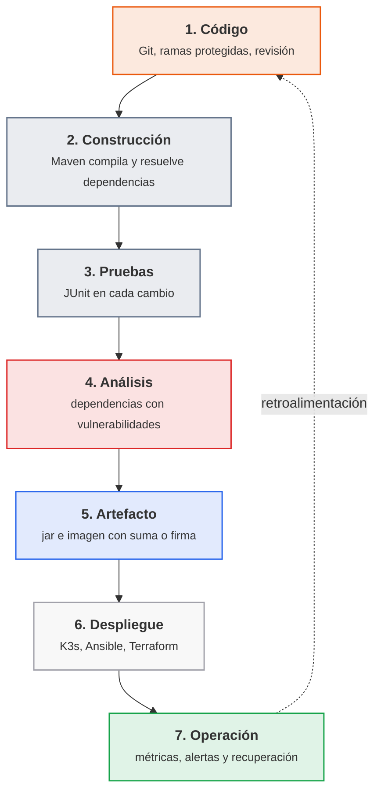

<p class="pie" markdown>El pipeline de `pps-app`: cada flecha es una puerta que el cambio tiene que pasar, y la línea de puntos es el bucle que devuelve a los desarrolladores lo que ocurre en producción.</p>

Cada fase tiene su riesgo típico y su control. La tabla dice también en qué hoja de la unidad se monta el control, de modo que sirve de índice de lo que queda por hacer.

| Fase | Riesgo típico | Control | Herramienta y hoja |
|---|---|---|---|
| Código | Un cambio sin revisar, o una cuenta con demasiados permisos, llega a la rama principal | Rama protegida, revisión obligatoria, roles mínimos | GitHub, [A5.2](#a52-git-en-equipo-sesion-38) |
| Construcción | Una construcción que solo funciona en la máquina de una persona | Construcción reproducible desde un fichero de proyecto | Maven, [A5.3](#a53-construccion-con-maven-sesion-39) |
| Pruebas | Una regresión llega a producción | Pruebas automáticas que bloquean el pipeline si fallan | JUnit y Jenkins, A5.4 a A5.6 |
| Análisis | Una biblioteca con una vulnerabilidad conocida entra en la aplicación | Análisis de dependencias y fallo del pipeline ante una vulnerabilidad crítica | OWASP Dependency-Check, A5.7 |
| Artefacto | Se despliega algo distinto de lo que se construyó | Suma de verificación o firma del artefacto; imagen inmutable con etiqueta única | `sha256sum`, Docker, A5.7 |
| Despliegue | Una contraseña o un token escrito en el código, en la imagen o en el pipeline | Secretos fuera del código, en el almacén de credenciales | Credenciales de Jenkins, A5.7 |
| Despliegue | Un servidor configurado a mano que nadie sabe reproducir | Infraestructura y configuración como código | Terraform y Ansible, A5.8 a A5.11 |
| Operación | Un fallo que nadie ve, o que dura horas | Monitorización, alertas y plan de recuperación | Prometheus, Grafana, A5.15 a A5.18 |

Cuatro ideas de la tabla salen a menudo y conviene tenerlas claras:

- **Integridad**: la garantía de que el artefacto que se despliega es exactamente el que se construyó y probó. Se comprueba con una suma de verificación (`sha256sum`, que cambia por completo si cambia un solo bit) y, cuando hay que demostrar además quién lo produjo, con una firma digital.
- **Secretos en CI/CD**: un secreto (contraseña, token, clave) que se escribe en el repositorio queda en el historial para siempre, aunque se borre después. El pipeline lo recibe en tiempo de ejecución desde un almacén de credenciales y no lo muestra en el registro.
- **Infraestructura inmutable**: un servidor o un contenedor no se modifica una vez desplegado; para cambiarlo se construye uno nuevo desde el código y se sustituye el antiguo. Elimina la deriva de configuración (servidores que con el tiempo dejan de parecerse) y hace que volver atrás sea desplegar la versión anterior.
- **Despliegue azul-verde (*blue-green*)**: se mantienen dos entornos idénticos, uno en producción (azul) y otro con la versión nueva (verde). Se prueba el verde, se cambia el tráfico de uno a otro de golpe y, si algo falla, se vuelve al azul en segundos. Cuesta el doble de infraestructura y a cambio hace el despliegue casi sin riesgo.

### Escalado, virtualización y contenedores

El resultado del pipeline es algo que tiene que ejecutarse y atender a más usuarios de los previstos. Dos decisiones de infraestructura condicionan cómo se despliega: cómo crece el servicio y en qué se empaqueta.

| | Escalado vertical | Escalado horizontal |
|---|---|---|
| Qué hace | Da más recursos al mismo servidor (memoria, procesador, disco) | Añade más servidores que atienden la misma aplicación |
| Ventaja | Sencillo, sin cambiar la aplicación | Casi sin techo y con alta disponibilidad |
| Límite | El máximo de la máquina; un único punto de fallo | La aplicación tiene que admitir varias copias, y hace falta un balanceador de carga delante |

El criterio habitual es escalar en vertical mientras baste, por su sencillez, y pasar a horizontal cuando la disponibilidad importa más que el coste, porque solo con varias copias un fallo no interrumpe el servicio. Con varias copias, el balanceador reparte las peticiones y, si una copia cae, deja de enviarle tráfico (*failover*, la conmutación automática al resto).

El segundo eje es el empaquetado. Una máquina virtual lleva un sistema operativo completo sobre un hipervisor: aísla mucho y arranca en decenas de segundos, pero pesa gigabytes. Un contenedor comparte el núcleo del anfitrión y solo lleva la aplicación con sus bibliotecas: pesa megabytes, arranca en segundos y se puede destruir y recrear sin coste. Para un pipeline la diferencia decisiva es que la imagen del contenedor es el artefacto inmutable de la tabla anterior: se construye una vez, se firma o se verifica, y esa misma imagen es la que pasa por pruebas y por producción. Por eso `pps-app` termina como imagen Docker y no como paquete instalado a mano en un servidor. Las máquinas virtuales siguen haciendo falta debajo, como base sobre la que corre el clúster (`destino01` y los nodos K3s del laboratorio son máquinas virtuales creadas por código).

### A5.1 El pipeline de entrega (sesión 37)

<span class="et et-obj">Objetivo</span> Dibujar el pipeline de `pps-app` con su control de seguridad en cada fase, dejar el repositorio `pps-app` creado y comprobar que `pps01` tiene las herramientas de las hojas siguientes. Es la primera hoja de ACT_UT5_1 y trabaja el CE a (principios y objetivos de DevOps).

<span class="et et-pre">Antes de empezar</span> `pps01` encendida, con el repositorio `pps-entregas` clonado desde la A1.1, y tu cuenta `pps<NIA>` de GitHub. Se han explicado los [principios y objetivos de DevOps](#principios-y-objetivos-de-devops), [el ciclo de entrega y dónde entra la seguridad](#el-ciclo-de-entrega-y-donde-entra-la-seguridad) y [el escalado, las máquinas virtuales y los contenedores](#escalado-virtualizacion-y-contenedores).

<span class="et et-pas">Pasos</span>

1. En `pps01`, comprueba que están las herramientas que usarán las hojas de la unidad. Si `java` o `mvn` no aparecen, instálalos con `sudo apt install -y openjdk-17-jdk maven`:

    ```bash
    git --version && java -version && mvn -v && docker --version
    docker run --rm hello-world
    ```

2. Crea en <https://github.com> el repositorio `pps-app` de tu cuenta: privado, con README y sin más ficheros. Clónalo en `pps01` (con la URL HTTPS o SSH que ya usaste en `pps-entregas`):

    ```bash
    cd ~ && git clone https://github.com/pps<NIA>/pps-app.git
    ```

3. En `pps-entregas`, crea la carpeta de la hoja y el fichero del dibujo:

    ```bash
    cd ~/pps-entregas && mkdir -p ut5/a51 && touch ut5/a51/README.md ut5/a51/pipeline.md
    ```

4. Copia en `ut5/a51/pipeline.md` este esqueleto y sustituye cada `?` por el control de seguridad de esa fase, de los de la tabla del apartado del ciclo de entrega (una frase corta por nodo). GitHub dibuja el bloque `mermaid` al abrir el fichero; en VS Code se ve con la extensión *Markdown Preview Mermaid Support*:

    ````markdown
    ```mermaid
    flowchart TB
        A["Codigo: ?"] --> B["Construccion: ?"] --> C["Pruebas: ?"]
        C --> D["Analisis: ?"] --> E["Artefacto: ?"] --> F["Despliegue: ?"] --> G["Operacion: ?"]
        G -. retroalimentacion .-> A
    ```
    ````

5. Debajo del dibujo, añade una tabla con cuatro columnas: fase, qué ocurre en `pps-app`, riesgo si falta el control y herramienta que lo aplica (la de la tabla del apartado, con la hoja donde se monta). Marca con una línea aparte los **tres puntos del pipeline donde entraría un atacante** que quisiera colar código propio en la aplicación (por ejemplo, una dependencia comprometida o un token de Jenkins filtrado) y di cuál de tus controles lo detiene.
6. En `ut5/a51/README.md`, contesta en cuatro o cinco líneas cada una: qué diferencia hay entre integración continua, entrega continua y despliegue continuo, y cuál es la adecuada para `pps-app` si nadie revisa a mano; qué significa *shift left* y un ejemplo del pipeline; y qué es una infraestructura inmutable y qué ventaja da al volver atrás tras un despliegue fallido.
7. En el mismo README, decide con una tabla de tres filas cómo escalaría `pps-app` si pasara de 50 a 5.000 usuarios: qué se escala en vertical, qué en horizontal y por qué la aplicación va en contenedor y no en una máquina virtual instalada a mano. Basta una frase por fila.
8. Sube todo a `pps-entregas`:

    ```bash
    git add ut5/a51 && git commit -m "A5.1 pipeline de entrega" && git push
    ```

<span class="et et-com">Comprobación</span> `git --version`, `java -version`, `mvn -v` y `docker --version` responden sin error, `hello-world` imprime su mensaje de bienvenida, el repositorio `pps-app` existe en tu cuenta y está clonado en `~/pps-app`, y al abrir `pipeline.md` en GitHub se ve el diagrama con siete nodos y ninguno con un `?` sin sustituir.

<span class="et et-ent">Entrega</span> La carpeta `ut5/a51/` de `pps-entregas` (`README.md` con las respuestas y `pipeline.md` con el dibujo y las tablas), con las salidas del paso 1 como captura. Forma parte de la entrega ACT_UT5_1 (CE a, b y c), plazo el jueves 15 de abril a las 23:59, que se cierra con las hojas A5.2 a A5.7.

<span class="et et-ext">Si te sobra tiempo</span> Añade al dibujo una segunda vía: qué cambia en el pipeline si el despliegue fuera azul-verde en lugar de sustituir la versión anterior, y en qué fase harías la prueba del entorno verde antes de pasarle el tráfico.

## Sesión 38 · Control de versiones con roles

<p class="ut-meta" markdown>11 de marzo · Teoría y práctica · <span class="dur" tabindex="0" aria-label="Flujos de trabajo con Git en equipo · 10 min&#10;Ramas protegidas y revisión de cambios · 10 min&#10;Roles y permisos en GitHub · 5 min&#10;A5.2 Git en equipo · 85 min" data-dur="Flujos de trabajo con Git en equipo · 10 min&#10;Ramas protegidas y revisión de cambios · 10 min&#10;Roles y permisos en GitHub · 5 min&#10;A5.2 Git en equipo · 85 min">:material-school:<i class="dur-barra" style="--teoria:23%"></i>:material-flask:</span></p>

Al terminar la sesión hay una organización de GitHub de prueba con tres personas y tres roles distintos, una rama principal que solo admite cambios a través de un pull request con aprobación, y la comprobación práctica de que cada rol puede hacer lo que le corresponde y nada más. La teoría explica cómo se organiza el trabajo de varias personas con Git, qué reglas protegen la rama principal y qué permisos da cada rol de GitHub, con el equivalente en GitLab.

!!! consulta "Material de partida"
    **Aula**: `RA5-Despliegue-seguro/01 Material/03-Git.pdf` (qué es un sistema de control de versiones, funcionamiento de Git con directorio de trabajo, escenario y repositorio, y comandos básicos; la parte de ramas y roles la completa esta sesión). **Web** que ya usaba el material: <https://learngitbranching.js.org/> (visualización de ramas, de la entrega ACT_UT1_4). **Apuntes de terceros**: *Ciberseguridad-PePS*, tema 1, «Git» (<https://psegarrac.github.io/Ciberseguridad-PePS/tema1/git/2020/11/01/Git.html>; el apartado sobre publicar en Heroku está obsoleto y no se usa). Documentación oficial de GitHub sobre roles (<https://docs.github.com/en/organizations/managing-user-access-to-your-organizations-repositories/managing-repository-roles/repository-roles-for-an-organization>) y sobre reglas de rama (<https://docs.github.com/en/repositories/configuring-branches-and-merges-in-your-repository/managing-rulesets/about-rulesets>). Atribución completa en [Material y autoría](../material.md).

### Flujos de trabajo con Git en equipo

Git ya se usa en solitario desde la unidad 1. El objetivo ahora es que varias personas cambien el mismo código sin pisarse y sin romper lo que funciona, y la herramienta es la rama: una línea de desarrollo paralela que se crea barata, se trabaja aislada y se fusiona cuando está lista. Lo que un equipo tiene que acordar es el flujo, es decir, qué ramas existen, quién las crea y cómo vuelven a la principal.

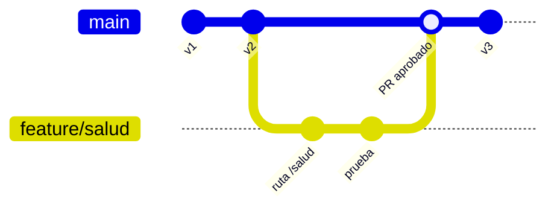

<p class="pie" markdown>Flujo de rama corta: `main` siempre está en un estado desplegable, cada cambio nace en su rama y vuelve por un pull request.</p>

| Flujo | Cómo funciona | Cuándo encaja |
|---|---|---|
| GitHub flow | Una rama principal siempre desplegable y ramas cortas por cambio, que se fusionan con un pull request | Servicios que se despliegan continuamente, como `pps-app` |
| Git flow | Ramas permanentes `main` y `develop`, más ramas de `release` y de `hotfix` | Software con versiones publicadas y varias en mantenimiento a la vez |
| Trunk-based | Todos trabajan sobre la rama principal con cambios muy pequeños, apoyados en interruptores de funcionalidad | Equipos maduros con pruebas muy buenas |

El criterio habitual para un pipeline de CI/CD es el primero: es el más sencillo y el que mejor casa con una rama principal que se construye y se prueba en cada cambio. Git flow añade ceremonia que solo compensa cuando hay versiones que mantener en paralelo. En cualquier flujo valen las mismas costumbres: una rama por cambio con un nombre que diga qué es (`feature/salud`, `fix/puerto`), commits pequeños con un mensaje que explique el porqué y ramas de vida corta, porque cuanto más tiempo vive una rama más se aleja de la principal y más duele fusionarla.

Cuando dos ramas cambian las mismas líneas, Git no puede decidir y marca un conflicto: deja ambas versiones en el fichero entre `<<<<<<<` y `>>>>>>>` y espera que una persona escoja. Se resuelve editando el fichero, haciendo `git add` y terminando la fusión con un commit.

### Ramas protegidas y revisión de cambios

Un flujo acordado de palabra se rompe el primer día de prisa. Una rama protegida convierte el acuerdo en una regla que la plataforma hace cumplir: nadie puede saltarse el camino del pull request, ni siquiera quien administra el repositorio si la regla no le concede excepción (la petición de fusión, con el mismo nombre que en GitHub; en GitLab se llama *merge request*). Lo que se configura en la rama principal es:

| Regla | Qué impide o exige |
|---|---|
| Exigir pull request | Prohíbe `git push` directo a la rama; el cambio entra solo por fusión |
| Aprobaciones requeridas | Un número mínimo de personas distintas de la autora tiene que aprobar |
| Descartar aprobaciones obsoletas | Un commit nuevo tras la aprobación la anula, para no aprobar una cosa y fusionar otra |
| Exigir comprobaciones | La construcción y las pruebas del pipeline tienen que pasar antes de poder fusionar |
| Bloquear el push forzado y el borrado | Nadie reescribe ni elimina el historial de la rama |
| Propietarios del código (`CODEOWNERS`) | Un fichero del repositorio nombra quién debe aprobar los cambios de cada carpeta |

La regla de las comprobaciones es la que une esta sesión con Jenkins: cuando el pipeline informe a GitHub del resultado de cada cambio, un pull request con pruebas rojas no se podrá fusionar. Las cuentas gratuitas de GitHub solo aplican estas reglas a los repositorios públicos; en uno privado hace falta un plan de pago, y por eso la práctica de esta sesión usa un repositorio público sin ningún dato real.

La revisión es la mitad humana del control. Quien revisa comprueba que el cambio hace lo que dice, que trae pruebas, que no añade ninguna dependencia nueva sin justificar y que no contiene secretos (contraseñas, tokens, claves). Un secreto subido por error no se arregla borrándolo en un commit posterior, porque queda en el historial: hay que revocarlo y generar otro. Como forma de fusionar, el criterio habitual para ramas cortas es *squash and merge* (todos los commits de la rama se comprimen en uno), que deja el historial de `main` legible, con un commit por cambio aprobado.

### Roles y permisos en GitHub

La regla que guía los permisos es la del mínimo privilegio: cada persona recibe el rol más bajo con el que puede hacer su trabajo, y se sube solo cuando hace falta. GitHub distingue dos niveles. En la **organización** hay propietarios (administran todo, incluida la facturación y los miembros) y miembros. En cada **repositorio** se asigna uno de cinco roles, ordenados de menos a más:

| Rol | Puede | No puede | Perfil típico |
|---|---|---|---|
| Read | Ver, clonar y comentar | Escribir | Auditoría, personas ajenas al equipo |
| Triage | Lo anterior, y gestionar incidencias y pull requests (etiquetar, asignar, cerrar) | Escribir código | Soporte, calidad |
| Write | Lo anterior, y subir a ramas no protegidas, abrir pull requests y aprobarlos | Cambiar ajustes del repositorio | Desarrollo |
| Maintain | Lo anterior, y gestionar el repositorio (ramas, etiquetas, algunos ajustes) | Acciones destructivas o de seguridad | Responsable técnico |
| Admin | Todo: reglas de rama, personas con acceso, borrar el repositorio | Nada | Quien responde del repositorio |

Dos detalles evitan sorpresas. Una aprobación de pull request solo cuenta para la regla de aprobaciones si la da alguien con rol Write o superior, de modo que una persona con Read puede comentar pero no aprobar. Y un rol se puede dar a una persona o, mejor, a un equipo de la organización: cuando alguien cambia de puesto se le cambia de equipo y no hay que revisar repositorio por repositorio. Las organizaciones pueden además exigir autenticación en dos pasos a todos sus miembros, que es la primera medida contra el robo de una cuenta.

Los pipelines también necesitan acceso, y la misma regla se aplica a las cuentas de máquina: el token que use Jenkins (hoja A5.4) se crea con permisos solo de lectura sobre el repositorio que construye, y una clave de despliegue (*deploy key*) de solo lectura es aún más estrecha.

GitLab ofrece lo mismo con otros nombres, y la correspondencia es directa:

| GitHub | GitLab | Diferencia relevante |
|---|---|---|
| Organización | Grupo | Los grupos de GitLab admiten subgrupos anidados |
| Read | Reporter | En GitLab, Guest ve menos aún |
| Triage | Planner (o Reporter) | Gestión de incidencias sin código |
| Write | Developer | Sube a ramas no protegidas |
| Maintain | Maintainer | Gestiona el repositorio |
| Admin y propietario | Owner | Administra el grupo |
| Rama protegida y regla de rama | Rama protegida (quién puede subir y fusionar) | En GitLab se elige por rol qué roles pueden subir y fusionar |
| Pull request | Merge request | Mismo concepto |
| `CODEOWNERS` | `CODEOWNERS` | Mismo fichero |

### A5.2 Git en equipo (sesión 38)

<span class="et et-obj">Objetivo</span> Montar en grupos de tres una organización de GitHub con tres roles, proteger la rama principal para que solo admita pull requests aprobados y comprobar en la práctica los límites de cada rol. Trabaja el CE b (control de versiones administrando roles y permisos) de ACT_UT5_1.

<span class="et et-pre">Antes de empezar</span> Tu cuenta `pps<NIA>` de GitHub y la de las otras dos personas del grupo, con Git configurado en `pps01`. Se han explicado los [flujos de trabajo con Git en equipo](#flujos-de-trabajo-con-git-en-equipo), las [ramas protegidas y la revisión de cambios](#ramas-protegidas-y-revision-de-cambios) y los [roles y permisos en GitHub](#roles-y-permisos-en-github). En el grupo, reparte las letras: **A** (administra), **B** (desarrolla) y **C** (da soporte). Si el aula no da grupos de tres, en uno de dos se omiten C, el paso 6 y su fila de la tabla.

<span class="et et-pas">Pasos</span>

1. **A** crea en <https://github.com/organizations/plan> una organización gratuita llamada `pps<NIA de A>-lab` y, dentro, el repositorio `equipo-demo`. Tiene que ser **público**, con README (recuerda que las reglas de rama no funcionan en privados con el plan gratuito). No pongas nada real en él.
2. **A** invita a B y a C a la organización con el rol de miembro y, en el repositorio, en *Settings* y *Collaborators and teams*, les da estos permisos: **B con Write y C con Triage**. Ambos aceptan la invitación desde su correo o desde el enlace que muestra GitHub. Apunta en una tabla del README de tu carpeta las tres personas, su rol y por qué es el mínimo que necesitan.
3. **A** protege `main`: en *Settings*, *Rules*, *Rulesets*, crea un ruleset nuevo para la rama por defecto y activa **exigir pull request con 1 aprobación**, **descartar aprobaciones obsoletas**, **bloquear el push forzado** y **restringir el borrado**. Deja vacía la lista de quien puede saltarse la regla, para que la regla valga también para A. Pon el estado en *Active*. (En una cuenta con reglas de rama clásicas, la opción equivalente es *Branches*, *Add branch protection rule*, con las mismas casillas.)
4. **B** clona el repositorio y trata de subir directamente a `main`. Guarda el mensaje de rechazo:

    ```bash
    git clone https://github.com/pps<NIA de A>-lab/equipo-demo.git && cd equipo-demo
    echo "cambio directo" >> README.md
    git commit -am "cambio directo" && git push origin main
    ```

    El servidor tiene que responder con un rechazo (`protected branch hook declined` o similar). Deshaz el commit local con `git reset --hard origin/main`.
5. **B** hace el cambio por el camino correcto: una rama, un commit y un pull request.

    ```bash
    git switch -c feature/saludo
    echo "Hola desde el equipo" > saludo.txt
    git add saludo.txt && git commit -m "Añade saludo.txt"
    git push -u origin feature/saludo
    ```

    En GitHub, abre el pull request de `feature/saludo` a `main` (aparece un aviso amarillo con el botón *Compare & pull request*). El botón de fusionar aparece bloqueado hasta que haya una aprobación.
6. **C** (Triage) entra en el pull request de B y prueba sus límites: puede comentar y añadir una etiqueta, pero no puede aprobar de forma que cuente ni fusionar. Después clona el repositorio, crea una rama y trata de subirla (`git push origin feature/soporte`): GitHub tiene que responder `Permission ... denied`. Captura ambas cosas.
7. **A** revisa el pull request: escribe un comentario en una línea concreta del cambio (*Files changed*) y envía la revisión con *Request changes*. **B** corrige con un segundo commit en la misma rama. **A** vuelve a revisar, aprueba con *Approve* y fusiona con *Squash and merge*. Comprueba que el historial de `main` tiene un solo commit nuevo.
8. Cada persona documenta en su carpeta de `pps-entregas` lo que ha visto desde su rol: el rechazo de B en el paso 4, la limitación de C en el paso 6, el pull request aprobado y fusionado, y la pantalla del ruleset.
9. Compara en el README, con una tabla de cuatro filas, lo que hiciste con lo que habría que configurar en GitLab: rol de B, rol de C, regla de rama protegida y aprobaciones requeridas.

<span class="et et-com">Comprobación</span> El `git push` directo de B a `main` se rechaza, el de C a cualquier rama también, el botón de fusionar del pull request no se activa hasta la aprobación de A, y tras fusionar `saludo.txt` está en `main` con un único commit añadido. Si el aviso de protección no aparece en la rama, revisa que el ruleset esté en *Active* y que el repositorio sea público.

<span class="et et-ent">Entrega</span> La carpeta `ut5/a52/` de `pps-entregas` con `README.md` (tabla de personas y roles, tabla de comparación con GitLab y explicación breve de cada prueba) y las capturas con nombre descriptivo (`ruleset.png`, `push-rechazado-b.png`, `permiso-denegado-c.png`, `pr-aprobado.png`). Añade la URL del repositorio `equipo-demo`. Forma parte de la entrega ACT_UT5_1, plazo el jueves 15 de abril a las 23:59.

<span class="et et-ext">Si te sobra tiempo</span> Añade el fichero `.github/CODEOWNERS` con la línea `* @pps<NIA de A>` en un pull request nuevo, activa en el ruleset *Require review from Code Owners* y comprueba que ahora solo la aprobación de A desbloquea la fusión. Después, provoca un conflicto: cambia la misma línea de `saludo.txt` en dos ramas y resuélvelo al fusionar la segunda.

!!! examen "Qué se evalúa: DevOps y control de versiones"
    Diferenciar integración, entrega y despliegue continuos; enumerar los principios de DevOps y qué es *shift left*; colocar un control de seguridad (revisión, análisis de dependencias, secretos fuera del código, suma o firma del artefacto) en la fase del pipeline que le corresponde; explicar integridad de artefactos, infraestructura inmutable y despliegue azul-verde; y, en Git, decidir qué rol de GitHub necesita cada perfil aplicando el mínimo privilegio y qué reglas protegen la rama principal.

## Sesión 39 · Automatización de la construcción con Maven

<p class="ut-meta" markdown>15 de marzo · Teoría y práctica · <span class="dur" tabindex="0" aria-label="Qué automatiza un sistema de construcción · 5 min&#10;Maven: ciclo de vida, dependencias y pruebas · 15 min&#10;Maven frente a Gradle · 5 min&#10;A5.3 Construcción con Maven · 85 min" data-dur="Qué automatiza un sistema de construcción · 5 min&#10;Maven: ciclo de vida, dependencias y pruebas · 15 min&#10;Maven frente a Gradle · 5 min&#10;A5.3 Construcción con Maven · 85 min">:material-school:<i class="dur-barra" style="--teoria:23%"></i>:material-flask:</span></p>

Al terminar la sesión existe el código completo de `pps-app`, la aplicación Java que se usa en el resto de la unidad, con su `pom.xml`, sus pruebas y un informe de pruebas generado, y `mvn verify` la construye desde cero en una sola orden. Esa orden es exactamente lo que Jenkins ejecutará en las sesiones siguientes. La teoría explica qué automatiza una herramienta de construcción, cómo lo hace Maven (ciclo de vida, dependencias y pruebas) y cuándo se prefiere Gradle.

!!! consulta "Material de partida"
    **Aula**: `RA5-Despliegue-seguro/01 Material/04-Maven_Gradle.pdf` (sistemas de automatización de la construcción, estructura del `pom.xml`, ciclo de vida, dependencias y plugins de Maven, y una introducción a Gradle). **Web** que ya usaba el material: <https://maven.apache.org/> y la guía del ciclo de vida (<https://maven.apache.org/guides/introduction/introduction-to-the-lifecycle.html>). **Apuntes de terceros**: *Ciberseguridad-PePS*, tema 5, «Sistemas de automatización de construcción» y «Aplicación en Maven» (<https://psegarrac.github.io/Ciberseguridad-PePS/tema5/cd/ci/2022/01/12/Aplicaci%C3%B3n-en-Maven.html>; la guía sigue el ejemplo del saludo con JUnit 4 y Java 8, que aquí se sustituye por una aplicación con servidor HTTP, JUnit 5 y Java 17). Atribución completa en [Material y autoría](../material.md).

### Qué automatiza un sistema de construcción

Construir un proyecto es todo lo que hay entre el código fuente y algo que se puede ejecutar y entregar: compilar, descargar las bibliotecas de las que depende, ejecutar las pruebas, empaquetar el resultado y, si procede, generar documentación. Hecho a mano, el resultado depende de la máquina de cada persona. Una herramienta de construcción lo describe en un fichero y lo ejecuta siempre igual con una sola orden, condición para automatizarlo en un pipeline.

| Tarea | Ejemplo en `pps-app` |
|---|---|
| Compilar | Pasar `App.java` a bytecode |
| Resolver dependencias | Descargar JUnit para las pruebas |
| Probar | Ejecutar `AppTest` y fallar si una prueba falla |
| Empaquetar | Producir `target/pps-app.jar` |
| Informar | Dejar el resultado de las pruebas en un informe |

Conviene no confundir tres cosas. Un entorno de desarrollo (IDE) ayuda a escribir código; la herramienta de construcción compila, prueba y empaqueta desde la línea de órdenes, sin depender de ningún IDE; y Jenkins orquesta cuándo se lanza la construcción y qué se hace con el resultado. Jenkins no compila nada por sí mismo: ejecuta `mvn`. Las herramientas del sector son Make (el clásico de C), Ant (Java, con las tareas escritas a mano), Maven y Gradle; las dos últimas son las que se usan hoy en Java.

### Maven: ciclo de vida, dependencias y pruebas

Maven parte de una idea llamada convención sobre configuración: si el proyecto sigue la estructura estándar, casi no hay que explicarle nada. El código va en `src/main/java`, las pruebas en `src/test/java` y todo lo generado en `target/`. Lo único que se escribe es el `pom.xml` (*Project Object Model*), que dice qué es el proyecto y de qué depende.

Cada proyecto se identifica con tres coordenadas: `groupId` (la organización, con el formato de dominio invertido, aquí `es.pps`), `artifactId` (el nombre, `pps-app`) y `version`. Con ellas se nombra cualquier artefacto en cualquier repositorio de Maven, incluido el propio.

**Ciclo de vida.** Maven define una secuencia fija de fases y ejecutar una fase ejecuta también todas las anteriores. Las que se usan a diario son estas:

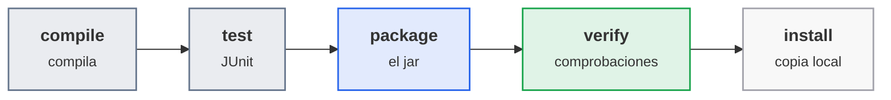

<p class="pie" markdown>Las fases de uso diario. `mvn package` ejecuta `compile` y `test` antes de empaquetar, así que un jar no se genera si una prueba falla.</p>

Las fases no hacen nada por sí solas: cada una tiene enganchados los *goals* de unos plugins. `compile` ejecuta el plugin del compilador, `test` el plugin `surefire` (que busca las clases cuyo nombre termina en `Test`, las ejecuta y escribe el informe en `target/surefire-reports/`) y `package` el plugin `jar`. Dos órdenes más completan lo básico: `mvn clean` borra `target/` para construir desde cero, y `-B` (modo por lotes) elimina los colores y las barras de progreso, que es como se lanza en un pipeline. Cuando alguna prueba falla, Maven termina con código de salida distinto de cero: es la señal con la que Jenkins sabe que la construcción ha fallado.

**Dependencias.** Cada `<dependency>` se descarga de Maven Central y se guarda en la caché local `~/.m2`, por lo que la primera construcción tarda y las siguientes no. El `scope` dice cuándo hace falta: `compile` (por defecto, siempre), `test` (solo para las pruebas, como JUnit, y no viaja en el jar), `provided` (la aporta el entorno) y `runtime`. Una dependencia arrastra las suyas (dependencias transitivas), y `mvn dependency:tree` las muestra. Este dato importa para la seguridad: cada biblioteca que entra en el árbol es código ajeno que forma parte de la aplicación, y una vulnerabilidad en una dependencia transitiva afecta igual. Por eso `pps-app` no usa más dependencias de ejecución que el propio JDK, y por eso la hoja A5.7 analiza el árbol con OWASP Dependency-Check.

**Pruebas.** Una prueba unitaria es un método que llama a una parte del código y comprueba con `assertEquals` que devuelve lo esperado. JUnit 5 es la biblioteca estándar y marca cada método con `@Test`. Un pipeline que compila pero no prueba solo comprueba que el código está bien escrito, no que funciona. La opción `-DskipTests` omite las pruebas: en un pipeline solo se admite en una etapa de construcción si otra etapa las ejecuta después (como en la sesión 41), nunca como forma de que pase.

### Maven frente a Gradle

Gradle resuelve el mismo problema con otro enfoque. El proyecto se describe en un script (`build.gradle`, en Groovy o Kotlin) y no en XML, y el resultado de cada tarea se guarda en caché para no repetir trabajo que no ha cambiado.

| | Maven | Gradle |
|---|---|---|
| Fichero de proyecto | `pom.xml`, declarativo | `build.gradle(.kts)`, un script |
| Ciclo | Fases fijas | Grafo de tareas, ampliable |
| Velocidad | Suficiente en proyectos pequeños | Más rápido con construcciones incrementales y en proyectos grandes |
| Uso típico | Java empresarial, servicios | Android y proyectos grandes con varios módulos |

El criterio habitual para este curso es Maven, porque su fichero declarativo se audita de un vistazo (basta leer qué dependencias y plugins lleva), su estructura es la misma en todos los proyectos y las herramientas del pipeline (Jenkins, el análisis de dependencias) lo integran con menos configuración. Gradle compensa cuando la velocidad de la construcción es un problema real. La sesión de margen de la primera parte de la unidad propone construir `pps-app` con Gradle como ampliación.

### A5.3 Construcción con Maven (sesión 39)

<span class="et et-obj">Objetivo</span> Escribir `pps-app` completa (servidor HTTP mínimo con dos rutas, dos pruebas y su `pom.xml`), construirla y probarla con Maven, generar el informe de pruebas y subirla a tu repositorio. El código que se escribe hoy es el que usan todas las hojas siguientes sin reescribirlo. Prepara la construcción que Jenkins automatiza en A5.4, dentro de ACT_UT5_1 (CE c).

<span class="et et-pre">Antes de empezar</span> El repositorio `pps-app` creado y clonado en `~/pps-app` en la [A5.1](#a51-el-pipeline-de-entrega-sesion-37), y `java`, `mvn` y `git` funcionando en `pps01`. Se han explicado [qué automatiza un sistema de construcción](#que-automatiza-un-sistema-de-construccion) y [Maven: ciclo de vida, dependencias y pruebas](#maven-ciclo-de-vida-dependencias-y-pruebas).

<span class="et et-pas">Pasos</span>

1. Crea la estructura estándar de Maven:

    ```bash
    cd ~/pps-app && mkdir -p src/main/java/es/pps src/test/java/es/pps
    ```

2. Escribe `pom.xml` en la raíz. Cópialo tal cual: las coordenadas son las de la unidad (`es.pps`, `pps-app`), `finalName` fija el nombre del jar en `target/pps-app.jar`, el plugin `jar` declara qué clase arranca y las versiones de los tres plugins van fijadas a propósito: el Maven de Ubuntu trae un plugin de compilación antiguo que ignora Java 17 y falla con `Source option 5 is no longer supported`:

    ```xml
    <?xml version="1.0" encoding="UTF-8"?>
    <project xmlns="http://maven.apache.org/POM/4.0.0"
             xmlns:xsi="http://www.w3.org/2001/XMLSchema-instance"
             xsi:schemaLocation="http://maven.apache.org/POM/4.0.0 https://maven.apache.org/xsd/maven-4.0.0.xsd">
      <modelVersion>4.0.0</modelVersion>

      <groupId>es.pps</groupId>
      <artifactId>pps-app</artifactId>
      <version>1.0.0</version>
      <packaging>jar</packaging>

      <properties>
        <maven.compiler.release>17</maven.compiler.release>
        <project.build.sourceEncoding>UTF-8</project.build.sourceEncoding>
      </properties>

      <dependencies>
        <dependency>
          <groupId>org.junit.jupiter</groupId>
          <artifactId>junit-jupiter</artifactId>
          <version>5.11.4</version>
          <scope>test</scope>
        </dependency>
      </dependencies>

      <build>
        <finalName>pps-app</finalName>
        <plugins>
          <plugin>
            <groupId>org.apache.maven.plugins</groupId>
            <artifactId>maven-compiler-plugin</artifactId>
            <version>3.13.0</version>
          </plugin>
          <plugin>
            <groupId>org.apache.maven.plugins</groupId>
            <artifactId>maven-surefire-plugin</artifactId>
            <version>3.5.2</version>
          </plugin>
          <plugin>
            <groupId>org.apache.maven.plugins</groupId>
            <artifactId>maven-jar-plugin</artifactId>
            <version>3.4.2</version>
            <configuration>
              <archive>
                <manifest>
                  <mainClass>es.pps.App</mainClass>
                </manifest>
              </archive>
            </configuration>
          </plugin>
        </plugins>
      </build>
    </project>
    ```

3. Escribe `src/main/java/es/pps/App.java`. Usa solo el servidor HTTP que trae el JDK, sin frameworks. Escucha en el 8080 (o en el puerto que se le pase como argumento), responde `Hola PPS` en `/` y `{"estado":"ok"}` en `/salud`:

    ```java
    package es.pps;

    import com.sun.net.httpserver.HttpExchange;
    import com.sun.net.httpserver.HttpServer;
    import java.io.IOException;
    import java.net.InetSocketAddress;
    import java.nio.charset.StandardCharsets;

    public class App {

        static final String SALUDO = "Hola PPS";
        static final String SALUD = "{\"estado\":\"ok\"}";

        static HttpServer crearServidor(int puerto) throws IOException {
            HttpServer servidor = HttpServer.create(new InetSocketAddress(puerto), 0);
            servidor.createContext("/salud", ex -> responder(ex, SALUD, "application/json"));
            servidor.createContext("/", ex -> responder(ex, SALUDO, "text/plain; charset=utf-8"));
            return servidor;
        }

        private static void responder(HttpExchange ex, String cuerpo, String tipo) throws IOException {
            byte[] datos = cuerpo.getBytes(StandardCharsets.UTF_8);
            ex.getResponseHeaders().set("Content-Type", tipo);
            ex.sendResponseHeaders(200, datos.length);
            try (var salida = ex.getResponseBody()) {
                salida.write(datos);
            }
        }

        public static void main(String[] args) throws IOException {
            int puerto = args.length > 0 ? Integer.parseInt(args[0]) : 8080;
            crearServidor(puerto).start();
            System.out.println("pps-app escuchando en el puerto " + puerto);
        }
    }
    ```

4. Escribe `src/test/java/es/pps/AppTest.java`. Cada prueba arranca el servidor en un puerto libre que elige el sistema (el `0`), hace una petición real y comprueba el código y el cuerpo de la respuesta:

    ```java
    package es.pps;

    import static org.junit.jupiter.api.Assertions.assertEquals;

    import com.sun.net.httpserver.HttpServer;
    import java.net.URI;
    import java.net.http.HttpClient;
    import java.net.http.HttpRequest;
    import java.net.http.HttpResponse;
    import org.junit.jupiter.api.AfterEach;
    import org.junit.jupiter.api.BeforeEach;
    import org.junit.jupiter.api.Test;

    class AppTest {

        private HttpServer servidor;
        private String base;

        @BeforeEach
        void arrancar() throws Exception {
            servidor = App.crearServidor(0);
            servidor.start();
            base = "http://localhost:" + servidor.getAddress().getPort();
        }

        @AfterEach
        void parar() {
            servidor.stop(0);
        }

        private HttpResponse<String> get(String ruta) throws Exception {
            HttpRequest peticion = HttpRequest.newBuilder(URI.create(base + ruta)).build();
            return HttpClient.newHttpClient().send(peticion, HttpResponse.BodyHandlers.ofString());
        }

        @Test
        void laRaizSaluda() throws Exception {
            HttpResponse<String> r = get("/");
            assertEquals(200, r.statusCode());
            assertEquals("Hola PPS", r.body());
        }

        @Test
        void saludDevuelveJson() throws Exception {
            HttpResponse<String> r = get("/salud");
            assertEquals(200, r.statusCode());
            assertEquals("{\"estado\":\"ok\"}", r.body());
        }
    }
    ```

5. Construye desde cero. La primera vez Maven descarga los plugins y JUnit, y con todo el aula descargando a la vez tarda varios minutos: aprovecha para leer la salida. Anota en qué fase se ejecuta cada plugin (`compiler`, `surefire`, `jar`) y cuántas pruebas ejecuta:

    ```bash
    mvn -B clean verify
    ```

    Debe terminar en `Tests run: 2, Failures: 0, Errors: 0` y `BUILD SUCCESS`, y dejar `target/pps-app.jar`.
6. Genera el informe de pruebas. Maven ya dejó el informe en texto y XML en `target/surefire-reports/`; el segundo comando añade la versión HTML, que se abre en el navegador de `pps01` (abre `target/reports/surefire.html`). Captura la pantalla:

    ```bash
    cat target/surefire-reports/es.pps.AppTest.txt
    mvn -B test surefire-report:report
    ```

7. Rompe una prueba a propósito. En `AppTest.java` cambia `"Hola PPS"` por `"Hola mundo"`, ejecuta `mvn -B test` y comprueba dos cosas: el mensaje `expected: <Hola mundo> but was: <Hola PPS>` y que el código de salida es distinto de cero (`echo $?`). Ese código es el que hace fallar un pipeline. Deshaz el cambio y vuelve a comprobar que pasa.
8. Ejecuta el jar y pruébalo desde otra terminal. El puerto se pasa como argumento porque el 8080 puede seguir ocupado por el Apache de la unidad 3:

    ```bash
    java -jar target/pps-app.jar 8083
    curl -s http://localhost:8083/ ; echo
    curl -s http://localhost:8083/salud ; echo
    ```

    Para el servidor con `Ctrl+C`.
9. Muestra el árbol de dependencias con `mvn -B dependency:tree` y explica en el README en dos líneas por qué JUnit aparece con `scope test` y por qué eso importa para la seguridad de lo que se despliega.
10. Añade un `.gitignore` con `target/` y publica en `main` (este repositorio es personal y no tiene reglas de rama):

    ```bash
    printf 'target/\n' > .gitignore
    git add . && git commit -m "A5.3 pps-app: servidor, pruebas y pom" && git push
    ```

<span class="et et-com">Comprobación</span> `mvn -B clean verify` termina en `BUILD SUCCESS` con las dos pruebas en verde, con el cambio del paso 7 la construcción falla con código distinto de cero y sin él pasa, `curl` devuelve `Hola PPS` y `{"estado":"ok"}`, y en GitHub `pps-app` tiene `pom.xml`, `src/` y `.gitignore` pero no `target/`.

<span class="et et-ent">Entrega</span> La URL del repositorio `pps-app` y la carpeta `ut5/a53/` de `pps-entregas` con `README.md` (comandos usados, plugin de cada fase del paso 5, explicación del paso 9) y las capturas `build-success.png`, `informe-pruebas.png`, `prueba-fallida.png` y `curl.png`. Forma parte de la entrega ACT_UT5_1, plazo el jueves 15 de abril a las 23:59.

<span class="et et-ext">Si te sobra tiempo</span> Añade una tercera prueba que compruebe que una ruta inexistente (`/nada`) también responde 200, porque `/` captura todo lo que no es `/salud`, y decide si ese comportamiento es el deseable para una aplicación real.

!!! examen "Qué se evalúa: construcción"
    Qué automatiza una herramienta de construcción y en qué se distingue de Jenkins; las fases del ciclo de vida de Maven y que ejecutar una fase ejecuta las anteriores; el sentido del `scope` de una dependencia y por qué las dependencias transitivas importan para la seguridad; qué hace `surefire`; y cuándo se elegiría Gradle en lugar de Maven.

## Sesión 40 · Jenkins: instalación y primer trabajo

<p class="ut-meta" markdown>18 de marzo · Teoría y práctica · <span class="dur" tabindex="0" aria-label="Integración continua · 5 min&#10;Arquitectura de Jenkins · 10 min&#10;Instalación, plugins y credenciales · 5 min&#10;A5.4 Jenkins: primer trabajo · 90 min" data-dur="Integración continua · 5 min&#10;Arquitectura de Jenkins · 10 min&#10;Instalación, plugins y credenciales · 5 min&#10;A5.4 Jenkins: primer trabajo · 90 min">:material-school:<i class="dur-barra" style="--teoria:18%"></i>:material-flask:</span></p>

Al acabar esta sesión hay un servidor Jenkins funcionando en un contenedor de `pps01`, conectado al repositorio `pps-app` de GitHub con una credencial guardada en Jenkins, y un trabajo que descarga el código, lo compila y ejecuta sus pruebas cada vez que se pulsa "Construir ahora". Primero se ve para qué sirve la integración continua y cómo se reparte el trabajo dentro de Jenkins; después se instala y se configura lo mínimo.

!!! consulta "Material de partida"
    - **Aula** (`RA5-Despliegue-seguro/02 ACT_RA5_1 - Jenkins`): `RA5.1.pdf`, el enunciado de la entrega ACT_UT5_1. Explica CI/CD, Jenkins y el Jenkinsfile, y pide las tareas 1 y 2 del apunte de Jenkins de *Ciberseguridad-PePS* (más abajo) y un `jenkinsfile.docker` (la parte de Docker es la [A5.6](#a56-jenkins-con-docker-sesion-42)). La entrega se hace en GitHub con un README y capturas de las pipelines funcionando.
    - **Web, apuntes de terceros** (se enlazan, no se copian): *Ciberseguridad-PePS*, tema 5, «Jenkins» (instalación con Docker, primer pipeline, la fase de confirmación y las tareas del enunciado), <https://psegarrac.github.io/Ciberseguridad-PePS/tema5/cd/ci/2022/01/13/jenkins.html>; y *Apuntes de Puesta en Producción Segura*, unidad 5, <https://github.com/EloyAlbiach/PPS/tree/main/desplegado_seguro> (CC BY-NC-SA 4.0; atribución completa en [Material y autoría](../material.md)).
    - **Ejemplos del enunciado**: <https://github.com/pkaminasfp/jenkins>.
    - **Documentación oficial**: <https://www.jenkins.io/doc/book/> (instalación en Docker: <https://www.jenkins.io/doc/book/installing/docker/>).

### Integración continua

**Objetivo**: que cada cambio que entra en el repositorio se compile y se pruebe solo, en una máquina que no es la del autor, y que el resultado (verde o rojo) lo vea todo el equipo. **Herramienta**: un servidor de integración continua, en el curso Jenkins.

La integración continua (CI) es la práctica de fusionar los cambios de todo el equipo en un repositorio común muchas veces al día y validar cada fusión con una construcción automática y sus pruebas. Lo que se busca es detectar el fallo cuando cuesta poco arreglarlo: el cambio es reciente y la lista de sospechosos es un commit. Con CI, el repositorio tiene siempre una respuesta objetiva a "¿esto compila y pasa sus pruebas?" que no depende de la versión de Java ni de los paquetes de cada portátil.

Las tres siglas se distinguen por hasta dónde llega la automatización:

| Práctica | Qué automatiza | Quién decide el paso a producción |
|---|---|---|
| Integración continua | Construir y probar cada cambio | No llega a producción |
| Entrega continua (CD) | Lo anterior más dejar un artefacto listo para desplegar | Una persona, con un botón |
| Despliegue continuo | Lo anterior más desplegar en producción | Nadie: si las pruebas pasan, se despliega |

El pipeline de esta unidad llega hasta la entrega continua: construye, prueba y deja una imagen de contenedor; el despliegue se hace después con las herramientas de las sesiones siguientes. La regla de oro de un pipeline de integración es que **una etapa que falla detiene las siguientes**: si no compila, no se prueba; si las pruebas fallan, no se publica nada. Esa parada es también el primer control de seguridad del pipeline, porque una puerta que no se puede saltar es la base de cualquier control posterior (análisis de dependencias, firma de artefactos) que se añade en la [sesión 43](#a57-pipeline-seguro-sesion-43).

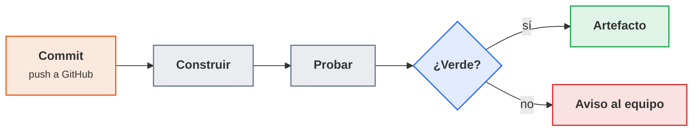

<p class="pie" markdown>El bucle de la integración continua: un commit dispara la construcción y las pruebas, y el resultado llega al equipo en minutos.</p>

### Arquitectura de Jenkins

**Objetivo**: saber qué es cada pieza que se va a ver en pantalla y dónde se ejecuta realmente el código de un trabajo, porque de eso dependen los privilegios y la seguridad del servidor. **Herramienta**: Jenkins, un servidor de automatización escrito en Java, de código abierto y con licencia MIT, que sirve por HTTP su propia interfaz web.

Jenkins se compone de cuatro elementos:

| Elemento | Qué es | Detalle que importa |
|---|---|---|
| Controlador (antes "maestro") | El proceso Jenkins: interfaz web, configuración, credenciales, planificación y registro de resultados | Guarda todo en el directorio `JENKINS_HOME` (en el contenedor, `/var/jenkins_home`, montado como volumen) |
| Agente (nodo) | Una máquina, VM o contenedor que ejecuta las construcciones y se conecta al controlador (por SSH o por el puerto `50000`) | Es quien ejecuta el código del repositorio, que no siempre es de confianza |
| Trabajo (job) | La definición de qué construir: de dónde se descarga el código, cuándo se lanza y qué comandos se ejecutan | Puede ser de estilo libre (formulario en la web) o pipeline (código, la [sesión 41](#a55-jenkinsfile-sesion-41)) |
| Plugin | Una extensión que añade funciones: fuentes de código, pasos de pipeline, publicación de informes, Docker | Cada plugin es código que corre con los privilegios de Jenkins: se instala lo necesario y se mantiene actualizado |

Cada ejecución de un trabajo es una construcción (build) con número correlativo (`#1`, `#2`...), su registro de consola y sus artefactos. Ese número es el que se usa como etiqueta de las imágenes de Docker a partir de la [A5.6](#a56-jenkins-con-docker-sesion-42).

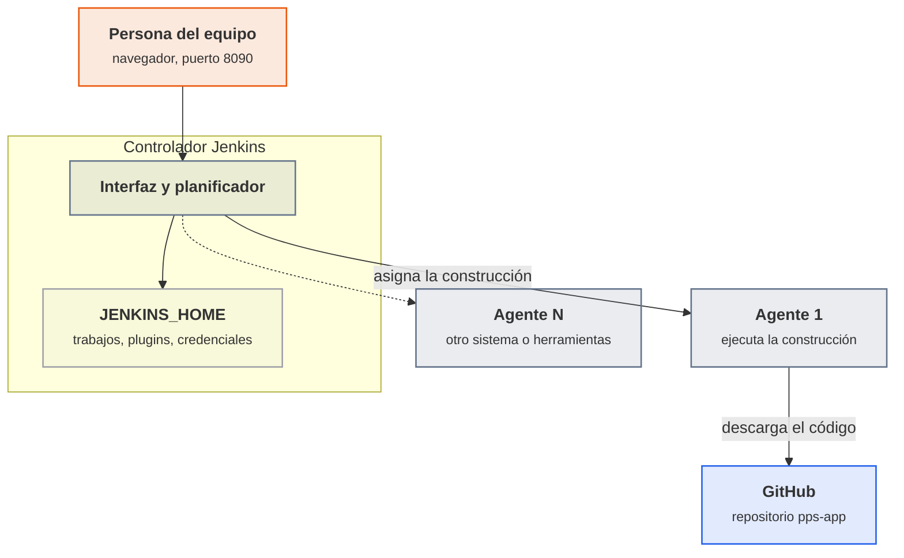

<p class="pie" markdown>El controlador planifica y guarda; los agentes construyen. En el laboratorio no hay agentes aparte y las construcciones corren en el propio controlador.</p>

**El criterio de producción es no construir en el controlador.** El controlador tiene las credenciales de todo el equipo y el acceso al disco donde viven; si una construcción ejecuta ahí código de un repositorio, quien controle ese código controla Jenkins. Por eso en producción el controlador se configura con cero ejecutores y las construcciones van a agentes desechables (una VM o un contenedor por construcción), sin credenciales fuera de las que el trabajo necesita. En el laboratorio del curso, con un solo servidor y un repositorio propio, se acepta que el controlador construya, y se recuerda en cada hoja donde ese atajo se nota. Los agentes tienen además una regla de dirección: el agente se conecta al controlador y ejecuta lo que este le manda, de modo que un agente comprometido nunca debe poder dar órdenes al controlador.

### Instalación, plugins y credenciales

**Objetivo**: dejar Jenkins funcionando de forma repetible y con los mínimos permisos. **Herramientas**: la imagen oficial `jenkins/jenkins` con la etiqueta `lts-jdk17` (versión de soporte largo, con el JDK 17 que usa la aplicación), un volumen de Docker para `JENKINS_HOME` y la propia interfaz para plugins y credenciales.

Las versiones LTS reciben las correcciones de seguridad y cambian poco: es la etiqueta indicada para un servidor que se quiere mantener. El patrón es el de la documentación oficial (puertos `8080` de interfaz y `50000` de agentes, y un volumen para `/var/jenkins_home`). La documentación ya ejemplifica con `lts-jdk21`; el laboratorio usa `lts-jdk17` porque coincide con el Java de la aplicación, y con `lts-jdk21` el resto de la hoja no cambia.

Tres decisiones de instalación tienen consecuencias de seguridad:

- **El volumen es el estado.** El contenedor se puede borrar y recrear (para actualizar la imagen, por ejemplo) sin perder trabajos, plugins ni credenciales, siempre que se monte el mismo volumen. Ese volumen es también lo que hay que copiar en la copia de seguridad ([A5.18](#a518-plan-de-recuperacion-sesion-55)).
- **La primera contraseña de administrador** la genera Jenkins en su primer arranque y la deja en el registro del contenedor y en `secrets/initialAdminPassword`. Sirve una sola vez, para crear el usuario administrador real; no se comparte ni se sube a ningún sitio.
- **Los plugins.** El asistente ofrece "instalar los sugeridos", que incluye lo necesario para esta unidad: Git (descargar código), Pipeline (escribir pipelines como código), Credentials y Credentials Binding (guardar secretos y entregarlos al trabajo), y JUnit (publicar el resultado de las pruebas). Más adelante se añade Docker Pipeline ([A5.6](#a56-jenkins-con-docker-sesion-42)). Se instala lo que se va a usar: cada plugin de más es superficie de ataque, y los avisos de seguridad de Jenkins se refieren casi siempre a plugins.

Para que Jenkins descargue un repositorio privado de GitHub, se le da una **credencial**, que se guarda en el almacén de Jenkins, se cifra en `JENKINS_HOME` y se identifica por un ID (aquí `github-token`). El trabajo la nombra por su ID y Jenkins la entrega al ejecutarlo, enmascarando su valor en el registro. La credencial nunca va escrita en el trabajo ni en el repositorio. Lo que se guarda es un token personal de GitHub con el mínimo permiso posible (lectura de contenido de un solo repositorio), no la contraseña de la cuenta: un token se revoca sin cambiar la contraseña, y si se filtra solo abre lo que se le concedió.

!!! ojo "Un Jenkins sin usuario es un servidor de ejecución remota"
    Un trabajo de Jenkins ejecuta comandos de shell. Quien pueda crear o editar trabajos puede ejecutar cualquier orden con el usuario `jenkins`, y ese usuario ve todas las credenciales del almacén. Un Jenkins con el acceso anónimo abierto o con la contraseña inicial sin cambiar se puede usar para atacar el propio servidor y todo lo que este alcance. En el laboratorio, `pps01` solo es alcanzable desde el propio equipo (NAT y red de solo anfitrión). En cualquier otro sitio, Jenkins va detrás de un proxy con HTTPS y con los permisos por rol.

### A5.4 Jenkins: primer trabajo (sesión 40)

<span class="et et-obj">Objetivo</span> Jenkins corre en un contenedor de `pps01` en `http://192.168.56.10:8090`, tiene una credencial `github-token` y un trabajo `pps-app-build` que descarga `pps-app` de GitHub, lo compila y ejecuta sus pruebas, con el resultado de los tests publicado en la página de la construcción.

<span class="et et-pre">Antes de empezar</span> `pps01` encendida con Docker, Java y Maven, y el repositorio `pps-app` en tu cuenta de GitHub (`pps<NIA>`) con la aplicación y sus pruebas de la [A5.3](#a53-construccion-con-maven-sesion-39), que pasan con `mvn test` en `pps01`. Se han explicado la [integración continua](#integracion-continua), la [arquitectura de Jenkins](#arquitectura-de-jenkins) y la [instalación, plugins y credenciales](#instalacion-plugins-y-credenciales). Sustituye `pps<NIA>` por tu usuario en todo lo que sigue.

<span class="et et-pas">Pasos</span>

1. Prepara la imagen de Jenkins con Maven. La imagen oficial no lo trae y sin él no hay forma de compilar `pps-app`. Crea `~/jenkins-lab/Dockerfile` y constrúyela (la descarga tarda: mientras corre, sigue con el paso 4):

    ```dockerfile
    FROM jenkins/jenkins:lts-jdk17
    USER root
    RUN apt-get update && apt-get install -y --no-install-recommends maven \
        && rm -rf /var/lib/apt/lists/*
    USER jenkins
    ```

    ```bash
    mkdir -p ~/jenkins-lab && cd ~/jenkins-lab
    docker build -t pps-jenkins:1 .
    ```

2. Arranca el contenedor con el volumen `jenkins_home` y comprueba que Maven está dentro:

    ```bash
    docker run -d --name jenkins --restart unless-stopped \
      -p 8090:8080 -p 50000:50000 \
      -v jenkins_home:/var/jenkins_home pps-jenkins:1
    docker exec jenkins mvn -v
    docker exec jenkins cat /var/jenkins_home/secrets/initialAdminPassword
    ```

    La última orden imprime la contraseña inicial. Si `mvn -v` dice que no encuentra la orden, la imagen no es la tuya: repasa el nombre del paso 1.

3. Abre `http://192.168.56.10:8090` desde el navegador del equipo anfitrión (o `http://localhost:8090` en `pps01`), pega la contraseña, elige "Install suggested plugins" y espera (de 5 a 15 minutos con toda el aula descargando a la vez). Crea tu usuario administrador con una contraseña que no reutilices en otro sitio y acepta la URL de Jenkins que propone.
4. En GitHub, crea el token: *Settings*, *Developer settings*, *Fine-grained personal access tokens*, con acceso solo al repositorio `pps-app`, permiso *Contents: Read-only* y caducidad de 30 días. Cópialo en el momento: GitHub no lo vuelve a mostrar.
5. En Jenkins, *Manage Jenkins*, *Credentials*, *System*, *Global credentials*, *Add Credentials*: tipo *Username with password*, usuario `pps<NIA>`, contraseña el token, ID `github-token`. El ID tiene que ser exactamente ese porque las hojas siguientes lo nombran.
6. Crea el trabajo: *New Item*, nombre `pps-app-build`, tipo *Freestyle project*. En *Source Code Management* elige Git, con la URL `https://github.com/pps<NIA>/pps-app.git`, la credencial `github-token` y la rama `*/main` (si tu rama principal se llama distinto, pon la tuya). En *Build Steps* añade *Execute shell* con:

    ```bash
    mvn -B clean package
    ```

    En *Post-build Actions* añade *Publish JUnit test result report* con `target/surefire-reports/*.xml`. Guarda.

7. Pulsa *Build Now* y abre la construcción `#1`, *Console Output*. Al final tiene que aparecer `BUILD SUCCESS` y `Finished: SUCCESS`; en la página del trabajo aparece la gráfica de resultados de las pruebas. Si falla, el error está en el propio registro: casi siempre es la URL, la rama o la credencial ([Errores frecuentes](#errores-frecuentes-en-el-laboratorio)).
8. Comprueba que la integración continua sirve para algo: en tu copia local de `pps-app`, cambia el valor que espera uno de los tests de la A5.3 (por ejemplo, el texto "Hola PPS" por otro) sin tocar el código de la aplicación, haz `git commit` y `git push`, y pulsa *Build Now*. La construcción `#2` tiene que salir roja y decir qué test ha fallado. Deshaz el cambio (`git revert HEAD`), súbelo y comprueba que la `#3` vuelve a verde. Captura las tres.

<span class="et et-com">Comprobación</span> `docker ps` muestra `jenkins` con los puertos `8090` y `50000`; en el panel del trabajo hay tres construcciones (verde, roja, verde); la roja muestra el test que falla en la pestaña *Test Result*; y tu token no aparece en ninguna captura ni en `git log`.

<span class="et et-ent">Entrega</span> Carpeta `ut5/a54/` de `pps-entregas` con un `README.md` que diga qué se ha hecho, los comandos de los pasos 1 y 2 y la captura de cada construcción (`build1-verde.png`, `build2-rojo.png`, `build3-verde.png`) y de la configuración del trabajo sin el token (`config-trabajo.png`). Forma parte de la entrega ACT_UT5_1, con plazo el jueves 15 de abril a las 23:59.

<span class="et et-ext">Si te sobra tiempo</span> Borra el contenedor (`docker rm -f jenkins`) y vuelve a crearlo con la misma orden del paso 2: el trabajo, el usuario y la credencial siguen ahí porque viven en el volumen `jenkins_home`. Luego mira en *Manage Jenkins*, *Nodes*, cuántos ejecutores tiene el nodo integrado y qué cambiaría si se pusiera a cero.

## Sesión 41 · Pipeline como código: Jenkinsfile

<p class="ut-meta" markdown>22 de marzo · Teoría y práctica · <span class="dur" tabindex="0" aria-label="Pipeline declarativo · 10 min&#10;El Jenkinsfile en el repositorio · 5 min&#10;A5.5 Jenkinsfile · 95 min" data-dur="Pipeline declarativo · 10 min&#10;El Jenkinsfile en el repositorio · 5 min&#10;A5.5 Jenkinsfile · 95 min">:material-school:<i class="dur-barra" style="--teoria:14%"></i>:material-flask:</span></p>

Al acabar esta sesión la definición del trabajo ya no vive en un formulario de Jenkins sino en un fichero `Jenkinsfile` de la raíz de `pps-app`, con las etapas de construcción, pruebas y publicación del informe, y Jenkins lo lanza solo cuando detecta un commit nuevo. Se ve primero la estructura de un pipeline declarativo y después por qué conviene que el fichero viaje con el código.

!!! consulta "Material de partida"
    - **Aula** (`RA5-Despliegue-seguro/02 ACT_RA5_1 - Jenkins/RA5.1.pdf`): el apartado 1.2.1 describe el Jenkinsfile (declarativo o *scripted*, en la raíz del repositorio) y remite a colecciones de ejemplos: <https://github.com/jenkinsci/pipeline-examples>, <https://github.com/hoto/jenkinsfile-examples> y un *gist* de ejemplos. El punto 3.1 del enunciado pide las tareas 1 y 2 del apunte de Jenkins y "realizar la pipeline con el fichero Jenkinsfile".
    - **Web, apuntes de terceros** (se enlazan, no se copian): *Ciberseguridad-PePS*, tema 5, «Jenkins», apartados «Introducción a las pipelines», «Jenkinsfile» y «Tareas», <https://psegarrac.github.io/Ciberseguridad-PePS/tema5/cd/ci/2022/01/13/jenkins.html>. Sus ejemplos usan Gradle y una calculadora de Spring Boot; aquí la misma estructura se aplica a `pps-app` con Maven, y la calculadora de Python de la tarea 1 se hace en la [A5.6](#a56-jenkins-con-docker-sesion-42), cuando ya hay agentes Docker.
    - **Documentación oficial**: <https://www.jenkins.io/doc/book/pipeline/> y <https://www.jenkins.io/doc/book/pipeline/jenkinsfile/>.

### Pipeline declarativo

**Objetivo**: describir en un fichero qué etapas tiene la construcción y qué hace cada una. **Herramienta**: la sintaxis declarativa de pipeline de Jenkins, un lenguaje basado en Groovy con una estructura fija.

Jenkins admite dos sintaxis. La *scripted* es Groovy libre y permite casi todo, incluidos errores difíciles de leer. La **declarativa** tiene una estructura cerrada que Jenkins valida antes de ejecutar, y es la que se usa en el curso: un fallo de sintaxis se detecta al empezar, no a mitad de la construcción. Un pipeline declarativo es un bloque `pipeline` con estas piezas:

| Pieza | Qué expresa | Ejemplo |
|---|---|---|
| `agent` | Dónde se ejecuta el pipeline o una etapa | `agent any` (cualquier nodo disponible) |
| `stages` y `stage` | Las etapas, en orden. Si una falla, las siguientes no se ejecutan | `stage('Pruebas')` |
| `steps` | Las órdenes de una etapa | `sh 'mvn -B test'` |
| `environment` | Variables disponibles en todo el pipeline o en una etapa | `APP = 'pps-app'` |
| `options` | Comportamiento general: tiempo máximo, número de construcciones que se conservan | `timeout(time: 10, unit: 'MINUTES')` |
| `triggers` | Qué lanza el pipeline sin pulsar el botón | `pollSCM('H/2 * * * *')` |
| `post` | Qué se hace al terminar según el resultado (`always`, `success`, `failure`) | `junit '...'` para publicar resultados aunque las pruebas fallen |

Un *step* es una sola operación (`sh` ejecuta una orden de shell, `echo` escribe en el registro, `junit` publica resultados de pruebas, `archiveArtifacts` guarda ficheros). Una *stage* agrupa steps con un nombre, y esos nombres son las columnas de la vista de etapas que Jenkins dibuja para cada construcción: verde si la etapa pasó, roja si falló y gris si no llegó a ejecutarse.

Las variables de `environment` se leen en los `sh` como variables de shell (`$APP`). Jenkins añade las suyas, entre ellas `BUILD_NUMBER` (el número de la construcción), `WORKSPACE` (la carpeta de trabajo) y `JOB_NAME`. Una precaución de Groovy que da problemas reales: una cadena entre comillas simples se pasa tal cual al shell, y una entre comillas dobles la interpola Groovy antes de ejecutar. Para valores públicos da igual; para un secreto, la interpolación de Groovy deja el valor en el registro de la construcción y en el historial, y por eso los secretos se usan siempre en comillas simples y con el mecanismo de credenciales ([sesión 43](#a57-pipeline-seguro-sesion-43)).

```groovy
pipeline {
    agent any
    environment { APP = 'pps-app' }
    stages {
        stage('Construir') {
            steps { sh 'mvn -B -DskipTests clean package' }
        }
        stage('Pruebas') {
            steps { sh 'mvn -B test' }
            post { always { junit 'target/surefire-reports/*.xml' } }
        }
    }
}
```

### El Jenkinsfile en el repositorio

**Objetivo**: que la forma de construir una aplicación se versione, se revise y se recupere igual que el código de la aplicación. **Herramienta**: el trabajo de tipo *Pipeline* con la opción *Pipeline script from SCM*, que le dice a Jenkins de qué repositorio y qué fichero leer.

Un pipeline escrito en el formulario web de Jenkins solo existe en Jenkins: si el servidor se pierde, se pierde con él, y nadie ve quién lo cambió ni por qué. Con el `Jenkinsfile` en la raíz del repositorio ocurre lo contrario, y cada ventaja es también una propiedad de seguridad:

- **Trazabilidad**: el historial de Git dice quién cambió el pipeline, cuándo y con qué mensaje.
- **Revisión**: un cambio en el pipeline entra por un pull request con la revisión obligatoria de la [A5.2](#a52-git-en-equipo-sesion-38), como cualquier otro cambio. Sin esa revisión, quien pueda subir código puede cambiar lo que Jenkins ejecuta y con qué credenciales.
- **Recuperación**: si se reinstala Jenkins, basta con apuntar un trabajo nuevo al repositorio.
- **Coherencia**: cada rama y cada commit llevan el pipeline que les corresponde.

Jenkins hace primero la descarga del repositorio y después lee el fichero, de modo que la etapa de descarga no se escribe: en el pipeline desde SCM es implícita. Tampoco hace falta que el cambio se lance a mano. En el laboratorio, el disparador es el sondeo del repositorio (`pollSCM`): Jenkins pregunta a GitHub cada cierto tiempo si hay commits nuevos. La alternativa habitual en producción es el *webhook*, en que GitHub avisa a Jenkins en el mismo instante del push; exige que GitHub alcance el servidor de Jenkins, y la dirección `192.168.56.10` de `pps01` no es accesible desde Internet. Ese es el motivo del sondeo, y por eso no se abre el laboratorio a la red para conseguirlo.

### A5.5 Jenkinsfile (sesión 41)

<span class="et et-obj">Objetivo</span> `pps-app` lleva en su raíz un `Jenkinsfile` con las etapas Construir, Pruebas e Informe; un trabajo `pps-app-pipeline` lo lee del repositorio, se lanza solo al detectar un commit y sabes ver en la vista de etapas cuál falla cuando se rompe una.

<span class="et et-pre">Antes de empezar</span> Jenkins funcionando con la credencial `github-token` y el trabajo `pps-app-build` de la [A5.4](#a54-jenkins-primer-trabajo-sesion-40). Se han explicado el [pipeline declarativo](#pipeline-declarativo) y [el Jenkinsfile en el repositorio](#el-jenkinsfile-en-el-repositorio). El `jar` de la aplicación se llama `target/pps-app.jar`, como quedó en la [A5.3](#a53-construccion-con-maven-sesion-39).

<span class="et et-pas">Pasos</span>

1. En tu copia local de `pps-app`, crea el `Jenkinsfile` de la raíz con este contenido (cópialo y cambia solo lo que se indica en el paso 5):

    ```groovy
    pipeline {
        agent any
        options {
            timeout(time: 10, unit: 'MINUTES')
            buildDiscarder(logRotator(numToKeepStr: '10'))
        }
        triggers { pollSCM('H/2 * * * *') }
        environment { APP = 'pps-app' }
        stages {
            stage('Construir') {
                steps { sh 'mvn -B -DskipTests clean package' }
            }
            stage('Pruebas') {
                steps { sh 'mvn -B test' }
                post { always { junit 'target/surefire-reports/*.xml' } }
            }
            stage('Informe') {
                steps {
                    archiveArtifacts artifacts: 'target/pps-app.jar, target/surefire-reports/*.txt', fingerprint: true
                }
            }
        }
        post {
            success { echo "${env.APP} #${env.BUILD_NUMBER}: construcción correcta" }
            failure { echo "${env.APP} #${env.BUILD_NUMBER}: construcción fallida, revisa la etapa en rojo" }
        }
    }
    ```

2. Súbelo al repositorio:

    ```bash
    git add Jenkinsfile && git commit -m "A5.5 Jenkinsfile" && git push
    ```

3. En Jenkins crea un trabajo nuevo, `pps-app-pipeline`, de tipo *Pipeline*. En la sección *Pipeline* elige *Pipeline script from SCM*, SCM `Git`, la misma URL de `pps-app` y la credencial `github-token`, la rama `*/main` y *Script Path* `Jenkinsfile`. Guarda.
4. Pulsa *Build Now*. La primera construcción lee el `Jenkinsfile`, registra el disparador y ejecuta las tres etapas. Comprueba en la vista de etapas que las tres son verdes y que en la página de la construcción aparecen el `jar` y los resultados de las pruebas.
5. Comprueba el disparador automático. Cambia en el `Jenkinsfile` el mensaje del `echo` de `success`, haz commit y push, y no pulses nada: en menos de tres minutos tiene que aparecer una construcción nueva, con la etiqueta *Started by an SCM change*. Si no aparece, mira *Git Polling Log* en el menú del trabajo.
6. Rompe cada etapa a propósito, de una en una, con un commit por prueba (pulsa *Build Now* en vez de esperar al sondeo), y apunta qué ves en la vista de etapas:
    - Construir: quita un punto y coma de una clase Java (no compila).
    - Pruebas: cambia el valor que espera un test.
    - Informe: cambia en `archiveArtifacts` el valor de `artifacts` por un fichero que no exista, como `'target/no-existe.jar'` (si solo se cambia el nombre del `jar`, el patrón sigue encontrando los `.txt` de pruebas y la etapa no falla).

    Tras cada prueba, `git revert HEAD` y `git push` dejan el pipeline en verde otra vez.

7. Anota en el README qué etapas quedan grises en cada caso y por qué (una etapa que falla detiene las siguientes) y cuánto ha tardado el disparador en actuar.

<span class="et et-com">Comprobación</span> El trabajo tiene construcciones verdes, una lanzada por el commit del paso 5 y tres rojas (una por etapa rota). En cada roja, solo esa etapa y las posteriores cambian de color, y el `Jenkinsfile` de la última construcción es el que está en `main`.

<span class="et et-ent">Entrega</span> Carpeta `ut5/a55/` de `pps-entregas` con el `README.md` del paso 7, la vista de etapas del pipeline correcto y la de cada etapa rota (`etapas-verde.png`, `etapas-construir.png`, `etapas-pruebas.png`, `etapas-informe.png`), y el `Jenkinsfile` final. El repositorio `pps-app` con el `Jenkinsfile` en la raíz forma parte de la entrega ACT_UT5_1, con plazo el jueves 15 de abril a las 23:59.

<span class="et et-ext">Si te sobra tiempo</span> Añade una etapa `Analisis` entre `Pruebas` e `Informe` que ejecute `mvn -B verify` y comprueba en la vista de etapas cuánto tiempo añade. O prueba `parallel` para lanzar dos comprobaciones a la vez dentro de una etapa.

## Sesión 42 · Docker en el pipeline

<p class="ut-meta" markdown>5 de abril · Teoría y práctica · <span class="dur" tabindex="0" aria-label="Imágenes y contenedores · 5 min&#10;Dockerfile y compose de pps-app · 10 min&#10;Jenkins y Docker · 10 min&#10;A5.6 Jenkins con Docker · 85 min" data-dur="Imágenes y contenedores · 5 min&#10;Dockerfile y compose de pps-app · 10 min&#10;Jenkins y Docker · 10 min&#10;A5.6 Jenkins con Docker · 85 min">:material-school:<i class="dur-barra" style="--teoria:23%"></i>:material-flask:</span></p>

Al acabar esta sesión `pps-app` tiene un `Dockerfile` y un `compose.yml`, y un segundo pipeline, `jenkinsfile.docker`, compila dentro de un contenedor, construye la imagen `pps<NIA>/pps-app:<número de construcción>`, la ejecuta, le pasa las pruebas y levanta el `compose`. Se repasa lo justo de imágenes y contenedores, se escribe el `Dockerfile` y el `compose` de la aplicación y se ve cómo un Jenkins que corre en un contenedor puede manejar Docker, con el riesgo que eso supone.

!!! consulta "Material de partida"
    - **Aula**: el enunciado `RA5.1.pdf` (`RA5-Despliegue-seguro/02 ACT_RA5_1 - Jenkins`) fija el contenido del `jenkinsfile.docker` en su punto 3.2: una etapa que ejecuta el pipeline en un entorno Docker, otra que crea una imagen, otra que la ejecuta, otra que ejecuta los tests dentro del contenedor, un `docker-compose` en el repositorio y una etapa que lo ejecuta. La bibliografía cita *Using Docker with Pipeline* (<https://www.jenkins.io/doc/book/pipeline/docker/>) y los ejemplos `pkaminasfp/jenkins` (<https://github.com/pkaminasfp/jenkins>). En `01 Material` está `02-Docker.pdf` (Docker: imágenes, contenedores, volúmenes) y `docker_deep_dive.pdf` (libro comercial, solo referencia de fondo).
    - **Web, apuntes de terceros** (se enlazan, no se copian): *Ciberseguridad-PePS*, tema de Docker (<https://psegarrac.github.io/Ciberseguridad-PePS/>, entradas «Docker» de 2021-01-08 y «Docker compose» de 2021-01-13) y el taller de Docker de Aula Software Libre (<https://aulasoftwarelibre.github.io/taller-de-docker/dockerfile/>).
    - **Documentación oficial**: <https://www.jenkins.io/doc/book/pipeline/docker/>, <https://docs.docker.com/reference/dockerfile/> y <https://docs.docker.com/compose/>.

### Imágenes y contenedores

**Objetivo**: distinguir qué se construye y qué se ejecuta, porque el pipeline produce lo primero y despliega lo segundo. **Herramienta**: Docker, ya conocido; aquí solo interesan los conceptos que cambian una decisión de seguridad.

| Concepto | Qué es | Consecuencia en un pipeline |
|---|---|---|
| Imagen | Plantilla de solo lectura, hecha de capas: sistema base, dependencias, aplicación | Es el artefacto que se construye una vez y se despliega igual en todos los entornos |
| Etiqueta (tag) | Nombre de versión de una imagen, como `pps-app:12` | Una etiqueta se puede mover: `latest` apunta a otra imagen mañana. El pipeline etiqueta con el número de construcción (`pps<NIA>/pps-app:12`) para saber qué código lleva cada imagen |
| Contenedor | Una imagen en ejecución: un proceso aislado con su sistema de ficheros y su red | Es desechable: se para y se sustituye, no se arregla dentro |
| Registro | Servidor de imágenes (Docker Hub) | Publicar en él es la última etapa del pipeline de la [A5.19](#a519-proyecto-construccion-y-pipeline-sesion-56) |
| Volumen | Almacenamiento que sobrevive al contenedor | Lo que no está en un volumen se pierde al recrear el contenedor |

Una imagen no debe llevar secretos: cada instrucción del `Dockerfile` crea una capa, y una contraseña copiada y borrada en una capa posterior sigue estando en la anterior. Tampoco debe ejecutarse como `root` si no hace falta: si un fallo de la aplicación permite ejecutar órdenes, las ejecuta con el usuario del contenedor. Estos dos criterios (sin secretos, sin `root`) son los que revisa la [A2.4 de la UT2](ut2-nivel-seguridad.md#a24-docker-aislamiento-y-auditoria-sesion-12) y los que se aplican a la imagen de `pps-app`.

### Dockerfile y compose de pps-app

**Objetivo**: empaquetar el `jar` en una imagen pequeña y arrancarla con una orden. **Herramientas**: el `Dockerfile` describe cómo se construye la imagen, y Docker Compose describe cómo se ejecuta uno o varios contenedores.

El `Dockerfile` de `pps-app` parte de una imagen con solo el entorno de ejecución de Java (no el JDK completo: la aplicación no compila nada al arrancar), crea un usuario sin privilegios y copia el `jar` que ya construyó Maven:

```dockerfile
FROM eclipse-temurin:17-jre
RUN useradd --system --uid 10001 app
WORKDIR /app
COPY target/pps-app.jar app.jar
USER app
EXPOSE 8080
ENTRYPOINT ["java", "-jar", "app.jar"]
```

`FROM` fija la base, `COPY` mete el `jar`, `USER` baja los privilegios antes de arrancar, `EXPOSE` documenta el puerto y `ENTRYPOINT` es el proceso del contenedor. El `compose.yml` describe la ejecución. Las dos variables, `IMAGEN` y `TAG`, las pone el pipeline: así el fichero del repositorio no lleva el usuario de nadie y sirve a todo el grupo:

```yaml
name: pps-app
services:
  app:
    image: ${IMAGEN:-pps-app}:${TAG:-latest}
    ports:
      - "8092:8080"
    restart: unless-stopped
```

El servicio `app` publica el `8080` del contenedor en el `8092` de la VM. `restart: unless-stopped` hace que Docker lo levante de nuevo si el proceso muere o si se reinicia la máquina, y es lo que la [A5.17](#a517-reaccion-a-fallos-sesion-54) pondrá a prueba. El compose de balanceo con dos réplicas y nginx, que se despliega en K3s en la [A5.14](#a514-balanceo-en-k3s-y-k9s-sesion-51), es una ampliación de este mismo fichero.

### Jenkins y Docker

**Objetivo**: que las etapas del pipeline se ejecuten en contenedores limpios y desechables y que Jenkins pueda construir imágenes. **Herramientas**: el plugin *Docker Pipeline* (añade `agent { docker { ... } }`) y la CLI de Docker dentro de la imagen de Jenkins.

Hay dos usos distintos de Docker en un pipeline, y conviene no mezclarlos:

| Uso | Sintaxis | Qué aporta |
|---|---|---|
| **La etapa corre dentro de un contenedor** | `agent { docker { image 'maven:3.9-eclipse-temurin-17' } }` (o `agent { dockerfile true }`, que construye el entorno desde un `Dockerfile` del repositorio) | Entorno limpio y con las versiones fijadas, sin instalar Maven ni Java en el servidor |
| **La etapa maneja Docker** | `sh 'docker build ...'`, `sh 'docker run ...'`, `sh 'docker compose up'` | Construir y ejecutar imágenes, que es el producto del pipeline |

Ambos necesitan que Jenkins pueda hablar con un demonio de Docker. Si Jenkins es un contenedor, se le da el acceso montando el socket del demonio del anfitrión (`/var/run/docker.sock`) y la CLI de Docker en la imagen.

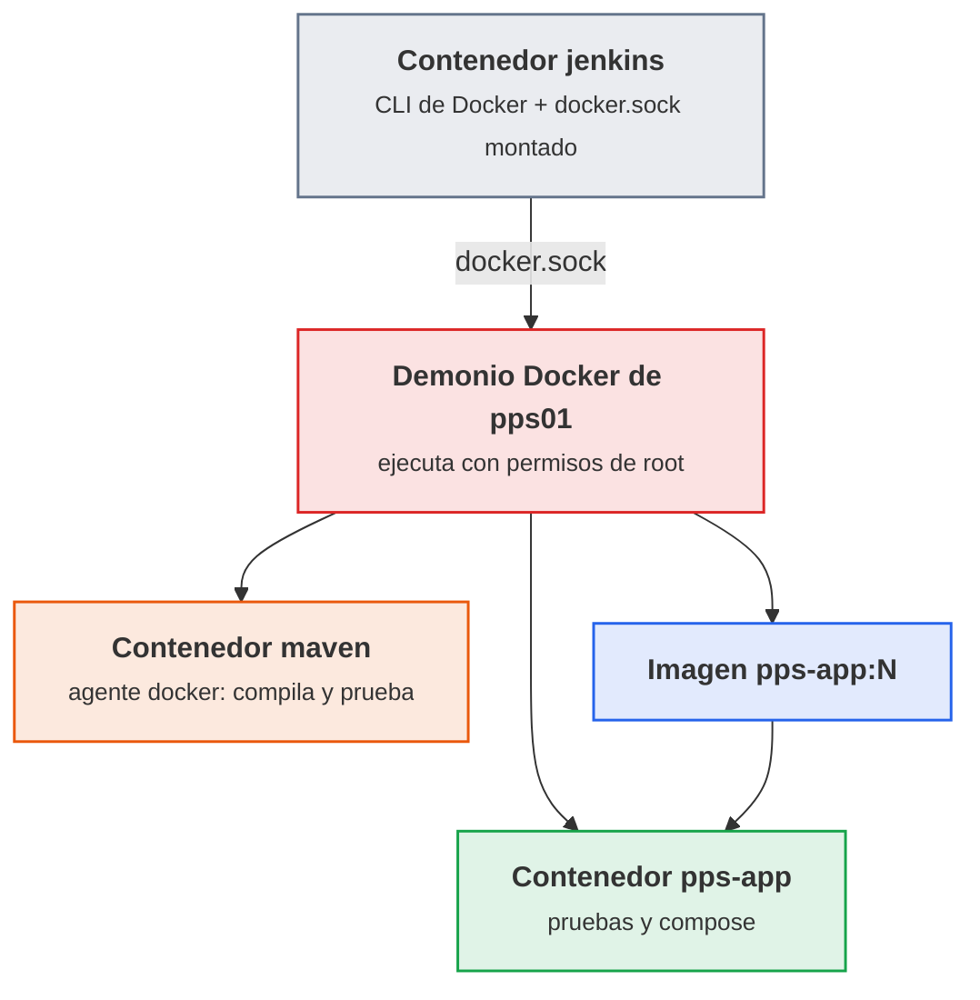

<p class="pie" markdown>Con el socket montado, los contenedores que crea Jenkins no son hijos suyos sino hermanos, creados por el demonio del anfitrión.</p>

!!! ojo "Montar docker.sock equivale a dar root sobre el servidor"
    Quien puede hablar con el demonio puede pedirle un contenedor que monte el disco entero de la máquina (`docker run -v /:/host ...`) y leer o cambiar cualquier fichero como `root`. Un pipeline con `docker.sock` puede, por tanto, hacer lo mismo, y con él cualquiera que pueda editar el `Jenkinsfile`. En el laboratorio se acepta, porque `pps01` es una VM del propio alumno, sin datos ni credenciales ajenas. En producción no: las alternativas son un demonio de Docker aislado en el agente (Docker en Docker con TLS, que es lo que documenta Jenkins), agentes desechables que ejecutan las construcciones en su propia máquina, o herramientas que construyen imágenes sin demonio y sin `root` (Kaniko, Buildah). Además, el `Jenkinsfile` que se ejecuta con ese acceso tiene que pasar por la revisión obligatoria de la [A5.2](#a52-git-en-equipo-sesion-38).

Un detalle práctico del agente Docker: la carpeta de trabajo de la construcción (el *workspace*) se monta dentro del contenedor, así que lo que se compila dentro está en el workspace y sobrevive al contenedor. Lo que no está en el workspace, como la caché de Maven en `/root/.m2`, se pierde con él; en la hoja se guarda dentro del workspace para no descargar las dependencias en cada construcción. Entre etapas con agentes distintos se pasan ficheros con `stash` y `unstash`.

### A5.6 Jenkins con Docker (sesión 42)

<span class="et et-obj">Objetivo</span> `pps-app` tiene `Dockerfile` y `compose.yml`, y el pipeline `jenkinsfile.docker` compila y prueba dentro de un contenedor, construye la imagen `pps<NIA>/pps-app:<construcción>`, la ejecuta, le pasa los tests dentro del contenedor y levanta el `compose`, todo desde Jenkins.

<span class="et et-pre">Antes de empezar</span> Jenkins funcionando con `github-token` y los pipelines de la [A5.4](#a54-jenkins-primer-trabajo-sesion-40) y la [A5.5](#a55-jenkinsfile-sesion-41), y `mvn package` que genera `target/pps-app.jar`. Se han explicado las [imágenes y contenedores](#imagenes-y-contenedores), el [Dockerfile y el compose de pps-app](#dockerfile-y-compose-de-pps-app) y [Jenkins y Docker](#jenkins-y-docker). Sustituye `pps<NIA>` por tu usuario. El puerto `8092` de `pps01` tiene que estar libre.

<span class="et et-pas">Pasos</span>

1. En tu copia local de `pps-app`, crea el `Dockerfile` y el `compose.yml` de la raíz copiando los de la teoría tal cual. Comprueba a mano que la imagen funciona antes de meter Jenkins por medio:

    ```bash
    mvn -B package
    docker build -t pps<NIA>/pps-app:local .
    docker run -d --name prueba -p 8092:8080 pps<NIA>/pps-app:local
    curl -s http://localhost:8092/ ; curl -s http://localhost:8092/salud
    docker rm -f prueba
    ```

    Tienen que salir `Hola PPS` y `{"estado":"ok"}`. Sube ambos ficheros con `git add`, `git commit` y `git push`.

2. Dale a Jenkins la CLI de Docker. En `~/jenkins-lab/Dockerfile` (el de la A5.4), deja el contenido siguiente y reconstruye con una etiqueta nueva; instala Maven, el cliente de Docker y el plugin de compose desde el repositorio oficial de Docker:

    ```dockerfile
    FROM jenkins/jenkins:lts-jdk17
    USER root
    RUN apt-get update && apt-get install -y --no-install-recommends maven ca-certificates curl \
        && install -m 0755 -d /etc/apt/keyrings \
        && curl -fsSL https://download.docker.com/linux/debian/gpg -o /etc/apt/keyrings/docker.asc \
        && echo "deb [signed-by=/etc/apt/keyrings/docker.asc] https://download.docker.com/linux/debian $(. /etc/os-release && echo $VERSION_CODENAME) stable" \
           > /etc/apt/sources.list.d/docker.list \
        && apt-get update && apt-get install -y --no-install-recommends docker-ce-cli docker-compose-plugin \
        && rm -rf /var/lib/apt/lists/*
    USER jenkins
    ```

    ```bash
    cd ~/jenkins-lab && docker build -t pps-jenkins:2 .
    ```

3. Recrea el contenedor de Jenkins con el socket montado y el grupo de Docker, y comprueba que desde dentro ve el demonio. El volumen `jenkins_home` es el mismo, así que conservas trabajos, usuario y credenciales:

    ```bash
    docker rm -f jenkins
    docker run -d --name jenkins --restart unless-stopped \
      -p 8090:8080 -p 50000:50000 \
      -v jenkins_home:/var/jenkins_home \
      -v /var/run/docker.sock:/var/run/docker.sock \
      --group-add $(stat -c %g /var/run/docker.sock) pps-jenkins:2
    docker exec jenkins docker version
    ```

    La orden tiene que mostrar el cliente y el servidor. Si dice `permission denied`, el grupo del `--group-add` no es el del socket: repite la orden sin cambiar nada más.

4. En Jenkins (`http://192.168.56.10:8090`), instala el plugin *Docker Pipeline*: *Manage Jenkins*, *Plugins*, *Available plugins*, busca `Docker Pipeline`, instala y marca reiniciar si lo pide.
5. Crea `jenkinsfile.docker` en la raíz de `pps-app`. Solo cambia `pps<NIA>` en `IMAGEN`:

    ```groovy
    pipeline {
        agent none
        options { timeout(time: 20, unit: 'MINUTES') }
        environment {
            IMAGEN = 'pps<NIA>/pps-app'
            PRUEBA = 'pps-app-prueba'
        }
        stages {
            stage('Construir en Docker') {
                agent { docker { image 'maven:3.9-eclipse-temurin-17' } }
                steps {
                    sh 'mvn -B -Dmaven.repo.local=$WORKSPACE/.m2 clean package'
                    stash name: 'app', includes: 'target/pps-app.jar'
                }
                post { always { junit 'target/surefire-reports/*.xml' } }
            }
            stage('Crear imagen') {
                agent any
                steps {
                    unstash 'app'
                    sh 'docker build -t $IMAGEN:$BUILD_NUMBER .'
                }
            }
            stage('Ejecutar contenedor') {
                agent any
                steps {
                    sh 'docker rm -f $PRUEBA || true'
                    sh 'docker run -d --name $PRUEBA $IMAGEN:$BUILD_NUMBER'
                    sh 'sleep 5'
                }
            }
            stage('Pruebas en el contenedor') {
                agent any
                steps {
                    sh 'docker run --rm --network container:$PRUEBA curlimages/curl:latest -fsS http://localhost:8080/ | grep "Hola PPS"'
                    sh 'docker run --rm --network container:$PRUEBA curlimages/curl:latest -fsS http://localhost:8080/salud | grep estado'
                }
                post { always { sh 'docker logs $PRUEBA || true; docker rm -f $PRUEBA || true' } }
            }
            stage('Docker Compose') {
                agent any
                steps {
                    sh 'TAG=$BUILD_NUMBER docker compose up -d'
                    sh 'sleep 5'
                    sh 'docker run --rm --network pps-app_default curlimages/curl:latest -fsS http://app:8080/salud'
                }
            }
        }
    }
    ```

    Las pruebas entran al contenedor por su propia red (`--network container:...`) y no por un puerto publicado, porque `localhost` dentro de Jenkins es Jenkins y no `pps01`. Sube el fichero.

6. Crea el trabajo `pps-app-docker` de tipo *Pipeline*, *Pipeline script from SCM* con el repositorio y la credencial de siempre y *Script Path* `jenkinsfile.docker`. Pulsa *Build Now*. La primera vez descarga las imágenes de `maven` y `curl` (de 3 a 10 minutos con el aula entera descargando); las siguientes construcciones tardan una fracción.
7. Comprueba desde `pps01` lo que ha dejado el pipeline: `docker images pps<NIA>/pps-app` (una imagen por construcción, con el número de la construcción como etiqueta), `docker ps` (el contenedor del compose) y `curl -s http://localhost:8092/salud`.
8. Rompe la etapa de pruebas y observa la reacción: cambia en el `jenkinsfile.docker` el texto que busca el `grep` (por ejemplo, `Adios PPS`), sube el cambio y lanza el trabajo. La etapa `Pruebas en el contenedor` tiene que salir en rojo y `Docker Compose` en gris. Después restaura el texto.
9. Escribe el README de la carpeta de entrega y haz las capturas.

<span class="et et-com">Comprobación</span> La vista de etapas de una construcción correcta muestra las cinco etapas en verde; `docker images` lista `pps<NIA>/pps-app` con el número de construcción como etiqueta y `curl` al `8092` devuelve `{"estado":"ok"}`. En la construcción rota, la etapa de pruebas está en rojo y la de compose en gris: no se ha desplegado nada nuevo.

<span class="et et-ent">Entrega</span> Carpeta `ut5/a56/` de `pps-entregas` con el `README.md` (qué hace cada etapa en una línea, los comandos de los pasos 2, 3 y 7, y qué implica montar `docker.sock` en tres frases tuyas), el `jenkinsfile.docker`, el `Dockerfile`, el `compose.yml` y las capturas `etapas-docker-verde.png`, `etapas-docker-roja.png` y `curl-salud.png`. El repositorio `pps-app` con los cuatro ficheros forma parte de la entrega ACT_UT5_1 (enunciado RA5.1, punto 3.2), con plazo el jueves 15 de abril a las 23:59, y su README tiene que incluir una captura de las pipelines funcionando con una breve explicación.

<span class="et et-ext">Si te sobra tiempo</span> Cierra la tarea 1 y 2 del apunte de Jenkins del enunciado, que pide la calculadora en Python: crea un repositorio `calculadora` con `calculadora.py` (multiplica dos números de la línea de comandos), `test_calculadora.py` con `unittest` y un `Jenkinsfile` con `agent { docker { image 'python:3.12-slim' } }`, un `sh 'python -m unittest'` y `pollSCM`. Rompe una etapa y comprueba la reacción, igual que en la A5.5.

!!! examen "Qué se evalúa de este bloque"
    - Diferencia entre integración, entrega y despliegue continuos, y por qué una etapa que falla detiene las siguientes.
    - Piezas de Jenkins (controlador, agente, trabajo, plugin) y por qué en producción el controlador no construye.
    - Credenciales: dónde se guardan, cómo se nombran por ID y por qué nunca van en el `Jenkinsfile` ni en el repositorio; token con el mínimo permiso frente a contraseña de la cuenta.
    - Ventajas de seguridad del `Jenkinsfile` en el repositorio (trazabilidad, revisión, recuperación) y disparo por sondeo frente a webhook.
    - Riesgo de montar `docker.sock` en Jenkins, y alternativas (Docker en Docker con TLS, agentes desechables, construcción sin demonio).
    - Imágenes: etiqueta por número de construcción frente a `latest`, usuario sin privilegios y ningún secreto en las capas.

## Sesión 43 · Pipeline seguro: componentes y secretos

<p class="ut-meta" markdown>8 de abril · Teoría y práctica · <span class="dur" tabindex="0" aria-label="Análisis de dependencias con OWASP Dependency-Check · 10 min&#10;Secretos en el pipeline y firma de artefactos · 10 min&#10;A5.7 Pipeline seguro · 90 min" data-dur="Análisis de dependencias con OWASP Dependency-Check · 10 min&#10;Secretos en el pipeline y firma de artefactos · 10 min&#10;A5.7 Pipeline seguro · 90 min">:material-school:<i class="dur-barra" style="--teoria:18%"></i>:material-flask:</span></p>

Al terminar la sesión el pipeline de `pps-app` tiene una etapa que analiza sus dependencias y se rompe si encuentra una vulnerabilidad crítica, las credenciales viven en Jenkins y no en el repositorio, y el jar publicado lleva una suma de verificación que se comprueba antes de usarlo. La aplicación no se toca: lo que se añade son controles de seguridad al pipeline de las sesiones 40 a 42.

!!! consulta "Material de partida"
    En el aula, `RA5-Despliegue-seguro/02 ACT_RA5_1 - Jenkins/RA5.1.pdf` es el enunciado de la entrega ACT_UT5_1 (Jenkins, `Jenkinsfile` y `jenkinsfile.docker`); no pide análisis de dependencias, que es la ampliación de esta sesión y la que responde al banco de preguntas de EX_RA5 (secretos en CI/CD, firma de artefactos, integridad, privilegios y agentes de Jenkins). Fuera del aula hay dos apuntes públicos. El primero es "Análisis de componentes", del repositorio de apuntes de Ciberseguridad (<https://github.com/victorponz/Ciberseguridad-PePS>, entrada de febrero de 2022, sin licencia declarada): inventario de componentes, vulnerabilidades conocidas, listas de materiales (SBOM) y Dependency-Track. El segundo es el índice `desplegado_seguro` de los apuntes de PPS (<https://github.com/EloyAlbiach/PPS>, CC BY-NC-SA 4.0). Aquí se usa otra herramienta de la misma familia que Dependency-Track, OWASP Dependency-Check: documentación en <https://owasp.org/www-project-dependency-check/> e imagen en <https://hub.docker.com/r/owasp/dependency-check>. Para las credenciales, la referencia es <https://www.jenkins.io/doc/book/using/using-credentials/>.

### Análisis de dependencias con OWASP Dependency-Check

El objetivo de este apartado es saber qué vulnerabilidades conocidas trae el software que la aplicación no ha escrito, y hacerlo en cada construcción y no una vez al año. La herramienta es OWASP Dependency-Check, que compara las librerías del proyecto con la base de vulnerabilidades públicas.

Una aplicación Java pequeña arrastra decenas de librerías: las que declara en el `pom.xml` y las que estas traen a su vez (dependencias transitivas). El código propio puede ser impecable y el jar seguir siendo vulnerable por una librería antigua; el caso de Log4Shell (una librería de registro presente en miles de aplicaciones sin que sus equipos lo supieran) es el ejemplo de manual. Esta práctica se llama análisis de composición del software (SCA): conocer el inventario de componentes y cruzarlo con las vulnerabilidades publicadas.

Dependency-Check hace ese cruce en tres pasos: identifica cada librería (nombre y versión, por su huella y sus metadatos), la busca en la base de la NVD (la Base de Datos Nacional de Vulnerabilidades de EE. UU., donde cada fallo tiene un identificador CVE) y genera un informe con cada hallazgo y su puntuación CVSS, la escala de 0 a 10 de gravedad. Por convenio, 9,0 o más es crítica, de 7,0 a 8,9 alta, de 4,0 a 6,9 media y por debajo baja.

| Pieza | Qué es | Detalle que importa |
|---|---|---|
| CLI de Dependency-Check | La herramienta que analiza carpetas o ficheros | En el curso se usa la imagen `owasp/dependency-check`, sin instalar nada en Jenkins |
| Base de la NVD | Las vulnerabilidades conocidas, descargadas en local | La primera descarga es lenta y se guarda en un volumen para reutilizarla |
| Clave de la API de la NVD | Identifica al usuario ante la NVD | Sin ella la descarga es muy lenta y falla con errores 403 o 429 si muchos equipos piden a la vez |
| `--failOnCVSS 9` | Umbral de fallo | El comando termina con error si hay un hallazgo de 9,0 o más: es lo que rompe el pipeline |
| Informe (`dependency-check-report.html`) | El resultado legible | Se archiva en Jenkins como cualquier otro artefacto |
| Fichero de supresiones | Lista de falsos positivos aceptados | Cada supresión lleva motivo y fecha; suprimir sin explicar es esconder el problema |

Dos matices evitan errores de criterio. Primero, un hallazgo no es una explotación demostrada: la herramienta puede equivocarse al identificar una librería (falso positivo) o marcar una función que la aplicación nunca llama. Por eso el pipeline falla solo con las críticas y las demás se revisan en el informe. Segundo, la herramienta solo conoce vulnerabilidades ya publicadas: una librería sin hallazgos no está demostrada como segura, solo no tiene fallos conocidos.

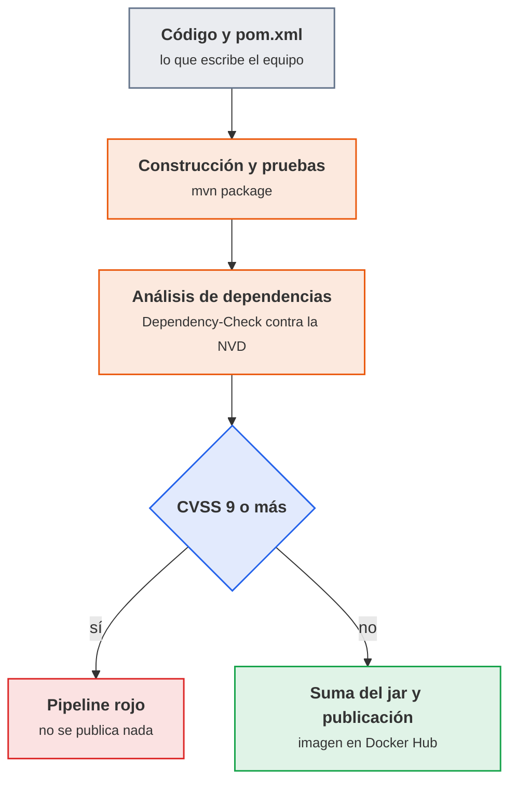

<p class="pie" markdown>El análisis va después de construir y antes de publicar: un artefacto con una crítica conocida no debe llegar al registro.</p>

!!! empresa "Cómo se hace en producción"
    El análisis puntual se complementa con un inventario permanente (una SBOM en formato CycloneDX) subido a una plataforma como Dependency-Track, que avisa cuando aparece una vulnerabilidad nueva en un componente ya desplegado. El pipeline solo ve el momento de la construcción; el inventario vigila lo que ya está en producción. Esa plataforma es la que describe el apunte del material de partida.

### Secretos en el pipeline y firma de artefactos

El objetivo es que ninguna clave, contraseña o token viaje en el código ni en los registros, y que quien recibe un artefacto pueda comprobar que es el que salió del pipeline. Las herramientas son el almacén de credenciales de Jenkins y las sumas de verificación y firmas.

Un secreto en un repositorio Git es un secreto publicado: el historial lo conserva aunque se borre en el commit siguiente, y basta un `git clone` para leerlo. Los sitios donde se cuelan en un pipeline son siempre los mismos: el `Jenkinsfile` (una contraseña escrita en un `sh`), las variables de entorno impresas por un `echo` o por `env`, las URL con usuario y contraseña incrustados y los ficheros `.env` subidos por descuido.

Jenkins guarda los secretos en su almacén de credenciales, cifrados, y el pipeline los pide por su identificador (`credentialsId`) sin conocer nunca el valor. Los tipos que se usan en esta unidad son tres:

| Tipo de credencial | Contiene | Ejemplo en el laboratorio |
|---|---|---|
| Secret text | Un único texto secreto | Token de GitHub (`github-token`), clave de la API de la NVD (`nvd-api-key`) |
| Username with password | Usuario y contraseña o token | Docker Hub (`dockerhub`) |
| Secret file | Un fichero entero | Un kubeconfig o una clave privada |

Al usar una credencial con `withCredentials`, Jenkins enmascara su valor en el registro de la construcción y lo sustituye por asteriscos. Ese enmascarado es una red de seguridad, no una garantía: un valor transformado (codificado en base64, cortado en trozos) ya no coincide y aparece en claro. La regla es que el secreto no se imprima, no se pase como argumento visible con comillas dobles de Groovy (que lo interpolan antes de ejecutar) y no se guarde en un fichero del espacio de trabajo. En un `sh` con comillas simples es el intérprete de la terminal quien lee la variable de entorno, y el valor nunca pasa por Groovy.

Otros controles que completan lo anterior, y que caen en el examen: los privilegios de Jenkins (un usuario que crea pipelines ejecuta código en el controlador, luego los permisos se reparten por rol y no se da administrador a todos), los agentes (el código de un pipeline debe ejecutarse en un agente y no en el controlador, que es quien guarda todas las credenciales) y el acceso al demonio de Docker (montar `docker.sock` equivale a dar `root`, tal como se avisa en la sesión 42).

#### Integridad y firma del artefacto

Una suma de verificación (`sha256sum`) es una huella del fichero: si cambia un solo bit, la suma cambia. Sirve para saber que el jar que se despliega es el que se construyó. Pero una suma guardada junto al fichero no autentica a nadie: quien puede sustituir el jar puede sustituir también la suma. Por eso la suma solo protege de corrupciones y cambios accidentales, salvo que se guarde en un sitio que el atacante no controla.

La firma resuelve lo que la suma no puede. Se firma con una clave privada (que solo tiene el pipeline) y cualquiera verifica con la clave pública que el artefacto lo produjo quien tiene esa clave privada y no se ha alterado.

| Mecanismo | Qué garantiza | Qué no garantiza |
|---|---|---|
| Suma SHA-256 | Que el fichero no ha cambiado desde que se calculó la suma | Quién lo produjo, ni que la suma no se haya cambiado a la vez |
| Firma GPG (firma separada `.sig`) | Origen y contenido, mientras la clave privada esté protegida | Que el código firmado sea seguro, solo que viene de quien firma |
| Firma de imágenes (Cosign, Docker Content Trust) | Lo mismo, para imágenes de contenedor | Igual: firmar no es auditar |

En el laboratorio se calcula y se verifica la suma en el pipeline (etapa de integridad) y la firma con GPG se deja como ampliación. En una empresa la firma de imágenes y la de los artefactos de terceros es cada vez más habitual, porque el ataque a la cadena de suministro (un componente o una construcción comprometidos) es una de las vías de entrada más graves de los últimos años.

!!! examen "Qué se evalúa"
    Qué es el análisis de composición del software y qué encuentra Dependency-Check; qué mide CVSS y qué umbral rompe el pipeline; dónde se guardan las credenciales de Jenkins y por qué no van en el `Jenkinsfile`; qué límite tiene el enmascarado en el registro; diferencia entre suma de verificación y firma; por qué montar `docker.sock` equivale a dar `root`; por qué el controlador de Jenkins no debe ejecutar el código de los pipelines.

### A5.7 Pipeline seguro (sesión 43)

<span class="et et-obj">Objetivo</span> El `Jenkinsfile` de `pps-app` tiene dos etapas nuevas: una analiza las dependencias con OWASP Dependency-Check y rompe el pipeline si hay una vulnerabilidad de CVSS 9 o más, y otra calcula y verifica la suma SHA-256 del jar. Las credenciales están en Jenkins, no en el repositorio, y lo demuestras con el informe, con el registro de la construcción y con `git grep`.

<span class="et et-pre">Antes de empezar</span> El controlador `jenkins` en marcha en `pps01` (`http://localhost:8090`) con el pipeline de la sesión 42: `Jenkinsfile` en la raíz de `pps-app`, la credencial `github-token` de la A5.4 y acceso al demonio de Docker desde el contenedor (`docker ps` funciona dentro de `jenkins`). Una clave de la API de la NVD, que se pide en <https://nvd.nist.gov/developers/request-an-api-key> con el correo corporativo y llega por correo; conviene pedirla antes de la clase. Se han explicado [el análisis de dependencias](#analisis-de-dependencias-con-owasp-dependency-check) y [los secretos y la firma de artefactos](#secretos-en-el-pipeline-y-firma-de-artefactos).

<span class="et et-pas">Pasos</span>

1. En Jenkins, `Administrar Jenkins`, `Credentials`, `Global`, `Add Credentials`: tipo `Secret text`, `Secret` con tu clave de la NVD, `ID` igual a `nvd-api-key`. Comprueba de paso que `github-token` aparece en la lista con ese identificador exacto.

    Crea en el mismo sitio la credencial del registro, que el pipeline usará en la A5.19 para publicar la imagen; se deja lista ahora. Antes, en Docker Hub, **Account settings > Personal access tokens > Generate new token** con permisos de lectura y escritura, y copia el token (solo se muestra una vez). En Jenkins, `Add Credentials`: tipo `Username with password`, usuario `pps<NIA>`, contraseña el token (nunca la contraseña de la cuenta) e `ID` igual a `dockerhub`.
2. Lanza ya la primera descarga de la base de la NVD, que es lo más lento de la hoja, y déjala en una terminal de `pps01` mientras sigues. La clave se lee sin eco y solo vive en esa terminal:

    ```bash
    read -rs NVD_KEY; export NVD_KEY
    docker run --rm -v dc-data:/usr/share/dependency-check/data \
      owasp/dependency-check --updateonly --nvdApiKey "$NVD_KEY"
    ```

    El volumen `dc-data` guarda la base: las ejecuciones del pipeline solo descargan las novedades. La primera descarga puede tardar bastantes minutos; si termina con un error (`Invalid API Key`, 403 o 429), revisa la clave y repite.
3. Busca secretos escritos en el repositorio. Si sale una línea con un valor real, es un fallo que corregir antes de seguir: el valor se mueve a una credencial de Jenkins y, si ya se subió, se considera comprometido y se revoca:

    ```bash
    cd ~/pps-app
    git grep -n -i -E "password|passwd|token|secret|apikey" -- Jenkinsfile jenkinsfile.docker compose.yml Dockerfile
    git log -p --all | grep -i -E "ghp_|dckr_pat_" | head
    ```

    Ninguna línea puede contener un valor: solo nombres de variable o de credencial como `dockerhub`. Cuando en la A5.19 se añada el `docker login`, tendrá que usar `withCredentials` con `--password-stdin`, en esta forma:

    ```groovy
    withCredentials([usernamePassword(credentialsId: 'dockerhub',
                                      usernameVariable: 'DH_USER', passwordVariable: 'DH_PASS')]) {
        sh 'echo "$DH_PASS" | docker login -u "$DH_USER" --password-stdin'
    }
    ```

4. Añade a propósito una dependencia vulnerable a `pom.xml`, dentro de `<dependencies>`. Es una librería de registro con una vulnerabilidad crítica muy conocida; la aplicación no la usa, solo viaja en el jar (es una prueba de laboratorio, no se ejecuta):

    ```xml
    <dependency>
      <groupId>org.apache.logging.log4j</groupId>
      <artifactId>log4j-core</artifactId>
      <version>2.14.1</version>
    </dependency>
    <dependency>
      <groupId>org.apache.logging.log4j</groupId>
      <artifactId>log4j-api</artifactId>
      <version>2.14.1</version>
    </dependency>
    ```

5. En el `Jenkinsfile`, añade la etapa siguiente después de la de pruebas. Si tu etapa de construcción usa un contenedor de Maven como agente, pon a esta el mismo `agent`. La ruta `$WORKSPACE` la resuelve el shell, no Groovy, y `--volumes-from jenkins` hace que el contenedor del análisis vea el mismo espacio de trabajo que Jenkins (un `-v $WORKSPACE:...` no serviría: esa ruta existe dentro de `jenkins`, no en el anfitrión):

    ```groovy
    stage('Análisis de dependencias') {
        steps {
            sh 'mvn -B -q dependency:copy-dependencies -DoutputDirectory=target/dependency'
            withCredentials([string(credentialsId: 'nvd-api-key', variable: 'NVD_KEY')]) {
                sh '''
                    docker run --rm --volumes-from jenkins \
                      -v dc-data:/usr/share/dependency-check/data \
                      owasp/dependency-check \
                      --scan "$WORKSPACE/target/dependency" --scan "$WORKSPACE/target/pps-app.jar" \
                      --project pps-app --format HTML --format JSON \
                      --out "$WORKSPACE/dc-report" \
                      --failOnCVSS 9 --nvdApiKey "$NVD_KEY"
                '''
            }
        }
        post {
            always { archiveArtifacts artifacts: 'dc-report/**', allowEmptyArchive: true }
        }
    }
    ```

6. Haz commit y push (`A5.7 análisis de dependencias con una librería vulnerable`) y lanza la construcción. Tiene que terminar en rojo en la etapa `Análisis de dependencias`. Abre el informe archivado (`dc-report/dependency-check-report.html`) y anota el identificador CVE, el CVSS y la librería de la vulnerabilidad más grave. Abre también el registro de la construcción y comprueba que la clave de la NVD aparece como `****` y no en claro.
7. Corrige la causa, no el umbral: en `pom.xml` sube las dos dependencias a la versión `2.17.1` (o elimínalas, porque la aplicación no las usa). Haz commit, push y una nueva construcción: la etapa tiene que pasar. Si sigue en rojo por otra librería, el informe dice cuál.
8. Añade la etapa de integridad después de la de análisis. La suma se calcula justo tras construir y se verifica de nuevo antes de publicar; el jar y su suma se archivan con huella (`fingerprint`), que permite a Jenkins seguir qué construcción produjo ese fichero:

    ```groovy
    stage('Integridad del artefacto') {
        steps {
            sh 'sha256sum target/pps-app.jar > target/pps-app.jar.sha256'
            sh 'sha256sum -c target/pps-app.jar.sha256'
            archiveArtifacts artifacts: 'target/pps-app.jar,target/pps-app.jar.sha256', fingerprint: true
        }
    }
    ```

    En la A5.19, cuando exista la etapa que publica la imagen, su primera línea será `sh 'sha256sum -c target/pps-app.jar.sha256'`: si el jar cambia entre la construcción y la publicación, el pipeline se detiene ahí.
9. Haz commit y push del `Jenkinsfile` final, lanza una última construcción (todo en verde) y guarda las evidencias en `pps-entregas/ut5/a57/`: un `README.md` con qué se ha hecho, los comandos y el CVE que encontró el análisis (identificador, CVSS y librería), y capturas del pipeline en rojo, del informe, del registro con `****`, del listado de credenciales (sin mostrar valores) y del pipeline en verde.

<span class="et et-com">Comprobación</span> Con la dependencia `2.14.1` el pipeline falla en `Análisis de dependencias` y el informe muestra una vulnerabilidad crítica; con la `2.17.1` termina en verde, con la suma verificada dos veces. `git grep` no encuentra ningún valor secreto, el registro enmascara la clave, y la lista de credenciales muestra `github-token`, `nvd-api-key` y `dockerhub` con esos ID exactos. Si la etapa falla por un motivo distinto al esperado (`docker: not found`, error de permisos, un 403 de la NVD), mira [Errores frecuentes](#errores-frecuentes-en-el-laboratorio).

<span class="et et-ent">Entrega</span> `Jenkinsfile`, `pom.xml` y `ut5/a57/README.md` con sus capturas, subidos a `pps-app` y a `pps-entregas`. La hoja forma parte de la entrega ACT_UT5_1, plazo el jueves 15 de abril a las 23:59, junto con A5.1 a A5.6; la clave de la NVD y cualquier token no aparecen en ningún fichero ni captura.

<span class="et et-ext">Si te sobra tiempo</span> Comprueba que la suma detecta un cambio: entra en el contenedor con `docker exec -it jenkins bash`, ve a `/var/jenkins_home/workspace/<nombre del trabajo>`, copia el jar a `/tmp`, añádele un byte con `echo x >> /tmp/pps-app.jar` y compara `sha256sum` de la copia con `target/pps-app.jar.sha256`: tienen que ser distintas. Firma el jar con GPG: genera una clave de prueba en `pps01` (`gpg --quick-generate-key ops-pps default default never`), firma con `gpg --detach-sign --armor target/pps-app.jar` y verifica con `gpg --verify target/pps-app.jar.asc target/pps-app.jar`. En un pipeline real la clave privada sería una credencial de tipo `Secret file`. Otra prueba: crea un fichero de supresiones con una entrada que silencie un hallazgo, con su motivo y una fecha, y pásalo con `--suppression`.

!!! truco "Un umbral es una política"
    El 9 de `--failOnCVSS` se decide con el equipo y queda escrito en el `Jenkinsfile`, que se revisa como cualquier otro código. Bajarlo para que el pipeline pase es la trampa habitual: la solución correcta es actualizar la librería, o suprimir el hallazgo por escrito y con motivo si de verdad no aplica. La clave de la NVD, por su parte, va como argumento de `docker run` y se ve en la lista de procesos del anfitrión; es admisible porque es una clave gratuita y revocable, pero una credencial de más valor no se pasaría así.

## Sesión 44 · Infraestructura como código: Terraform

<p class="ut-meta" markdown>12 de abril · Teoría y práctica · <span class="dur" tabindex="0" aria-label="Infraestructura como código · 10 min&#10;Terraform: proveedores, recursos, estado y ciclo de trabajo · 15 min&#10;A5.8 Terraform: primera máquina · 85 min" data-dur="Infraestructura como código · 10 min&#10;Terraform: proveedores, recursos, estado y ciclo de trabajo · 15 min&#10;A5.8 Terraform: primera máquina · 85 min">:material-school:<i class="dur-barra" style="--teoria:23%"></i>:material-flask:</span></p>

Al terminar la sesión existe una máquina virtual Ubuntu 24.04 en VirtualBox que nadie ha creado con el ratón: la ha creado Terraform a partir de un fichero de texto, y un segundo `plan` confirma que no hay nada que cambiar. Antes de escribir el fichero se ve qué gana un equipo al describir su infraestructura como código y qué piezas tiene Terraform; la máquina resultante, `destino01`, es la que configura Ansible en la sesión 46.

!!! consulta "Material de partida"
    En el aula, `RA5-Despliegue-seguro/03 ACT_RA5_2 - Terraform & Ansible/RA5.2.pdf` es el enunciado de la entrega ACT_UT5_2 (punto 3.1: provisionar con Terraform una máquina virtual Ubuntu 24.04 en VirtualBox; la entrega es un repositorio de GitHub con la estructura correcta y un README con capturas). `04 Terraform & Ansible/Terraform_Ansible.pdf` es solo el índice de diapositivas, y en `05 Material Terraform/` hay tres PDF: "Introduction to Terraform", "Terraform como Infrastructure as Code" y "Complete Terraform Tutorial", este último un tutorial largo de fondo que no se sigue por orden. La documentación oficial es <https://developer.hashicorp.com/terraform/docs>. El proveedor de VirtualBox es comunitario: <https://registry.terraform.io/providers/terra-farm/virtualbox/latest> y su código en <https://github.com/terra-farm/terraform-provider-virtualbox>.

### Infraestructura como código

El objetivo es entender qué problema resuelve describir servidores, redes y discos en ficheros. La herramienta que se usa para ello es Terraform; su compañera Ansible (sesión 46) configura lo que hay dentro de las máquinas.

Crear una máquina con el ratón funciona una vez y falla la segunda: nadie recuerda qué casillas se marcaron, dos entornos que debían ser iguales acaban distintos y, si se pierde el servidor, no hay receta para rehacerlo. La infraestructura como código (IaC) sustituye el ratón por ficheros de texto que una herramienta aplica. Al ser texto, van a Git y heredan todo lo que ya se sabe hacer con el código: historial, revisión en un pull request, vuelta atrás y ejecución automática desde un pipeline.

El punto de partida de todas las herramientas de IaC es el enfoque declarativo: el fichero describe el estado final que se quiere ("una máquina con 2 CPU y 1,5 GB de memoria") y la herramienta calcula qué hacer para llegar a él. Frente a un script que lista pasos, lo declarativo tiene una propiedad decisiva: es idempotente. Aplicarlo dos veces produce el mismo resultado que aplicarlo una, porque la segunda vez la herramienta compara lo deseado con lo que existe y no encuentra diferencias.

| Herramienta | Qué hace | Cuándo entra |
|---|---|---|
| Terraform (y OpenTofu) | Crea y modifica la infraestructura: máquinas, redes, discos, DNS | Sesiones 44 y 45 |
| Ansible | Configura el interior de las máquinas: paquetes, ficheros, servicios | Sesiones 46 y 48 |
| Jenkins | Ejecuta las dos anteriores desde un pipeline | Proyecto integrador |

La división de trabajo es la habitual del sector: Terraform aprovisiona (deja la máquina creada y con red) y Ansible configura (la deja útil). Confundirlos lleva a scripts enormes que hacen mal las dos cosas. La seguridad gana tres cosas concretas: el estado deseado es auditable en el historial de Git, un entorno comprometido se destruye y se recrea en minutos desde un origen conocido (infraestructura inmutable: no se arregla un servidor, se sustituye), y los cambios pasan por revisión antes de aplicarse.

### Terraform: proveedores, recursos, estado y ciclo de trabajo

Este apartado presenta las piezas de un proyecto Terraform y el ciclo `init`, `plan`, `apply`, que es el que se repite en cada cambio. Se escribe en HCL, el lenguaje de configuración de la herramienta, en ficheros con extensión `.tf`.

| Pieza | Qué es | Ejemplo en esta sesión |
|---|---|---|
| Proveedor (`provider`) | El complemento que sabe hablar con una plataforma concreta | `terra-farm/virtualbox`, que maneja VirtualBox con `VBoxManage` |
| Recurso (`resource`) | Un objeto que Terraform crea y mantiene | `virtualbox_vm`, la máquina virtual |
| Bloque `terraform` | Fija la versión de Terraform y de cada proveedor | `required_providers` con la versión exacta |
| Estado (`terraform.tfstate`) | Fichero donde Terraform anota qué ha creado y con qué valores | Se genera solo tras el primer `apply` |
| Fichero de bloqueo (`.terraform.lock.hcl`) | Versión y huellas de los proveedores descargados | Se sube a Git; el directorio `.terraform/` no |

El estado es la pieza que más se subestima. Terraform no consulta a la plataforma qué existe: compara el código con el estado que él mismo guardó y con la respuesta de la plataforma. Sin estado, no sabe que ya creó la máquina y la crearía otra vez. Además el estado guarda los valores completos de cada recurso, incluidas contraseñas y claves si algún recurso las maneja: por eso no se sube a Git y se trata como un secreto (se desarrolla en la sesión 45).

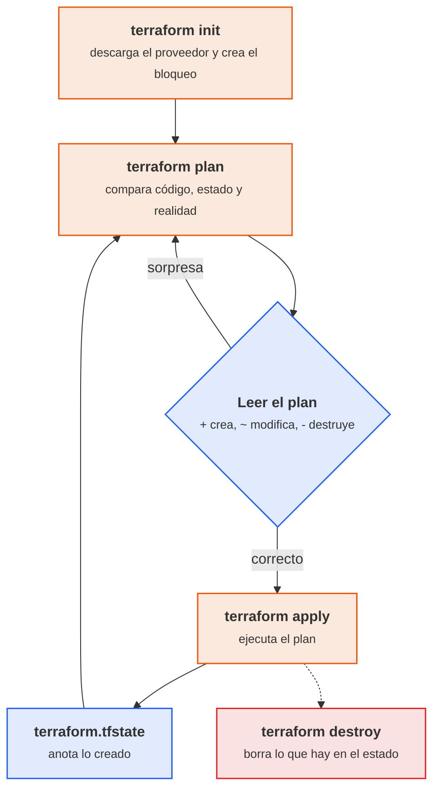

<p class="pie" markdown>El plan se lee siempre antes de aplicar: `+` crea, `~` modifica en sitio y `-/+` destruye y vuelve a crear, que es lo que hay que detectar a tiempo.</p>

Un proyecto mínimo para este laboratorio, que es el que copia la hoja, tiene este aspecto. El proveedor se fija a una versión exacta porque solo hay publicadas dos versiones y una es la de una versión anterior (ver el aviso siguiente); la imagen es una caja de Vagrant, un formato de imagen de VirtualBox ya preparado con Ubuntu 24.04 y las Guest Additions (los controladores que permiten a VirtualBox informar de la IP de la máquina):

```hcl
terraform {
  required_providers {
    virtualbox = {
      source  = "terra-farm/virtualbox"
      version = "0.2.2-alpha.1"
    }
  }
}

resource "virtualbox_vm" "destino01" {
  name   = "destino01"
  image  = "https://vagrantcloud.com/bento/boxes/ubuntu-24.04/versions/202510.26.0/providers/virtualbox/amd64/vagrant.box"
  cpus   = 1
  memory = "1536 mib"

  network_adapter {
    type = "nat"
  }
  network_adapter {
    type           = "hostonly"
    host_interface = "vboxnet0"
  }
}
```

!!! ojo "El proveedor de VirtualBox es comunitario y está en alfa"
    `terra-farm/virtualbox` no lo mantiene HashiCorp ni Oracle. Su última versión publicada es la `0.2.2-alpha.1` de septiembre de 2021 y su repositorio recibe pocos cambios (sobre todo actualizaciones automáticas de dependencias), aunque hay informes de 2025 de uso con VirtualBox 7.1 y Ubuntu 24.04. Funciona, pero conviene tratarlo como una herramienta de laboratorio y no de producción: se fija la versión exacta (existen `0.2.1-alpha.1` y `0.2.2-alpha.1`; una `0.2.1` sin sufijo no existe y `init` falla), no se actualiza a la ligera y su nombre de proveedor no se cambia por otro sin probarlo. En una empresa, las mismas ideas se usan con proveedores mantenidos (Proxmox, vSphere, nubes públicas). Los fallos típicos están en [Errores frecuentes](#errores-frecuentes-en-el-laboratorio).

!!! ojo "Terraform necesita `VBoxManage` en la misma máquina"
    El proveedor no habla con una API: ejecuta `VBoxManage` en el equipo donde se lanza `terraform`. Ese equipo tiene que ser el que tiene VirtualBox, el anfitrión del aula, y no `pps01`, que es una máquina virtual (crear máquinas dentro de otra exigiría virtualización anidada y más memoria de la que hay). Por eso en esta sesión `terraform` se ejecuta en el anfitrión, y `pps01` se reserva para Jenkins y para Ansible, que llegan a `destino01` por la red solo anfitrión.

!!! consulta "Terraform, OpenTofu y la licencia"
    Terraform se publicó durante años con licencia de código abierto (MPL). En agosto de 2023 HashiCorp cambió a la Business Source License (BSL), que permite uso propio pero restringe ofrecer productos que compitan con los de la empresa. Como respuesta, la comunidad bifurcó la última versión abierta y creó OpenTofu, hoy alojado en la Linux Foundation. Los ficheros `.tf`, el lenguaje y los proveedores son compatibles: donde este material escribe `terraform plan`, en OpenTofu se escribe `tofu plan`. Para el alumnado no cambia nada práctico (la actividad del aula pide Terraform y aquí se usa Terraform), pero en una empresa conviene saber cuál de las dos está en uso y qué licencia acepta. Información y comparativa en <https://opentofu.org/> y <https://opentofu.org/faq/>; el proveedor de VirtualBox también se descarga con OpenTofu desde `registry.opentofu.org`.

### A5.8 Terraform: primera máquina (sesión 44)

<span class="et et-obj">Objetivo</span> Desde un proyecto Terraform propio, el proveedor de VirtualBox crea la máquina `destino01` (Ubuntu 24.04, 1 CPU, 1,5 GB, con NAT y red solo anfitrión), entras en ella por SSH, un segundo `plan` dice que no hay cambios y el proyecto queda en un repositorio Git sin el estado ni el directorio `.terraform/`. La máquina se conserva: la usan las sesiones 45 y 46.

<span class="et et-pre">Antes de empezar</span> Este trabajo se hace en el anfitrión del aula (o en tu portátil), que es donde está VirtualBox 7.x, y no en `pps01`; hace falta conexión a Internet para descargar el proveedor y la imagen, que pesa varios cientos de megabytes, y `pps01` puede estar apagada. Se ha explicado [qué es la infraestructura como código](#infraestructura-como-codigo) y [las piezas y el ciclo de Terraform](#terraform-proveedores-recursos-estado-y-ciclo-de-trabajo). El aviso sobre `VBoxManage` está en ese mismo apartado.

<span class="et et-pas">Pasos</span>

1. Instala Terraform en el anfitrión siguiendo <https://developer.hashicorp.com/terraform/install> (en macOS, `brew tap hashicorp/tap && brew install hashicorp/tap/terraform`; en Windows, `winget install Hashicorp.Terraform`; en Ubuntu, el repositorio APT de HashiCorp que indica esa página). Comprueba las dos herramientas:

    ```bash
    terraform version
    VBoxManage --version
    ```

    `VBoxManage` tiene que responder con una versión 7.x. Si el comando no se encuentra, añade la carpeta de instalación de VirtualBox al `PATH`.
2. Prepara la red solo anfitrión. Terraform va a conectar la máquina a `vboxnet0`, la red `192.168.56.0/24` de las convenciones del laboratorio, y el servidor DHCP de esa red se limita a una sola dirección para que la primera máquina que pida IP reciba siempre la `192.168.56.20`, la de `destino01`. `pps01` no se ve afectada porque tiene la IP fija `192.168.56.10`:

    ```bash
    VBoxManage list hostonlyifs
    VBoxManage list dhcpservers
    ```

    La primera orden tiene que mostrar `vboxnet0` con la IP `192.168.56.1`. Si la segunda no muestra ningún servidor, créalo, y si ya existe, modifícalo (cada orden con su verbo):

    ```bash
    VBoxManage dhcpserver add --interface=vboxnet0 --server-ip=192.168.56.2 \
      --netmask=255.255.255.0 --lower-ip=192.168.56.20 --upper-ip=192.168.56.20 --enable
    VBoxManage dhcpserver modify --interface=vboxnet0 \
      --lower-ip=192.168.56.20 --upper-ip=192.168.56.20 --enable
    ```

3. Crea el repositorio del proyecto. El `.gitignore` va desde el primer día, antes del primer commit, porque el estado que Terraform genera puede contener secretos:

    ```bash
    mkdir -p ~/pps-iac/terraform && cd ~/pps-iac && git init -b main
    printf '.terraform/\n*.tfstate\n*.tfstate.*\nplan.bin\ncrash.log\n' > .gitignore
    ```

4. En `~/pps-iac/terraform/main.tf` copia el [proyecto mínimo](#terraform-proveedores-recursos-estado-y-ciclo-de-trabajo) tal cual, con el proveedor en `0.2.2-alpha.1` y la imagen de la caja de Vagrant. Lo único que puedes tocar es el nombre; déjalo en `destino01`.
5. Inicializa, comprueba y planifica. Lee el plan entero antes de seguir: todo lo que aparece con `+` es lo que Terraform va a crear, y hay bastantes más atributos que las cinco líneas que escribiste, porque el proveedor rellena el resto:

    ```bash
    cd ~/pps-iac/terraform
    terraform init
    terraform fmt && terraform validate
    terraform plan -out=plan.bin
    ```

6. Aplica el plan. La primera vez descarga la imagen y tarda; mientras espera, abre otra terminal y empieza el `README.md` de la hoja (qué has hecho y los comandos de los pasos anteriores):

    ```bash
    terraform apply plan.bin
    ```

7. Comprueba desde fuera y desde dentro. La IP la muestra `terraform show`; la máquina tiene que ser `192.168.56.20`. Entra por SSH con el usuario `vagrant` y la contraseña `vagrant`, que son las credenciales publicadas de esa imagen y solo valen aquí, en una red solo anfitrión sin acceso desde fuera:

    ```bash
    VBoxManage list runningvms
    terraform show | grep ipv4_address
    ssh vagrant@192.168.56.20
    lsb_release -d && ping -c 2 1.1.1.1
    ```

    Dentro tienen que aparecer `Ubuntu 24.04` y respuestas al `ping` (sale por el adaptador NAT). Sal con `exit`.
8. Ejecuta `terraform plan` otra vez, sin cambiar nada. Tiene que terminar diciendo que no hay cambios: es la idempotencia que se explicó al empezar la sesión. Haz una captura.
9. Haz commit y `git push`. Crea antes el repositorio vacío `pps-iac` en tu cuenta de GitHub (`pps<NIA>`), y comprueba con `git status` que ni `.terraform/` ni `terraform.tfstate` aparecen:

    ```bash
    git add . && git commit -m "A5.8 primera maquina con Terraform"
    git remote add origin https://github.com/pps<NIA>/pps-iac.git
    git push -u origin main
    ```

    Comprueba también que `terraform/.terraform.lock.hcl` sí se ha subido: fija las versiones y las huellas de los proveedores que se descargaron.

<span class="et et-com">Comprobación</span> `VBoxManage list runningvms` muestra `destino01`, el SSH entra en `192.168.56.20` con un Ubuntu 24.04, el segundo `plan` termina con `No changes. Your infrastructure matches the configuration.` y el repositorio no contiene `terraform.tfstate`. Si `terraform init` no encuentra el proveedor, revisa que la versión sea exactamente `0.2.2-alpha.1`. Si `terraform show` no da `ipv4_address` o el SSH no conecta, la máquina arrancó pero la segunda interfaz no tiene IP: abre `destino01` desde VirtualBox, entra por la consola y pide dirección a mano con `sudo dhclient enp0s8` (el nombre de la interfaz sale de `ip -br a`).

<span class="et et-ent">Entrega</span> Repositorio `pps-iac` con `.gitignore`, `terraform/main.tf` y `terraform/.terraform.lock.hcl`, y en `ut5/a58/` de `pps-entregas` un `README.md` con los comandos y las capturas del primer plan, del apply, del SSH dentro de la máquina y del segundo plan sin cambios. La hoja forma parte de la entrega ACT_UT5_2 (punto 3.1 del enunciado), plazo el lunes 3 de mayo a las 23:59, junto con A5.9, A5.10 y A5.11.

<span class="et et-ext">Si te sobra tiempo</span> Cambia `memory` a `"2048 mib"` con la máquina creada y ejecuta `terraform plan`: mira si el proveedor marca `~` (modifica en sitio) o `-/+` (destruye y recrea) y por qué importa la diferencia en una máquina con datos. Después vuelve al valor original y comprueba que el plan queda sin cambios. Compara además el tamaño de `terraform.tfstate` con el de `main.tf` y abre el estado: cuenta cuántos atributos guarda de una máquina que tú describiste en cinco líneas.

## Sesión 45 · Terraform: variables, estado y secretos

<p class="ut-meta" markdown>15 de abril · Teoría y práctica · <span class="dur" tabindex="0" aria-label="Variables, salidas y módulos · 5 min&#10;El estado y los secretos · 10 min&#10;A5.9 Terraform: variables y estado · 95 min" data-dur="Variables, salidas y módulos · 5 min&#10;El estado y los secretos · 10 min&#10;A5.9 Terraform: variables y estado · 95 min">:material-school:<i class="dur-barra" style="--teoria:14%"></i>:material-flask:</span></p>

Al terminar la sesión el proyecto de la sesión 44 no lleva valores escritos a mano en el código, deja como salida la IP de `destino01` para que Ansible la use, y el repositorio está protegido para que ni el estado ni los ficheros de valores lleguen a Git. Hoy vence además la entrega ACT_UT5_1 (A5.1 a A5.7) a las 23:59; esta hoja forma parte de la siguiente, ACT_UT5_2.

!!! consulta "Material de partida"
    En el aula, `RA5-Despliegue-seguro/05 Material Terraform/` ("Introduction to Terraform", "Terraform como Infrastructure as Code" y "Complete Terraform Tutorial") cubre variables, salidas, módulos y estado; el enunciado sigue siendo `03 ACT_RA5_2 - Terraform & Ansible/RA5.2.pdf`. Los temas de estado, secretos y backends remotos son los que pregunta el banco de EX_RA5. La documentación oficial está en <https://developer.hashicorp.com/terraform/language/values/variables> (variables), <https://developer.hashicorp.com/terraform/language/values/outputs> (salidas), <https://developer.hashicorp.com/terraform/language/modules> (módulos), <https://developer.hashicorp.com/terraform/language/state/sensitive-data> (datos sensibles en el estado) y <https://developer.hashicorp.com/terraform/language/backend> (dónde se guarda el estado).

### Variables, salidas y módulos

El objetivo es que el mismo código sirva para más de un entorno cambiando solo valores, y que lo que Terraform sabe (la IP de una máquina) pueda usarlo la herramienta siguiente. Las piezas son las variables de entrada, las salidas y los módulos.

| Pieza | Qué hace | Ejemplo |
|---|---|---|
| Variable de entrada (`variable`) | Un valor que se pasa desde fuera, con tipo, descripción y valor por defecto opcional | `var.vm_memory` |
| Valor de la variable | Se da en `terraform.tfvars`, con `-var`, o con una variable de entorno `TF_VAR_nombre` | `vm_memory = 1536` |
| Salida (`output`) | Un valor que Terraform muestra al terminar y que otro programa puede leer | La IP de `destino01` |
| Módulo | Una carpeta de `.tf` reutilizable, llamada con `module` y sus propios parámetros | Un módulo `vm` que crea cualquier máquina |

Una variable declara su tipo, una descripción y, si se quiere, una validación que rechaza valores absurdos antes de tocar nada. Lo importante para la seguridad es dónde se guardan los valores: el `terraform.tfvars` real se trata como configuración local y no se sube a Git; al repositorio va un `terraform.tfvars.example` con valores de ejemplo. Un secreto se pasa por entorno (`TF_VAR_...`) o desde un gestor de secretos, nunca escrito en el código.

Una salida marcada como `sensitive = true` no se imprime en la terminal (aparece como `<sensitive>`), y lo mismo vale para una variable. Es una protección contra el descuido de ver o copiar un valor, no contra quien tenga acceso al estado, como se ve a continuación. Los módulos se usan cuando la misma estructura se repite (tres máquinas iguales, pruebas y producción); en el laboratorio bastan las variables y los módulos quedan como ampliación de la hoja.

### El estado y los secretos

El estado (`terraform.tfstate`) es un fichero JSON con todos los atributos de cada recurso creado, tal como los devolvió la plataforma. Eso incluye cualquier valor secreto que un recurso reciba o genere: contraseñas iniciales, claves privadas, tokens. `sensitive = true` lo oculta en la terminal, pero en el fichero está en texto claro. Tres consecuencias prácticas:

- El estado nunca se sube a Git (`.gitignore` con `*.tfstate` y `*.tfstate.*` antes del primer commit). Un estado subido por error se considera un secreto filtrado: se rotan las credenciales que contuviera, no basta con borrarlo del repositorio.
- Los ficheros de valores con secretos tampoco (`*.tfvars`), y los secretos se prefieren inyectados por entorno.
- El estado se guarda en un lugar con control de acceso, cifrado y copia, no en el portátil de quien ejecuta `terraform`.

Por defecto el estado es local (backend `local`), que es lo que se usa en el laboratorio. En equipo se usa un backend remoto: un almacén compartido (un bucket S3, MinIO, un servidor HTTP, Terraform Cloud) que guarda el estado en un solo sitio.

| Aspecto | Backend local | Backend remoto |
|---|---|---|
| Dónde está | Fichero en el disco de quien ejecuta | Almacén compartido con control de acceso |
| Trabajo en equipo | Cada uno tendría un estado distinto: se pisan | Estado único y compartido |
| Bloqueo | No hay: dos `apply` a la vez pueden corromperlo | Bloquea mientras alguien aplica (según el backend) |
| Secretos | En texto claro en el disco del portátil | Cifrado en reposo y acceso por roles |
| Recuperación | Si se pierde el fichero, Terraform olvida lo que creó | El almacén tiene versiones y copias |

Un principio de fondo acompaña a todo lo anterior: mínimo privilegio. Quien puede leer el estado puede leer los secretos que contiene, así que el acceso al backend se da a las personas y a los pipelines que lo necesitan y a nadie más. Y el fichero de bloqueo de proveedores (`.terraform.lock.hcl`) sí se sube: fija las versiones y las huellas de los proveedores descargados, de modo que otro equipo o el pipeline descarguen exactamente los mismos binarios y no una versión sustituida.

!!! examen "Qué se evalúa"
    Qué gana un equipo con la infraestructura como código y qué significa declarativo e idempotente; el ciclo `init`, `plan`, `apply`, `destroy` y qué señala cada símbolo del plan; qué guarda el fichero de estado, por qué contiene secretos aunque la variable sea `sensitive` y por qué no va a Git; para qué sirve un backend remoto (estado compartido, bloqueo, cifrado y control de acceso); cómo se pasan los secretos a Terraform (entorno o gestor, no código); qué es un módulo; diferencia entre Terraform y OpenTofu; y qué reparto de trabajo hay entre Terraform (crea) y Ansible (configura).

### A5.9 Terraform: variables y estado (sesión 45)

<span class="et et-obj">Objetivo</span> El proyecto `pps-iac` de A5.8 queda parametrizado con variables, sin un valor escrito en `main.tf`, y muestra como salida la IP de `destino01`. Compruebas con tus ojos que el estado guarda en texto claro un secreto marcado como `sensitive`, y dejas el repositorio protegido con `.gitignore` para que ni el estado ni los ficheros de valores puedan subirse.

<span class="et et-pre">Antes de empezar</span> La máquina `destino01` de A5.8 creada y el proyecto en `~/pps-iac/terraform` del anfitrión, donde `terraform plan` da `No changes`. Se han explicado [las variables, las salidas y los módulos](#variables-salidas-y-modulos) y [el estado y los secretos](#el-estado-y-los-secretos).

<span class="et et-pas">Pasos</span>

1. Crea `variables.tf` con las variables que hoy están escritas en `main.tf`. Cada una lleva `type` y `description`; la de memoria, además, una validación:

    ```hcl
    variable "vm_name" {
      type        = string
      description = "Nombre de la maquina virtual en VirtualBox"
      default     = "destino01"
    }

    variable "vm_cpus" {
      type        = number
      description = "Numero de CPU"
      default     = 1
    }

    variable "vm_memory_mib" {
      type        = number
      description = "Memoria en MiB (minimo 1024)"
      default     = 1536
      validation {
        condition     = var.vm_memory_mib >= 1024
        error_message = "La memoria minima es 1024 MiB."
      }
    }

    variable "box_url" {
      type        = string
      description = "Imagen de Vagrant con Ubuntu 24.04"
    }

    variable "host_interface" {
      type        = string
      description = "Red solo anfitrion de VirtualBox"
      default     = "vboxnet0"
    }
    ```

2. Sustituye en `main.tf` cada valor por su variable (`var.vm_name`, `var.vm_cpus`, `var.box_url`, `var.host_interface`; la memoria como `"${var.vm_memory_mib} mib"`). Crea `terraform.tfvars` con la URL de la imagen, la única variable sin valor por defecto, y copia ese fichero a `terraform.tfvars.example`:

    ```hcl
    box_url = "https://vagrantcloud.com/bento/boxes/ubuntu-24.04/versions/202510.26.0/providers/virtualbox/amd64/vagrant.box"
    ```

3. Ejecuta `terraform validate` y `terraform plan`. Tiene que terminar en `No changes`: cambiar la forma de escribir el código no cambia la infraestructura, y el plan es la prueba. Si propone destruir y crear la máquina, algún valor no es idéntico al de A5.8 (el nombre, la memoria o la imagen); corrígelo antes de aplicar.
4. Comprueba la validación: `terraform plan -var vm_memory_mib=512` tiene que fallar con tu mensaje de error, sin tocar nada.
5. Crea `outputs.tf` con la IP de la segunda interfaz de la máquina (la de la red solo anfitrión, que es la segunda declarada), aplica y léela:

    ```hcl
    output "ip_destino01" {
      description = "IP de destino01 en la red solo anfitrion"
      value       = virtualbox_vm.destino01.network_adapter[1].ipv4_address
    }
    ```

    ```bash
    terraform apply
    terraform output ip_destino01
    terraform output -raw ip_destino01
    ```

    La variante `-raw` no lleva comillas ni salto de línea: es la que usa un script o, en la sesión 46, el inventario de Ansible. Tiene que dar `192.168.56.20`.
6. Genera un secreto para ver cómo lo trata el estado. Añade el proveedor `random` al bloque `required_providers` (`random = { source = "hashicorp/random", version = "~> 3.0" }`) y estos dos bloques, en `main.tf` y `outputs.tf` respectivamente. La contraseña no se usa en la máquina: solo sirve para la comprobación:

    ```hcl
    resource "random_password" "acceso" {
      length  = 16
      special = false
    }
    ```

    ```hcl
    output "clave_acceso" {
      description = "Contrasena de prueba (solo para la practica)"
      value       = random_password.acceso.result
      sensitive   = true
    }
    ```

    Ejecuta `terraform init` (descarga el proveedor nuevo) y `terraform apply`. Después `terraform output`: la salida sensible aparece como `<sensitive>`.
7. Mira ahora el fichero de estado, que es donde está el problema. El valor que Terraform oculta en la terminal está en claro en el disco:

    ```bash
    terraform output -raw clave_acceso; echo
    grep -n '"result":' terraform.tfstate
    ```

    Los dos valores coinciden. Anota en el README qué ocurriría si ese `terraform.tfstate` se subiera a un repositorio.
8. Protege el repositorio. Amplía el `.gitignore` de la raíz (`~/pps-iac`) con los ficheros de valores y deja el de ejemplo, y comprueba que Git ignora de verdad lo que debe y que no ignora el fichero de bloqueo:

    ```bash
    cd ~/pps-iac
    printf '*.tfvars\n!*.tfvars.example\n' >> .gitignore
    git check-ignore -v terraform/terraform.tfstate terraform/terraform.tfvars terraform/plan.bin
    git status --short
    ```

    Las tres rutas tienen que salir como ignoradas, y `git status` solo debe mostrar `.tf`, `terraform.tfvars.example`, `.terraform.lock.hcl` y `.gitignore`. Comprueba además que la contraseña generada no está en nada de lo que se va a subir: `git add -A` y después `git grep --cached -n "$(cd terraform && terraform output -raw clave_acceso)"` no debe devolver nada.
9. Haz commit y `git push` (`A5.9 variables, salidas y .gitignore`). Después, en el README de `ut5/a59/` de `pps-entregas`, escribe en cinco líneas dónde guardarías el estado en un equipo de cinco personas (qué backend, quién lo lee, cómo se cifra y cómo se bloquea) y por qué; sin instalarlo, usa la tabla del apartado del estado.

<span class="et et-com">Comprobación</span> `main.tf` no contiene valores literales de nombre, CPU, memoria, imagen ni red; el `plan` tras el refactor dijo `No changes`; `terraform output -raw ip_destino01` da `192.168.56.20`; el `plan` con 512 MiB falla con tu mensaje; el valor de `clave_acceso` aparece en `terraform.tfstate` pero no en el repositorio; y `git status` no muestra ningún `tfstate` ni `terraform.tfvars`. Si el `plan` del paso 3 quiere recrear la máquina, compara `terraform show` con `variables.tf` valor a valor.

<span class="et et-ent">Entrega</span> Repositorio `pps-iac` con `variables.tf`, `outputs.tf`, `main.tf`, `terraform.tfvars.example`, `.terraform.lock.hcl` y `.gitignore`; en `ut5/a59/` de `pps-entregas`, el `README.md` con las capturas del `plan` sin cambios, del fallo de validación, de la salida `<sensitive>` y del `grep` sobre el estado (tapa el valor de la contraseña en la captura antes de subirla) y las cinco líneas del paso 9. La hoja forma parte de la entrega ACT_UT5_2, plazo el lunes 3 de mayo a las 23:59.

<span class="et et-ext">Si te sobra tiempo</span> Mueve la máquina a un módulo: crea `terraform/modules/vm/` con `main.tf`, `variables.tf` y `outputs.tf`, llámalo desde el `main.tf` de la raíz con `module "destino01" { source = "./modules/vm" ... }` y ejecuta `terraform init` y `terraform plan`. Como el recurso cambia de dirección, el plan querrá destruir y crear la máquina: `terraform state mv virtualbox_vm.destino01 module.destino01.virtualbox_vm.destino01` mueve el recurso en el estado y deja el plan sin cambios. Otra opción: exporta `TF_VAR_vm_memory_mib=2048` y comprueba con `terraform plan` que una variable de entorno gana sobre el valor por defecto.

## Sesión 46 · Ansible: inventario y playbooks

<p class="ut-meta" markdown>19 de abril · Teoría y práctica · <span class="dur" tabindex="0" aria-label="Gestión de la configuración · 10 min&#10;Ansible: inventario, módulos y playbooks · 15 min&#10;A5.10 Ansible: primer playbook · 85 min" data-dur="Gestión de la configuración · 10 min&#10;Ansible: inventario, módulos y playbooks · 15 min&#10;A5.10 Ansible: primer playbook · 85 min">:material-school:<i class="dur-barra" style="--teoria:23%"></i>:material-flask:</span></p>

Terraform ya crea la máquina `destino01`, pero la deja vacía. Al acabar esta sesión esa máquina tiene el sistema actualizado y Apache instalado y en marcha, y todo ello se ha conseguido desde `pps01` con un playbook de Ansible que se puede ejecutar dos veces sin que la segunda cambie nada. Primero se ve qué problema resuelve la gestión de la configuración, después las cuatro piezas de Ansible (inventario, módulos, playbook e idempotencia) y por último la hoja A5.10.

!!! consulta "Material de partida"
    En el aula, carpeta `RA5-Despliegue-seguro/01 Material`: `05-DevOps.pdf` (gestión de configuración) y `06-Ansible.pdf` (conceptos y ejemplos). En `03 ACT_RA5_2 - Terraform & Ansible`: `RA5.2.pdf`, cuyo apartado 3.2 es el enunciado de esta hoja (actualizar el sistema e instalar Apache), y en `06 Material Ansible` el artículo "Easy Ansible setup using VirtualBox" y el material de DVWA con Ansible. En la web: los apuntes del curso anterior sobre gestión de la configuración (inventario, comandos ad hoc, playbooks, idempotencia, handlers y variables) y la documentación oficial de Ansible (<https://docs.ansible.com/>). Las diapositivas y los artículos de terceros se consultan, no se copian: aquí se explica lo mismo con palabras propias.

### Gestión de la configuración

El objetivo de este apartado es entender por qué no basta con crear máquinas: alguien tiene que dejarlas en un estado conocido, y hacerlo a mano no escala ni se puede auditar. La herramienta que se usa para ello en el curso es Ansible.

Una máquina recién creada por Terraform solo tiene el sistema base. Instalar paquetes, copiar ficheros de configuración, crear usuarios y arrancar servicios es la **gestión de la configuración**. Hacerlo a mano por SSH tiene tres problemas conocidos: dos máquinas que deberían ser iguales acaban distintas (deriva de configuración), nadie sabe qué se tocó y cuándo, y reconstruir un servidor tras un fallo depende de la memoria de quien lo montó. Una herramienta de gestión de la configuración sustituye esa secuencia de órdenes por un fichero versionado que describe el estado deseado. Para el despliegue seguro importa además que ese fichero es revisable: un cambio en Apache pasa por un pull request como cualquier otro cambio de código.

| Herramienta | Modelo | Qué necesita en la máquina gestionada |
|---|---|---|
| **Ansible** | Empuja la configuración desde el equipo de control, en YAML | Solo SSH y Python (sin agente) |
| Puppet, Chef | Un agente en cada máquina consulta a un servidor central | Agente instalado y servidor central |

El criterio habitual para un laboratorio pequeño o un equipo que empieza es Ansible, porque no exige instalar nada en los destinos ni mantener un servidor central. Puppet y Chef compensan cuando hay miles de nodos que deben corregirse solos de forma continua, que no es el caso del curso.

Terraform y Ansible no compiten, se reparten el trabajo: Terraform aprovisiona (crea la máquina y su red), Ansible configura (la deja útil). El límite es difuso, y por eso se fija una regla práctica: lo que existe fuera del sistema operativo lo crea Terraform, lo que existe dentro lo configura Ansible.

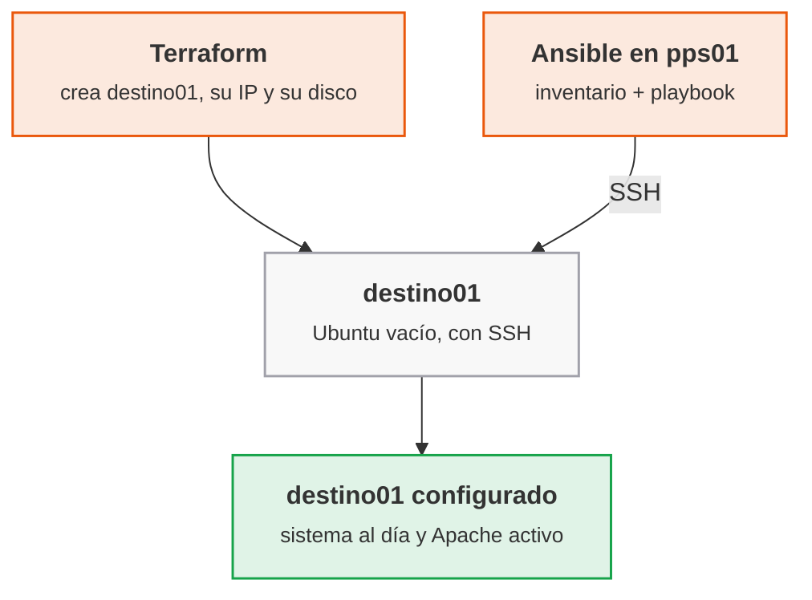

<p class="pie" markdown>Reparto de tareas: `terraform apply` produce la máquina y `ansible-playbook` la configura; el único punto de contacto es la IP y el acceso SSH.</p>

### Ansible: inventario, módulos y playbooks

Este apartado presenta las cuatro piezas que se escriben en la hoja: el inventario dice a qué máquinas se llega, los módulos hacen el trabajo, el playbook ordena las tareas y la idempotencia es la propiedad que hace seguro repetirlas. La herramienta se instala en `pps01`, el equipo de control, con `sudo apt install -y ansible`.

**Inventario.** Es la lista de máquinas gestionadas, con el usuario y la clave con que se entra. El formato INI es el más corto:

```ini
[web]
destino01 ansible_host=192.168.56.20 ansible_user=vagrant
```

`[web]` es un grupo: un playbook se dirige a un grupo, no a una máquina concreta, y por eso el mismo playbook sirve mañana para tres servidores web. El usuario es `vagrant`, el de la imagen con que Terraform creó la máquina en la A5.8. Un fichero `ansible.cfg` en la carpeta del proyecto fija el inventario por defecto para no repetir `-i` en cada orden.

**Módulos.** Cada tarea llama a un módulo, un programa pequeño que Ansible copia a la máquina, ejecuta y borra. Los cuatro que se usan en las dos hojas de Ansible:

| Módulo | Qué garantiza | Ejemplo |
|---|---|---|
| `ansible.builtin.apt` | Un paquete instalado o actualizado, o la caché al día | `name: apache2`, `state: present` |
| `ansible.builtin.service` | Un servicio arrancado y activado en el arranque | `name: apache2`, `state: started` |
| `ansible.builtin.copy` y `template` | Un fichero con un contenido concreto en un destino | `dest: /var/www/html/index.html` |
| `ansible.builtin.uri` | Una respuesta HTTP esperada (comprobación) | `url: http://192.168.56.20` |

**Playbook.** Es un fichero YAML con una lista de tareas para un grupo de máquinas. Las tareas se ejecutan en orden y cada una lleva un nombre legible, que es lo que se ve en la salida. La orden `become: true` hace que las tareas se ejecuten con `sudo`, necesario para instalar paquetes.

**Idempotencia.** Un módulo no ejecuta una acción a ciegas: compara el estado pedido con el real y solo actúa si difieren. La salida lo dice con tres palabras por tarea: `ok` (ya estaba como se pedía), `changed` (se ha modificado algo) y `failed`. La primera ejecución de un playbook sobre una máquina virgen dará muchos `changed`; la segunda tiene que dar `changed=0`. Esa es la prueba de que el playbook describe un estado y no una receta de pasos, y es lo que se captura como evidencia.

!!! ojo "Los módulos `command` y `shell` no son idempotentes"
    Ejecutan siempre la orden y marcan `changed` siempre. Solo se usan cuando no existe un módulo específico, y con `creates:` o `changed_when:` para que informen del cambio real. Un playbook lleno de `shell: apt install ...` funciona una vez y falla la prueba de idempotencia.

Dos opciones ahorran tiempo en clase: `--check` simula el playbook sin cambiar nada y `--diff` muestra qué líneas de un fichero cambiarían.

!!! examen "Qué se evalúa en Ansible"
    Diferencia entre aprovisionar (Terraform) y configurar (Ansible), qué es un inventario y un playbook, por qué Ansible no necesita agente y qué significa que un playbook sea idempotente (la segunda ejecución da `changed=0`). Se pide reconocer un módulo no idempotente y decir por qué.

### A5.10 Ansible: primer playbook (sesión 46)

<span class="et et-obj">Objetivo</span> Desde `pps01`, configurar `destino01` con Ansible: actualizar el sistema e instalar Apache, comprobar que el servidor responde y demostrar con una segunda ejecución que el playbook es idempotente. Es el punto 3.2 del enunciado de la entrega ACT_UT5_2.

<span class="et et-pre">Antes de empezar</span> Se han explicado [la gestión de la configuración](#gestion-de-la-configuracion) y [el inventario, los módulos y los playbooks de Ansible](#ansible-inventario-modulos-y-playbooks). La VM `destino01` (192.168.56.20), la que creó Terraform en la A5.8, tiene que estar encendida y accesible por SSH con el usuario `vagrant` (contraseña `vagrant`, solo válida en esta red solo anfitrión); `pps01` está en la misma red. El repositorio `pps-iac` de la A5.8 vive en el anfitrión: en `pps01` se clona y en él se crea `ansible/`. Se enciende solo `pps01` y `destino01`.

<span class="et et-pas">Pasos</span>

1. Instala Ansible en `pps01` y comprueba la versión:

    ```bash
    sudo apt update && sudo apt install -y ansible
    ansible --version
    ```

2. Comprueba que entras en `destino01` por SSH con clave. Si pide contraseña, copia tu clave pública (`ssh-keygen -t ed25519` si aún no tienes una; la contraseña es `vagrant`) y vuelve a probar:

    ```bash
    ssh-copy-id vagrant@192.168.56.20
    ssh vagrant@192.168.56.20 'hostname && lsb_release -ds'
    ```

3. Clona `pps-iac` en `pps01`, crea la carpeta del proyecto y el inventario con el grupo `web` y un `ansible.cfg` que lo use por defecto:

    ```bash
    git clone https://github.com/pps<NIA>/pps-iac.git ~/pps-iac
    mkdir -p ~/pps-iac/ansible && cd ~/pps-iac/ansible
    printf '[web]\ndestino01 ansible_host=192.168.56.20 ansible_user=vagrant\n' > inventario.ini
    printf '[defaults]\ninventory = inventario.ini\nhost_key_checking = False\n' > ansible.cfg
    ```

4. Prueba la conexión con el módulo `ping` (no es un ping de red: comprueba SSH y Python en el destino). Debe responder `pong` en verde:

    ```bash
    ansible web -m ansible.builtin.ping
    ```

5. Escribe `site.yml` con dos tareas: actualizar el sistema e instalar Apache y arrancarlo. Cópialo tal cual:

    ```yaml
    ---
    - name: Configurar el servidor web
      hosts: web
      become: true
      tasks:
        - name: Actualizar la caché e instalar las actualizaciones
          ansible.builtin.apt:
            update_cache: true
            upgrade: dist
            cache_valid_time: 3600

        - name: Instalar Apache
          ansible.builtin.apt:
            name: apache2
            state: present

        - name: Arrancar Apache y activarlo en el arranque
          ansible.builtin.service:
            name: apache2
            state: started
            enabled: true
    ```

6. Comprueba la sintaxis y ejecuta. `vagrant` usa `sudo` sin contraseña en esa imagen. La actualización descarga paquetes: tarda varios minutos y con toda la clase a la vez, más.

    ```bash
    ansible-playbook site.yml --syntax-check
    ansible-playbook site.yml
    ```

7. Comprueba desde `pps01` que Apache responde y ejecuta el playbook por segunda vez. Anota el resumen final (`PLAY RECAP`) de las dos ejecuciones:

    ```bash
    curl -sI http://192.168.56.20 | head -1
    ansible-playbook site.yml
    ```

8. Documenta y publica: sube `ansible/` a `pps-iac` (`git add`, `git commit`, `git push`) y crea `ut5/a510/` en `pps-entregas` con `README.md`, las capturas y una copia de `inventario.ini`, `ansible.cfg` y `site.yml`.

<span class="et et-com">Comprobación</span> El paso 4 responde `pong`, `curl` devuelve `HTTP/1.1 200 OK` y el `PLAY RECAP` de la primera ejecución muestra `changed` distinto de 0 mientras el de la segunda muestra `changed=0` y `failed=0`. Si la segunda pasada sigue marcando `changed` en la primera tarea porque han salido paquetes nuevos entre las dos, repítela: debe estabilizarse. Si algo no conecta, mira [Errores frecuentes](#errores-frecuentes-en-el-laboratorio).

<span class="et et-ent">Entrega</span> Carpeta `ut5/a510/` de `pps-entregas` con el `README.md` (qué se ha hecho, comandos, validación), las capturas de la primera y la segunda ejecución con su `PLAY RECAP` y los tres ficheros del proyecto. Forma parte de la entrega ACT_UT5_2, plazo el lunes 3 de mayo a las 23:59; la completa la hoja A5.11.

<span class="et et-ext">Si te sobra tiempo</span> Simula el playbook con `ansible-playbook site.yml --check --diff` sobre una máquina donde Apache ya está instalado (sobre una virgen la tarea del servicio falla en simulación, porque el paquete aún no existe). Ejecuta `ansible web -m ansible.builtin.setup -a 'filter=ansible_distribution*'` y lee los datos que Ansible recoge de la máquina (los hechos). Después añade una tarea que instale `curl` y `unzip` con una sola llamada a `apt` usando una lista en `name`.


## Sesión 47 · Margen y repaso de la primera parte de la unidad 5

<p class="ut-meta" markdown>22 de abril · Margen · <span class="dur" tabindex="0" aria-label="Repaso y recuperación · 110 min" data-dur="Repaso y recuperación · 110 min">:material-school:<i class="dur-barra" style="--teoria:0%"></i>:material-flask:</span></p>

Esta sesión no trae contenido nuevo ni hoja propia. Cierra la primera mitad de la unidad, la que va de DevOps a Ansible, y sirve para recuperar lo que se haya perdido o para afianzar lo que ya funciona antes de entrar en K3s y en la monitorización. Conviene llegar con `pps01` y `destino01` disponibles, porque la mayor parte de lo que se repasa se ejecuta en ellas.

!!! consulta "Material de partida"
    No hay material nuevo: la sesión reutiliza el de las anteriores. Para repasar, los enunciados del aula son `RA5-Despliegue-seguro/02 ACT_RA5_1 - Jenkins/RA5.1.pdf` (Jenkins y `jenkinsfile.docker`) y `03 ACT_RA5_2 - Terraform & Ansible/RA5.2.pdf` (Terraform y Ansible). Para la ampliación con Gradle, en `01 Material` está `04-Maven_Gradle.pdf`, y en la web la documentación oficial de Nginx (<https://nginx.org/en/docs/>) y de Gradle (<https://docs.gradle.org/>). Los documentos de terceros se consultan, no se copian.

### Si se ha perdido alguna clase

Se recupera en este orden, porque cada hoja usa lo que dejó la anterior. Lo que ya está hecho se salta.

- Sesiones 37 a 39 (DevOps, Git en equipo y Maven): las hojas [A5.1](#a51-el-pipeline-de-entrega-sesion-37), [A5.2](#a52-git-en-equipo-sesion-38) y [A5.3](#a53-construccion-con-maven-sesion-39). La A5.3 deja el repositorio `pps-app` que usan las siguientes, así que es la primera prioridad.
- Sesiones 40 a 43 (Jenkins): [A5.4](#a54-jenkins-primer-trabajo-sesion-40), [A5.5](#a55-jenkinsfile-sesion-41), [A5.6](#a56-jenkins-con-docker-sesion-42) y [A5.7](#a57-pipeline-seguro-sesion-43). Pertenecen a la entrega ACT_UT5_1, cuyo plazo ya venció el jueves 15 de abril: entregada fuera de plazo y sin causa justificada se corrige sobre el 50 %.
- Sesiones 44 y 45 (Terraform): [A5.8](#a58-terraform-primera-maquina-sesion-44) y [A5.9](#a59-terraform-variables-y-estado-sesion-45). Sin `destino01` no se puede hacer Ansible.
- Sesiones 46 y 48 (Ansible): [A5.10](#a510-ansible-primer-playbook-sesion-46) y [A5.11](#a511-ansible-despliegue-sesion-48). La A5.11 se hace en su fecha; la A5.10 sí se puede recuperar hoy. Las dos forman parte de ACT_UT5_2, plazo el lunes 3 de mayo.

### Si no se ha perdido ninguna

La reserva tiene dos partes: primero el repaso, que sostiene las entregas, y después la ampliación, que es opcional.

- **Jenkins.** Vuelve a arrancar el pipeline de `pps-app` desde cero: haz un cambio mínimo en el código, empuja y comprueba que la construcción, las pruebas y el análisis de dependencias salen sin tocar nada a mano. Si algo falla, el fallo es la lección.
- **Terraform.** Destruir `destino01` con `terraform destroy`, volver a crearla con `terraform apply` y comprobar que la IP de salida es la misma (la máquina nueva no tiene la clave SSH del alumno: hay que repetir `ssh-copy-id`). Comprobar que `.gitignore` deja fuera el estado y las variables con secretos.
- **Ansible.** Con `destino01` recién creada, ejecuta el playbook de la A5.10: una máquina nueva queda configurada sin entrar en ella por SSH. Ese es el ciclo que se necesita en el proyecto integrador. El playbook de la A5.11 se ve en la sesión siguiente.
- **Ampliación con Nginx.** Cambia el servidor web del playbook de la A5.10: escribe una variante que instale `nginx` en lugar de `apache2` (paquete y servicio) y comprueba con `curl` que responde. Sirve para ver qué es específico del paquete (nombre, servicio, ruta de la web) y qué no.
- **Ampliación con Gradle.** Construye `pps-app` con Gradle en lugar de Maven y compara el fichero de construcción, el tiempo y la salida de las pruebas. La comparación se hizo en teoría en la sesión 39; aquí se hace con las manos.

!!! examen "Qué se evalúa en el repaso"
    Reconocer qué herramienta resuelve qué problema: Jenkins construye y prueba, Terraform aprovisiona, Ansible configura. Se pregunta por el orden en que se encadenan y por qué cada una es idempotente o declarativa.

## Sesión 48 · Ansible: despliegue de una aplicación

<p class="ut-meta" markdown>26 de abril · Teoría y práctica · <span class="dur" tabindex="0" aria-label="Roles, variables y handlers · 10 min&#10;Validar un despliegue · 5 min&#10;A5.11 Ansible: despliegue · 95 min" data-dur="Roles, variables y handlers · 10 min&#10;Validar un despliegue · 5 min&#10;A5.11 Ansible: despliegue · 95 min">:material-school:<i class="dur-barra" style="--teoria:14%"></i>:material-flask:</span></p>

El playbook de la sesión 46 deja `destino01` con Apache funcionando, pero el servidor todavía no sirve nada propio. Al acabar esta sesión el playbook está reorganizado en un rol, publica un `index.html` con el mensaje `Ansible rocks`, reinicia Apache solo cuando ese fichero cambia y comprueba por sí mismo, con `curl`, que el servidor responde lo esperado. Se explica primero cómo se organiza un rol y para qué sirven las variables y los handlers, después cómo se valida un despliegue, y la hoja A5.11 lo aplica.

!!! consulta "Material de partida"
    En el aula, `RA5-Despliegue-seguro/03 ACT_RA5_2 - Terraform & Ansible/RA5.2.pdf`, cuyo apartado 3.3 es el enunciado de esta hoja (crear un `index.html` con "Ansible rocks", reiniciar el servicio y comprobar el mensaje con `curl`), y `01 Material/06-Ansible.pdf` (roles y ejemplos). En la web, los apuntes del curso anterior sobre Ansible (handlers, variables y Ansible Galaxy) y la documentación oficial sobre roles, handlers y el módulo `uri`: <https://docs.ansible.com/>. Los apuntes y PDF de terceros se consultan, no se copian.

### Roles, variables y handlers

El objetivo es que un playbook no crezca como una lista larga de tareas mezcladas. Un rol agrupa lo necesario para un cometido (aquí, servir una web con Apache) y se puede aplicar a cualquier máquina; las variables separan lo que cambia (el mensaje) de lo que no, y los handlers reaccionan a los cambios. Todo se ejecuta con `ansible-playbook`, como en la sesión anterior.

Un **rol** es una carpeta con una estructura fija, y Ansible carga cada fichero por su nombre y su sitio, sin que haya que importarlo a mano:

```text
roles/web/
├── defaults/main.yml      valores por defecto de las variables (los más fáciles de sobrescribir)
├── tasks/main.yml         las tareas del rol
├── handlers/main.yml      las tareas que solo se ejecutan si alguien las avisa
└── templates/index.html.j2  ficheros con variables, en plantilla Jinja2
```

El playbook queda reducido a decir a qué máquinas se aplica y qué roles llevan. Lo que hay dentro del rol se puede probar y compartir por separado, y es lo que se publica en Ansible Galaxy, el repositorio de roles de la comunidad.

Las **variables** se escriben entre llaves dobles dentro de una plantilla (`{{ mensaje }}`). Su valor sale de varios sitios con un orden de prioridad: los `defaults` del rol pierden frente a todo, y una variable pasada en la línea de órdenes con `-e` gana a todo. El criterio habitual es poner en `defaults` un valor razonable para cada variable del rol y sobrescribirlo en el inventario o con `-e` solo donde haga falta. Una variable que tiene que cumplirse siempre se pone en `vars`, que es más difícil de sobrescribir, pero es la excepción.

!!! ojo "Las variables de Ansible no son un sitio para secretos"
    Un `defaults/main.yml` con una contraseña acaba en el repositorio, como el fichero de estado de Terraform. Para los valores sensibles se usa `ansible-vault`, que cifra el fichero de variables con una clave que no se sube, o se leen de un gestor de secretos. El mensaje de esta hoja no es secreto; una contraseña de base de datos sí lo sería.

Los **handlers** son tareas en `handlers/main.yml` que no se ejecutan por su cuenta. Una tarea que puede cambiar algo las avisa con `notify: nombre` y el handler se lanza al final del bloque de tareas, una sola vez, y solo si la tarea que avisó marcó `changed`. Es la forma idempotente de reiniciar un servicio: si el `index.html` ya estaba igual, no hay cambio, no hay aviso y Apache no se reinicia. Un `service: state: restarted` como tarea normal reiniciaría el servidor en cada ejecución.

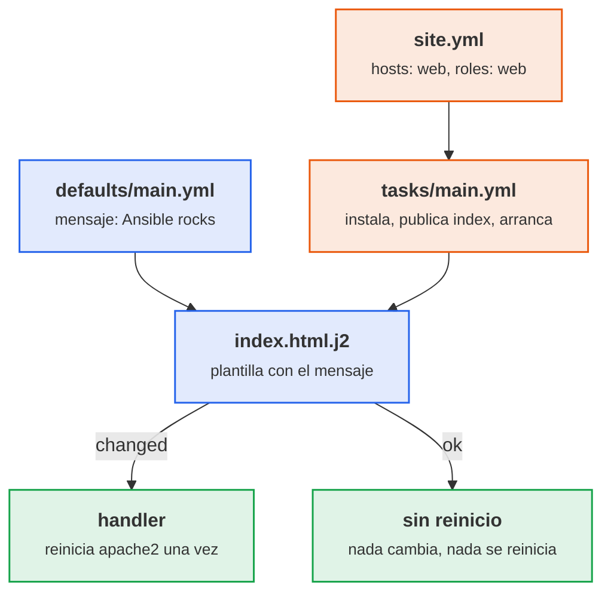

<p class="pie" markdown>Un cambio en el fichero avisa al handler y Apache se reinicia; si el fichero ya coincide, la tarea da `ok` y no hay reinicio.</p>

### Validar un despliegue

Que el playbook termine sin errores no demuestra que la web funcione: dice que cada módulo hizo lo que se le pidió, no que el conjunto sirva. Una validación completa tiene tres niveles y cada uno detecta una cosa distinta.

| Nivel | Cómo | Qué detecta |
|---|---|---|
| Antes de aplicar | `--syntax-check` y `--check --diff` | Errores de YAML y qué cambiaría, sin tocar la máquina |
| Estado | Segunda ejecución con `changed=0` | Que el playbook describe un estado y no una receta |
| Servicio | Petición HTTP con `curl` o el módulo `uri` | Que lo desplegado responde lo que debe, visto desde fuera |

El último nivel es el que cuenta para el resultado. Se hace desde `pps01`, que es el sitio desde el que llegaría un usuario, y se comprueba el contenido, no solo el código de estado: una página de error de Apache también devuelve una respuesta. En el propio playbook, el módulo `uri` con `return_content` y un `assert` sobre el texto convierten la comprobación en una tarea más: si el mensaje no aparece, el playbook falla y el pipeline que lo lance se detiene.

!!! examen "Qué se evalúa en el despliegue con Ansible"
    Qué contiene un rol y para qué sirve cada carpeta, la diferencia entre una variable por defecto y una pasada con `-e`, cuándo se ejecuta un handler (solo si la tarea avisada cambió algo, una vez al final) y por qué eso evita reinicios innecesarios. Se pregunta también cómo se comprueba que un despliegue funciona (contenido de la respuesta, no solo el estado del módulo) y dónde no se guardan los secretos.

### A5.11 Ansible: despliegue (sesión 48)

<span class="et et-obj">Objetivo</span> Reorganizar el playbook de la A5.10 en un rol `web`, desplegar en `destino01` un `index.html` con el mensaje `Ansible rocks`, reiniciar Apache con un handler solo cuando el fichero cambia y comprobar con `curl` que el servidor responde el mensaje. Es el punto 3.3 del enunciado de la entrega ACT_UT5_2.

<span class="et et-pre">Antes de empezar</span> Se han explicado [los roles, las variables y los handlers](#roles-variables-y-handlers) y [cómo se valida un despliegue](#validar-un-despliegue). De la A5.10 se da por hecho que existe `~/pps-iac/ansible/` en `pps01` (clonado de `pps-iac`) con `inventario.ini`, `ansible.cfg` y `site.yml`, y que `destino01` (192.168.56.20) está encendida y se alcanza con `ansible web -m ansible.builtin.ping`. Se enciende solo `pps01` y `destino01`.

<span class="et et-pas">Pasos</span>

1. Crea la estructura del rol y su plantilla. El mensaje va en una variable con valor por defecto, no dentro del HTML:

    ```bash
    cd ~/pps-iac/ansible
    mkdir -p roles/web/{defaults,tasks,handlers,templates}
    printf -- '---\nmensaje: Ansible rocks\n' > roles/web/defaults/main.yml
    cat > roles/web/templates/index.html.j2 <<'HTML'
    <!DOCTYPE html>
    <html lang="es">
      <head><meta charset="utf-8"><title>PPS</title></head>
      <body><h1>{{ mensaje }}</h1></body>
    </html>
    HTML
    ```

2. Escribe las tareas del rol en `roles/web/tasks/main.yml`. La tarea de la plantilla lleva `notify`: es la que avisa al handler. Cópialo tal cual:

    ```yaml
    ---
    - name: Instalar Apache
      ansible.builtin.apt:
        name: apache2
        state: present

    - name: Publicar el index.html
      ansible.builtin.template:
        src: index.html.j2
        dest: /var/www/html/index.html
        owner: root
        group: root
        mode: "0644"
      notify: Reiniciar Apache

    - name: Arrancar Apache y activarlo en el arranque
      ansible.builtin.service:
        name: apache2
        state: started
        enabled: true
    ```

3. Escribe el handler en `roles/web/handlers/main.yml`. El nombre tiene que ser idéntico al del `notify`, letra por letra:

    ```yaml
    ---
    - name: Reiniciar Apache
      ansible.builtin.service:
        name: apache2
        state: restarted
    ```

4. Sustituye `site.yml` por una versión que actualiza el sistema, aplica el rol y comprueba el resultado. Los handlers se lanzan al terminar el rol, antes de `post_tasks`, por eso la comprobación ve ya el servidor reiniciado. Las dos tareas de `post_tasks` llevan `when: not ansible_check_mode` porque con `--check` no se publica nada y la página que hay todavía no contiene el mensaje: sin esa condición, la simulación del paso 5 terminaría en fallo:

    ```yaml
    ---
    - name: Desplegar la web
      hosts: web
      become: true
      pre_tasks:
        - name: Actualizar la caché e instalar las actualizaciones
          ansible.builtin.apt:
            update_cache: true
            upgrade: dist
            cache_valid_time: 3600
      roles:
        - web
      post_tasks:
        - name: Pedir la página al propio servidor
          ansible.builtin.uri:
            url: http://localhost
            return_content: true
          register: respuesta
          when: not ansible_check_mode

        - name: Comprobar que aparece el mensaje
          ansible.builtin.assert:
            that: mensaje in respuesta.content
            success_msg: "La web responde: {{ mensaje }}"
            fail_msg: "La web no devuelve el mensaje esperado"
          when: not ansible_check_mode
    ```

5. Valida antes de aplicar y aplica después. Anota en la salida la línea `RUNNING HANDLER [web : Reiniciar Apache]` y el `PLAY RECAP`:

    ```bash
    ansible-playbook site.yml --syntax-check
    ansible-playbook site.yml --check --diff
    ansible-playbook site.yml
    ```

6. Comprueba desde `pps01`, como lo vería un usuario, y repite el playbook para demostrar la idempotencia. La segunda pasada no debe mostrar ningún `RUNNING HANDLER`:

    ```bash
    curl -s http://192.168.56.20 | grep 'Ansible rocks'
    ansible-playbook site.yml
    ```

7. Comprueba que el handler solo se lanza cuando hace falta. Cambia el mensaje con `-e`, observa que ahora sí hay `changed` y reinicio, y vuelve al valor por defecto para dejar la evidencia final con `Ansible rocks`:

    ```bash
    ansible-playbook site.yml -e '{"mensaje": "Ansible sigue rocks"}'
    curl -s http://192.168.56.20 | grep h1
    ansible-playbook site.yml
    curl -s http://192.168.56.20 | grep 'Ansible rocks'
    ```

8. Documenta y publica: sube `ansible/` a `pps-iac` y, en `ut5/a511/` de `pps-entregas`, crea el `README.md` (qué se ha hecho, comandos, validación) con las capturas de las tres ejecuciones y del `curl`, y copia la carpeta `ansible/` sin secretos. Sube con `git add`, `git commit` y `git push`.

<span class="et et-com">Comprobación</span> La primera ejecución muestra `changed` en la plantilla y el handler `Reiniciar Apache`; la segunda termina con `changed=0` y sin handler; con `-e` hay un `changed` y un reinicio; el `assert` da `ok` y `curl` devuelve `Ansible rocks`. Si el handler no aparece nunca, el nombre del `notify` no coincide con el del handler. Si algo no conecta, mira [Errores frecuentes](#errores-frecuentes-en-el-laboratorio).

<span class="et et-ent">Entrega</span> Carpeta `ut5/a511/` de `pps-entregas` con el `README.md`, las capturas y el proyecto `ansible/`. Con la A5.8, la A5.9 y la A5.10 completa la entrega ACT_UT5_2: el `README` de la entrega recoge la captura de la provisión con Terraform, la de la configuración con Ansible y la de la validación con `curl`. Plazo el lunes 3 de mayo a las 23:59.

<span class="et et-ext">Si te sobra tiempo</span> Rompe la comprobación a propósito: cambia el `assert` para que busque un texto distinto y comprueba que el playbook falla al final con el mensaje de `fail_msg`. Después mueve la tarea de actualización del sistema a su propio rol `base` y aplica los dos roles en `site.yml`.

## Sesión 49 · K3s en un nodo

<p class="ut-meta" markdown>29 de abril · Teoría y práctica · <span class="dur" tabindex="0" aria-label="Escalado y orquestación: pods, despliegues y servicios · 15 min&#10;K3s frente a Kubernetes · 10 min&#10;A5.12 K3s de un nodo · 85 min" data-dur="Escalado y orquestación: pods, despliegues y servicios · 15 min&#10;K3s frente a Kubernetes · 10 min&#10;A5.12 K3s de un nodo · 85 min">:material-school:<i class="dur-barra" style="--teoria:23%"></i>:material-flask:</span></p>

Hasta ahora cada aplicación corría en un contenedor que alguien arrancaba a mano. Al acabar esta sesión hay un clúster K3s de un solo nodo en la VM `k3s-1`, con nginx desplegado en dos réplicas, accesible por el puerto 30080, y con K9s instalado para verlo. Primero se explica por qué hace falta un orquestador y qué objetos de Kubernetes intervienen (pod, despliegue, servicio), después qué es K3s y en qué se distingue de Kubernetes, y por último la hoja A5.12.

!!! consulta "Material de partida"
    En el aula, carpeta `RA5-Despliegue-seguro/08 ACT_RA5_4 - K3s & K9s`: `RA5.4.pdf` (Kubernetes, K3s en un nodo y en alta disponibilidad, componentes, `kubectl` y K9s; sus apartados 5.1 y 5.2 son los enunciados de las hojas A5.12 y A5.13, y el 5.3 el de la A5.14). En `01 Material`: `01-Infraestructura.pdf` (escalado vertical y horizontal, virtualización y contenedores). En la web: <https://k3s.io/> y su documentación (<https://docs.k3s.io/quick-start>), <https://kubernetes.io/es/> y <https://k9scli.io/>. Los *Apuntes de Puesta en Producción Segura* y *Ciberseguridad-PePS* sobre el desplegado seguro no tratan Kubernetes: esta parte se apoya solo en el PDF y en la documentación oficial. Las diapositivas se consultan, no se copian.

### Escalado y orquestación: pods, despliegues y servicios

El objetivo de este apartado es entender qué problema resuelve un orquestador y con qué cuatro objetos se trabaja en la práctica. La herramienta de línea de órdenes es `kubectl`, que habla con el clúster y le pide que aplique lo que describe un fichero YAML.

**Escalar** es dar más capacidad a un servicio. El escalado vertical le añade recursos a la misma máquina (más CPU o memoria): es sencillo, pero tiene techo y obliga a parar. El escalado horizontal añade más copias del servicio detrás de un reparto de carga: no tiene techo práctico y tolera la caída de una copia, pero exige que el servicio pueda ejecutarse en varias instancias a la vez. Los contenedores son ligeros y arrancan en segundos, y por eso el escalado horizontal es el que se automatiza. Con dos o tres contenedores basta un `docker compose`; con decenas repartidas en varias máquinas hace falta algo que decida dónde corre cada uno, lo reinicie si cae y mantenga el número deseado. Eso es un **orquestador**, y el estándar es Kubernetes.

Kubernetes funciona por **estado deseado**: se declara cuántas copias de qué imagen se quieren y el clúster trabaja sin parar para que la realidad coincida. Es el mismo principio de idempotencia de Terraform y Ansible, aplicado a los contenedores en ejecución.

| Objeto | Qué es | Analogía con Docker |
|---|---|---|
| **Pod** | La unidad mínima: uno o varios contenedores que comparten red y almacenamiento | Un contenedor (o un grupo que comparte red) |
| **Deployment** (despliegue) | Declara la imagen y el número de réplicas; si un pod cae, crea otro; permite actualizar sin corte | `docker compose` con `--scale` y `restart` |
| **Service** (servicio) | Nombre y dirección estables delante de un conjunto de pods, con reparto entre ellos | La red del compose con el nombre del servicio |
| **Namespace** | Agrupa objetos; los del propio Kubernetes viven en `kube-system` | Un proyecto de compose |

Un servicio de tipo **NodePort** abre el mismo puerto (del 30000 al 32767) en todos los nodos y lo reenvía a los pods. En el laboratorio del curso, nginx queda en el 30080, y se llega a él por la IP de cualquier nodo.

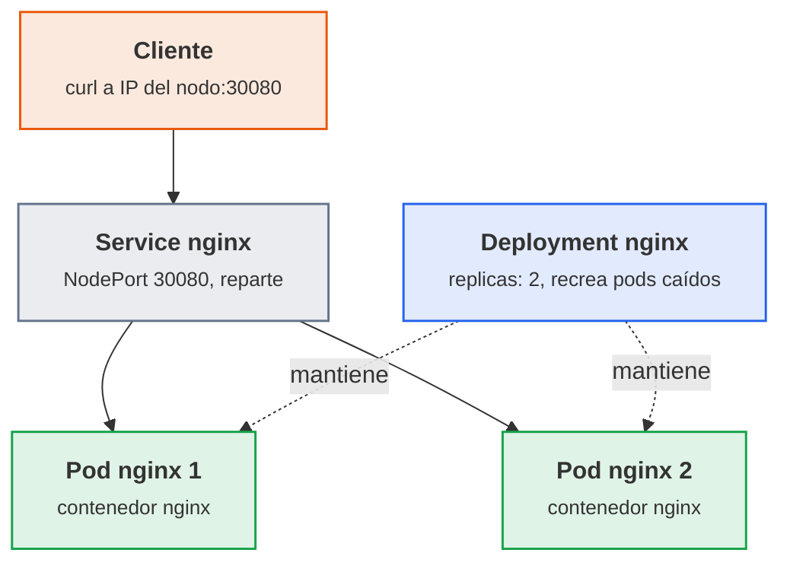

<p class="pie" markdown>El `Deployment` no sirve tráfico: solo mantiene el número de pods. El reparto lo hace el `Service`.</p>

### K3s frente a Kubernetes

El objetivo es saber por qué se usa K3s en el laboratorio y qué se conserva de Kubernetes. K3s es una distribución certificada de Kubernetes que se instala con un único binario y un `curl`, pensada para máquinas con pocos recursos. Un clúster de verdad exige montar varios componentes por separado; K3s los empaqueta todos.

| Aspecto | Kubernetes completo | K3s |
|---|---|---|
| Instalación | Varios componentes y un instalador (kubeadm) | Un script: `curl -sfL https://get.k3s.io \| sh -` |
| Base de datos del clúster | etcd aparte | SQLite en un nodo; etcd embebido en alta disponibilidad |
| Incluido de serie | Nada más allá del núcleo | Traefik (entrada HTTP), CoreDNS, almacenamiento local y balanceador de servicios |
| Recursos por servidor | Varios GB | Mínimo documentado: 2 CPU y 2 GB de memoria (agente: 1 CPU y 512 MB) |
| `kubectl` y YAML | Los estándar | Los mismos: un YAML sirve en ambos |

En un nodo K3s ejecuta a la vez el plano de control (API, planificador y controladores) y los pods de las aplicaciones. Por eso un solo nodo es un laboratorio y no un entorno de producción: si esa máquina cae, cae todo. La alta disponibilidad se ve en la sesión 50.

!!! ojo "Los recursos del laboratorio quedan por debajo del mínimo documentado"
    Cada VM `k3s-N` del curso tiene 1 vCPU y 1,5 GB, por debajo de los 2 CPU y 2 GB que K3s documenta para un servidor. Con nginx funciona, pero el arranque es lento (de dos a cuatro minutos hasta que el nodo pasa a `Ready`) y un nodo que se queda sin memoria se reinicia sin avisar. El criterio habitual es respetar el mínimo si el equipo lo permite: con 16 GB, tres VM de 2 GB (6 GB) caben si `pps01` está apagada. Si ni así caben las tres, la alternativa es k3d, que ejecuta K3s dentro de contenedores Docker en `pps01` y que se explica en la sesión 50.

!!! examen "Qué se evalúa"
    Diferencia entre escalado vertical y horizontal y cuál permite tolerar fallos; qué hace un orquestador; función de pod, deployment y service (quién mantiene las réplicas y quién reparte el tráfico); por qué K3s y no Kubernetes completo en un laboratorio.

### A5.12 K3s de un nodo (sesión 49)

<span class="et et-obj">Objetivo</span> Instalar K3s en la VM `k3s-1`, desplegar nginx con dos réplicas, abrirlo por el NodePort 30080 y ver el clúster con K9s. Es el punto 5.1 del enunciado de la entrega ACT_UT5_4.

<span class="et et-pre">Antes de empezar</span> Se han explicado [los pods, despliegues y servicios](#escalado-y-orquestacion-pods-despliegues-y-servicios) y [K3s frente a Kubernetes](#k3s-frente-a-kubernetes). Se da por hecho `destino01` (A5.8), que sirve de base para clonar. Se enciende solo `k3s-1` (y `pps01` si se quiere trabajar desde ella); el resto queda apagado. La descarga de K3s y de la imagen de nginx necesita salida a Internet, así que `k3s-1` lleva dos adaptadores: NAT (salida) y solo anfitrión (192.168.56.31).

<span class="et et-pas">Pasos</span>

1. Con la VM `destino01` apagada, clónala como `k3s-1` (clon completo, con MAC nueva). Ajusta en VirtualBox 1 vCPU y 1,5 GB (2 GB si el equipo lo permite) y añade un adaptador NAT como primero si no lo tiene. Arranca y entra con el usuario `vagrant` (contraseña `vagrant`), que el clon hereda de `destino01`.
2. Un clon repite el identificador de máquina y el nombre. Corrígelos, y comprueba cómo se llama la interfaz de solo anfitrión (la que tiene 192.168.56.x). El clon arrastra también el Apache que `destino01` instaló en la A5.10, cuyo puerto 80 chocaría con Traefik de K3s, así que se desactiva:

    ```bash
    sudo hostnamectl set-hostname k3s-1
    sudo rm /etc/machine-id && sudo systemd-machine-id-setup
    sudo systemctl disable --now apache2
    ip -br a
    ```

3. Fija la IP de la interfaz de solo anfitrión. Sustituye `enp0s8` por el nombre que mostró `ip -br a` y guarda esto en `/etc/netplan/60-lab.yaml`. Si el clon trae otro fichero en `/etc/netplan/` con la IP de `destino01` (`grep -l 192.168.56.20 /etc/netplan/*`), bórralo para que no queden dos direcciones. Aplica con `sudo netplan apply` y comprueba con `ping -c1 192.168.56.10` y `ping -c1 deb.debian.org`:

    ```yaml
    network:
      version: 2
      ethernets:
        enp0s8:
          dhcp4: false
          addresses: [192.168.56.31/24]
    ```

4. Instala K3s. La variable hace legible el fichero de configuración de `kubectl` sin `sudo`, y las dos opciones fuerzan que el nodo use la red de solo anfitrión y no la NAT, cuya IP es idéntica en todas las VM de VirtualBox. La instalación tarda de 3 a 8 minutos según la descarga:

    ```bash
    curl -sfL https://get.k3s.io | K3S_KUBECONFIG_MODE="644" sh -s - \
      --node-ip 192.168.56.31 --flannel-iface enp0s8
    ```

5. Espera a que el nodo esté listo y mira qué ha arrancado por su cuenta. Verás el nodo `Ready` con rol `control-plane` y pods de `kube-system` (CoreDNS, Traefik...). Si aparece `NotReady`, espera un minuto y repite: en una VM de 1 vCPU es normal:

    ```bash
    export KUBECONFIG=/etc/rancher/k3s/k3s.yaml
    kubectl get nodes -o wide
    kubectl get pods -A
    ```

6. Crea `nginx.yaml` con el despliegue y el servicio. Fíjate en las tres piezas: `replicas: 2`, la etiqueta `app: nginx` que une el servicio con los pods, y `nodePort: 30080`:

    ```yaml
    apiVersion: apps/v1
    kind: Deployment
    metadata:
      name: nginx
    spec:
      replicas: 2
      selector:
        matchLabels: {app: nginx}
      template:
        metadata:
          labels: {app: nginx}
        spec:
          containers:
            - name: nginx
              image: nginx:stable
              ports: [{containerPort: 80}]
    ---
    apiVersion: v1
    kind: Service
    metadata:
      name: nginx
    spec:
      type: NodePort
      selector: {app: nginx}
      ports:
        - port: 80
          targetPort: 80
          nodePort: 30080
    ```

7. Aplica el fichero, espera a que los dos pods estén `Running` (descargar la imagen tarda de 1 a 3 minutos) y comprueba el servicio desde la propia VM y desde `pps01` o el anfitrión:

    ```bash
    kubectl apply -f nginx.yaml
    kubectl get deploy,pods,svc -o wide
    curl -s http://192.168.56.31:30080 | head -4
    ```

8. Comprueba el estado deseado: borra un pod y mira cómo el despliegue crea otro. Escalar (`kubectl scale deploy nginx --replicas=3`) queda para la hoja siguiente:

    ```bash
    kubectl get pods
    kubectl delete pod <nombre de un pod nginx>
    kubectl get pods -w        # Ctrl+C cuando haya dos Running
    ```

9. Instala K9s (binario para Linux; en una VM de 64 bits de Intel o AMD) y ábrelo. Dentro, `:pods` lista los pods, `:svc` los servicios, `:deploy` los despliegues y `:nodes` los nodos; `l` muestra los logs del pod seleccionado, `d` lo describe y `q` sale. Sitúate sobre un pod de nginx y verás sus logs:

    ```bash
    curl -sL https://github.com/derailed/k9s/releases/latest/download/k9s_Linux_amd64.tar.gz | sudo tar xz -C /usr/local/bin k9s
    export TERM=xterm-256color
    k9s
    ```

10. Crea `~/pps-entregas/ut5/a512/README.md` con el resultado de `kubectl get nodes -o wide`, `kubectl get deploy,pods,svc -o wide` y el `curl`, junto con una captura de K9s con los dos pods de nginx. Haz `git add`, `git commit` y `git push`.

<span class="et et-com">Comprobación</span> `kubectl get nodes` muestra `k3s-1` en `Ready`, el despliegue `nginx` dice `2/2`, `curl http://192.168.56.31:30080` devuelve la página `Welcome to nginx!` y K9s lista los dos pods en `Running`. Si `curl` da `Connection refused` o el nodo no arranca, mira [Errores frecuentes](#errores-frecuentes-en-el-laboratorio).

<span class="et et-ent">Entrega</span> La carpeta `ut5/a512/` de `pps-entregas` con el README y las capturas, más `nginx.yaml`. Forma parte de la entrega ACT_UT5_4, plazo el jueves 13 de mayo (23:59), junto con las hojas A5.13 y A5.14.

<span class="et et-ext">Si te sobra tiempo</span> Cambia la imagen a `nginx:alpine` en `nginx.yaml`, aplícalo de nuevo y observa con `kubectl rollout status deploy/nginx` cómo Kubernetes sustituye los pods uno a uno sin cortar el servicio.

## Sesión 50 · K3s en alta disponibilidad

<p class="ut-meta" markdown>3 de mayo · Teoría y práctica · <span class="dur" tabindex="0" aria-label="Alta disponibilidad: etcd embebido, base de datos externa y quórum · 15 min&#10;A5.13 K3s en alta disponibilidad · 95 min" data-dur="Alta disponibilidad: etcd embebido, base de datos externa y quórum · 15 min&#10;A5.13 K3s en alta disponibilidad · 95 min">:material-school:<i class="dur-barra" style="--teoria:14%"></i>:material-flask:</span></p>

Un clúster de un nodo cae entero si cae su máquina. Al acabar esta sesión hay tres servidores K3s (`k3s-1`, `k3s-2` y `k3s-3`) formando un solo clúster, nginx repetido con dos réplicas y la prueba de que el clúster sigue funcionando cuando uno de los servidores se apaga. Primero se explica cómo K3s guarda su estado y por qué el número de servidores tiene que ser impar; después la hoja A5.13.

!!! consulta "Material de partida"
    En el aula, `RA5-Despliegue-seguro/08 ACT_RA5_4 - K3s & K9s/RA5.4.pdf`: el apartado 2.2 (arquitectura HA, con base de datos interna y externa) y la actividad 5.2, que es el enunciado de esta hoja. En la web: <https://docs.k3s.io/datastore/ha-embedded> (etcd embebido, con las órdenes de instalación), <https://docs.k3s.io/installation/requirements> (requisitos y puertos) y <https://docs.k3s.io/architecture>. Ningún apunte de terceros del curso anterior cubre esta sesión.

### Alta disponibilidad: etcd embebido, base de datos externa y quórum

El objetivo es entender qué se replica en un clúster de alta disponibilidad y cuántos servidores hacen falta. Se instala con el mismo `curl` de la sesión anterior, pero arrancando varios servidores que comparten estado.

El estado del clúster (qué despliegues existen, cuántas réplicas, dónde corre cada pod) vive en una base de datos, y es lo único que un servidor no puede perder. En un nodo, K3s usa SQLite, un fichero local. Para tener varios servidores, esa base de datos tiene que ser compartida y tolerante a la caída de uno de ellos. K3s ofrece dos caminos:

| | etcd embebido | Base de datos externa |
|---|---|---|
| Qué es | etcd, el almacén de Kubernetes, replicado dentro de los propios servidores | PostgreSQL, MySQL o etcd en otras máquinas |
| Piezas que administrar | Solo los servidores K3s | Servidores K3s más la base de datos, que también hay que hacer resistente |
| Servidores mínimos | Tres (número impar) | Dos, más la base de datos |
| Se instala con | `--cluster-init` en el primero y `--server` en el resto | `--datastore-endpoint` en todos |

El criterio habitual, y el del laboratorio, es etcd embebido: no añade máquinas ni servicios, y con tres servidores ya se tolera la pérdida de uno. La base externa solo compensa cuando la organización ya opera un PostgreSQL o MySQL con alta disponibilidad y quiere reutilizarlo.

etcd toma decisiones por mayoría, y la mayoría se llama **quórum**: con `n` servidores son necesarios `n/2 + 1` (división entera). Por debajo de esa cifra el clúster no puede escribir su estado, así que el API deja de aceptar cambios aunque las máquinas sigan encendidas. Es lo que evita que dos mitades incomunicadas decidan por separado.

| Servidores | Quórum | Caídas toleradas |
|---|---|---|
| 1 | 1 | 0 |
| 2 | 2 | 0 (peor que uno solo: cualquier caída bloquea) |
| 3 | 2 | 1 |
| 5 | 3 | 2 |

Por eso el número tiene que ser impar: cuatro servidores necesitan tres para el quórum y toleran una sola caída, igual que tres. Los pods que ya estaban en marcha en los nodos que sobreviven siguen sirviendo aunque el API esté bloqueado; lo que se pierde es la capacidad de cambiar el clúster.

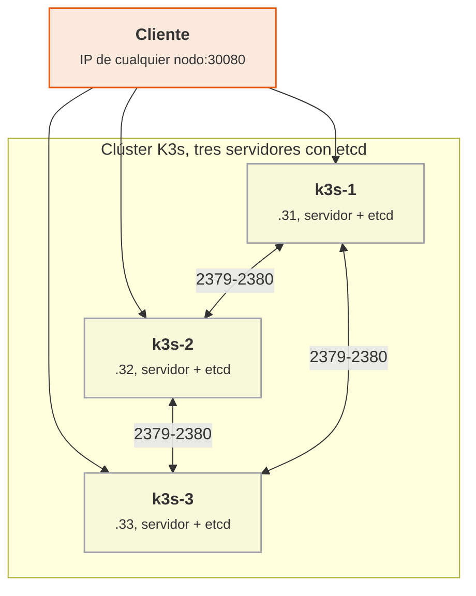

<p class="pie" markdown>Los tres servidores replican `etcd` por los puertos 2379 y 2380; el tráfico de las aplicaciones entra por el NodePort de cualquiera de ellos.</p>

Los servidores nuevos necesitan tres cosas para unirse: la dirección del primero (`--server https://192.168.56.31:6443`), el mismo **token** (un secreto compartido, que no va al repositorio) y visibilidad de los puertos 6443, 2379 y 2380 entre ellos. Un límite del montaje del laboratorio: todos los clientes apuntan a `k3s-1`, así que si cae ese servidor `kubectl` deja de responder desde él aunque el clúster siga vivo. En producción se pone delante una IP virtual o un balanceador, y se usa `--tls-san` para que el certificado la admita.

!!! truco "Si las tres VM no caben: k3d"
    Si el equipo no soporta tres VM más, la alternativa es k3d, que ejecuta cada nodo K3s como un contenedor Docker dentro de `pps01`, sin VM nuevas y con arranque en segundos. Es K3s de verdad, con etcd embebido y tres servidores, pero comparten kernel y disco y no permite probar el apagado de una máquina completa (se detiene el contenedor). Se instala con `curl -s https://raw.githubusercontent.com/k3d-io/k3d/main/install.sh | bash` y el clúster se crea con `k3d cluster create pps --servers 3 -p "30080:30080@server:0" -p "80:80@loadbalancer"`. Los nodos se llaman `k3d-pps-server-0`, `k3d-pps-server-1` y `k3d-pps-server-2`; nginx queda en `http://localhost:30080`, la entrada HTTP de la A5.14 en `http://localhost` (con la cabecera `Host`), se apaga un nodo con `docker stop k3d-pps-server-2` y `kubectl` se ejecuta con `docker exec k3d-pps-server-0 kubectl get nodes`. El resto de la hoja (nginx, K9s, comprobaciones) es idéntico. Documentación: <https://k3d.io/stable/>.

!!! examen "Qué se evalúa"
    Qué guarda etcd y por qué el clúster necesita mayoría; cálculo del quórum y de las caídas toleradas con 3 y 5 servidores; por qué dos servidores no mejoran a uno; diferencia entre etcd embebido y base de datos externa y cuál conviene en un laboratorio.

### A5.13 K3s en alta disponibilidad (sesión 50)

<span class="et et-obj">Objetivo</span> Montar un clúster K3s de tres servidores con etcd embebido, repetir el despliegue de nginx con dos réplicas, ver los tres nodos en K9s y comprobar que el clúster sobrevive al apagado de un servidor. Es el punto 5.2 del enunciado de la entrega ACT_UT5_4.

<span class="et et-pre">Antes de empezar</span> Se han explicado [el etcd embebido, la base de datos externa y el quórum](#alta-disponibilidad-etcd-embebido-base-de-datos-externa-y-quorum). Se da por hecho la VM `k3s-1` de la A5.12 con su `nginx.yaml` y K9s instalado. Se encienden solo `k3s-1`, `k3s-2` y `k3s-3` (`pps01` puede quedar apagada; se trabaja por SSH desde el anfitrión). Hoy vence también el plazo de la entrega ACT_UT5_2 (23:59): si falta algo de Terraform o Ansible, se sube antes de irse.

<span class="et et-pas">Pasos</span>

1. En `k3s-1`, desinstala el clúster de un nodo para partir de cero (borra K3s y sus datos, no el `nginx.yaml`). Después apaga la VM y clónala dos veces como `k3s-2` y `k3s-3` (clon completo, MAC nueva). Cada clon de una VM ya limpia tarda de 3 a 5 minutos:

    ```bash
    /usr/local/bin/k3s-uninstall.sh
    sudo poweroff
    ```

2. En cada clon, repite la configuración de la A5.12 con su nombre y su IP: `k3s-2` con 192.168.56.32 y `k3s-3` con 192.168.56.33. Cambia el hostname, regenera `machine-id` y edita la dirección de `/etc/netplan/60-lab.yaml` (el resto del fichero no cambia; `sudo netplan apply`). Arranca también `k3s-1`. Comprueba que las tres se ven entre sí: `ping -c1 192.168.56.31`, `.32` y `.33`.
3. En `k3s-1`, instala el primer servidor. `--cluster-init` activa etcd embebido, y el token es el secreto compartido (en el laboratorio se pone en la orden; nunca en un fichero del repositorio). Tarda de 3 a 8 minutos:

    ```bash
    curl -sfL https://get.k3s.io | K3S_TOKEN=secreto-del-laboratorio K3S_KUBECONFIG_MODE="644" sh -s - server \
      --cluster-init --node-ip 192.168.56.31 --flannel-iface enp0s8 --tls-san 192.168.56.31
    kubectl get nodes    # con KUBECONFIG=/etc/rancher/k3s/k3s.yaml; espera al estado Ready
    ```

4. En `k3s-2`, une el segundo servidor apuntando al primero. Espera a que termine (de 3 a 8 minutos, más lento que el primero porque replica etcd) antes de pasar al tercero; si se unen a la vez el quórum se forma mal:

    ```bash
    curl -sfL https://get.k3s.io | K3S_TOKEN=secreto-del-laboratorio K3S_KUBECONFIG_MODE="644" sh -s - server \
      --server https://192.168.56.31:6443 --node-ip 192.168.56.32 --flannel-iface enp0s8
    ```

5. En `k3s-3`, la misma orden con `--node-ip 192.168.56.33`. Desde `k3s-1` comprueba que hay tres nodos con rol `control-plane,etcd` y todos en `Ready`:

    ```bash
    export KUBECONFIG=/etc/rancher/k3s/k3s.yaml
    kubectl get nodes -o wide
    ```

6. Repite el despliegue de nginx con el mismo fichero de la A5.12. Comprueba en qué nodos han caído los dos pods y que el NodePort responde en las IP de los tres, incluso en el que no tiene ningún pod:

    ```bash
    kubectl apply -f nginx.yaml
    kubectl get pods -o wide
    for ip in 31 32 33; do curl -s -o /dev/null -w "$ip %{http_code}\n" http://192.168.56.$ip:30080; done
    ```

7. Abre K9s en `k3s-1`, ejecuta `:nodes` y comprueba que los tres servidores están `Ready`. Después `:pods` y sitúate sobre un pod de nginx con `d` para ver en qué nodo corre. Haz una captura de cada vista.
8. Prueba la tolerancia a fallos: apaga `k3s-3` (`sudo poweroff` en ella). En `k3s-1`, `kubectl get nodes` la marca `NotReady` a los 40 segundos aproximadamente. Repite el bucle `curl` del paso 6 solo con `.31` y `.32`: el servicio sigue respondiendo y `kubectl` sigue aceptando cambios (`kubectl scale deploy nginx --replicas=3`), porque quedan dos de tres servidores, que es el quórum.
9. Enciende `k3s-3` y comprueba que vuelve a `Ready` sin hacer nada. Vuelve a dejar el despliegue en dos réplicas.
10. Crea `~/pps-entregas/ut5/a513/README.md` con las salidas de `kubectl get nodes -o wide`, del bucle `curl`, la captura de K9s y unas líneas que expliquen qué pasó con el clúster mientras `k3s-3` estaba apagada. No incluyas el token. Haz `git add`, `git commit` y `git push`.

<span class="et et-com">Comprobación</span> Tres nodos en `Ready`, `nginx` con `2/2`, un `200` desde las tres IP en el paso 6 y, con `k3s-3` apagada, un `200` desde `.31` y `.32` y un `scale` que se aplica. Si un nodo nuevo no aparece o se queda en `NotReady`, mira [Errores frecuentes](#errores-frecuentes-en-el-laboratorio).

<span class="et et-ent">Entrega</span> La carpeta `ut5/a513/` de `pps-entregas` con el README y las capturas. Forma parte de la entrega ACT_UT5_4, plazo el jueves 13 de mayo (23:59), junto con las hojas A5.12 y A5.14.

<span class="et et-ext">Si te sobra tiempo</span> Apaga ahora `k3s-2` y `k3s-3` a la vez y observa: `kubectl` deja de responder o se queda esperando (sin quórum no hay API), pero `curl` a `192.168.56.31:30080` puede seguir sirviendo mientras el pod siga en `k3s-1`. Enciende una de las dos y comprueba que el API vuelve. Anota cuál de los dos comportamientos es el del plano de control y cuál el de los pods.

## Sesión 51 · Aplicaciones en K3s y K9s

<p class="ut-meta" markdown>6 de mayo · Teoría y práctica · <span class="dur" tabindex="0" aria-label="Servicios, entrada HTTP y balanceo de carga; K9s · 10 min&#10;A5.14 Balanceo en K3s y K9s · 100 min" data-dur="Servicios, entrada HTTP y balanceo de carga; K9s · 10 min&#10;A5.14 Balanceo en K3s y K9s · 100 min">:material-school:<i class="dur-barra" style="--teoria:9%"></i>:material-flask:</span></p>

Un despliegue de laboratorio con nginx no es todavía una aplicación propia. Al acabar esta sesión la aplicación `pps-app` corre en el clúster de tres servidores con réplicas repartidas entre los nodos, delante hay una entrada HTTP que balancea la carga entre ellas, y K9s sirve para comprobar el reparto, escalar y matar pods. Se explica cómo se traduce un `docker-compose` de balanceo a objetos de Kubernetes y qué aporta K9s; después la hoja A5.14.

!!! consulta "Material de partida"
    En el aula, `RA5-Despliegue-seguro/08 ACT_RA5_4 - K3s & K9s/RA5.4.pdf`: el apartado 3 (K9s) y la actividad 5.3, que es el enunciado de esta hoja: desplegar en K3s y validar con K9s el `docker-compose` de balanceo de carga del taller <https://aulasoftwarelibre.github.io/taller-de-docker/dockerfile/#balanceo-de-carga>. En la web: <https://k9scli.io/> (K9s) y <https://docs.k3s.io/networking/networking-services> (servicios y Traefik en K3s). El compose del taller usa la versión 2.3 de Traefik y el socket de Docker, que no existen en K3s: por eso la hoja lo traduce en lugar de ejecutarlo tal cual.

### Servicios, entrada HTTP y balanceo de carga; K9s

El objetivo es saber qué objeto de Kubernetes sustituye a cada servicio del compose de balanceo, y con qué herramienta se ve el resultado. El compose del taller tiene tres servicios: la aplicación web (que se escala con `--scale web=5`), una base de datos Redis y un Traefik que reparte las peticiones entre las réplicas. En Kubernetes cada pieza tiene su equivalente:

| En el compose | En K3s | Detalle |
|---|---|---|
| `web` con `--scale web=5` | **Deployment** con `replicas: 5` | El clúster reparte los pods entre los nodos y los recrea si caen |
| Red interna y nombre del servicio | **Service** de tipo ClusterIP | Nombre estable y reparto entre los pods que casan con la etiqueta |
| `redis` | Otro Deployment y su Service | Se localiza por el nombre `redis` |
| `traefik` con reglas en etiquetas (`Host(...)`) | **Ingress** (regla) más el Traefik que K3s ya trae | La regla `host` se escribe en un objeto, no en etiquetas |
| `docker.sock` montado en Traefik | No hace falta | Traefik consulta al API de Kubernetes |

Hay dos niveles de reparto. El Service reparte entre los pods de un mismo servicio dentro del clúster. El Ingress recibe las peticiones HTTP de fuera por el puerto 80 de cualquier nodo y las dirige al Service según el nombre de host (`Host`). K3s activa Traefik como controlador de entrada por defecto, así que no se instala nada: basta crear el objeto Ingress.

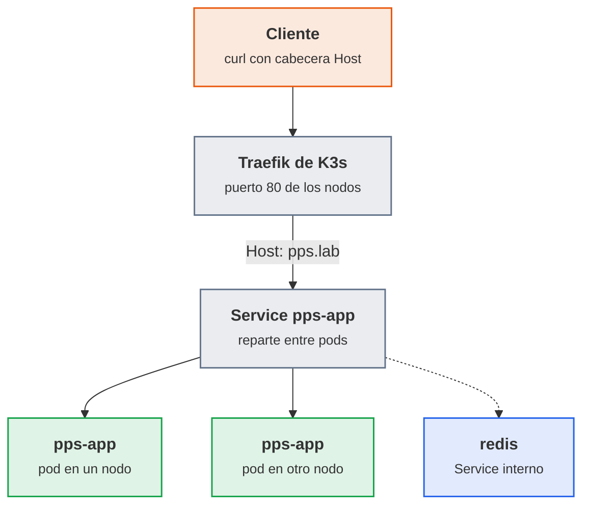

<p class="pie" markdown>La entrada elige el Service por el nombre de host; el Service elige el pod. Redis no recibe tráfico de fuera.</p>

**K9s** es un panel de terminal que consulta al clúster de forma continua: en lugar de repetir `kubectl get pods` se ve la lista actualizarse. Se usa para comprobar cuántos pods hay y en qué nodo, leer los logs y los eventos de un pod que no arranca, escalar un despliegue y borrar un pod para ver cómo se recrea. Las órdenes son las mismas que `kubectl`, con teclas. El criterio habitual es `kubectl` para lo que se guarda y se repite (aplicar YAML, scripts) y K9s para diagnosticar a ojo.

| Tecla | Efecto |
|---|---|
| `:pods`, `:svc`, `:deploy`, `:nodes`, `:ing` | Cambia de vista (`:ing` para Ingress) |
| `l` | Logs del pod seleccionado |
| `d` | Describe el objeto, con sus eventos |
| `s` | En un Deployment, escala; en un pod, abre una shell |
| `Ctrl+d` | Borra el objeto seleccionado (pide confirmación) |
| `?` | Ayuda con todas las teclas |

!!! examen "Qué se evalúa"
    Diferencia entre Service e Ingress y qué nivel de reparto hace cada uno; equivalencias entre `docker compose` y Kubernetes (`--scale`, red, etiquetas de Traefik); qué es K9s y para qué se prefiere a `kubectl`. Cuidado con el `docker.sock` montado: en Docker equivale a dar root al contenedor, y en Kubernetes se evita porque no hace falta.

### A5.14 Balanceo en K3s y K9s (sesión 51)

<span class="et et-obj">Objetivo</span> Desplegar `pps-app` en el clúster de la A5.13 con el fichero `k8s/pps-app.yaml` (aplicación, Redis y regla de entrada), comprobar el reparto de carga entre réplicas y validarlo con K9s. Es el punto 5.3 del enunciado de la entrega ACT_UT5_4: la traducción a K3s del `docker-compose` de balanceo.

<span class="et et-pre">Antes de empezar</span> Se han explicado [los servicios, la entrada HTTP, el balanceo y K9s](#servicios-entrada-http-y-balanceo-de-carga-k9s). Se da por hecho el clúster de tres servidores de la A5.13 (se encienden `k3s-1`, `k3s-2` y `k3s-3`), y la imagen `pps<NIA>/pps-app` construida por el pipeline en la A5.6 (existe en el Docker local de `pps01`). La publicación integrada en el pipeline llega en la A5.19; hasta entonces, esta hoja la sube a mano en el paso 1. Ten a mano el token de Docker Hub creado en la A5.7. El repositorio `pps-app` de GitHub tiene la aplicación desde la A5.3.

<span class="et et-pas">Pasos</span>

1. Publica la imagen en Docker Hub para que los nodos puedan descargarla. En `pps01`, entra con el token de Docker Hub de la A5.7 y sube la imagen que construyó el pipeline en la A5.6 a un repositorio público, con la misma etiqueta que usará el manifiesto:

    ```bash
    docker login -u pps<NIA> --password-stdin <<< "$TOKEN_DOCKERHUB"
    docker push pps<NIA>/pps-app:<etiqueta>
    ```

    Desde la A5.19 esto lo hace el propio pipeline y este paso sobra.
2. Arranca las tres VM y espera a que `kubectl get nodes` (en `k3s-1`, con `KUBECONFIG=/etc/rancher/k3s/k3s.yaml`) muestre los tres en `Ready`, algo más de dos minutos. Comprueba que Traefik ya existe y escucha en el puerto 80 de los nodos:

    ```bash
    kubectl -n kube-system get svc traefik
    ```

3. En `k3s-1`, clona el repositorio de la aplicación y crea la carpeta de manifiestos (`git clone` sin credenciales funciona si el repositorio es público; si es privado, clona desde `pps01` y copia el fichero):

    ```bash
    git clone https://github.com/pps<NIA>/pps-app.git && cd pps-app && mkdir -p k8s
    ```

4. Crea `k8s/pps-app.yaml` con la aplicación web, su servicio, Redis y la regla de entrada. Sustituye `pps<NIA>` y `<etiqueta>` por tu usuario y el último build. La sonda de disponibilidad usa la ruta `/salud` de la aplicación para que el servicio no reparta peticiones a un pod que aún no ha arrancado:

    ```yaml
    apiVersion: apps/v1
    kind: Deployment
    metadata:
      name: pps-app
    spec:
      replicas: 2
      selector:
        matchLabels: {app: pps-app}
      template:
        metadata:
          labels: {app: pps-app}
        spec:
          containers:
            - name: pps-app
              image: pps<NIA>/pps-app:<etiqueta>
              ports: [{containerPort: 8080}]
              resources:
                requests: {memory: 64Mi}
                limits: {memory: 192Mi}
              readinessProbe:
                httpGet: {path: /salud, port: 8080}
                initialDelaySeconds: 5
    ---
    apiVersion: v1
    kind: Service
    metadata:
      name: pps-app
    spec:
      selector: {app: pps-app}
      ports: [{port: 80, targetPort: 8080}]
    ---
    apiVersion: apps/v1
    kind: Deployment
    metadata:
      name: redis
    spec:
      replicas: 1
      selector:
        matchLabels: {app: redis}
      template:
        metadata:
          labels: {app: redis}
        spec:
          containers:
            - name: redis
              image: redis:7
              args: ["redis-server", "--appendonly", "yes"]
    ---
    apiVersion: v1
    kind: Service
    metadata:
      name: redis
    spec:
      selector: {app: redis}
      ports: [{port: 6379}]
    ---
    apiVersion: networking.k8s.io/v1
    kind: Ingress
    metadata:
      name: pps-app
    spec:
      rules:
        - host: pps.lab
          http:
            paths:
              - path: /
                pathType: Prefix
                backend:
                  service: {name: pps-app, port: {number: 80}}
    ```

5. Aplica el fichero, espera a que los pods estén `Running` y `READY 1/1` (la imagen se descarga en cada nodo que recibe un pod, de 1 a 3 minutos) y prueba la entrada por la IP de cada nodo. La cabecera `Host` sustituye a un DNS que el laboratorio no tiene:

    ```bash
    kubectl apply -f k8s/pps-app.yaml
    kubectl get pods -o wide
    for ip in 31 32 33; do curl -s -H "Host: pps.lab" http://192.168.56.$ip/; echo; done
    curl -s -H "Host: pps.lab" http://192.168.56.31/salud
    ```

    Tiene que responder `Hola PPS` desde los tres nodos y `{"estado":"ok"}` en `/salud`.
6. Una aplicación que responde siempre lo mismo no enseña qué réplica contesta. Para ver el reparto, crea `k8s/reparto.yaml` con `traefik/whoami`, una imagen mínima que devuelve el nombre de su pod, en tres réplicas y con otra regla de entrada:

    ```yaml
    apiVersion: apps/v1
    kind: Deployment
    metadata:
      name: reparto
    spec:
      replicas: 3
      selector:
        matchLabels: {app: reparto}
      template:
        metadata:
          labels: {app: reparto}
        spec:
          containers:
            - name: whoami
              image: traefik/whoami
    ---
    apiVersion: v1
    kind: Service
    metadata:
      name: reparto
    spec:
      selector: {app: reparto}
      ports: [{port: 80}]
    ---
    apiVersion: networking.k8s.io/v1
    kind: Ingress
    metadata:
      name: reparto
    spec:
      rules:
        - host: reparto.pps.lab
          http:
            paths:
              - path: /
                pathType: Prefix
                backend:
                  service: {name: reparto, port: {number: 80}}
    ```

7. Aplícalo y lanza veinte peticiones contando qué pod contesta cada una. Tienen que aparecer los tres nombres, con un reparto parecido:

    ```bash
    kubectl apply -f k8s/reparto.yaml
    for i in $(seq 20); do curl -s -H "Host: reparto.pps.lab" http://192.168.56.31/ | grep Hostname; done | sort | uniq -c
    ```

8. Abre K9s y haz la validación que pide el enunciado. En `:deploy`, sitúate sobre `pps-app` y pulsa `s` para escalar a 5 réplicas (el equivalente de `--scale web=5` del compose). En `:pods` comprueba que hay cinco y en qué nodos, con `l` mira los logs de uno y con `d` sus eventos. Haz una captura de la vista de pods.
9. Comprueba la autorrecuperación con carga: en una terminal deja el bucle del paso 7 con `while true`, y en K9s borra un pod de `reparto` con `Ctrl+d`. Verás cómo el reparto sigue funcionando y aparece un pod nuevo. Detén el bucle con `Ctrl+C`. Después vuelve `pps-app` a 2 réplicas.
10. Sube los manifiestos al repositorio `pps-app` (carpeta `k8s/`) y documenta la hoja en `~/pps-entregas/ut5/a514/README.md`: la salida del `curl` de los tres nodos, el recuento del paso 7, la captura de K9s y una tabla breve con la equivalencia entre el compose del taller y tus manifiestos. Haz `git add`, `git commit` y `git push` en los dos repositorios.

<span class="et et-com">Comprobación</span> `curl` con `Host: pps.lab` devuelve `Hola PPS` desde las tres IP, el recuento muestra tres nombres de pod distintos, K9s muestra cinco pods de `pps-app` al escalar y el pod borrado se recrea. Si los pods se quedan en `ImagePullBackOff` o el `curl` devuelve `404 page not found`, mira [Errores frecuentes](#errores-frecuentes-en-el-laboratorio).

<span class="et et-ent">Entrega</span> `k8s/pps-app.yaml` y `k8s/reparto.yaml` en el repositorio `pps-app`, y la carpeta `ut5/a514/` de `pps-entregas` con el README y las capturas. Cierra la entrega ACT_UT5_4 (A5.12, A5.13 y A5.14), plazo el jueves 13 de mayo (23:59).

<span class="et et-ext">Si te sobra tiempo</span> Cambia la imagen de `pps-app` a la etiqueta del build anterior con `kubectl set image deploy/pps-app pps-app=pps<NIA>/pps-app:<otra etiqueta>` y observa con `kubectl rollout status` cómo se sustituyen los pods sin cortar el servicio; deshaz el cambio con `kubectl rollout undo deploy/pps-app`.

## Sesión 52 · Monitorización con Prometheus

<p class="ut-meta" markdown>10 de mayo · Teoría y práctica · <span class="dur" tabindex="0" aria-label="Métricas, exporters y consultas · 15 min&#10;Arquitectura de Prometheus · 10 min&#10;A5.15 Prometheus y Grafana · 85 min" data-dur="Métricas, exporters y consultas · 15 min&#10;Arquitectura de Prometheus · 10 min&#10;A5.15 Prometheus y Grafana · 85 min">:material-school:<i class="dur-barra" style="--teoria:23%"></i>:material-flask:</span></p>

Un servicio desplegado que nadie mide falla en silencio: la unidad ha construido, empaquetado y desplegado, y falta saber si lo desplegado funciona y con qué carga. Al terminar la sesión hay en `pps01` un stack de ejemplo con Prometheus recogiendo métricas de la máquina, de los contenedores y de un proxy, Grafana leyéndolas, y una captura de cada componente validado. Primero se ve qué es una métrica y quién la expone (exporter), después cómo la recoge y consulta Prometheus, y la hoja A5.15 levanta el conjunto completo con un `docker compose`.

!!! consulta "Material de partida"
    En el aula (`RA5-Despliegue-seguro/07 ACT_RA5_3 - Prometheus & Grafana`) está `RA5.3.pdf`: introducción a los sistemas de monitorización (componentes, tipos y beneficios) y las dos actividades de la entrega ACT_UT5_3. La primera, que cubre esta sesión, pide levantar el stack del repositorio <https://github.com/dinesh24murali/example_repo/tree/main/prometheus_grafana_example> validando la instalación y la configuración, con captura de todos los elementos del stack; el artículo que lo acompaña es "Introduction to monitoring with Prometheus & Grafana", en <https://medium.com/@dineshmurali/introduction-to-monitoring-with-prometheus-grafana-ea338d93b2d9>. La segunda actividad (`node_exporter` en un servidor y Grafana en otro equipo) es la sesión 53. Documentación pública: <https://prometheus.io/docs/introduction/overview/> y <https://grafana.com/docs/grafana/latest/>.

### Métricas, exporters y consultas

Monitorizar es medir de forma continua y guardar las medidas con su fecha para poder ver la tendencia, comparar y avisar. Lo que se mide, en cada capa, son métricas: números que cambian con el tiempo. Prometheus las trata como series temporales, y cada serie se identifica por el nombre de la métrica y un conjunto de etiquetas.

```text
node_cpu_seconds_total{cpu="0", mode="idle", instance="192.168.56.20:9100"}  45231.7
```

El nombre dice qué se mide (`node_cpu_seconds_total`), las etiquetas dicen de quién y cómo (`instance`, `mode`) y el número es el valor en ese instante. Cuatro tipos cubren casi todo lo que se ve en el laboratorio:

| Tipo | Qué es | Ejemplo | Cómo se consulta |
|---|---|---|---|
| Counter | Solo sube (o vuelve a cero al reiniciar) | peticiones atendidas, bytes enviados | con `rate()`, nunca el valor en bruto |
| Gauge | Sube y baja | memoria libre, contenedores en marcha | directamente |
| Histogram | Reparte las medidas en cubos | tiempos de respuesta | `histogram_quantile()` |
| Summary | Cuantiles ya calculados en origen | tiempos de respuesta | directamente |

Un servicio no expone sus métricas por arte de magia. El **exporter** es el pequeño programa que las publica en texto plano en una ruta HTTP (`/metrics`) para que Prometheus las recoja. Hay dos casos:

| Caso | Quién publica `/metrics` | En el laboratorio |
|---|---|---|
| El propio programa lleva su exporter | Prometheus, Traefik, Grafana | `prometheus:9090`, `traefik:8082` |
| Programa que no habla Prometheus | Un exporter aparte que lo mide desde fuera | `node_exporter` (la máquina, puerto 9100), cAdvisor (los contenedores, 8080) |

La pregunta que se hace a Prometheus se escribe en **PromQL**. Tres consultas bastan para leer las series del stack de la hoja:

| Consulta | Qué responde |
|---|---|
| `up` | 1 si el último intento de recoger cada destino funcionó, 0 si falló |
| `rate(node_cpu_seconds_total{mode="idle"}[1m])` | fracción de tiempo ociosa de cada CPU en el último minuto |
| `sum by (code) (rate(traefik_service_requests_total[1m]))` | peticiones por segundo del proxy, separadas por código HTTP |

`up` es la más útil de todas: es la que dice si el propio sistema de monitorización ve al servicio, y la que se usa en la sesión 54 para avisar de que algo se ha caído.

### Arquitectura de Prometheus

Prometheus funciona por **extracción** (pull): es él quien va cada cierto tiempo (`scrape_interval`, 15 s en el stack) a la dirección de cada destino y se lleva lo que publique. Para monitorizar una máquina basta con que exponga el puerto, sin agente que empuje datos. Y hay una ventaja de seguridad: el servidor decide a quién mira, y un destino comprometido no puede inundarlo de datos falsos con otro nombre.

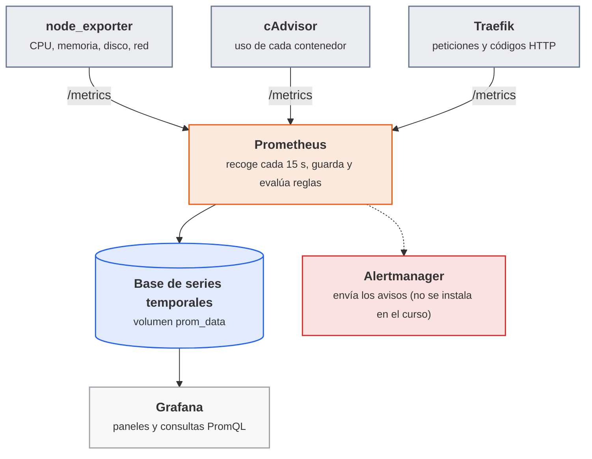

<p class="pie" markdown>Prometheus **extrae** las métricas de cada destino; Grafana no las guarda, las **consulta** a Prometheus cada vez que dibuja un panel.</p>

La configuración entera está en un fichero, `prometheus.yml`. Su parte esencial es la lista de trabajos de extracción, cada uno con un nombre y las direcciones que vigila:

```yaml
global:
  scrape_interval: 15s
scrape_configs:
  - job_name: "node"
    static_configs:
      - targets: ["node-exporter:9100"]
```

Cada destino recibe automáticamente dos etiquetas, `job` (el nombre del trabajo) e `instance` (su dirección), y son las que sirven para filtrar en PromQL y en los paneles. La pantalla **Status > Targets** de la interfaz web de Prometheus (puerto 9090) muestra cada destino con su estado `UP` o `DOWN` y el error si lo hay: es el primer sitio donde mirar cuando una gráfica sale vacía.

!!! ojo "El stack de ejemplo no es un modelo de seguridad"
    El repositorio de ejemplo publica la contraseña de Grafana (`admin` / `grafana`), monta el socket de Docker y carpetas del anfitrión dentro de contenedores, y expone todos los puertos. Vale en una VM aislada del laboratorio y no en un servidor real, donde Grafana lleva contraseña propia y Prometheus y las métricas quedan tras un cortafuegos o un proxy con autenticación.

!!! examen "Qué se evalúa"
    Diferencia entre monitorizar (medir de forma continua) y depurar un fallo ya ocurrido; qué es una métrica, para qué sirven las etiquetas y qué tipo de métrica es un contador frente a una medida instantánea; qué hace un exporter; que Prometheus **extrae** los datos de los destinos y que `up` indica si lo consigue; y cuál es el papel de Grafana (visualiza, no recoge).

### A5.15 Prometheus y Grafana (sesión 52)

<span class="et et-obj">Objetivo</span> En `pps01` corre el stack de ejemplo (Traefik con una aplicación de prueba, Prometheus, cAdvisor, node_exporter y Grafana), los cuatro destinos de Prometheus salen en `UP`, has lanzado consultas PromQL sobre ellos y Grafana muestra el panel de node_exporter con datos reales. Es la primera actividad de ACT_UT5_3 del aula: levantar el stack y validar cada componente con captura.

<span class="et et-pre">Antes de empezar</span> `pps01` encendida (con Docker sin `sudo`, de la sesión 42) y con salida a Internet por su adaptador NAT: se descargan cinco imágenes. Conviene parar lo que no se use, porque el stack añade seis contenedores a los 6 GB de la máquina: `docker stop jenkins` (vuelve a arrancar con `docker start jenkins`). Se han explicado [métricas, exporters y consultas](#metricas-exporters-y-consultas) y la [arquitectura de Prometheus](#arquitectura-de-prometheus). Necesitas el repositorio `pps-entregas` clonado en `pps01`.

<span class="et et-pas">Pasos</span>

1. Comprueba que los puertos que usa el stack están libres. El Apache nativo de la A3.11 escucha en el 80 y choca con Traefik, así que se apaga y se impide que arranque con el sistema (si no está instalado, la orden avisa y se sigue). Después, la búsqueda tiene que quedar sin salida; si aparece algún puerto más, el servicio que lo ocupa (Log4Shell usa 8080 y 8082) se para antes de seguir:

    ```bash
    sudo systemctl disable --now apache2
    ss -ltn | grep -E ':(80|3000|8080|8082|9090)\s'
    ```

2. Descarga el ejemplo y entra en su carpeta. El `prometheus.yml` del ejemplo declara la API v1 de Alertmanager, que las versiones actuales de Prometheus rechazan (el contenedor se reinicia en bucle con `expected Alertmanager api version to be one of [v2]`), así que se borra esa línea; Alertmanager no se usa en el laboratorio:

    ```bash
    git clone --depth 1 https://github.com/dinesh24murali/example_repo.git ~/monitor
    cd ~/monitor/prometheus_grafana_example
    sed -i '/api_version: v1/d' prometheus/prometheus.yml
    ls
    ```

3. Construye la imagen de la aplicación de prueba y arranca el stack en segundo plano. La primera vez tarda porque descarga las imágenes; con treinta alumnos a la vez cuenta con diez minutos, y el aviso de que `version` está obsoleto en el `docker-compose.yml` se puede ignorar:

    ```bash
    docker compose build
    docker compose up -d
    docker compose ps
    ```

    En `ps` tienen que salir seis servicios en estado `running`: `traefik`, `nodeapp`, `prometheus`, `cadvisor`, `node-exporter` y `grafana`. Si alguno sale `exited`, `docker compose logs <servicio>` dice por qué.

4. Genera tráfico para que haya datos que mirar: peticiones correctas y errores 500 a través de Traefik, que es quien las cuenta.

    ```bash
    for i in $(seq 1 40); do
      curl -s -o /dev/null http://localhost/
      curl -s -o /dev/null http://localhost/error_or_not/error
    done
    ```

5. Abre la interfaz de Prometheus, `http://localhost:9090`, y entra en **Status > Targets**. Los cuatro trabajos (`prometheus`, `node`, `cadvisor`, `traefik`) tienen que estar en `UP`. Haz la captura: es la validación de Prometheus.
6. En **Graph**, ejecuta estas tres consultas y anota qué devuelve cada una. Con la segunda, cambia a la pestaña **Graph** y comprueba que la línea se mueve al repetir el bucle del paso 4:

    ```text
    up
    sum by (code) (rate(traefik_service_requests_total[1m]))
    container_memory_usage_bytes{name=~".*nodeapp.*"}
    ```

    La tercera es del cAdvisor: Docker Compose añade un prefijo al nombre del contenedor, por eso se filtra con una expresión regular. Si no devuelve nada, ejecuta `container_memory_usage_bytes` a secas y busca en las etiquetas cuál es el de `nodeapp`.

7. Abre cAdvisor, `http://localhost:8080`, y localiza el contenedor `nodeapp` con su CPU y su memoria. Captura.
8. Abre Grafana, `http://localhost:3000` (usuario `admin`, contraseña `grafana`, la del ejemplo). Comprueba en **Connections > Data sources** que Prometheus ya viene como fuente por defecto y pulsa **Save & test**. Después, en **Dashboards > New > Import**, escribe el identificador `1860` (el panel "Node Exporter Full" de grafana.com), elige Prometheus como fuente y guarda. Captura el panel con datos.
9. Crea `ut5/a515/` en `pps-entregas` con las capturas de los pasos 3 (`docker compose ps`), 5, 7 y 8, y con un `README.md` que diga, para cada componente del stack, qué hace en una línea, cómo lo has validado y qué valor devolvió la consulta `up`. Sube con `git add`, `git commit` y `git push`. Deja el stack levantado: la hoja siguiente lo usa como referencia.

<span class="et et-com">Comprobación</span> Los cuatro destinos aparecen en `UP` en Prometheus, la consulta de peticiones por código HTTP muestra dos series (`200` y `500`) y el panel de Grafana dibuja CPU y memoria de `pps01` sin el aviso "No data". Si una gráfica sale vacía, el primer sitio donde mirar es **Status > Targets**, y si Grafana no consulta a Prometheus, la dirección de la fuente de datos tiene que ser `http://prometheus:9090` (el nombre del servicio dentro de la red del compose, no `localhost`).

<span class="et et-ent">Entrega</span> La carpeta `ut5/a515/` de `pps-entregas` con el `README.md` y las cuatro capturas. Forma parte de la entrega ACT_UT5_3, plazo el 17 de mayo (23:59), junto con la hoja A5.16.

<span class="et et-ext">Si te sobra tiempo</span> Importa también el panel de cAdvisor (identificador `14282`) y detén el contenedor de la aplicación con `docker compose stop nodeapp`: mira cuánto tarda su serie en dejar de actualizarse y qué hace la consulta `up` (no cambia, porque `nodeapp` no es un destino de Prometheus: piensa por qué).

## Sesión 53 · Monitorización remota con Grafana

<p class="ut-meta" markdown>13 de mayo · Teoría y práctica · <span class="dur" tabindex="0" aria-label="Monitorizar otra máquina: node_exporter · 5 min&#10;Paneles, fuentes de datos y alertas en Grafana · 5 min&#10;A5.16 Monitorización de un servidor · 100 min" data-dur="Monitorizar otra máquina: node_exporter · 5 min&#10;Paneles, fuentes de datos y alertas en Grafana · 5 min&#10;A5.16 Monitorización de un servidor · 100 min">:material-school:<i class="dur-barra" style="--teoria:9%"></i>:material-flask:</span></p>

El caso real de la monitorización no es medir la máquina donde corre todo, sino vigilar un servidor desde otro equipo. Al terminar la sesión `destino01` publica sus métricas con node_exporter, el Prometheus y el Grafana de `pps01` (los de la A5.15) las recogen y las muestran en el panel de node_exporter, y hay escrita una primera regla de alerta que avisa cuando `destino01` deja de responder. La teoría cabe en dos ideas (qué se instala en cada máquina y qué es una fuente de datos, un panel y una alerta) y el tiempo va a la hoja A5.16.

!!! consulta "Material de partida"
    En el aula (`RA5-Despliegue-seguro/07 ACT_RA5_3 - Prometheus & Grafana`), la segunda actividad de `RA5.3.pdf` plantea exactamente esta arquitectura: un Ubuntu Server con `node_exporter` que expone las métricas y un Ubuntu cliente con Grafana y el panel de node_exporter que las consume. La bibliografía del PDF apunta a <https://prometheus.io/>, <https://grafana.com/> y <https://github.com/prometheus/node_exporter>. Además, la guía oficial <https://prometheus.io/docs/guides/node-exporter/> recorre la instalación de node_exporter y la consulta de sus métricas.

### Monitorizar otra máquina: node_exporter

Monitorizar un servidor desde otro equipo reparte el trabajo en dos máquinas con papeles distintos:

| Máquina | Qué lleva | Qué hace | Puerto |
|---|---|---|---|
| `destino01` (192.168.56.20), la vigilada | node_exporter | Publica en `/metrics` la CPU, la memoria, el disco y la red del sistema | 9100 |
| `pps01` (192.168.56.10), la que vigila | Prometheus y Grafana, en contenedores (el stack de la A5.15) | Prometheus extrae `192.168.56.20:9100` cada 15 s y Grafana dibuja lo que Prometheus guarda | 9090 y 3000 |

En el servidor vigilado no se instala Prometheus ni Grafana: solo el exporter, que es un programa pequeño y de solo lectura. En Ubuntu se instala con el gestor de paquetes (`prometheus-node-exporter`), que lo deja como servicio de `systemd` escuchando en el 9100, y es el criterio habitual frente a descargar el binario a mano, porque las actualizaciones de seguridad llegan con el resto del sistema. Para el laboratorio no hace falta más, pero en producción el puerto 9100 se abre solo hacia la dirección de Prometheus, porque las métricas de una máquina (versión del núcleo, sistemas de ficheros, nombres de interfaces) son información útil para quien prepara un ataque.

### Paneles, fuentes de datos y alertas en Grafana

Grafana no guarda métricas: se conecta a sistemas que sí las tienen y las dibuja. Tres conceptos ordenan su interfaz:

| Concepto | Qué es | En la hoja |
|---|---|---|
| Fuente de datos (data source) | La conexión a un almacén de datos, con su dirección | Prometheus en `http://prometheus:9090` |
| Panel (panel) | Una gráfica o un número, definido por una consulta PromQL | CPU, memoria, disco y red de `destino01` |
| Dashboard | Una página de paneles, exportable como fichero JSON | El identificador 1860 de grafana.com, "Node Exporter Full" |

El panel se construye una vez y se reutiliza: importar un dashboard de la comunidad por su identificador ahorra escribir treinta consultas, y basta después elegir con el desplegable `instance` la máquina que se quiere mirar.

Las **alertas** son la segunda mitad de la monitorización: mirar gráficas no sirve de nada a las tres de la madrugada. Una alerta es una consulta con una condición y un tiempo mínimo. Hay dos sitios donde definirla:

| Dónde | Cómo | Cuándo |
|---|---|---|
| Reglas de Prometheus (fichero YAML) | Versionables en Git, se despliegan con el resto de la configuración | Criterio del curso: es infraestructura como código y no depende de la interfaz |
| Alertas de Grafana (en su interfaz) | Cómodas de crear, viven en la base de datos de Grafana | Equipos que ya gestionan todo desde Grafana |

Una regla de Prometheus tiene esta forma, y el campo `for` es el que evita avisar por un fallo de un segundo:

```yaml
groups:
  - name: pps
    rules:
      - alert: ServidorCaido
        expr: up{job="destino01"} == 0
        for: 1m
        labels:
          severity: critical
        annotations:
          summary: "{{ $labels.instance }} no responde desde hace más de un minuto"
```

La alerta pasa por tres estados: **Inactive** (la condición no se cumple), **Pending** (se cumple, pero aún no ha pasado el `for`) y **Firing** (se cumple y ha pasado el tiempo). Prometheus solo evalúa y muestra el estado en su pestaña **Alerts**; el envío del aviso por correo o mensajería lo hace Alertmanager, otro componente que en el laboratorio no se instala. Con ver la alerta pasar a `Firing` se comprueba la parte que evalúa el criterio del RA.

!!! examen "Qué se evalúa"
    Qué hay que instalar en la máquina vigilada y qué en la que vigila; qué es una fuente de datos, un panel y una alerta; por qué una alerta lleva un tiempo mínimo (`for`) y qué diferencia hay entre `Pending` y `Firing`; y por qué el puerto del exporter se restringe en producción.

### A5.16 Monitorización de un servidor (sesión 53)

<span class="et et-obj">Objetivo</span> `destino01` expone sus métricas con node_exporter, el Prometheus del stack de la A5.15 (en `pps01`) las recoge y el panel de node_exporter muestra en el Grafana de `pps01` la CPU, la memoria y el disco de `destino01`. Son dos máquinas distintas, una que vigila y otra vigilada, como pide la segunda actividad de ACT_UT5_3 del aula. De paso queda escrita la regla de alerta `ServidorCaido`, que la hoja A5.17 pondrá a prueba.

<span class="et et-pre">Antes de empezar</span> Necesitas encendidas `destino01` (192.168.56.20, la de la A5.8, con su adaptador NAT activo para instalar el paquete) y `pps01` (192.168.56.10) con el stack de la A5.15 levantado en `~/monitor/prometheus_grafana_example` (`docker compose ps` con los seis servicios; si no lo está, `docker compose up -d`). Las dos VM en la red solo anfitrión. Se han explicado [monitorizar otra máquina con node_exporter](#monitorizar-otra-maquina-node_exporter) y los [paneles, las fuentes de datos y las alertas](#paneles-fuentes-de-datos-y-alertas-en-grafana). Vas a saltar entre dos máquinas: cada paso dice en cuál va.

<span class="et et-pas">Pasos</span>

1. En `destino01` (usuario `vagrant`), instala node_exporter desde el repositorio de Ubuntu y comprueba que el servicio arranca y publica métricas:

    ```bash
    sudo apt update && sudo apt install -y prometheus-node-exporter
    systemctl is-active prometheus-node-exporter
    curl -s http://localhost:9100/metrics | grep -m3 node_cpu_seconds_total
    ```

2. Desde `pps01`, comprueba que las métricas se ven por la red, que es lo que Prometheus necesitará. Si no responde, revisa que las dos VM están en la misma red solo anfitrión y que no hay `ufw` activo en `destino01` (`sudo ufw status`):

    ```bash
    curl -s http://192.168.56.20:9100/metrics | head -5
    ```

3. En `pps01`, entra en la carpeta del stack de la A5.15. El contenedor de Prometheus monta la carpeta `prometheus/` entera en `/etc/prometheus`, así que cualquier fichero que pongas ahí lo ve:

    ```bash
    cd ~/monitor/prometheus_grafana_example/prometheus
    ls
    ```

4. En `prometheus.yml` añade, al principio, el bloque `rule_files` (al nivel de `global`) y, al final de `scrape_configs`, el trabajo `destino01` con la máquina vigilada. La dirección es la IP de `destino01`, no un nombre de servicio, porque `destino01` no es un contenedor del compose:

    ```yaml
    rule_files:
      - /etc/prometheus/alertas.yml
    ```

    ```yaml
      - job_name: "destino01"
        static_configs:
          - targets: ["192.168.56.20:9100"]
    ```

    Crea también `alertas.yml` en esa misma carpeta copiando la regla `ServidorCaido` de la teoría (el bloque completo, empezando por `groups:`).

5. Reinicia Prometheus para que lea el fichero nuevo y comprueba que el reinicio no lo ha roto. Si `Up` no aparece o el contenedor se reinicia en bucle, `docker compose logs prometheus` señala la línea del YAML con el error (casi siempre una sangría):

    ```bash
    cd ~/monitor/prometheus_grafana_example
    docker compose restart prometheus
    docker compose ps prometheus
    ```

6. Desde el navegador de `pps01`, abre `http://localhost:9090/targets`: ahora son cinco trabajos y el nuevo, `destino01`, tiene que estar en `UP`, como los otros cuatro. Si sale `DOWN`, el mensaje de error de esa pantalla dice si es de red o de puerto. Captura.
7. Abre Grafana, `http://localhost:3000` (usuario `admin`, contraseña `grafana`), y entra en el panel de node_exporter que importaste en la A5.15 (**Dashboards**, "Node Exporter Full"; si lo borraste, impórtalo otra vez con el identificador `1860` y la fuente Prometheus, que ya viene creada, con la dirección `http://prometheus:9090`).
8. Elige en el desplegable `Host` la máquina `192.168.56.20:9100` (`destino01`) y captura el panel con sus datos. Cambia a `Host` de `pps01` un momento para ver que son dos series distintas y vuelve a `destino01`.
9. Provoca carga en `destino01` para comprobar que lo que se ve es real: mantén un minuto y medio la CPU ocupada y observa cómo sube el gráfico de CPU en Grafana (con la actualización de 15 s, tarda un poco en reflejarse). Captura la subida.

    ```bash
    timeout 90 sh -c 'yes > /dev/null'
    ```

10. En `http://localhost:9090/alerts` comprueba que la regla `ServidorCaido` aparece en estado `Inactive` (en verde) y captura. Crea `ut5/a516/` en `pps-entregas` con las capturas de los pasos 6, 8, 9 y 10 y copias de `prometheus.yml` y `alertas.yml` y un `README.md` con los comandos usados y el resultado de cada comprobación. Sube con `git add`, `git commit` y `git push`.

<span class="et et-com">Comprobación</span> El Prometheus de `pps01` tiene a `destino01` (`192.168.56.20:9100`) en `UP`, Grafana dibuja las métricas de `destino01` (no las de `pps01`: el desplegable `Host` lo confirma), la CPU sube durante el paso 9 y la regla de alerta está cargada sin errores. Si Prometheus no arranca tras el reinicio, es un error de sangría en `prometheus.yml` (lo dice `docker compose logs prometheus`); si el panel sale sin datos con el aviso de fuente de datos, la dirección es `http://prometheus:9090` y no `localhost`.

<span class="et et-ent">Entrega</span> La carpeta `ut5/a516/` de `pps-entregas` con capturas, ficheros de configuración y `README.md`. Forma parte de la entrega ACT_UT5_3 (junto con la A5.15), plazo el 17 de mayo (23:59). El enunciado original, `RA5.3.pdf`, está en el aula y pide la captura de los elementos del stack y la monitorización remota de `destino01` desde `pps01`; las dos hojas lo cubren.

<span class="et et-ext">Si te sobra tiempo</span> Duplica la regla como `MemoriaBaja`, con la expresión `node_memory_MemAvailable_bytes / node_memory_MemTotal_bytes < 0.1` y `for: 2m`, reinicia con `docker compose restart prometheus` y comprueba que aparece. Mira también cómo importar el mismo panel desde un fichero JSON en vez de por su identificador.

## Sesión 54 · Simulación de fallos

<p class="ut-meta" markdown>17 de mayo · Teoría y práctica · <span class="dur" tabindex="0" aria-label="Ingeniería del caos · 10 min&#10;Medir la reacción del sistema · 15 min&#10;A5.17 Reacción a fallos · 85 min" data-dur="Ingeniería del caos · 10 min&#10;Medir la reacción del sistema · 15 min&#10;A5.17 Reacción a fallos · 85 min">:material-school:<i class="dur-barra" style="--teoria:23%"></i>:material-flask:</span></p>

Un sistema que se despliega con cuidado y se monitoriza puede seguir sin haber demostrado lo más importante: que se recupera solo cuando algo falla. Al terminar la sesión hay cuatro experimentos hechos con sus tiempos medidos (un contenedor que cae con y sin política de reinicio, un pod que se borra, un nodo del clúster que se apaga y un servidor que deja de responder a Prometheus) y una tabla que dice, para cada fallo, quién reaccionó, en cuánto tiempo y si saltó la alerta. Primero se ve qué es la ingeniería del caos y con qué herramientas se practica, y después qué se mide y qué reacción cabe esperar en cada capa; la hoja A5.17 reproduce esos fallos a pequeña escala.

!!! consulta "Material de partida"
    Del curso anterior se conserva el apunte "Herramientas de simulación de fallos" (`2022-02-21-Herramientas-de-simulación-de-fallos.md`, entre los apuntes de terceros que recoge la página [Material](../material.md); no declara licencia, por lo que aquí solo se enlaza y se explica con palabras propias): define la ingeniería del caos y describe Simian Army, Chaos Toolkit, Chaoskube, Simmy, Chaos Mesh y Gremlin. No existe actividad del aula para esta sesión: la hoja A5.17 es nueva y cubre el criterio e) del RA5, que el curso anterior solo trataba en teoría. Enlaces públicos: <https://principlesofchaos.org/>, <https://chaos-mesh.org/> y <https://chaostoolkit.org/>.

### Ingeniería del caos

La ingeniería del caos consiste en provocar fallos a propósito, de forma controlada, para comprobar que el sistema reacciona como se espera antes de que el fallo llegue por sorpresa. Un plan de recuperación que nunca se ha ejecutado es una suposición: el experimento lo convierte en un dato. Cada experimento sigue el mismo ciclo:

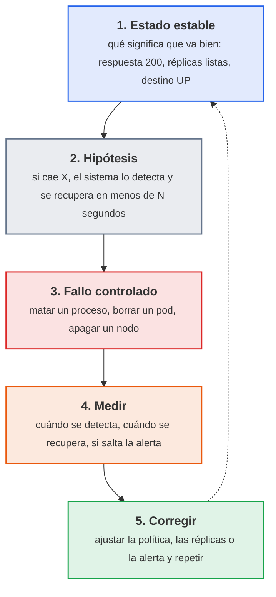

<p class="pie" markdown>El experimento parte de una hipótesis que se puede comprobar con un número, y termina con un cambio en el sistema, no solo con una conclusión.</p>

Dos reglas de seguridad acompañan a cualquier experimento. La primera es acotar el **radio de impacto**: se rompe una pieza cada vez, con un servicio de prueba y con la forma de deshacerlo preparada. La segunda es partir de un sistema sano, con la monitorización funcionando, porque sin ella no hay forma de medir. En un laboratorio se puede romper todo; en producción se empieza por un entorno de pruebas y por horas de poca carga, y solo cuando el sistema demuestra que aguanta se pasa a probar en el entorno real.

Las herramientas existen para automatizar y repetir esos experimentos. Ninguna se instala en el curso, pero conviene reconocerlas:

| Herramienta | Dónde actúa | Qué hace | Coste |
|---|---|---|---|
| Chaos Monkey | Máquinas de una nube gestionada con Spinnaker | Apaga instancias al azar en horario laboral | Libre |
| Chaos Mesh | Kubernetes | Mata pods, corta o retrasa la red, sobrecarga CPU y disco | Libre |
| Chaoskube | Kubernetes | Borra pods elegidos al azar cada cierto tiempo | Libre |
| Chaos Toolkit | Cualquier sistema con extensiones | Describe el experimento en un fichero y lo ejecuta | Libre |
| Gremlin | Servidores, contenedores, nubes | Plataforma comercial con todo lo anterior y una interfaz | De pago |

La hoja hace a mano, con `kill`, `kubectl delete` y apagado de máquinas, lo que estas herramientas hacen de forma programada: para entender qué se mide vale más provocar un fallo una vez que configurar una herramienta.

### Medir la reacción del sistema

Reaccionar de forma automática a un fallo quiere decir que hay una pieza que detecta el problema y otra que lo repara sin intervención humana. En el laboratorio del curso cada capa tiene la suya, y cada una con un tiempo característico:

| Fallo | Quién detecta y repara | Qué se espera | Orden de tiempo |
|---|---|---|---|
| Un proceso del contenedor muere | Docker, con la política `restart: unless-stopped` | El contenedor se vuelve a arrancar solo. Sin política, se queda parado | Segundos |
| Se borra un pod | El Deployment de Kubernetes, que mantiene el número de réplicas | Crea otro pod para volver a las dos réplicas | Segundos |
| Se apaga un nodo del clúster | El controlador de nodos de Kubernetes | El nodo pasa a `NotReady`; sus pods se reprograman en otro nodo pasado el tiempo de tolerancia | Unos 40 s para detectar, unos 5 min para reprogramar |
| Un servidor deja de responder | Prometheus, con una regla de alerta | `up` pasa a 0, la alerta pasa a `Pending` y después a `Firing` | Intervalo de extracción más el `for` de la regla |

La diferencia entre "detectar" y "reparar" es la que se mide. Dos tiempos resumen el comportamiento de un sistema ante un fallo:

| Tiempo | Qué mide | Cómo se toma en la hoja |
|---|---|---|
| Tiempo de detección | Desde que ocurre el fallo hasta que el sistema o la monitorización lo notan | Hora del fallo frente a hora de `NotReady` o de `Firing` |
| Tiempo de recuperación | Desde el fallo hasta que el servicio vuelve a responder | Bucle de `curl` con marca de hora |

El tiempo de recuperación es la métrica de despliegue "tiempo medio de recuperación" (se retoma en la sesión 55). Y un fallo que se repara solo pero no avisa deja un problema oculto: un contenedor que se reinicia cada minuto está sano para el usuario y roto para quien lo mantiene. Por eso el experimento comprueba las dos cosas, reparación y alerta.

Dos precisiones evitan interpretar mal los resultados. La política `unless-stopped` no reinicia un contenedor parado a mano con `docker stop`: es la diferencia entre un fallo y una decisión. Y los cinco minutos antes de reprogramar los pods de un nodo caído son intencionados (evitan moverlo todo por un corte de red de segundos) y se ajustan con `tolerationSeconds`.

!!! examen "Qué se evalúa"
    Qué es la ingeniería del caos y por qué un experimento lleva hipótesis, radio de impacto acotado y medida; qué mecanismo reacciona en cada capa (política de reinicio, réplicas del Deployment, controlador de nodos, regla de alerta); la diferencia entre tiempo de detección y de recuperación; y por qué un sistema que se recupera solo sin avisar sigue siendo un problema.

### A5.17 Reacción a fallos (sesión 54)

<span class="et et-obj">Objetivo</span> Has provocado cuatro fallos (un contenedor con y sin política de reinicio, un pod, un nodo del clúster y un servidor que deja de responder a Prometheus), has medido cuánto tardó cada uno en detectarse y en repararse, y has comprobado si saltó la alerta. Cubre el criterio e) del RA5, capacidad del sistema para reaccionar de forma automática a fallos, y produce la primera parte de la entrega ACT_UT5_5.

<span class="et et-pre">Antes de empezar</span> Necesitas el clúster K3s de tres servidores de la [A5.13](#a513-k3s-en-alta-disponibilidad-sesion-50) con el despliegue `nginx` de dos réplicas y su NodePort 30080 (encendidas `k3s-1`, `k3s-2` y `k3s-3`), la monitorización de la [A5.16](#a516-monitorizacion-de-un-servidor-sesion-53) (`destino01` encendida, con node_exporter, y `pps01` con el stack de la A5.15 levantado y la regla `ServidorCaido` cargada). Son cinco VM encendidas. En `pps01` el stack de la A5.15 tiene que seguir en marcha porque es el Prometheus que vigila, así que solo se apaga Jenkins (`docker stop jenkins`), que aquí no se usa, para no chocar de puerto. Pero además, con cinco VM encendidas se suman 12 GB, por encima del [presupuesto de memoria](../laboratorio.md#presupuesto-de-memoria): parar Jenkins libera RAM dentro de `pps01`, no los 6 GB que VirtualBox reserva del anfitrión, así que antes de arrancar, con `pps01` apagada, baja su memoria a 4 GB con `VBoxManage modifyvm pps01 --memory 4096`; al terminar la hoja, restaura `--memory 6144`. Los puertos no se pisan: el stack ocupa 80, 3000, 8080, 8082 y 9090, Jenkins el 8090 y los contenedores de la hoja el 8101 y el 8102. Se han explicado la [ingeniería del caos](#ingenieria-del-caos) y [cómo medir la reacción del sistema](#medir-la-reaccion-del-sistema). `kubectl` se ejecuta en `k3s-1` (`sudo k3s kubectl ...`) o en `pps01` si dejaste allí el `kubeconfig`. Cada experimento cambia una sola cosa y se deshace al terminar.

<span class="et et-pas">Pasos</span>

1. En `pps01`, crea `ut5/a517/README.md` en `pps-entregas` con una tabla vacía de cuatro filas (contenedor, pod, nodo, servidor) y las columnas `Hipótesis`, `Detección`, `Recuperación`, `¿Alerta?` y `Conclusión`. Rellena la columna `Hipótesis` **antes** de romper nada, con una cifra por fila, apoyándote en la tabla de la teoría.
2. Empieza por el fallo más lento, el del nodo, y déjalo corriendo. Mira dónde están los pods y elige un nodo que tenga un pod de `nginx` y no sea `k3s-1` (si los dos están en `k3s-1`, `kubectl rollout restart deploy/nginx` los recoloca):

    ```bash
    kubectl get pods -o wide
    ```

3. En una segunda terminal de `pps01`, lanza un bucle que pida el servicio cada segundo con marca de hora (`000` significa que no hubo respuesta en 2 s), y déjalo abierto durante todo el experimento:

    ```bash
    while true; do printf '%s ' "$(date +%T)"; curl -s -o /dev/null -m 2 -w '%{http_code}\n' http://192.168.56.31:30080; sleep 1; done | tee ~/nodo.log
    ```

4. Apaga de golpe el nodo elegido, como si se cortara la corriente. En el equipo que ejecuta VirtualBox (no dentro de `pps01`), con `VBoxManage controlvm k3s-3 poweroff` (cambia `k3s-3` por el tuyo) o con el menú **Cerrar > Apagar la máquina** de la VM. Anota la hora exacta. En `k3s-1`, mira cuándo pasa el nodo a `NotReady` (unos 40 s) y cuántas líneas `000` acumula el bucle:

    ```bash
    kubectl get nodes -w
    ```

5. Mientras el clúster decide qué hacer con el nodo (tarda unos cinco minutos), haz el experimento del contenedor en `pps01`. Crea dos servidores iguales, uno sin política de reinicio y otro con ella:

    ```bash
    docker run -d --name web-sin -p 8101:80 nginx:alpine
    docker run -d --name web-con --restart unless-stopped -p 8102:80 nginx:alpine
    ```

6. Simula un fallo del proceso (no una parada ordenada) matando el proceso principal de cada contenedor desde el sistema, y mide cuánto tarda en volver a responder el que tiene política. Compara al final el estado de los dos:

    ```bash
    sudo kill -9 $(docker inspect -f '{{.State.Pid}}' web-sin)
    t0=$(date +%s%N); sudo kill -9 $(docker inspect -f '{{.State.Pid}}' web-con)
    until curl -sf -o /dev/null http://localhost:8102; do sleep 0.2; done
    echo "recuperado en $(( ($(date +%s%N) - t0) / 1000000 )) ms"
    docker ps -a --filter name=web- --format '{{.Names}} {{.Status}}'
    docker inspect -f '{{.RestartCount}}' web-con
    ```

    Después ejecuta `docker stop web-con` y comprueba que **no** vuelve a arrancar: la política distingue un fallo de una parada pedida a mano. Anota los dos comportamientos.

7. En `k3s-1`, borra uno de los dos pods de `nginx` (el que no esté en el nodo apagado; `kubectl get pods -o wide` dice cuál) y observa cuánto tarda en volver a haber dos réplicas listas. Con la segunda orden, cada línea que pinta el `watch` lleva marca de hora; pulsa `Ctrl+C` cuando el pod nuevo llegue a `Running` y `1/1`:

    ```bash
    kubectl delete pod <nombre_del_pod>
    kubectl get pods -w | while read -r l; do echo "$(date +%T) $l"; done
    ```

8. En `destino01`, para el exporter y anota la hora. En `http://localhost:9090/alerts` (en `pps01`) observa cómo la alerta `ServidorCaido` pasa de `Inactive` a `Pending` y, tras el minuto del `for`, a `Firing`. Anota las dos horas y captura cada estado. Al terminar, vuelve a arrancarlo y comprueba que la alerta se resuelve:

    ```bash
    sudo systemctl stop prometheus-node-exporter
    sudo systemctl start prometheus-node-exporter
    ```

9. Vuelve al experimento del nodo, cuando hayan pasado unos cinco minutos desde el paso 4. En `k3s-1`, mira qué ha hecho el clúster con los pods que estaban en el nodo apagado. Detén el bucle del paso 3 con `Ctrl+C` y cuenta las líneas que acaban en `000`. Después enciende el nodo desde VirtualBox y comprueba que vuelve a `Ready`:

    ```bash
    kubectl get pods -o wide
    grep -c ' 000$' ~/nodo.log
    ```

10. Completa la tabla con los tiempos medidos, copia `nodo.log` a la carpeta, sube las capturas (`kubectl get nodes` con el nodo `NotReady`, `docker ps -a` de los dos contenedores, el `watch` del pod, la alerta en `Pending` y en `Firing`) y limpia: `docker rm -f web-sin web-con`. En `Conclusión` escribe, por fila, si la hipótesis se cumplió y qué cambiarías si no (por ejemplo, la política de reinicio de un servicio que no la tiene). Sube con `git add`, `git commit` y `git push`.

<span class="et et-com">Comprobación</span> Las cuatro filas de la tabla tienen hipótesis, detección, recuperación y conclusión con cifras medidas, no estimadas. El contenedor `web-con` tiene `RestartCount` mayor que 0 y `web-sin` sigue parado, el Deployment ha vuelto a dos réplicas listas tras borrar el pod, el nodo apagado ha pasado por `NotReady` y ha vuelto a `Ready`, y la alerta ha llegado a `Firing` y se ha resuelto. Si el bucle del paso 3 no registra ningún `000`, el pod caído no estaba en el nodo apagado o Kubernetes ya lo había sacado del servicio antes de la siguiente petición: repite el experimento eligiendo bien el nodo.

<span class="et et-ent">Entrega</span> La carpeta `ut5/a517/` de `pps-entregas` con `README.md` (la tabla completa), `nodo.log` y las capturas. Forma parte de la entrega ACT_UT5_5 (con la hoja A5.18), plazo el 24 de mayo (23:59), y su tabla se reutiliza en la sesión 55 y en el proyecto integrador.

<span class="et et-ext">Si te sobra tiempo</span> Instala `prometheus-node-exporter` en el nodo del clúster que vas a apagar, añádelo como destino en el `prometheus.yml` del stack de `pps01` y repite el paso 4: así también salta `ServidorCaido` por el nodo caído, y puedes comparar el tiempo de detección de Prometheus con el de Kubernetes.

## Sesión 55 · Recuperación ante desastres y retroalimentación

<p class="ut-meta" markdown>20 de mayo · Teoría y práctica · <span class="dur" tabindex="0" aria-label="Plan de recuperación: copias, RTO y RPO · 15 min&#10;Bucles de retroalimentación y retrospectivas · 10 min&#10;A5.18 Plan de recuperación · 85 min" data-dur="Plan de recuperación: copias, RTO y RPO · 15 min&#10;Bucles de retroalimentación y retrospectivas · 10 min&#10;A5.18 Plan de recuperación · 85 min">:material-school:<i class="dur-barra" style="--teoria:23%"></i>:material-flask:</span></p>

La sesión anterior terminó con fallos que el sistema absorbe solo (un contenedor que se reinicia, un pod que se recrea). Esta trata de los fallos que no absorbe: el volumen que se borra, la máquina que no arranca, el disco que se llena. Al acabar hay un plan de recuperación escrito con dos números que lo gobiernan (RTO y RPO), una copia de un volumen real de `pps01` restaurada en un contenedor de prueba con el tiempo medido, y una retrospectiva breve que convierte lo aprendido en acciones. La herramienta es una orden de `docker` con `tar` para la copia y un documento en Markdown para el plan; lo que importa es el procedimiento, no la herramienta.

!!! consulta "Material de partida"
    En el aula, carpeta `RA5-Despliegue-seguro/01 Material`: `05-DevOps.pdf` (cultura DevOps, entrega continua y realimentación entre desarrollo y operación) y `01-Infraestructura.pdf` (virtualización y contenedores, de donde sale la idea de que un contenedor se recrea y sus datos no). No existía actividad propia de este tema: la hoja A5.18 y la entrega ACT_UT5_5 son nuevas y cubren los criterios f y g de RA5. En la web, el índice de la unidad "Implantación de sistemas seguros de desplegado de software" (<https://github.com/EloyAlbiach/PPS/tree/main/desplegado_seguro>, licencia CC BY-NC-SA 4.0, solo como referencia de temario) y el artículo "Herramientas de simulación de fallos" de los apuntes de la web <https://psegarrac.github.io/Ciberseguridad-PePS/> (2022-02-21), que enlaza con la sesión 54. Las guías de recuperación ante desastres de la documentación de cada proveedor se consultan, no se copian.

### Plan de recuperación: copias, RTO y RPO

El objetivo de este apartado es poder contestar por escrito, para cada servicio, dos preguntas: cuánto tiempo se puede estar sin él y cuántos datos se pueden perder. Con esas dos respuestas se decide qué copia se hace, cada cuánto y dónde se guarda.

Un **desastre**, a efectos de la unidad, es cualquier suceso que deja un servicio inutilizable y que no se corrige con un reinicio: borrado por error, disco corrupto, máquina perdida, credencial comprometida que obliga a reconstruir. La recuperación se mide con dos objetivos que fija quien responde del servicio, no quien lo administra:

| Objetivo | Qué mide | Cómo se cumple |
|---|---|---|
| **RTO** (tiempo objetivo de recuperación) | Tiempo máximo aceptable entre la caída y el servicio de nuevo en pie | Procedimiento escrito y ensayado, infraestructura reproducible (Terraform y Ansible), imágenes ya publicadas |
| **RPO** (punto objetivo de recuperación) | Cantidad máxima de datos que se acepta perder, expresada en tiempo (por ejemplo 24 horas) | Frecuencia de las copias: el RPO no puede ser menor que el intervalo entre copias |

Ejemplo del laboratorio: si el Jenkins de `pps01` se pierde y basta con volver a la copia de anoche, el RPO es de 24 horas y una copia diaria lo cumple. Si el RTO es de una hora, el procedimiento de restauración tiene que caber en una hora **medida**, no supuesta.

Lo que se protege no es todo por igual. Una regla útil es separar lo que se **reconstruye** de lo que se **restaura**:

| Qué es | Cómo se recupera | Ejemplo en `pps-app` |
|---|---|---|
| Código y configuración como código | Se clona el repositorio; no necesita copia propia | `pps-app` en GitHub, `pps-iac` con Terraform y Ansible |
| Imágenes | Se vuelven a descargar de Docker Hub o se reconstruyen con el pipeline | `pps<NIA>/pps-app:<etiqueta>` |
| Máquinas | Se recrean con Terraform y Ansible | `destino01`, los nodos de K3s |
| **Datos con estado** | **Solo se restauran de una copia**: no hay otra fuente | Volumen `jenkins_home` (trabajos, credenciales cifradas, historial), datos de Grafana |

Por eso el plan de recuperación gasta su esfuerzo en el último renglón: lo demás ya está a salvo si la unidad se ha hecho bien. Para las copias vale la regla **3-2-1** como punto de partida: tres copias de los datos, en dos soportes distintos, con una fuera de la máquina original. En el laboratorio la copia se hace en `pps01` y, si sobra tiempo, se envía además a otra VM con `scp`, que ya cuenta como "fuera de la máquina".

Una copia que nunca se ha restaurado no es una copia: es una esperanza. Por eso el plan incluye siempre una **restauración de prueba** en un sitio distinto del original, y el RTO que se declara es el que se mide en ella. Y una copia de un volumen con credenciales es tan sensible como las credenciales: se guarda con permisos `600`, fuera de cualquier repositorio y, si sale de la máquina, cifrada.

!!! ojo "Copia de seguridad con la clave al lado"
    El volumen `jenkins_home` guarda las credenciales cifradas y, en el mismo volumen, la clave maestra que las descifra (`secrets/`). Una copia entera contiene, por tanto, todo lo necesario para leerlas. La copia se trata como un secreto: permisos `600`, nunca en `pps-entregas` ni en una captura, y en la carpeta de entregas solo va su suma `sha256`.

El contenido mínimo de un plan de recuperación cabe en una lista: qué servicios cubre y con qué RTO y RPO, qué se copia, cómo y con qué frecuencia, dónde se guarda, quién lo restaura, los pasos exactos de la restauración (con las órdenes), cómo se comprueba que ha funcionado y cuándo se ensayó por última vez.

### Bucles de retroalimentación y retrospectivas

Un incidente o un proyecto no acaban cuando el servicio vuelve a funcionar, sino cuando el equipo ha decidido qué cambia para que no se repita. Este apartado da la herramienta para cerrar ese bucle sin convertirlo en una reunión larga.

DevOps insiste en los **bucles de retroalimentación** cortos: cuanto antes llega al equipo la información de lo que salió mal, más barato es corregirlo. La unidad ya tiene varios bucles automáticos (el pipeline avisa en minutos de que una prueba falla, Prometheus avisa de que un nodo cae). La **retrospectiva** es el bucle humano: una reunión corta, al cerrar un ciclo de trabajo, donde el equipo revisa cómo trabajó, no solo qué construyó. El formato mínimo tiene tres columnas y una regla:

| Columna | Pregunta | Ejemplo |
|---|---|---|
| Qué salió bien | ¿Qué conviene mantener? | La restauración se hizo con un script y en 4 minutos |
| Qué mejorar | ¿Qué costó más de lo esperado? | Nadie sabía dónde estaba la copia |
| Acciones | ¿Qué se hace distinto, quién y para cuándo? | `ops` guarda la ruta de copias en el README, antes del lunes |

La regla es que **una retrospectiva sin acciones con responsable y fecha no ha servido**: cada punto de "qué mejorar" o bien se convierte en una acción o se descarta a propósito. Los roles se escriben (`ops`, `admin`, "el equipo de Sistemas"), no nombres de personas, y en la reunión siguiente se revisa qué acciones se cumplieron.

Los números alimentan la conversación. Cuatro métricas de despliegue, usadas de forma habitual, resumen la salud de la entrega: **frecuencia de despliegue** (cada cuánto llega un cambio a producción), **plazo de entrega de un cambio** (del commit al servicio), **tasa de fallos** de los cambios y **tiempo de recuperación** (lo que se tarda en volver a un estado bueno tras un fallo). Las dos últimas enlazan directamente con esta sesión: el tiempo de recuperación medido en la restauración es el dato que se compara con el RTO, y las mediciones de la sesión 54 son la base de la retrospectiva.

!!! examen "Qué se evalúa de este bloque"
    Definir RTO y RPO con un ejemplo y decir de qué depende cada uno. Distinguir qué se reconstruye (código, imágenes, máquinas) de qué se restaura (datos con estado) y por qué una copia no probada no cuenta. Enumerar el contenido de un plan de recuperación. Explicar qué es un bucle de retroalimentación, el formato de una retrospectiva y las cuatro métricas de despliegue. Es el criterio f (documentar la recuperación) y el g (bucles de retroalimentación).

### A5.18 Plan de recuperación (sesión 55)

<span class="et et-obj">Objetivo</span> Redactar el plan de recuperación de dos servicios del laboratorio con su RTO y su RPO, hacer una copia del volumen `jenkins_home`, restaurarla en un Jenkins de prueba midiendo el tiempo, y cerrar con una retrospectiva breve. Es el CE f (procedimiento de recuperación documentado) y el CE g (bucle de retroalimentación) de RA5.

<span class="et et-pre">Antes de empezar</span> `pps01` encendida con el contenedor `jenkins` (imagen `pps-jenkins:2` de la [sesión 42](#a56-jenkins-con-docker-sesion-42)) y el volumen `jenkins_home` de la [sesión 40](#a54-jenkins-primer-trabajo-sesion-40), con al menos el trabajo de `pps-app`. Las mediciones de la [hoja anterior](#a517-reaccion-a-fallos-sesion-54) (tiempos de recuperación y si saltó la alerta), que se reutilizan. Se ha explicado el [plan de recuperación, RTO y RPO](#plan-de-recuperacion-copias-rto-y-rpo) y los [bucles de retroalimentación y la retrospectiva](#bucles-de-retroalimentacion-y-retrospectivas). Antes de empezar, instantánea de `pps01`. El puerto `8091` de `pps01` se usa solo para el Jenkins de prueba y se libera al terminar.

<span class="et et-pas">Pasos</span>

1. Crea la carpeta de la hoja y la de copias, esta última fuera del repositorio y con permisos cerrados:

    ```bash
    mkdir -p ~/pps-entregas/ut5/a518 && install -d -m 700 ~/copias
    ```

    En `~/pps-entregas/ut5/a518/plan-recuperacion.md` escribe la tabla de servicios con RTO y RPO. Se proponen valores razonables para el laboratorio; se pueden cambiar si se justifican en una línea:

    | Servicio | Datos con estado | RPO | RTO | Cómo se recupera |
    |---|---|---|---|---|
    | Jenkins (`pps01`) | Volumen `jenkins_home` | 24 h | 30 min | Restaurar la copia en un contenedor nuevo |
    | `pps-app` en K3s | Ninguno (imagen y `k8s/pps-app.yaml`) | 0 | 15 min | `ansible-playbook` con la última imagen |

2. Haz la copia del volumen sin parar Jenkins (para un laboratorio es suficiente; en producción se pararía o se usaría el mecanismo de copia de la propia herramienta). Anota la hora antes y después:

    ```bash
    date -u +%FT%TZ
    docker run --rm -v jenkins_home:/datos:ro -v ~/copias:/copia alpine \
      tar czf /copia/jenkins_home-$(date +%F).tar.gz -C /datos .
    chmod 600 ~/copias/jenkins_home-*.tar.gz
    sha256sum ~/copias/jenkins_home-*.tar.gz | tee ~/pps-entregas/ut5/a518/copia.sha256
    ```

3. Simula que hay un cambio posterior a la copia, para poder medir el RPO: en Jenkins crea un trabajo vacío llamado `posterior-a-la-copia` y anota la hora. Es el "dato" que se perdería si el desastre ocurriera ahora: la diferencia entre esa hora y la de la copia es el RPO real de esta situación.
4. Restaura en un Jenkins de prueba, **sin tocar el original**. Cronometra desde que escribes la primera orden hasta que la interfaz responde:

    ```bash
    date +%T
    docker volume create jenkins_restaurado
    docker run --rm -v jenkins_restaurado:/datos -v ~/copias:/copia alpine \
      sh -c 'tar xzf "$(ls -t /copia/jenkins_home-*.tar.gz | head -1)" -C /datos'
    docker run -d --name jenkins-restaurado -p 8091:8080 -v jenkins_restaurado:/var/jenkins_home pps-jenkins:2
    until curl -s -o /dev/null -w '%{http_code}' http://localhost:8091/login | grep -q 200; do sleep 5; done; date +%T
    ```

5. Entra en `http://192.168.56.10:8091` (o `http://localhost:8091` desde `pps01`) con el usuario de tu Jenkins original. Comprueba que el trabajo de `pps-app` y las credenciales `github-token`, `dockerhub` y `nvd-api-key` (solo su presencia, nunca su valor) están, y que `posterior-a-la-copia` **no** está. Captura la pantalla de la lista de trabajos y calcula el RTO medido: la diferencia entre las dos horas que imprimió el paso 4, redondeada al minuto.
6. Compara con la tabla del paso 1 y ajusta el plan: si el RTO medido supera el objetivo, cambia el objetivo (y di por qué) o el procedimiento (por ejemplo, un script `restaurar-jenkins.sh` con las órdenes del paso 4). Completa `plan-recuperacion.md` con el contenido mínimo: qué se copia y cada cuánto, dónde se guarda, quién restaura, las órdenes exactas, cómo se comprueba y la fecha de este ensayo. Para `pps-app` en K3s, la recuperación es la del [playbook de despliegue](#a520-proyecto-despliegue-y-monitorizacion-sesion-57): explícalo en tres líneas y añade el tiempo de recuperación medido en la hoja anterior.
7. Retira lo de prueba (`docker rm -f jenkins-restaurado && docker volume rm jenkins_restaurado`) y, por parejas o en grupo de tres, escribe durante 10 minutos `retrospectiva.md` con el formato de tres columnas del [apartado de retrospectivas](#bucles-de-retroalimentacion-y-retrospectivas). Cada columna se rellena con hechos de las hojas A5.17 y A5.18, y las acciones llevan rol responsable y fecha. Añade una línea con las cuatro métricas de despliegue tal como se han vivido en el proyecto hasta ahora (por ejemplo, tiempo de recuperación: el medido en el paso 5).
8. Sube todo a `pps-entregas` con `git add`, `git commit` y `git push`, sin la copia `.tar.gz`.

<span class="et et-com">Comprobación</span> El Jenkins restaurado muestra el trabajo de `pps-app` y sus credenciales, no muestra `posterior-a-la-copia`, y `docker ps` ya no lista `jenkins-restaurado`. `git status` en `pps-entregas` no muestra ningún `.tar.gz`. El `ls -t` elige la copia más reciente: con dos copias de días distintos, `tar` no admite el comodín. Si el contenedor restaurado no arranca o pide la clave inicial de instalación, el volumen quedó vacío: revisa el nombre de la copia del paso 2 y repite el paso 4 con un volumen nuevo.

<span class="et et-ent">Entrega</span> En `ut5/a518/` de `pps-entregas`: `plan-recuperacion.md`, `copia.sha256`, `retrospectiva.md` y la captura del Jenkins restaurado. Forma parte de la entrega ACT_UT5_5 (con la hoja A5.17), plazo el 24 de mayo a las 23:59; el documento se prepara con el formato de la Normativa de entrega y su plantilla `Plantilla_memoria_tarea`.

<span class="et et-ext">Si te sobra tiempo</span> Copia el `.tar.gz` a otra VM con `scp` (`destino01`) y calcula allí su `sha256sum` para comprobar que coincide: es la tercera "pata" de la regla 3-2-1. O convierte el paso 2 en una tarea de `cron` diaria y comprueba que se genera con el nombre del día.

## Sesión 56 · Proyecto integrador: construcción y pipeline

<p class="ut-meta" markdown>24 de mayo · Teoría y práctica · <span class="dur" tabindex="0" aria-label="Presentación del proyecto y criterios · 10 min&#10;A5.19 Proyecto: construcción y pipeline · 100 min" data-dur="Presentación del proyecto y criterios · 10 min&#10;A5.19 Proyecto: construcción y pipeline · 100 min">:material-school:<i class="dur-barra" style="--teoria:9%"></i>:material-flask:</span></p>

El proyecto integrador no introduce herramientas nuevas: recorre de una vez, sobre la misma aplicación `pps-app`, lo que la unidad ha construido por piezas. Al acabar esta sesión existe la primera mitad del recorrido, un pipeline de Jenkins que construye, prueba, analiza las dependencias y publica la imagen en Docker Hub cada vez que cambia la rama principal; la segunda mitad (despliegue, monitorización y plan de recuperación) es la sesión siguiente. Antes de la hoja se presenta qué se entrega y con qué criterios se califica.

!!! consulta "Material de partida"
    Esta actividad no existía en el aula de 2024-25: es nueva y junta las anteriores. Cada parte se apoya en el material de su hoja. Del aula, carpeta `RA5-Despliegue-seguro`: `02 ACT_RA5_1 - Jenkins/RA5.1.pdf` (Jenkinsfile y `jenkinsfile.docker`), `03 ACT_RA5_2 - Terraform & Ansible/RA5.2.pdf` (playbook), `08 ACT_RA5_4 - K3s & K9s/RA5.4.pdf` (K3s) y `07 ACT_RA5_3 - Prometheus & Grafana/RA5.3.pdf` (monitorización). En la web, la documentación oficial de Jenkins (<https://www.jenkins.io/doc/book/pipeline/>) y de Docker Hub (<https://docs.docker.com/docker-hub/>) sobre repositorios y etiquetas.

### Enunciado del proyecto integrador

El objetivo es entregar un sistema que se pueda seguir de punta a punta: un cambio en `pps-app` llega, sin manos, a un servicio que corre en K3s, se ve en un panel y tiene un plan de recuperación probado. La herramienta que hilvana todo es el pipeline de Jenkins; las demás (Ansible, K3s, Prometheus, Grafana) ya se han usado por separado.

**Qué se construye**, con los nombres fijos del laboratorio:

1. **Pipeline** (sesión 56): `Jenkinsfile` en la raíz de `pps-app` con las etapas de construcción y pruebas con Maven (el código lo obtiene Jenkins al leer el `Jenkinsfile` del repositorio), análisis de dependencias con OWASP Dependency-Check, suma `sha256` del jar y publicación de la imagen `pps<NIA>/pps-app:<número de build>` en Docker Hub con las credenciales `github-token`, `dockerhub` y `nvd-api-key` de Jenkins.
2. **Despliegue** (sesión 57): un playbook de Ansible en `~/pps-iac/ansible/` que despliega esa imagen en el clúster K3s (`k3s-1`, `k3s-2`, `k3s-3`) con `k8s/pps-app.yaml`, con dos réplicas, y que se puede ejecutar dos veces sin cambios en la segunda.
3. **Monitorización** (sesión 57): los nodos del clúster aparecen en el Prometheus de `pps01` y en un panel de Grafana.
4. **Plan de recuperación** (sesión 57): el de la hoja A5.18 ajustado al proyecto, con RTO y RPO, y la evidencia de una restauración.

El plazo es el lunes 31 de mayo a las 23:59. Se cubren los criterios c, d, e y f de RA5. La calificación reparte cien puntos así:

| Criterio | CE | Peso | Qué se comprueba |
|---|---|---|---|
| Pipeline que construye, prueba y analiza | c | 25 % | `Jenkinsfile` versionado con etapas de Maven, pruebas y Dependency-Check, con fallo ante una vulnerabilidad crítica, credenciales solo en Jenkins, suma `sha256` del artefacto y ningún secreto en el repositorio |
| Imagen publicada en Docker Hub | c | 10 % | Etiqueta igual al número de build, que arranca y responde en `/salud` |
| Despliegue automatizado en K3s | d | 25 % | Playbook y `k8s/pps-app.yaml`, dos réplicas en `Running`, servicio accesible, segunda pasada con `changed=0` |
| Monitorización | e | 15 % | Aplicación y nodo como objetivos `UP` en Prometheus, panel de Grafana con captura y al menos una alerta útil |
| Plan de recuperación | f | 15 % | RTO y RPO justificados, copia y restauración medida, procedimiento con órdenes exactas |
| Calidad del informe y del README | c, d, e, f | 10 % | Reproducible por otra persona, con el recorrido, los comandos y las capturas, sin secretos |

Un proyecto que no llega a una parte se califica por las que sí entrega: es mejor un pipeline completo y un despliegue a medias que todo a medias. Dependency-Check con el pipeline verde pero sin que haya llegado a probarse que **falla** con una vulnerabilidad crítica no obtiene el peso entero del criterio de seguridad.

!!! examen "Qué se evalúa de este bloque"
    Del proyecto se pregunta el recorrido, no las órdenes: qué fase del pipeline detecta cada tipo de fallo (prueba fallida, vulnerabilidad, secreto expuesto), por qué la imagen se etiqueta con el número de build y no solo con `latest`, y por qué las credenciales viven en Jenkins. También se pueden pedir cambios sobre un `Jenkinsfile` dado (añadir una etapa, cambiar el umbral de fallo).

### A5.19 Proyecto: construcción y pipeline (sesión 56)

<span class="et et-obj">Objetivo</span> Tener en `pps-app` un `Jenkinsfile` completo que, en cada cambio de la rama principal, construye y prueba con Maven, analiza las dependencias, calcula la suma del jar y publica `pps<NIA>/pps-app:<build>` en Docker Hub, y comprobar que esa imagen arranca. Es la parte de pipeline del proyecto y aporta a los criterios c y d de RA5.

<span class="et et-pre">Antes de empezar</span> `pps01` con Jenkins en `http://192.168.56.10:8090` y las credenciales `github-token`, `dockerhub` y `nvd-api-key`, y el volumen `dc-data` con la base de la NVD, de la [sesión 43](#a57-pipeline-seguro-sesion-43); el repositorio `pps-app` con la aplicación de la sesión 39, su `Dockerfile` y la rama principal protegida de la [sesión 38](#a52-git-en-equipo-sesion-38); el contenedor `jenkins` (imagen `pps-jenkins:2`) capaz de ejecutar `docker` como en la [sesión 42](#a56-jenkins-con-docker-sesion-42). Se han presentado el [enunciado y los criterios](#enunciado-del-proyecto-integrador). Si el `Jenkinsfile` de `pps-app` ya tiene alguna de las etapas de abajo, se conserva: la hoja completa lo que falte, no lo reescribe. Repositorio de Docker Hub `pps<NIA>/pps-app` público, para que K3s lo descargue sin credenciales en la sesión 57.

<span class="et et-pas">Pasos</span>

1. En `pps01`, clona o actualiza el repositorio, comprueba que la aplicación construye y que el `Dockerfile` existe, y crea la rama de trabajo:

    ```bash
    cd ~/pps-app && git checkout main && git pull
    mvn -q verify && ls Dockerfile
    git switch -c proyecto-pipeline
    ```

2. Abre el `Jenkinsfile` y déjalo con estas etapas. Es el pipeline íntegro; si ya tenías partes, cambia solo lo que difiera. Las variables dependen de `pps<NIA>`: sustituye `pps000000` por el tuyo:

    ```groovy
    pipeline {
        agent any
        environment {
            IMAGEN = 'pps000000/pps-app'
        }
        options { timestamps() }
        stages {
            stage('Construir y probar') {
                steps { sh 'mvn -B verify' }
                post { always { junit 'target/surefire-reports/*.xml' } }
            }
            stage('Analizar dependencias') {
                steps {
                    sh 'mvn -B -q dependency:copy-dependencies -DoutputDirectory=target/dependency'
                    withCredentials([string(credentialsId: 'nvd-api-key', variable: 'NVD_KEY')]) {
                        sh '''
                          docker run --rm --volumes-from jenkins \
                            -v dc-data:/usr/share/dependency-check/data \
                            owasp/dependency-check \
                            --scan "$WORKSPACE/target/dependency" --scan "$WORKSPACE/target/pps-app.jar" \
                            --project pps-app --format HTML --out "$WORKSPACE/dc-report" \
                            --failOnCVSS 9 --nvdApiKey "$NVD_KEY"
                        '''
                    }
                }
                post { always { archiveArtifacts artifacts: 'dc-report/**', allowEmptyArchive: true } }
            }
            stage('Suma del artefacto') {
                steps {
                    sh 'sha256sum target/pps-app.jar > target/pps-app.jar.sha256'
                    archiveArtifacts artifacts: 'target/pps-app.jar,target/pps-app.jar.sha256', fingerprint: true
                }
            }
            stage('Publicar imagen') {
                steps {
                    withCredentials([usernamePassword(credentialsId: 'dockerhub',
                                     usernameVariable: 'DH_USER', passwordVariable: 'DH_PASS')]) {
                        sh '''
                          sha256sum -c target/pps-app.jar.sha256
                          docker build -t "$IMAGEN:$BUILD_NUMBER" .
                          echo "$DH_PASS" | docker login -u "$DH_USER" --password-stdin
                          docker push "$IMAGEN:$BUILD_NUMBER"
                          docker logout
                        '''
                    }
                }
            }
        }
    }
    ```

    Es el pipeline de la sesión 43 más la publicación: `--volumes-from jenkins` hace que Dependency-Check vea el espacio de trabajo con la misma ruta que Jenkins, y `dc-data` es la base de la NVD ya descargada (si usaste otro nombre, cámbialo). La suma se comprueba de nuevo justo antes de publicar.

3. Comprueba que el fichero no lleva ningún secreto y súbelo en la rama, no en `main`:

    ```bash
    grep -inE 'password|token|secret' Jenkinsfile ; git add Jenkinsfile && git commit -m "Proyecto: pipeline completo" && git push -u origin proyecto-pipeline
    ```

    El `grep` solo debe imprimir las tres líneas del bloque de credenciales de Docker Hub (`usernamePassword`, `passwordVariable` y `--password-stdin`), que nombran la variable y no llevan ningún valor. Cualquier otra línea es un secreto escrito en el fichero.
4. En GitHub, abre un pull request de `proyecto-pipeline` a `main` y pide la revisión a tu pareja de laboratorio, que la aprueba en su cuenta si el `Jenkinsfile` no contiene secretos. La rama protegida no deja fusionar sin esa aprobación. Fusiona.
5. En Jenkins, comprueba que el trabajo de `pps-app` apunta al repositorio con la credencial `github-token` y que lee el `Jenkinsfile` del repositorio (Definition: Pipeline script from SCM, rama `main`). Pulsa **Construir ahora**. La primera ejecución con Dependency-Check es la más lenta; mientras corre, sigue la salida de consola.
6. Si el pipeline falla, lee la primera línea de error y corrige antes de repetir: los fallos habituales están en [Errores frecuentes](#errores-frecuentes-en-el-laboratorio). Cuando quede verde, anota el número de build, abre el informe de dependencias archivado (`dc-report`) y la lista de artefactos, y captura el resultado.
7. Comprueba que la imagen está en Docker Hub con esa etiqueta y que arranca y responde. Sustituye `N` por el número de build:

    ```bash
    docker pull pps000000/pps-app:N
    docker run -d --name prueba-app -p 8083:8080 pps000000/pps-app:N
    curl -s http://localhost:8083/salud; docker rm -f prueba-app
    ```

    La respuesta esperada es `{"estado":"ok"}`. El puerto `8083` es temporal, solo para esta comprobación.
8. Vuelve a comprobar la suma: descarga `pps-app.jar.sha256` desde los artefactos del build y ejecuta `sha256sum -c` sobre el jar archivado. Debe decir `OK`.
9. Crea `~/pps-entregas/ut5/proyecto/` con un `README.md` que lleve el enlace a `pps-app`, el número de build verde, las capturas (etapas verdes, informe de dependencias, etiqueta en Docker Hub) y el resultado del `curl`. Sube con `git add`, `git commit` y `git push`.

<span class="et et-com">Comprobación</span> El build queda verde con las cuatro etapas, la etiqueta `N` existe en `pps<NIA>/pps-app`, el contenedor responde `{"estado":"ok"}` en `/salud` y `sha256sum -c` dice `OK`. El historial del `Jenkinsfile` en `main` muestra un commit que vino de un pull request aprobado. Ni el repositorio ni las capturas muestran la contraseña de Docker Hub.

<span class="et et-ent">Entrega</span> En `ut5/proyecto/` de `pps-entregas`: `README.md` de esta parte con capturas y la URL de `pps-app` con el `Jenkinsfile` en `main`. Forma parte del proyecto integrador, plazo el 31 de mayo a las 23:59; la parte de despliegue y monitorización se añade en la hoja siguiente al mismo `README.md`.

<span class="et et-ext">Si te sobra tiempo</span> Demuestra que la puerta de seguridad funciona: en una rama, añade una dependencia con una vulnerabilidad crítica conocida (por ejemplo una versión antigua de `log4j-core`) y comprueba que la etapa de análisis falla y que la etapa de publicación no llega a ejecutarse. Guarda la captura en el README y descarta la rama. Con más tiempo, convierte el trabajo en un multibranch para que cada rama tenga su propio pipeline.

## Sesión 57 · Proyecto integrador: despliegue y monitorización

<p class="ut-meta" markdown>27 de mayo · Teoría y práctica · <span class="dur" tabindex="0" aria-label="Dudas comunes del proyecto · 10 min&#10;A5.20 Proyecto: despliegue y monitorización · 100 min" data-dur="Dudas comunes del proyecto · 10 min&#10;A5.20 Proyecto: despliegue y monitorización · 100 min">:material-school:<i class="dur-barra" style="--teoria:9%"></i>:material-flask:</span></p>

Con la imagen ya publicada por el pipeline, esta sesión cierra el recorrido: un playbook de Ansible la despliega en el clúster K3s, Prometheus y Grafana vigilan los nodos y el plan de recuperación se ajusta al proyecto y se ensaya con un tiempo medido. Al terminar, el proyecto está listo para entregarse el 31 de mayo. Antes de la hoja se repasan las dudas que se repiten en este tipo de integración.

!!! consulta "Material de partida"
    Sin actividad propia en el aula de 2024-25: esta sesión reutiliza `03 ACT_RA5_2 - Terraform & Ansible/RA5.2.pdf` y `06 Material Ansible` (playbook), `08 ACT_RA5_4 - K3s & K9s/RA5.4.pdf` (K3s y despliegue con dos réplicas) y `07 ACT_RA5_3 - Prometheus & Grafana/RA5.3.pdf` (Prometheus, `node_exporter` y el panel de Grafana). En la web, <https://docs.ansible.com/>, <https://k3s.io/> y <https://prometheus.io/docs/>. Las guías de terceros se consultan, no se copian.

### Dudas comunes del proyecto

El objetivo es llegar a la hoja sabiendo cómo encajan las piezas y qué suele fallar en las uniones, que es donde se pierde el tiempo en un proyecto integrador. Las herramientas no cambian: Jenkins entrega una imagen, Ansible la despliega, K3s la ejecuta y Prometheus la vigila.

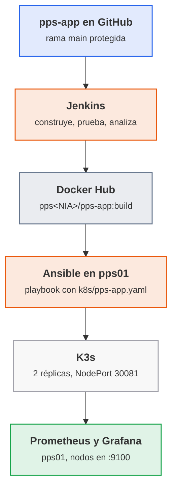

<p class="pie" markdown>Recorrido del proyecto: el único dato que viaja entre el pipeline y el despliegue es la **etiqueta** de la imagen, el número de build.</p>

Las uniones que más fallan, con su causa y su arreglo:

| Unión | Síntoma | Causa habitual | Arreglo |
|---|---|---|---|
| Docker Hub a K3s | Pods en `ImagePullBackOff` | Repositorio privado, o etiqueta que no existe | Repositorio público en el laboratorio; comprobar la etiqueta con `docker pull` antes de desplegar |
| Ansible a K3s | El playbook no encuentra `k3s` | Se ejecuta en un nodo que no es servidor, o sin `become` | Apuntar a `k3s-1` y con `become: true`; `k3s kubectl` está en la ruta del servidor |
| Servicio | No responde en el puerto del nodo | NodePort distinto al del manifiesto, o pods sin pasar la sonda | Mirar `k3s kubectl get svc,pods`; la sonda de `/salud` marca los pods como listos |
| Prometheus | Objetivo `DOWN` | `node_exporter` no instalado o puerto 9100 no alcanzable | Comprobar `curl http://<nodo>:9100/metrics` desde `pps01` |

Dos criterios de diseño se defienden en el informe. El primero: **la etiqueta de la imagen es el número de build**, nunca `latest`, porque `latest` no dice qué versión corre, no se puede volver a la anterior y K3s no descarga de nuevo una imagen que cree que ya tiene. Con el número de build, desplegar es cambiar un parámetro del playbook y volver atrás es desplegar el número anterior. El segundo: **el playbook es idempotente**, así que se puede ejecutar de nuevo tras un fallo sin miedo, y esa propiedad es la que permite decir que el plan de recuperación de la aplicación es "ejecutar el playbook".

!!! ojo "La aplicación no publica métricas"
    `pps-app` es un servidor mínimo sin endpoint `/metrics`, así que Prometheus no ve la aplicación, sino los nodos que la alojan (CPU, memoria, disco y red con `node_exporter`). Para el proyecto es suficiente, y la disponibilidad de la propia aplicación se comprueba con la sonda `/salud` de K3s. Instrumentar la aplicación queda fuera del alcance de la unidad.

!!! examen "Qué se evalúa de este bloque"
    Por qué se etiqueta con el número de build y no con `latest`, qué garantiza la idempotencia de un playbook y cómo se comprueba, qué mide cada capa de la monitorización (nodo, servicio, aplicación) y qué CE toca cada parte del proyecto. También la lectura de un `k8s/pps-app.yaml`: réplicas, sonda y tipo de servicio.

### A5.20 Proyecto: despliegue y monitorización (sesión 57)

<span class="et et-obj">Objetivo</span> Desplegar en K3s, con un playbook de Ansible, la imagen publicada por el pipeline; ver los tres nodos en Prometheus y Grafana; y dejar en el proyecto el plan de recuperación con el tiempo de reposición de la aplicación medido. Es la parte de despliegue, monitorización y recuperación del proyecto y aporta a los criterios d, e y f de RA5.

<span class="et et-pre">Antes de empezar</span> Encendidas `pps01`, `k3s-1`, `k3s-2`, `k3s-3` (el clúster de la [sesión 50](#a513-k3s-en-alta-disponibilidad-sesion-50)), con el Prometheus y el Grafana de `pps01` (el stack de la [A5.15](#a515-prometheus-y-grafana-sesion-52) ampliado en la [A5.16](#a516-monitorizacion-de-un-servidor-sesion-53)) y con acceso a Internet; `~/pps-iac/ansible/` con el inventario de la [sesión 46](#a510-ansible-primer-playbook-sesion-46); una imagen `pps<NIA>/pps-app:N` publicada en la [hoja anterior](#a519-proyecto-construccion-y-pipeline-sesion-56) y el plan de la [sesión 55](#a518-plan-de-recuperacion-sesion-55). Se han repasado las [dudas comunes](#dudas-comunes-del-proyecto). Apaga `destino01` y para Jenkins (`docker stop jenkins`) si el equipo va justo de memoria; el stack de monitorización de `pps01` se queda en marcha. `vagrant` ya tiene `sudo` sin contraseña en los tres nodos. Son cuatro máquinas distintas en 100 minutos: los pasos 1 a 5 son lo largo, y la captura del panel de Grafana y el plan se dejan para el final.

<span class="et et-pas">Pasos</span>

1. Añade los tres nodos al inventario `~/pps-iac/ansible/inventario.ini` y comprueba que Ansible llega a ellos. Si falla por la clave, copia la de `pps01` con `ssh-copy-id vagrant@192.168.56.31` (y `.32`, `.33`):

    ```ini
    [k3s]
    k3s-1 ansible_host=192.168.56.31
    k3s-2 ansible_host=192.168.56.32
    k3s-3 ansible_host=192.168.56.33

    [k3s:vars]
    ansible_user=vagrant
    ```

    ```bash
    cd ~/pps-iac/ansible && ansible k3s -i inventario.ini -m ping
    ```

2. En `~/pps-app/k8s/pps-app.yaml` deja el manifiesto. El de la [A5.14](#a514-balanceo-en-k3s-y-k9s-sesion-51) (con `image` fijada a una etiqueta, servicio `ClusterIP`, Redis e Ingress) no sirve tal cual: se sustituye por este, con la línea `image` igual a `IMAGEN_PPS_APP` y el servicio `NodePort` en el `30081` (el `30080` es el del nginx de la sesión 50). El Redis y el Ingress de aquella hoja siguen en el clúster, pero el Ingress deja de servir la aplicación porque el servicio pasa al puerto 8080:

    ```yaml
    apiVersion: apps/v1
    kind: Deployment
    metadata:
      name: pps-app
    spec:
      replicas: 2
      selector:
        matchLabels: {app: pps-app}
      template:
        metadata:
          labels: {app: pps-app}
        spec:
          containers:
            - name: pps-app
              image: IMAGEN_PPS_APP
              ports: [{containerPort: 8080}]
              readinessProbe:
                httpGet: {path: /salud, port: 8080}
                initialDelaySeconds: 3
    ---
    apiVersion: v1
    kind: Service
    metadata:
      name: pps-app
    spec:
      type: NodePort
      selector: {app: pps-app}
      ports:
        - port: 8080
          targetPort: 8080
          nodePort: 30081
    ```

    Guárdalo en una rama de `pps-app` (`git switch -c proyecto-k8s`, commit y push). El playbook lo lee del disco de `pps01`, no de GitHub, así que el pull request a `main` se abre al final, si queda tiempo, y si no, en casa antes del plazo.

3. Crea `~/pps-iac/ansible/despliegue-k3s.yml`. El primer bloque instala `node_exporter` en los tres nodos (paquete de Ubuntu, escucha en el 9100); el segundo aplica el manifiesto con la imagen que se le pase y comprueba el servicio en cada nodo. Sustituye `pps000000` por tu usuario:

    ```yaml
    - name: Preparar los nodos para la monitorización
      hosts: k3s
      become: true
      tasks:
        - name: Instalar node_exporter
          ansible.builtin.apt:
            name: prometheus-node-exporter
            state: present
            update_cache: true
            cache_valid_time: 3600
        - name: Servicio en marcha y habilitado
          ansible.builtin.service:
            name: prometheus-node-exporter
            state: started
            enabled: true

    - name: Desplegar pps-app en K3s
      hosts: k3s-1
      become: true
      vars:
        imagen: "pps000000/pps-app:{{ build }}"
        manifiesto: "{{ lookup('env', 'HOME') }}/pps-app/k8s/pps-app.yaml"
      tasks:
        - name: Aplicar el manifiesto con la imagen indicada
          ansible.builtin.command:
            cmd: k3s kubectl apply -f -
            stdin: "{{ lookup('ansible.builtin.file', manifiesto) | replace('IMAGEN_PPS_APP', imagen) }}"
          register: aplicar
          changed_when: "'configured' in aplicar.stdout or 'created' in aplicar.stdout"
        - name: Esperar a que las réplicas estén listas
          ansible.builtin.command: k3s kubectl rollout status deployment/pps-app --timeout=120s
          changed_when: false

    - name: Comprobar el servicio desde cada nodo
      hosts: k3s
      tasks:
        - name: /salud responde
          ansible.builtin.uri:
            url: "http://{{ ansible_host }}:30081/salud"
            return_content: true
          register: salud
          failed_when: "'ok' not in salud.content"
    ```

4. Ejecútalo con el número de build de la hoja anterior y mira el resumen; después ejecútalo otra vez. La segunda pasada debe terminar con `changed=0` en `k3s-1` (los nodos que ya tenían `node_exporter` tampoco cambian):

    ```bash
    ansible-playbook -i inventario.ini despliegue-k3s.yml -e build=N
    ansible-playbook -i inventario.ini despliegue-k3s.yml -e build=N
    ```

    Un error `ImagePullBackOff` en el paso de espera casi siempre es una etiqueta mal escrita o un repositorio privado: mira la tabla de las [dudas comunes](#dudas-comunes-del-proyecto).
5. Comprueba el resultado desde `pps01`: los dos pods en `Running` repartidos en nodos, y el servicio respondiendo por cualquier nodo:

    ```bash
    ssh vagrant@192.168.56.31 'sudo k3s kubectl get pods,svc -o wide'
    for ip in 31 32 33; do curl -s http://192.168.56.$ip:30081/; echo; done
    ```

    La respuesta esperada es `Hola PPS` desde los tres. Captura la salida.
6. En `pps01`, añade los nodos a Prometheus. En el `prometheus.yml` del stack (`~/monitor/prometheus_grafana_example/prometheus/`, el de las hojas A5.15 y A5.16) añade un trabajo nuevo bajo `scrape_configs`, y reinicia el servicio con `docker compose restart prometheus` desde `~/monitor/prometheus_grafana_example`:

    ```yaml
      - job_name: k3s
        static_configs:
          - targets: ['192.168.56.31:9100', '192.168.56.32:9100', '192.168.56.33:9100']
    ```

    Abre `http://localhost:9090/targets` y comprueba que los tres estén en `UP`. Captura.
7. En Grafana (`http://localhost:3000`), abre el panel de node_exporter de la sesión 53 y elige uno de los nodos de K3s en el selector de instancia. Captura el panel con datos de CPU y memoria de `k3s-1`.
8. Ensaya la recuperación de la aplicación y cronométrala. Borra el despliegue y vuelve a lanzar el playbook; el tiempo de la segunda orden es el RTO medido de `pps-app`:

    ```bash
    ssh vagrant@192.168.56.31 'sudo k3s kubectl delete deployment,svc pps-app'
    time ansible-playbook -i inventario.ini despliegue-k3s.yml -e build=N
    ```

9. Copia a `~/pps-entregas/ut5/proyecto/plan-recuperacion.md` el plan de la hoja A5.18 y ajústalo al proyecto: dos servicios (Jenkins con su copia, `pps-app` con el playbook), el RTO medido en el paso 8 frente al objetivo de cada uno y la frase de la retrospectiva más importante. Amplía el `README.md` del proyecto con las capturas de los pasos 4 a 7 y el playbook completo. Sube con `git add`, `git commit` y `git push`, y guarda `despliegue-k3s.yml` también en el repositorio `pps-iac`.

<span class="et et-com">Comprobación</span> El playbook termina sin errores y su segunda pasada da `changed=0` en `k3s-1`; hay dos pods `pps-app` en `Running` y el `curl` responde `Hola PPS` en los tres nodos; los tres objetivos de Prometheus están `UP` y el panel de Grafana muestra datos de un nodo; el RTO medido de `pps-app` está escrito en el plan. Ningún fichero del repositorio contiene contraseñas.

<span class="et et-ent">Entrega</span> En `ut5/proyecto/` de `pps-entregas`: `README.md` completo (pipeline de la hoja anterior, despliegue y monitorización, con capturas), `plan-recuperacion.md`, `despliegue-k3s.yml` y el enlace a los repositorios `pps-app` y `pps-iac`. Cierra el proyecto integrador, plazo el 31 de mayo a las 23:59, con los criterios y pesos del [enunciado](#enunciado-del-proyecto-integrador). Se sube a la tarea de Aules la URL de `pps-entregas` y el PDF con el informe en el formato de la Normativa de entrega.

<span class="et et-ext">Si te sobra tiempo</span> Despliega otra versión: modifica el mensaje de `App`, deja que el pipeline publique el build `N+1` y lanza el playbook con `-e build=N+1`; comprueba con `kubectl rollout status` que el cambio se hace por sustitución gradual de los pods y con `curl` que responde la versión nueva. Después vuelve al build `N` y anota cuánto se tarda: es el "volver atrás" de la etiqueta por número.

## Sesión 58 · Margen y repaso de la unidad 5

<p class="ut-meta" markdown>31 de mayo · Margen · <span class="dur" tabindex="0" aria-label="Repaso y recuperación · 110 min" data-dur="Repaso y recuperación · 110 min">:material-school:<i class="dur-barra" style="--teoria:0%"></i>:material-flask:</span></p>

Sesión de margen, sin teoría nueva y sin hoja. Es el último día para entregar el proyecto integrador y Atenea (retos de RA3, RA4 y RA5), a las 23:59, y la última clase antes del examen de la segunda evaluación (RA4 y RA5). Se usa para recuperar lo pendiente y, si no hay nada pendiente, para repasar.

**Si se ha perdido alguna clase.** Se recupera aquí, por este orden de prioridad:

- Primero lo que tiene plazo hoy: el `README.md` y el playbook del proyecto ([A5.19](#a519-proyecto-construccion-y-pipeline-sesion-56) y [A5.20](#a520-proyecto-despliegue-y-monitorizacion-sesion-57)) y los retos de Atenea que falten.
- Después las hojas de la unidad que falten con entrega vencida (ACT_UT5_5 con las hojas [A5.17](#a517-reaccion-a-fallos-sesion-54) y [A5.18](#a518-plan-de-recuperacion-sesion-55)), que se corrigen sobre el 50 % si no hay causa justificada.
- Al final, las hojas de la unidad 4 que queden, porque también entran en el examen.

**Si no se ha perdido ninguna.** Se dedica la sesión a repasar para el examen, con este reparto orientativo:

- Revisar con el `README.md` del proyecto delante el recorrido completo (commit, pipeline, imagen, playbook, K3s, monitorización) y explicárselo en voz alta a la pareja de laboratorio: quien no sabe contar una fase no la domina.
- Repasar los cinco bloques `examen` de la unidad (DevOps y Git, Jenkins y CI, infraestructura como código, orquestación y monitorización, fallos y recuperación) y contestar de memoria las preguntas que plantean; repasar en especial credenciales y privilegios en Jenkins, el fichero de estado y los secretos en Terraform, blue-green, integridad y firma de artefactos, e infraestructura inmutable.
- Repetir sin apuntes la restauración de la hoja A5.18 y cronometrarla: cada minuto que baje es tiempo de examen práctico ganado.
- Resolver dudas de las unidades 4 y 5 en grupo, y mirar los errores de la lista de [Errores frecuentes](#errores-frecuentes-en-el-laboratorio) que se han vivido.

## Prácticas evaluables de la unidad

En esta unidad no hay sesiones de práctica evaluable: las seis entregas se construyen con las hojas A5.1 a A5.20 y se cierran por su plazo, siempre a las 23:59 (hora de Madrid) del día indicado. Cada entrega se califica en su propia tarea de Aules. Fuera de plazo y sin causa justificada se corrige sobre el 50 %. El plazo no se mueve aunque se pierda una clase: lo que se mueve es el contenido, y las sesiones 47 y 58 están para recuperarlo.

Todas comparten tres reglas de entrega:

- Las evidencias de cada hoja viven en `pps-entregas/ut5/a5<k>/` (por ejemplo `ut5/a54/`), con su `README.md`, los comandos usados, la validación y las capturas (ver [Repositorio de entregas](../laboratorio.md#repositorio-de-entregas)). Se sube con `git add`, `git commit` y `git push` al terminar cada hoja, no el día del plazo.
- La aplicación de la unidad vive en el repositorio `pps-app` (Jenkinsfile, `jenkinsfile.docker`, `compose.yml`, `k8s/pps-app.yaml`). En la tarea de Aules se pega la URL del repositorio y, cuando la entrega es un documento, se sube el PDF con el formato de la *Normativa de entrega* y su plantilla `Plantilla_memoria_tarea`.
- Ninguna contraseña, token ni clave va en un repositorio, en el historial ni en una captura. Un secreto encontrado se descuenta en el criterio de seguridad de la entrega y obliga a rotarlo.

| Entrega | Hojas | Plazo | CE | Se entrega |
|---|---|---|---|---|
| ACT_UT5_1 · Jenkins | A5.1 a A5.7 | jueves 15 de abril, 23:59 | a, b, c | Repositorio `pps-app` y carpetas `ut5/a51` a `ut5/a57` |
| ACT_UT5_2 · Terraform y Ansible | A5.8 a A5.11 | lunes 3 de mayo, 23:59 | d | Repositorio con `terraform/` y `ansible/` y carpetas `ut5/a58` a `ut5/a511` |
| ACT_UT5_4 · K3s y K9s | A5.12, A5.13, A5.14 | jueves 13 de mayo, 23:59 | d, e | Carpetas `ut5/a512` a `ut5/a514` y manifiestos |
| ACT_UT5_3 · Prometheus y Grafana | A5.15, A5.16 | lunes 17 de mayo, 23:59 | e | Carpetas `ut5/a515` y `ut5/a516` |
| ACT_UT5_5 · Fallos y recuperación | A5.17, A5.18 | lunes 24 de mayo, 23:59 | e, f, g | Informe PDF y carpetas `ut5/a517` y `ut5/a518` |
| Proyecto integrador | A5.19, A5.20 | lunes 31 de mayo, 23:59 | c, d, e, f | Repositorio `pps-app`, informe PDF y carpeta `ut5/proyecto/` |

El orden de plazos no sigue el de los números: ACT_UT5_4 (K3s) vence antes que ACT_UT5_3 (monitorización) porque sus hojas se dan antes, en las sesiones 49 a 51. La ponderación de estas entregas frente a las demás unidades y al examen la fija [el módulo](../modulo.md).

### ACT_UT5_1 · Jenkins

<p class="ut-meta" markdown>Sale de las hojas [A5.1](#a51-el-pipeline-de-entrega-sesion-37) a [A5.7](#a57-pipeline-seguro-sesion-43) · plazo jueves 15 de abril, 23:59 · RA5 CE a, b, c</p>

Es la entrega que ancla la unidad: a partir del repositorio `pps-app` se demuestra que existe un flujo de integración continua conectado al control de versiones y que ese flujo se puede fiar de sí mismo. Lo que se pide es lo del enunciado original, ampliado con lo que exigen los CE a y b.

Entrega en GitHub, en el repositorio `pps-app`:

1. `Jenkinsfile` en la raíz, con las etapas de construcción, pruebas y publicación del informe (de la A5.5). Se ejecuta con el trabajo de Jenkins sin tocar nada a mano.
2. `jenkinsfile.docker` en la raíz, con las etapas del enunciado: ejecutar el pipeline en un entorno Docker, crear la imagen, ejecutarla, ejecutar los tests dentro del contenedor y ejecutar el `compose.yml` del repositorio (de la A5.6).
3. `Dockerfile` y `compose.yml` en la raíz, y la aplicación con sus pruebas JUnit (de la A5.3).
4. Etapa de análisis de dependencias con OWASP Dependency-Check, credenciales `github-token` y `dockerhub` guardadas en Jenkins (nunca en el `Jenkinsfile`) y el pipeline que falla ante una vulnerabilidad crítica (de la A5.7).
5. `README.md` con una captura de cada pipeline funcionando (`Jenkinsfile` y `jenkinsfile.docker`), una explicación breve de cada etapa y el organigrama de roles de la A5.2 (tres roles, rama `main` protegida, revisión obligatoria).

En `pps-entregas`, `ut5/a51` lleva el diagrama del pipeline con el control de seguridad de cada fase, y `ut5/a52` las capturas de la protección de rama y de un pull request bloqueado hasta su aprobación.

| Criterio | CE | Sale de | Peso |
|---|---|---|---|
| Principios y objetivos de DevOps y del pipeline de entrega identificados, con un control de seguridad por fase | a | A5.1 | 10 % |
| Repositorio con roles, rama protegida y pull request con revisión obligatoria | b | A5.2 | 15 % |
| Proyecto Maven que construye y prueba, con informe de pruebas | c | A5.3 | 10 % |
| Jenkins instalado, verificado y conectado a GitHub, con el trabajo que construye la aplicación | c | A5.4 | 15 % |
| `Jenkinsfile` que construye, prueba y publica el informe, ejecutado desde el repositorio | c | A5.5 | 15 % |
| `jenkinsfile.docker` con sus seis puntos y `compose.yml` en el repositorio | c | A5.6 | 20 % |
| Pipeline seguro: análisis de dependencias, credenciales fuera del código y fallo ante una vulnerabilidad crítica | c | A5.7 | 15 % |

Cada fila se valora por niveles: 40 % si está intentado pero no funciona, 60 % si funciona sin evidencia clara, 80 % si funciona y está documentado, 90 % si además se explica el porqué de las decisiones y 100 % si se ha comprobado también el caso de fallo (un test que rompe, una credencial ausente, una vulnerabilidad que cuela).

### ACT_UT5_2 · Terraform y Ansible

<p class="ut-meta" markdown>Sale de las hojas [A5.8](#a58-terraform-primera-maquina-sesion-44), [A5.9](#a59-terraform-variables-y-estado-sesion-45), [A5.10](#a510-ansible-primer-playbook-sesion-46) y [A5.11](#a511-ansible-despliegue-sesion-48) · plazo lunes 3 de mayo, 23:59 · RA5 CE d</p>

Se demuestra que una máquina puede crearse y configurarse solo con código, y que repetir el proceso da el mismo resultado. El enunciado del aula pide tres cosas: provisionar una VM Ubuntu 24.04 con Terraform, configurarla con Ansible (actualizar e instalar Apache) y publicar un `index.html` con el texto `Ansible rocks`, reiniciar el servicio y comprobarlo con `curl`.

Entrega en GitHub, en un repositorio (o en la carpeta `~/pps-iac` publicada) con esta estructura:

1. `terraform/` con `main.tf`, `variables.tf` y `outputs.tf` (IP de `destino01` como salida), versiones de proveedor fijadas y `.gitignore` que excluye `terraform.tfstate*`, `.terraform/` y `*.tfvars` con datos propios (de la A5.8 y la A5.9).
2. `ansible/` con `inventario.ini`, un playbook que actualiza el sistema e instala Apache (de la A5.10) y otro que publica `index.html` con `Ansible rocks`, con un handler que reinicia el servicio (de la A5.11).
3. `README.md` con una captura de la provisión (`apply` terminado y la VM en VirtualBox), de la configuración (`PLAY RECAP`), de la segunda pasada con `changed=0` y del `curl` que devuelve el mensaje esperado.

| Criterio | CE | Sale de | Peso |
|---|---|---|---|
| VM Ubuntu 24.04 provisionada por código, con `plan` revisado antes del `apply` | d | A5.8 | 25 % |
| Variables, salida con la IP y estado y secretos fuera del repositorio | d | A5.9 | 20 % |
| Playbook que actualiza el sistema e instala Apache, con inventario propio | d | A5.10 | 20 % |
| `index.html` desplegado, reinicio por handler y `curl` que verifica `Ansible rocks` | d | A5.11 | 20 % |
| Idempotencia demostrada: segunda pasada con `changed=0` y `plan` sin cambios | d | A5.9 y A5.11 | 15 % |

Niveles: 40, 60, 80, 90 y 100 %, con el mismo criterio que en ACT_UT5_1.

### ACT_UT5_4 · K3s y K9s

<p class="ut-meta" markdown>Sale de las hojas [A5.12](#a512-k3s-de-un-nodo-sesion-49), [A5.13](#a513-k3s-en-alta-disponibilidad-sesion-50) y [A5.14](#a514-balanceo-en-k3s-y-k9s-sesion-51) · plazo jueves 13 de mayo, 23:59 · RA5 CE d, e</p>

Se demuestra que un despliegue puede planificarse sobre un orquestador y que este mantiene el estado pedido. El enunciado del aula tiene tres actividades: K3s en un nodo con nginx en dos réplicas y validación con K9s, lo mismo en alta disponibilidad, y el despliegue en K3s del compose de balanceo de carga, validado con K9s.

Entrega en las carpetas `ut5/a512`, `ut5/a513` y `ut5/a514` de `pps-entregas`, cada una con su README:

1. **Un nodo (A5.12)**: comandos de instalación, `kubectl get nodes` y `kubectl get pods` con las dos réplicas de nginx en `Running`, acceso por el NodePort `30080`, y una captura de K9s con el despliegue.
2. **Alta disponibilidad (A5.13)**: los tres nodos `k3s-1`, `k3s-2` y `k3s-3` en `Ready` con el rol `control-plane`, el mismo despliegue de nginx repartido entre nodos y K9s conectado al clúster. Si el equipo no permite tres VM, se documenta la alternativa usada y por qué.
3. **Balanceo (A5.14)**: los manifiestos YAML que sustituyen al compose (nginx delante de dos réplicas), la prueba de que las peticiones se reparten y la vista de K9s (pods, logs y servicio).

| Criterio | CE | Sale de | Peso |
|---|---|---|---|
| K3s en un nodo instalado y verificado, nginx con dos réplicas y K9s funcionando | d | A5.12 | 25 % |
| K3s en alta disponibilidad con tres servidores y el despliegue repetido | d | A5.13 | 30 % |
| Balanceo de carga desplegado en K3s y verificado con K9s | d | A5.14 | 25 % |
| Reacción del orquestador comprobada: un pod borrado se recrea sin perder el servicio | e | A5.12 a A5.14 | 20 % |

Niveles: 40, 60, 80, 90 y 100 %. La rúbrica original de esta actividad está en el aula (`RA5.4.pdf`, última página).

### ACT_UT5_3 · Prometheus y Grafana

<p class="ut-meta" markdown>Sale de las hojas [A5.15](#a515-prometheus-y-grafana-sesion-52) y [A5.16](#a516-monitorizacion-de-un-servidor-sesion-53) · plazo lunes 17 de mayo, 23:59 · RA5 CE e</p>

Se demuestra que un sistema desplegado se observa desde fuera y que esa observación es la base de la reacción a fallos. El enunciado pide dos cosas: levantar el stack de ejemplo (Prometheus, Grafana y un contenedor) validando cada componente, y monitorizar de forma remota un servidor con `node_exporter` desde un cliente con Grafana y el panel de `node_exporter`.

Entrega en `ut5/a515` y `ut5/a516` de `pps-entregas`:

1. **Stack de ejemplo (A5.15)**: el `compose.yml` usado, una captura de cada elemento (Prometheus en `:9090` con los targets en `UP`, Grafana en `:3000` con la fuente de datos probada y el contenedor de ejemplo) y una consulta PromQL con su resultado.
2. **Monitorización remota (A5.16)**: `node_exporter` en `destino01` (`192.168.56.20:9100`), Prometheus y Grafana en `pps01` (`:9090` y `:3000`), el `prometheus.yml` con el target de `destino01` y el panel de `node_exporter` mostrando datos reales del servidor. Una regla de alerta sencilla (servidor caído o CPU alta) con su captura en estado `firing`.

| Criterio | CE | Sale de | Peso |
|---|---|---|---|
| Stack de ejemplo levantado y cada componente validado con captura | e | A5.15 | 35 % |
| Servidor expuesto con `node_exporter` y recogido como target en `UP` | e | A5.16 | 25 % |
| Panel de Grafana con datos reales del servidor, leído desde otro equipo | e | A5.16 | 25 % |
| Regla de alerta que salta al parar el servicio | e | A5.16 | 15 % |

Niveles: 40, 60, 80, 90 y 100 %.

### ACT_UT5_5 · Fallos y recuperación

<p class="ut-meta" markdown>Sale de las hojas [A5.17](#a517-reaccion-a-fallos-sesion-54) y [A5.18](#a518-plan-de-recuperacion-sesion-55) · plazo lunes 24 de mayo, 23:59 · RA5 CE e, f, g</p>

Actividad nueva, sin enunciado en el aula: cubre lo que las herramientas anteriores no llegan a demostrar, que el sistema aguanta un fallo, que existe un procedimiento escrito para recuperarlo y que el equipo aprende de ello. Se entrega un informe en PDF con el formato de la *Normativa de entrega* (portada, índice, desarrollo, conclusiones y bibliografía) y las evidencias en `ut5/a517` y `ut5/a518`.

El informe contiene:

1. **Pruebas de fallo (A5.17)**: una tabla con cada fallo provocado (contenedor sin y con `restart: unless-stopped`, pod borrado, nodo apagado en el clúster de la A5.13), el tiempo medido hasta la recuperación, si saltó la alerta y qué se aprende de cada caso.
2. **Plan de recuperación (A5.18)**: RTO y RPO propuestos para el servicio con su justificación, procedimiento paso a paso para recuperarlo, y la evidencia de la restauración de prueba de un volumen (copia, borrado, restauración y comprobación de los datos).
3. **Retrospectiva (A5.18)**: qué salió bien, qué mejorar y al menos tres acciones con responsable y fecha, enlazadas con las métricas de despliegue (frecuencia de despliegue y tiempo de recuperación).

| Criterio | CE | Sale de | Peso |
|---|---|---|---|
| Fallos provocados, con recuperación automática medida y comparación con y sin política de reinicio | e | A5.17 | 30 % |
| Alertas comprobadas: qué fallo dispara qué aviso y en cuánto tiempo | e | A5.17 | 10 % |
| Plan de recuperación con RTO y RPO justificados y procedimiento que otra persona podría seguir | f | A5.18 | 25 % |
| Restauración de prueba de un volumen documentada con evidencia | f | A5.18 | 15 % |
| Retrospectiva con acciones concretas y bucle de retroalimentación con las métricas | g | A5.18 | 20 % |

Niveles: 40, 60, 80, 90 y 100 %.

### Proyecto integrador

<p class="ut-meta" markdown>Sale de las hojas [A5.19](#a519-proyecto-construccion-y-pipeline-sesion-56) y [A5.20](#a520-proyecto-despliegue-y-monitorizacion-sesion-57) · plazo lunes 31 de mayo, 23:59 · RA5 CE c, d, e, f</p>

Actividad nueva y sin trabajo nuevo de herramientas: junta en un solo hilo lo construido durante la unidad. Una confirmación en `pps-app` dispara el pipeline de Jenkins, que construye, prueba, analiza y publica la imagen `pps<NIA>/pps-app:<etiqueta>` en Docker Hub; el despliegue lleva esa imagen a K3s con `k8s/pps-app.yaml` y el playbook de Ansible; la aplicación se monitoriza en Prometheus y Grafana, y un informe recoge el plan de recuperación.

Entrega:

1. Repositorio `pps-app` con `Jenkinsfile`, `Dockerfile`, `k8s/pps-app.yaml`, el playbook de despliegue y un `README.md` con el diagrama del flujo completo y una captura del pipeline en verde.
2. Etiqueta `entrega-pps-ut5` en el repositorio: `git tag entrega-pps-ut5 && git push origin entrega-pps-ut5`. Si se corrige algo después, se mueve con `git tag -f` y se vuelve a subir.
3. Informe en PDF (formato de la *Normativa de entrega*) con la evidencia de cada fase, la prueba de que la aplicación responde en `/` y en `/salud` desde el clúster, el panel de Grafana con su tráfico y el plan de recuperación aplicado al servicio real, con una restauración probada.
4. Carpeta `ut5/proyecto/` en `pps-entregas`, con el `README.md` de cada parte.

| Criterio | CE | Sale de | Peso |
|---|---|---|---|
| Pipeline que construye, prueba y analiza, con credenciales fuera del código y fallo ante una vulnerabilidad crítica | c | A5.19 | 25 % |
| Imagen publicada en Docker Hub con la etiqueta del número de build | c | A5.19 | 10 % |
| Despliegue automatizado en K3s con el playbook y `k8s/pps-app.yaml`, con la aplicación respondiendo | d | A5.20 | 25 % |
| Monitorización de la aplicación y del nodo con al menos una alerta útil | e | A5.20 | 15 % |
| Plan de recuperación aplicado al servicio: RTO, RPO, procedimiento y restauración probada | f | A5.20 | 15 % |
| Calidad del informe y del README: reproducible por otra persona, sin secretos | c, d, e, f | A5.19 y A5.20 | 10 % |

Niveles: 40, 60, 80, 90 y 100 %.

El enunciado original de las actividades ACT_UT5_1, ACT_UT5_2, ACT_UT5_3 y ACT_UT5_4 está en el aula (carpeta `RA5-Despliegue-seguro`); ACT_UT5_5 y el proyecto integrador son nuevos y su enunciado es el de esta página.

## Errores frecuentes en el laboratorio

Para lo general (VM que no arranca, disco lleno, puertos ocupados, Docker sin permisos) véase [Si algo se rompe](../laboratorio.md#si-algo-se-rompe). Aquí van los fallos propios de esta unidad.

**Jenkins: `docker: not found` o `permission denied while trying to connect to the Docker daemon socket`.** El contenedor `jenkins` no trae el cliente de Docker ni acceso al demonio. Se monta `/var/run/docker.sock` y se instala el cliente `docker` dentro de la imagen (o se usa una imagen propia derivada de `jenkins/jenkins:lts-jdk17`), y el usuario `jenkins` del contenedor tiene que poder leer el socket. Comprobación: `docker exec jenkins docker ps`. Recordatorio: montar el socket equivale a dar root sobre `pps01`; se acepta en el laboratorio y no en producción.

**Jenkins no arranca o pierde todo al reiniciar: `Permission denied` en `/var/jenkins_home`.** El volumen `jenkins_home` (o la carpeta montada en su lugar) pertenece a otro usuario; el contenedor corre como el usuario `jenkins` (UID 1000). Con un volumen con nombre no ocurre; con una carpeta del anfitrión hace falta `sudo chown -R 1000:1000 <carpeta>`. Si se creó el contenedor sin volumen, los trabajos desaparecen con `docker rm`: `docker volume ls` debe mostrar `jenkins_home`.

**El pipeline no encuentra la credencial: `Could not find credentials entry with ID 'dockerhub'`.** El identificador del `Jenkinsfile` no coincide letra por letra con el creado en Jenkins (`github-token` y `dockerhub`), o la credencial se guardó en otro ámbito o dentro de una carpeta. Se revisa en Administrar Jenkins > Credentials. Y si el secreto aparece en el log en claro, se usó `echo` o un `sh` con comillas dobles y la interpolación de Groovy; se pasa con `withCredentials` y comillas simples, y el secreto ya expuesto se revoca y se crea otro.

**GitHub rechaza el `push` o Jenkins no puede clonar: `Authentication failed`.** El token personal caducó o no tiene el ámbito de repositorio. No se arregla pegando el token en la URL del repositorio, que lo deja en el historial de shell y en la configuración del trabajo: se crea uno nuevo, se actualiza la credencial de Jenkins y se comprueba con "Test connection".

**Maven: `Fatal error compiling: release version 17 not supported` o `mvn: command not found` dentro de Jenkins.** El agente solo tiene JRE, o no tiene Maven. En `pps01` hace falta un JDK 17 (`javac -version`) y en Jenkins la herramienta Maven configurada en Administrar Jenkins > Tools, o un contenedor de construcción con `maven` y JDK. La versión de `maven.compiler.release` del `pom.xml` no puede ser mayor que el JDK disponible.

**Dependency-Check tarda muchísimo o falla al bajar la base de vulnerabilidades.** La primera ejecución descarga toda la base (NVD) y, sin clave de API, el servicio la limita: con treinta alumnos a la vez el aula agota la cuota y salen errores `403` o `429`. Soluciones, por orden: pedir una clave gratuita de la NVD y guardarla como credencial de Jenkins (nunca en el `Jenkinsfile`), conservar la carpeta de datos en un volumen para que solo la primera vez sea lenta, y en clase escalonar el arranque. Un fallo de descarga no debe interpretarse como "sin vulnerabilidades": el pipeline tiene que fallar, no dar verde.

**Terraform con VirtualBox: `VBoxManage: error` o el `apply` deja la VM a medias.** Casi siempre la virtualización por hardware está desactivada, otra VM tiene bloqueado el disco, o el nombre de la VM ya existe en VirtualBox de una prueba anterior. `VBoxManage list vms` muestra qué hay; si Terraform no la conoce, se elimina a mano y se repite. Si aparece `Error: Failed to query available provider packages`, no hay salida a Internet desde `pps01` durante `init`. Nunca se borra `terraform.tfstate` para "empezar de cero" con la VM viva: se pierde la relación entre el código y la máquina.

**Ansible: `UNREACHABLE! ... Permission denied (publickey)` o `Connection timed out`.** La clave pública de `pps01` no está en `destino01` (el paso de `ssh-copy-id` o su equivalente en la provisión), el usuario del inventario no es `vagrant`, o la IP no es `192.168.56.20`. `ssh -v vagrant@192.168.56.20` lo dice antes de tocar Ansible. Con `sudo` que pide contraseña falla `become`: hace falta `--ask-become-pass` o sudo sin contraseña para el usuario en el laboratorio. Y si `apt` responde `Could not get lock`, el arranque de la VM aún está aplicando actualizaciones: se espera un par de minutos.

**K3s: los nodos no se unen al clúster.** Las tres causas habituales son: el token (`sudo cat /var/lib/rancher/k3s/server/node-token` en el primer servidor) mal copiado, el nombre de máquina repetido entre nodos (cada uno tiene que llamarse `k3s-1`, `k3s-2` y `k3s-3`), o el puerto `6443` inalcanzable desde el nuevo nodo (`curl -k https://192.168.56.31:6443`). Con etcd embebido el primer servidor se instala con `--cluster-init` y los demás con `--server https://192.168.56.31:6443`. Con 1,5 GB por nodo, si un nodo queda en `NotReady` conviene mirar `free -m` y `journalctl -u k3s`: la falta de memoria es lo más probable. Tras apagar un nodo del trío, `kubectl` deja de responder si se apuntó al nodo apagado: el kubeconfig debe apuntar a uno vivo.

**K3s: el puerto 80 de un nodo responde la página de Apache, o Traefik no enlaza el 80.** El nodo se clonó de `destino01`, que trae `apache2` escuchando en el 80 (A5.10 y A5.11), y ese Apache heredado ocupa el puerto que Traefik necesita para la entrada HTTP. Se desactiva en cada nodo con `sudo systemctl disable --now apache2` y se repite el despliegue.

**Prometheus no recoge las métricas (target `DOWN` o ausente).** `curl http://192.168.56.20:9100/metrics` desde `pps01` es la prueba: si falla, `node_exporter` no corre en `destino01` o el cortafuegos bloquea el puerto `9100`. Si responde y Prometheus sigue sin ver el target, el `prometheus.yml` tiene un error de sangría (Prometheus no arranca, `docker logs` lo dice) o el fichero editado no es el montado en el contenedor. Después de cambiarlo se recarga o se reinicia el contenedor. `localhost` dentro del contenedor de Prometheus es el propio contenedor: los objetivos se escriben con la IP de `destino01`.

**Grafana no muestra datos.** Se comprueba de derecha a izquierda: el target está en `UP` en Prometheus; la fuente de datos de Grafana apunta a la dirección que ve el contenedor de Grafana (no `localhost:9090`, sino `http://prometheus:9090` si comparten red de Compose, o `http://192.168.56.10:9090`) y su botón "Save & test" da verde; el intervalo de tiempo del panel abarca el rato en que corre el exporter; y el panel importado usa la variable de instancia correcta (la de `destino01`, no la de `pps01` ni la de un ejemplo anterior). Con un reloj de las VM desajustado el panel sale vacío aunque los datos existan: se sincroniza la hora en ambas máquinas.

Los enlaces para ampliar y los apartados que van más allá de lo que se hace en clase están en [Para ampliar](../ampliacion.md#ut5-despliegue-seguro).
