# UT5 · Despliegue seguro

<p class="ut-meta">44 h · Sesiones 37 a 58 · RA5 CE a, b, c, d, e, f, g</p>

Una aplicación que funciona en el portátil de quien la escribe todavía no está en producción. Entre el `git push` y el servicio que atiende a los usuarios hay una cadena de pasos (construir, probar, analizar, empaquetar, crear la máquina, configurarla, desplegar, vigilar) y cada paso hecho a mano es un sitio donde se cuela un error, un secreto en un fichero o una versión que nadie sabe de dónde salió. Esta unidad automatiza esa cadena y la protege: Git con roles y ramas protegidas para que nadie cambie el código sin revisión, Maven y Jenkins para construir y probar en cada cambio, Docker para empaquetar, Terraform y Ansible para crear y configurar la máquina destino, K3s para orquestar los contenedores, Prometheus y Grafana para ver cómo se comportan y un plan de recuperación para el día en que algo falle. La unidad se cierra con un proyecto integrador que junta todas las piezas en un solo recorrido, desde el commit hasta el servicio monitorizado.

Las cuatro primeras entregas, ACT_UT5_1 a ACT_UT5_4, tienen en el aula su enunciado en PDF («RA5.1 Jenkins», «RA5.2 IaC: Infrastructure as Code», «RA5.3 Sistema de monitorización» y «RA5.4 K3's & K9's»), y **el PDF es el que manda**: las hojas siguen su numeración (3.1, 3.2... y 5.1 a 5.3 en el de K3s) y dicen en cada ejercicio a qué punto responden, y lo que una hoja añade por su cuenta va en su ejercicio «Extra (opcional)», que es lo que las rúbricas llaman «Extra». Donde el laboratorio del curso hace algo de otra forma que el enunciado (otra aplicación, otra versión de Ubuntu), la hoja lo dice y explica por qué. ACT_UT5_5 y el proyecto integrador no tienen PDF: su enunciado es el de esta página.

!!! consulta "Solo sobre lo propio"
    Todo lo que se hace en esta unidad se hace en el laboratorio del alumno: las máquinas `pps01`, `destino01`, `k3s-1`, `k3s-2` y `k3s-3` en una red solo anfitrión, y los repositorios y la cuenta de Docker Hub `pps<NIA>`. Jenkins, Terraform y Ansible son herramientas con mucho poder por diseño: Jenkins ejecuta código en cada cambio y puede tocar el demonio de Docker, Terraform crea y destruye máquinas, Ansible entra por SSH y cambia lo que encuentra. Usarlas contra servidores, repositorios o cuentas ajenas sin autorización escrita es acceso sin autorización a un sistema ajeno, delito tipificado en el artículo 197 bis del Código Penal. Lo mismo vale para los ejercicios de fallos de esta unidad: apagar un nodo o matar un contenedor a propósito se hace solo en el clúster propio. Los secretos (tokens de GitHub, contraseña de Docker Hub, claves SSH) son personales: se guardan en el almacén de credenciales de Jenkins o en variables de entorno, nunca en el repositorio ni en una captura de pantalla.

!!! ojo "Montar docker.sock en Jenkins equivale a dar root"
    Para que las etapas de Jenkins construyan imágenes, el contenedor `jenkins` necesita hablar con el demonio de Docker, y la forma más corta es montar el socket del anfitrión (`-v /var/run/docker.sock:/var/run/docker.sock`). Quien controla ese socket puede arrancar un contenedor privilegiado que monte el disco del anfitrión entero, así que cualquiera que pueda editar un `Jenkinsfile` (o un pull request que lo modifique) obtiene en la práctica root en la máquina. En el laboratorio se acepta, porque `pps01` es una VM propia sin datos de nadie y con instantánea. En producción no: se usa un agente efímero aislado y dedicado a construir, un demonio de Docker sin privilegios (rootless) o un constructor de imágenes que no necesite el socket (Kaniko, Buildah), y la construcción de código que viene de ramas no revisadas queda fuera del controlador. El 8 de abril, la sesión de [pipeline seguro](#sesion-43-pipeline-seguro-componentes-y-secretos) vuelve sobre esto con los secretos.

## Sesión 37 · DevOps y puesta segura en producción

<p class="ut-meta" markdown>8 de marzo · Teoría y práctica · <span class="dur" tabindex="0" aria-label="Principios y objetivos de DevOps · 10 min&#10;El ciclo de entrega y dónde entra la seguridad · 10 min&#10;Escalado, virtualización y contenedores · 5 min&#10;A5.1 El pipeline de entrega · 85 min" data-dur="Principios y objetivos de DevOps · 10 min&#10;El ciclo de entrega y dónde entra la seguridad · 10 min&#10;Escalado, virtualización y contenedores · 5 min&#10;A5.1 El pipeline de entrega · 85 min">:material-school:<i class="dur-barra" style="--teoria:23%"></i>:material-flask:</span></p>

Al terminar la sesión hay un mapa del recorrido que hace una aplicación desde que alguien escribe una línea hasta que atiende peticiones en producción, con el control de seguridad que corresponde a cada fase, y el repositorio `pps-app` creado y listo para las hojas siguientes. La teoría fija primero qué persigue DevOps y con qué prácticas, después dibuja el ciclo de entrega y coloca en él cada control, y cierra con la infraestructura sobre la que corre el resultado (escalado, máquinas virtuales y contenedores).

!!! consulta "Recursos de la sesión"
    **Para la práctica**

    - [Manual de Jenkins](https://www.jenkins.io/doc/book/): la herramienta de integración continua sobre la que gira la unidad.

### Principios y objetivos de DevOps

El problema que resuelve DevOps es organizativo antes que técnico: quien desarrolla quiere cambiar el software cuanto antes y quien opera quiere que nada cambie, porque cada cambio es un riesgo. Cuando los dos equipos trabajan separados, las entregas son grandes, poco frecuentes y dolorosas. DevOps es el conjunto de prácticas que junta desarrollo y operación en un mismo flujo, con automatización para que entregar sea rutinario y no un acontecimiento. Las herramientas de la unidad (Git, Maven, Jenkins, Docker, Terraform, Ansible, K3s, Prometheus) son la forma concreta de cada una de estas prácticas.

Los principios se resumen en cinco:

- **Responsabilidad compartida**: el equipo que escribe el código responde también de cómo se comporta en producción.
- **Automatización**: todo lo que se repite (compilar, probar, empaquetar, desplegar, crear servidores) lo hace una herramienta y queda escrito como código.
- **Cambios pequeños y frecuentes**: un cambio de veinte líneas se revisa, se prueba y se deshace con facilidad; uno de veinte mil no.
- **Medición**: lo que no se mide no se puede mejorar. Cuatro métricas son las de referencia del sector (las de DORA, el programa de investigación de Google sobre entrega de software): frecuencia de despliegue, plazo desde el commit hasta producción, porcentaje de despliegues que fallan y tiempo de recuperación.
- **Retroalimentación rápida**: cuanto antes se entera el equipo de un fallo (una prueba roja a los cinco minutos, una alerta a los dos), más barato es corregirlo. Es el bucle que cierra el ciclo.

El objetivo que une los cinco principios es entregar valor más a menudo con menos fallos y recuperarse deprisa cuando alguno ocurre. Tres prácticas distintas se suelen confundir y conviene separarlas:

| Práctica | Qué garantiza | Quién decide el paso a producción |
|---|---|---|
| Integración continua (CI) | Cada cambio se integra en la rama común varias veces al día y se valida con una construcción y pruebas automáticas | No llega a producción: solo valida |
| Entrega continua | El resultado de cada integración queda listo para desplegarse en cualquier momento | Una persona, con un botón de aprobación |
| Despliegue continuo | Todo cambio que supera las pruebas se despliega solo | Nadie: el pipeline |

Este material abrevia integración y entrega continuas como CI/CD, y así se nombran en el resto de la unidad. La diferencia entre las dos últimas filas no es técnica sino de confianza: se pasa al despliegue continuo cuando las pruebas y la monitorización son lo bastante buenas para que aprobar a mano no aporte nada.

Cuando la seguridad se incorpora al mismo flujo se habla de DevSecOps, cuya idea central es desplazar los controles a la izquierda del ciclo (*shift left*): un fallo se detecta en la máquina del desarrollador o en el pipeline, donde cuesta minutos, y no en producción, donde cuesta un incidente. El apartado siguiente coloca cada control en su fase.

### El ciclo de entrega y dónde entra la seguridad

Un pipeline de entrega es la cadena automática que lleva un cambio desde el repositorio hasta producción. El objetivo de este apartado es ver esa cadena entera y saber qué se comprueba en cada fase, porque un control colocado en la fase equivocada llega tarde o no protege de nada. La cadena es la de `pps-app`, la aplicación Java de ejemplo que se construye a lo largo de la unidad.

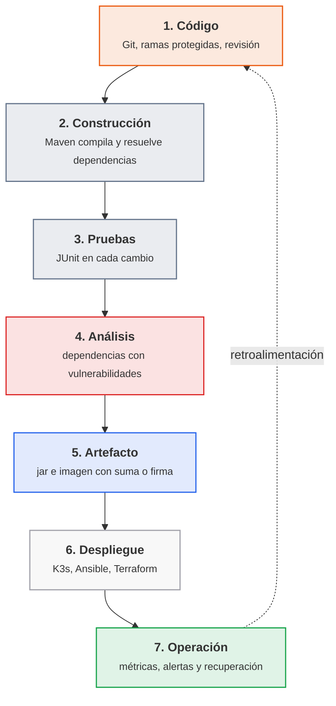

<p class="pie" markdown>El pipeline de `pps-app`: cada flecha es una puerta que el cambio tiene que pasar, y la línea de puntos es el bucle que devuelve a los desarrolladores lo que ocurre en producción.</p>

Cada fase tiene su riesgo típico y su control. La tabla dice también en qué hoja de la unidad se monta el control, de modo que sirve de índice de lo que queda por hacer.

| Fase | Riesgo típico | Control | Herramienta y hoja |
|---|---|---|---|
| Código | Un cambio sin revisar, o una cuenta con demasiados permisos, llega a la rama principal | Rama protegida, revisión obligatoria, roles mínimos | GitHub, [A5.2](#a52-git-en-equipo-sesion-38) |
| Construcción | Una construcción que solo funciona en la máquina de una persona | Construcción reproducible desde un fichero de proyecto | Maven, [A5.3](#a53-construccion-con-maven-sesion-39) |
| Pruebas | Una regresión llega a producción | Pruebas automáticas que bloquean el pipeline si fallan | JUnit y Jenkins, A5.4 a A5.6 |
| Análisis | Una biblioteca con una vulnerabilidad conocida entra en la aplicación | Análisis de dependencias y fallo del pipeline ante una vulnerabilidad crítica | OWASP Dependency-Check, A5.7 |
| Artefacto | Se despliega algo distinto de lo que se construyó | Suma de verificación o firma del artefacto; imagen inmutable con etiqueta única | `sha256sum`, Docker, A5.7 |
| Despliegue | Una contraseña o un token escrito en el código, en la imagen o en el pipeline | Secretos fuera del código, en el almacén de credenciales | Credenciales de Jenkins, A5.7 |
| Despliegue | Un servidor configurado a mano que nadie sabe reproducir | Infraestructura y configuración como código | Terraform y Ansible, A5.8 a A5.11 |
| Operación | Un fallo que nadie ve, o que dura horas | Monitorización, alertas y plan de recuperación | Prometheus, Grafana, A5.15 a A5.18 |

Cuatro ideas de la tabla salen a menudo y conviene tenerlas claras:

- **Integridad**: la garantía de que el artefacto que se despliega es exactamente el que se construyó y probó. Se comprueba con una suma de verificación (`sha256sum`, que cambia por completo si cambia un solo bit) y, cuando hay que demostrar además quién lo produjo, con una firma digital.
- **Secretos en CI/CD**: un secreto (contraseña, token, clave) que se escribe en el repositorio queda en el historial para siempre, aunque se borre después. El pipeline lo recibe en tiempo de ejecución desde un almacén de credenciales y no lo muestra en el registro.
- **Infraestructura inmutable**: un servidor o un contenedor no se modifica una vez desplegado; para cambiarlo se construye uno nuevo desde el código y se sustituye el antiguo. Elimina la deriva de configuración (servidores que con el tiempo dejan de parecerse) y hace que volver atrás sea desplegar la versión anterior.
- **Despliegue azul-verde (*blue-green*)**: se mantienen dos entornos idénticos, uno en producción (azul) y otro con la versión nueva (verde). Se prueba el verde, se cambia el tráfico de uno a otro de golpe y, si algo falla, se vuelve al azul en segundos. Cuesta el doble de infraestructura y a cambio hace el despliegue casi sin riesgo.

### Escalado, virtualización y contenedores

El resultado del pipeline es algo que tiene que ejecutarse y atender a más usuarios de los previstos. Dos decisiones de infraestructura condicionan cómo se despliega: cómo crece el servicio y en qué se empaqueta.

| | Escalado vertical | Escalado horizontal |
|---|---|---|
| Qué hace | Da más recursos al mismo servidor (memoria, procesador, disco) | Añade más servidores que atienden la misma aplicación |
| Ventaja | Sencillo, sin cambiar la aplicación | Casi sin techo y con alta disponibilidad |
| Límite | El máximo de la máquina; un único punto de fallo | La aplicación tiene que admitir varias copias, y hace falta un balanceador de carga delante |

El criterio habitual es escalar en vertical mientras baste, por su sencillez, y pasar a horizontal cuando la disponibilidad importa más que el coste, porque solo con varias copias un fallo no interrumpe el servicio. Con varias copias, el balanceador reparte las peticiones y, si una copia cae, deja de enviarle tráfico (*failover*, la conmutación automática al resto).

El segundo eje es el empaquetado. Una máquina virtual lleva un sistema operativo completo sobre un hipervisor: aísla mucho y arranca en decenas de segundos, pero pesa gigabytes. Un contenedor comparte el núcleo del anfitrión y solo lleva la aplicación con sus bibliotecas: pesa megabytes, arranca en segundos y se puede destruir y recrear sin coste. Para un pipeline la diferencia decisiva es que la imagen del contenedor es el artefacto inmutable de la tabla anterior: se construye una vez, se firma o se verifica, y esa misma imagen es la que pasa por pruebas y por producción. Por eso `pps-app` termina como imagen Docker y no como paquete instalado a mano en un servidor. Las máquinas virtuales siguen haciendo falta debajo, como base sobre la que corre el clúster (`destino01` y los nodos K3s del laboratorio son máquinas virtuales creadas por código).

### A5.1 El pipeline de entrega (sesión 37)

<span class="et et-obj">Objetivo</span> Dibujar el pipeline de `pps-app` con el control de seguridad de cada fase, crear el repositorio `pps-app` y dejar `pps01` con las herramientas de la unidad. No es un punto del enunciado RA5.1: es la explicación de los pipelines (CE a) que lleva el README de la ACT_UT5_1, con plazo el 15 de abril.

<span class="et et-pre">Antes de empezar</span> `pps01` con `pps-entregas` ([A1.1](ut1-prueba-aplicaciones.md#a11-puesto-de-trabajo-sesion-1)) y tu cuenta `pps<NIA>` de GitHub. Teoría: [principios y objetivos de DevOps](#principios-y-objetivos-de-devops), [el ciclo de entrega](#el-ciclo-de-entrega-y-donde-entra-la-seguridad) y [escalado y contenedores](#escalado-virtualizacion-y-contenedores).

<span class="et et-pas">Ejercicios</span> Trabaja en `~/pps-entregas/ut5/a51/` y contesta en su `README.md`.

1. **Herramientas.** Comprueba que `pps01` tiene Git, el JDK 17, Maven y Docker, y que Docker arranca `hello-world`. Guarda una captura de las versiones.
2. **Repositorio de la aplicación.** Crea en GitHub el repositorio privado `pps-app`, solo con el README, y clónalo en `~/pps-app`. Es el de toda la unidad.
3. **Pipeline.** Dibuja en `pipeline.md`, en Mermaid, las siete fases del ciclo de entrega de `pps-app`, cada una con su control de seguridad en una frase, y la flecha de retroalimentación.
4. **Riesgos.** Debajo del dibujo, una tabla con la fase, qué ocurre en `pps-app`, el riesgo si falta el control y la herramienta que lo aplica (con su hoja). Señala los tres puntos por donde un atacante colaría código propio y qué control lo detiene.
5. **Conceptos.** Contesta en cuatro o cinco líneas cada pregunta: integración, entrega y despliegue continuos (y cuál conviene a `pps-app` si nadie revisa a mano); *shift left*, con un ejemplo del pipeline; e infraestructura inmutable y su ventaja al volver atrás.
6. **Escalado.** En una tabla de tres filas, si `pps-app` pasara de 50 a 5.000 usuarios: qué escalarías en vertical, qué en horizontal y por qué va en contenedor y no en una máquina instalada a mano.

## Sesión 38 · Control de versiones con roles

<p class="ut-meta" markdown>11 de marzo · Teoría y práctica · <span class="dur" tabindex="0" aria-label="Flujos de trabajo con Git en equipo · 10 min&#10;Ramas protegidas y revisión de cambios · 10 min&#10;Roles y permisos en GitHub · 5 min&#10;A5.2 Git en equipo · 85 min" data-dur="Flujos de trabajo con Git en equipo · 10 min&#10;Ramas protegidas y revisión de cambios · 10 min&#10;Roles y permisos en GitHub · 5 min&#10;A5.2 Git en equipo · 85 min">:material-school:<i class="dur-barra" style="--teoria:23%"></i>:material-flask:</span></p>

Al terminar la sesión hay una organización de GitHub de prueba con tres personas y tres roles distintos, una rama principal que solo admite cambios a través de un pull request con aprobación, y la comprobación práctica de que cada rol puede hacer lo que le corresponde y nada más. La teoría explica cómo se organiza el trabajo de varias personas con Git, qué reglas protegen la rama principal y qué permisos da cada rol de GitHub, con el equivalente en GitLab.

!!! consulta "Recursos de la sesión"
    **Para la práctica**

    - [Roles de repositorio](https://docs.github.com/en/organizations/managing-user-access-to-your-organizations-repositories/managing-repository-roles/repository-roles-for-an-organization) y [reglas de rama](https://docs.github.com/en/repositories/configuring-branches-and-merges-in-your-repository/managing-rulesets/about-rulesets) en GitHub.
    - [Learn Git Branching](https://learngitbranching.js.org/): repaso de ramas y remotos.

### Flujos de trabajo con Git en equipo

Git ya se usa en solitario desde la unidad 1. El objetivo ahora es que varias personas cambien el mismo código sin pisarse y sin romper lo que funciona, y la herramienta es la rama: una línea de desarrollo paralela que se crea barata, se trabaja aislada y se fusiona cuando está lista. Lo que un equipo tiene que acordar es el flujo, es decir, qué ramas existen, quién las crea y cómo vuelven a la principal.

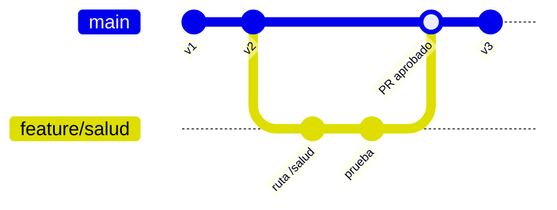

<p class="pie" markdown>Flujo de rama corta: `main` siempre está en un estado desplegable, cada cambio nace en su rama y vuelve por un pull request.</p>

| Flujo | Cómo funciona | Cuándo encaja |
|---|---|---|
| GitHub flow | Una rama principal siempre desplegable y ramas cortas por cambio, que se fusionan con un pull request | Servicios que se despliegan continuamente, como `pps-app` |
| Git flow | Ramas permanentes `main` y `develop`, más ramas de `release` y de `hotfix` | Software con versiones publicadas y varias en mantenimiento a la vez |
| Trunk-based | Todos trabajan sobre la rama principal con cambios muy pequeños, apoyados en interruptores de funcionalidad | Equipos maduros con pruebas muy buenas |

El criterio habitual para un pipeline de CI/CD es el primero: es el más sencillo y el que mejor casa con una rama principal que se construye y se prueba en cada cambio. Git flow añade ceremonia que solo compensa cuando hay versiones que mantener en paralelo. En cualquier flujo valen las mismas costumbres: una rama por cambio con un nombre que diga qué es (`feature/salud`, `fix/puerto`), commits pequeños con un mensaje que explique el porqué y ramas de vida corta, porque cuanto más tiempo vive una rama más se aleja de la principal y más duele fusionarla.

Cuando dos ramas cambian las mismas líneas, Git no puede decidir y marca un conflicto: deja ambas versiones en el fichero entre `<<<<<<<` y `>>>>>>>` y espera que una persona escoja. Se resuelve editando el fichero, haciendo `git add` y terminando la fusión con un commit.

### Ramas protegidas y revisión de cambios

Un flujo acordado de palabra se rompe el primer día de prisa. Una rama protegida convierte el acuerdo en una regla que la plataforma hace cumplir: nadie puede saltarse el camino del pull request, ni siquiera quien administra el repositorio si la regla no le concede excepción (la petición de fusión, con el mismo nombre que en GitHub; en GitLab se llama *merge request*). Lo que se configura en la rama principal es:

| Regla | Qué impide o exige |
|---|---|
| Exigir pull request | Prohíbe `git push` directo a la rama; el cambio entra solo por fusión |
| Aprobaciones requeridas | Un número mínimo de personas distintas de la autora tiene que aprobar |
| Descartar aprobaciones obsoletas | Un commit nuevo tras la aprobación la anula, para no aprobar una cosa y fusionar otra |
| Exigir comprobaciones | La construcción y las pruebas del pipeline tienen que pasar antes de poder fusionar |
| Bloquear el push forzado y el borrado | Nadie reescribe ni elimina el historial de la rama |
| Propietarios del código (`CODEOWNERS`) | Un fichero del repositorio nombra quién debe aprobar los cambios de cada carpeta |

La regla de las comprobaciones es la que une esta sesión con Jenkins: cuando el pipeline informe a GitHub del resultado de cada cambio, un pull request con pruebas rojas no se podrá fusionar. Las cuentas gratuitas de GitHub solo aplican estas reglas a los repositorios públicos; en uno privado hace falta un plan de pago, y por eso la práctica de esta sesión usa un repositorio público sin ningún dato real.

La revisión es la mitad humana del control. Quien revisa comprueba que el cambio hace lo que dice, que trae pruebas, que no añade ninguna dependencia nueva sin justificar y que no contiene secretos (contraseñas, tokens, claves). Un secreto subido por error no se arregla borrándolo en un commit posterior, porque queda en el historial: hay que revocarlo y generar otro. Como forma de fusionar, el criterio habitual para ramas cortas es *squash and merge* (todos los commits de la rama se comprimen en uno), que deja el historial de `main` legible, con un commit por cambio aprobado.

### Roles y permisos en GitHub

La regla que guía los permisos es la del mínimo privilegio: cada persona recibe el rol más bajo con el que puede hacer su trabajo, y se sube solo cuando hace falta. GitHub distingue dos niveles. En la **organización** hay propietarios (administran todo, incluida la facturación y los miembros) y miembros. En cada **repositorio** se asigna uno de cinco roles, ordenados de menos a más:

| Rol | Puede | No puede | Perfil típico |
|---|---|---|---|
| Read | Ver, clonar y comentar | Escribir | Auditoría, personas ajenas al equipo |
| Triage | Lo anterior, y gestionar incidencias y pull requests (etiquetar, asignar, cerrar) | Escribir código | Soporte, calidad |
| Write | Lo anterior, y subir a ramas no protegidas, abrir pull requests y aprobarlos | Cambiar ajustes del repositorio | Desarrollo |
| Maintain | Lo anterior, y gestionar el repositorio (ramas, etiquetas, algunos ajustes) | Acciones destructivas o de seguridad | Responsable técnico |
| Admin | Todo: reglas de rama, personas con acceso, borrar el repositorio | Nada | Quien responde del repositorio |

Dos detalles evitan sorpresas. Una aprobación de pull request solo cuenta para la regla de aprobaciones si la da alguien con rol Write o superior, de modo que una persona con Read puede comentar pero no aprobar. Y un rol se puede dar a una persona o, mejor, a un equipo de la organización: cuando alguien cambia de puesto se le cambia de equipo y no hay que revisar repositorio por repositorio. Las organizaciones pueden además exigir autenticación en dos pasos a todos sus miembros, que es la primera medida contra el robo de una cuenta.

Los pipelines también necesitan acceso, y la misma regla se aplica a las cuentas de máquina: el token que use Jenkins se crea con permisos solo de lectura sobre el repositorio que construye, y una clave de despliegue (*deploy key*) de solo lectura es aún más estrecha.

GitLab ofrece lo mismo con otros nombres, y la correspondencia es directa:

| GitHub | GitLab | Diferencia relevante |
|---|---|---|
| Organización | Grupo | Los grupos de GitLab admiten subgrupos anidados |
| Read | Reporter | En GitLab, Guest ve menos aún |
| Triage | Planner (o Reporter) | Gestión de incidencias sin código |
| Write | Developer | Sube a ramas no protegidas |
| Maintain | Maintainer | Gestiona el repositorio |
| Admin y propietario | Owner | Administra el grupo |
| Rama protegida y regla de rama | Rama protegida (quién puede subir y fusionar) | En GitLab se elige por rol qué roles pueden subir y fusionar |
| Pull request | Merge request | Mismo concepto |
| `CODEOWNERS` | `CODEOWNERS` | Mismo fichero |

### A5.2 Git en equipo (sesión 38)

<span class="et et-obj">Objetivo</span> En grupos de tres, montar una organización de GitHub con tres roles, proteger `main` para que solo admita pull requests aprobados y comprobar los límites de cada rol. Es la evidencia de roles y permisos (CE b) de la ACT_UT5_1, con plazo el 15 de abril.

<span class="et et-pre">Antes de empezar</span> Las tres cuentas de GitHub del grupo y Git en `pps01`; reparte en el grupo los papeles **A** (administra), **B** (desarrolla) y **C** (soporte), y en un grupo de dos se omiten C y el ejercicio 4. Teoría: [flujos con Git](#flujos-de-trabajo-con-git-en-equipo), [ramas protegidas](#ramas-protegidas-y-revision-de-cambios) y [roles y permisos](#roles-y-permisos-en-github).

<span class="et et-pas">Ejercicios</span> Trabaja en `~/pps-entregas/ut5/a52/` y contesta en su `README.md`, con la URL de `equipo-demo` y las capturas `ruleset.png`, `push-rechazado-b.png`, `permiso-denegado-c.png` y `pr-aprobado.png`.

1. **Organización y roles.** A crea la organización `pps<NIA de A>-lab` con el repositorio **público** `equipo-demo` y da Write a B y Triage a C. Anota en una tabla cada persona, su rol y por qué es el mínimo que necesita.
2. **Rama protegida.** A protege `main` con un ruleset que exija pull request con una aprobación, descarte las aprobaciones obsoletas y bloquee el push forzado y el borrado, sin nadie en la lista de excepciones.
3. **Push de B.** B intenta subir un commit directo a `main` y guarda el rechazo. Después crea `saludo.txt` en la rama `feature/saludo` y abre un pull request, que queda bloqueado.
4. **Límites de C.** C comenta y etiqueta el pull request de B, e intenta aprobarlo, fusionarlo y subir una rama propia. Anota qué puede y qué no.
5. **Revisión y fusión.** A pide cambios en una línea concreta, B corrige con un segundo commit y A aprueba y fusiona con *Squash and merge*. Comprueba que `main` tiene un solo commit nuevo.
6. **Comparación con GitLab.** Resume lo visto desde tu rol y compara en una tabla de cuatro filas con GitLab: rol de B, rol de C, rama protegida y aprobaciones requeridas.

!!! examen "Qué se evalúa: DevOps y control de versiones"
    Diferenciar integración, entrega y despliegue continuos; enumerar los principios de DevOps y qué es *shift left*; colocar un control de seguridad (revisión, análisis de dependencias, secretos fuera del código, suma o firma del artefacto) en la fase del pipeline que le corresponde; explicar integridad de artefactos, infraestructura inmutable y despliegue azul-verde; y, en Git, decidir qué rol de GitHub necesita cada perfil aplicando el mínimo privilegio y qué reglas protegen la rama principal.

## Sesión 39 · Automatización de la construcción con Maven

<p class="ut-meta" markdown>15 de marzo · Teoría y práctica · <span class="dur" tabindex="0" aria-label="Qué automatiza un sistema de construcción · 5 min&#10;Maven: ciclo de vida, dependencias y pruebas · 15 min&#10;Maven frente a Gradle · 5 min&#10;A5.3 Construcción con Maven · 85 min" data-dur="Qué automatiza un sistema de construcción · 5 min&#10;Maven: ciclo de vida, dependencias y pruebas · 15 min&#10;Maven frente a Gradle · 5 min&#10;A5.3 Construcción con Maven · 85 min">:material-school:<i class="dur-barra" style="--teoria:23%"></i>:material-flask:</span></p>

Al terminar la sesión existe el código completo de `pps-app`, la aplicación Java que se usa en el resto de la unidad, con su `pom.xml`, sus pruebas y un informe de pruebas generado, y `mvn verify` la construye desde cero en una sola orden, que es lo que hace falta para automatizarla. La teoría explica qué automatiza una herramienta de construcción, cómo lo hace Maven (ciclo de vida, dependencias y pruebas) y cuándo se prefiere Gradle.

!!! consulta "Recursos de la sesión"
    **Para la práctica**

    - [Maven](https://maven.apache.org/) y su [ciclo de vida](https://maven.apache.org/guides/introduction/introduction-to-the-lifecycle.html): la automatización de la construcción.

### Qué automatiza un sistema de construcción

Construir un proyecto es todo lo que hay entre el código fuente y algo que se puede ejecutar y entregar: compilar, descargar las bibliotecas de las que depende, ejecutar las pruebas, empaquetar el resultado y, si procede, generar documentación. Hecho a mano, el resultado depende de la máquina de cada persona. Una herramienta de construcción lo describe en un fichero y lo ejecuta siempre igual con una sola orden, condición para automatizarlo en un pipeline.

| Tarea | Ejemplo en `pps-app` |
|---|---|
| Compilar | Pasar `App.java` a bytecode |
| Resolver dependencias | Descargar JUnit para las pruebas |
| Probar | Ejecutar `AppTest` y fallar si una prueba falla |
| Empaquetar | Producir `target/pps-app.jar` |
| Informar | Dejar el resultado de las pruebas en un informe |

Conviene no confundir tres cosas. Un entorno de desarrollo (IDE) ayuda a escribir código; la herramienta de construcción compila, prueba y empaqueta desde la línea de órdenes, sin depender de ningún IDE; y Jenkins orquesta cuándo se lanza la construcción y qué se hace con el resultado. Jenkins no compila nada por sí mismo: ejecuta `mvn`. Las herramientas del sector son Make (el clásico de C), Ant (Java, con las tareas escritas a mano), Maven y Gradle; las dos últimas son las que se usan hoy en Java.

### Maven: ciclo de vida, dependencias y pruebas

Maven parte de una idea llamada convención sobre configuración: si el proyecto sigue la estructura estándar, casi no hay que explicarle nada. El código va en `src/main/java`, las pruebas en `src/test/java` y todo lo generado en `target/`. Lo único que se escribe es el `pom.xml` (*Project Object Model*), que dice qué es el proyecto y de qué depende.

Cada proyecto se identifica con tres coordenadas: `groupId` (la organización, con el formato de dominio invertido, aquí `es.pps`), `artifactId` (el nombre, `pps-app`) y `version`. Con ellas se nombra cualquier artefacto en cualquier repositorio de Maven, incluido el propio.

**Ciclo de vida.** Maven define una secuencia fija de fases y ejecutar una fase ejecuta también todas las anteriores. Las que se usan a diario son estas:

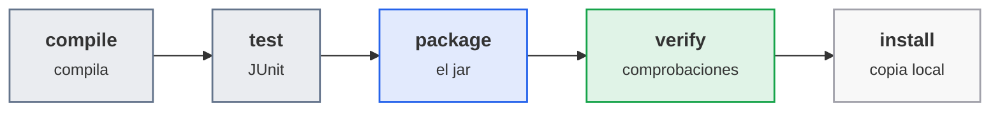

<p class="pie" markdown>Las fases de uso diario. `mvn package` ejecuta `compile` y `test` antes de empaquetar, así que un jar no se genera si una prueba falla.</p>

Las fases no hacen nada por sí solas: cada una tiene enganchados los *goals* de unos plugins. `compile` ejecuta el plugin del compilador, `test` el plugin `surefire` (que busca las clases cuyo nombre termina en `Test`, las ejecuta y escribe el informe en `target/surefire-reports/`) y `package` el plugin `jar`. Dos órdenes más completan lo básico: `mvn clean` borra `target/` para construir desde cero, y `-B` (modo por lotes) elimina los colores y las barras de progreso, que es como se lanza en un pipeline. Cuando alguna prueba falla, Maven termina con código de salida distinto de cero: es la señal con la que Jenkins sabe que la construcción ha fallado.

**Dependencias.** Cada `<dependency>` se descarga de Maven Central y se guarda en la caché local `~/.m2`, por lo que la primera construcción tarda y las siguientes no. El `scope` dice cuándo hace falta: `compile` (por defecto, siempre), `test` (solo para las pruebas, como JUnit, y no viaja en el jar), `provided` (la aporta el entorno) y `runtime`. Una dependencia arrastra las suyas (dependencias transitivas), y `mvn dependency:tree` las muestra. Este dato importa para la seguridad: cada biblioteca que entra en el árbol es código ajeno que forma parte de la aplicación, y una vulnerabilidad en una dependencia transitiva afecta igual. Por eso `pps-app` no usa más dependencias de ejecución que el propio JDK. El 8 de abril, el pipeline pasa a analizar ese árbol con OWASP Dependency-Check.

**Pruebas.** Una prueba unitaria es un método que llama a una parte del código y comprueba con `assertEquals` que devuelve lo esperado. JUnit 5 es la biblioteca estándar y marca cada método con `@Test`. Un pipeline que compila pero no prueba solo comprueba que el código está bien escrito, no que funciona. La opción `-DskipTests` omite las pruebas: en un pipeline solo se admite en una etapa de construcción si otra etapa las ejecuta después, nunca como forma de que pase.

### Maven frente a Gradle

Gradle resuelve el mismo problema con otro enfoque. El proyecto se describe en un script (`build.gradle`, en Groovy o Kotlin) y no en XML, y el resultado de cada tarea se guarda en caché para no repetir trabajo que no ha cambiado.

| | Maven | Gradle |
|---|---|---|
| Fichero de proyecto | `pom.xml`, declarativo | `build.gradle(.kts)`, un script |
| Ciclo | Fases fijas | Grafo de tareas, ampliable |
| Velocidad | Suficiente en proyectos pequeños | Más rápido con construcciones incrementales y en proyectos grandes |
| Uso típico | Java empresarial, servicios | Android y proyectos grandes con varios módulos |

El criterio habitual para este curso es Maven, porque su fichero declarativo se audita de un vistazo (basta leer qué dependencias y plugins lleva), su estructura es la misma en todos los proyectos y las herramientas del pipeline (Jenkins, el análisis de dependencias) lo integran con menos configuración. Gradle compensa cuando la velocidad de la construcción es un problema real. La sesión de margen del 22 de abril propone construir `pps-app` con Gradle como ampliación.

### A5.3 Construcción con Maven (sesión 39)

<span class="et et-obj">Objetivo</span> Escribir `pps-app` (un servidor HTTP con `/` y `/salud`, dos pruebas y su `pom.xml`), construirla y probarla con Maven y publicarla en GitHub. Es la tarea 1 del punto 3.1 de RA5.1 (CE c), hecha con `pps-app` en Java en lugar de la calculadora en Python del apunte porque es la aplicación de todas las hojas siguientes (la calculadora queda como Extra en la [A5.6](#a56-jenkins-con-docker-sesion-42)); la recoge la ACT_UT5_1, con plazo el 15 de abril.

<span class="et et-pre">Antes de empezar</span> `~/pps-app` clonado ([A5.1](#a51-el-pipeline-de-entrega-sesion-37)) y `java`, `mvn` y `git` en `pps01`. Teoría: [qué automatiza un sistema de construcción](#que-automatiza-un-sistema-de-construccion) y [Maven](#maven-ciclo-de-vida-dependencias-y-pruebas).

<span class="et et-pas">Ejercicios</span> Trabaja en `~/pps-app` y contesta en `~/pps-entregas/ut5/a53/README.md`, con la URL del repositorio.

1. **Programa y pruebas (3.1, tarea 1).** Crea la estructura estándar de Maven con estos tres ficheros, copiados tal cual y sin quitar las versiones de los plugins: `pom.xml` en la raíz, `App.java` en `src/main/java/es/pps/` y `AppTest.java` en `src/test/java/es/pps/`.

    === "pom.xml"

        ```xml
        <?xml version="1.0" encoding="UTF-8"?>
        <project xmlns="http://maven.apache.org/POM/4.0.0"
                 xmlns:xsi="http://www.w3.org/2001/XMLSchema-instance"
                 xsi:schemaLocation="http://maven.apache.org/POM/4.0.0 https://maven.apache.org/xsd/maven-4.0.0.xsd">
          <modelVersion>4.0.0</modelVersion>

          <groupId>es.pps</groupId>
          <artifactId>pps-app</artifactId>
          <version>1.0.0</version>
          <packaging>jar</packaging>

          <properties>
            <maven.compiler.release>17</maven.compiler.release>
            <project.build.sourceEncoding>UTF-8</project.build.sourceEncoding>
          </properties>

          <dependencies>
            <dependency>
              <groupId>org.junit.jupiter</groupId>
              <artifactId>junit-jupiter</artifactId>
              <version>5.11.4</version>
              <scope>test</scope>
            </dependency>
          </dependencies>

          <build>
            <finalName>pps-app</finalName>
            <plugins>
              <plugin>
                <groupId>org.apache.maven.plugins</groupId>
                <artifactId>maven-compiler-plugin</artifactId>
                <version>3.13.0</version>
              </plugin>
              <plugin>
                <groupId>org.apache.maven.plugins</groupId>
                <artifactId>maven-surefire-plugin</artifactId>
                <version>3.5.2</version>
              </plugin>
              <plugin>
                <groupId>org.apache.maven.plugins</groupId>
                <artifactId>maven-jar-plugin</artifactId>
                <version>3.4.2</version>
                <configuration>
                  <archive>
                    <manifest>
                      <mainClass>es.pps.App</mainClass>
                    </manifest>
                  </archive>
                </configuration>
              </plugin>
            </plugins>
          </build>
        </project>
        ```

    === "App.java"

        ```java
        package es.pps;

        import com.sun.net.httpserver.HttpExchange;
        import com.sun.net.httpserver.HttpServer;
        import java.io.IOException;
        import java.net.InetSocketAddress;
        import java.nio.charset.StandardCharsets;

        public class App {

            static final String SALUDO = "Hola PPS";
            static final String SALUD = "{\"estado\":\"ok\"}";

            static HttpServer crearServidor(int puerto) throws IOException {
                HttpServer servidor = HttpServer.create(new InetSocketAddress(puerto), 0);
                servidor.createContext("/salud", ex -> responder(ex, SALUD, "application/json"));
                servidor.createContext("/", ex -> responder(ex, SALUDO, "text/plain; charset=utf-8"));
                return servidor;
            }

            private static void responder(HttpExchange ex, String cuerpo, String tipo) throws IOException {
                byte[] datos = cuerpo.getBytes(StandardCharsets.UTF_8);
                ex.getResponseHeaders().set("Content-Type", tipo);
                ex.sendResponseHeaders(200, datos.length);
                try (var salida = ex.getResponseBody()) {
                    salida.write(datos);
                }
            }

            public static void main(String[] args) throws IOException {
                int puerto = args.length > 0 ? Integer.parseInt(args[0]) : 8080;
                crearServidor(puerto).start();
                System.out.println("pps-app escuchando en el puerto " + puerto);
            }
        }
        ```

    === "AppTest.java"

        ```java
        package es.pps;

        import static org.junit.jupiter.api.Assertions.assertEquals;

        import com.sun.net.httpserver.HttpServer;
        import java.net.URI;
        import java.net.http.HttpClient;
        import java.net.http.HttpRequest;
        import java.net.http.HttpResponse;
        import org.junit.jupiter.api.AfterEach;
        import org.junit.jupiter.api.BeforeEach;
        import org.junit.jupiter.api.Test;

        class AppTest {

            private HttpServer servidor;
            private String base;

            @BeforeEach
            void arrancar() throws Exception {
                servidor = App.crearServidor(0);
                servidor.start();
                base = "http://localhost:" + servidor.getAddress().getPort();
            }

            @AfterEach
            void parar() {
                servidor.stop(0);
            }

            private HttpResponse<String> get(String ruta) throws Exception {
                HttpRequest peticion = HttpRequest.newBuilder(URI.create(base + ruta)).build();
                return HttpClient.newHttpClient().send(peticion, HttpResponse.BodyHandlers.ofString());
            }

            @Test
            void laRaizSaluda() throws Exception {
                HttpResponse<String> r = get("/");
                assertEquals(200, r.statusCode());
                assertEquals("Hola PPS", r.body());
            }

            @Test
            void saludDevuelveJson() throws Exception {
                HttpResponse<String> r = get("/salud");
                assertEquals(200, r.statusCode());
                assertEquals("{\"estado\":\"ok\"}", r.body());
            }
        }
        ```

2. **Construcción y pruebas (3.1, tarea 1).** Construye desde cero con `mvn -B clean verify` y genera el informe de pruebas en HTML. Anota en qué fase corre cada plugin (`compiler`, `surefire`, `jar`) y cuántas pruebas pasan.
3. **Prueba rota.** Cambia el texto que espera una prueba, sin tocar la aplicación, y anota qué dice Maven y con qué código de salida termina. Deshaz el cambio.
4. **Ejecución (3.1, tarea 1).** Ejecuta el jar en el puerto 8083 (el 8080 puede seguir ocupado por el Apache de la unidad 3) y comprueba que responde en `/` y en `/salud`.
5. **Publicación (3.1, tarea 1).** Sube el proyecto a `main` de `pps-app` con un `.gitignore` que deje fuera `target/`.

!!! examen "Qué se evalúa: construcción"
    Qué automatiza una herramienta de construcción y en qué se distingue de Jenkins; las fases del ciclo de vida de Maven y que ejecutar una fase ejecuta las anteriores; el sentido del `scope` de una dependencia y por qué las dependencias transitivas importan para la seguridad; qué hace `surefire`; y cuándo se elegiría Gradle en lugar de Maven.

## Sesión 40 · Jenkins: instalación y primer trabajo

<p class="ut-meta" markdown>18 de marzo · Teoría y práctica · <span class="dur" tabindex="0" aria-label="Integración continua · 5 min&#10;Arquitectura de Jenkins · 10 min&#10;Instalación, plugins y credenciales · 5 min&#10;A5.4 Jenkins: primer trabajo · 90 min" data-dur="Integración continua · 5 min&#10;Arquitectura de Jenkins · 10 min&#10;Instalación, plugins y credenciales · 5 min&#10;A5.4 Jenkins: primer trabajo · 90 min">:material-school:<i class="dur-barra" style="--teoria:18%"></i>:material-flask:</span></p>

Al acabar esta sesión hay un servidor Jenkins funcionando en un contenedor de `pps01`, conectado al repositorio `pps-app` de GitHub con una credencial guardada en Jenkins, y un trabajo que descarga el código, lo compila y ejecuta sus pruebas cada vez que se pulsa "Construir ahora". Primero se ve para qué sirve la integración continua y cómo se reparte el trabajo dentro de Jenkins; después se instala y se configura lo mínimo.

!!! consulta "Recursos de la sesión"
    **Para la práctica**

    - [Instalar Jenkins con Docker](https://www.jenkins.io/doc/book/installing/docker/): la puesta en marcha.
    - [Ejemplos de Jenkins](https://github.com/pkaminasfp/jenkins): pipelines de referencia.
    - El enunciado de la entrega ACT_UT5_1 es el PDF «RA5.1 Jenkins» del aula. Su punto 3.1 remite a las tareas 1 y 2 del [apunte de Jenkins](https://psegarrac.github.io/Ciberseguridad-PePS/tema5/cd/ci/2022/01/13/jenkins.html#tareas).

### Integración continua

**Objetivo**: que cada cambio que entra en el repositorio se compile y se pruebe solo, en una máquina que no es la del autor, y que el resultado (verde o rojo) lo vea todo el equipo. **Herramienta**: un servidor de integración continua, en el curso Jenkins.

La integración continua (CI) es la práctica de fusionar los cambios de todo el equipo en un repositorio común muchas veces al día y validar cada fusión con una construcción automática y sus pruebas. Lo que se busca es detectar el fallo cuando cuesta poco arreglarlo: el cambio es reciente y la lista de sospechosos es un commit. Con CI, el repositorio tiene siempre una respuesta objetiva a "¿esto compila y pasa sus pruebas?" que no depende de la versión de Java ni de los paquetes de cada portátil.

Las tres siglas se distinguen por hasta dónde llega la automatización:

| Práctica | Qué automatiza | Quién decide el paso a producción |
|---|---|---|
| Integración continua | Construir y probar cada cambio | No llega a producción |
| Entrega continua (CD) | Lo anterior más dejar un artefacto listo para desplegar | Una persona, con un botón |
| Despliegue continuo | Lo anterior más desplegar en producción | Nadie: si las pruebas pasan, se despliega |

El pipeline de esta unidad llega hasta la entrega continua: construye, prueba y deja una imagen de contenedor, y el despliegue lo hacen otras herramientas. La regla de oro de un pipeline de integración es que **una etapa que falla detiene las siguientes**: si no compila, no se prueba; si las pruebas fallan, no se publica nada. Esa parada es también el primer control de seguridad del pipeline, porque una puerta que no se puede saltar es la base de cualquier control posterior, como el análisis de dependencias o la firma de artefactos.

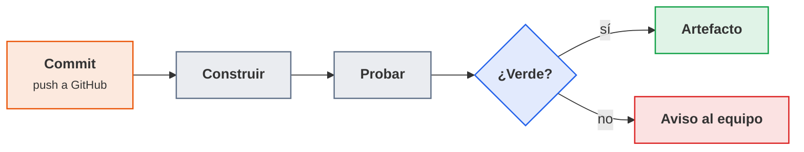

<p class="pie" markdown>El bucle de la integración continua: un commit dispara la construcción y las pruebas, y el resultado llega al equipo en minutos.</p>

### Arquitectura de Jenkins

**Objetivo**: saber qué es cada pieza que se va a ver en pantalla y dónde se ejecuta realmente el código de un trabajo, porque de eso dependen los privilegios y la seguridad del servidor. **Herramienta**: Jenkins, un servidor de automatización escrito en Java, de código abierto y con licencia MIT, que sirve por HTTP su propia interfaz web.

Jenkins se compone de cuatro elementos:

| Elemento | Qué es | Detalle que importa |
|---|---|---|
| Controlador (antes "maestro") | El proceso Jenkins: interfaz web, configuración, credenciales, planificación y registro de resultados | Guarda todo en el directorio `JENKINS_HOME` (en el contenedor, `/var/jenkins_home`, montado como volumen) |
| Agente (nodo) | Una máquina, VM o contenedor que ejecuta las construcciones y se conecta al controlador (por SSH o por el puerto `50000`) | Es quien ejecuta el código del repositorio, que no siempre es de confianza |
| Trabajo (job) | La definición de qué construir: de dónde se descarga el código, cuándo se lanza y qué comandos se ejecutan | Puede ser de estilo libre (formulario en la web) o pipeline (código) |
| Plugin | Una extensión que añade funciones: fuentes de código, pasos de pipeline, publicación de informes, Docker | Cada plugin es código que corre con los privilegios de Jenkins: se instala lo necesario y se mantiene actualizado |

Cada ejecución de un trabajo es una construcción (build) con número correlativo (`#1`, `#2`...), su registro de consola y sus artefactos. Desde el 5 de abril, cuando el pipeline pasa a [construir imágenes de Docker](#a56-jenkins-con-docker-sesion-42), ese número les sirve de etiqueta.

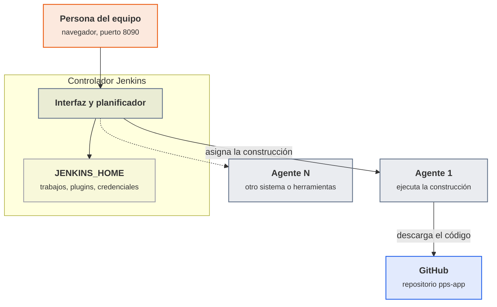

<p class="pie" markdown>El controlador planifica y guarda; los agentes construyen. En el laboratorio no hay agentes aparte y las construcciones corren en el propio controlador.</p>

**El criterio de producción es no construir en el controlador.** El controlador tiene las credenciales de todo el equipo y el acceso al disco donde viven; si una construcción ejecuta ahí código de un repositorio, quien controle ese código controla Jenkins. Por eso en producción el controlador se configura con cero ejecutores y las construcciones van a agentes desechables (una VM o un contenedor por construcción), sin credenciales fuera de las que el trabajo necesita. En el laboratorio del curso, con un solo servidor y un repositorio propio, se acepta que el controlador construya, y se recuerda en cada hoja donde ese atajo se nota. Los agentes tienen además una regla de dirección: el agente se conecta al controlador y ejecuta lo que este le manda, de modo que un agente comprometido nunca debe poder dar órdenes al controlador.

### Instalación, plugins y credenciales

**Objetivo**: dejar Jenkins funcionando de forma repetible y con los mínimos permisos. **Herramientas**: la imagen oficial `jenkins/jenkins` con la etiqueta `lts-jdk17` (versión de soporte largo, con el JDK 17 que usa la aplicación), un volumen de Docker para `JENKINS_HOME` y la propia interfaz para plugins y credenciales.

Las versiones LTS reciben las correcciones de seguridad y cambian poco: es la etiqueta indicada para un servidor que se quiere mantener. El patrón es el de la documentación oficial (puertos `8080` de interfaz y `50000` de agentes, y un volumen para `/var/jenkins_home`). La documentación ya ejemplifica con `lts-jdk21`; el laboratorio usa `lts-jdk17` porque coincide con el Java de la aplicación, y con `lts-jdk21` el resto de la hoja no cambia.

Tres decisiones de instalación tienen consecuencias de seguridad:

- **El volumen es el estado.** El contenedor se puede borrar y recrear (para actualizar la imagen, por ejemplo) sin perder trabajos, plugins ni credenciales, siempre que se monte el mismo volumen. Ese volumen es también lo que hay que copiar en la copia de seguridad.
- **La primera contraseña de administrador** la genera Jenkins en su primer arranque y la deja en el registro del contenedor y en `secrets/initialAdminPassword`. Sirve una sola vez, para crear el usuario administrador real; no se comparte ni se sube a ningún sitio.
- **Los plugins.** El asistente ofrece "instalar los sugeridos", que incluye lo necesario para esta unidad: Git (descargar código), Pipeline (escribir pipelines como código), Credentials y Credentials Binding (guardar secretos y entregarlos al trabajo), y JUnit (publicar el resultado de las pruebas). Se instala lo que se va a usar: cada plugin de más es superficie de ataque, y los avisos de seguridad de Jenkins se refieren casi siempre a plugins. Docker Pipeline se añade el 5 de abril, cuando el pipeline [pasa a usar Docker](#a56-jenkins-con-docker-sesion-42).

Para que Jenkins descargue un repositorio privado de GitHub, se le da una **credencial**, que se guarda en el almacén de Jenkins, se cifra en `JENKINS_HOME` y se identifica por un ID (aquí `github-token`). El trabajo la nombra por su ID y Jenkins la entrega al ejecutarlo, enmascarando su valor en el registro. La credencial nunca va escrita en el trabajo ni en el repositorio. Lo que se guarda es un token personal de GitHub con el mínimo permiso posible (lectura de contenido de un solo repositorio), no la contraseña de la cuenta: un token se revoca sin cambiar la contraseña, y si se filtra solo abre lo que se le concedió.

!!! ojo "Un Jenkins sin usuario es un servidor de ejecución remota"
    Un trabajo de Jenkins ejecuta comandos de shell. Quien pueda crear o editar trabajos puede ejecutar cualquier orden con el usuario `jenkins`, y ese usuario ve todas las credenciales del almacén. Un Jenkins con el acceso anónimo abierto o con la contraseña inicial sin cambiar se puede usar para atacar el propio servidor y todo lo que este alcance. En el laboratorio, `pps01` solo es alcanzable desde el propio equipo (NAT y red de solo anfitrión). En cualquier otro sitio, Jenkins va detrás de un proxy con HTTPS y con los permisos por rol.

### A5.4 Jenkins: primer trabajo (sesión 40)

<span class="et et-obj">Objetivo</span> Montar Jenkins en un contenedor de `pps01` (`http://192.168.56.10:8090`) con la credencial `github-token` y un trabajo `pps-app-build` que compila y prueba `pps-app`. Es la base de la tarea 2 del punto 3.1 de RA5.1: la ACT_UT5_1 (plazo, 15 de abril) no recoge este trabajo, sino el pipeline de la A5.5 que lo sustituye.

<span class="et et-pre">Antes de empezar</span> `pps01` con Docker y `pps-app` con sus pruebas en verde ([A5.3](#a53-construccion-con-maven-sesion-39)). Teoría: [integración continua](#integracion-continua), [arquitectura de Jenkins](#arquitectura-de-jenkins) y [instalación, plugins y credenciales](#instalacion-plugins-y-credenciales).

<span class="et et-pas">Ejercicios</span> Trabaja en `~/jenkins-lab` y deja lo hecho, con las capturas de las tres construcciones, en `~/pps-entregas/ut5/a54/README.md`.

1. **Imagen.** Construye `pps-jenkins:1`, que es `jenkins/jenkins:lts-jdk17` con Maven añadido, desde un `Dockerfile` en `~/jenkins-lab`.
2. **Contenedor.** Arranca el contenedor `jenkins` con esa imagen, el volumen `jenkins_home` en `/var/jenkins_home`, la interfaz en el 8090, el 50000 de los agentes y reinicio automático. Comprueba que Maven responde dentro.
3. **Primer arranque.** Desbloquea Jenkins, instala los plugins sugeridos y crea tu usuario administrador con una contraseña que no uses en otro sitio.
4. **Credencial de GitHub.** Crea un token de grano fino solo para `pps-app`, con *Contents: Read-only* y 30 días de caducidad, y guárdalo en Jenkins como *Username with password* con el usuario `pps<NIA>` y el ID `github-token`, exactamente ese, porque lo usan las hojas siguientes.
5. **Trabajo de estilo libre.** Crea `pps-app-build`, que descarga `main` de `pps-app` con `github-token`, ejecuta `mvn -B clean package` y publica los resultados de JUnit. La construcción `#1` termina en `SUCCESS`.
6. **Construcción roja.** Rompe un test con un commit (la `#2` sale roja) y deshazlo (la `#3` vuelve a verde). Captura las tres sin el token a la vista.

## Sesión 41 · Pipeline como código: Jenkinsfile

<p class="ut-meta" markdown>22 de marzo · Teoría y práctica · <span class="dur" tabindex="0" aria-label="Pipeline declarativo · 10 min&#10;El Jenkinsfile en el repositorio · 5 min&#10;A5.5 Jenkinsfile · 95 min" data-dur="Pipeline declarativo · 10 min&#10;El Jenkinsfile en el repositorio · 5 min&#10;A5.5 Jenkinsfile · 95 min">:material-school:<i class="dur-barra" style="--teoria:14%"></i>:material-flask:</span></p>

Al acabar esta sesión la definición del trabajo ya no vive en un formulario de Jenkins sino en un fichero `Jenkinsfile` de la raíz de `pps-app`, con las etapas de construcción, pruebas y publicación del informe, y Jenkins lo lanza solo cuando detecta un commit nuevo. Se ve primero la estructura de un pipeline declarativo y después por qué conviene que el fichero viaje con el código.

!!! consulta "Recursos de la sesión"
    **Para la práctica**

    - [Pipelines de Jenkins](https://www.jenkins.io/doc/book/pipeline/) y el [`Jenkinsfile`](https://www.jenkins.io/doc/book/pipeline/jenkinsfile/): el pipeline como código.

### Pipeline declarativo

**Objetivo**: describir en un fichero qué etapas tiene la construcción y qué hace cada una. **Herramienta**: la sintaxis declarativa de pipeline de Jenkins, un lenguaje basado en Groovy con una estructura fija.

Jenkins admite dos sintaxis. La *scripted* es Groovy libre y permite casi todo, incluidos errores difíciles de leer. La **declarativa** tiene una estructura cerrada que Jenkins valida antes de ejecutar, y es la que se usa en el curso: un fallo de sintaxis se detecta al empezar, no a mitad de la construcción. Un pipeline declarativo es un bloque `pipeline` con estas piezas:

| Pieza | Qué expresa | Ejemplo |
|---|---|---|
| `agent` | Dónde se ejecuta el pipeline o una etapa | `agent any` (cualquier nodo disponible) |
| `stages` y `stage` | Las etapas, en orden. Si una falla, las siguientes no se ejecutan | `stage('Pruebas')` |
| `steps` | Las órdenes de una etapa | `sh 'mvn -B test'` |
| `environment` | Variables disponibles en todo el pipeline o en una etapa | `APP = 'pps-app'` |
| `options` | Comportamiento general: tiempo máximo, número de construcciones que se conservan | `timeout(time: 10, unit: 'MINUTES')` |
| `triggers` | Qué lanza el pipeline sin pulsar el botón | `pollSCM('H/2 * * * *')` |
| `post` | Qué se hace al terminar según el resultado (`always`, `success`, `failure`) | `junit '...'` para publicar resultados aunque las pruebas fallen |

Un *step* es una sola operación (`sh` ejecuta una orden de shell, `echo` escribe en el registro, `junit` publica resultados de pruebas, `archiveArtifacts` guarda ficheros). Una *stage* agrupa steps con un nombre, y esos nombres son las columnas de la vista de etapas que Jenkins dibuja para cada construcción: verde si la etapa pasó, roja si falló y gris si no llegó a ejecutarse.

Las variables de `environment` se leen en los `sh` como variables de shell (`$APP`). Jenkins añade las suyas, entre ellas `BUILD_NUMBER` (el número de la construcción), `WORKSPACE` (la carpeta de trabajo) y `JOB_NAME`. Una precaución de Groovy que da problemas reales: una cadena entre comillas simples se pasa tal cual al shell, y una entre comillas dobles la interpola Groovy antes de ejecutar. Para valores públicos da igual; para un secreto, la interpolación de Groovy deja el valor en el registro de la construcción y en el historial, y por eso los secretos se usan siempre en comillas simples y con el mecanismo de credenciales. Ese mecanismo, `withCredentials`, se ve el 8 de abril, en la sesión de [pipeline seguro](#a57-pipeline-seguro-sesion-43).

```groovy
pipeline {
    agent any
    environment { APP = 'pps-app' }
    stages {
        stage('Construir') {
            steps { sh 'mvn -B -DskipTests clean package' }
        }
        stage('Pruebas') {
            steps { sh 'mvn -B test' }
            post { always { junit 'target/surefire-reports/*.xml' } }
        }
    }
}
```

### El Jenkinsfile en el repositorio

**Objetivo**: que la forma de construir una aplicación se versione, se revise y se recupere igual que el código de la aplicación. **Herramienta**: el trabajo de tipo *Pipeline* con la opción *Pipeline script from SCM*, que le dice a Jenkins de qué repositorio y qué fichero leer.

Un pipeline escrito en el formulario web de Jenkins solo existe en Jenkins: si el servidor se pierde, se pierde con él, y nadie ve quién lo cambió ni por qué. Con el `Jenkinsfile` en la raíz del repositorio ocurre lo contrario, y cada ventaja es también una propiedad de seguridad:

- **Trazabilidad**: el historial de Git dice quién cambió el pipeline, cuándo y con qué mensaje.
- **Revisión**: un cambio en el pipeline entra por un pull request con la revisión obligatoria de la [A5.2](#a52-git-en-equipo-sesion-38), como cualquier otro cambio. Sin esa revisión, quien pueda subir código puede cambiar lo que Jenkins ejecuta y con qué credenciales.
- **Recuperación**: si se reinstala Jenkins, basta con apuntar un trabajo nuevo al repositorio.
- **Coherencia**: cada rama y cada commit llevan el pipeline que les corresponde.

Jenkins hace primero la descarga del repositorio y después lee el fichero, de modo que la etapa de descarga no se escribe: en el pipeline desde SCM es implícita. Tampoco hace falta que el cambio se lance a mano. En el laboratorio, el disparador es el sondeo del repositorio (`pollSCM`): Jenkins pregunta a GitHub cada cierto tiempo si hay commits nuevos. La alternativa habitual en producción es el *webhook*, en que GitHub avisa a Jenkins en el mismo instante del push; exige que GitHub alcance el servidor de Jenkins, y la dirección `192.168.56.10` de `pps01` no es accesible desde Internet. Ese es el motivo del sondeo, y por eso no se abre el laboratorio a la red para conseguirlo.

### A5.5 Jenkinsfile (sesión 41)

<span class="et et-obj">Objetivo</span> Llevar el pipeline a un `Jenkinsfile` en la raíz de `pps-app`, que el trabajo `pps-app-pipeline` lanza en cada commit, y romper cada etapa para ver cómo lo muestra Jenkins. Es la tarea 2 del punto 3.1 de RA5.1, con una etapa `Construir` que el apunte no lleva porque `pps-app` es Java; la recoge la ACT_UT5_1, con plazo el 15 de abril.

<span class="et et-pre">Antes de empezar</span> Jenkins con `github-token` ([A5.4](#a54-jenkins-primer-trabajo-sesion-40)) y el jar `target/pps-app.jar` de la [A5.3](#a53-construccion-con-maven-sesion-39). Teoría: [pipeline declarativo](#pipeline-declarativo) y [el Jenkinsfile en el repositorio](#el-jenkinsfile-en-el-repositorio).

<span class="et et-pas">Ejercicios</span> Trabaja en `~/pps-app` y contesta en `~/pps-entregas/ut5/a55/README.md`; la captura en verde y la explicación del ejercicio 5 van también al README de `pps-app`.

1. **Jenkinsfile (3.1, tarea 2).** Escribe un `Jenkinsfile` con las etapas `Construir`, `Pruebas` e `Informe` (que archiva el jar y los `.txt` de las pruebas), un tiempo máximo de 10 minutos, sondeo del repositorio cada dos minutos y un `post` con un mensaje distinto según el resultado.
2. **Trabajo (3.1, tarea 2).** Crea `pps-app-pipeline`, de tipo *Pipeline script from SCM* sobre `main` con `github-token`, y lánzalo a mano hasta ver las tres etapas en verde, el jar y los resultados de las pruebas.
3. **Disparo por commit (3.1, tarea 2).** Sube un cambio sin tocar Jenkins y mide cuánto tarda en aparecer una construcción *Started by an SCM change*.
4. **Etapas rotas (3.1, tarea 2).** Rompe cada etapa de una en una, con un commit por prueba: un error de compilación, un test que falla y, en `Informe`, un fichero que no existe (que sea el único de `artifacts`, o los `.txt` harán que pase). Captura cada vista de etapas y deshaz el cambio antes del siguiente.
5. **Explicación (3.1, tarea 2).** Explica qué etapas quedan en gris en cada caso y por qué, y cuánto tardó el disparador.

## Sesión 42 · Docker en el pipeline

<p class="ut-meta" markdown>5 de abril · Teoría y práctica · <span class="dur" tabindex="0" aria-label="Imágenes y contenedores · 5 min&#10;Dockerfile y compose de pps-app · 10 min&#10;Jenkins y Docker · 10 min&#10;A5.6 Jenkins con Docker · 85 min" data-dur="Imágenes y contenedores · 5 min&#10;Dockerfile y compose de pps-app · 10 min&#10;Jenkins y Docker · 10 min&#10;A5.6 Jenkins con Docker · 85 min">:material-school:<i class="dur-barra" style="--teoria:23%"></i>:material-flask:</span></p>

Al acabar esta sesión `pps-app` tiene un `Dockerfile` y un `compose.yml`, y un segundo pipeline, `jenkinsfile.docker`, compila dentro de un contenedor, construye la imagen `pps<NIA>/pps-app:<número de construcción>`, la ejecuta, le pasa las pruebas y levanta el `compose`. Se repasa lo justo de imágenes y contenedores, se escribe el `Dockerfile` y el `compose` de la aplicación y se ve cómo un Jenkins que corre en un contenedor puede manejar Docker, con el riesgo que eso supone.

!!! consulta "Recursos de la sesión"
    **Para la práctica**

    - [Docker en el pipeline](https://www.jenkins.io/doc/book/pipeline/docker/), [referencia del Dockerfile](https://docs.docker.com/reference/dockerfile/) y [Docker Compose](https://docs.docker.com/compose/).

### Imágenes y contenedores

**Objetivo**: distinguir qué se construye y qué se ejecuta, porque el pipeline produce lo primero y despliega lo segundo. **Herramienta**: Docker, ya conocido; aquí solo interesan los conceptos que cambian una decisión de seguridad.

| Concepto | Qué es | Consecuencia en un pipeline |
|---|---|---|
| Imagen | Plantilla de solo lectura, hecha de capas: sistema base, dependencias, aplicación | Es el artefacto que se construye una vez y se despliega igual en todos los entornos |
| Etiqueta (tag) | Nombre de versión de una imagen, como `pps-app:12` | Una etiqueta se puede mover: `latest` apunta a otra imagen mañana. El pipeline etiqueta con el número de construcción (`pps<NIA>/pps-app:12`) para saber qué código lleva cada imagen |
| Contenedor | Una imagen en ejecución: un proceso aislado con su sistema de ficheros y su red | Es desechable: se para y se sustituye, no se arregla dentro |
| Registro | Servidor de imágenes (Docker Hub) | Publicar en él es la última etapa del pipeline |
| Volumen | Almacenamiento que sobrevive al contenedor | Lo que no está en un volumen se pierde al recrear el contenedor |

Una imagen no debe llevar secretos: cada instrucción del `Dockerfile` crea una capa, y una contraseña copiada y borrada en una capa posterior sigue estando en la anterior. Tampoco debe ejecutarse como `root` si no hace falta: si un fallo de la aplicación permite ejecutar órdenes, las ejecuta con el usuario del contenedor. Estos dos criterios (sin secretos, sin `root`) son los que revisa la [auditoría de Docker de la UT2](ut2-nivel-seguridad.md#a24-docker-aislamiento-y-auditoria-sesion-12) y los que se aplican a la imagen de `pps-app`.

### Dockerfile y compose de pps-app

**Objetivo**: empaquetar el `jar` en una imagen pequeña y arrancarla con una orden. **Herramientas**: el `Dockerfile` describe cómo se construye la imagen, y Docker Compose describe cómo se ejecuta uno o varios contenedores.

El `Dockerfile` de `pps-app` parte de una imagen con solo el entorno de ejecución de Java (no el JDK completo: la aplicación no compila nada al arrancar), crea un usuario sin privilegios y copia el `jar` que ya construyó Maven:

```dockerfile
FROM eclipse-temurin:17-jre
RUN useradd --system --uid 10001 app
WORKDIR /app
COPY target/pps-app.jar app.jar
USER app
EXPOSE 8080
ENTRYPOINT ["java", "-jar", "app.jar"]
```

`FROM` fija la base, `COPY` mete el `jar`, `USER` baja los privilegios antes de arrancar, `EXPOSE` documenta el puerto y `ENTRYPOINT` es el proceso del contenedor. El `compose.yml` describe la ejecución. Las dos variables, `IMAGEN` y `TAG`, las pone el pipeline: así el fichero del repositorio no lleva el usuario de nadie y sirve a todo el grupo:

```yaml
name: pps-app
services:
  app:
    image: ${IMAGEN:-pps-app}:${TAG:-latest}
    ports:
      - "8092:8080"
    restart: unless-stopped
```

El servicio `app` publica el `8080` del contenedor en el `8092` de la VM. `restart: unless-stopped` hace que Docker lo levante de nuevo si el proceso muere o si se reinicia la máquina. La [simulación de fallos](#a517-reaccion-a-fallos-sesion-54) del 17 de mayo pone a prueba esa política.

### Jenkins y Docker

**Objetivo**: que las etapas del pipeline se ejecuten en contenedores limpios y desechables y que Jenkins pueda construir imágenes. **Herramientas**: el plugin *Docker Pipeline* (añade `agent { docker { ... } }`) y la CLI de Docker dentro de la imagen de Jenkins.

Hay dos usos distintos de Docker en un pipeline, y conviene no mezclarlos:

| Uso | Sintaxis | Qué aporta |
|---|---|---|
| **La etapa corre dentro de un contenedor** | `agent { docker { image 'maven:3.9-eclipse-temurin-17' } }` (o `agent { dockerfile true }`, que construye el entorno desde un `Dockerfile` del repositorio) | Entorno limpio y con las versiones fijadas, sin instalar Maven ni Java en el servidor |
| **La etapa maneja Docker** | `sh 'docker build ...'`, `sh 'docker run ...'`, `sh 'docker compose up'` | Construir y ejecutar imágenes, que es el producto del pipeline |

Ambos necesitan que Jenkins pueda hablar con un demonio de Docker. Si Jenkins es un contenedor, se le da el acceso montando el socket del demonio del anfitrión (`/var/run/docker.sock`) y la CLI de Docker en la imagen.

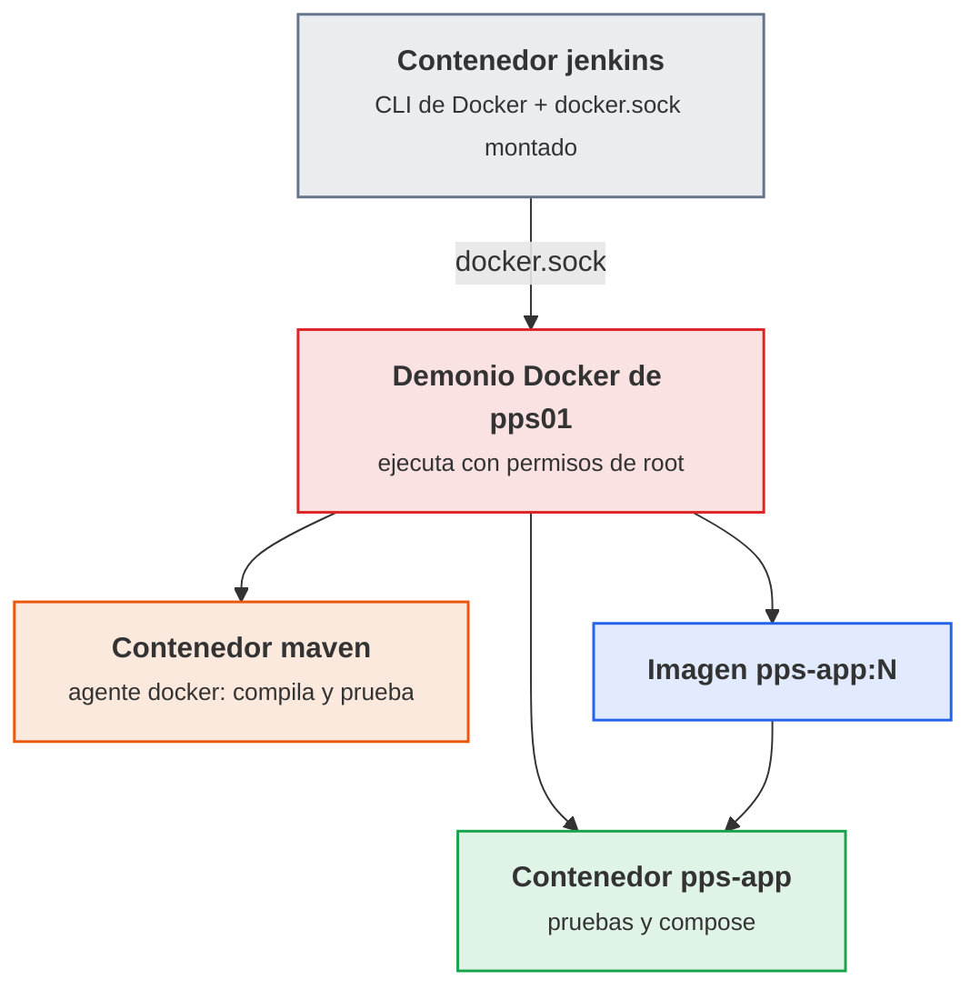

<p class="pie" markdown>Con el socket montado, los contenedores que crea Jenkins no son hijos suyos sino hermanos, creados por el demonio del anfitrión.</p>

!!! ojo "Montar docker.sock equivale a dar root sobre el servidor"
    Quien puede hablar con el demonio puede pedirle un contenedor que monte el disco entero de la máquina (`docker run -v /:/host ...`) y leer o cambiar cualquier fichero como `root`. Un pipeline con `docker.sock` puede, por tanto, hacer lo mismo, y con él cualquiera que pueda editar el `Jenkinsfile`. En el laboratorio se acepta, porque `pps01` es una VM del propio alumno, sin datos ni credenciales ajenas. En producción no: las alternativas son un demonio de Docker aislado en el agente (Docker en Docker con TLS, que es lo que documenta Jenkins), agentes desechables que ejecutan las construcciones en su propia máquina, o herramientas que construyen imágenes sin demonio y sin `root` (Kaniko, Buildah). Además, el `Jenkinsfile` que se ejecuta con ese acceso tiene que pasar por la revisión obligatoria de la [A5.2](#a52-git-en-equipo-sesion-38).

Un detalle práctico del agente Docker: la carpeta de trabajo de la construcción (el *workspace*) se monta dentro del contenedor, así que lo que se compila dentro está en el workspace y sobrevive al contenedor. Lo que no está en el workspace, como la caché de Maven en `/root/.m2`, se pierde con él; en la hoja se guarda dentro del workspace para no descargar las dependencias en cada construcción. Entre etapas con agentes distintos se pasan ficheros con `stash` y `unstash`.

### A5.6 Jenkins con Docker (sesión 42)

<span class="et et-obj">Objetivo</span> Añadir a `pps-app` su `Dockerfile` y su `compose.yml`, y un pipeline `jenkinsfile.docker` que compila dentro de Docker, construye la imagen `pps<NIA>/pps-app:<construcción>`, la prueba en un contenedor y levanta el compose. Es el punto 3.2 de RA5.1; lo recoge la ACT_UT5_1, con plazo el 15 de abril.

<span class="et et-pre">Antes de empezar</span> Jenkins de la [A5.5](#a55-jenkinsfile-sesion-41) y el puerto 8092 de `pps01` libre. Teoría: [imágenes y contenedores](#imagenes-y-contenedores), [Dockerfile y compose de pps-app](#dockerfile-y-compose-de-pps-app) y [Jenkins y Docker](#jenkins-y-docker).

<span class="et et-pas">Ejercicios</span> Trabaja en `~/pps-app` y `~/jenkins-lab`, y contesta en `~/pps-entregas/ut5/a56/README.md`: qué hace cada etapa en una línea y qué implica montar `docker.sock`. El README de `pps-app` lleva la captura de cada pipeline en verde y una breve explicación.

1. **Dockerfile y compose (3.2).** Añade a `pps-app` el `Dockerfile` y el `compose.yml` de la teoría, tal cual, y comprueba a mano que la imagen responde en `/` y en `/salud` publicada en el 8092. Súbelos.
2. **Jenkins con Docker.** Construye `pps-jenkins:2`: la imagen de la A5.4 más `docker-ce-cli` y `docker-compose-plugin`, del repositorio oficial de Docker para Debian.
3. **Acceso al demonio.** Recrea `jenkins` con `pps-jenkins:2`, el mismo `jenkins_home`, el socket de Docker de `pps01` montado y el grupo propietario del socket añadido, hasta que `docker version` dentro muestre cliente y servidor. Instala el plugin *Docker Pipeline*.
4. **jenkinsfile.docker (3.2).** Escríbelo con `agent none`, `IMAGEN = 'pps<NIA>/pps-app'`, `PRUEBA = 'pps-app-prueba'` y una etapa por elemento del enunciado: `Construir en Docker` (agente `maven:3.9-eclipse-temurin-17`, con `stash` del jar), `Crear imagen` (`$IMAGEN:$BUILD_NUMBER`), `Ejecutar contenedor` (`$PRUEBA`), `Pruebas en el contenedor` y `Docker Compose` (`/salud` del servicio `app`). Dentro de Jenkins, `localhost` es Jenkins: las pruebas se lanzan desde un contenedor `curlimages/curl` en la red del contenedor probado.
5. **Pipeline en verde (3.2).** Crea el trabajo `pps-app-docker`, que lee `jenkinsfile.docker` (*Script Path*), y lánzalo hasta tener las cinco etapas en verde, la imagen etiquetada con el número de construcción y el compose respondiendo en el 8092.
6. **Extra (opcional).** Rompe la etapa de pruebas y captura qué etapas quedan en rojo y en gris; o haz también el punto 3.1 con la calculadora en Python del apunte, en un repositorio `calculadora` con `unittest` y un `Jenkinsfile` sobre un agente `python:3.12-slim`.

!!! examen "Qué se evalúa de este bloque"
    - Diferencia entre integración, entrega y despliegue continuos, y por qué una etapa que falla detiene las siguientes.
    - Piezas de Jenkins (controlador, agente, trabajo, plugin) y por qué en producción el controlador no construye.
    - Credenciales: dónde se guardan, cómo se nombran por ID y por qué nunca van en el `Jenkinsfile` ni en el repositorio; token con el mínimo permiso frente a contraseña de la cuenta.
    - Ventajas de seguridad del `Jenkinsfile` en el repositorio (trazabilidad, revisión, recuperación) y disparo por sondeo frente a webhook.
    - Riesgo de montar `docker.sock` en Jenkins, y alternativas (Docker en Docker con TLS, agentes desechables, construcción sin demonio).
    - Imágenes: etiqueta por número de construcción frente a `latest`, usuario sin privilegios y ningún secreto en las capas.

## Sesión 43 · Pipeline seguro: componentes y secretos

<p class="ut-meta" markdown>8 de abril · Teoría y práctica · <span class="dur" tabindex="0" aria-label="Análisis de dependencias con OWASP Dependency-Check · 10 min&#10;Secretos en el pipeline y firma de artefactos · 10 min&#10;A5.7 Pipeline seguro · 90 min" data-dur="Análisis de dependencias con OWASP Dependency-Check · 10 min&#10;Secretos en el pipeline y firma de artefactos · 10 min&#10;A5.7 Pipeline seguro · 90 min">:material-school:<i class="dur-barra" style="--teoria:18%"></i>:material-flask:</span></p>

Al terminar la sesión el pipeline de `pps-app` tiene una etapa que analiza sus dependencias y se rompe si encuentra una vulnerabilidad crítica, las credenciales viven en Jenkins y no en el repositorio, y el jar publicado lleva una suma de verificación que se comprueba antes de usarlo. La aplicación no se toca: lo que se añade son controles de seguridad al pipeline de Jenkins que ya construye, prueba y empaqueta `pps-app` en una imagen.

!!! consulta "Recursos de la sesión"
    **Para la práctica**

    - [OWASP Dependency-Check](https://owasp.org/www-project-dependency-check/) ([imagen](https://hub.docker.com/r/owasp/dependency-check)): análisis de dependencias.
    - [Credenciales en Jenkins](https://www.jenkins.io/doc/book/using/using-credentials/): los secretos del pipeline.

### Análisis de dependencias con OWASP Dependency-Check

El objetivo de este apartado es saber qué vulnerabilidades conocidas trae el software que la aplicación no ha escrito, y hacerlo en cada construcción y no una vez al año. La herramienta es OWASP Dependency-Check, que compara las librerías del proyecto con la base de vulnerabilidades públicas.

Una aplicación Java pequeña arrastra decenas de librerías: las que declara en el `pom.xml` y las que estas traen a su vez (dependencias transitivas). El código propio puede ser impecable y el jar seguir siendo vulnerable por una librería antigua; el caso de Log4Shell (una librería de registro presente en miles de aplicaciones sin que sus equipos lo supieran) es el ejemplo de manual. Esta práctica se llama análisis de composición del software (SCA): conocer el inventario de componentes y cruzarlo con las vulnerabilidades publicadas.

Dependency-Check hace ese cruce en tres pasos: identifica cada librería (nombre y versión, por su huella y sus metadatos), la busca en la base de la NVD (la Base de Datos Nacional de Vulnerabilidades de EE. UU., donde cada fallo tiene un identificador CVE) y genera un informe con cada hallazgo y su puntuación CVSS, la escala de 0 a 10 de gravedad. Por convenio, 9,0 o más es crítica, de 7,0 a 8,9 alta, de 4,0 a 6,9 media y por debajo baja.

| Pieza | Qué es | Detalle que importa |
|---|---|---|
| CLI de Dependency-Check | La herramienta que analiza carpetas o ficheros | En el curso se usa la imagen `owasp/dependency-check`, sin instalar nada en Jenkins |
| Base de la NVD | Las vulnerabilidades conocidas, descargadas en local | La primera descarga es lenta y se guarda en un volumen para reutilizarla |
| Clave de la API de la NVD | Identifica al usuario ante la NVD | Sin ella la descarga es muy lenta y falla con errores 403 o 429 si muchos equipos piden a la vez |
| `--failOnCVSS 9` | Umbral de fallo | El comando termina con error si hay un hallazgo de 9,0 o más: es lo que rompe el pipeline |
| Informe (`dependency-check-report.html`) | El resultado legible | Se archiva en Jenkins como cualquier otro artefacto |
| Fichero de supresiones | Lista de falsos positivos aceptados | Cada supresión lleva motivo y fecha; suprimir sin explicar es esconder el problema |

Dos matices evitan errores de criterio. Primero, un hallazgo no es una explotación demostrada: la herramienta puede equivocarse al identificar una librería (falso positivo) o marcar una función que la aplicación nunca llama. Por eso el pipeline falla solo con las críticas y las demás se revisan en el informe. Segundo, la herramienta solo conoce vulnerabilidades ya publicadas: una librería sin hallazgos no está demostrada como segura, solo no tiene fallos conocidos.

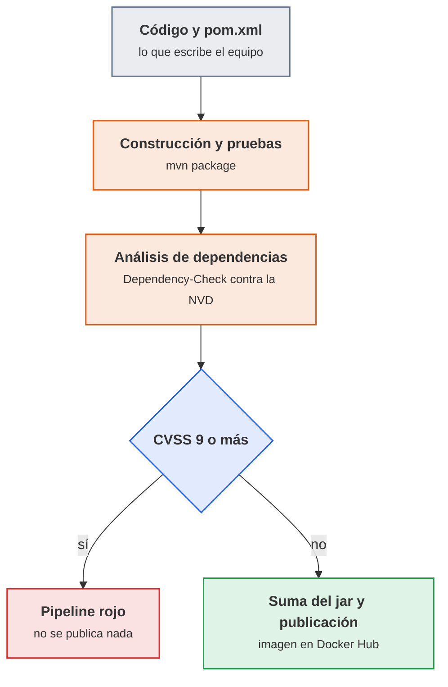

<p class="pie" markdown>El análisis va después de construir y antes de publicar: un artefacto con una crítica conocida no debe llegar al registro.</p>

!!! empresa "Cómo se hace en producción"
    El análisis puntual se complementa con un inventario permanente (una SBOM en formato CycloneDX) subido a una plataforma como Dependency-Track, que avisa cuando aparece una vulnerabilidad nueva en un componente ya desplegado. El pipeline solo ve el momento de la construcción; el inventario vigila lo que ya está en producción.

### Secretos en el pipeline y firma de artefactos

El objetivo es que ninguna clave, contraseña o token viaje en el código ni en los registros, y que quien recibe un artefacto pueda comprobar que es el que salió del pipeline. Las herramientas son el almacén de credenciales de Jenkins y las sumas de verificación y firmas.

Un secreto en un repositorio Git es un secreto publicado: el historial lo conserva aunque se borre en el commit siguiente, y basta un `git clone` para leerlo. Los sitios donde se cuelan en un pipeline son siempre los mismos: el `Jenkinsfile` (una contraseña escrita en un `sh`), las variables de entorno impresas por un `echo` o por `env`, las URL con usuario y contraseña incrustados y los ficheros `.env` subidos por descuido.

Jenkins guarda los secretos en su almacén de credenciales, cifrados, y el pipeline los pide por su identificador (`credentialsId`) sin conocer nunca el valor. Los tipos que se usan en esta unidad son tres:

| Tipo de credencial | Contiene | Ejemplo en el laboratorio |
|---|---|---|
| Secret text | Un único texto secreto | Token de GitHub (`github-token`), clave de la API de la NVD (`nvd-api-key`) |
| Username with password | Usuario y contraseña o token | Docker Hub (`dockerhub`) |
| Secret file | Un fichero entero | Un kubeconfig o una clave privada |

Al usar una credencial con `withCredentials`, Jenkins enmascara su valor en el registro de la construcción y lo sustituye por asteriscos. Ese enmascarado es una red de seguridad, no una garantía: un valor transformado (codificado en base64, cortado en trozos) ya no coincide y aparece en claro. La regla es que el secreto no se imprima, no se pase como argumento visible con comillas dobles de Groovy (que lo interpolan antes de ejecutar) y no se guarde en un fichero del espacio de trabajo. En un `sh` con comillas simples es el intérprete de la terminal quien lee la variable de entorno, y el valor nunca pasa por Groovy.

Otros controles que completan lo anterior, y que caen en el examen: los privilegios de Jenkins (un usuario que crea pipelines ejecuta código en el controlador, luego los permisos se reparten por rol y no se da administrador a todos), los agentes (el código de un pipeline debe ejecutarse en un agente y no en el controlador, que es quien guarda todas las credenciales) y el acceso al demonio de Docker (montar `docker.sock` equivale a dar `root`).

#### Integridad y firma del artefacto

Una suma de verificación (`sha256sum`) es una huella del fichero: si cambia un solo bit, la suma cambia. Sirve para saber que el jar que se despliega es el que se construyó. Pero una suma guardada junto al fichero no autentica a nadie: quien puede sustituir el jar puede sustituir también la suma. Por eso la suma solo protege de corrupciones y cambios accidentales, salvo que se guarde en un sitio que el atacante no controla.

La firma resuelve lo que la suma no puede. Se firma con una clave privada (que solo tiene el pipeline) y cualquiera verifica con la clave pública que el artefacto lo produjo quien tiene esa clave privada y no se ha alterado.

| Mecanismo | Qué garantiza | Qué no garantiza |
|---|---|---|
| Suma SHA-256 | Que el fichero no ha cambiado desde que se calculó la suma | Quién lo produjo, ni que la suma no se haya cambiado a la vez |
| Firma GPG (firma separada `.sig`) | Origen y contenido, mientras la clave privada esté protegida | Que el código firmado sea seguro, solo que viene de quien firma |
| Firma de imágenes (Cosign, Docker Content Trust) | Lo mismo, para imágenes de contenedor | Igual: firmar no es auditar |

En el laboratorio se calcula y se verifica la suma en el pipeline (etapa de integridad) y la firma con GPG se deja como ampliación. En una empresa la firma de imágenes y la de los artefactos de terceros es cada vez más habitual, porque el ataque a la cadena de suministro (un componente o una construcción comprometidos) es una de las vías de entrada más graves de los últimos años.

!!! examen "Qué se evalúa"
    Qué es el análisis de composición del software y qué encuentra Dependency-Check; qué mide CVSS y qué umbral rompe el pipeline; dónde se guardan las credenciales de Jenkins y por qué no van en el `Jenkinsfile`; qué límite tiene el enmascarado en el registro; diferencia entre suma de verificación y firma; por qué montar `docker.sock` equivale a dar `root`; por qué el controlador de Jenkins no debe ejecutar el código de los pipelines.

### A5.7 Pipeline seguro (sesión 43)

<span class="et et-obj">Objetivo</span> Añadir al `Jenkinsfile` de `pps-app` el análisis de dependencias con OWASP Dependency-Check, que rompe el pipeline con un CVSS de 9 o más, y la suma SHA-256 del jar, con todas las credenciales en Jenkins. No es un punto de RA5.1: va en el capítulo «Extra» de la ACT_UT5_1 (plazo, 15 de abril), y el proyecto integrador lo exige.

<span class="et et-pre">Antes de empezar</span> Jenkins con `github-token` y acceso a Docker ([A5.6](#a56-jenkins-con-docker-sesion-42)) y una clave de la API de la NVD, que se pide en <https://nvd.nist.gov/developers/request-an-api-key> y conviene tener antes de clase. Teoría: [análisis de dependencias](#analisis-de-dependencias-con-owasp-dependency-check) y [secretos y firma de artefactos](#secretos-en-el-pipeline-y-firma-de-artefactos).

<span class="et et-pas">Ejercicios</span> Trabaja en `~/pps-app` y contesta en `~/pps-entregas/ut5/a57/README.md`, sin ningún valor secreto en ficheros ni capturas.

1. **Credenciales.** Guarda en Jenkins `nvd-api-key` (*Secret text*) y `dockerhub` (*Username with password*, con `pps<NIA>` y un token de Docker Hub de lectura y escritura, nunca la contraseña). `dockerhub` la usa el proyecto integrador, el 24 de mayo.
2. **Base de la NVD.** Lanza en `pps01` la primera descarga de la base al volumen `dc-data` con la imagen `owasp/dependency-check` y `--updateonly`, sin que la clave quede en el historial de la shell. Sigue con lo demás mientras termina.
3. **Sin secretos.** Comprueba que ni los ficheros ni el historial de `pps-app` contienen un token (`github_pat_`, `ghp_`, `dckr_pat_`). El que aparezca pasa a una credencial y se revoca.
4. **Etapa de análisis.** Añade a `pom.xml` `log4j-core` y `log4j-api` de `org.apache.logging.log4j` en la versión `2.14.1`, y al `Jenkinsfile`, tras las pruebas, esta etapa:

    ```groovy
    stage('Análisis de dependencias') {
        steps {
            sh 'mvn -B -q dependency:copy-dependencies -DoutputDirectory=target/dependency'
            withCredentials([string(credentialsId: 'nvd-api-key', variable: 'NVD_KEY')]) {
                sh '''
                    docker run --rm --volumes-from jenkins \
                      -v dc-data:/usr/share/dependency-check/data \
                      owasp/dependency-check \
                      --scan "$WORKSPACE/target/dependency" --scan "$WORKSPACE/target/pps-app.jar" \
                      --project pps-app --format HTML --format JSON \
                      --out "$WORKSPACE/dc-report" \
                      --failOnCVSS 9 --nvdApiKey "$NVD_KEY"
                '''
            }
        }
        post {
            always { archiveArtifacts artifacts: 'dc-report/**', allowEmptyArchive: true }
        }
    }
    ```

5. **Fallo y corrección.** Lanza la construcción, que cae en `Análisis de dependencias`. Anota el CVE, el CVSS y la librería del hallazgo más grave y comprueba que el registro enmascara la clave. Corrige la causa (versión `2.17.1`, o quitarlas), no el umbral.
6. **Integridad.** Añade la etapa `Integridad del artefacto`, que calcula la suma del jar en `target/pps-app.jar.sha256`, la verifica y archiva los dos con `fingerprint`. La última construcción queda entera en verde.

!!! truco "Un umbral es una política"
    El 9 de `--failOnCVSS` se decide con el equipo y queda escrito en el `Jenkinsfile`, que se revisa como cualquier otro código. Bajarlo para que el pipeline pase es la trampa habitual: la solución correcta es actualizar la librería, o suprimir el hallazgo por escrito y con motivo si de verdad no aplica. La clave de la NVD, por su parte, va como argumento de `docker run` y se ve en la lista de procesos del anfitrión; es admisible porque es una clave gratuita y revocable, pero una credencial de más valor no se pasaría así.

## Sesión 44 · Infraestructura como código: Terraform

<p class="ut-meta" markdown>12 de abril · Teoría y práctica · <span class="dur" tabindex="0" aria-label="Infraestructura como código · 10 min&#10;Terraform: proveedores, recursos, estado y ciclo de trabajo · 15 min&#10;A5.8 Terraform: primera máquina · 85 min" data-dur="Infraestructura como código · 10 min&#10;Terraform: proveedores, recursos, estado y ciclo de trabajo · 15 min&#10;A5.8 Terraform: primera máquina · 85 min">:material-school:<i class="dur-barra" style="--teoria:23%"></i>:material-flask:</span></p>

Al terminar la sesión existe una máquina virtual Ubuntu 24.04 en VirtualBox que nadie ha creado con el ratón: la ha creado Terraform a partir de un fichero de texto, y un segundo `plan` confirma que no hay nada que cambiar. Antes de escribir el fichero se ve qué gana un equipo al describir su infraestructura como código y qué piezas tiene Terraform. La máquina resultante, `destino01`, es la que Ansible configura a partir del 19 de abril.

!!! consulta "Recursos de la sesión"
    **Para la práctica**

    - [Documentación de Terraform](https://developer.hashicorp.com/terraform/docs): el lenguaje y los comandos.
    - [Proveedor de VirtualBox para Terraform](https://registry.terraform.io/providers/terra-farm/virtualbox/latest): el que provisiona la máquina; es comunitario.
    - El enunciado de la entrega ACT_UT5_2 es el PDF «RA5.2 IaC: Infrastructure as Code» del aula.

    **Para ampliar** (opcional)

    - El aula tiene material complementario de Terraform (tutoriales de infraestructura como código).

### Infraestructura como código

El objetivo es entender qué problema resuelve describir servidores, redes y discos en ficheros. La herramienta que se usa para ello es Terraform; su compañera Ansible configura lo que hay dentro de las máquinas.

Crear una máquina con el ratón funciona una vez y falla la segunda: nadie recuerda qué casillas se marcaron, dos entornos que debían ser iguales acaban distintos y, si se pierde el servidor, no hay receta para rehacerlo. La infraestructura como código (IaC) sustituye el ratón por ficheros de texto que una herramienta aplica. Al ser texto, van a Git y heredan todo lo que ya se sabe hacer con el código: historial, revisión en un pull request, vuelta atrás y ejecución automática desde un pipeline.

El punto de partida de todas las herramientas de IaC es el enfoque declarativo: el fichero describe el estado final que se quiere ("una máquina con 2 CPU y 1,5 GB de memoria") y la herramienta calcula qué hacer para llegar a él. Frente a un script que lista pasos, lo declarativo tiene una propiedad decisiva: es idempotente. Aplicarlo dos veces produce el mismo resultado que aplicarlo una, porque la segunda vez la herramienta compara lo deseado con lo que existe y no encuentra diferencias.

| Herramienta | Qué hace |
|---|---|
| Terraform (y OpenTofu) | Crea y modifica la infraestructura: máquinas, redes, discos, DNS |
| Ansible | Configura el interior de las máquinas: paquetes, ficheros, servicios |
| Jenkins | Ejecuta las dos anteriores desde un pipeline |

La división de trabajo es la habitual del sector: Terraform aprovisiona (deja la máquina creada y con red) y Ansible configura (la deja útil). Confundirlos lleva a scripts enormes que hacen mal las dos cosas. La seguridad gana tres cosas concretas: el estado deseado es auditable en el historial de Git, un entorno comprometido se destruye y se recrea en minutos desde un origen conocido (infraestructura inmutable: no se arregla un servidor, se sustituye), y los cambios pasan por revisión antes de aplicarse.

### Terraform: proveedores, recursos, estado y ciclo de trabajo

Este apartado presenta las piezas de un proyecto Terraform y el ciclo `init`, `plan`, `apply`, que es el que se repite en cada cambio. Se escribe en HCL, el lenguaje de configuración de la herramienta, en ficheros con extensión `.tf`.

| Pieza | Qué es | Ejemplo en esta sesión |
|---|---|---|
| Proveedor (`provider`) | El complemento que sabe hablar con una plataforma concreta | `terra-farm/virtualbox`, que maneja VirtualBox con `VBoxManage` |
| Recurso (`resource`) | Un objeto que Terraform crea y mantiene | `virtualbox_vm`, la máquina virtual |
| Bloque `terraform` | Fija la versión de Terraform y de cada proveedor | `required_providers` con la versión exacta |
| Estado (`terraform.tfstate`) | Fichero donde Terraform anota qué ha creado y con qué valores | Se genera solo tras el primer `apply` |
| Fichero de bloqueo (`.terraform.lock.hcl`) | Versión y huellas de los proveedores descargados | Se sube a Git; el directorio `.terraform/` no |

El estado es la pieza que más se subestima. Terraform no consulta a la plataforma qué existe: compara el código con el estado que él mismo guardó y con la respuesta de la plataforma. Sin estado, no sabe que ya creó la máquina y la crearía otra vez. Además el estado guarda los valores completos de cada recurso, incluidas contraseñas y claves si algún recurso las maneja: por eso no se sube a Git y se trata como un secreto. Dónde guardarlo y cómo protegerlo se ve el 15 de abril.

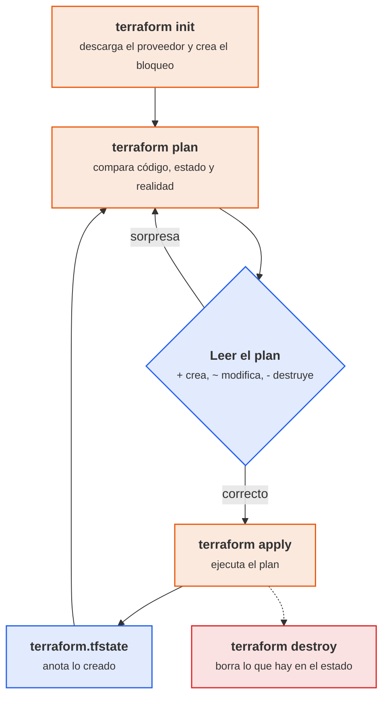

<p class="pie" markdown>El plan se lee siempre antes de aplicar: `+` crea, `~` modifica en sitio y `-/+` destruye y vuelve a crear, que es lo que hay que detectar a tiempo.</p>

Un proyecto mínimo para este laboratorio, que es el que copia la hoja, tiene este aspecto. El proveedor se fija a una versión exacta porque solo hay publicadas dos versiones y una es la de una versión anterior (ver el aviso siguiente); la imagen es una caja de Vagrant, un formato de imagen de VirtualBox ya preparado con Ubuntu 24.04 y las Guest Additions (los controladores que permiten a VirtualBox informar de la IP de la máquina):

```hcl
terraform {
  required_providers {
    virtualbox = {
      source  = "terra-farm/virtualbox"
      version = "0.2.2-alpha.1"
    }
  }
}

resource "virtualbox_vm" "destino01" {
  name   = "destino01"
  image  = "https://vagrantcloud.com/bento/boxes/ubuntu-24.04/versions/202510.26.0/providers/virtualbox/amd64/vagrant.box"
  cpus   = 1
  memory = "1536 mib"

  network_adapter {
    type = "nat"
  }
  network_adapter {
    type           = "hostonly"
    host_interface = "vboxnet0"
  }
}
```

!!! ojo "El proveedor de VirtualBox es comunitario y está en alfa"
    `terra-farm/virtualbox` no lo mantiene HashiCorp ni Oracle. Su última versión publicada es la `0.2.2-alpha.1` de septiembre de 2021 y su repositorio recibe pocos cambios (sobre todo actualizaciones automáticas de dependencias), aunque hay informes de 2025 de uso con VirtualBox 7.1 y Ubuntu 24.04. Funciona, pero conviene tratarlo como una herramienta de laboratorio y no de producción: se fija la versión exacta (existen `0.2.1-alpha.1` y `0.2.2-alpha.1`; una `0.2.1` sin sufijo no existe y `init` falla), no se actualiza a la ligera y su nombre de proveedor no se cambia por otro sin probarlo. En una empresa, las mismas ideas se usan con proveedores mantenidos (Proxmox, vSphere, nubes públicas). Los fallos típicos están en [Errores frecuentes](#errores-frecuentes-en-el-laboratorio).

!!! ojo "Terraform necesita `VBoxManage` en la misma máquina"
    El proveedor no habla con una API: ejecuta `VBoxManage` en el equipo donde se lanza `terraform`. Ese equipo tiene que ser el que tiene VirtualBox, el anfitrión del aula, y no `pps01`, que es una máquina virtual (crear máquinas dentro de otra exigiría virtualización anidada y más memoria de la que hay). Por eso en esta sesión `terraform` se ejecuta en el anfitrión, y `pps01` se reserva para Jenkins y para Ansible, que llegan a `destino01` por la red solo anfitrión.

!!! consulta "Terraform, OpenTofu y la licencia"
    Terraform se publicó durante años con licencia de código abierto (MPL). En agosto de 2023 HashiCorp cambió a la Business Source License (BSL), que permite uso propio pero restringe ofrecer productos que compitan con los de la empresa. Como respuesta, la comunidad bifurcó la última versión abierta y creó OpenTofu, hoy alojado en la Linux Foundation. Los ficheros `.tf`, el lenguaje y los proveedores son compatibles: donde este material escribe `terraform plan`, en OpenTofu se escribe `tofu plan`. Para el alumnado no cambia nada práctico (la actividad pide Terraform y aquí se usa Terraform), pero en una empresa conviene saber cuál de las dos está en uso y qué licencia acepta. Información y comparativa en <https://opentofu.org/> y <https://opentofu.org/faq/>; el proveedor de VirtualBox también se descarga con OpenTofu desde `registry.opentofu.org`.

### A5.8 Terraform: primera máquina (sesión 44)

<span class="et et-obj">Objetivo</span> Crear con Terraform y el proveedor de VirtualBox la máquina `destino01` (Ubuntu 24.04, 1 CPU, 1,5 GB, NAT y solo anfitrión) y dejar el proyecto en Git sin el estado. Es el punto 3.1 de RA5.2; lo recoge la ACT_UT5_2, con plazo el 3 de mayo, y la máquina se conserva para las hojas siguientes.

<span class="et et-pre">Antes de empezar</span> El anfitrión del aula (o tu portátil) con VirtualBox 7.x e Internet; no se trabaja en `pps01`. Teoría: [infraestructura como código](#infraestructura-como-codigo) y [Terraform](#terraform-proveedores-recursos-estado-y-ciclo-de-trabajo).

<span class="et et-pas">Ejercicios</span> Trabaja en `~/pps-iac` del anfitrión y contesta en `~/pps-entregas/ut5/a58/README.md`.

1. **Terraform y VirtualBox.** Instala Terraform en el anfitrión y comprueba que responden `terraform` y `VBoxManage` (7.x).
2. **Dirección fija.** Deja el DHCP de `vboxnet0` (`192.168.56.0/24`) repartiendo una sola dirección, la `192.168.56.20`, para que `destino01` la reciba siempre.
3. **Proyecto (3.1).** Crea el repositorio Git `~/pps-iac` con `terraform/main.tf` copiado de la teoría y un `.gitignore` que deje fuera `.terraform/`, `*.tfstate`, `*.tfstate.*`, `plan.bin` y `crash.log` desde antes del primer commit.
4. **Provisión (3.1).** Inicializa, valida, guarda el plan en `plan.bin`, léelo y aplica exactamente ese plan. Captura el `apply` terminado: es la captura de la provisión del README de `pps-iac`.
5. **Validación (3.1).** Entra por SSH en `192.168.56.20` (usuario `vagrant`, contraseña `vagrant`) y comprueba que es Ubuntu 24.04 con salida a Internet; si la segunda interfaz no tiene IP, pídela desde la consola con `dhclient`. Un segundo `plan` dice que no hay cambios.
6. **Repositorio en GitHub.** Publica `pps-iac` en un repositorio de tu cuenta, el que se entrega en la ACT_UT5_2, con `terraform/.terraform.lock.hcl` y sin `.terraform/` ni el estado.

## Sesión 45 · Terraform: variables, estado y secretos

<p class="ut-meta" markdown>15 de abril · Teoría y práctica · <span class="dur" tabindex="0" aria-label="Variables, salidas y módulos · 5 min&#10;El estado y los secretos · 10 min&#10;A5.9 Terraform: variables y estado · 95 min" data-dur="Variables, salidas y módulos · 5 min&#10;El estado y los secretos · 10 min&#10;A5.9 Terraform: variables y estado · 95 min">:material-school:<i class="dur-barra" style="--teoria:14%"></i>:material-flask:</span></p>

Al terminar la sesión el proyecto Terraform que creó `destino01` no lleva valores escritos a mano en el código, deja como salida la IP de la máquina para que Ansible la use, y el repositorio está protegido para que ni el estado ni los ficheros de valores lleguen a Git. Hoy vence además, a las 23:59, la entrega ACT_UT5_1, que recoge las A5.1 a A5.7. El enunciado de la siguiente, ACT_UT5_2, no pide lo que se hace hoy: cuenta en ella como «Extra» del punto 3.1, y es la forma correcta de dejar un proyecto Terraform que se va a compartir.

!!! consulta "Recursos de la sesión"
    **Para la práctica**

    - Documentación de Terraform: [variables](https://developer.hashicorp.com/terraform/language/values/variables), [salidas](https://developer.hashicorp.com/terraform/language/values/outputs), [módulos](https://developer.hashicorp.com/terraform/language/modules), [datos sensibles en el estado](https://developer.hashicorp.com/terraform/language/state/sensitive-data) y [dónde se guarda el estado](https://developer.hashicorp.com/terraform/language/backend).

### Variables, salidas y módulos

El objetivo es que el mismo código sirva para más de un entorno cambiando solo valores, y que lo que Terraform sabe (la IP de una máquina) pueda usarlo la herramienta siguiente. Las piezas son las variables de entrada, las salidas y los módulos.

| Pieza | Qué hace | Ejemplo |
|---|---|---|
| Variable de entrada (`variable`) | Un valor que se pasa desde fuera, con tipo, descripción y valor por defecto opcional | `var.vm_memory_mib` |
| Valor de la variable | Se da en `terraform.tfvars`, con `-var`, o con una variable de entorno `TF_VAR_nombre` | `vm_memory_mib = 1536` |
| Salida (`output`) | Un valor que Terraform muestra al terminar y que otro programa puede leer | La IP de `destino01` |
| Módulo | Una carpeta de `.tf` reutilizable, llamada con `module` y sus propios parámetros | Un módulo `vm` que crea cualquier máquina |

Una variable declara su tipo, una descripción y, si se quiere, una validación que rechaza valores absurdos antes de tocar nada. Lo importante para la seguridad es dónde se guardan los valores: el `terraform.tfvars` real se trata como configuración local y no se sube a Git; al repositorio va un `terraform.tfvars.example` con valores de ejemplo. Un secreto se pasa por entorno (`TF_VAR_...`) o desde un gestor de secretos, nunca escrito en el código.

Una salida marcada como `sensitive = true` no se imprime en la terminal (aparece como `<sensitive>`), y lo mismo vale para una variable. Es una protección contra el descuido de ver o copiar un valor, no contra quien tenga acceso al estado, como se ve a continuación. Los módulos se usan cuando la misma estructura se repite (tres máquinas iguales, pruebas y producción); en el laboratorio bastan las variables y los módulos quedan como ampliación de la hoja.

### El estado y los secretos

El estado (`terraform.tfstate`) es un fichero JSON con todos los atributos de cada recurso creado, tal como los devolvió la plataforma. Eso incluye cualquier valor secreto que un recurso reciba o genere: contraseñas iniciales, claves privadas, tokens. `sensitive = true` lo oculta en la terminal, pero en el fichero está en texto claro. Tres consecuencias prácticas:

- El estado nunca se sube a Git (`.gitignore` con `*.tfstate` y `*.tfstate.*` antes del primer commit). Un estado subido por error se considera un secreto filtrado: se rotan las credenciales que contuviera, no basta con borrarlo del repositorio.
- Los ficheros de valores con secretos tampoco (`*.tfvars`), y los secretos se prefieren inyectados por entorno.
- El estado se guarda en un lugar con control de acceso, cifrado y copia, no en el portátil de quien ejecuta `terraform`.

Por defecto el estado es local (backend `local`), que es lo que se usa en el laboratorio. En equipo se usa un backend remoto: un almacén compartido (un bucket S3, MinIO, un servidor HTTP, Terraform Cloud) que guarda el estado en un solo sitio.

| Aspecto | Backend local | Backend remoto |
|---|---|---|
| Dónde está | Fichero en el disco de quien ejecuta | Almacén compartido con control de acceso |
| Trabajo en equipo | Cada uno tendría un estado distinto: se pisan | Estado único y compartido |
| Bloqueo | No hay: dos `apply` a la vez pueden corromperlo | Bloquea mientras alguien aplica (según el backend) |
| Secretos | En texto claro en el disco del portátil | Cifrado en reposo y acceso por roles |
| Recuperación | Si se pierde el fichero, Terraform olvida lo que creó | El almacén tiene versiones y copias |

Un principio de fondo acompaña a todo lo anterior: mínimo privilegio. Quien puede leer el estado puede leer los secretos que contiene, así que el acceso al backend se da a las personas y a los pipelines que lo necesitan y a nadie más. Y el fichero de bloqueo de proveedores (`.terraform.lock.hcl`) sí se sube: fija las versiones y las huellas de los proveedores descargados, de modo que otro equipo o el pipeline descarguen exactamente los mismos binarios y no una versión sustituida.

!!! examen "Qué se evalúa"
    Qué gana un equipo con la infraestructura como código y qué significa declarativo e idempotente; el ciclo `init`, `plan`, `apply`, `destroy` y qué señala cada símbolo del plan; qué guarda el fichero de estado, por qué contiene secretos aunque la variable sea `sensitive` y por qué no va a Git; para qué sirve un backend remoto (estado compartido, bloqueo, cifrado y control de acceso); cómo se pasan los secretos a Terraform (entorno o gestor, no código); qué es un módulo; diferencia entre Terraform y OpenTofu; y qué reparto de trabajo hay entre Terraform (crea) y Ansible (configura).

### A5.9 Terraform: variables y estado (sesión 45)

<span class="et et-obj">Objetivo</span> Parametrizar `pps-iac` con variables, sacar la IP de `destino01` como salida, ver que el estado guarda en claro un secreto `sensitive` y proteger el repositorio. No es un punto de RA5.2: es el «Extra» del punto 3.1 de la ACT_UT5_2, con plazo el 3 de mayo.

<span class="et et-pre">Antes de empezar</span> `destino01` y `~/pps-iac/terraform` de la [A5.8](#a58-terraform-primera-maquina-sesion-44), con `plan` sin cambios. Teoría: [variables, salidas y módulos](#variables-salidas-y-modulos) y [el estado y los secretos](#el-estado-y-los-secretos).

<span class="et et-pas">Ejercicios</span> Trabaja en `~/pps-iac` del anfitrión y contesta en `~/pps-entregas/ut5/a59/README.md`, sin el valor de la contraseña en ninguna captura.

1. **Variables.** Saca a `variables.tf` `vm_name`, `vm_cpus`, `vm_memory_mib`, `box_url` y `host_interface`, con tipo y descripción y los valores de la A5.8 por defecto; `box_url` va en `terraform.tfvars`, con copia en `terraform.tfvars.example`. `vm_memory_mib` rechaza menos de 1024 MiB con un mensaje tuyo.
2. **Sin cambios.** Comprueba que el `plan` tras el cambio dice `No changes` y que uno con `vm_memory_mib=512` falla con tu mensaje.
3. **Salida.** Declara en `outputs.tf` la salida `ip_destino01` y comprueba que da `192.168.56.20`.
4. **Secreto en el estado.** Genera con `hashicorp/random` la contraseña `random_password.acceso` (16 caracteres sin especiales), sácala en la salida `clave_acceso` marcada `sensitive` y búscala en `terraform.tfstate`. Explica qué pasaría si ese estado se subiera.
5. **Repositorio protegido.** Amplía el `.gitignore` para que deje fuera los `*.tfvars` salvo el `.example`, comprueba qué ignora Git y que la contraseña no está en nada de lo que subes, y súbelo.
6. **Estado en equipo.** En cinco líneas: dónde guardarías el estado en un equipo de cinco personas (backend, quién lo lee, cifrado y bloqueo) y por qué.

## Sesión 46 · Ansible: inventario y playbooks

<p class="ut-meta" markdown>19 de abril · Teoría y práctica · <span class="dur" tabindex="0" aria-label="Gestión de la configuración · 10 min&#10;Ansible: inventario, módulos y playbooks · 15 min&#10;A5.10 Ansible: primer playbook · 85 min" data-dur="Gestión de la configuración · 10 min&#10;Ansible: inventario, módulos y playbooks · 15 min&#10;A5.10 Ansible: primer playbook · 85 min">:material-school:<i class="dur-barra" style="--teoria:23%"></i>:material-flask:</span></p>

Terraform ya crea la máquina `destino01`, pero la deja vacía. Al acabar esta sesión esa máquina tiene el sistema actualizado y Apache instalado y en marcha, y todo ello se ha conseguido desde `pps01` con un playbook de Ansible que se puede ejecutar dos veces sin que la segunda cambie nada. Primero se ve qué problema resuelve la gestión de la configuración, después las cuatro piezas de Ansible (inventario, módulos, playbook e idempotencia) y por último la hoja A5.10.

!!! consulta "Recursos de la sesión"
    **Para la práctica**

    - [Documentación de Ansible](https://docs.ansible.com/): inventario, módulos, playbooks e idempotencia.

### Gestión de la configuración

El objetivo de este apartado es entender por qué no basta con crear máquinas: alguien tiene que dejarlas en un estado conocido, y hacerlo a mano no escala ni se puede auditar. La herramienta que se usa para ello en el curso es Ansible.

Una máquina recién creada por Terraform solo tiene el sistema base. Instalar paquetes, copiar ficheros de configuración, crear usuarios y arrancar servicios es la **gestión de la configuración**. Hacerlo a mano por SSH tiene tres problemas conocidos: dos máquinas que deberían ser iguales acaban distintas (deriva de configuración), nadie sabe qué se tocó y cuándo, y reconstruir un servidor tras un fallo depende de la memoria de quien lo montó. Una herramienta de gestión de la configuración sustituye esa secuencia de órdenes por un fichero versionado que describe el estado deseado. Para el despliegue seguro importa además que ese fichero es revisable: un cambio en Apache pasa por un pull request como cualquier otro cambio de código.

| Herramienta | Modelo | Qué necesita en la máquina gestionada |
|---|---|---|
| **Ansible** | Empuja la configuración desde el equipo de control, en YAML | Solo SSH y Python (sin agente) |
| Puppet, Chef | Un agente en cada máquina consulta a un servidor central | Agente instalado y servidor central |

El criterio habitual para un laboratorio pequeño o un equipo que empieza es Ansible, porque no exige instalar nada en los destinos ni mantener un servidor central. Puppet y Chef compensan cuando hay miles de nodos que deben corregirse solos de forma continua, que no es el caso del curso.

Terraform y Ansible no compiten, se reparten el trabajo: Terraform aprovisiona (crea la máquina y su red), Ansible configura (la deja útil). El límite es difuso, y por eso se fija una regla práctica: lo que existe fuera del sistema operativo lo crea Terraform, lo que existe dentro lo configura Ansible.

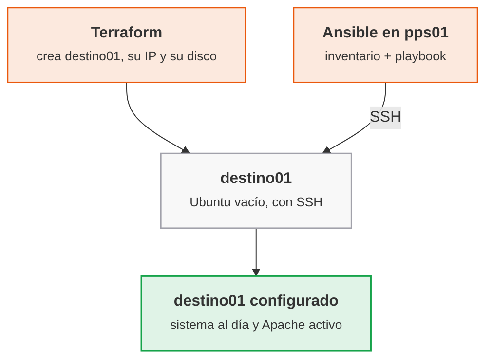

<p class="pie" markdown>Reparto de tareas: `terraform apply` produce la máquina y `ansible-playbook` la configura; el único punto de contacto es la IP y el acceso SSH.</p>

### Ansible: inventario, módulos y playbooks

Este apartado presenta las cuatro piezas que se escriben en la hoja: el inventario dice a qué máquinas se llega, los módulos hacen el trabajo, el playbook ordena las tareas y la idempotencia es la propiedad que hace seguro repetirlas. La herramienta se instala en `pps01`, el equipo de control, con `sudo apt install -y ansible`.

**Inventario.** Es la lista de máquinas gestionadas, con el usuario y la clave con que se entra. El formato INI es el más corto:

```ini
[web]
destino01 ansible_host=192.168.56.20 ansible_user=vagrant
```

`[web]` es un grupo: un playbook se dirige a un grupo, no a una máquina concreta, y por eso el mismo playbook sirve mañana para tres servidores web. El usuario es `vagrant`, el de la imagen con que Terraform creó la máquina en la A5.8. Un fichero `ansible.cfg` en la carpeta del proyecto fija el inventario por defecto para no repetir `-i` en cada orden.

**Módulos.** Cada tarea llama a un módulo, un programa pequeño que Ansible copia a la máquina, ejecuta y borra. Los cuatro que se usan en las dos hojas de Ansible:

| Módulo | Qué garantiza | Ejemplo |
|---|---|---|
| `ansible.builtin.apt` | Un paquete instalado o actualizado, o la caché al día | `name: apache2`, `state: present` |
| `ansible.builtin.service` | Un servicio arrancado y activado en el arranque | `name: apache2`, `state: started` |
| `ansible.builtin.copy` y `template` | Un fichero con un contenido concreto en un destino | `dest: /var/www/html/index.html` |
| `ansible.builtin.uri` | Una respuesta HTTP esperada (comprobación) | `url: http://192.168.56.20` |

**Playbook.** Es un fichero YAML con una lista de tareas para un grupo de máquinas. Las tareas se ejecutan en orden y cada una lleva un nombre legible, que es lo que se ve en la salida. La orden `become: true` hace que las tareas se ejecuten con `sudo`, necesario para instalar paquetes.

**Idempotencia.** Un módulo no ejecuta una acción a ciegas: compara el estado pedido con el real y solo actúa si difieren. La salida lo dice con tres palabras por tarea: `ok` (ya estaba como se pedía), `changed` (se ha modificado algo) y `failed`. La primera ejecución de un playbook sobre una máquina virgen dará muchos `changed`; la segunda tiene que dar `changed=0`. Esa es la prueba de que el playbook describe un estado y no una receta de pasos, y es lo que se captura como evidencia.

!!! ojo "Los módulos `command` y `shell` no son idempotentes"
    Ejecutan siempre la orden y marcan `changed` siempre. Solo se usan cuando no existe un módulo específico, y con `creates:` o `changed_when:` para que informen del cambio real. Un playbook lleno de `shell: apt install ...` funciona una vez y falla la prueba de idempotencia.

Dos opciones ahorran tiempo en clase: `--check` simula el playbook sin cambiar nada y `--diff` muestra qué líneas de un fichero cambiarían.

!!! examen "Qué se evalúa en Ansible"
    Diferencia entre aprovisionar (Terraform) y configurar (Ansible), qué es un inventario y un playbook, por qué Ansible no necesita agente y qué significa que un playbook sea idempotente (la segunda ejecución da `changed=0`). Se pide reconocer un módulo no idempotente y decir por qué.

### A5.10 Ansible: primer playbook (sesión 46)

<span class="et et-obj">Objetivo</span> Configurar `destino01` desde `pps01` con Ansible (actualización del sistema y Apache) y demostrar que el playbook es idempotente. Es el punto 3.2 de RA5.2; lo recoge la ACT_UT5_2, con plazo el 3 de mayo.

<span class="et et-pre">Antes de empezar</span> `pps01` y `destino01` (`192.168.56.20`, usuario y contraseña `vagrant`) encendidas, y `pps-iac` de la [A5.8](#a58-terraform-primera-maquina-sesion-44) en GitHub. Teoría: [gestión de la configuración](#gestion-de-la-configuracion) y [Ansible](#ansible-inventario-modulos-y-playbooks).

<span class="et et-pas">Ejercicios</span> Trabaja en `~/pps-iac/ansible/` de `pps01` y contesta en `~/pps-entregas/ut5/a510/README.md`.

1. **Acceso por SSH.** Instala Ansible en `pps01` y deja que entre en `destino01` como `vagrant` con clave, sin contraseña.
2. **Inventario (3.2).** Clona `pps-iac` en `pps01` y crea en `ansible/` el `inventario.ini` de la teoría, con `destino01` en el grupo `web`, y un `ansible.cfg` que lo use por defecto (con `host_key_checking = False`, solo en el laboratorio, por las VM clonadas). El grupo `web` responde `pong`.
3. **Update, upgrade y Apache (3.2).** Escribe `site.yml` para `web`, con `become`, que actualice la caché y el sistema, instale Apache y lo deje arrancado y activado. Captura el `PLAY RECAP`: es la captura de la configuración del README de `pps-iac`.
4. **Validación e idempotencia (3.2).** Comprueba que Apache responde en `http://192.168.56.20` y ejecuta el playbook otra vez hasta `changed=0`. Explica qué demuestra y sube `ansible/` a `pps-iac`.
5. **Extra (opcional).** Simula el playbook con `--check --diff`, lee los hechos de la máquina con el módulo `setup` e instala `curl` y `unzip` con una sola tarea.

## Sesión 47 · Margen y repaso de la primera parte de la unidad 5

<p class="ut-meta" markdown>22 de abril · Margen · <span class="dur" tabindex="0" aria-label="Repaso y recuperación · 110 min" data-dur="Repaso y recuperación · 110 min">:material-school:<i class="dur-barra" style="--teoria:0%"></i>:material-flask:</span></p>

Esta sesión no trae contenido nuevo ni hoja propia. Cierra la primera mitad de la unidad, la que va de DevOps a Ansible, y sirve para recuperar lo que se haya perdido o para afianzar lo que ya funciona antes de entrar en K3s y en la monitorización. Conviene llegar con `pps01` y `destino01` disponibles, porque la mayor parte de lo que se repasa se ejecuta en ellas.

!!! consulta "Recursos de la sesión"
    No hay material nuevo: se repasan Jenkins, Terraform y Ansible; para ampliar, la documentación de [Nginx](https://nginx.org/en/docs/) y de [Gradle](https://docs.gradle.org/).

### Si se ha perdido alguna clase

Se recupera en este orden, porque cada hoja usa lo que dejó la anterior. Lo que ya está hecho se salta.

- Sesiones 37 a 39 (DevOps, Git en equipo y Maven): las hojas [A5.1](#a51-el-pipeline-de-entrega-sesion-37), [A5.2](#a52-git-en-equipo-sesion-38) y [A5.3](#a53-construccion-con-maven-sesion-39). La A5.3 deja el repositorio `pps-app` que usan las siguientes, así que es la primera prioridad.
- Sesiones 40 a 43 (Jenkins): [A5.4](#a54-jenkins-primer-trabajo-sesion-40), [A5.5](#a55-jenkinsfile-sesion-41), [A5.6](#a56-jenkins-con-docker-sesion-42) y [A5.7](#a57-pipeline-seguro-sesion-43). Las recoge la entrega ACT_UT5_1, cuyo plazo ya venció el jueves 15 de abril: entregada fuera de plazo y sin causa justificada, se corrige sobre el 50 %.
- Sesiones 44 y 45 (Terraform): [A5.8](#a58-terraform-primera-maquina-sesion-44) y [A5.9](#a59-terraform-variables-y-estado-sesion-45). Sin `destino01` no se puede hacer Ansible.
- Sesiones 46 y 48 (Ansible): [A5.10](#a510-ansible-primer-playbook-sesion-46) y [A5.11](#a511-ansible-despliegue-sesion-48). La A5.11 se hace en su fecha; la A5.10 sí se puede recuperar hoy. Las dos las recoge ACT_UT5_2, con plazo el lunes 3 de mayo.

### Si no se ha perdido ninguna

La reserva tiene dos partes: primero el repaso, que sostiene las entregas, y después la ampliación, que es opcional.

- **Jenkins.** Vuelve a arrancar el pipeline de `pps-app` desde cero: haz un cambio mínimo en el código, empuja y comprueba que la construcción, las pruebas y el análisis de dependencias salen sin tocar nada a mano. Si algo falla, el fallo es la lección.
- **Terraform.** Destruir `destino01` con `terraform destroy`, volver a crearla con `terraform apply` y comprobar que la IP de salida es la misma (la máquina nueva no tiene la clave SSH del alumno: hay que repetir `ssh-copy-id`). Comprobar que `.gitignore` deja fuera el estado y las variables con secretos.
- **Ansible.** Con `destino01` recién creada, ejecuta el playbook de la A5.10: una máquina nueva queda configurada sin entrar en ella por SSH. El proyecto integrador de finales de mayo se apoya en este mismo ciclo.
- **Ampliación con Nginx.** Cambia el servidor web del playbook de la A5.10: escribe una variante que instale `nginx` en lugar de `apache2` (paquete y servicio) y comprueba con `curl` que responde. Sirve para ver qué es específico del paquete (nombre, servicio, ruta de la web) y qué no.
- **Ampliación con Gradle.** Construye `pps-app` con Gradle en lugar de Maven y compara el fichero de construcción, el tiempo y la salida de las pruebas. La comparación se hizo en teoría en la sesión 39; aquí se hace con las manos.

!!! examen "Qué se evalúa en el repaso"
    Reconocer qué herramienta resuelve qué problema: Jenkins construye y prueba, Terraform aprovisiona, Ansible configura. Se pregunta por el orden en que se encadenan y por qué cada una es idempotente o declarativa.

## Sesión 48 · Ansible: despliegue de una aplicación

<p class="ut-meta" markdown>26 de abril · Teoría y práctica · <span class="dur" tabindex="0" aria-label="Roles, variables y handlers · 10 min&#10;Validar un despliegue · 5 min&#10;A5.11 Ansible: despliegue · 95 min" data-dur="Roles, variables y handlers · 10 min&#10;Validar un despliegue · 5 min&#10;A5.11 Ansible: despliegue · 95 min">:material-school:<i class="dur-barra" style="--teoria:14%"></i>:material-flask:</span></p>

El playbook de la sesión 46 deja `destino01` con Apache funcionando, pero el servidor todavía no sirve nada propio. Al acabar esta sesión el playbook está reorganizado en un rol, publica un `index.html` con el mensaje `Ansible rocks`, reinicia Apache solo cuando ese fichero cambia y comprueba por sí mismo, con `curl`, que el servidor responde lo esperado. Se explica primero cómo se organiza un rol y para qué sirven las variables y los handlers, después cómo se valida un despliegue, y la hoja A5.11 lo aplica.

!!! consulta "Recursos de la sesión"
    **Para la práctica**

    - [Documentación de Ansible](https://docs.ansible.com/): roles, handlers y el módulo `uri`.

### Roles, variables y handlers

El objetivo es que un playbook no crezca como una lista larga de tareas mezcladas. Un rol agrupa lo necesario para un cometido (aquí, servir una web con Apache) y se puede aplicar a cualquier máquina; las variables separan lo que cambia (el mensaje) de lo que no, y los handlers reaccionan a los cambios. Todo se ejecuta con `ansible-playbook`, como en la sesión anterior.

Un **rol** es una carpeta con una estructura fija, y Ansible carga cada fichero por su nombre y su sitio, sin que haya que importarlo a mano:

```text
roles/web/
├── defaults/main.yml      valores por defecto de las variables (los más fáciles de sobrescribir)
├── tasks/main.yml         las tareas del rol
├── handlers/main.yml      las tareas que solo se ejecutan si alguien las avisa
└── templates/index.html.j2  ficheros con variables, en plantilla Jinja2
```

El playbook queda reducido a decir a qué máquinas se aplica y qué roles llevan. Lo que hay dentro del rol se puede probar y compartir por separado, y es lo que se publica en Ansible Galaxy, el repositorio de roles de la comunidad.

Las **variables** se escriben entre llaves dobles dentro de una plantilla (`{{ mensaje }}`). Su valor sale de varios sitios con un orden de prioridad: los `defaults` del rol pierden frente a todo, y una variable pasada en la línea de órdenes con `-e` gana a todo. El criterio habitual es poner en `defaults` un valor razonable para cada variable del rol y sobrescribirlo en el inventario o con `-e` solo donde haga falta. Una variable que tiene que cumplirse siempre se pone en `vars`, que es más difícil de sobrescribir, pero es la excepción.

!!! ojo "Las variables de Ansible no son un sitio para secretos"
    Un `defaults/main.yml` con una contraseña acaba en el repositorio, como el fichero de estado de Terraform. Para los valores sensibles se usa `ansible-vault`, que cifra el fichero de variables con una clave que no se sube, o se leen de un gestor de secretos. El mensaje de esta hoja no es secreto; una contraseña de base de datos sí lo sería.

Los **handlers** son tareas en `handlers/main.yml` que no se ejecutan por su cuenta. Una tarea que puede cambiar algo las avisa con `notify: nombre` y el handler se lanza al final del bloque de tareas, una sola vez, y solo si la tarea que avisó marcó `changed`. Es la forma idempotente de reiniciar un servicio: si el `index.html` ya estaba igual, no hay cambio, no hay aviso y Apache no se reinicia. Un `service: state: restarted` como tarea normal reiniciaría el servidor en cada ejecución.

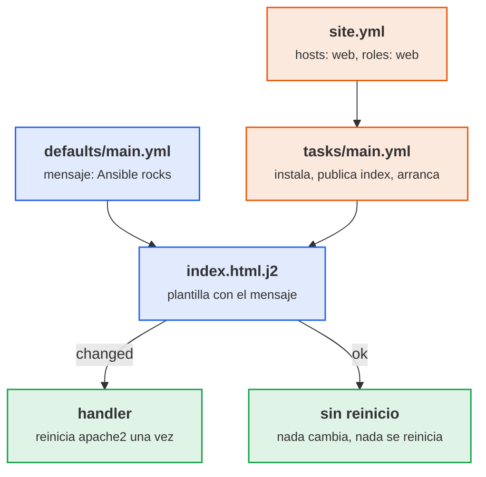

<p class="pie" markdown>Un cambio en el fichero avisa al handler y Apache se reinicia; si el fichero ya coincide, la tarea da `ok` y no hay reinicio.</p>

### Validar un despliegue

Que el playbook termine sin errores no demuestra que la web funcione: dice que cada módulo hizo lo que se le pidió, no que el conjunto sirva. Una validación completa tiene tres niveles y cada uno detecta una cosa distinta.

| Nivel | Cómo | Qué detecta |
|---|---|---|
| Antes de aplicar | `--syntax-check` y `--check --diff` | Errores de YAML y qué cambiaría, sin tocar la máquina |
| Estado | Segunda ejecución con `changed=0` | Que el playbook describe un estado y no una receta |
| Servicio | Petición HTTP con `curl` o el módulo `uri` | Que lo desplegado responde lo que debe, visto desde fuera |

El último nivel es el que cuenta para el resultado. Se hace desde `pps01`, que es el sitio desde el que llegaría un usuario, y se comprueba el contenido, no solo el código de estado: una página de error de Apache también devuelve una respuesta. En el propio playbook, el módulo `uri` con `return_content` y un `assert` sobre el texto convierten la comprobación en una tarea más: si el mensaje no aparece, el playbook falla y el pipeline que lo lance se detiene.

!!! examen "Qué se evalúa en el despliegue con Ansible"
    Qué contiene un rol y para qué sirve cada carpeta, la diferencia entre una variable por defecto y una pasada con `-e`, cuándo se ejecuta un handler (solo si la tarea avisada cambió algo, una vez al final) y por qué eso evita reinicios innecesarios. Se pregunta también cómo se comprueba que un despliegue funciona (contenido de la respuesta, no solo el estado del módulo) y dónde no se guardan los secretos.

### A5.11 Ansible: despliegue (sesión 48)

<span class="et et-obj">Objetivo</span> Convertir el playbook en un rol `web` que publica en `destino01` un `index.html` con `Ansible rocks`, reinicia Apache solo cuando el fichero cambia y lo verifica con `curl`. Es el punto 3.3 de RA5.2; lo recoge la ACT_UT5_2, con plazo el 3 de mayo.

<span class="et et-pre">Antes de empezar</span> `~/pps-iac/ansible/` de la [A5.10](#a510-ansible-primer-playbook-sesion-46) y `destino01` encendida. Teoría: [roles, variables y handlers](#roles-variables-y-handlers) y [validar un despliegue](#validar-un-despliegue).

<span class="et et-pas">Ejercicios</span> Trabaja en `~/pps-iac/ansible/` y contesta en `~/pps-entregas/ut5/a511/README.md`.

1. **Rol, index.html y reinicio (3.3).** Crea el rol `web`: instala Apache, publica `/var/www/html/index.html` desde la plantilla `index.html.j2` con la variable `mensaje` (`Ansible rocks`, en `defaults`) y avisa al handler `Reiniciar Apache` solo desde la tarea de la plantilla.
2. **Comprobación en el playbook (3.3).** Deja `site.yml` con la actualización de la A5.10 en `pre_tasks`, el rol `web` y, en `post_tasks`, un `uri` contra `http://localhost` y un `assert` sobre el mensaje. Esas dos tareas llevan `when: not ansible_check_mode`, o la simulación falla.
3. **Aplicación y reinicio (3.3).** Valida con `--syntax-check` y `--check --diff`, aplica y localiza en la salida el handler `Reiniciar Apache` y el `PLAY RECAP`.
4. **Verificación con curl (3.3).** Comprueba con `curl` desde `pps01` que `destino01` sirve `Ansible rocks` y demuestra la idempotencia con una segunda ejecución. Captura el `curl`: es la de validación del README de `pps-iac`.
5. **Publicación.** Sube `ansible/` a `pps-iac`.
6. **Extra (opcional).** Pasa otro mensaje con `-e` para ver que el handler solo salta cuando el fichero cambia, o lanza el playbook desde un trabajo de Jenkins con la clave SSH como credencial (el nivel «Pipeline» de la rúbrica).

## Sesión 49 · K3s en un nodo

<p class="ut-meta" markdown>29 de abril · Teoría y práctica · <span class="dur" tabindex="0" aria-label="Escalado y orquestación: pods, despliegues y servicios · 15 min&#10;K3s frente a Kubernetes · 10 min&#10;A5.12 K3s de un nodo · 85 min" data-dur="Escalado y orquestación: pods, despliegues y servicios · 15 min&#10;K3s frente a Kubernetes · 10 min&#10;A5.12 K3s de un nodo · 85 min">:material-school:<i class="dur-barra" style="--teoria:23%"></i>:material-flask:</span></p>

Hasta ahora cada aplicación corría en un contenedor que alguien arrancaba a mano. Al acabar esta sesión hay un clúster K3s de un solo nodo en la VM `k3s-1`, con nginx desplegado en dos réplicas, accesible por el puerto 30080, y con K9s instalado para verlo. Primero se explica por qué hace falta un orquestador y qué objetos de Kubernetes intervienen (pod, despliegue, servicio), después qué es K3s y en qué se distingue de Kubernetes, y por último la hoja A5.12.

!!! consulta "Recursos de la sesión"
    **Para la práctica**

    - [K3s](https://docs.k3s.io/quick-start), [Kubernetes](https://kubernetes.io/es/) y [K9s](https://k9scli.io/): el clúster ligero y su panel.
    - El enunciado de la entrega ACT_UT5_4 es el PDF «RA5.4 K3's & K9's» del aula.

### Escalado y orquestación: pods, despliegues y servicios

El objetivo de este apartado es entender qué problema resuelve un orquestador y con qué cuatro objetos se trabaja en la práctica. La herramienta de línea de órdenes es `kubectl`, que habla con el clúster y le pide que aplique lo que describe un fichero YAML.

**Escalar** es dar más capacidad a un servicio. El escalado vertical le añade recursos a la misma máquina (más CPU o memoria): es sencillo, pero tiene techo y obliga a parar. El escalado horizontal añade más copias del servicio detrás de un reparto de carga: no tiene techo práctico y tolera la caída de una copia, pero exige que el servicio pueda ejecutarse en varias instancias a la vez. Los contenedores son ligeros y arrancan en segundos, y por eso el escalado horizontal es el que se automatiza. Con dos o tres contenedores basta un `docker compose`; con decenas repartidas en varias máquinas hace falta algo que decida dónde corre cada uno, lo reinicie si cae y mantenga el número deseado. Eso es un **orquestador**, y el estándar es Kubernetes.

Kubernetes funciona por **estado deseado**: se declara cuántas copias de qué imagen se quieren y el clúster trabaja sin parar para que la realidad coincida. Es el mismo principio de idempotencia de Terraform y Ansible, aplicado a los contenedores en ejecución.

| Objeto | Qué es | Analogía con Docker |
|---|---|---|
| **Pod** | La unidad mínima: uno o varios contenedores que comparten red y almacenamiento | Un contenedor (o un grupo que comparte red) |
| **Deployment** (despliegue) | Declara la imagen y el número de réplicas; si un pod cae, crea otro; permite actualizar sin corte | `docker compose` con `--scale` y `restart` |
| **Service** (servicio) | Nombre y dirección estables delante de un conjunto de pods, con reparto entre ellos | La red del compose con el nombre del servicio |
| **Namespace** | Agrupa objetos; los del propio Kubernetes viven en `kube-system` | Un proyecto de compose |

Un servicio de tipo **NodePort** abre el mismo puerto (del 30000 al 32767) en todos los nodos y lo reenvía a los pods. En el laboratorio del curso, nginx queda en el 30080, y se llega a él por la IP de cualquier nodo.

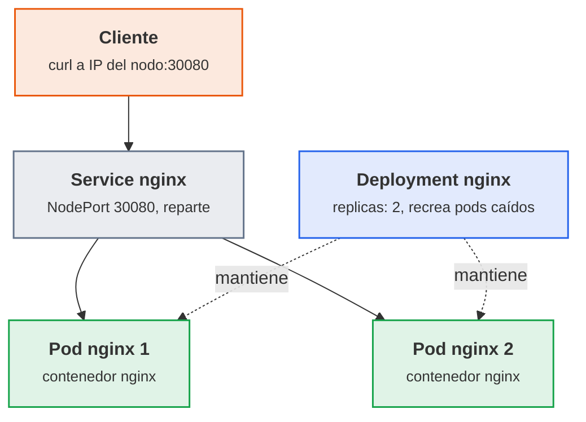

<p class="pie" markdown>El `Deployment` no sirve tráfico: solo mantiene el número de pods. El reparto lo hace el `Service`.</p>

### K3s frente a Kubernetes

El objetivo es saber por qué se usa K3s en el laboratorio y qué se conserva de Kubernetes. K3s es una distribución certificada de Kubernetes que se instala con un único binario y un `curl`, pensada para máquinas con pocos recursos. Un clúster de verdad exige montar varios componentes por separado; K3s los empaqueta todos.

| Aspecto | Kubernetes completo | K3s |
|---|---|---|
| Instalación | Varios componentes y un instalador (kubeadm) | Un script: `curl -sfL https://get.k3s.io \| sh -` |
| Base de datos del clúster | etcd aparte | SQLite en un nodo; etcd embebido en alta disponibilidad |
| Incluido de serie | Nada más allá del núcleo | Traefik (entrada HTTP), CoreDNS, almacenamiento local y balanceador de servicios |
| Recursos por servidor | Varios GB | Mínimo documentado: 2 CPU y 2 GB de memoria (agente: 1 CPU y 512 MB) |
| `kubectl` y YAML | Los estándar | Los mismos: un YAML sirve en ambos |

En un nodo K3s ejecuta a la vez el plano de control (API, planificador y controladores) y los pods de las aplicaciones. Por eso un solo nodo es un laboratorio y no un entorno de producción: si esa máquina cae, cae todo. La alta disponibilidad, con tres servidores, se monta el 3 de mayo.

!!! ojo "Los recursos del laboratorio quedan por debajo del mínimo documentado"
    Cada VM `k3s-N` del curso tiene 1 vCPU y 1,5 GB, por debajo de los 2 CPU y 2 GB que K3s documenta para un servidor. Con nginx funciona, pero el arranque es lento (de dos a cuatro minutos hasta que el nodo pasa a `Ready`) y un nodo que se queda sin memoria se reinicia sin avisar. El criterio habitual es respetar el mínimo si el equipo lo permite: con 16 GB, tres VM de 2 GB (6 GB) caben si `pps01` está apagada. Si ni así caben las tres, la alternativa es k3d, que ejecuta K3s dentro de contenedores Docker en `pps01`.

!!! examen "Qué se evalúa"
    Diferencia entre escalado vertical y horizontal y cuál permite tolerar fallos; qué hace un orquestador; función de pod, deployment y service (quién mantiene las réplicas y quién reparte el tráfico); por qué K3s y no Kubernetes completo en un laboratorio.

### A5.12 K3s de un nodo (sesión 49)

<span class="et et-obj">Objetivo</span> Instalar K3s en la VM `k3s-1`, desplegar nginx con dos réplicas en el NodePort 30080 y validarlo con K9s. Es el punto 5.1 de RA5.4; lo recoge la ACT_UT5_4, con plazo el 13 de mayo.

<span class="et et-pre">Antes de empezar</span> `destino01` ([A5.8](#a58-terraform-primera-maquina-sesion-44)) apagada para clonarla, y solo `k3s-1` encendida. Teoría: [pods, despliegues y servicios](#escalado-y-orquestacion-pods-despliegues-y-servicios) y [K3s frente a Kubernetes](#k3s-frente-a-kubernetes).

<span class="et et-pas">Ejercicios</span> Trabaja en `k3s-1` y contesta en `~/pps-entregas/ut5/a512/README.md`.

1. **Máquina k3s-1.** Clona `destino01` como `k3s-1` (clon completo con MAC nueva, NAT como primer adaptador) y dale identidad propia: nombre `k3s-1`, `machine-id` nuevo e IP fija `192.168.56.31` en `/etc/netplan/60-lab.yaml`. Desactiva el Apache heredado, que ocupa el 80 de Traefik.
2. **K3s en un nodo (5.1).** Instala K3s hasta ver `k3s-1` en `Ready` como `control-plane`. La orden fija la red de solo anfitrión, porque la NAT tiene la misma IP en todas las VM:

    ```bash
    curl -sfL https://get.k3s.io | K3S_KUBECONFIG_MODE="644" sh -s - \
      --node-ip 192.168.56.31 --flannel-iface enp0s8
    ```

3. **nginx con dos réplicas (5.1).** Despliega con `nginx.yaml` un Deployment `nginx` de dos réplicas de `nginx:stable` y un Service `nginx` `NodePort` en el 30080, y comprueba que responde desde la VM y desde fuera.
4. **Validación con K9s (5.1).** Instala K9s y revisa con él los pods, el servicio, el despliegue, el nodo y los logs de un pod. Captura los dos pods de nginx.
5. **Documentación (5.1).** Añade las salidas de `kubectl get nodes -o wide` y `kubectl get deploy,pods,svc -o wide`, el `curl` y `nginx.yaml`, y explica qué hace cada objeto.
6. **Extra (opcional).** Borra un pod y observa cómo el Deployment lo repone, y cambia la imagen a `nginx:alpine` para ver la sustitución gradual con `kubectl rollout status`.

## Sesión 50 · K3s en alta disponibilidad

<p class="ut-meta" markdown>3 de mayo · Teoría y práctica · <span class="dur" tabindex="0" aria-label="Alta disponibilidad: etcd embebido, base de datos externa y quórum · 15 min&#10;A5.13 K3s en alta disponibilidad · 95 min" data-dur="Alta disponibilidad: etcd embebido, base de datos externa y quórum · 15 min&#10;A5.13 K3s en alta disponibilidad · 95 min">:material-school:<i class="dur-barra" style="--teoria:14%"></i>:material-flask:</span></p>

Un clúster de un nodo cae entero si cae su máquina. Al acabar esta sesión hay tres servidores K3s (`k3s-1`, `k3s-2` y `k3s-3`) formando un solo clúster, nginx repetido con dos réplicas y la prueba de que el clúster sigue funcionando cuando uno de los servidores se apaga. Primero se explica cómo K3s guarda su estado y por qué el número de servidores tiene que ser impar; después la hoja A5.13.

!!! consulta "Recursos de la sesión"
    **Para la práctica**

    - Documentación de K3s: [etcd embebido para alta disponibilidad](https://docs.k3s.io/datastore/ha-embedded), [requisitos y puertos](https://docs.k3s.io/installation/requirements) y [arquitectura](https://docs.k3s.io/architecture).

### Alta disponibilidad: etcd embebido, base de datos externa y quórum

El objetivo es entender qué se replica en un clúster de alta disponibilidad y cuántos servidores hacen falta. Se instala con el mismo `curl` de la sesión anterior, pero arrancando varios servidores que comparten estado.

El estado del clúster (qué despliegues existen, cuántas réplicas, dónde corre cada pod) vive en una base de datos, y es lo único que un servidor no puede perder. En un nodo, K3s usa SQLite, un fichero local. Para tener varios servidores, esa base de datos tiene que ser compartida y tolerante a la caída de uno de ellos. K3s ofrece dos caminos:

| | etcd embebido | Base de datos externa |
|---|---|---|
| Qué es | etcd, el almacén de Kubernetes, replicado dentro de los propios servidores | PostgreSQL, MySQL o etcd en otras máquinas |
| Piezas que administrar | Solo los servidores K3s | Servidores K3s más la base de datos, que también hay que hacer resistente |
| Servidores mínimos | Tres (número impar) | Dos, más la base de datos |
| Se instala con | `--cluster-init` en el primero y `--server` en el resto | `--datastore-endpoint` en todos |

El criterio habitual, y el del laboratorio, es etcd embebido: no añade máquinas ni servicios, y con tres servidores ya se tolera la pérdida de uno. La base externa solo compensa cuando la organización ya opera un PostgreSQL o MySQL con alta disponibilidad y quiere reutilizarlo.

etcd toma decisiones por mayoría, y la mayoría se llama **quórum**: con `n` servidores son necesarios `n/2 + 1` (división entera). Por debajo de esa cifra el clúster no puede escribir su estado, así que el API deja de aceptar cambios aunque las máquinas sigan encendidas. Es lo que evita que dos mitades incomunicadas decidan por separado.

| Servidores | Quórum | Caídas toleradas |
|---|---|---|
| 1 | 1 | 0 |
| 2 | 2 | 0 (peor que uno solo: cualquier caída bloquea) |
| 3 | 2 | 1 |
| 5 | 3 | 2 |

Por eso el número tiene que ser impar: cuatro servidores necesitan tres para el quórum y toleran una sola caída, igual que tres. Los pods que ya estaban en marcha en los nodos que sobreviven siguen sirviendo aunque el API esté bloqueado; lo que se pierde es la capacidad de cambiar el clúster.

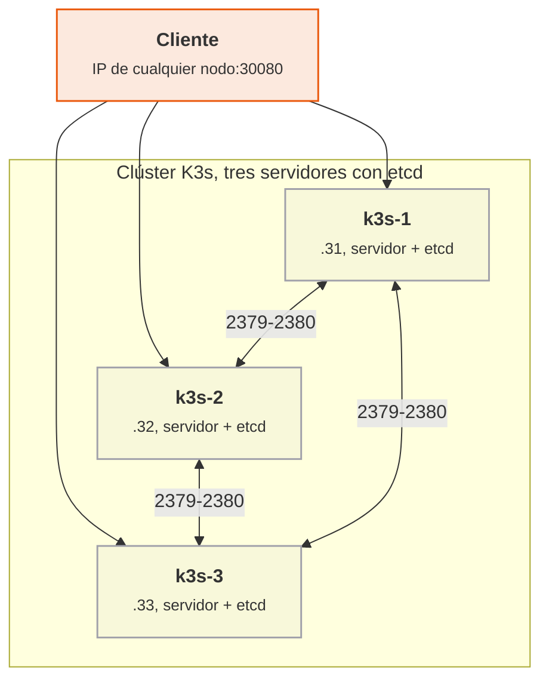

<p class="pie" markdown>Los tres servidores replican `etcd` por los puertos 2379 y 2380; el tráfico de las aplicaciones entra por el NodePort de cualquiera de ellos.</p>

Los servidores nuevos necesitan tres cosas para unirse: la dirección del primero (`--server https://192.168.56.31:6443`), el mismo **token** (un secreto compartido, que no va al repositorio) y visibilidad de los puertos 6443, 2379 y 2380 entre ellos. Un límite del montaje del laboratorio: todos los clientes apuntan a `k3s-1`, así que si cae ese servidor `kubectl` deja de responder desde él aunque el clúster siga vivo. En producción se pone delante una IP virtual o un balanceador, y se usa `--tls-san` para que el certificado la admita.

!!! truco "Si las tres VM no caben: k3d"
    Si el equipo no soporta tres VM más, la alternativa es k3d, que ejecuta cada nodo K3s como un contenedor Docker dentro de `pps01`, sin VM nuevas y con arranque en segundos. Es K3s de verdad, con etcd embebido y tres servidores, pero comparten kernel y disco y no permite probar el apagado de una máquina completa (se detiene el contenedor). Se instala con `curl -s https://raw.githubusercontent.com/k3d-io/k3d/main/install.sh | bash` y el clúster se crea con `k3d cluster create pps --servers 3 -p "30080:30080@server:0" -p "80:80@loadbalancer"`. Los nodos se llaman `k3d-pps-server-0`, `k3d-pps-server-1` y `k3d-pps-server-2`; nginx queda en `http://localhost:30080`, se apaga un nodo con `docker stop k3d-pps-server-2` y `kubectl` se ejecuta con `docker exec k3d-pps-server-0 kubectl get nodes`. El resto de la hoja (nginx, K9s, comprobaciones) es idéntico. La entrada HTTP que se monta el 6 de mayo queda en `http://localhost`, con la cabecera `Host`. Documentación: <https://k3d.io/stable/>.

!!! examen "Qué se evalúa"
    Qué guarda etcd y por qué el clúster necesita mayoría; cálculo del quórum y de las caídas toleradas con 3 y 5 servidores; por qué dos servidores no mejoran a uno; diferencia entre etcd embebido y base de datos externa y cuál conviene en un laboratorio.

### A5.13 K3s en alta disponibilidad (sesión 50)

<span class="et et-obj">Objetivo</span> Montar un clúster K3s de tres servidores con etcd embebido, repetir el nginx con dos réplicas, validarlo con K9s y comprobar que sobrevive a la caída de un servidor. Es el punto 5.2 de RA5.4; lo recoge la ACT_UT5_4, con plazo el 13 de mayo.

<span class="et et-pre">Antes de empezar</span> `k3s-1` con `nginx.yaml` y K9s ([A5.12](#a512-k3s-de-un-nodo-sesion-49)), y solo `k3s-1`, `k3s-2` y `k3s-3` encendidas. Teoría: [etcd embebido y quórum](#alta-disponibilidad-etcd-embebido-base-de-datos-externa-y-quorum).

<span class="et et-pas">Ejercicios</span> Trabaja por SSH desde el anfitrión y contesta en `~/pps-entregas/ut5/a513/README.md`, sin el token.

1. **Tres máquinas.** Desinstala K3s de `k3s-1` sin perder `nginx.yaml` y clónala, apagada, como `k3s-2` (`192.168.56.32`) y `k3s-3` (`192.168.56.33`), con identidad propia como en la A5.12.
2. **K3s en alta disponibilidad (5.2).** Arranca `k3s-1` con `--cluster-init` y une `k3s-2` y `k3s-3` con `--server`, de una en una y con el mismo token, hasta ver los tres nodos `Ready` con el rol `control-plane,etcd`.
3. **nginx con dos réplicas (5.2).** Repite el despliegue, anota en qué nodos caen los pods y comprueba que el 30080 responde en las tres IP, también en la de un nodo sin pods.
4. **Validación con K9s (5.2).** Captura en K9s los tres servidores en `Ready` y el nodo de cada pod.
5. **Caída de un servidor (5.2, análisis técnico).** Apaga `k3s-3` y anota cuánto tarda en salir `NotReady`. Comprueba que el servicio responde en `.31` y `.32` y que el clúster acepta un escalado a tres réplicas. Enciéndela, comprueba que vuelve sola y deja dos réplicas.
6. **Documentación (5.2).** Añade `kubectl get nodes -o wide`, las respuestas de las tres IP y qué pasó con el clúster mientras `k3s-3` estaba apagada.
7. **Extra (opcional).** Apaga `k3s-2` y `k3s-3` a la vez y explica por qué `kubectl` deja de responder mientras `curl` a `k3s-1` puede seguir sirviendo.

## Sesión 51 · Aplicaciones en K3s y K9s

<p class="ut-meta" markdown>6 de mayo · Teoría y práctica · <span class="dur" tabindex="0" aria-label="Servicios, entrada HTTP y balanceo de carga; K9s · 10 min&#10;A5.14 Balanceo en K3s y K9s · 100 min" data-dur="Servicios, entrada HTTP y balanceo de carga; K9s · 10 min&#10;A5.14 Balanceo en K3s y K9s · 100 min">:material-school:<i class="dur-barra" style="--teoria:9%"></i>:material-flask:</span></p>

Un despliegue de laboratorio con nginx no es todavía una aplicación propia. Al acabar esta sesión la aplicación `pps-app` corre en el clúster de tres servidores con réplicas repartidas entre los nodos, delante hay una entrada HTTP que balancea la carga entre ellas, y K9s sirve para comprobar el reparto, escalar y matar pods. Se explica cómo se traduce un `docker-compose` de balanceo a objetos de Kubernetes y qué aporta K9s; después la hoja A5.14.

!!! consulta "Recursos de la sesión"
    **Para la práctica**

    - [K9s](https://k9scli.io/) y [servicios y red en K3s](https://docs.k3s.io/networking/networking-services).
    - [Taller de Docker (balanceo de carga)](https://aulasoftwarelibre.github.io/taller-de-docker/dockerfile/#balanceo-de-carga): el compose que aquí se traduce a K3s.

### Servicios, entrada HTTP y balanceo de carga; K9s

El objetivo es saber qué objeto de Kubernetes sustituye a cada servicio del compose de balanceo, y con qué herramienta se ve el resultado. El compose del taller tiene tres servicios: la aplicación web (que se escala con `--scale web=5`), una base de datos Redis y un Traefik que reparte las peticiones entre las réplicas. En Kubernetes cada pieza tiene su equivalente:

| En el compose | En K3s | Detalle |
|---|---|---|
| `web` con `--scale web=5` | **Deployment** con `replicas: 5` | El clúster reparte los pods entre los nodos y los recrea si caen |
| Red interna y nombre del servicio | **Service** de tipo ClusterIP | Nombre estable y reparto entre los pods que casan con la etiqueta |
| `redis` | Otro Deployment y su Service | Se localiza por el nombre `redis` |
| `traefik` con reglas en etiquetas (`Host(...)`) | **Ingress** (regla) más el Traefik que K3s ya trae | La regla `host` se escribe en un objeto, no en etiquetas |
| `docker.sock` montado en Traefik | No hace falta | Traefik consulta al API de Kubernetes |

Hay dos niveles de reparto. El Service reparte entre los pods de un mismo servicio dentro del clúster. El Ingress recibe las peticiones HTTP de fuera por el puerto 80 de cualquier nodo y las dirige al Service según el nombre de host (`Host`). K3s activa Traefik como controlador de entrada por defecto, así que no se instala nada: basta crear el objeto Ingress.

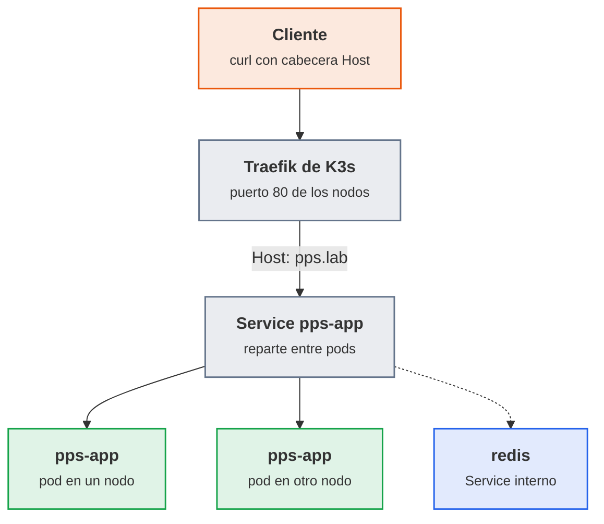

<p class="pie" markdown>La entrada elige el Service por el nombre de host; el Service elige el pod. Redis no recibe tráfico de fuera.</p>

**K9s** es un panel de terminal que consulta al clúster de forma continua: en lugar de repetir `kubectl get pods` se ve la lista actualizarse. Se usa para comprobar cuántos pods hay y en qué nodo, leer los logs y los eventos de un pod que no arranca, escalar un despliegue y borrar un pod para ver cómo se recrea. Las órdenes son las mismas que `kubectl`, con teclas. El criterio habitual es `kubectl` para lo que se guarda y se repite (aplicar YAML, scripts) y K9s para diagnosticar a ojo.

| Tecla | Efecto |
|---|---|
| `:pods`, `:svc`, `:deploy`, `:nodes`, `:ing` | Cambia de vista (`:ing` para Ingress) |
| `l` | Logs del pod seleccionado |
| `d` | Describe el objeto, con sus eventos |
| `s` | En un Deployment, escala; en un pod, abre una shell |
| `Ctrl+d` | Borra el objeto seleccionado (pide confirmación) |
| `?` | Ayuda con todas las teclas |

!!! examen "Qué se evalúa"
    Diferencia entre Service e Ingress y qué nivel de reparto hace cada uno; equivalencias entre `docker compose` y Kubernetes (`--scale`, red, etiquetas de Traefik); qué es K9s y para qué se prefiere a `kubectl`. Cuidado con el `docker.sock` montado: en Docker equivale a dar root al contenedor, y en Kubernetes se evita porque no hace falta.

### A5.14 Balanceo en K3s y K9s (sesión 51)

<span class="et et-obj">Objetivo</span> Desplegar `pps-app` en el clúster con `k8s/pps-app.yaml` (aplicación, Redis y entrada HTTP), medir el reparto de carga y validarlo con K9s. Es el punto 5.3 de RA5.4, con `pps-app` en lugar de la aplicación Flask del taller y `traefik/whoami` para ver el reparto; lo recoge la ACT_UT5_4, con plazo el 13 de mayo.

<span class="et et-pre">Antes de empezar</span> El clúster de la [A5.13](#a513-k3s-en-alta-disponibilidad-sesion-50) y la imagen `pps<NIA>/pps-app` de la [A5.6](#a56-jenkins-con-docker-sesion-42), que solo está en `pps01`, con un token de Docker Hub. Teoría: [servicios, entrada HTTP, balanceo y K9s](#servicios-entrada-http-y-balanceo-de-carga-k9s).

<span class="et et-pas">Ejercicios</span> Trabaja en una copia de `pps-app` en `k3s-1` y contesta en `~/pps-entregas/ut5/a514/README.md`.

1. **Imagen al alcance del clúster.** Publica desde `pps01` la imagen `pps<NIA>/pps-app` en un repositorio público de Docker Hub, con la etiqueta que usará el manifiesto.
2. **Del compose a manifiestos (5.3).** Escribe `k8s/pps-app.yaml`: Deployment `pps-app` (dos réplicas en el 8080, `readinessProbe` a `/salud` y límite de 192 Mi) con su Service en el 80, Deployment y Service `redis` (`redis:7`, 6379) y un Ingress que lleve el host `pps.lab` al Service `pps-app`.
3. **Despliegue (5.3).** Aplícalo y comprueba que responde en `/` y en `/salud` por el 80 de los tres nodos. El laboratorio no tiene DNS: el nombre va en la cabecera `Host`.
4. **Reparto de carga (5.3).** Escribe `k8s/reparto.yaml`: tres réplicas de `traefik/whoami`, su Service `reparto` y un Ingress para `reparto.pps.lab`. Cuenta qué pod contesta cada una de veinte peticiones.
5. **Validación con K9s (5.3).** Escala `pps-app` a cinco réplicas, mira en qué nodos quedan y los logs y eventos de una, y borra un pod de `reparto` con peticiones en marcha. Deja `pps-app` en dos réplicas.
6. **Documentación (5.3).** Sube los dos manifiestos a `k8s/` de `pps-app` y añade una tabla de equivalencias entre el compose del taller y tus manifiestos.
7. **Extra (opcional).** Cambia la imagen de `pps-app` a otra etiqueta con `kubectl set image`, observa la sustitución con `kubectl rollout status` y deshazla con `kubectl rollout undo`.

## Sesión 52 · Monitorización con Prometheus

<p class="ut-meta" markdown>10 de mayo · Teoría y práctica · <span class="dur" tabindex="0" aria-label="Métricas, exporters y consultas · 15 min&#10;Arquitectura de Prometheus · 10 min&#10;A5.15 Prometheus y Grafana · 85 min" data-dur="Métricas, exporters y consultas · 15 min&#10;Arquitectura de Prometheus · 10 min&#10;A5.15 Prometheus y Grafana · 85 min">:material-school:<i class="dur-barra" style="--teoria:23%"></i>:material-flask:</span></p>

Un servicio desplegado que nadie mide falla en silencio: la unidad ha construido, empaquetado y desplegado, y falta saber si lo desplegado funciona y con qué carga. Al terminar la sesión hay en `pps01` un stack de ejemplo con Prometheus recogiendo métricas de la máquina, de los contenedores y de un proxy, Grafana leyéndolas, y una captura de cada componente validado. Primero se ve qué es una métrica y quién la expone (exporter), después cómo la recoge y consulta Prometheus, y la hoja A5.15 levanta el conjunto completo con un `docker compose`.

!!! consulta "Recursos de la sesión"
    **Para la práctica**

    - [Ejemplo de Prometheus y Grafana](https://github.com/dinesh24murali/example_repo/tree/main/prometheus_grafana_example): el stack que se levanta.
    - [Prometheus](https://prometheus.io/docs/introduction/overview/) y [Grafana](https://grafana.com/docs/grafana/latest/): la documentación oficial.
    - El enunciado de la entrega ACT_UT5_3 es el PDF «RA5.3 Sistema de monitorización» del aula.

    **Para ampliar** (opcional)

    - [Introducción a la monitorización con Prometheus y Grafana](https://medium.com/@dineshmurali/introduction-to-monitoring-with-prometheus-grafana-ea338d93b2d9).

### Métricas, exporters y consultas

Monitorizar es medir de forma continua y guardar las medidas con su fecha para poder ver la tendencia, comparar y avisar. Lo que se mide, en cada capa, son métricas: números que cambian con el tiempo. Prometheus las trata como series temporales, y cada serie se identifica por el nombre de la métrica y un conjunto de etiquetas.

```text
node_cpu_seconds_total{cpu="0", mode="idle", instance="192.168.56.20:9100"}  45231.7
```

El nombre dice qué se mide (`node_cpu_seconds_total`), las etiquetas dicen de quién y cómo (`instance`, `mode`) y el número es el valor en ese instante. Cuatro tipos cubren casi todo lo que se ve en el laboratorio:

| Tipo | Qué es | Ejemplo | Cómo se consulta |
|---|---|---|---|
| Counter | Solo sube (o vuelve a cero al reiniciar) | peticiones atendidas, bytes enviados | con `rate()`, nunca el valor en bruto |
| Gauge | Sube y baja | memoria libre, contenedores en marcha | directamente |
| Histogram | Reparte las medidas en cubos | tiempos de respuesta | `histogram_quantile()` |
| Summary | Cuantiles ya calculados en origen | tiempos de respuesta | directamente |

Un servicio no expone sus métricas por arte de magia. El **exporter** es el pequeño programa que las publica en texto plano en una ruta HTTP (`/metrics`) para que Prometheus las recoja. Hay dos casos:

| Caso | Quién publica `/metrics` | En el laboratorio |
|---|---|---|
| El propio programa lleva su exporter | Prometheus, Traefik, Grafana | `prometheus:9090`, `traefik:8082` |
| Programa que no habla Prometheus | Un exporter aparte que lo mide desde fuera | `node_exporter` (la máquina, puerto 9100), cAdvisor (los contenedores, 8080) |

La pregunta que se hace a Prometheus se escribe en **PromQL**. Tres consultas bastan para leer las series del stack de la hoja:

| Consulta | Qué responde |
|---|---|
| `up` | 1 si el último intento de recoger cada destino funcionó, 0 si falló |
| `rate(node_cpu_seconds_total{mode="idle"}[1m])` | fracción de tiempo ociosa de cada CPU en el último minuto |
| `sum by (code) (rate(traefik_service_requests_total[1m]))` | peticiones por segundo del proxy, separadas por código HTTP |

`up` es la más útil de todas: es la que dice si el propio sistema de monitorización ve al servicio. La alerta de servidor caído que se escribe el 13 de mayo se basa en ella.

### Arquitectura de Prometheus

Prometheus funciona por **extracción** (pull): es él quien va cada cierto tiempo (`scrape_interval`, 15 s en el stack) a la dirección de cada destino y se lleva lo que publique. Para monitorizar una máquina basta con que exponga el puerto, sin agente que empuje datos. Y hay una ventaja de seguridad: el servidor decide a quién mira, y un destino comprometido no puede inundarlo de datos falsos con otro nombre.

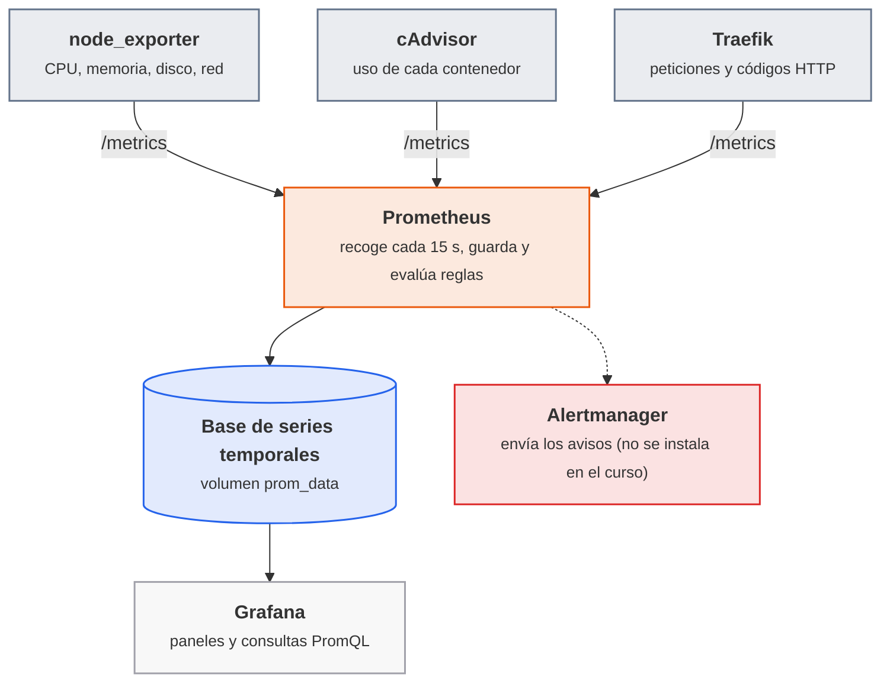

<p class="pie" markdown>Prometheus **extrae** las métricas de cada destino; Grafana no las guarda, las **consulta** a Prometheus cada vez que dibuja un panel.</p>

La configuración entera está en un fichero, `prometheus.yml`. Su parte esencial es la lista de trabajos de extracción, cada uno con un nombre y las direcciones que vigila:

```yaml
global:
  scrape_interval: 15s
scrape_configs:
  - job_name: "node"
    static_configs:
      - targets: ["node-exporter:9100"]
```

Cada destino recibe automáticamente dos etiquetas, `job` (el nombre del trabajo) e `instance` (su dirección), y son las que sirven para filtrar en PromQL y en los paneles. La pantalla **Status > Targets** de la interfaz web de Prometheus (puerto 9090) muestra cada destino con su estado `UP` o `DOWN` y el error si lo hay: es el primer sitio donde mirar cuando una gráfica sale vacía.

!!! ojo "El stack de ejemplo no es un modelo de seguridad"
    El repositorio de ejemplo publica la contraseña de Grafana (`admin` / `grafana`), monta el socket de Docker y carpetas del anfitrión dentro de contenedores, y expone todos los puertos. Vale en una VM aislada del laboratorio y no en un servidor real, donde Grafana lleva contraseña propia y Prometheus y las métricas quedan tras un cortafuegos o un proxy con autenticación.

!!! examen "Qué se evalúa"
    Diferencia entre monitorizar (medir de forma continua) y depurar un fallo ya ocurrido; qué es una métrica, para qué sirven las etiquetas y qué tipo de métrica es un contador frente a una medida instantánea; qué hace un exporter; que Prometheus **extrae** los datos de los destinos y que `up` indica si lo consigue; y cuál es el papel de Grafana (visualiza, no recoge).

### A5.15 Prometheus y Grafana (sesión 52)

<span class="et et-obj">Objetivo</span> Levantar en `pps01` el stack del ejemplo (Traefik con una aplicación, Prometheus, cAdvisor, node_exporter y Grafana) y validar cada elemento con una captura. Es el punto 3.1 de RA5.3; lo recoge la ACT_UT5_3, con plazo el 17 de mayo.

<span class="et et-pre">Antes de empezar</span> `pps01` con Docker e Internet, y Jenkins parado para liberar memoria. Teoría: [métricas, exporters y consultas](#metricas-exporters-y-consultas) y [arquitectura de Prometheus](#arquitectura-de-prometheus).

<span class="et et-pas">Ejercicios</span> Trabaja en `~/monitor` y contesta en `~/pps-entregas/ut5/a515/README.md`. Deja el stack levantado: lo usa la A5.16.

1. **Puertos libres.** Deja libres el 80, 3000, 8080, 8082 y 9090 de `pps01`; el 80 es del Apache de la [A3.11](ut3-vulnerabilidades-web.md#a311-contrasenas-y-proteccion-frente-a-bots-sesion-25), que no debe volver a arrancar con el sistema.
2. **Stack del ejemplo (3.1).** Clona el [ejemplo](https://github.com/dinesh24murali/example_repo) en `~/monitor` y levanta `prometheus_grafana_example` hasta ver sus seis servicios en `running`. Antes, borra la línea `api_version: v1` de su `prometheus.yml`, o Prometheus se reinicia en bucle.
3. **Prometheus (3.1).** Con tráfico por Traefik (respuestas 200 y 500), comprueba los cuatro trabajos en `UP` y consulta `up`, las peticiones por código HTTP y la memoria de `nodeapp` según cAdvisor.
4. **cAdvisor y Grafana (3.1).** Comprueba `nodeapp` en cAdvisor y, en Grafana (`admin` / `grafana`), la fuente Prometheus y el dashboard `1860` importado y con datos.
5. **Todos los elementos (3.1).** Guarda una captura por cada uno de los seis servicios y la de `docker compose ps`, y explica por componente qué hace, cómo lo has validado y qué devolvió `up`.
6. **Extra (opcional).** Importa el panel de cAdvisor `14282`, para `nodeapp` con `docker compose stop` y explica por qué `up` no cambia.

## Sesión 53 · Monitorización remota con Grafana

<p class="ut-meta" markdown>13 de mayo · Teoría y práctica · <span class="dur" tabindex="0" aria-label="Monitorizar otra máquina: node_exporter · 5 min&#10;Paneles, fuentes de datos y alertas en Grafana · 5 min&#10;A5.16 Monitorización de un servidor · 100 min" data-dur="Monitorizar otra máquina: node_exporter · 5 min&#10;Paneles, fuentes de datos y alertas en Grafana · 5 min&#10;A5.16 Monitorización de un servidor · 100 min">:material-school:<i class="dur-barra" style="--teoria:9%"></i>:material-flask:</span></p>

El caso real de la monitorización no es medir la máquina donde corre todo, sino vigilar un servidor desde otro equipo. Al terminar la sesión `destino01` publica sus métricas con node_exporter, el Prometheus y el Grafana de `pps01` (los de la A5.15) las recogen y las muestran en el panel de node_exporter, y hay escrita una primera regla de alerta que avisa cuando `destino01` deja de responder. La teoría cabe en dos ideas (qué se instala en cada máquina y qué es una fuente de datos, un panel y una alerta) y el tiempo va a la hoja A5.16.

!!! consulta "Recursos de la sesión"
    **Para la práctica**

    - [Guía de `node_exporter`](https://prometheus.io/docs/guides/node-exporter/): exponer y consultar las métricas de una máquina.
    - [Prometheus](https://prometheus.io/) y [Grafana](https://grafana.com/).

### Monitorizar otra máquina: node_exporter

Monitorizar un servidor desde otro equipo reparte el trabajo en dos máquinas con papeles distintos:

| Máquina | Qué lleva | Qué hace | Puerto |
|---|---|---|---|
| `destino01` (192.168.56.20), la vigilada | node_exporter | Publica en `/metrics` la CPU, la memoria, el disco y la red del sistema | 9100 |
| `pps01` (192.168.56.10), la que vigila | Prometheus y Grafana, en contenedores (el stack de la A5.15) | Prometheus extrae `192.168.56.20:9100` cada 15 s y Grafana dibuja lo que Prometheus guarda | 9090 y 3000 |

En el servidor vigilado no se instala Prometheus ni Grafana: solo el exporter, que es un programa pequeño y de solo lectura. En Ubuntu se instala con el gestor de paquetes (`prometheus-node-exporter`), que lo deja como servicio de `systemd` escuchando en el 9100, y es el criterio habitual frente a descargar el binario a mano, porque las actualizaciones de seguridad llegan con el resto del sistema. Para el laboratorio no hace falta más, pero en producción el puerto 9100 se abre solo hacia la dirección de Prometheus, porque las métricas de una máquina (versión del núcleo, sistemas de ficheros, nombres de interfaces) son información útil para quien prepara un ataque.

### Paneles, fuentes de datos y alertas en Grafana

Grafana no guarda métricas: se conecta a sistemas que sí las tienen y las dibuja. Tres conceptos ordenan su interfaz:

| Concepto | Qué es | En la hoja |
|---|---|---|
| Fuente de datos (data source) | La conexión a un almacén de datos, con su dirección | Prometheus en `http://prometheus:9090` |
| Panel (panel) | Una gráfica o un número, definido por una consulta PromQL | CPU, memoria, disco y red de `destino01` |
| Dashboard | Una página de paneles, exportable como fichero JSON | El identificador 1860 de grafana.com, "Node Exporter Full" |

El panel se construye una vez y se reutiliza: importar un dashboard de la comunidad por su identificador ahorra escribir treinta consultas, y basta después elegir con el desplegable `instance` la máquina que se quiere mirar.

Las **alertas** son la segunda mitad de la monitorización: mirar gráficas no sirve de nada a las tres de la madrugada. Una alerta es una consulta con una condición y un tiempo mínimo. Hay dos sitios donde definirla:

| Dónde | Cómo | Cuándo |
|---|---|---|
| Reglas de Prometheus (fichero YAML) | Versionables en Git, se despliegan con el resto de la configuración | Criterio del curso: es infraestructura como código y no depende de la interfaz |
| Alertas de Grafana (en su interfaz) | Cómodas de crear, viven en la base de datos de Grafana | Equipos que ya gestionan todo desde Grafana |

Una regla de Prometheus tiene esta forma, y el campo `for` es el que evita avisar por un fallo de un segundo:

```yaml
groups:
  - name: pps
    rules:
      - alert: ServidorCaido
        expr: up{job="destino01"} == 0
        for: 1m
        labels:
          severity: critical
        annotations:
          summary: "{{ $labels.instance }} no responde desde hace más de un minuto"
```

La alerta pasa por tres estados: **Inactive** (la condición no se cumple), **Pending** (se cumple, pero aún no ha pasado el `for`) y **Firing** (se cumple y ha pasado el tiempo). Prometheus solo evalúa y muestra el estado en su pestaña **Alerts**; el envío del aviso por correo o mensajería lo hace Alertmanager, otro componente que en el laboratorio no se instala. Con ver la alerta pasar a `Firing` se comprueba la parte que evalúa el criterio del RA.

!!! examen "Qué se evalúa"
    Qué hay que instalar en la máquina vigilada y qué en la que vigila; qué es una fuente de datos, un panel y una alerta; por qué una alerta lleva un tiempo mínimo (`for`) y qué diferencia hay entre `Pending` y `Firing`; y por qué el puerto del exporter se restringe en producción.

### A5.16 Monitorización de un servidor (sesión 53)

<span class="et et-obj">Objetivo</span> Vigilar `destino01` desde `pps01`: node_exporter en el servidor, Prometheus que lo recoge y el panel de node_exporter en Grafana, más la regla `ServidorCaido` que necesita la A5.17. Es el punto 3.2 de RA5.3, con `pps01` (Ubuntu 24.04) como cliente en lugar del 24.10 del enunciado; lo recoge la ACT_UT5_3, con plazo el 17 de mayo.

<span class="et et-pre">Antes de empezar</span> `destino01` con salida a Internet y `pps01` con el stack de la [A5.15](#a515-prometheus-y-grafana-sesion-52) en `~/monitor/prometheus_grafana_example`. Teoría: [node_exporter](#monitorizar-otra-maquina-node_exporter) y [paneles, fuentes de datos y alertas](#paneles-fuentes-de-datos-y-alertas-en-grafana).

<span class="et et-pas">Ejercicios</span> Trabaja en `destino01` y en el stack de `pps01`, y contesta en `~/pps-entregas/ut5/a516/README.md`, con copias de `prometheus.yml` y `alertas.yml`.

1. **node_exporter (3.2).** Instálalo en `destino01` y comprueba desde `pps01` que sus métricas se leen en `192.168.56.20:9100`.
2. **Recogida (3.2).** Añade a Prometheus el trabajo `destino01` (con ese nombre exacto, el que busca la regla) hasta verlo en `UP`, y la regla `ServidorCaido` en un `alertas.yml` cargado con `rule_files`.
3. **Panel (3.2).** En "Node Exporter Full", elige `destino01` en `Host`, compáralo con `pps01` y captura el de `destino01`.
4. **Datos reales (3.2, análisis técnico).** Ocupa la CPU de `destino01` un minuto y medio y captura la subida en el panel.
5. **Alerta.** Comprueba que `ServidorCaido` está cargada en `Inactive` y captúrala.
6. **Extra (opcional).** Añade la regla `MemoriaBaja` (memoria disponible por debajo del 10 % durante 2 minutos) e importa el panel desde su JSON en lugar de su identificador.

## Sesión 54 · Simulación de fallos

<p class="ut-meta" markdown>17 de mayo · Teoría y práctica · <span class="dur" tabindex="0" aria-label="Ingeniería del caos · 10 min&#10;Medir la reacción del sistema · 15 min&#10;A5.17 Reacción a fallos · 85 min" data-dur="Ingeniería del caos · 10 min&#10;Medir la reacción del sistema · 15 min&#10;A5.17 Reacción a fallos · 85 min">:material-school:<i class="dur-barra" style="--teoria:23%"></i>:material-flask:</span></p>

Un sistema que se despliega con cuidado y se monitoriza puede seguir sin haber demostrado lo más importante: que se recupera solo cuando algo falla. Al terminar la sesión hay cuatro experimentos hechos con sus tiempos medidos (un contenedor que cae con y sin política de reinicio, un pod que se borra, un nodo del clúster que se apaga y un servidor que deja de responder a Prometheus) y una tabla que dice, para cada fallo, quién reaccionó, en cuánto tiempo y si saltó la alerta. Primero se ve qué es la ingeniería del caos y con qué herramientas se practica, y después qué se mide y qué reacción cabe esperar en cada capa; la hoja A5.17 reproduce esos fallos a pequeña escala.

!!! consulta "Recursos de la sesión"
    **Para la práctica**

    - [Principios de la ingeniería del caos](https://principlesofchaos.org/), [Chaos Mesh](https://chaos-mesh.org/) y [Chaos Toolkit](https://chaostoolkit.org/): simular fallos a propósito.
    - El enunciado de la entrega ACT_UT5_5 está en el aula.

### Ingeniería del caos

La ingeniería del caos consiste en provocar fallos a propósito, de forma controlada, para comprobar que el sistema reacciona como se espera antes de que el fallo llegue por sorpresa. Un plan de recuperación que nunca se ha ejecutado es una suposición: el experimento lo convierte en un dato. Cada experimento sigue el mismo ciclo:

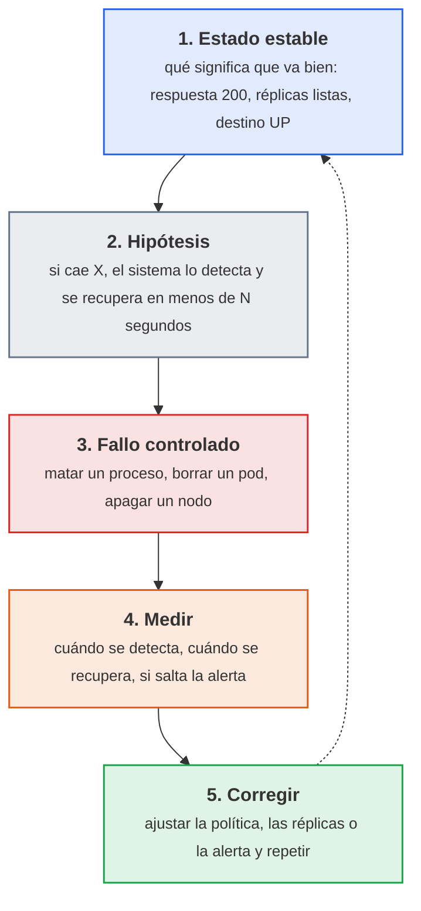

<p class="pie" markdown>El experimento parte de una hipótesis que se puede comprobar con un número, y termina con un cambio en el sistema, no solo con una conclusión.</p>

Dos reglas de seguridad acompañan a cualquier experimento. La primera es acotar el **radio de impacto**: se rompe una pieza cada vez, con un servicio de prueba y con la forma de deshacerlo preparada. La segunda es partir de un sistema sano, con la monitorización funcionando, porque sin ella no hay forma de medir. En un laboratorio se puede romper todo; en producción se empieza por un entorno de pruebas y por horas de poca carga, y solo cuando el sistema demuestra que aguanta se pasa a probar en el entorno real.

Las herramientas existen para automatizar y repetir esos experimentos. Ninguna se instala en el curso, pero conviene reconocerlas:

| Herramienta | Dónde actúa | Qué hace | Coste |
|---|---|---|---|
| Chaos Monkey | Máquinas de una nube gestionada con Spinnaker | Apaga instancias al azar en horario laboral | Libre |
| Chaos Mesh | Kubernetes | Mata pods, corta o retrasa la red, sobrecarga CPU y disco | Libre |
| Chaoskube | Kubernetes | Borra pods elegidos al azar cada cierto tiempo | Libre |
| Chaos Toolkit | Cualquier sistema con extensiones | Describe el experimento en un fichero y lo ejecuta | Libre |
| Gremlin | Servidores, contenedores, nubes | Plataforma comercial con todo lo anterior y una interfaz | De pago |

La hoja hace a mano, con `kill`, `kubectl delete` y apagado de máquinas, lo que estas herramientas hacen de forma programada: para entender qué se mide vale más provocar un fallo una vez que configurar una herramienta.

### Medir la reacción del sistema

Reaccionar de forma automática a un fallo quiere decir que hay una pieza que detecta el problema y otra que lo repara sin intervención humana. En el laboratorio del curso cada capa tiene la suya, y cada una con un tiempo característico:

| Fallo | Quién detecta y repara | Qué se espera | Orden de tiempo |
|---|---|---|---|
| Un proceso del contenedor muere | Docker, con la política `restart: unless-stopped` | El contenedor se vuelve a arrancar solo. Sin política, se queda parado | Segundos |
| Se borra un pod | El Deployment de Kubernetes, que mantiene el número de réplicas | Crea otro pod para volver a las dos réplicas | Segundos |
| Se apaga un nodo del clúster | El controlador de nodos de Kubernetes | El nodo pasa a `NotReady`; sus pods se reprograman en otro nodo pasado el tiempo de tolerancia | Unos 40 s para detectar, unos 5 min para reprogramar |
| Un servidor deja de responder | Prometheus, con una regla de alerta | `up` pasa a 0, la alerta pasa a `Pending` y después a `Firing` | Intervalo de extracción más el `for` de la regla |

La diferencia entre "detectar" y "reparar" es la que se mide. Dos tiempos resumen el comportamiento de un sistema ante un fallo:

| Tiempo | Qué mide | Cómo se toma en la hoja |
|---|---|---|
| Tiempo de detección | Desde que ocurre el fallo hasta que el sistema o la monitorización lo notan | Hora del fallo frente a hora de `NotReady` o de `Firing` |
| Tiempo de recuperación | Desde el fallo hasta que el servicio vuelve a responder | Bucle de `curl` con marca de hora |

El tiempo de recuperación es la métrica de despliegue "tiempo medio de recuperación". Y un fallo que se repara solo pero no avisa deja un problema oculto: un contenedor que se reinicia cada minuto está sano para el usuario y roto para quien lo mantiene. Por eso el experimento comprueba las dos cosas, reparación y alerta.

Dos precisiones evitan interpretar mal los resultados. La política `unless-stopped` no reinicia un contenedor parado a mano con `docker stop`: es la diferencia entre un fallo y una decisión. Y los cinco minutos antes de reprogramar los pods de un nodo caído son intencionados (evitan moverlo todo por un corte de red de segundos) y se ajustan con `tolerationSeconds`.

!!! examen "Qué se evalúa"
    Qué es la ingeniería del caos y por qué un experimento lleva hipótesis, radio de impacto acotado y medida; qué mecanismo reacciona en cada capa (política de reinicio, réplicas del Deployment, controlador de nodos, regla de alerta); la diferencia entre tiempo de detección y de recuperación; y por qué un sistema que se recupera solo sin avisar sigue siendo un problema.

### A5.17 Reacción a fallos (sesión 54)

<span class="et et-obj">Objetivo</span> Provocar cuatro fallos (contenedor con y sin política de reinicio, pod, nodo del clúster y servidor vigilado), medir cuánto tarda cada uno en detectarse y repararse y comprobar si salta la alerta. Es el CE e de la ACT_UT5_5, con plazo el 24 de mayo.

<span class="et et-pre">Antes de empezar</span> El clúster de la [A5.13](#a513-k3s-en-alta-disponibilidad-sesion-50) con `nginx` en el 30080, y la monitorización de la [A5.16](#a516-monitorizacion-de-un-servidor-sesion-53) con `ServidorCaido`; para que quepan las cinco VM, baja `pps01` a 4 GB antes de arrancarla y restáurala a 6 GB al terminar. Teoría: [ingeniería del caos](#ingenieria-del-caos) y [medir la reacción del sistema](#medir-la-reaccion-del-sistema).

<span class="et et-pas">Ejercicios</span> Trabaja en `pps01` y `k3s-1`, y contesta en `~/pps-entregas/ut5/a517/README.md`, con `nodo.log` y las capturas.

1. **Hipótesis.** Prepara una tabla de cuatro filas (contenedor, pod, nodo, servidor) con las columnas `Hipótesis`, `Detección`, `Recuperación`, `¿Alerta?` y `Conclusión`, y rellena `Hipótesis` con una cifra antes de romper nada.
2. **Nodo.** Con un bucle en `pps01` que pida `http://192.168.56.31:30080` cada segundo y guarde hora y código en `~/nodo.log`, apaga de golpe desde el anfitrión un nodo con un pod de `nginx` que no sea `k3s-1`. Anota cuánto tarda en salir `NotReady`.
3. **Contenedor.** En `pps01`, arranca `web-sin` (8101, sin política) y `web-con` (8102, `unless-stopped`) con `nginx:alpine`, mata el proceso principal de cada uno y mide cuánto tarda `web-con` en volver. Después para `web-con` con `docker stop` y mira si vuelve.
4. **Pod.** Borra un pod de `nginx` que no esté en el nodo apagado y mide cuánto tarda el Deployment en volver a dos réplicas listas.
5. **Servidor.** Para el node_exporter de `destino01` y anota la hora de `ServidorCaido` en `Pending` y en `Firing`. Arráncalo y comprueba que la alerta se resuelve.
6. **Cierre.** A los cinco minutos del apagado, mira qué hizo el clúster con los pods del nodo caído, para el bucle, cuenta los fallos de `nodo.log` y enciende el nodo. Completa la tabla con lo medido y retira `web-sin` y `web-con`.

## Sesión 55 · Recuperación ante desastres y retroalimentación

<p class="ut-meta" markdown>20 de mayo · Teoría y práctica · <span class="dur" tabindex="0" aria-label="Plan de recuperación: copias, RTO y RPO · 15 min&#10;Bucles de retroalimentación y retrospectivas · 10 min&#10;A5.18 Plan de recuperación · 85 min" data-dur="Plan de recuperación: copias, RTO y RPO · 15 min&#10;Bucles de retroalimentación y retrospectivas · 10 min&#10;A5.18 Plan de recuperación · 85 min">:material-school:<i class="dur-barra" style="--teoria:23%"></i>:material-flask:</span></p>

La sesión anterior terminó con fallos que el sistema absorbe solo (un contenedor que se reinicia, un pod que se recrea). Esta trata de los fallos que no absorbe: el volumen que se borra, la máquina que no arranca, el disco que se llena. Al acabar hay un plan de recuperación escrito con dos números que lo gobiernan (RTO y RPO), una copia de un volumen real de `pps01` restaurada en un contenedor de prueba con el tiempo medido, y una retrospectiva breve que convierte lo aprendido en acciones. La herramienta es una orden de `docker` con `tar` para la copia y un documento en Markdown para el plan; lo que importa es el procedimiento, no la herramienta.

!!! consulta "Recursos de la sesión"
    **Para la práctica**

    - [Copia y restauración en K3s](https://docs.k3s.io/datastore/backup-restore): la recuperación del clúster.

### Plan de recuperación: copias, RTO y RPO

El objetivo de este apartado es poder contestar por escrito, para cada servicio, dos preguntas: cuánto tiempo se puede estar sin él y cuántos datos se pueden perder. Con esas dos respuestas se decide qué copia se hace, cada cuánto y dónde se guarda.

Un **desastre**, a efectos de la unidad, es cualquier suceso que deja un servicio inutilizable y que no se corrige con un reinicio: borrado por error, disco corrupto, máquina perdida, credencial comprometida que obliga a reconstruir. La recuperación se mide con dos objetivos que fija quien responde del servicio, no quien lo administra:

| Objetivo | Qué mide | Cómo se cumple |
|---|---|---|
| **RTO** (tiempo objetivo de recuperación) | Tiempo máximo aceptable entre la caída y el servicio de nuevo en pie | Procedimiento escrito y ensayado, infraestructura reproducible (Terraform y Ansible), imágenes ya publicadas |
| **RPO** (punto objetivo de recuperación) | Cantidad máxima de datos que se acepta perder, expresada en tiempo (por ejemplo 24 horas) | Frecuencia de las copias: el RPO no puede ser menor que el intervalo entre copias |

Ejemplo del laboratorio: si el Jenkins de `pps01` se pierde y basta con volver a la copia de anoche, el RPO es de 24 horas y una copia diaria lo cumple. Si el RTO es de una hora, el procedimiento de restauración tiene que caber en una hora **medida**, no supuesta.

Lo que se protege no es todo por igual. Una regla útil es separar lo que se **reconstruye** de lo que se **restaura**:

| Qué es | Cómo se recupera | Ejemplo en `pps-app` |
|---|---|---|
| Código y configuración como código | Se clona el repositorio; no necesita copia propia | `pps-app` en GitHub, `pps-iac` con Terraform y Ansible |
| Imágenes | Se vuelven a descargar de Docker Hub o se reconstruyen con el pipeline | `pps<NIA>/pps-app:<etiqueta>` |
| Máquinas | Se recrean con Terraform y Ansible | `destino01`, los nodos de K3s |
| **Datos con estado** | **Solo se restauran de una copia**: no hay otra fuente | Volumen `jenkins_home` (trabajos, credenciales cifradas, historial), datos de Grafana |

Por eso el plan de recuperación gasta su esfuerzo en el último renglón: lo demás ya está a salvo si la unidad se ha hecho bien. Para las copias vale la regla **3-2-1** como punto de partida: tres copias de los datos, en dos soportes distintos, con una fuera de la máquina original. En el laboratorio la copia se hace en `pps01`; enviarla además a otra VM con `scp` ya contaría como "fuera de la máquina".

Una copia que nunca se ha restaurado no es una copia: es una esperanza. Por eso el plan incluye siempre una **restauración de prueba** en un sitio distinto del original, y el RTO que se declara es el que se mide en ella. Y una copia de un volumen con credenciales es tan sensible como las credenciales: se guarda con permisos `600`, fuera de cualquier repositorio y, si sale de la máquina, cifrada.

!!! ojo "Copia de seguridad con la clave al lado"
    El volumen `jenkins_home` guarda las credenciales cifradas y, en el mismo volumen, la clave maestra que las descifra (`secrets/`). Una copia entera contiene, por tanto, todo lo necesario para leerlas. La copia se trata como un secreto: permisos `600`, nunca en `pps-entregas` ni en una captura, y en la carpeta de entregas solo va su suma `sha256`.

El contenido mínimo de un plan de recuperación cabe en una lista: qué servicios cubre y con qué RTO y RPO, qué se copia, cómo y con qué frecuencia, dónde se guarda, quién lo restaura, los pasos exactos de la restauración (con las órdenes), cómo se comprueba que ha funcionado y cuándo se ensayó por última vez.

### Bucles de retroalimentación y retrospectivas

Un incidente o un proyecto no acaban cuando el servicio vuelve a funcionar, sino cuando el equipo ha decidido qué cambia para que no se repita. Este apartado da la herramienta para cerrar ese bucle sin convertirlo en una reunión larga.

DevOps insiste en los **bucles de retroalimentación** cortos: cuanto antes llega al equipo la información de lo que salió mal, más barato es corregirlo. La unidad ya tiene varios bucles automáticos (el pipeline avisa en minutos de que una prueba falla, Prometheus avisa de que un nodo cae). La **retrospectiva** es el bucle humano: una reunión corta, al cerrar un ciclo de trabajo, donde el equipo revisa cómo trabajó, no solo qué construyó. El formato mínimo tiene tres columnas y una regla:

| Columna | Pregunta | Ejemplo |
|---|---|---|
| Qué salió bien | ¿Qué conviene mantener? | La restauración se hizo con un script y en 4 minutos |
| Qué mejorar | ¿Qué costó más de lo esperado? | Nadie sabía dónde estaba la copia |
| Acciones | ¿Qué se hace distinto, quién y para cuándo? | `ops` guarda la ruta de copias en el README, antes del lunes |

La regla es que **una retrospectiva sin acciones con responsable y fecha no ha servido**: cada punto de "qué mejorar" o bien se convierte en una acción o se descarta a propósito. Los roles se escriben (`ops`, `admin`, "el equipo de Sistemas"), no nombres de personas, y en la reunión siguiente se revisa qué acciones se cumplieron.

Los números alimentan la conversación. Cuatro métricas de despliegue, usadas de forma habitual, resumen la salud de la entrega: **frecuencia de despliegue** (cada cuánto llega un cambio a producción), **plazo de entrega de un cambio** (del commit al servicio), **tasa de fallos** de los cambios y **tiempo de recuperación** (lo que se tarda en volver a un estado bueno tras un fallo). Las dos últimas enlazan directamente con esta sesión: el tiempo de recuperación medido en la restauración es el dato que se compara con el RTO, y las mediciones de la simulación de fallos son la base de la retrospectiva.

!!! examen "Qué se evalúa de este bloque"
    Definir RTO y RPO con un ejemplo y decir de qué depende cada uno. Distinguir qué se reconstruye (código, imágenes, máquinas) de qué se restaura (datos con estado) y por qué una copia no probada no cuenta. Enumerar el contenido de un plan de recuperación. Explicar qué es un bucle de retroalimentación, el formato de una retrospectiva y las cuatro métricas de despliegue. Es el criterio f (documentar la recuperación) y el g (bucles de retroalimentación).

### A5.18 Plan de recuperación (sesión 55)

<span class="et et-obj">Objetivo</span> Redactar el plan de recuperación de Jenkins y de `pps-app` con su RTO y RPO, restaurar una copia de `jenkins_home` midiendo el tiempo y cerrar con una retrospectiva. Son los CE f y g de la ACT_UT5_5, con plazo el 24 de mayo.

<span class="et et-pre">Antes de empezar</span> `pps01` con el contenedor `jenkins` (`pps-jenkins:2`, [A5.6](#a56-jenkins-con-docker-sesion-42)) y una instantánea recién hecha, y las mediciones de la [A5.17](#a517-reaccion-a-fallos-sesion-54). Teoría: [plan de recuperación, RTO y RPO](#plan-de-recuperacion-copias-rto-y-rpo) y [retrospectivas](#bucles-de-retroalimentacion-y-retrospectivas).

<span class="et et-pas">Ejercicios</span> Trabaja en `pps01` y contesta en `~/pps-entregas/ut5/a518/`: `plan-recuperacion.md`, `copia.sha256`, `retrospectiva.md` y la captura del Jenkins restaurado, sin el `.tar.gz`.

1. **Plan.** Crea `~/copias` fuera de cualquier repositorio, con permisos `700`, y empieza `plan-recuperacion.md` con una tabla para Jenkins (su dato con estado es `jenkins_home`) y para `pps-app` en K3s: RPO, RTO y cómo se recupera cada uno, con una línea de justificación.
2. **Copia.** Copia `jenkins_home`, sin parar Jenkins, a un `.tar.gz` de `~/copias` con la fecha en el nombre y permisos `600`. Guarda su suma en `copia.sha256` y anota la hora.
3. **Dato posterior.** Crea en Jenkins el trabajo vacío `posterior-a-la-copia` y anota la hora: su distancia a la copia es el RPO real.
4. **Restauración.** Restaura la copia sin tocar el original, en el volumen `jenkins_restaurado` y el contenedor `jenkins-restaurado` de `pps-jenkins:2` en el 8091, y cronometra hasta que `/login` responde (el RTO medido). Comprueba que están el trabajo de `pps-app` y las credenciales `github-token`, `dockerhub` y `nvd-api-key`, y que `posterior-a-la-copia` no. Con copias de varios días, `tar` no admite el comodín: elige la más reciente.
5. **Ajuste.** Si el RTO medido supera el objetivo, cambia el objetivo (y di por qué) o el procedimiento, por ejemplo con un script `restaurar-jenkins.sh`. Completa el plan con el contenido mínimo de la teoría y explica en tres líneas cómo se repone `pps-app` con su imagen y `k8s/pps-app.yaml`.
6. **Retrospectiva.** Retira el Jenkins y el volumen de prueba y escribe en grupo, en 10 minutos, `retrospectiva.md`: hechos de las A5.17 y A5.18, acciones con rol responsable y fecha, y las métricas de despliegue tal como se han vivido.

## Sesión 56 · Proyecto integrador: construcción y pipeline

<p class="ut-meta" markdown>24 de mayo · Teoría y práctica · <span class="dur" tabindex="0" aria-label="Presentación del proyecto y criterios · 10 min&#10;A5.19 Proyecto: construcción y pipeline · 100 min" data-dur="Presentación del proyecto y criterios · 10 min&#10;A5.19 Proyecto: construcción y pipeline · 100 min">:material-school:<i class="dur-barra" style="--teoria:9%"></i>:material-flask:</span></p>

El proyecto integrador no introduce herramientas nuevas: recorre de una vez, sobre la misma aplicación `pps-app`, lo que la unidad ha construido por piezas. Al acabar esta sesión existe la primera mitad del recorrido, un pipeline de Jenkins que construye, prueba, analiza las dependencias y publica la imagen en Docker Hub cada vez que cambia la rama principal. Antes de la hoja se presenta qué se entrega y con qué criterios se califica. La segunda mitad, con el despliegue, la monitorización y el plan de recuperación, se hace el 27 de mayo.

!!! consulta "Recursos de la sesión"
    **Para la práctica**

    - [Pipelines de Jenkins](https://www.jenkins.io/doc/book/pipeline/) y [repositorios y etiquetas en Docker Hub](https://docs.docker.com/docker-hub/): construir, probar y publicar la imagen.
    - El enunciado del proyecto integrador está en el aula.

### Enunciado del proyecto integrador

El objetivo es entregar un sistema que se pueda seguir de punta a punta: un cambio en `pps-app` llega, sin manos, a un servicio que corre en K3s, se ve en un panel y tiene un plan de recuperación probado. La herramienta que hilvana todo es el pipeline de Jenkins; las demás (Ansible, K3s, Prometheus, Grafana) ya se han usado por separado.

**Qué se construye**, con los nombres fijos del laboratorio:

1. **Pipeline**: `Jenkinsfile` en la raíz de `pps-app` con las etapas de construcción y pruebas con Maven (el código lo obtiene Jenkins al leer el `Jenkinsfile` del repositorio), análisis de dependencias con OWASP Dependency-Check, suma `sha256` del jar y publicación de la imagen `pps<NIA>/pps-app:<número de build>` en Docker Hub con las credenciales `github-token`, `dockerhub` y `nvd-api-key` de Jenkins.
2. **Despliegue**: un playbook de Ansible en `~/pps-iac/ansible/` que despliega esa imagen en el clúster K3s (`k3s-1`, `k3s-2`, `k3s-3`) con `k8s/pps-app.yaml`, con dos réplicas, y que se puede ejecutar dos veces sin cambios en la segunda.
3. **Monitorización**: los nodos del clúster aparecen en el Prometheus de `pps01` y en un panel de Grafana.
4. **Plan de recuperación**: el de la hoja A5.18 ajustado al proyecto, con RTO y RPO, y la evidencia de una restauración.

El plazo es el lunes 31 de mayo a las 23:59. Se cubren los criterios c, d, e y f de RA5. La calificación reparte cien puntos así:

| Criterio | CE | Peso | Qué se comprueba |
|---|---|---|---|
| Pipeline que construye, prueba y analiza | c | 25 % | `Jenkinsfile` versionado con etapas de Maven, pruebas y Dependency-Check, con fallo ante una vulnerabilidad crítica, credenciales solo en Jenkins, suma `sha256` del artefacto y ningún secreto en el repositorio |
| Imagen publicada en Docker Hub | c | 10 % | Etiqueta igual al número de build, que arranca y responde en `/salud` |
| Despliegue automatizado en K3s | d | 25 % | Playbook y `k8s/pps-app.yaml`, dos réplicas en `Running`, servicio accesible, segunda pasada con `changed=0` |
| Monitorización | e | 15 % | Aplicación y nodo como objetivos `UP` en Prometheus, panel de Grafana con captura y al menos una alerta útil |
| Plan de recuperación | f | 15 % | RTO y RPO justificados, copia y restauración medida, procedimiento con órdenes exactas |
| Calidad del informe y del README | c, d, e, f | 10 % | Reproducible por otra persona, con el recorrido, los comandos y las capturas, sin secretos |

Un proyecto que no llega a una parte se califica por las que sí entrega: es mejor un pipeline completo y un despliegue a medias que todo a medias. Dependency-Check con el pipeline verde pero sin que haya llegado a probarse que **falla** con una vulnerabilidad crítica no obtiene el peso entero del criterio de seguridad.

!!! examen "Qué se evalúa de este bloque"
    Del proyecto se pregunta el recorrido, no las órdenes: qué fase del pipeline detecta cada tipo de fallo (prueba fallida, vulnerabilidad, secreto expuesto), por qué la imagen se etiqueta con el número de build y no solo con `latest`, y por qué las credenciales viven en Jenkins. También se pueden pedir cambios sobre un `Jenkinsfile` dado (añadir una etapa, cambiar el umbral de fallo).

### A5.19 Proyecto: construcción y pipeline (sesión 56)

<span class="et et-obj">Objetivo</span> Completar el `Jenkinsfile` de `pps-app` para que construya, pruebe, analice las dependencias, calcule la suma del jar y publique `pps<NIA>/pps-app:<build>` en Docker Hub. Es la parte de pipeline del proyecto integrador (CE c), con plazo el 31 de mayo.

<span class="et et-pre">Antes de empezar</span> Jenkins con `github-token`, `dockerhub`, `nvd-api-key` y `dc-data` ([A5.7](#a57-pipeline-seguro-sesion-43)), `pps-app` con la rama protegida ([A5.2](#a52-git-en-equipo-sesion-38)) y un repositorio público `pps<NIA>/pps-app` en Docker Hub. Teoría: [enunciado del proyecto](#enunciado-del-proyecto-integrador).

<span class="et et-pas">Ejercicios</span> Trabaja en `~/pps-app` y contesta en `~/pps-entregas/ut5/proyecto/README.md`.

1. **Etapas.** En la rama `proyecto-pipeline`, deja el `Jenkinsfile` con las cuatro etapas del enunciado: construir y probar con Maven, analizar dependencias, calcular la suma del jar y publicar la imagen. Conserva lo que ya tenga de la A5.7.
2. **Publicación.** Escribe la etapa que verifica la suma, construye la imagen con `$BUILD_NUMBER` como etiqueta, entra en Docker Hub con `dockerhub` (con `withCredentials`, `--password-stdin` y comillas simples), la sube y cierra la sesión.
3. **Revisión.** Comprueba que el `Jenkinsfile` no lleva ningún secreto y llévalo a `main` con un pull request que apruebe tu pareja.
4. **Pipeline en verde.** Lanza el trabajo desde `main` hasta que quede verde. Anota el número de build y captura las etapas, el informe `dc-report` y los artefactos.
5. **Comprobación.** Comprueba que la etiqueta está en Docker Hub, que la imagen responde en `/salud` (en el 8083 de `pps01`, solo para esta prueba) y que `sha256sum -c` valida el jar archivado.
6. **Extra (opcional).** Demuestra que la puerta de seguridad funciona: en una rama, añade una dependencia con una vulnerabilidad crítica conocida y comprueba que el análisis falla y la publicación no se ejecuta.

## Sesión 57 · Proyecto integrador: despliegue y monitorización

<p class="ut-meta" markdown>27 de mayo · Teoría y práctica · <span class="dur" tabindex="0" aria-label="Dudas comunes del proyecto · 10 min&#10;A5.20 Proyecto: despliegue y monitorización · 100 min" data-dur="Dudas comunes del proyecto · 10 min&#10;A5.20 Proyecto: despliegue y monitorización · 100 min">:material-school:<i class="dur-barra" style="--teoria:9%"></i>:material-flask:</span></p>

Con la imagen ya publicada por el pipeline, esta sesión cierra el recorrido: un playbook de Ansible la despliega en el clúster K3s, Prometheus y Grafana vigilan los nodos y el plan de recuperación se ajusta al proyecto y se ensaya con un tiempo medido. Al terminar, el proyecto está listo para entregarse el 31 de mayo. Antes de la hoja se repasan las dudas que se repiten en este tipo de integración.

!!! consulta "Recursos de la sesión"
    **Para la práctica**

    - [Ansible](https://docs.ansible.com/), [K3s](https://k3s.io/) y [Prometheus](https://prometheus.io/docs/): desplegar con réplicas y monitorizar.

### Dudas comunes del proyecto

El objetivo es llegar a la hoja sabiendo cómo encajan las piezas y qué suele fallar en las uniones, que es donde se pierde el tiempo en un proyecto integrador. Las herramientas no cambian: Jenkins entrega una imagen, Ansible la despliega, K3s la ejecuta y Prometheus la vigila.

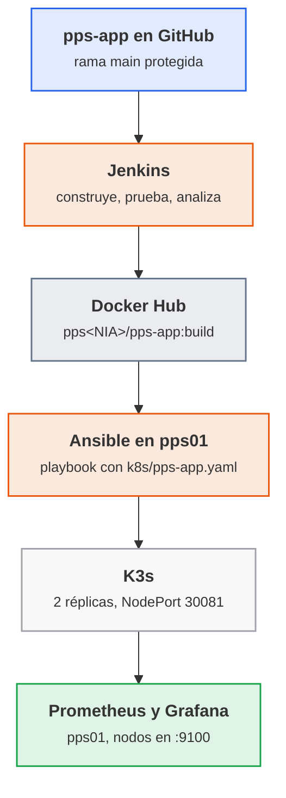

<p class="pie" markdown>Recorrido del proyecto: el único dato que viaja entre el pipeline y el despliegue es la **etiqueta** de la imagen, el número de build.</p>

Las uniones que más fallan, con su causa y su arreglo:

| Unión | Síntoma | Causa habitual | Arreglo |
|---|---|---|---|
| Docker Hub a K3s | Pods en `ImagePullBackOff` | Repositorio privado, o etiqueta que no existe | Repositorio público en el laboratorio; comprobar la etiqueta con `docker pull` antes de desplegar |
| Ansible a K3s | El playbook no encuentra `k3s` | Se ejecuta en un nodo que no es servidor, o sin `become` | Apuntar a `k3s-1` y con `become: true`; `k3s kubectl` está en la ruta del servidor |
| Servicio | No responde en el puerto del nodo | NodePort distinto al del manifiesto, o pods sin pasar la sonda | Mirar `k3s kubectl get svc,pods`; la sonda de `/salud` marca los pods como listos |
| Prometheus | Objetivo `DOWN` | `node_exporter` no instalado o puerto 9100 no alcanzable | Comprobar `curl http://<nodo>:9100/metrics` desde `pps01` |

Dos criterios de diseño se defienden en el informe. El primero: **la etiqueta de la imagen es el número de build**, nunca `latest`, porque `latest` no dice qué versión corre, no se puede volver a la anterior y K3s no descarga de nuevo una imagen que cree que ya tiene. Con el número de build, desplegar es cambiar un parámetro del playbook y volver atrás es desplegar el número anterior. El segundo: **el playbook es idempotente**, así que se puede ejecutar de nuevo tras un fallo sin miedo, y esa propiedad es la que permite decir que el plan de recuperación de la aplicación es "ejecutar el playbook".

!!! ojo "La aplicación no publica métricas"
    `pps-app` es un servidor mínimo sin endpoint `/metrics`, así que Prometheus no ve la aplicación, sino los nodos que la alojan (CPU, memoria, disco y red con `node_exporter`). Para el proyecto es suficiente, y la disponibilidad de la propia aplicación se comprueba con la sonda `/salud` de K3s. Instrumentar la aplicación queda fuera del alcance de la unidad.

!!! examen "Qué se evalúa de este bloque"
    Por qué se etiqueta con el número de build y no con `latest`, qué garantiza la idempotencia de un playbook y cómo se comprueba, qué mide cada capa de la monitorización (nodo, servicio, aplicación) y qué CE toca cada parte del proyecto. También la lectura de un `k8s/pps-app.yaml`: réplicas, sonda y tipo de servicio.

### A5.20 Proyecto: despliegue y monitorización (sesión 57)

<span class="et et-obj">Objetivo</span> Desplegar en K3s con Ansible la imagen del pipeline, vigilar los tres nodos con Prometheus y Grafana y medir el tiempo de reposición de la aplicación. Es la parte de despliegue, monitorización y recuperación del proyecto integrador (CE d, e y f), con plazo el 31 de mayo.

<span class="et et-pre">Antes de empezar</span> `pps01` y `k3s-1` a `k3s-3` ([A5.13](#a513-k3s-en-alta-disponibilidad-sesion-50)) con Internet; en `pps01`, el stack de la [A5.16](#a516-monitorizacion-de-un-servidor-sesion-53), `~/pps-iac/ansible/`, la imagen `pps<NIA>/pps-app:N` de la [A5.19](#a519-proyecto-construccion-y-pipeline-sesion-56) y el plan de la [A5.18](#a518-plan-de-recuperacion-sesion-55). Teoría: [dudas comunes del proyecto](#dudas-comunes-del-proyecto).

<span class="et et-pas">Ejercicios</span> Trabaja en `~/pps-iac/ansible/` de `pps01` y amplía `~/pps-entregas/ut5/proyecto/README.md`. Los ejercicios 1 a 4 son lo largo; deja Grafana y el plan para el final.

1. **Inventario.** Añade un grupo `k3s` con los tres nodos por su IP y el usuario `vagrant`, y comprueba que Ansible llega a los tres.
2. **Manifiesto.** En la rama `proyecto-k8s` de `pps-app`, deja `k8s/pps-app.yaml` con el Deployment de la A5.14 (dos réplicas y sonda de `/salud`), un Service `NodePort` en el 30081 hacia el 8080 y la línea `image: IMAGEN_PPS_APP`, que cambiará el playbook.
3. **Playbook.** Escribe `despliegue-k3s.yml` con tres jugadas: `prometheus-node-exporter` en marcha en los tres nodos; en `k3s-1`, con `become`, aplicar el manifiesto con la imagen `pps<NIA>/pps-app:{{ build }}` y esperar con `k3s kubectl rollout status` (con `changed_when: false`); y desde cada nodo, `uri` a `/salud` en el 30081. La tarea que aplica es esta:

    ```yaml
    - ansible.builtin.command:
        cmd: k3s kubectl apply -f -
        stdin: "{{ lookup('ansible.builtin.file', manifiesto) | replace('IMAGEN_PPS_APP', imagen) }}"
      register: aplicar
      changed_when: "'configured' in aplicar.stdout or 'created' in aplicar.stdout"
    ```

4. **Despliegue.** Lanza con `-e build=N` y repite hasta `changed=0` en `k3s-1`. Captura los dos pods `pps-app` en `Running` repartidos y la respuesta en el 30081 de los tres nodos.
5. **Monitorización.** Añade al `prometheus.yml` de `pps01` el trabajo `k3s` con el 9100 de los tres nodos hasta verlos en `UP`, y captura el panel de node_exporter de `k3s-1`.
6. **Recuperación.** Borra el Deployment y el Service de `pps-app` y cronometra el playbook que los repone. Copia a `ut5/proyecto/plan-recuperacion.md` el plan de la A5.18 ajustado (Jenkins con su copia, `pps-app` con el playbook, RTO medido frente a objetivo) y guarda `despliegue-k3s.yml` también en `pps-iac`.

## Sesión 58 · Margen y repaso de la unidad 5

<p class="ut-meta" markdown>31 de mayo · Margen · <span class="dur" tabindex="0" aria-label="Repaso y recuperación · 110 min" data-dur="Repaso y recuperación · 110 min">:material-school:<i class="dur-barra" style="--teoria:0%"></i>:material-flask:</span></p>

Sesión de margen, sin teoría nueva y sin hoja. Es el último día para entregar el proyecto integrador y Atenea (retos de RA3, RA4 y RA5), a las 23:59, y la última clase antes del examen de la segunda evaluación (RA4 y RA5). Se usa para recuperar lo pendiente y, si no hay nada pendiente, para repasar.

**Si se ha perdido alguna clase.** Se recupera aquí, por este orden de prioridad:

- Primero lo que tiene plazo hoy: el `README.md` y el playbook del proyecto ([A5.19](#a519-proyecto-construccion-y-pipeline-sesion-56) y [A5.20](#a520-proyecto-despliegue-y-monitorizacion-sesion-57)) y los retos de Atenea que falten.
- Después, las hojas que falten de una entrega ya vencida: las [A5.17](#a517-reaccion-a-fallos-sesion-54) y [A5.18](#a518-plan-de-recuperacion-sesion-55), que recoge ACT_UT5_5. Esa entrega se corrige sobre el 50 % si no hay causa justificada.
- Al final, las hojas de la unidad 4 que queden, porque también entran en el examen.

**Si no se ha perdido ninguna.** Se dedica la sesión a repasar para el examen, con este reparto orientativo:

- Revisar con el `README.md` del proyecto delante el recorrido completo (commit, pipeline, imagen, playbook, K3s, monitorización) y explicárselo en voz alta a la pareja de laboratorio: quien no sabe contar una fase no la domina.
- Repasar los cinco bloques `examen` de la unidad (DevOps y Git, Jenkins y CI, infraestructura como código, orquestación y monitorización, fallos y recuperación) y contestar de memoria las preguntas que plantean; repasar en especial credenciales y privilegios en Jenkins, el fichero de estado y los secretos en Terraform, blue-green, integridad y firma de artefactos, e infraestructura inmutable.
- Repetir sin apuntes la restauración de la hoja A5.18 y cronometrarla: cada minuto que baje es tiempo de examen práctico ganado.
- Resolver dudas de las unidades 4 y 5 en grupo, y mirar los errores de la lista de [Errores frecuentes](#errores-frecuentes-en-el-laboratorio) que se han vivido.

## Prácticas evaluables de la unidad

La unidad tiene seis entregas y ninguna tiene sesión propia: cada una se construye con las hojas de las que sale y se cierra por su plazo, siempre a las 23:59 (hora de Madrid) del día indicado, en su propia tarea de Aules. Las cuatro primeras tienen en el aula su enunciado en PDF, y **lo que dice ese enunciado es lo que se entrega**: este apartado lo resume y dice de qué hoja y de qué ejercicio sale cada punto, pero no añade ni quita nada. Lo que las hojas proponen fuera del enunciado está en su ejercicio «Extra (opcional)» y solo cuenta como «Extra», el nivel más alto de las rúbricas. ACT_UT5_5 y el proyecto integrador no tienen PDF: su enunciado es el de esta página. Fuera de plazo y sin causa justificada, una entrega se corrige sobre el 50 %. El plazo no se mueve aunque se pierda una clase: lo que se mueve es el contenido, y las sesiones 47 y 58 están para recuperarlo.

| Entrega en Aules | Enunciado (PDF) | Hojas | Plazo | CE |
|---|---|---|---|---|
| ACT_UT5_1 · Jenkins | RA5.1 Jenkins | A5.1 a A5.7 | jueves 15 de abril, 23:59 | a, b, c |
| ACT_UT5_2 · Terraform y Ansible | RA5.2 IaC: Infrastructure as Code | A5.8 a A5.11 | lunes 3 de mayo, 23:59 | d, e, f |
| ACT_UT5_4 · K3s y K9s | RA5.4 K3's & K9's | A5.12 a A5.14 | jueves 13 de mayo, 23:59 | a, b, c |
| ACT_UT5_3 · Prometheus y Grafana | RA5.3 Sistema de monitorización | A5.15 y A5.16 | lunes 17 de mayo, 23:59 | a, b, c |
| ACT_UT5_5 · Fallos y recuperación | Sin PDF: el de esta página | A5.17 y A5.18 | lunes 24 de mayo, 23:59 | e, f, g |
| Proyecto integrador | Sin PDF: el de esta página | A5.19 y A5.20 | lunes 31 de mayo, 23:59 | c, d, e, f |

El orden de plazos no sigue el de los números: ACT_UT5_4 (K3s) vence antes que ACT_UT5_3 (monitorización) porque sus hojas se dan antes, en las sesiones 49 a 51. **Los CE de la tabla son los que lista cada PDF.** El de RA5.2 lista «CA.» (sin letra), E y F: la letra que falta es la D, la que sigue la secuencia. Los de RA5.3 y RA5.4 listan A, B y C. Cada enunciado reparte su peso a partes iguales entre sus CE, y todos sus puntos los trabajan todos, por eso en las tablas de cada entrega cada punto lleva todos los CE de la entrega.

**Cómo se entrega.** Los enunciados RA5.1 y RA5.2 piden la entrega en GitHub: un repositorio con la estructura correcta y los ficheros necesarios para ejecutar lo que se pide, y un `README.md` con las capturas y una breve explicación. Los de RA5.3 y RA5.4 no fijan el formato, y se entregan del mismo modo, con las carpetas de las hojas en `pps-entregas`. En la tarea de Aules se escribe la URL del repositorio que se corrige; un repositorio privado (`pps-app`) se comparte antes del plazo con quien corrige, como colaborador. Ninguno de los cuatro enunciados pide un documento con la *Normativa de entrega*: el informe en PDF solo lo llevan ACT_UT5_5 y el proyecto integrador, y la forma de hacerlo está en [Del README al PDF de la entrega](../laboratorio.md#del-readme-al-pdf-de-la-entrega). Para todas:

- Las evidencias de cada hoja viven en `pps-entregas/ut5/a5<k>/` (por ejemplo `ut5/a54/`), con su `README.md`, los comandos usados, la validación y las capturas (ver [Repositorio de entregas](../laboratorio.md#repositorio-de-entregas)). Se sube con `git add`, `git commit` y `git push` al terminar cada hoja, no el día del plazo.
- El `README.md` que se corrige se ordena por los puntos del enunciado, con un título por punto y en su orden (`## 3.1 ...`, `## 3.2 ...`), cada captura con su pie, y lo que venga de los ejercicios «Extra (opcional)», en un capítulo final «Extra». Lo que lleva cada capítulo está en el apartado de cada entrega.
- Ninguna contraseña, token ni clave va en un repositorio, en el historial ni en una captura. Un secreto encontrado se descuenta en la fila donde aparece y obliga a rotarlo.

**Cómo se califica.** Las rúbricas de RA5.2, RA5.3 y RA5.4 tienen una fila por punto del enunciado y no dan peso a las filas; RA5.1 no trae rúbrica. Los pesos de cada entrega son, por eso, una propuesta por punto del enunciado, y la nota de la entrega es la media ponderada de sus filas. Cada fila se califica en uno de estos niveles:

| Entrega | Niveles de cada fila |
|---|---|
| ACT_UT5_1 (sin rúbrica: se usan los niveles de la de RA5.3) | 60 % funcionamiento correcto, 90 % análisis técnico, 100 % Extra |
| ACT_UT5_2 (rúbrica de RA5.2) | 60 % funcionamiento correcto, 80 % análisis técnico, 90 % pipeline, 100 % Extra |
| ACT_UT5_4 (rúbrica de RA5.4) | 50 % funcionamiento correcto del K3s, 70 % despliegue del servicio, 80 % validación con K9s, 90 % análisis técnico, 100 % Extra |
| ACT_UT5_3 (rúbrica de RA5.3) | 60 % funcionamiento correcto, 90 % análisis técnico, 100 % Extra |
| ACT_UT5_5 y proyecto integrador (sin PDF) | 40 % intentado pero no funciona, 60 % funciona sin evidencia clara, 80 % funciona y está documentado, 90 % explica el porqué de las decisiones, 100 % comprueba también el caso de fallo (un test que rompe, una credencial ausente, una vulnerabilidad que cuela) |

«Funcionamiento correcto» es que lo pedido funciona y se ve en la captura. «Análisis técnico» es que el README explica qué hace cada pieza y por qué el resultado demuestra que funciona; los ejercicios de las hojas que lo producen lo dicen en su título. «Pipeline», en RA5.2, es que el punto no se ejecuta a mano sino desde un pipeline: para Ansible, un trabajo de Jenkins que lanza el playbook (el «Extra (opcional)» de la [A5.11](#a511-ansible-despliegue-sesion-48)); para Terraform, que se ejecuta en el anfitrión y queda fuera del alcance del Jenkins de `pps01`, un script versionado que encadena `init`, `validate`, `plan` y `apply`. «Extra» es lo de los ejercicios «Extra (opcional)».

### ACT_UT5_1 · Jenkins

<p class="ut-meta" markdown>Sale de las hojas [A5.1](#a51-el-pipeline-de-entrega-sesion-37) a [A5.7](#a57-pipeline-seguro-sesion-43) · plazo jueves 15 de abril, 23:59 · RA5 CE a, b, c</p>

Enunciado: «RA5.1 Jenkins». Se entrega el repositorio `pps-app` de GitHub, con lo necesario para ejecutar los dos pipelines y un `README.md` con una captura de cada pipeline funcionando y una breve explicación. El punto 3.1 remite a las tareas 1 y 2 del apunte de Jenkins: un programa con pruebas unitarias y su pipeline en un `Jenkinsfile`, disparado con cada commit y con cada etapa rota a propósito. El curso las hace con `pps-app`, en Java, en lugar de la calculadora en Python del apunte, por las razones que da la [A5.3](#a53-construccion-con-maven-sesion-39). El enunciado nombra los CE a y b sin darles un punto propio: se evidencian con la explicación del README y con la organización de roles de la A5.2.

| Punto del enunciado | CE | Peso en la entrega (propuesta) | De dónde sale |
|---|---|---|---|
| Actividades: breve explicación en el README (CI/CD y qué hace cada pipeline) | a | 10 % | A5.1, ejercicios 3 a 5, y A5.5, ejercicio 5 |
| Actividades: entrega en GitHub con la estructura correcta, y control de versiones con roles | b | 10 % | A5.2, y A5.3, ejercicio 5 |
| 3.1 Tarea 1: programa con pruebas unitarias, ejecutado y publicado en GitHub | c | 20 % | A5.3, ejercicios 1 a 5 |
| 3.1 Tarea 2: `Jenkinsfile` disparado por cada commit, con cada etapa rota a propósito | c | 25 % | A5.4 y A5.5, ejercicios 1 a 4 |
| 3.2 `jenkinsfile.docker` con sus cinco etapas y el `docker-compose` en el repositorio | c | 35 % | A5.6, ejercicios 1 a 5 |

**Qué lleva el repositorio.** En la raíz de `pps-app`: `pom.xml` y `src/` (la aplicación y sus pruebas JUnit), `Jenkinsfile`, `jenkinsfile.docker`, `Dockerfile` y `compose.yml`, sin `target/`. Y un `README.md` con estos capítulos:

1. **Introducción.** Qué es `pps-app`, qué es CI/CD y qué control de seguridad corresponde a cada fase del pipeline (de la A5.1), con el enlace a `ut5/a52` de `pps-entregas`: la organización, los roles y la rama protegida (CE b).
2. **3.1 Tarea 1.** Cómo se construye, se prueba y se ejecuta la aplicación, con la salida de las pruebas y el `curl` a `/` y a `/salud`.
3. **3.1 Tarea 2.** El `Jenkinsfile`, la captura del pipeline en verde lanzado por un commit (*Started by an SCM change*), la captura de cada etapa rota y la explicación de qué etapas quedan en gris y por qué.
4. **3.2 `jenkinsfile.docker`.** Qué hace cada etapa en una línea, con el elemento del enunciado al que responde, la captura del pipeline en verde y el `curl` al compose en el 8092.
5. **Extra.** Lo que se haya hecho de los ejercicios «Extra (opcional)», en especial el pipeline seguro de la A5.7 (análisis de dependencias, credenciales y suma del jar) y, si se ha hecho, la calculadora en Python.

### ACT_UT5_2 · Terraform y Ansible

<p class="ut-meta" markdown>Sale de las hojas [A5.8](#a58-terraform-primera-maquina-sesion-44), [A5.10](#a510-ansible-primer-playbook-sesion-46) y [A5.11](#a511-ansible-despliegue-sesion-48), con la [A5.9](#a59-terraform-variables-y-estado-sesion-45) como Extra · plazo lunes 3 de mayo, 23:59 · RA5 CE d, e, f</p>

Enunciado: «RA5.2 IaC: Infrastructure as Code». Se entrega el repositorio `pps-iac` de GitHub, con `terraform/` y `ansible/` y lo necesario para ejecutarlos, y un `README.md` con la captura de la provisión, la de la configuración y la de la validación.

| Punto del enunciado | CE | Peso en la entrega (propuesta) | De dónde sale |
|---|---|---|---|
| 3.1 Provisionar una VM Ubuntu 24.04 en VirtualBox mediante Terraform | d, e, f | 40 % | A5.8, ejercicios 3 a 6 |
| 3.2 Configurarla con Ansible: update y upgrade automáticos del sistema e instalación de Apache | d, e, f | 30 % | A5.10 |
| 3.3 Configurarla con Ansible: `index.html` con `Ansible rocks`, reinicio del servicio y `curl` que verifica el mensaje | d, e, f | 30 % | A5.11, ejercicios 1 a 4 |

**Qué lleva el repositorio.** `terraform/` con `main.tf` y `.terraform.lock.hcl` (y `variables.tf`, `outputs.tf` y `terraform.tfvars.example` si se ha hecho la A5.9), `ansible/` con `inventario.ini`, `ansible.cfg`, `site.yml` y el rol `web`, y un `.gitignore` que deja fuera el estado y los ficheros de valores. El `README.md`, con estos capítulos:

1. **3.1 Provisión.** Desde dónde se lanza Terraform (el anfitrión, porque necesita `VBoxManage`), el `plan` leído, la captura del `apply` terminado con la máquina en VirtualBox, el SSH dentro de ella y el segundo `plan` sin cambios.
2. **3.2 Configuración.** El inventario y el playbook, la captura del `PLAY RECAP` de la primera ejecución y la de la segunda con `changed=0`.
3. **3.3 Validación.** La plantilla y el handler, la salida con el reinicio de Apache y la captura del `curl` que devuelve `Ansible rocks`.
4. **Pipeline y Extra.** Si algún punto se lanza desde un pipeline, cómo; y las variables, la salida y el estado de la A5.9, con lo que se haya hecho de los ejercicios «Extra (opcional)».

### ACT_UT5_4 · K3s y K9s

<p class="ut-meta" markdown>Sale de las hojas [A5.12](#a512-k3s-de-un-nodo-sesion-49), [A5.13](#a513-k3s-en-alta-disponibilidad-sesion-50) y [A5.14](#a514-balanceo-en-k3s-y-k9s-sesion-51) · plazo jueves 13 de mayo, 23:59 · RA5 CE a, b, c</p>

Enunciado: «RA5.4 K3's & K9's». Sus actividades van numeradas 5.1 a 5.3, y las referencias a «K9s del punto 3.1.1» y «del 3.2.1» no corresponden a ningún punto del PDF: se refieren a su apartado de K9s. El enunciado no fija el formato de entrega: se entregan las carpetas `ut5/a512`, `ut5/a513` y `ut5/a514` de `pps-entregas`, cada una con su README, y los manifiestos en `k8s/` de `pps-app`. El 5.2 se asigna al CE e porque es el que demuestra que el sistema desplegado sigue sirviendo solo cuando cae un servidor.

| Punto del enunciado | CE | Peso en la entrega (propuesta) | De dónde sale |
|---|---|---|---|
| 5.1 K3s en un nodo (instalación, configuración y validación), nginx con dos réplicas y validación con K9s | a, b, c | 30 % | A5.12, ejercicios 1 a 5 |
| 5.2 K3s en alta disponibilidad, nginx con dos réplicas y validación con K9s | a, b, c | 40 % | A5.13 |
| 5.3 Despliegue en K3s del `docker-compose` de balanceo de carga, validado con K9s | a, b, c | 30 % | A5.14 |

**Qué lleva cada README.** Un capítulo por punto, ordenado por los niveles de la rúbrica (funcionamiento del K3s, despliegue del servicio, validación con K9s y análisis técnico):

1. **5.1, en `ut5/a512`.** Los comandos de instalación y `kubectl get nodes -o wide` con `k3s-1` en `Ready`; `nginx.yaml`, `kubectl get deploy,pods,svc -o wide` con `2/2` y el `curl` al 30080; la captura de K9s con los dos pods; y qué hace cada objeto.
2. **5.2, en `ut5/a513`.** Los tres nodos en `Ready` con su rol, el despliegue repartido y el `200` desde las tres IP, la captura de K9s y lo que pasó con `k3s-3` apagada. Sin el token.
3. **5.3, en `ut5/a514`.** Los manifiestos y la tabla de equivalencias con el compose del taller, el `curl` con `Host: pps.lab` desde los tres nodos, el recuento del reparto y las capturas de K9s (cinco réplicas, logs y el pod recreado).

Cada README cierra con su «Extra», si lo hay.

### ACT_UT5_3 · Prometheus y Grafana

<p class="ut-meta" markdown>Sale de las hojas [A5.15](#a515-prometheus-y-grafana-sesion-52) y [A5.16](#a516-monitorizacion-de-un-servidor-sesion-53) · plazo lunes 17 de mayo, 23:59 · RA5 CE a, b, c</p>

Enunciado: «RA5.3 Sistema de monitorización». No fija el formato de entrega: se entregan las carpetas `ut5/a515` y `ut5/a516` de `pps-entregas`, cada una con su README.

| Punto del enunciado | CE | Peso en la entrega (propuesta) | De dónde sale |
|---|---|---|---|
| 3.1 Stack del ejemplo, validando la instalación y la configuración, con captura de todos sus elementos | a, b, c | 50 % | A5.15 |
| 3.2 Monitorización remota: node_exporter en el servidor, y Grafana con el panel de node_exporter en el cliente | a, b, c | 50 % | A5.16, ejercicios 1 a 4 |

**Qué lleva cada README.**

1. **3.1, en `ut5/a515`.** El `compose.yml` usado, una captura de cada uno de los seis elementos del stack y, por componente, qué hace y cómo se ha validado, con el resultado de `up` y de las consultas PromQL.
2. **3.2, en `ut5/a516`.** node_exporter en `destino01` y su `/metrics` leído desde `pps01`, el `prometheus.yml` con el trabajo `destino01` en `UP`, el panel de node_exporter con los datos de `destino01` y la subida de CPU.
3. **Extra.** La regla `ServidorCaido` cargada (la usa la A5.17) y lo que se haya hecho de los ejercicios «Extra (opcional)».

### ACT_UT5_5 · Fallos y recuperación

<p class="ut-meta" markdown>Sale de las hojas [A5.17](#a517-reaccion-a-fallos-sesion-54) y [A5.18](#a518-plan-de-recuperacion-sesion-55) · plazo lunes 24 de mayo, 23:59 · RA5 CE e, f, g</p>

Actividad nueva, sin enunciado en el aula: cubre lo que las herramientas anteriores no llegan a demostrar, que el sistema aguanta un fallo, que existe un procedimiento escrito para recuperarlo y que el equipo aprende de ello. Se entrega un informe en PDF con el formato de la *Normativa de entrega* (portada, índice, desarrollo, conclusiones y bibliografía) y las evidencias en `ut5/a517` y `ut5/a518`.

El informe contiene:

1. **Pruebas de fallo (A5.17)**: una tabla con cada fallo provocado (contenedor sin y con `restart: unless-stopped`, pod borrado, nodo apagado en el clúster de la A5.13), el tiempo medido hasta la recuperación, si saltó la alerta y qué se aprende de cada caso.
2. **Plan de recuperación (A5.18)**: RTO y RPO propuestos para el servicio con su justificación, procedimiento paso a paso para recuperarlo, y la evidencia de la restauración de prueba de un volumen (copia, borrado, restauración y comprobación de los datos).
3. **Retrospectiva (A5.18)**: qué salió bien, qué mejorar y al menos tres acciones con responsable y fecha, enlazadas con las métricas de despliegue (frecuencia de despliegue y tiempo de recuperación).

| Criterio | CE | Sale de | Peso |
|---|---|---|---|
| Fallos provocados, con recuperación automática medida y comparación con y sin política de reinicio | e | A5.17 | 30 % |
| Alertas comprobadas: qué fallo dispara qué aviso y en cuánto tiempo | e | A5.17 | 10 % |
| Plan de recuperación con RTO y RPO justificados y procedimiento que otra persona podría seguir | f | A5.18 | 25 % |
| Restauración de prueba de un volumen documentada con evidencia | f | A5.18 | 15 % |
| Retrospectiva con acciones concretas y bucle de retroalimentación con las métricas | g | A5.18 | 20 % |

Niveles: los de las entregas sin PDF, en [Cómo se califica](#practicas-evaluables-de-la-unidad).

### Proyecto integrador

<p class="ut-meta" markdown>Sale de las hojas [A5.19](#a519-proyecto-construccion-y-pipeline-sesion-56) y [A5.20](#a520-proyecto-despliegue-y-monitorizacion-sesion-57) · plazo lunes 31 de mayo, 23:59 · RA5 CE c, d, e, f</p>

Actividad nueva y sin trabajo nuevo de herramientas: junta en un solo hilo lo construido durante la unidad. Una confirmación en `pps-app` dispara el pipeline de Jenkins, que construye, prueba, analiza y publica la imagen `pps<NIA>/pps-app:<etiqueta>` en Docker Hub; el despliegue lleva esa imagen a K3s con `k8s/pps-app.yaml` y el playbook de Ansible; la aplicación se monitoriza en Prometheus y Grafana, y un informe recoge el plan de recuperación.

Entrega:

1. Repositorio `pps-app` con `Jenkinsfile`, `Dockerfile`, `k8s/pps-app.yaml`, el playbook de despliegue y un `README.md` con el diagrama del flujo completo y una captura del pipeline en verde.
2. Etiqueta `entrega-pps-ut5` en el repositorio: `git tag entrega-pps-ut5 && git push origin entrega-pps-ut5`. Si se corrige algo después, se mueve con `git tag -f` y se vuelve a subir.
3. Informe en PDF (formato de la *Normativa de entrega*) con la evidencia de cada fase, la prueba de que la aplicación responde en `/` y en `/salud` desde el clúster, el panel de Grafana con su tráfico y el plan de recuperación aplicado al servicio real, con una restauración probada.
4. Carpeta `ut5/proyecto/` en `pps-entregas`, con el `README.md` de cada parte.

| Criterio | CE | Sale de | Peso |
|---|---|---|---|
| Pipeline que construye, prueba y analiza, con credenciales fuera del código y fallo ante una vulnerabilidad crítica | c | A5.19 | 25 % |
| Imagen publicada en Docker Hub con la etiqueta del número de build | c | A5.19 | 10 % |
| Despliegue automatizado en K3s con el playbook y `k8s/pps-app.yaml`, con la aplicación respondiendo | d | A5.20 | 25 % |
| Monitorización de la aplicación y del nodo con al menos una alerta útil | e | A5.20 | 15 % |
| Plan de recuperación aplicado al servicio: RTO, RPO, procedimiento y restauración probada | f | A5.20 | 15 % |
| Calidad del informe y del README: reproducible por otra persona, sin secretos | c, d, e, f | A5.19 y A5.20 | 10 % |

Niveles: los de las entregas sin PDF, en [Cómo se califica](#practicas-evaluables-de-la-unidad).

El enunciado de ACT_UT5_1 a ACT_UT5_4 es su PDF del aula; ACT_UT5_5 y el proyecto integrador no tienen PDF, y su enunciado es el de esta página.

## Errores frecuentes en el laboratorio

Para lo general (VM que no arranca, disco lleno, puertos ocupados, Docker sin permisos) véase [Si algo se rompe](../laboratorio.md#si-algo-se-rompe). Aquí van los fallos propios de esta unidad.

**Jenkins: `docker: not found` o `permission denied while trying to connect to the Docker daemon socket`.** El contenedor `jenkins` no trae el cliente de Docker ni acceso al demonio. Se monta `/var/run/docker.sock` y se instala el cliente `docker` dentro de la imagen (o se usa una imagen propia derivada de `jenkins/jenkins:lts-jdk17`), y el usuario `jenkins` del contenedor tiene que poder leer el socket. Comprobación: `docker exec jenkins docker ps`. Recordatorio: montar el socket equivale a dar root sobre `pps01`; se acepta en el laboratorio y no en producción.

**Jenkins no arranca o pierde todo al reiniciar: `Permission denied` en `/var/jenkins_home`.** El volumen `jenkins_home` (o la carpeta montada en su lugar) pertenece a otro usuario; el contenedor corre como el usuario `jenkins` (UID 1000). Con un volumen con nombre no ocurre; con una carpeta del anfitrión hace falta `sudo chown -R 1000:1000 <carpeta>`. Si se creó el contenedor sin volumen, los trabajos desaparecen con `docker rm`: `docker volume ls` debe mostrar `jenkins_home`.

**El pipeline no encuentra la credencial: `Could not find credentials entry with ID 'dockerhub'`.** El identificador del `Jenkinsfile` no coincide letra por letra con el creado en Jenkins (`github-token` y `dockerhub`), o la credencial se guardó en otro ámbito o dentro de una carpeta. Se revisa en Administrar Jenkins > Credentials. Y si el secreto aparece en el log en claro, se usó `echo` o un `sh` con comillas dobles y la interpolación de Groovy; se pasa con `withCredentials` y comillas simples, y el secreto ya expuesto se revoca y se crea otro.

**GitHub rechaza el `push` o Jenkins no puede clonar: `Authentication failed`.** El token personal caducó o no tiene el ámbito de repositorio. No se arregla pegando el token en la URL del repositorio, que lo deja en el historial de shell y en la configuración del trabajo: se crea uno nuevo, se actualiza la credencial de Jenkins y se comprueba con "Test connection".

**Maven: `Fatal error compiling: release version 17 not supported` o `mvn: command not found` dentro de Jenkins.** El agente solo tiene JRE, o no tiene Maven. En `pps01` hace falta un JDK 17 (`javac -version`) y en Jenkins la herramienta Maven configurada en Administrar Jenkins > Tools, o un contenedor de construcción con `maven` y JDK. La versión de `maven.compiler.release` del `pom.xml` no puede ser mayor que el JDK disponible.

**A5.4 · `mvn: command not found` en la primera construcción.** El contenedor se arrancó con la imagen `jenkins/jenkins` y no con `pps-jenkins:1`, que es la que trae Maven. Se para, se borra el contenedor (el volumen `jenkins_home` se conserva) y se arranca con la imagen propia.

**A5.4 · La construcción #1 falla al clonar.** Casi siempre es una de tres cosas: la URL del repositorio, la rama (el trabajo busca `*/master` y el repositorio usa `main`) o la credencial `github-token`, que no está seleccionada en el trabajo o tiene el token caducado.

**A5.6 · `permission denied` en `/var/run/docker.sock` aunque el contenedor se arrancó con `--group-add`.** El número de grupo no es el del socket en `pps01`. Se mira con `stat -c %g /var/run/docker.sock` y se vuelve a arrancar el contenedor con ese número.

**A5.7 · La descarga de la base de la NVD termina con `Invalid API Key`, 403 o 429.** Los dos primeros son la clave: se revisa la credencial `nvd-api-key` de Jenkins (sin espacios ni salto de línea al final) y se repite. El 429 es que se han hecho demasiadas peticiones seguidas: basta esperar un poco y repetir.

**Dependency-Check tarda muchísimo o falla al bajar la base de vulnerabilidades.** La primera ejecución descarga toda la base (NVD) y, sin clave de API, el servicio la limita: con treinta alumnos a la vez el aula agota la cuota y salen errores `403` o `429`. Soluciones, por orden: pedir una clave gratuita de la NVD y guardarla como credencial de Jenkins (nunca en el `Jenkinsfile`), conservar la carpeta de datos en un volumen para que solo la primera vez sea lenta, y en clase escalonar el arranque. Un fallo de descarga no debe interpretarse como "sin vulnerabilidades": el pipeline tiene que fallar, no dar verde.

**Terraform con VirtualBox: `VBoxManage: error` o el `apply` deja la VM a medias.** Casi siempre la virtualización por hardware está desactivada, otra VM tiene bloqueado el disco, o el nombre de la VM ya existe en VirtualBox de una prueba anterior. `VBoxManage list vms` muestra qué hay; si Terraform no la conoce, se elimina a mano y se repite. Si aparece `Error: Failed to query available provider packages`, no hay salida a Internet desde `pps01` durante `init`. Nunca se borra `terraform.tfstate` para "empezar de cero" con la VM viva: se pierde la relación entre el código y la máquina.

**Ansible: `UNREACHABLE! ... Permission denied (publickey)` o `Connection timed out`.** La clave pública de `pps01` no está en `destino01` (el paso de `ssh-copy-id` o su equivalente en la provisión), el usuario del inventario no es `vagrant`, o la IP no es `192.168.56.20`. `ssh -v vagrant@192.168.56.20` lo dice antes de tocar Ansible. Con `sudo` que pide contraseña falla `become`: hace falta `--ask-become-pass` o sudo sin contraseña para el usuario en el laboratorio. Y si `apt` responde `Could not get lock`, el arranque de la VM aún está aplicando actualizaciones: se espera un par de minutos.

**K3s: los nodos no se unen al clúster.** Las tres causas habituales son: el token (`sudo cat /var/lib/rancher/k3s/server/node-token` en el primer servidor) mal copiado, el nombre de máquina repetido entre nodos (cada uno tiene que llamarse `k3s-1`, `k3s-2` y `k3s-3`), o el puerto `6443` inalcanzable desde el nuevo nodo (`curl -k https://192.168.56.31:6443`). Con etcd embebido el primer servidor se instala con `--cluster-init` y los demás con `--server https://192.168.56.31:6443`. Con 1,5 GB por nodo, si un nodo queda en `NotReady` conviene mirar `free -m` y `journalctl -u k3s`: la falta de memoria es lo más probable. Tras apagar un nodo del trío, `kubectl` deja de responder si se apuntó al nodo apagado: el kubeconfig debe apuntar a uno vivo.

**K3s: el puerto 80 de un nodo responde la página de Apache, o Traefik no enlaza el 80.** El nodo se clonó de `destino01`, que trae `apache2` escuchando en el 80 (A5.10 y A5.11), y ese Apache heredado ocupa el puerto que Traefik necesita para la entrada HTTP. Se desactiva en cada nodo con `sudo systemctl disable --now apache2` y se repite el despliegue.

**K3s: pods en `ImagePullBackOff`, o `curl` a la entrada que devuelve `404 page not found`.** El primero es un fallo al descargar la imagen: el repositorio de Docker Hub es privado, la etiqueta del manifiesto no existe o el nodo no tiene salida a Internet. `kubectl describe pod <pod>` muestra en sus eventos el error exacto, y `docker pull` de esa misma imagen desde `pps01` dice si existe. El `404` lo da Traefik cuando ninguna regla de Ingress casa con la petición: falta la cabecera `Host` (`curl -H "Host: pps.lab"`), el `host` del Ingress está mal escrito o el Ingress no se ha creado (`kubectl get ingress`).

**Prometheus no recoge las métricas (target `DOWN` o ausente).** `curl http://192.168.56.20:9100/metrics` desde `pps01` es la prueba: si falla, `node_exporter` no corre en `destino01` o el cortafuegos bloquea el puerto `9100`. Si responde y Prometheus sigue sin ver el target, el `prometheus.yml` tiene un error de sangría (Prometheus no arranca, `docker logs` lo dice) o el fichero editado no es el montado en el contenedor. Después de cambiarlo se recarga o se reinicia el contenedor. `localhost` dentro del contenedor de Prometheus es el propio contenedor: los objetivos se escriben con la IP de `destino01`.

**Grafana no muestra datos.** Se comprueba de derecha a izquierda: el target está en `UP` en Prometheus; la fuente de datos de Grafana apunta a la dirección que ve el contenedor de Grafana (no `localhost:9090`, sino `http://prometheus:9090` si comparten red de Compose, o `http://192.168.56.10:9090`) y su botón "Save & test" da verde; el intervalo de tiempo del panel abarca el rato en que corre el exporter; y el panel importado usa la variable de instancia correcta (la de `destino01`, no la de `pps01` ni la de un ejemplo anterior). Con un reloj de las VM desajustado el panel sale vacío aunque los datos existan: se sincroniza la hora en ambas máquinas.

Los enlaces para ampliar y los apartados que van más allá de lo que se hace en clase están en [Para ampliar](../ampliacion.md#ut5-despliegue-seguro).
